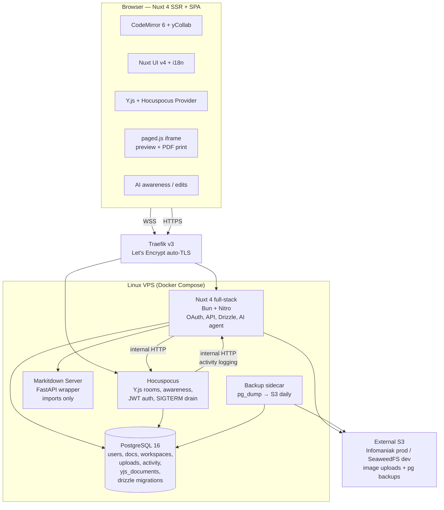
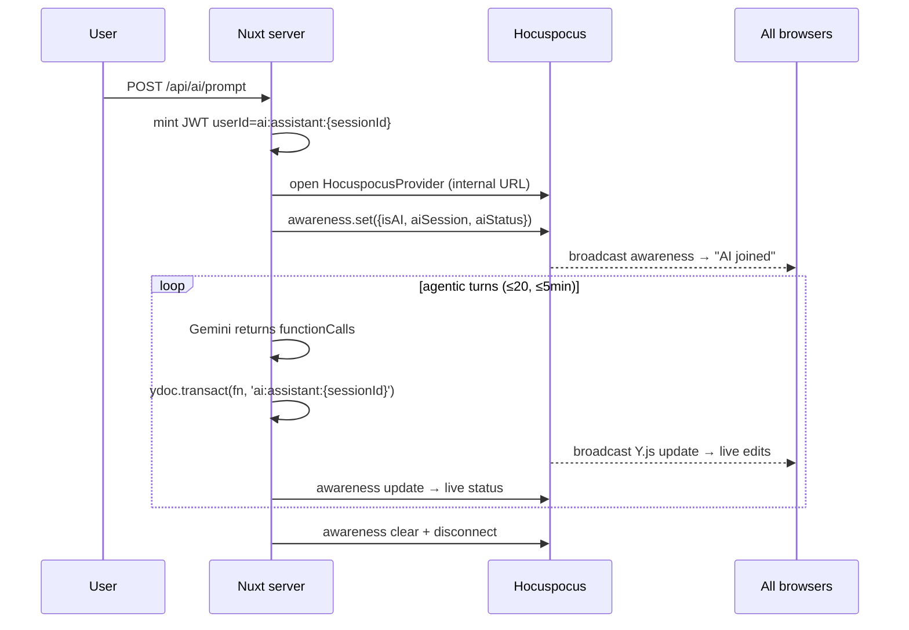

# YPad — Project Guide

Collaborative markdown editor: Y.js CRDT + Hocuspocus sync, OAuth (GitHub/Google) via `nuxt-auth-utils`, PostgreSQL (app data + Y.js state via `y-postgresql`), external S3 for image uploads & pg backups, multi-lingual UI via `@nuxtjs/i18n`, AI writing assistance via Google Gemini. Single Linux VPS, Docker Compose.

Login is **optional** — public docs work anonymously. Login is required to own, manage permissions, use workspaces, delete, or use AI.

---

## 1. Architecture



**Key design principles**

- **Full-stack Nuxt.** One Bun process serves SSR + Nitro API + OAuth sessions. No CDN.
- **OAuth optional.** Anonymous users can view/edit public docs; login gates ownership and AI.
- **Drizzle + Postgres for app data.** Versioned migrations in `drizzle/` applied at boot.
- **Y.js state lives in Postgres** via `y-postgresql` (`yjs_documents` table). Append-only updates + periodic merge replaces the earlier S3-blob-overwrite scheme — durable, one `pg_dump` covers everything.
- **S3 = image uploads + pg backups, nothing else.** External S3 in `docker-compose.prod.yml`; SeaweedFS in `docker-compose.dev.yml` and `docker-compose.local.yml`.
- **Hocuspocus as separate container.** Long-lived WS + in-memory Y.Doc state shouldn't share the Nitro event loop. Server↔sync talk over shared-secret HTTP.
- **AI joins the doc as a real Y.js client** (see §7).
- **Preview is paged, in an iframe.** The right pane shows discrete A4/Letter pages via paged.js. The same `themeToCss(theme)` output drives both the live preview iframe AND the PDF print iframe — what you see is what you print. No server Chromium (see §9).
- **Markitdown isolated.** Python/FastAPI wrapper around Microsoft markitdown for `.docx`/`.pdf`/`.pptx`/etc. → markdown imports. Replaced the prior pandoc/extra image (~1.1 GB → ~615 MB); Nuxt stays lean.
- **Daily pg backups to S3** via sidecar (same script for dev/prod, endpoint differs).

---

## 2. Technology Stack — Pinned Versions

### Runtime

| Tool | Version | Purpose |
|---|---|---|
| Bun | 1.3.12 | JS/TS runtime + package manager |
| Nuxt | 4.4.2 | Full-stack Vue (SSR + API via Nitro) |

### Nuxt modules

| Module | Version | Purpose |
|---|---|---|
| `@nuxt/ui` | 4.6.1 | Reka UI + Tailwind v4 |
| `nuxt-auth-utils` | 0.5.29 | OAuth + sealed-cookie sessions |
| `@nuxtjs/i18n` | 10.2.1 | 6 languages, lazy-loaded |
| `@vueuse/nuxt` | 14.2.1 | VueUse auto-imports |
| `@pinia/nuxt` | 0.11.3 | State management (must precede Colada) |
| `@pinia/colada-nuxt` | 0.3.2 | `useQuery` / `useMutation` |
| `@vite-pwa/nuxt` | 0.10.6 | PWA/Workbox |
| `nuxt-codemirror` | 0.0.11 | CM6 Vue wrapper |

### Frontend

| Package | Version | Purpose |
|---|---|---|
| `yjs` | 13.6.30 | CRDT doc model |
| `y-codemirror.next` | 0.3.5 | CM6 ↔ Y.js with remote cursors |
| `@hocuspocus/provider` | 3.4.4 | WS provider |
| `@codemirror/lang-markdown` | 6.3.2 | Markdown + GFM |
| `@codemirror/language-data` | 6.5.1 | Code-fence highlighting |
| `markdown-it` + plugins | 14.1.0 | Core renderer (task-lists, emoji, footnote + custom pagebreak rule) |
| `@mdit/plugin-{attrs,mark,ins,sub,sup,dl,abbr,figure,img-size}` | 0.23–0.25 | Batch 1: typography & semantic markup |
| `@mdit/plugin-alert` + `@mdit/plugin-katex` + `katex` | 0.23–0.25 / 0.16 | Batch 2: `> [!NOTE]` alerts + math |
| `markdown-it-anchor` + `markdown-it-toc-done-right` | 9.2.0 / 4.2.0 | Batch 3: heading IDs + `[[toc]]` |
| `mermaid` (CDN ESM, lazy) | 11.x | Batch 3: `\`\`\`mermaid` diagrams; pinned in `shared/utils/mermaidCdn.ts` |
| `highlight.js` | 11.11.1 | Code highlighting (CDN stylesheet varies by `theme.code.theme`) |
| `dompurify` | 3.2.4 | XSS sanitization |
| `pagedjs` (CDN) | 0.4.3 | CSS Paged Media polyfill — preview AND PDF print. Loaded from `cdn.jsdelivr.net` (not bundled), version pinned in `shared/utils/pagedjsCdn.ts`. |
| `nanoid` | 5.1.5 | ID generation |
| `@google/genai` | ^1.50 | Gemini SDK |

### Sync server (`sync-server/`)

| Package | Version | Purpose |
|---|---|---|
| `@hocuspocus/server` | 3.4.4 | WS sync server |
| `y-postgresql` | 1.0.1 | Y.js persistence (⚠ `useIndex: false` — 1.0.1 has SQL bug in index-creation branch) |
| `pg` | ^8.20 | Driver (shared with app) |
| `jsonwebtoken` | 9.0.2 | JWT verification |

### Nuxt server

| Package | Version | Purpose |
|---|---|---|
| `drizzle-orm` | 0.45.2 | Type-safe ORM (`node-postgres` adapter) |
| `drizzle-kit` | 0.31.10 | Migration generator |
| `pg` | ^8.20 | Driver |
| `@aws-sdk/client-s3` + presigner | 3.750.0 | Image uploads |
| `jsonwebtoken` | 9.0.2 | Hocuspocus token minting |
| `zod` | ^4 | Validates Gemini function-call args; `z.toJSONSchema` generates tool schemas |

> `argon2` is **not** used — document password hashing goes through `nuxt-auth-utils`'s built-in scrypt `hashPassword`/`verifyPassword`.

---

## 3. Data Model

### Storage

| Data | Storage |
|---|---|
| Users, documents (incl. per-doc theme JSONB + optional `workspace_id`), shares, workspaces (incl. description), workspace_members (role), uploads, activity, rate-limits, AI sessions | PostgreSQL (Drizzle) |
| Y.js document state | PostgreSQL (`yjs_documents` via `y-postgresql`) |
| Image blobs | S3 (`docs/{docId}/{fileId}.ext`) |
| Postgres backups | S3 (`backups/postgres/{ISO8601}.sql.gz`) |
| User sessions | Sealed cookies (`nuxt-auth-utils`), versioned via `SESSION_VERSION` |

Schema source-of-truth: `server/db/schema.ts`. Enums stored as `text('col', { enum: [...] })` — not `pgEnum` — so adding values is a TS-only change, no `ALTER TYPE` migration friction.

### Migrations

- `bun run db:generate` — edit `server/db/schema.ts`, then generate. Drizzle-kit diffs against `drizzle/meta/` snapshots; commit both SQL + snapshot.
- `server/plugins/00-db-migrate.ts` — numeric `00-` prefix forces load-first so the sweeper and rate-limit-cleanup plugins don't race empty-schema queries.
- `server/plugins/99-shutdown.ts` — closes pg pool on Nitro `close`.
- Prod applies on container boot. No backwards-compat shims pre-launch; break freely.

### S3 key layout

```
docs/{docId}/{fileId}.{ext}          # image uploads
backups/postgres/{ISO8601}.sql.gz    # daily pg_dump
```

### Swappable S3 backend

`NUXT_S3_ENDPOINT` swaps between SeaweedFS (dev), Infomaniak (current prod), AWS, R2 — no code changes. Sync-server no longer touches S3.

---

## 4. Auth & Access Control

### Access modes

| Mode | Anonymous | Logged-in non-owner | Owner |
|---|---|---|---|
| **Private** (default for logged-in docs) | — (forbidden) | — (forbidden) | Full control |
| **Open edit** (default for anonymous docs) | Edit | Edit | Full control |
| **Open view** | View | View | Edit + manage |
| **Password-protected** | Enter password | Enter password | Edit + manage |

**Workspace membership overrides these modes for logged-in members** (see §4 "Workspaces & roles" for the role matrix). A workspace admin/editor bypasses `private` and `password-protected` on docs in their workspace; a workspace viewer gets view access regardless of accessMode but stays read-only even for `open-edit`. Non-members fall through to this table.

### Read-only enforcement (4 layers)

1. Token endpoint — mints JWT with `readOnly: true` for non-owners of open-view docs.
2. Hocuspocus — `onAuthenticate` returns `{ readOnly }`; server blocks Y.js updates.
3. CodeMirror — `EditorView.editable` + `EditorState.readOnly` via **Compartments** (reconfigured reactively when `readOnly` flips async after `fetchToken`).
4. UI — view-mode forced to preview, toolbar hidden, badge shown.

### Password-protected enforcement (3 layers)

1. Token endpoint returns `token: null` until password verified — no usable JWT issued.
2. Hocuspocus rejects connection → no content synced.
3. Client-side template gated by `v-if="!requiresPassword"` → lock screen; editor mounts only after sync.

### Session

- `runtimeConfig.session.maxAge = 7d`.
- `SESSION_VERSION` (in `server/utils/validatedSession.ts`) is stamped into every session. Mismatching cookies cleared on next request. Bump the constant to invalidate everyone.
- OAuth handlers live in `server/routes/auth/` (NOT `server/auth/` — Nitro doesn't map that). GitHub upserts on `users.githubId`, Google on `users.googleId`.

### Workspaces & roles (collab layer over docs)

Workspaces are owner-managed "folders" over documents. Logged-in users can create them, invite others by email, and docs created in a workspace are visible/editable by its members. Anonymous users never interact with workspaces. Standalone docs (docs with `workspace_id IS NULL`) are untouched by the collab layer — owner-only rules remain.

- **Source of truth:** `workspace_members` table (`workspace_id, user_id, role, joined_at`, composite PK). Every member of every workspace — including the creator — has a row here. `workspaces.ownerId` stays as an immutable "original creator" record (for provenance / activity log attribution) but is **never** read for authorization.
- **Roles:** `admin` / `editor` / `viewer`. Permission matrix (doc-level permissions are orthogonal to the workspace role — a doc owner always has full rights to their own doc regardless of role):

  | Action | Viewer | Editor | Admin | Doc owner |
  |---|:-:|:-:|:-:|:-:|
  | View doc | ✓ | ✓ | ✓ | ✓ |
  | Edit content / title / theme | — | ✓ | ✓ | ✓ |
  | Change access mode / password | — | — | ✓ | ✓ |
  | Delete doc | — | own only | any | own |
  | Create doc in workspace | — | ✓ | ✓ | n/a |
  | Add / remove members, change roles | — | — | ✓ | n/a |
  | Rename / edit / delete workspace | — | — | ✓ | n/a |
  | Leave workspace | ✓ | ✓ | ✓ (if not last admin) | n/a |

- **"Must always have ≥1 admin" invariant** — enforced at the API layer in `workspace_members/[userId].patch.ts` (refuses last-admin demotion) and `workspace_members/[userId].delete.ts` (refuses last-admin removal / self-leave). No SQL constraint for this — it's a cross-row rule, simpler to validate at the endpoint.
- **Multiple admins allowed.** Any admin can promote/demote any other member, add/remove anyone, and delete the workspace. No separate "owner vs admin" hierarchy — if you trust them to admin, you trust them to delete.
- **Member invite is exact-email only.** `POST /members` body `{ email }` → case-insensitive exact match. Zero typeahead / substring endpoint because that would enumerate the user base. 404 if no account matches, 409 if already a member. Default role for new invites is `editor`.
- **Central auth helpers:** `server/utils/workspaceAccess.ts` — `getWorkspaceRole`, `getDocAuthz`, `canEditDoc`, `canManageDoc`, `canManageWorkspace`, `countWorkspaceAdmins`. Every endpoint that used to check `doc.ownerId === session.user.id` now calls `canManageDoc` / `canEditDoc`. These helpers are **additive**: for docs with `workspace_id IS NULL` they return exactly what the owner-only check did, so standalone + anonymous doc flows are untouched. Verified in smoke test: workspace member of one workspace gets `forbidden: true` on a standalone private doc owned by another user.
- **Token endpoint fold-in.** `/api/docs/:docId/token` does a second small query against `workspace_members` (gated on both `session.user.id != null` and `doc.workspaceId != null`) before falling back to accessMode rules. Workspace admin/editor → `readOnly: false` and bypasses `private`; workspace viewer → token issued but `readOnly: true` regardless of accessMode. This preserves the existing 4-layer read-only enforcement; sync-server is unchanged.
- **Cascade delete.** Workspace DELETE iterates every doc in the workspace and calls the shared `deleteDocument(docId)` helper per-doc (S3 + Y.js + sync notify). `workspace_members` rows drop via `ON DELETE CASCADE` on the FK. Viewer can only leave, not delete.
- **Doc list scoping.** `GET /api/user/documents` (dashboard "Recent Documents") still lists only *owned* docs — workspace docs you don't own surface inside the workspace view, not on the dashboard. Deliberate to keep the two lists semantically clean.

---

## 5. API Route Map

> `server/api/` → `/api/*`. `server/routes/` → `/`. Files in `server/auth/` are unreachable.

```
# Auth (nuxt-auth-utils)
GET    /auth/github                        OAuth redirect
GET    /auth/google                        OAuth redirect
GET    /api/_auth/session                  Current session

# Meta
GET    /api/health                         DB-touching probe (healthchecks)
GET    /api/version                        { buildId } — SPA staleness detection

# Documents
POST   /api/docs                           Create (anonymous OK; defaults to private if logged-in, open-edit if not); accepts optional `workspaceId` if caller is admin/editor of that workspace
GET    /api/docs/:docId/meta
PUT    /api/docs/:docId/meta               `canEditDoc` (title/theme/etc.) + `canManageDoc` for `accessMode`
DELETE /api/docs/:docId                    `canManageDoc` (doc owner OR workspace admin); cascades S3 + notify-deleted to sync
GET    /api/docs/:docId/token              Consolidated: token + readOnly + requiresPassword + forbidden + accessMode + ownerId
GET    /api/docs/:docId/activity           Latest 50 entries
POST   /api/docs/:docId/password           Set/verify/remove

# Internal (X-Internal-Secret; sync-server → app only)
POST   /api/internal/activity              Log edit/join/leave entry

# User
GET    /api/user/documents
GET    /api/user/workspaces
GET    /api/user/recent

# Files
POST   /api/upload/request                 Presigned PUT + insert unconfirmed uploads row
POST   /api/upload/confirm                 HEAD S3 + flip confirmed_at
GET    /api/files/:docId/:fileId           302 → presigned GET (access-controlled)

# Import (public — user uploads their own file)
POST   /api/import                         DOCX/PDF/PPTX/XLSX/HTML/EPUB → markdown via markitdown, 50MB cap

# Export — client-side, no endpoint:
#   - Markdown:  app/utils/download.ts:downloadMarkdown
#   - PDF:       app/utils/printPdf.ts (paged.js iframe + window.print)

# Workspaces (login required) — see §7a
POST   /api/workspaces                                       Create; inserts creator as role='admin'
GET    /api/user/workspaces                                  List every workspace I'm a member of (any role)
GET    /api/workspaces/:wsId                                 Detail: workspace + docs + members + myRole
PUT    /api/workspaces/:wsId                                 Rename / edit description (admin only)
DELETE /api/workspaces/:wsId                                 Cascade-delete workspace + every doc in it (admin only)
POST   /api/workspaces/:wsId/members                         Add by email (admin only; 404 no-such-user, 409 duplicate)
PATCH  /api/workspaces/:wsId/members/:userId                 Change role (admin only; 409 if last admin demoted)
DELETE /api/workspaces/:wsId/members/:userId                 Remove or self-leave (409 if last admin)

# AI (login required) — see §7
POST   /api/ai/prompt                      Returns { sessionId }; loop runs in background
POST   /api/ai/rewrite                     Inline selection rewrite, no tools
POST   /api/ai/abort                       Initiator only (403 otherwise)
```

Auth guard: `server/middleware/auth.ts` whitelists public patterns and calls `requireValidatedUserSession` for the protected prefixes (`/api/docs/` outside whitelist, `/api/workspaces`, `/api/user`, `/api/upload`, `/api/import`, `/api/ai`). `/api/import` is public — anyone can upload their own file for conversion.

Token endpoint **never issues a usable JWT for forbidden or password-gated docs** — returns `{ token: null, ... }` so Hocuspocus rejects until unlock.

---

## 6. Sync Server (Hocuspocus)

Separate container. Config at `sync-server/src/index.ts`. Hooks: `onLoadDocument`, `onStoreDocument`, `onAuthenticate`, `onConnect`/`onDisconnect`, `onRequest`.

### Persistence (`y-postgresql`)

- Singleton `PostgresqlPersistence.build(...)` with `tableName: 'yjs_documents'`, `useIndex: false` (bug), `flushSize: 200`.
- Replaces the prior S3-blob-overwrite scheme. Append-only updates auto-merge into a compacted update every `flushSize` writes — a failed write can't nuke prior state.
- `onLoadDocument` returns `new Y.Doc()` on read failure (never throws into Hocuspocus). `clearDocument` is called on doc deletion.

### Auth

- `JWT_SECRET` required at startup; no fallback.
- Every connection **must** present a valid JWT (no anonymous bypass — anonymous browsers still go through the Nuxt token endpoint).
- Verifies `payload.docId === documentName`, returns `{ readOnly: payload.readOnly }`.

### Rate limiter

- Per-IP connection cap (20) tracked via separate `connectionIPs: Map<socketId, ip>` rather than mutating connection object — Hocuspocus v3 hook shapes vary. Defensive try/catch; only the "Too many connections" error is re-thrown.
- Max 5000 rooms.

### Activity logging

- Primary attribution: `lastEditorByDoc` Map, populated in `onChange` from authenticated JWT `userName`. Read in `onStoreDocument`.
- Fallback: `mostRecentEditorFromAwareness(awareness)`. Logs `[hocuspocus] Attribution fallback …` warning when it kicks in (drift detection in prod).
- `previousTextByDoc` (diff baseline) re-seeded from disk in `onLoadDocument`. Neither map is persisted — per-edit bootstrap covers restart edge case.
- Transport: fire-and-forget POST to `${APP_URL}/api/internal/activity` with `X-Internal-Secret`, 5s timeout. Nuxt caps latest 500 entries per doc.
- Dev networking: sync-server in Docker reaches host-running Nuxt via `host.docker.internal` (`host-gateway` extra_host on Linux). **Nuxt dev must bind `0.0.0.0`.**

### Internal HTTP

All routes gate on `X-Internal-Secret === INTERNAL_API_SECRET`. Implementation in `sync-server/src/internal-http.ts`; `handleInternalRequest()` returns `true` when handled, caller throws `null` (Hocuspocus sentinel) to skip default handling.

| Route | Purpose |
|---|---|
| `GET /health` | Public. Docker HEALTHCHECK + Traefik service-loadbalancer healthcheck — stops routing to draining containers. |
| `POST /internal/notify-deleted` | Sets `ymeta._deleted = Date.now()` on in-memory Y.Doc (broadcasts to clients) then `ypgPersistence.clearDocument()` so the doc can't be revived from disk. |

### Graceful shutdown

SIGTERM/SIGINT → `server.destroy()` (drains WS + awaits pending Y.js stores) → `ypgPersistence.destroy()`. 25s kill-timer as failsafe. Compose `stop_grace_period: 30s`.

### Running the sync-server

TypeScript runs directly under Bun (no pre-bundle). Bun's bundler choked on Hocuspocus CJS/ESM exports and startup-time delta is negligible.

---

## 7. AI Features — Gemini as Collaborator

Two flows, one backend model:

- **Top-bar prompt** (`AIPromptBar.vue`) — agentic loop with function tools (`view_document`, `replace_text`, `insert_text`, `web_search`). Uses `config.google.model` (default `gemini-3.1-flash-lite-preview`).
- **Inline selection rewrite** (`AISelectionPopup.vue`) — cheap-tier one-shot, no tools, full-doc context. Uses `config.google.rewriteModel` (default `gemini-2.5-flash-lite`).

Both logged-in only.

### AI-as-Y.js-client



No SSE — status rides on Y.js awareness. Each edit is its own `ydoc.transact` so:
- Users watch AI type in real time.
- Origin string carries `sessionId` for activity attribution.
- Multi-edit responses land as clean ordered atomic updates.
- `replace_text` matches content (not byte-offset), so earlier edits don't invalidate later ones in the same turn.

**Session `kind` discriminator** — both `/api/ai/prompt` and `/api/ai/rewrite` flow through the same `createAiSession` (same Y.js awareness payload, same per-user-per-doc cap). The awareness `aiSession.kind` field (`'prompt' | 'rewrite'`) lets the client tell them apart so the floating bottom AI bar's rainbow-pulse animation only fires for prompt sessions, and the inline selection popup's animation only fires for rewrite sessions. Without this gate both surfaces would animate on every rewrite.

### Concurrency

- No doc-level lock — multiple AI sessions on the same doc are fine; edits merge via CRDT. Semantic conflict ("make formal" vs "make casual") is accepted.
- **Per-user cap: 1 session per user per doc.** Second POST → **409** (`DuplicateSessionError`). Enforced by Postgres UNIQUE index in `ai_sessions` — survives Nitro restart.

### Cancellation

`POST /api/ai/abort { sessionId }`:
- 404 if already ended (client swallows).
- **403 if not initiator.**
- Otherwise abort — loop unwinds, awareness clears.
- Server treats any error thrown after `abortController.signal.aborted === true` as an abort regardless of SDK error shape. Status goes to `{phase:'done', message:'Stopped'}` — no error toast.

### Function tools

Zod schemas in `server/utils/agentic/functionTools.ts` are the **source of truth**. `z.toJSONSchema(schema, { target: 'draft-7' })` generates both what Gemini sees and the runtime validator. Before dispatch, `runLoop` `safeParse`s `FunctionCall.args` → parse failures return as `functionResponse.isError` with Zod issue path + message so the model self-corrects.

Gotchas:
- Use `z.array(...).min(2).max(2)` not `z.tuple(...)` for fixed-length arrays — Gemini's validator rejects tuple-shaped `items: [...]` JSON Schema.
- Fixed-sized array example: `view_document` `view_range` param.

Tool semantics (`server/utils/aiToolAdapter.ts`):

| Tool | Behavior |
|---|---|
| `view_document({ view_range? })` | Returns `ytext.toString()` with 1-indexed line prefixes. |
| `replace_text({ old_str, new_str })` | 0 matches → "No match found". 2+ → "Found N matches, add more context". 1 → transact delete+insert. |
| `insert_text({ insert_line, insert_text })` | Map line → char idx (0 = file start); transact insert. |
| `web_search({ query })` | Isolated sub-call with `tools: [{ googleSearch: {} }]` only. Returns synthesised answer + bulleted `Sources:` from `groundingMetadata.groundingChunks`. Never mixed with `functionDeclarations` in the main loop. |

**Why wrap `googleSearch` as our own function** instead of passing it as a top-level tool: (a) `googleSearch` + `functionDeclarations` coexistence has shifted between model versions; (b) wrapping gives pre-call status UX ("Searching the web for 'X'…") — otherwise it's implicit with only post-hoc `groundingMetadata`.

### Inline rewrite specifics

- Full-doc context windowed to 40k chars around selection; model matches tone but rewrites only the selection.
- **Race-safe positions.** Client sends Y.js `RelativePosition` for both ends; server resolves via `createAbsolutePositionFromRelativePosition`. If human edited inside selection concurrently, RelativePosition slides with the edit.
- Fallback chain: relative pos → raw index sanity check → single-`indexOf` → **409 "Selection has moved"**.

### Limits & sweeper

- Rate limits (Valkey sliding-window-log via `server/utils/rateLimit.ts`): `ai-prompt: 20/h`, `ai-rewrite: 30/h` per user.
- Deadlines: prompt 5 min, rewrite 30 s, loop `MAX_TURNS = 20`.
- Sweeper (`server/plugins/ai-session-sweep.ts`) — 60s tick, aborts sessions >7 min old (threshold > prompt deadline so legit long grounded searches aren't killed). One-shot startup purge clears rows from crashed prior process so per-user cap unblocks.
- `event.node.req.on('close')` aborts if client tab closes mid-request.

### Error lingering

Error status lingers 2.5s in awareness (vs 500ms for success) so clients latch the message before awareness cleanup destroys the session. `useAI.ts` promotes `phase === 'error'` messages into `lastError` → `AIPromptBar.vue` toasts.

### Config

```env
NUXT_GOOGLE_API_KEY=...                                    # required at startup
NUXT_GOOGLE_MODEL=gemini-3.1-flash-lite-preview            # agentic loop
NUXT_GOOGLE_REWRITE_MODEL=gemini-2.5-flash-lite            # inline rewrites
```

Pricing (at time of writing): `gemini-3.1-flash-lite-preview` $0.25/$1.50 per 1M in/out, grounding free up to 5k prompts/month shared across Gemini 3 family. `gemini-2.5-flash-lite` $0.10/$0.40. Display name is vendor-neutral ("AI Assistant") so future swaps stay behind the adapter.

---

## 8. Document Composables (split)

Orchestrator + two workers:

- `useDocToken.ts` — fetches `/api/docs/:docId/token`; handles password-verify reconnect; exposes `{token, readOnly, requiresPassword, forbidden, accessMode, isOwner, hasOwner, initialTheme, pendingPasswordUnlock, setAccessMode}`. The single round-trip also seeds the initial theme so the preview can paint before Y.js sync settles.
- `useHocuspocusSync.ts` — provider lifecycle only. `getToken()` callback so reconnects pick up password-verified JWTs without wiring. Exposes `{provider, status, synced, userCount, docSizeBytes, reconnect}`.
- `useDocument.ts` — thin orchestrator. Creates Y.Doc + awareness + undoManager, composes the workers, owns the title bridge (`ymeta.observe` → Vue ref), deletion observer (`ymeta._deleted`), welcome-doc seeding.

Preserved design points:
- **Single consolidated fetch on init** (token endpoint returns metadata + initial theme too — no separate `/meta` call).
- **Single Awareness instance** passed to both `HocuspocusProvider` and yCollab for the component lifetime.
- **Title bridge** — `ymeta.observe()` updates a reactive ref; computed wraps get/set.
- **Theme bridge** — same pattern as title: `ymeta.theme` Y.Map entry → reactive `theme` ref, `setTheme()` writes both ymeta (live broadcast) and the DB row (debounced 800 ms). Owner edits get DB persistence; ownerless docs (anonymous-created) skip the DB write since `PUT /meta` requires ownership — Y.js sync covers it.
- **Welcome content insertion** fires on `onSynced` (server empty), `onDisconnect` before-ever-synced, or no-syncUrl path.
- **Password flow** — `onPasswordVerified(newToken)` stashes JWT, orchestrator listens and calls `useHocuspocusSync.reconnect()`. `requiresPassword` flips false only on `onSynced` (via `clearPendingUnlock`) — prevents empty-doc-prepend bug.

Return shape (~21 fields): `ydoc, ytext, awareness, provider, status, synced, userCount, isReadOnly, isOwner, isDeleted, requiresPassword, forbidden, accessMode, docSizeBytes, docSizeWarning, undoManager, title, theme, canEditTheme, setTheme, resetTheme, onPasswordVerified, setAccessMode, destroy`.

`canEditTheme` is a computed that mirrors content edit access: read-only = false, owner = true, anonymous on an ownerless doc = true (open-edit means "anyone can change anything", theme included).

---

## 9. Preview Rendering & PDF Export

The right pane shows **paged** output — discrete A4/Letter pages, not continuous markdown — inside a same-origin iframe. PDF export is the same pipeline run in a hidden iframe + `window.print()`. No server-side Chromium.

### Pipeline

1. **`app/utils/renderMarkdown.ts`** — singleton markdown-it + DOMPurify with strict `ALLOWED_TAGS`/`ALLOWED_ATTR` allowlist. Plugins lazy-imported inside `init()` (mixed CJS/ESM crashes SSR; DOMPurify needs DOM; highlight.js is large). Pipeline: core + task-lists + emoji + footnote + Batch 1 (attrs/mark/ins/sub/sup/dl/abbr/figure/img-size) + Batch 2 (alert/katex) + Batch 3 (anchor/toc) + custom `pagebreakPlugin` (block rule matching `<!-- pagebreak -->`). Used by both live preview and PDF print → identical XSS boundary. The `highlight.js/styles/github-dark.min.css` import lives inside `init()` too — without it, code blocks render with the right classes but all-white text. Highlight callback **always** emits `language-${lang}` class (not just for hljs-known languages) so the iframe-side mermaid detector can find `pre code.language-mermaid`.
2. **`transformFootnotesForPagedMedia(html)`** lifts each `<li>` from markdown-it-footnote's end-of-doc `<section>` into a `<span class="footnote">` at the original `<sup>` ref site. Theme CSS then applies `float: footnote`, which paged.js places in the page-bottom `@footnote` margin area.
3. **`shared/utils/themeToCss.ts`** compiles `DocTheme + {title, date, tocTitle}` into the entire stylesheet — `@page` + `@top-*`/`@bottom-*`/`@footnote` margin boxes, `.paged-doc` body styles, modular-scale headings, image/code/blockquote variants, alerts, KaTeX, mermaid, TOC (with `target-counter` page numbers), page-break, `column-span: all` spanners. `themeFontsImport(theme)` returns a Google Fonts `@import` URL (separate so swapping a color doesn't refetch fonts).
4. **`app/composables/usePagedPreview.ts`** mounts a persistent srcdoc iframe. Parent calls `iframe.contentWindow.__renderDoc({html, themeCss, fontsImport, hljsUrl, mermaidTheme})` on every change (250 ms debounce). Before handing HTML to paged.js, the iframe pre-processes: decodes images (await `.decode()`), then scans for `pre code.language-mermaid` and lazy-loads mermaid from CDN on first encounter, replacing each block with its rendered SVG. paged.js sees plain inline SVG it can paginate normally. iframe re-paginates and posts back `{type:'paginated', pageCount}`. Internal anchor clicks (`<a href="#id">`) are intercepted so TOC/footnote links don't navigate the iframe away from srcdoc.
5. **`app/utils/printPdf.ts`** — hidden iframe with theme CSS in `<style>`, content in `.paged-doc`, `window.PagedConfig = { auto: true, after: () => print() }`, `afterprint` listener cleans up. 30 s safety timeout. Mermaid pre-processing runs in the parent document context (different window from the preview iframe) before the HTML is handed to the print iframe.

### Theme system

`shared/types/theme.ts:DocTheme` — single shape that drives preview AND print. Per-doc, stored in `documents.theme` JSONB (server-validated by `shared/utils/themeValidation.ts`) and mirrored to `ymeta.theme` for live multi-collaborator broadcast.

- **Default** (`shared/utils/defaultTheme.ts`): A4 portrait 20mm, Inter 11pt 1.3 line-height, brand `#3B82F6`, justify body alignment, header `{title}` left, footer `{page} / {pages}` center.
- **Built-in templates** (`shared/utils/themePresets.ts`): Modern, Academic Paper (2-col journal), Tech Report, Business Report, Novel, Newsletter — each a complete `DocTheme` shown in the editor's template picker. Selecting one swaps the entire theme.
- **Granular sections** — the editor panel exposes separate accordion sections for Page / Body / Headings / Colors / Layout / Header / Footer / Code / Tables / Images & quotes / Table of contents / Diagrams. Each section reads its own slice of the DocTheme; changing (say) a table header color doesn't perturb body typography.
- **Editor UI** (`app/components/document/ThemeEditorPanel.vue`) lives in the unified right-sidebar slot (Activity / Theme are mutually exclusive). Owner-only on owned docs, open to anyone on ownerless docs.
- **Font picker** loads every entry in `shared/utils/themeFonts.ts` from Google Fonts in one combined request when the panel mounts; each picker item renders its own label in its own face.
- **TOC controls** — `theme.toc.{maxDepth, showTitle, showPageNumbers, leaderStyle}`. `maxDepth` is enforced by CSS (hiding deeper nested `ul`s) since the renderer always emits h1–h4; the dynamic CSS approach avoids re-initializing markdown-it per render.
- **Mermaid theme** — `theme.mermaid.theme` picks one of mermaid's five built-in palettes (default/dark/forest/neutral/base). Applied via `mermaid.initialize({ theme })` before each iframe render.
- **Phase 4** (user-saved themes — `themes` table + CRUD) is still pending; everything above is shipped.

Header/footer templates support tokens: `{title}`, `{date}`, `{page}`, `{pages}`. Title/date are baked into the CSS string at compile time (see "margin boxes are siblings" gotcha); page/pages map to paged.js's built-in `counter()` calls. Inserting a token from the chip row is cursor-aware — it splices into the focused input at the caret, dispatched via `data-slot` / `data-position` attributes on each input.

### Why an iframe (load-bearing)

paged.js was designed to paginate a static document **once**. It mutates global state — appends `<style>` to `document.head`, sets `:root` custom properties, re-paginates the entire doc on every call. Re-running it into the host page on every keystroke caused cumulative cross-contamination and visible layout jitter no amount of off-screen-swap mitigation cleaned up. An iframe gives paged.js its own document context; the host app stays insulated. Inside the iframe, scroll position is captured before swap and restored after (snap-to-bottom if user was within 50 px of end). The snap-to-bottom check is gated on the *previous* render having had real scrollable content (`prevScrollHeight > viewport + 100`) — without that gate, the empty pre-paint mount false-positives the "near bottom" check on every page reload and dumps the user at the end of the doc.

Communication is one-way:
- Parent → iframe: `iframe.contentWindow.__renderDoc(opts)`
- Iframe → parent: `postMessage` with `{type: 'iframe-ready' | 'paginated' | 'iframe-error'}`

`postMessage` `targetOrigin: '*'` is intentional — srcdoc has an opaque origin in some browsers (Chromium reports `"null"`) and an origin-restricted post would silently fail. Trust boundary on the parent side is `e.source === iframe.contentWindow`.

### Responsive page sizing

A4 = 794 px @ 96 dpi — clips on narrow viewports. The iframe sets `--page-zoom` on `.pagedjs_pages` via the CSS `zoom` property (shrinks both visual and layout box, unlike `transform: scale` which leaves the layout box at full size and overflows). Recomputed after each pagination and on iframe `resize`, capped at 1 (never enlarge).

### CDN-loaded polyfill

paged.js polyfill loaded from `https://cdn.jsdelivr.net/npm/pagedjs@${VERSION}/dist/paged.polyfill.min.js` — version pinned in `shared/utils/pagedjsCdn.ts`. Used by both `usePagedPreview` and `printPdf`.

Versioned URL = automatic cache-bust on upgrade. Workbox `runtimeCaching` on `cdn.jsdelivr.net` caches the asset for offline reload. Local bundling via `?url` was tried first but pagedjs's package "exports" field blocks subpath imports of `dist/`, and a Nitro endpoint reading from `node_modules` was fragile — CDN is the simpler, durable answer.

### Dark preview

In dark mode the **chrome around the pages** flips to match the parent app's canvas, but the pages themselves stay as the theme defines them (white paper, dark text). Print/export reads the theme directly so PDFs always come out on a real white page regardless of viewing mode.

Implementation: srcdoc iframe is same-origin so it reads `window.parent.document.documentElement.classList.contains('dark')` and the parent's body bg via `getComputedStyle`. A `MutationObserver` on the parent's html `class` attribute mirrors changes onto the iframe's body class + `color-scheme` (so native scrollbars switch to dark too). No re-render needed — pure CSS swap.

### Floating AI bar overlap

The agentic AI prompt bar floats `position: absolute; bottom-6` over `<main>`. To stop it from covering the last lines of the doc, both scroll containers (CodeMirror's `.cm-scroller` and the iframe `body`) get `padding-bottom: 120 px` so content can scroll fully past the bar.

---

## 10. Mobile

**Breakpoint: `useMediaQuery('(max-width: 639px)')`** — matches Tailwind `sm:`. Previously 768px caused layout drift in 640–768px range.

Implemented:
- Edit-only default on narrow — `watchEffect` forces `viewMode = 'edit'` when `isMobile && viewMode === 'split'`.
- CM6 responsive theme via **Compartment** (font 16px mobile to kill iOS auto-zoom, line-height 1.7, padding 12/16px, reconfigured live on resize/rotation).
- CM6 always-on `autocapitalize: 'sentences'`, `autocorrect: 'on'`, `spellcheck: 'true'`.
- Toolbar `flex-wrap` instead of horizontal scroll. Document action buttons stay anchored via `items-start` + `shrink-0`.
- Collapsed top-bar `UDropdownMenu` (hamburger) on mobile.
- Icon-only connection badge (`<span class="hidden sm:inline">`).
- Responsive title `max-w-[180px] sm:max-w-56 md:max-w-80`.

Right-sidebar layout (Activity OR Theme — mutually exclusive, single slot):
- `< xl` (≤1279px): opening either panel hides preview; in edit mode the panel is `w-80` sidebar (full-width xs).
- `xl+`: panel is fixed `w-80` right sidebar regardless of view mode → genuine triple-pane when split. Preview uses `hidden xl:block` (CSS) not `v-if` so resize past xl brings it back instantly without remounting markdown pipeline.

---

## 11. Security

### Authentication

- OAuth via `nuxt-auth-utils` (encrypted HTTP-only cookies, CSRF protected, no localStorage tokens). Explicit `maxAge: 7d`.
- `SESSION_VERSION` invalidation mechanism (bump constant → clears all cookies on next request).
- Hocuspocus **always** requires valid JWT — no anonymous WS bypass.
- `JWT_SECRET`, `DATABASE_URL`, `INTERNAL_API_SECRET` — required at startup; no fallbacks.

### Rate limits

| What | Limit |
|---|---|
| Password brute-force | 5 per IP+docId per minute |
| Token endpoint | 30 per IP per minute (prevents enumeration) |
| Import | 10 per IP per minute (PDF export is client-side, no server limit) |
| AI prompt | 20 per user per hour |
| AI rewrite | 30 per user per hour |
| Hocuspocus | 20 connections per IP, 5000 rooms |

### Input validation

- `meta.put`: title (≤255), accessMode (enum), wordCount (0–10M, finite), sizeBytes (0–100M, finite), theme (full structural validation in `shared/utils/themeValidation.ts` — bounded numeric ranges, hex-color regex, font-name allowlist, header/footer template safety check).
- Uploads: PNG/JPEG/GIF/WebP/SVG, 10MB max.
- Imports: extension whitelist, 50MB max.

### File access

- `/api/files/:docId/:fileId` checks access mode before presigning. Password-protected docs require owner auth — anonymous can't pull files.
- Presigned URL TTL: **5 min upload, 120s read**. Short read TTL because presigned URLs can't be revoked — long ones would outlive access-mode changes / password rotations / deletions.

### Other

- Password hashing via `nuxt-auth-utils` scrypt.
- Password token expiry: 2h (not 24h).
- XSS: markdown-it `html: false` + DOMPurify.
- `.env` gitignored.

---

## 12. Docker Compose

Three files for three purposes:

| File | Scope | TLS | Images | Use |
|---|---|---|---|---|
| `docker-compose.dev.yml` | infra only (postgres, valkey, seaweedfs, sync, markitdown, backup) — Nuxt runs on host | — | `build:` where needed | daily dev with HMR |
| `docker-compose.local.yml` | full stack incl. Traefik + GlitchTip | mkcert (file provider) on `ypad.127.0.0.1.nip.io` | `build:` from source | pre-push full-stack verification — see `docs/LOCAL.md` |
| `docker-compose.prod.yml` | full stack incl. Traefik + GlitchTip | Let's Encrypt (`tlschallenge`) | GHCR (`${REGISTRY}/md-online-{app,sync,markitdown,backup}:${IMAGE_TAG}`) | VPS deploy — see `docs/DEPLOY.md` |

The three files are standalone — no shared base. Duplication is accepted in exchange for each being readable top-to-bottom.

### Production (containers)

Traefik, postgres, valkey, app, sync, markitdown, backup sidecar, GlitchTip (web + worker + init). No SeaweedFS in prod — S3 is external.

Key points:
- `postgres:16-alpine` with `pg_isready` healthcheck. Named `pg_data` volume.
- `app` and `sync` both `depends_on: postgres { condition: service_healthy }`.
- `stop_grace_period: 30s` on `app` and `sync` so SIGTERM handlers drain.
- Traefik service-loadbalancer healthcheck labels on both (`/api/health` + `/health`) — stops routing to draining containers.
- `backup` sidecar: `postgres:16-alpine` + `aws-cli`, pipes `pg_dump --no-owner --clean --if-exists | gzip | aws s3 cp` to `s3://…/backups/postgres/{ISO8601}.sql.gz`. Default: daily, 30-day retention. Prunes beyond `BACKUP_RETENTION_COUNT` newest files.
- `NUXT_S3_ENDPOINT` env-driven.

DNS: `yourdomain.com` + `sync.yourdomain.com` → VPS IP. No `s3.` subdomain in prod (external S3).

Nuxt app Dockerfile multi-stages builder → runtime; **must `COPY drizzle/`** into runtime image so `00-db-migrate.ts` can apply migrations at boot.

### Development

```bash
docker compose -f docker-compose.dev.yml up -d    # Postgres + Valkey + SeaweedFS + Hocuspocus + markitdown + backup
bun run dev --host 0.0.0.0                         # Nuxt dev on host (HMR); 0.0.0.0 so sync container can reach via host.docker.internal
```

Ports exposed: Postgres 5432, Valkey 6379, SeaweedFS 8333, Hocuspocus 4001, markitdown 8080. Nitro `devProxy` forwards `/_s3/*` to SeaweedFS to sidestep CORS. WebSocket connects directly (no same-origin constraint).

Backup sidecar runs with tight loop in dev (1h interval, 5-file retention) so you can verify locally without waiting a day.

### Env (prod)

```env
DOMAIN, ACME_EMAIL
SESSION_PASSWORD                    # ≥32 chars
GITHUB_CLIENT_ID, GITHUB_CLIENT_SECRET
GOOGLE_CLIENT_ID, GOOGLE_CLIENT_SECRET
POSTGRES_PASSWORD
S3_ENDPOINT, S3_ACCESS_KEY, S3_SECRET_KEY, S3_BUCKET
JWT_SECRET                          # ≥64 chars
INTERNAL_API_SECRET
GOOGLE_API_KEY, GOOGLE_MODEL, GOOGLE_REWRITE_MODEL
BACKUP_INTERVAL_SECONDS, BACKUP_RETENTION_COUNT
```

### Restore

```bash
aws s3 cp s3://…/backups/postgres/….sql.gz - | gunzip | psql "$DATABASE_URL"
```

Dump uses `--clean --if-exists` so it drops existing objects before recreate.

---

## 13. Project Structure

```
app/
  app.vue, app.config.ts, assets/css/main.css
  components/
    auth/         LoginButtons, UserMenu
    editor/       EditorLayout, EditorMenuBar, EditorPane, EditorToolbar, MobileToolbar, ImageDropZone, TableSizePicker
    preview/      PreviewPane                                  # hosts the paged.js iframe via usePagedPreview
    collab/       PresenceBar, ConnectionStatus, ActivityFeed
    ai/           AIPromptBar, AISelectionPopup                # both blue + animated; kind-discriminated (§7)
    sharing/      ShareModal, PasswordModal
    document/     ImportModal, DeleteConfirmModal, ThemeEditorPanel
    workspace/    WorkspaceList, WorkspaceDocTable, WorkspaceMemberAvatars,
                  WorkspaceMembersModal, WorkspaceFormModal (create+edit),
                  WorkspaceDeleteConfirmModal
    history/      HistoryTimeline, DiffViewer   (MMP)
    common/       SizeWarning
  composables/    useDocument, useDocToken, useHocuspocusSync, useAI, useImageUpload,
                  useDocumentImport, useMarkdownPreview, usePagedPreview
  pages/          index.vue, d/[id].vue, w/[id].vue
  middleware/     auth.ts
  plugins/        version-check.client.ts
  utils/          queryKeys, colors, names, download, welcomeDoc,
                  renderMarkdown,                              # markdown-it + DOMPurify singleton + inline pagebreak rule
                  printPdf,                                    # paged.js hidden-iframe + window.print() + mermaid pre-process
                  editorCommands                               # toggleWrap/Heading/…, insertTable/Toc/Alert/Math/Diagram/PageBreak

server/
  routes/auth/    github.get.ts, google.get.ts
  api/
    health.get.ts, version.get.ts
    docs.post.ts, docs/[docId]/{meta,index,token,activity,password}.*
    upload/{request,confirm}.post.ts
    files/[docId]/[fileId].get.ts
    import.post.ts                                             # → markitdown service; no /api/export anymore
    internal/activity.post.ts
    ai/{prompt,rewrite,abort}.post.ts
    user/{documents,workspaces,recent}.get.ts
    workspaces/index.post.ts                                    # create workspace + insert admin row
    workspaces/[wsId]/{index.get,index.put,index.delete}.ts     # detail / rename / cascade-delete
    workspaces/[wsId]/members/{index.post,[userId].patch,[userId].delete}.ts  # invite / role-change / remove+leave
  db/schema.ts
  middleware/auth.ts
  plugins/        00-db-migrate, 99-shutdown, orphan-cleanup, ai-session-sweep,
                  rate-limit-cleanup, inactive-doc-sweep
  utils/          database, s3, rateLimit, routeParams, validatedSession, secrets,
                  workspaceAccess,                                # getWorkspaceRole, getDocAuthz,
                                                                  # canEdit/ManageDoc, canManageWorkspace
                  documentAccess, documentLifecycle,
                  aiSessions, aiClient, aiToolAdapter,
                  agentic/{runLoop, functionTools, streamStatus, markdownReference}
                                                                # markdownReference: full vocabulary injected into both
                                                                # prompt + rewrite system prompts so the model knows
                                                                # TOC/page-break/alerts/math/mermaid etc.

sync-server/      Dockerfile, src/{index, persistence, auth, rate-limiter, activity-logger, internal-http}.ts
markitdown-server/ Dockerfile, server.py                       # FastAPI wrapper around Microsoft markitdown
backup-server/    Dockerfile (postgres:16-alpine + aws-cli), backup.sh

drizzle/          0000_*.sql, meta/*                           # generated, committed
drizzle.config.ts

i18n/locales/     en, de, fr, es, ja, zh .json
shared/
  types/          auth.d.ts, markdown-it-plugins.d.ts, pagedjs.d.ts, theme.ts
  utils/          defaultTheme.ts, themeToCss.ts, themeValidation.ts, themeFonts.ts, themePresets.ts,
                  pagedjsCdn.ts, hljsCdn.ts, katexCdn.ts, mermaidCdn.ts, secrets.ts
public/           icons, favicon

Dockerfile, docker-compose.{dev,local,prod}.yml, nuxt.config.ts, package.json, bun.lock, colada.options.ts, .env
traefik/local/                                                 # mkcert .pem files (gitignored) + tls.yml
docs/                                                          # DEPLOY.md, LOCAL.md, S3-SETUP.md, OBSERVABILITY.md, SECRETS-ROTATION.md
```

---

## 14. Shipped Features (MVP done)

### Infrastructure
- Compose stack (Traefik + postgres + valkey + app + sync + markitdown + backup + GlitchTip). Dev variant runs infra only, Nuxt on host.
- Drizzle schema + versioned migrations applied at boot. pg pool singleton + graceful close.
- Hocuspocus with `y-postgresql` persistence + JWT auth + rate limiting + SIGTERM drain.
- S3 client singleton; Nitro `devProxy` for S3 CORS in dev.
- Markitdown HTTP service (FastAPI wrapper around Microsoft markitdown — replaced pandoc/extra).
- Daily Postgres backup sidecar with retention pruning.

### Auth & core editor
- GitHub + Google OAuth via `nuxt-auth-utils`. `SESSION_VERSION` invalidation.
- Anonymous doc creation; logged-in docs default to `private`.
- Landing page with login buttons, New Document, recent docs.
- `useDocument` + `useDocToken` + `useHocuspocusSync` split.
- CodeMirror 6 via `nuxt-codemirror` + `yCollab()` + `drawSelection()`.
- Split editor/preview, markdown-it + DOMPurify (async dynamic imports).
- Formatting toolbar, status bar, view-mode toggle.
- Welcome document pre-loaded for new documents.
- i18n `en.json` complete; other locales scaffolded.

### Collaboration & sharing
- Awareness (names, colors, avatars). PresenceBar.
- Document title synced via Y.js Map + observe bridge.
- Share modal with access-mode selector; read-only enforced at 4 layers.
- Password protection (scrypt) with 3-layer gating.
- Activity feed (30s auto-refresh, relative timestamps, 500 cap per doc).
- Remote deletion broadcast via `ymeta._deleted`; client observes and redirects.

### Files, import & export
- Presigned upload flow (request → PUT → confirm) with DB tracking.
- Drag-drop + paste image upload.
- Import via markitdown HTTP (DOCX/PDF/PPTX/XLSX/HTML/EPUB → markdown), with replace/append/cancel conflict handling.
- Export: client-side `.md` download + client-side PDF via paged.js iframe + `window.print()`. (DOCX/HTML export dropped intentionally — see §16.)

### Preview & PDF (paged.js pivot)
- Paged preview model (A4/Letter pages, header/footer, page-bottom footnotes via `float: footnote`).
- Same `themeToCss(theme)` drives live preview AND printed PDF.
- Iframe isolation for paged.js (preview + print) — see §9 for the why.
- Polyfill loaded from `cdn.jsdelivr.net`, version pinned in `shared/utils/pagedjsCdn.ts`.
- Page count surfaced in editor status bar.
- Responsive page sizing via CSS `zoom` so A4 (794 px) fits narrow viewports.
- `Cmd/Ctrl+P` intercepted at the document level (capture-phase) → routes through the same paged.js print iframe instead of printing the whole app chrome.
- Dark mode preview: chrome-only inversion (page stays white-paper / dark-text); native scrollbars switch via `color-scheme: dark`.
- Snap-to-bottom guard so empty pre-paint mount doesn't false-positive on first reload.
- Image `decode()` await before paginate so paged.js measures real image dimensions, not placeholder sizes.

### Theme system (Phases 1–3)
- Per-document theme: `documents.theme` JSONB column, `ymeta.theme` Y.Map mirror for live broadcast (same pattern as title).
- Server validator (`shared/utils/themeValidation.ts`) gates structure + numeric ranges + safe color/font/template chars.
- Theme editor as right-sidebar panel (`ThemeEditorPanel.vue`), mutually exclusive with the activity panel in a single sidebar slot.
- Owner-only writes on owned docs; open to anyone on ownerless (anonymous-created) docs — `canEditTheme` mirrors content edit access.
- Live editing via local draft + deep watcher → `setTheme` → ymeta + debounced PUT.
- Curated Google Fonts picker (`shared/utils/themeFonts.ts` — 20 sans/serif fonts) — each picker label rendered in its own face, all fonts loaded in one combined Google Fonts request.
- Built-in templates (`shared/utils/themePresets.ts`): Modern, Academic Paper (2-col), Tech Report, Business Report, Novel, Newsletter — clickable cards in the panel.
- Granular editor sections (11 accordion panels): Page / Body / Headings / Colors / Layout / Header / Footer / Code / Tables / Images & quotes / TOC / Diagrams.
- **TOC controls** — `maxDepth` (2/3/4), `showTitle`, `showPageNumbers`, `leaderStyle` (dotted/dashed/none). Dynamic CSS in `tocBlock(theme, runtime)` hides deeper ULs, swaps border-style, conditionally emits target-counter rule, bakes localized title text into `content:`.
- **Mermaid theme** — `theme.mermaid.theme` picks default/dark/forest/neutral/base; threaded into `mermaid.initialize()` per iframe render.
- Header/footer token chips (`{title}`, `{date}`, `{page}`, `{pages}`) insert at cursor in the focused input via `data-slot` / `data-position` attributes.
- Text alignment (`left` | `justify`) with hyphenation + `text-align-last: left` for clean justified bodies.
- Two-column fix via `column-fill: auto` (default `balance` mid-splits paragraphs).
- First-H1 and TOC get `column-span: all` so they span the full page width in multi-column layouts; no-op in single-column docs.
- `:first-child` margin reset so a leading H1 doesn't push whitespace at the top of page 1.

### Markdown extensions (Batches 1–3)
- **Batch 1** (`@mdit/plugin-*`): `attrs` (`# Heading {#id}`), `mark` (`==highlight==`), `ins` (`++insert++`), `sub` / `sup`, `dl` (definition lists), `abbr` (`*[HTML]: …`), `figure` (standalone images get `<figure>`+caption), `img-size` (`![alt =200x100]`).
- **Batch 2** (`@mdit/plugin-alert` + `@mdit/plugin-katex`): GitHub-style alerts (`> [!NOTE|TIP|IMPORTANT|WARNING|CAUTION]`), KaTeX math (inline `$x$` + block `$$…$$`, MathML output for a11y). KaTeX CSS via CDN inside iframe (same pattern as hljs).
- **Batch 3** (`markdown-it-anchor` + `markdown-it-toc-done-right` + Mermaid): auto heading IDs, `[[toc]]` placeholder renders as hierarchical list with paged.js `target-counter(attr(href url), page)` for real page numbers + dotted/dashed/none leaders. Mermaid lazy-loaded from CDN on first encounter; SVG inlined pre-pagination in the preview iframe (and parent context for print). Eight diagram types exposed via the Insert menu (flowchart, sequence, class, state, ER, gantt, pie, mindmap).
- **Page break**: custom inline markdown-it block rule matches `<!-- pagebreak -->` and emits `<div class="page-break">` → theme CSS does `break-after: page`. HTML-comment syntax is invisible in other markdown renderers.
- **AI vocabulary**: `server/utils/agentic/markdownReference.ts` is a single-source-of-truth reference injected into both prompt + rewrite system instructions. Every feature above has an entry so the model knows it can produce them. File header has a reminder: "When a new plugin is added in renderMarkdown.ts, add a line here too."

### Editor surfaces for extensions
- **Table size picker** (Word-style 8×8 hover-grid in a centered UModal) — both the toolbar Table button and Insert menu entry open the same modal.
- **Diagram dropdown** (8 mermaid kinds — flowchart/sequence/class/state/ER/gantt/pie/mindmap) — toolbar + Insert menu. Each option inserts a minimal working example.
- **Alert dropdown** (5 kinds) — toolbar + Insert menu.
- **Math dropdown** (inline + block) — toolbar + Insert menu.
- **TOC / Page break / Footnote / Definition list / HR** — toolbar single-click buttons + Insert menu entries.
- All extension commands live in `app/utils/editorCommands.ts`: `insertTable(view, rows, cols)`, `insertDiagram(view, kind)`, `insertAlert(view, kind)`, `insertMath(view, mode)`, `insertToc(view)`, `insertPageBreak(view)`, `insertFootnote(view)`, `insertDefinitionList(view)`.

### Editor chrome (menu bar + sidebar unification)
- Top-level menu bar (`EditorMenuBar.vue`) — File / Edit / View / Insert / Format / Sharing / Help, Google-Docs-style. Replaces the prior assortment of icon-only buttons; high-frequency actions still have visible header/toolbar shortcuts for one-click access.
- View → Language switcher cycles through the 6 i18n locales.
- Right sidebar slot is a single mutually-exclusive column shared by Activity and Theme; toggle from header (right-aligned in the formatting toolbar row) or via View menu.
- View-mode group (Edit/Split/Preview) centered in the header.
- Delete extracted from share modal into File → Delete with its own dedicated `DeleteConfirmModal`.

### Security hardening
- No hardcoded JWT/S3 fallbacks — fail-fast on missing env.
- Rate limits on token, password, import, export, AI endpoints.
- File-endpoint access control for password-protected docs.
- `meta.put` input validation.
- Password token expiry 24h → 2h.
- Word count persisted with 10s debounce + `keepalive` on unmount.

### Mobile
- Touch-optimized CM6 (autocapitalize, autocorrect, 16px mobile font via reactive Compartment).
- Collapsed top-bar menu, icon-only connection badge, responsive title, flex-wrap toolbar.
- 640px breakpoint aligned with Tailwind `sm:`.
- (Floating toolbar via `visualViewport`, bottom tab bar, bottom-sheet sidebar → **deferred to MMP**.)

### Document management
- Owner-only delete with type-to-confirm safety (workspace admins can also delete any doc in their workspace — see §4).
- S3 cleanup on delete + hourly 3-layer orphan reconciliation plugin.
- Delete-cascade broadcast through sync-server `onRequest` → `ymeta._deleted` + y-postgresql `clearDocument`.

### Workspaces & collaboration
- Workspaces as folders: `documents.workspaceId` nullable FK (`ON DELETE SET NULL` as a defensive fallback; app-level cascade is what actually runs). Immutable after doc creation (no move-between-workspaces yet).
- `workspace_members` junction table with `role` enum (`admin` / `editor` / `viewer`), composite PK `(workspaceId, userId)`, FK cascades on workspace + user delete. Migration backfills one `admin` row per existing workspace.
- Invite-by-email flow (case-insensitive exact match); no typeahead endpoint → no user-base enumeration. Default role = editor. 404 on no-such-account, 409 on duplicate.
- Role matrix enforced server-side via `server/utils/workspaceAccess.ts` (`getWorkspaceRole`, `getDocAuthz`, `canEditDoc`, `canManageDoc`, `canManageWorkspace`, `countWorkspaceAdmins`) — every ownership check refactored to use these helpers, preserving legacy owner-only behavior for standalone + anonymous docs.
- Token endpoint folds in a `workspace_members` lookup: admin/editor bypasses `private` & `password-protected`, viewer bypasses `private` but stays read-only regardless of accessMode. Sync-server unchanged — existing 4-layer read-only enforcement covers the viewer path.
- Last-admin invariant: workspace must always have ≥1 admin. Demoting / removing / self-leaving the last admin is refused at the API (409 with actionable message).
- Cascade workspace delete: iterates all docs, calls shared `deleteDocument` (S3 + Y.js + sync notify) per-doc, then drops the workspace row. `workspace_members` gone via FK cascade.
- UI: `/w/:id` detail page with role badge, avatar bar (static, not live presence), members-management modal (add / role dropdown / remove / leave) gated by role; workspace card on dashboard tagged with non-admin role; "Recent Documents" stays owned-only (workspace docs surface inside the workspace view).
- Verified isolation: a workspace member accessing a standalone private doc owned by a different user gets `forbidden: true` — the membership grant only applies within its own workspace.

### AI
- Gemini `@google/genai`. Agentic prompt loop (`view_document` / `replace_text` / `insert_text` / `web_search`).
- Inline selection rewrite on cheap-tier model with `RelativePosition` race safety.
- Streaming status via awareness — no SSE.
- Concurrent sessions allowed; 1-per-user-per-doc enforced by Postgres UNIQUE index.
- Initiator-only cancel. Per-user rate limits + 5-min deadline + 7-min sweeper.
- Sparkles avatars + pulsing ring in PresenceBar.
- **Floating prompt bar** (Android on-screen-AI inspired): pill-shaped, frosted backdrop, blue accent ring, 48 px circle send button edge-to-edge with input. While the agentic loop is active the ring cycles through the rainbow (8 s) and the glow breathes (2.8 s ease-in-out); reduced-motion users get a static violet ring.
- **Selection popup** matches the same visual family at smaller scale (36 px send circle, 1.5 → 3 px ring pulse). Animation fires only during inline rewrites.
- **Animation decoupling** via `aiSession.kind` ('prompt' | 'rewrite') so the floating bar's animation stays quiet during inline rewrites and vice versa, even though both endpoints share the same Y.js awareness machinery.

### Production hardening (Phase 7)
- SQLite → Postgres.
- S3-blob Y.js → `y-postgresql`.
- Graceful shutdown everywhere + Compose `stop_grace_period`.
- Daily pg backups to S3.
- SPA version detection (`/api/version` + `version-check.client.ts`).
- Session TTL + `SESSION_VERSION`.
- Uploads tracked in DB; 3-layer orphan cleanup with 24h grace.
- Attribution observability warnings.
- Traefik healthcheck labels.
- AI provider swap Claude → Gemini.

---

## 15. TODOs (MVP remaining + MMP)

### MVP leftover

- [ ] DNS: `yourdomain.com`, `sync.` subdomains (prod deploy).
- [ ] CORS: Traefik middleware for S3 (prod deploy).
- [x] PWA setup via `@vite-pwa/nuxt` (manifest, SW, install prompt, periodic-sync, unified with `/api/version` staleness poll).
- [x] Scheduled cleanup of inactive documents — `server/plugins/inactive-doc-sweep.ts`, reaps via shared `deleteDocument` helper. TTL knobs: `NUXT_INACTIVE_DOC_TTL_DAYS` (anon, default 180) and `NUXT_INACTIVE_DOC_OWNED_TTL_DAYS` (owner-owned, default 365); workspace-attached docs never reap.
- [x] Dual-secret rotation (`JWT_SECRET`, `INTERNAL_API_SECRET`) via `*_PREVIOUS` fallback — see `docs/SECRETS-ROTATION.md`. `SESSION_PASSWORD` rotates via `SESSION_VERSION` bump (documented in the same runbook).
- [x] Observability: self-hosted GlitchTip + `@sentry/nuxt` + `@sentry/bun`. Admin seeded via `DJANGO_SUPERUSER_*` env vars, registration off. See `docs/OBSERVABILITY.md`.
- [x] Rate-limit cleanup failure surfacing — fail-open path in `rateLimit.ts` now captures to Sentry with `component: rateLimit, event: valkey_unavailable`.
- [x] Valkey container for rate limiting + caching (replaces Postgres-backed rate limiter; shared with GlitchTip which also needs Valkey). *Caching layer not yet wired — tracked under MMP.*

### MMP

**Workspaces**
- [x] Workspace CRUD endpoints + detail page (`/w/{id}`) — see §4 "Workspaces & roles".
- [x] Create doc inside a workspace (`POST /api/docs` with `workspaceId`), workspace doc table with per-doc delete gating.
- [x] Collaboration: invite by email, three-role model (admin/editor/viewer), avatar bar, members-management modal, last-admin invariant, cascade delete of docs on workspace delete.
- [ ] Move an existing standalone doc into a workspace (and between workspaces). Currently immutable after creation.

**History & snapshots**
- [ ] Timestamped snapshots in S3 via Hocuspocus hook.
- [ ] History view: load any snapshot into fresh Y.Doc.
- [ ] Timeline scrubber, diff view, restore, export at point.
- [ ] Playback animation.

**Theme system**
- [x] Phase 2: `documents.theme` JSONB column + Drizzle migration; `ymeta.theme` mirror for live broadcast; theme settings panel UI; Google Fonts picker rendering each name in its own face.
- [x] Phase 3: Built-in theme templates (Modern, Academic Paper, Tech Report, Business Report, Novel) as a card picker at the top of the panel.
- [ ] Phase 4: User-saved themes — new `themes` table + CRUD endpoints.
- [ ] AI `update_theme` tool in agentic loop (theme injected as context).

**Preview/print polish (paged.js)**
- [x] `await Promise.all(images.map(img => img.decode()))` inside the iframe before paginate, so paged.js doesn't measure against placeholder image sizes.
- [ ] Refactor `IFRAME_BOOTSTRAP` template literal in `usePagedPreview.ts` to its own file (cosmetic).

**Markdown extensions**
Renderer ships markdown-it core + emoji + footnote + task-lists + Batches 1–3 (see §14). All shipped features are also mentioned in `server/utils/agentic/markdownReference.ts` so the AI can produce them.

- [x] **Batch 1 — typography & semantic markup**: `attrs`, `mark`, `ins`, `sub`, `sup`, `dl`, `abbr`, `figure`, `img-size`. DOMPurify allowlist extended.
- [x] **Batch 2 — math + alerts**: `@mdit/plugin-katex` (inline + block, MathML a11y output) + `@mdit/plugin-alert` (5 GitHub-style kinds). Old `:::warning/info/tip` containers dropped — alerts replace them.
- [x] **Batch 3a — anchors + auto-TOC**: `markdown-it-anchor` + `markdown-it-toc-done-right`, with paged.js `target-counter` for page numbers, configurable depth/leader/title/page-nums, column-span in multi-column layouts.
- [x] **Batch 3b — Mermaid diagrams**: lazy-loaded CDN ESM, iframe pre-process to SVG, 8 diagram kinds in the Insert menu + theme picker for mermaid's 5 built-in palettes. PlantUML was considered and deliberately skipped.
- [x] **Page break**: custom inline markdown-it block rule — `<!-- pagebreak -->` → `<div class="page-break">` + `break-after: page`. Not a plugin per se (didn't need a package), just ~15 lines in `renderMarkdown.ts`.

- [ ] **Batch 4 — editorial markup**:
  - `markdown-it-criticmarkup` — `{++add++}` `{--del--}` `{~~old~>new~~}` `{>>note<<}` `{==hl==}` for editorial review workflows.
  - `markdown-it-multimd-table` — rowspan, colspan, multi-line cells, table captions; what GFM tables can't express.
  - **Citations** — academic `[@key]` references. Pandoc's `--citeproc` is the standard but would re-introduce a server dep; explore client-side BibTeX parsing instead (limited CSL support but no infra cost).

**Power features**
- [ ] Download as markdown includes frontmatter with theme settings, title, etc
- [ ] Import markdown interprets frontmatter as theme settings, title, etc
- [ ] Command palette.
- [ ] Table of contents sidebar.
- [ ] Follow cursor.
- [ ] QR code sharing.
- [ ] Keyboard shortcuts cheat sheet.
- [ ] Offline mode (PWA cache).
- [ ] Y.js document compaction for oversized docs.
- [ ] Remaining locale translations (de, fr, es, ja, zh).
- [ ] Markdown export with base64-inlined images (currently exports source as-is, image refs are presigned URLs).

**Mobile MMP**
- [ ] Floating toolbar above virtual keyboard via `visualViewport` API.
- [ ] Bottom tab bar (Edit / Preview / AI).
- [ ] Sidebar as bottom sheet.

**AI Features**
- [ ] Integrate microphone input with speech-to-text.
- [ ] Image generation using gemini-3.1-flash-image-preview.
- [ ] Google Image Search tool
- [ ] Pexel / Unsplash search tool

**AI (explicitly out of scope for now)**
- Multi-turn conversation history per user per doc.
- Streaming text responses to UI (currently discarded; edits ARE the response).
- Activity log attribution as "AI Assistant (for Alice)".
- User-selectable model.
- Grounded-search result caching (material past 5k-free/month quota).
- Cost telemetry / budget caps.
- Provider-swap adapter (Claude, local Ollama).

---

## 16. Technical Decisions (the "why")

| Decision | Rationale |
|---|---|
| Full-stack Nuxt over SPA + Fastify | One server. Nitro handles API + SSR + auth in one Bun process. Kills GitHub Pages dependency. |
| `nuxt-auth-utils` over `@sidebase/nuxt-auth` | Lighter (no Auth.js), sealed-cookie sessions (no session DB), 40+ providers, built-in scrypt. |
| Drizzle + Postgres (was SQLite) | Real versioned migrations, concurrent writers, pg_dump backup path. Swap happened pre-user-data so no migration was needed. |
| Single `pg` driver stack-wide | `y-postgresql` requires `pg.PoolConfig`. Mixing drivers = two pools. |
| `y-postgresql` (was S3 blob overwrite) | Append + merge is vastly more durable; failed write can't nuke prior state. One `pg_dump` covers both app and Y.js data. Caveat: `useIndex: true` has a SQL bug in 1.0.1. |
| Text-enum columns, not `pgEnum` | Adding values is TS-only — no `ALTER TYPE` migration friction. |
| Migrations at boot via `00-db-migrate.ts` | Numeric prefix forces load-first so sweeper/rate-limit-cleanup don't race empty schema. `99-shutdown.ts` mirrors on teardown. |
| Bun everywhere (build + runtime + sync-server), `nitro.preset: 'bun'` | Required for packages with Bun-specific exports (lib0 resolves `./logging` differently under the `bun` vs `node` conditions). The default `node-server` preset traces via the `node` condition and produces output Bun can't execute; the `bun` preset traces via the `bun` condition so the output's module graph matches the runtime. Official guidance: https://bun.com/docs/guides/ecosystem/nuxt. |
| Pinia Colada over raw `$fetch` | Caching, dedup, loading/error states, invalidation for free. |
| VueUse over custom composables | 200+ battle-tested, auto-imported. |
| `@nuxtjs/i18n` lazy | Locale files on-demand. `strategy: 'no_prefix'` keeps clean URLs. |
| Y.js CRDT over custom OT | Proven convergence. No custom conflict resolution. |
| Hocuspocus as separate container | Long-lived WS + in-memory Y.Doc state shouldn't share event loop with HTTP. |
| Sync ↔ app via shared-secret HTTP | Alternatives (shared DB access, MQ) heavier. Simple, debuggable, same pattern as OAuth callbacks. |
| Graceful shutdown at both tiers | Sync: `server.destroy()` drains WS + awaits pending stores. App: `99-shutdown.ts` closes pg pool. Compose gives 30s grace. |
| Uploads tracked in DB pre-PUT | Every presigned URL writes a row; orphan cleanup uses uploads table as source-of-truth with 24h grace to avoid racing live uploads. |
| 3-layer orphan cleanup | (1) unconfirmed >24h, (2) gone-doc prefixes, (3) defensive untracked >24h. |
| Delete broadcast via `ymeta._deleted` | Reuses Y.js broadcast path — no new protocol. Clients already observe `ymeta`. |
| OAuth optional | Public docs work anonymously. Low friction for casual use. |
| `SESSION_VERSION` over backwards-compat shims | Pre-launch: bump constant, clear stale cookies. Simpler than carrying optional fields. |
| Read-only at 4 layers | Token + Hocuspocus + CM6 + UI. Defense in depth. |
| Backups via sidecar, not in-app | Keeps Nuxt image free of pg_dump/aws-cli. `postgres:16-alpine` ensures pg_dump version matches server. |
| SeaweedFS dev-only | Prod uses external S3 (Infomaniak). |
| Google Gemini via `@google/genai` (was Claude) | Materially cheaper at comparable quality for our two AI features. Display name vendor-neutral ("AI Assistant") so swaps are a config change. |
| Custom `web_search` wrapping `googleSearch` | Never mix `googleSearch` with `functionDeclarations` in one request — coexistence rules shift between model versions. Wrapping also gives live "Searching the web for 'X'…" status. One extra sub-call per search; immaterial at Gemini pricing. |
| Zod as AI-tool source-of-truth | `z.toJSONSchema` (Zod 4 native — not `zod-to-json-schema`) generates both Gemini's param schema and runtime validator. Malformed args round-trip back as `functionResponse.isError` with Zod issue path so the model self-corrects. Gotcha: use `.array().min(2).max(2)` not `.tuple()` — Gemini's validator rejects tuple-shaped `items: [...]`. |
| Paged preview over flowed preview | "Businesses think in pages." Right pane shows discrete A4/Letter pages so the preview is the document the user will print. Same `themeToCss` drives both → genuine WYSIWYG. |
| paged.js inside a same-origin iframe | paged.js mutates global state (head styles, `:root` vars, accumulated stylesheets) and re-paginates the entire doc on every call. Live re-running it on the host page caused cumulative cross-contamination and visible jitter no off-screen-swap dance fixed. The iframe gives paged.js its own document context; the host stays insulated. See §9. |
| Single `themeToCss(theme)` for preview AND print | Load-bearing for "what you see is what you print." One function, one stylesheet, two iframe consumers. Diverging would re-introduce the surprise gap users hated about the prior previews. |
| Client-side PDF via paged.js + `window.print()` | No server Chromium / no print microservice / no S3 round-trip / no queue. The user's own browser paginates the same iframe pipeline they were just looking at and the OS save-to-PDF dialog completes. |
| Drop DOCX/HTML export | Maintenance overhead (XeLaTeX font/Unicode breakage, HTML "what's the right styling" rabbit hole) for outputs that already exist via "open in Word" / "view in browser" workflows. Markdown export covers source-of-truth needs; PDF covers fixed-layout. |
| Markitdown over pandoc/extra | Image dropped from ~1.1 GB (pandoc + TeX + fonts) to ~615 MB. Faster cold start, fewer CVEs to track. Trade-off: narrower output coverage, but `/api/import` only converts **TO** markdown (export is client-side now), so the rich pandoc output formats were never used. |
| paged.js polyfill via CDN, not bundled | pagedjs's package "exports" field blocks subpath imports of `dist/`. Tried Nitro endpoint reading from `node_modules` (fragile across `process.cwd()` shifts), dropped for `cdn.jsdelivr.net/npm/pagedjs@${VERSION}/...` — versioned URL = automatic cache-bust on upgrade, Workbox caches the CDN host for offline. |
| Same CDN pattern for hljs / KaTeX / Mermaid | Every heavy client dep we need inside the srcdoc iframe — hljs theme stylesheets, KaTeX CSS, Mermaid ESM — loads from `cdn.jsdelivr.net` with a pinned version. Vite can't inject into srcdoc iframes (different document), and bundling heavy CSS/JS would bloat the Nuxt client. CDN cost is one-time per version. |
| Mermaid lazy-load (not bundled or eagerly loaded) | ~1MB ESM module; docs without diagrams shouldn't pay for it. Iframe pre-processor scans for `pre code.language-mermaid` and dynamic-imports from CDN on first encounter. Initialized with `themeVariables.fontSize: '12px'` + `flowchart: { htmlLabels: true, padding: 25, wrappingWidth: 200 }` + `securityLevel: 'strict'`. |
| Mermaid pre-process pipeline (not runtime-rendered) | Transform `pre code.language-mermaid` → `<div class="mermaid">{svg}</div>` BEFORE paged.js paginates. paged.js then sees plain inline SVG. Done in the iframe for preview, in parent context for print (different windows = different mermaid module instances). |
| Page break as a custom markdown-it rule (not a plugin) | ~15 lines: a block-ruler rule matching `<!-- pagebreak -->` on its own line. Didn't need a package. HTML-comment syntax degrades gracefully — every other markdown renderer sees a comment and emits nothing. |
| TOC page numbers via paged.js `target-counter` | `content: target-counter(attr(href url), page)` on the TOC link's `::after` resolves each heading's page number at print time. Real book-style TOC for free; no JS post-processing. |
| Single `MARKDOWN_REFERENCE` for AI | Shared between agentic prompt + inline rewrite system instructions, so the model knows the full vocabulary (alerts, math, mermaid, TOC, page break, etc.). File has a comment reminder to update it when adding plugins. Without this, the model defaults to baseline GFM and never reaches for the extensions. |
| Table size picker as UModal, not popover | Originally anchored to the toolbar button. Menu trigger felt disconnected (picker appeared far from where user clicked), and click events competed with menu close. Centered modal sidesteps both — modal/click semantics don't fight, and the trigger location no longer matters. |

---

## 17. Gotchas worth remembering

- **`server/auth/` is not a Nitro route dir.** OAuth handlers live in `server/routes/auth/`.
- **Nitro maps `server/api/` → `/api/`, `server/routes/` → `/`.**
- **`@nuxtjs/i18n` v10:** `lazy` was removed — lazy is default when `locales[].file` is set. `langDir: 'locales/'` resolves relative to `i18n/`, not `app/`.
- **`markdown-it-emoji`** needs `.full` property: `const emoji = (mod as any).full || (mod as any).default || mod`.
- **`highlight.js` theme CSS** must be imported dynamically inside `initMd()` — otherwise code blocks are all white.
- **CM6 `readOnly` must go through Compartments** because `isReadOnly` is async-set after `fetchToken`.
- **Single Awareness instance** — create once in orchestrator, pass to both `HocuspocusProvider` (via `awareness` option) and yCollab.
- **Y.js Map reactivity bridge** — `ymeta.get('title')` isn't Vue-reactive. Use `ymeta.observe()` → ref + computed.
- **`y-postgresql` 1.0.1 bug** — force `useIndex: false`.
- **Hocuspocus v3 Server vs Hocuspocus class** — `Server` wraps `Hocuspocus` with HTTP+WS+`.listen()`; use `Server` for standalone.
- **Hocuspocus v3 hook shapes vary** — rate-limiter uses separate `connectionIPs: Map<socketId, ip>` rather than mutating connection object.
- **Bun can't pre-bundle Hocuspocus** — run TS directly via `bun run src/index.ts`.
- **`nitro.preset` must match the runtime.** Default is `node-server`; if the CMD is `bun run`, flip to `'bun'` or packages with `bun` conditional exports (lib0, more as the ecosystem adopts) resolve to files the runtime can't execute.
- **Nitro's NFT tracer misses `@google/genai`'s transitive `ws`** (upstream [nitrojs/nitro#2923](https://github.com/nitrojs/nitro/issues/2923)). Fix with `nitro.externals.traceInclude: ['node_modules/ws/index.js']` — the entry, not the package.json (that copies one file); NFT follows its imports and pulls the whole lib/ dir in.
- **Dev sync-server networking** — `host.docker.internal` + `host-gateway` extra_host on Linux; Nuxt dev must bind `0.0.0.0`.
- **Activity attribution fallback warning** is the canary — grep prod logs for `[hocuspocus] Attribution fallback` to detect drift.
- **Drizzle `node-postgres` queries are Promise-returning** — no `.get()` / `.all()` / `.run()`. Use `(await db.select()...limit(1))[0]` idiom.
- **Always project explicitly** — never ship `passwordHash` on a public endpoint.
- **Never issue usable JWT for forbidden / password-gated docs** — info-disclosure primitive otherwise (used to sign tokens for nonexistent docs pre-fix).
- **Zod `z.tuple(...)` vs Gemini** — Gemini rejects tuple-shaped JSON Schema; use `.array().min(N).max(N)`.
- **AI session sweeper threshold must exceed prompt deadline** (7 min > 5 min) so legit long grounded searches aren't killed.
- **Inline rewrite positions via `RelativePosition`** — not raw indices — so concurrent human edits inside selection don't misplace the replacement. 409 on ambiguous fallback.
- **Presigned read URL TTL: 120s** — they can't be revoked; long TTLs outlive access-mode/password/deletion changes.
- **Mobile breakpoint: 639px** — matches Tailwind `sm:`. Don't re-introduce 768px.
- **paged.js mutates global state.** Head `<style>` insertions, `:root` custom properties, full re-pagination on every call. Never run paged.js directly on a host page — always inside an iframe (preview AND print). The host-page approach was tried; the resulting layout shift was unsalvageable.
- **paged.js Polisher only processes `@page` rules from CSS passed via the `stylesheets` argument** — `<style>` tags in the content tree are ignored for `@page`/margin-box parsing. Pass theme CSS as `[{ 'theme.css': cssText }]` to `previewer.preview(html, stylesheets, mount)`.
- **`Polisher.add()` accepts `{filename: cssText}` map objects, not Style elements.** Passing a `<style>` element gets treated as iterable and quietly emits `undefined`, leaving margin boxes unstyled.
- **Margin boxes are siblings of `.paged-doc`, not descendants.** paged.js extracts content into a fresh `pagedjs_page` tree where `@top-*`/`@bottom-*` boxes are not under the original root. CSS custom properties on `.paged-doc` don't propagate up. Bake `{title}`/`{date}` directly into the CSS string in `themeToCss`; `counter(page)` / `counter(pages)` for numbers.
- **srcdoc iframe + postMessage:** `targetOrigin` must be `'*'` — srcdoc has an opaque origin in some browsers (Chromium reports `"null"`) and an origin-restricted post would silently fail. Trust boundary on the parent is `e.source === iframe.contentWindow`.
- **Use CSS `zoom`, not `transform: scale`, for responsive page shrinking.** `transform: scale` leaves the layout box at full size and the doc overflows; `zoom` shrinks both visual and layout box so the page fits the available column.
- **Footnotes need a manual lift.** markdown-it-footnote emits all footnotes as a `<section>` at the end of the doc; paged.js's `float: footnote` only works on inline elements at the reference site. `transformFootnotesForPagedMedia` (in `app/utils/renderMarkdown.ts`) rewrites the structure before paged.js sees it.
- **Backticks inside IFRAME_BOOTSTRAP template-literal comments.** `usePagedPreview.ts`'s iframe bootstrap is itself a template literal. Any ` ` ` ` character in a JS comment inside that string closes the outer template early, and the browser then tries to execute the surviving fragment as a tagged template call. Fails silently (no errors in the iframe) but pagination wedges. Escape with `\`` or reword the comment.
- **SVG inside `<foreignObject>` can overflow the foreignObject viewport.** Mermaid with `htmlLabels: true` sometimes undersizes the foreignObject (font-metric drift between measurement and render contexts). The HTML content renders past the hard-clipped viewport edge — text appears cut off ("YPad docume"). Fix: `overflow: visible` on both `.mermaid svg` and `.mermaid foreignObject`, plus `white-space: nowrap` on inner `div/span/p`. Also bumping mermaid's `flowchart.padding` to 25 gives shapes like cylinders/stadiums room for their end-caps around the label.
- **srcdoc iframes resolve fragment links against the parent URL.** `<a href="#heading-id">` inside a srcdoc iframe — TOC entries, footnote refs — resolves against the parent page's URL and navigates the iframe there. Iframe then shows a copy of the editor at `#heading-id`, not the scrolled target. Fix: iframe bootstrap captures these clicks, preventDefault + `target.scrollIntoView()` manually.
- **`html: false` doesn't block tokens we push directly.** `html: false` disables markdown-it's html_block core rule (parser won't produce html tokens from raw HTML in source). But a custom block rule like `pagebreakPlugin` that `state.push('html_block', '', 0)` and sets `token.content` manually renders its content verbatim regardless. Use this for controlled HTML emission from a rule.
- **`<!-- pagebreak -->` as the page-break marker.** HTML-comment syntax is invisible in every other markdown renderer — docs ported elsewhere don't break. LaTeX-style `\pagebreak` was considered but less universal.
- **TOC heading IDs: anchor must load BEFORE toc plugin.** `markdown-it-toc-done-right` reads heading IDs to link against; `markdown-it-anchor` assigns them. Order matters in the `.use()` chain. Share a single `slugify` function between both so IDs and link targets always agree.
- **`column-span: all` is a real CSS spec, not a hack.** Standard CSS Multi-column Layout property — the spanned element interrupts the column flow, sits across the full content area, columns resume below. No-op outside multi-column containers. Safe to apply unconditionally to `.paged-doc > h1:first-of-type` and `.table-of-contents`.
- **KaTeX uses inline `style` for vertical alignment.** Fractions, roots, subscripts position via explicit `style="top: …"`. DOMPurify must allow `style` (v3 sanitizes style-attribute values by default — no `url(javascript:…)` risk). MathML-mode adds `math`/`semantics`/`mrow`/`mi`/`mo`/etc. to the allowlist.
- **Mermaid `htmlLabels: false` undersizes labels.** SVG `<text>` measurement is imprecise when fonts haven't loaded at render time. Going back to `htmlLabels: true` (foreignObject) fixes measurement — modern paged.js (0.4.x) paginates foreignObject correctly; the historical aversion came from older versions.
- **Re-export `renderMarkdown` always emits `language-${lang}` class**, even when hljs doesn't recognize the language. Without this, the iframe mermaid detector (which scans for `pre code.language-mermaid`) can't find diagram blocks — they'd come through with just `class="hljs"`.
- **Literal `@` in i18n locale values.** `@intlify/message-compiler` parses `@:key` as a linked message — so a placeholder like `name@example.com` in en.json blows up the build with "Invalid linked format (error code: 10)" and the dev server shows a full-screen Vite error overlay until fixed. Workaround: avoid `@` in literal strings (reword the placeholder to "Enter an email address"), or escape it via the `{'@'}` sequence.
- **Workspace authz is one helper per concern**, not a grab-bag. `canEditDoc` (owner + admin + editor) gates content edits; `canManageDoc` (owner + admin) gates sharing/destructive actions; `canManageWorkspace` (admin) gates workspace-level changes. Mixing them up — e.g. letting an editor change access mode — would leak the admin surface downward. Read the function name at every call site.
- **Removing a workspace member doesn't revoke active JWTs.** A member's in-flight token stays valid for up to 2h (token expiry). Next `token.get.ts` refresh denies them; Hocuspocus has no push-revoke mechanism. Acceptable today — if it matters later, add a sync-server `notify-kick` similar to `notify-deleted`.
- **`workspaces.ownerId` vs `workspace_members.role='admin'`.** They're not interchangeable. `ownerId` is immutable "original creator" for provenance and never authorizes anything. Authorization uses `workspace_members.role`. An admin who isn't the original creator is a full admin; the original creator who was demoted to editor is no longer allowed to manage the workspace.
