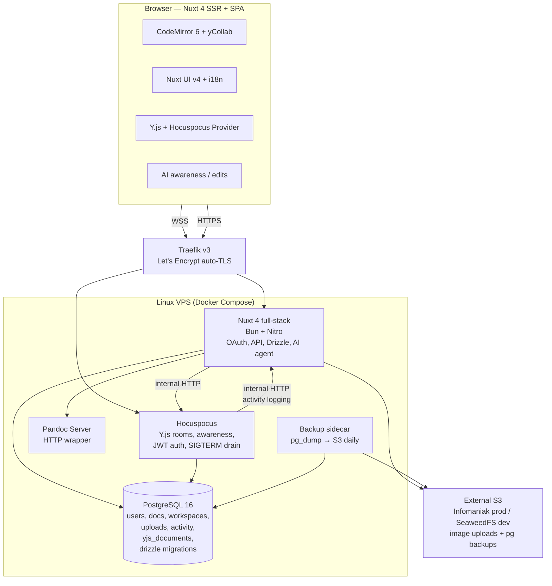
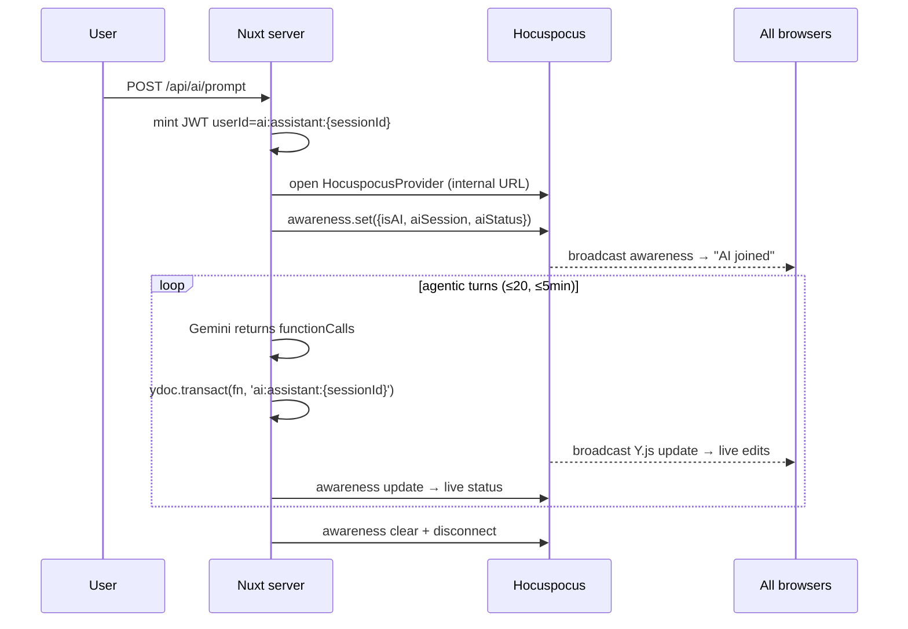

# YPad — Project Guide

Collaborative markdown editor: Y.js CRDT + Hocuspocus sync, OAuth (GitHub/Google) via `nuxt-auth-utils`, PostgreSQL (app data + Y.js state via `y-postgresql`), external S3 for image uploads & pg backups, multi-lingual UI via `@nuxtjs/i18n`, AI writing assistance via Google Gemini. Single Linux VPS, Docker Compose.

Login is **optional** — public docs work anonymously. Login is required to own, manage permissions, use workspaces, delete, or use AI.

---

## 1. Architecture



**Key design principles**

- **Full-stack Nuxt.** One Bun process serves SSR + Nitro API + OAuth sessions. No CDN.
- **OAuth optional.** Anonymous users can view/edit public docs; login gates ownership and AI.
- **Drizzle + Postgres for app data.** Versioned migrations in `drizzle/` applied at boot.
- **Y.js state lives in Postgres** via `y-postgresql` (`yjs_documents` table). Append-only updates + periodic merge replaces the earlier S3-blob-overwrite scheme — durable, one `pg_dump` covers everything.
- **S3 = image uploads + pg backups, nothing else.** External S3 in `docker-compose.prod.yml`; SeaweedFS in `docker-compose.dev.yml` and `docker-compose.local.yml`.
- **Hocuspocus as separate container.** Long-lived WS + in-memory Y.Doc state shouldn't share the Nitro event loop. Server↔sync talk over shared-secret HTTP.
- **AI joins the doc as a real Y.js client** (see §7).
- **Pandoc isolated.** Python HTTP wrapper around `pandoc/extra` so Nuxt stays lean (no TeX/fonts).
- **Daily pg backups to S3** via sidecar (same script for dev/prod, endpoint differs).

---

## 2. Technology Stack — Pinned Versions

### Runtime

| Tool | Version | Purpose |
|---|---|---|
| Bun | 1.3.12 | JS/TS runtime + package manager |
| Nuxt | 4.4.2 | Full-stack Vue (SSR + API via Nitro) |

### Nuxt modules

| Module | Version | Purpose |
|---|---|---|
| `@nuxt/ui` | 4.6.1 | Reka UI + Tailwind v4 |
| `nuxt-auth-utils` | 0.5.29 | OAuth + sealed-cookie sessions |
| `@nuxtjs/i18n` | 10.2.1 | 6 languages, lazy-loaded |
| `@vueuse/nuxt` | 14.2.1 | VueUse auto-imports |
| `@pinia/nuxt` | 0.11.3 | State management (must precede Colada) |
| `@pinia/colada-nuxt` | 0.3.2 | `useQuery` / `useMutation` |
| `@vite-pwa/nuxt` | 0.10.6 | PWA/Workbox |
| `nuxt-codemirror` | 0.0.11 | CM6 Vue wrapper |

### Frontend

| Package | Version | Purpose |
|---|---|---|
| `yjs` | 13.6.30 | CRDT doc model |
| `y-codemirror.next` | 0.3.5 | CM6 ↔ Y.js with remote cursors |
| `@hocuspocus/provider` | 3.4.4 | WS provider |
| `@codemirror/lang-markdown` | 6.3.2 | Markdown + GFM |
| `@codemirror/language-data` | 6.5.1 | Code-fence highlighting |
| `markdown-it` + plugins | 14.1.0 | Preview rendering (task-lists, emoji, footnote, container) |
| `highlight.js` | 11.11.1 | Preview code highlighting |
| `dompurify` | 3.2.4 | XSS sanitization |
| `nanoid` | 5.1.5 | ID generation |
| `@google/genai` | ^1.50 | Gemini SDK |

### Sync server (`sync-server/`)

| Package | Version | Purpose |
|---|---|---|
| `@hocuspocus/server` | 3.4.4 | WS sync server |
| `y-postgresql` | 1.0.1 | Y.js persistence (⚠ `useIndex: false` — 1.0.1 has SQL bug in index-creation branch) |
| `pg` | ^8.20 | Driver (shared with app) |
| `jsonwebtoken` | 9.0.2 | JWT verification |

### Nuxt server

| Package | Version | Purpose |
|---|---|---|
| `drizzle-orm` | 0.45.2 | Type-safe ORM (`node-postgres` adapter) |
| `drizzle-kit` | 0.31.10 | Migration generator |
| `pg` | ^8.20 | Driver |
| `@aws-sdk/client-s3` + presigner | 3.750.0 | Image uploads |
| `jsonwebtoken` | 9.0.2 | Hocuspocus token minting |
| `zod` | ^4 | Validates Gemini function-call args; `z.toJSONSchema` generates tool schemas |

> `argon2` is **not** used — document password hashing goes through `nuxt-auth-utils`'s built-in scrypt `hashPassword`/`verifyPassword`.

---

## 3. Data Model

### Storage

| Data | Storage |
|---|---|
| Users, documents, shares, workspaces, uploads, activity, rate-limits, AI sessions | PostgreSQL (Drizzle) |
| Y.js document state | PostgreSQL (`yjs_documents` via `y-postgresql`) |
| Image blobs | S3 (`docs/{docId}/{fileId}.ext`) |
| Postgres backups | S3 (`backups/postgres/{ISO8601}.sql.gz`) |
| User sessions | Sealed cookies (`nuxt-auth-utils`), versioned via `SESSION_VERSION` |

Schema source-of-truth: `server/db/schema.ts`. Enums stored as `text('col', { enum: [...] })` — not `pgEnum` — so adding values is a TS-only change, no `ALTER TYPE` migration friction.

### Migrations

- `bun run db:generate` — edit `server/db/schema.ts`, then generate. Drizzle-kit diffs against `drizzle/meta/` snapshots; commit both SQL + snapshot.
- `server/plugins/00-db-migrate.ts` — numeric `00-` prefix forces load-first so the sweeper and rate-limit-cleanup plugins don't race empty-schema queries.
- `server/plugins/99-shutdown.ts` — closes pg pool on Nitro `close`.
- Prod applies on container boot. No backwards-compat shims pre-launch; break freely.

### S3 key layout

```
docs/{docId}/{fileId}.{ext}          # image uploads
backups/postgres/{ISO8601}.sql.gz    # daily pg_dump
```

### Swappable S3 backend

`NUXT_S3_ENDPOINT` swaps between SeaweedFS (dev), Infomaniak (current prod), AWS, R2 — no code changes. Sync-server no longer touches S3.

---

## 4. Auth & Access Control

### Access modes

| Mode | Anonymous | Logged-in non-owner | Owner |
|---|---|---|---|
| **Private** (default for logged-in docs) | — (forbidden) | — (forbidden) | Full control |
| **Open edit** (default for anonymous docs) | Edit | Edit | Full control |
| **Open view** | View | View | Edit + manage |
| **Password-protected** | Enter password | Enter password | Edit + manage |

### Read-only enforcement (4 layers)

1. Token endpoint — mints JWT with `readOnly: true` for non-owners of open-view docs.
2. Hocuspocus — `onAuthenticate` returns `{ readOnly }`; server blocks Y.js updates.
3. CodeMirror — `EditorView.editable` + `EditorState.readOnly` via **Compartments** (reconfigured reactively when `readOnly` flips async after `fetchToken`).
4. UI — view-mode forced to preview, toolbar hidden, badge shown.

### Password-protected enforcement (3 layers)

1. Token endpoint returns `token: null` until password verified — no usable JWT issued.
2. Hocuspocus rejects connection → no content synced.
3. Client-side template gated by `v-if="!requiresPassword"` → lock screen; editor mounts only after sync.

### Session

- `runtimeConfig.session.maxAge = 7d`.
- `SESSION_VERSION` (in `server/utils/validatedSession.ts`) is stamped into every session. Mismatching cookies cleared on next request. Bump the constant to invalidate everyone.
- OAuth handlers live in `server/routes/auth/` (NOT `server/auth/` — Nitro doesn't map that). GitHub upserts on `users.githubId`, Google on `users.googleId`.

---

## 5. API Route Map

> `server/api/` → `/api/*`. `server/routes/` → `/`. Files in `server/auth/` are unreachable.

```
# Auth (nuxt-auth-utils)
GET    /auth/github                        OAuth redirect
GET    /auth/google                        OAuth redirect
GET    /api/_auth/session                  Current session

# Meta
GET    /api/health                         DB-touching probe (healthchecks)
GET    /api/version                        { buildId } — SPA staleness detection

# Documents
POST   /api/docs                           Create (anonymous OK; defaults to private if logged-in, open-edit if not)
GET    /api/docs/:docId/meta
PUT    /api/docs/:docId/meta               Owner only; validates title/accessMode/wordCount/sizeBytes
DELETE /api/docs/:docId                    Owner only; cascades S3 cleanup + notify-deleted to sync
GET    /api/docs/:docId/token              Consolidated: token + readOnly + requiresPassword + forbidden + accessMode + ownerId
GET    /api/docs/:docId/activity           Latest 50 entries
POST   /api/docs/:docId/password           Set/verify/remove

# Internal (X-Internal-Secret; sync-server → app only)
POST   /api/internal/activity              Log edit/join/leave entry

# User
GET    /api/user/documents
GET    /api/user/workspaces
GET    /api/user/recent

# Files
POST   /api/upload/request                 Presigned PUT + insert unconfirmed uploads row
POST   /api/upload/confirm                 HEAD S3 + flip confirmed_at
GET    /api/files/:docId/:fileId           302 → presigned GET (access-controlled)

# Import/Export (public — user already has the content)
POST   /api/import                         PDF/DOCX → markdown via Pandoc, 50MB cap
POST   /api/export/:docId                  Markdown → PDF/DOCX via Pandoc (XeLaTeX for Unicode/emoji)

# Workspaces (login required)
POST   /api/workspaces
GET    /api/workspaces/:wsId
PUT    /api/workspaces/:wsId
POST   /api/workspaces/:wsId/docs
DELETE /api/workspaces/:wsId/docs/:docId

# AI (login required) — see §7
POST   /api/ai/prompt                      Returns { sessionId }; loop runs in background
POST   /api/ai/rewrite                     Inline selection rewrite, no tools
POST   /api/ai/abort                       Initiator only (403 otherwise)
```

Auth guard: `server/middleware/auth.ts` whitelists public patterns and calls `requireUserSession` for the protected prefixes (`/api/docs/` outside whitelist, `/api/workspaces`, `/api/user`, `/api/upload`, `/api/ai`).

Token endpoint **never issues a usable JWT for forbidden or password-gated docs** — returns `{ token: null, ... }` so Hocuspocus rejects until unlock.

---

## 6. Sync Server (Hocuspocus)

Separate container. Config at `sync-server/src/index.ts`. Hooks: `onLoadDocument`, `onStoreDocument`, `onAuthenticate`, `onConnect`/`onDisconnect`, `onRequest`.

### Persistence (`y-postgresql`)

- Singleton `PostgresqlPersistence.build(...)` with `tableName: 'yjs_documents'`, `useIndex: false` (bug), `flushSize: 200`.
- Replaces the prior S3-blob-overwrite scheme. Append-only updates auto-merge into a compacted update every `flushSize` writes — a failed write can't nuke prior state.
- `onLoadDocument` returns `new Y.Doc()` on read failure (never throws into Hocuspocus). `clearDocument` is called on doc deletion.

### Auth

- `JWT_SECRET` required at startup; no fallback.
- Every connection **must** present a valid JWT (no anonymous bypass — anonymous browsers still go through the Nuxt token endpoint).
- Verifies `payload.docId === documentName`, returns `{ readOnly: payload.readOnly }`.

### Rate limiter

- Per-IP connection cap (20) tracked via separate `connectionIPs: Map<socketId, ip>` rather than mutating connection object — Hocuspocus v3 hook shapes vary. Defensive try/catch; only the "Too many connections" error is re-thrown.
- Max 5000 rooms.

### Activity logging

- Primary attribution: `lastEditorByDoc` Map, populated in `onChange` from authenticated JWT `userName`. Read in `onStoreDocument`.
- Fallback: `mostRecentEditorFromAwareness(awareness)`. Logs `[hocuspocus] Attribution fallback …` warning when it kicks in (drift detection in prod).
- `previousTextByDoc` (diff baseline) re-seeded from disk in `onLoadDocument`. Neither map is persisted — per-edit bootstrap covers restart edge case.
- Transport: fire-and-forget POST to `${APP_URL}/api/internal/activity` with `X-Internal-Secret`, 5s timeout. Nuxt caps latest 500 entries per doc.
- Dev networking: sync-server in Docker reaches host-running Nuxt via `host.docker.internal` (`host-gateway` extra_host on Linux). **Nuxt dev must bind `0.0.0.0`.**

### Internal HTTP

All routes gate on `X-Internal-Secret === INTERNAL_API_SECRET`. Implementation in `sync-server/src/internal-http.ts`; `handleInternalRequest()` returns `true` when handled, caller throws `null` (Hocuspocus sentinel) to skip default handling.

| Route | Purpose |
|---|---|
| `GET /health` | Public. Docker HEALTHCHECK + Traefik service-loadbalancer healthcheck — stops routing to draining containers. |
| `POST /internal/notify-deleted` | Sets `ymeta._deleted = Date.now()` on in-memory Y.Doc (broadcasts to clients) then `ypgPersistence.clearDocument()` so the doc can't be revived from disk. |

### Graceful shutdown

SIGTERM/SIGINT → `server.destroy()` (drains WS + awaits pending Y.js stores) → `ypgPersistence.destroy()`. 25s kill-timer as failsafe. Compose `stop_grace_period: 30s`.

### Running the sync-server

TypeScript runs directly under Bun (no pre-bundle). Bun's bundler choked on Hocuspocus CJS/ESM exports and startup-time delta is negligible.

---

## 7. AI Features — Gemini as Collaborator

Two flows, one backend model:

- **Top-bar prompt** (`AIPromptBar.vue`) — agentic loop with function tools (`view_document`, `replace_text`, `insert_text`, `web_search`). Uses `config.google.model` (default `gemini-3.1-flash-lite-preview`).
- **Inline selection rewrite** (`AISelectionPopup.vue`) — cheap-tier one-shot, no tools, full-doc context. Uses `config.google.rewriteModel` (default `gemini-2.5-flash-lite`).

Both logged-in only.

### AI-as-Y.js-client



No SSE — status rides on Y.js awareness. Each edit is its own `ydoc.transact` so:
- Users watch AI type in real time.
- Origin string carries `sessionId` for activity attribution.
- Multi-edit responses land as clean ordered atomic updates.
- `replace_text` matches content (not byte-offset), so earlier edits don't invalidate later ones in the same turn.

### Concurrency

- No doc-level lock — multiple AI sessions on the same doc are fine; edits merge via CRDT. Semantic conflict ("make formal" vs "make casual") is accepted.
- **Per-user cap: 1 session per user per doc.** Second POST → **409** (`DuplicateSessionError`). Enforced by Postgres UNIQUE index in `ai_sessions` — survives Nitro restart.

### Cancellation

`POST /api/ai/abort { sessionId }`:
- 404 if already ended (client swallows).
- **403 if not initiator.**
- Otherwise abort — loop unwinds, awareness clears.
- Server treats any error thrown after `abortController.signal.aborted === true` as an abort regardless of SDK error shape. Status goes to `{phase:'done', message:'Stopped'}` — no error toast.

### Function tools

Zod schemas in `server/utils/agentic/functionTools.ts` are the **source of truth**. `z.toJSONSchema(schema, { target: 'draft-7' })` generates both what Gemini sees and the runtime validator. Before dispatch, `runLoop` `safeParse`s `FunctionCall.args` → parse failures return as `functionResponse.isError` with Zod issue path + message so the model self-corrects.

Gotchas:
- Use `z.array(...).min(2).max(2)` not `z.tuple(...)` for fixed-length arrays — Gemini's validator rejects tuple-shaped `items: [...]` JSON Schema.
- Fixed-sized array example: `view_document` `view_range` param.

Tool semantics (`server/utils/aiToolAdapter.ts`):

| Tool | Behavior |
|---|---|
| `view_document({ view_range? })` | Returns `ytext.toString()` with 1-indexed line prefixes. |
| `replace_text({ old_str, new_str })` | 0 matches → "No match found". 2+ → "Found N matches, add more context". 1 → transact delete+insert. |
| `insert_text({ insert_line, insert_text })` | Map line → char idx (0 = file start); transact insert. |
| `web_search({ query })` | Isolated sub-call with `tools: [{ googleSearch: {} }]` only. Returns synthesised answer + bulleted `Sources:` from `groundingMetadata.groundingChunks`. Never mixed with `functionDeclarations` in the main loop. |

**Why wrap `googleSearch` as our own function** instead of passing it as a top-level tool: (a) `googleSearch` + `functionDeclarations` coexistence has shifted between model versions; (b) wrapping gives pre-call status UX ("Searching the web for 'X'…") — otherwise it's implicit with only post-hoc `groundingMetadata`.

### Inline rewrite specifics

- Full-doc context windowed to 40k chars around selection; model matches tone but rewrites only the selection.
- **Race-safe positions.** Client sends Y.js `RelativePosition` for both ends; server resolves via `createAbsolutePositionFromRelativePosition`. If human edited inside selection concurrently, RelativePosition slides with the edit.
- Fallback chain: relative pos → raw index sanity check → single-`indexOf` → **409 "Selection has moved"**.

### Limits & sweeper

- Rate limits (Valkey sliding-window-log via `server/utils/rateLimit.ts`): `ai-prompt: 20/h`, `ai-rewrite: 30/h` per user.
- Deadlines: prompt 5 min, rewrite 30 s, loop `MAX_TURNS = 20`.
- Sweeper (`server/plugins/ai-session-sweep.ts`) — 60s tick, aborts sessions >7 min old (threshold > prompt deadline so legit long grounded searches aren't killed). One-shot startup purge clears rows from crashed prior process so per-user cap unblocks.
- `event.node.req.on('close')` aborts if client tab closes mid-request.

### Error lingering

Error status lingers 2.5s in awareness (vs 500ms for success) so clients latch the message before awareness cleanup destroys the session. `useAI.ts` promotes `phase === 'error'` messages into `lastError` → `AIPromptBar.vue` toasts.

### Config

```env
NUXT_GOOGLE_API_KEY=...                                    # required at startup
NUXT_GOOGLE_MODEL=gemini-3.1-flash-lite-preview            # agentic loop
NUXT_GOOGLE_REWRITE_MODEL=gemini-2.5-flash-lite            # inline rewrites
```

Pricing (at time of writing): `gemini-3.1-flash-lite-preview` $0.25/$1.50 per 1M in/out, grounding free up to 5k prompts/month shared across Gemini 3 family. `gemini-2.5-flash-lite` $0.10/$0.40. Display name is vendor-neutral ("AI Assistant") so future swaps stay behind the adapter.

---

## 8. Document Composables (split)

Orchestrator + two workers:

- `useDocToken.ts` — fetches `/api/docs/:docId/token`; handles password-verify reconnect; exposes `{token, readOnly, requiresPassword, forbidden, accessMode, isOwner, pendingPasswordUnlock, setAccessMode}`.
- `useHocuspocusSync.ts` — provider lifecycle only. `getToken()` callback so reconnects pick up password-verified JWTs without wiring. Exposes `{provider, status, synced, userCount, docSizeBytes, reconnect}`.
- `useDocument.ts` — thin orchestrator. Creates Y.Doc + awareness + undoManager, composes the workers, owns the title bridge (`ymeta.observe` → Vue ref), deletion observer (`ymeta._deleted`), welcome-doc seeding.

Preserved design points:
- **Single consolidated fetch on init** (token endpoint returns metadata too — no separate `/meta` call).
- **Single Awareness instance** passed to both `HocuspocusProvider` and yCollab for the component lifetime.
- **Title bridge** — `ymeta.observe()` updates a reactive ref; computed wraps get/set.
- **Welcome content insertion** fires on `onSynced` (server empty), `onDisconnect` before-ever-synced, or no-syncUrl path.
- **Password flow** — `onPasswordVerified(newToken)` stashes JWT, orchestrator listens and calls `useHocuspocusSync.reconnect()`. `requiresPassword` flips false only on `onSynced` (via `clearPendingUnlock`) — prevents empty-doc-prepend bug.

Return shape (~17 fields, unchanged by the split): `ydoc, ytext, awareness, provider, status, synced, userCount, isReadOnly, isOwner, isDeleted, requiresPassword, forbidden, accessMode, docSizeBytes, docSizeWarning, undoManager, title, onPasswordVerified, setAccessMode, destroy`.

---

## 9. Preview Rendering

All markdown-it plugins loaded via **async dynamic imports** inside `initMd()`, guarded `if (import.meta.client)`:
1. Plugins have mixed CJS/ESM exports that crash SSR.
2. DOMPurify needs a browser DOM.
3. highlight.js is large — lazy load.

- `markdown-it-emoji` needs `.full`: `const emoji = (mod as any).full || (mod as any).default || mod`.
- **Import `highlight.js/styles/github-dark.min.css` dynamically inside `initMd()`** — without it, code blocks render with right class names but all-white text.
- `watch(source, ...)` set up after init resolves. `v-html` fed DOMPurify output.

---

## 10. Mobile

**Breakpoint: `useMediaQuery('(max-width: 639px)')`** — matches Tailwind `sm:`. Previously 768px caused layout drift in 640–768px range.

Implemented:
- Edit-only default on narrow — `watchEffect` forces `viewMode = 'edit'` when `isMobile && viewMode === 'split'`.
- CM6 responsive theme via **Compartment** (font 16px mobile to kill iOS auto-zoom, line-height 1.7, padding 12/16px, reconfigured live on resize/rotation).
- CM6 always-on `autocapitalize: 'sentences'`, `autocorrect: 'on'`, `spellcheck: 'true'`.
- Toolbar `flex-wrap` instead of horizontal scroll. Document action buttons stay anchored via `items-start` + `shrink-0`.
- Collapsed top-bar `UDropdownMenu` (hamburger) on mobile.
- Icon-only connection badge (`<span class="hidden sm:inline">`).
- Responsive title `max-w-[180px] sm:max-w-56 md:max-w-80`.

Activity-feed layout:
- `< xl` (≤1279px): opening activity hides preview; in edit mode activity is `w-80` sidebar (full-width xs).
- `xl+`: activity is fixed `w-80` right sidebar regardless of view mode → genuine triple-pane when split. Preview uses `hidden xl:block` (CSS) not `v-if` so resize past xl brings it back instantly without remounting markdown pipeline.

---

## 11. Security

### Authentication

- OAuth via `nuxt-auth-utils` (encrypted HTTP-only cookies, CSRF protected, no localStorage tokens). Explicit `maxAge: 7d`.
- `SESSION_VERSION` invalidation mechanism (bump constant → clears all cookies on next request).
- Hocuspocus **always** requires valid JWT — no anonymous WS bypass.
- `JWT_SECRET`, `DATABASE_URL`, `INTERNAL_API_SECRET` — required at startup; no fallbacks.

### Rate limits

| What | Limit |
|---|---|
| Password brute-force | 5 per IP+docId per minute |
| Token endpoint | 30 per IP per minute (prevents enumeration) |
| Import/export | 10 per IP per minute |
| AI prompt | 20 per user per hour |
| AI rewrite | 30 per user per hour |
| Hocuspocus | 20 connections per IP, 5000 rooms |

### Input validation

- `meta.put`: title (≤255), accessMode (enum), wordCount (0–10M, finite), sizeBytes (0–100M, finite).
- Uploads: PNG/JPEG/GIF/WebP/SVG, 10MB max.
- Imports: extension whitelist, 50MB max.

### File access

- `/api/files/:docId/:fileId` checks access mode before presigning. Password-protected docs require owner auth — anonymous can't pull files.
- Presigned URL TTL: **5 min upload, 120s read**. Short read TTL because presigned URLs can't be revoked — long ones would outlive access-mode changes / password rotations / deletions.

### Other

- Password hashing via `nuxt-auth-utils` scrypt.
- Password token expiry: 2h (not 24h).
- XSS: markdown-it `html: false` + DOMPurify.
- `.env` gitignored.

---

## 12. Docker Compose

Three files for three purposes:

| File | Scope | TLS | Images | Use |
|---|---|---|---|---|
| `docker-compose.dev.yml` | infra only (postgres, seaweedfs, sync, pandoc, backup) — Nuxt runs on host | — | `build:` where needed | daily dev with HMR |
| `docker-compose.local.yml` | full stack incl. Traefik | mkcert (file provider) on `ypad.127.0.0.1.nip.io` | `build:` from source | pre-push full-stack verification — see `docs/LOCAL.md` |
| `docker-compose.prod.yml` | full stack incl. Traefik | Let's Encrypt (`tlschallenge`) | GHCR (`${REGISTRY}/md-online-{app,sync,pandoc,backup}:${IMAGE_TAG}`) | VPS deploy — see `docs/DEPLOY.md` |

The three files are standalone — no shared base. Duplication is accepted in exchange for each being readable top-to-bottom.

### Production (6 containers)

Traefik, postgres, app, sync, pandoc, backup sidecar. No SeaweedFS in prod — S3 is external.

Key points:
- `postgres:16-alpine` with `pg_isready` healthcheck. Named `pg_data` volume.
- `app` and `sync` both `depends_on: postgres { condition: service_healthy }`.
- `stop_grace_period: 30s` on `app` and `sync` so SIGTERM handlers drain.
- Traefik service-loadbalancer healthcheck labels on both (`/api/health` + `/health`) — stops routing to draining containers.
- `backup` sidecar: `postgres:16-alpine` + `aws-cli`, pipes `pg_dump --no-owner --clean --if-exists | gzip | aws s3 cp` to `s3://…/backups/postgres/{ISO8601}.sql.gz`. Default: daily, 30-day retention. Prunes beyond `BACKUP_RETENTION_COUNT` newest files.
- `NUXT_S3_ENDPOINT` env-driven.

DNS: `yourdomain.com` + `sync.yourdomain.com` → VPS IP. No `s3.` subdomain in prod (external S3).

Nuxt app Dockerfile multi-stages builder → runtime; **must `COPY drizzle/`** into runtime image so `00-db-migrate.ts` can apply migrations at boot.

### Development

```bash
docker compose -f docker-compose.dev.yml up -d    # Postgres + SeaweedFS + Hocuspocus + Pandoc + backup
bun run dev --host 0.0.0.0                         # Nuxt dev on host (HMR); 0.0.0.0 so sync container can reach via host.docker.internal
```

Ports exposed: Postgres 5432, SeaweedFS 8333, Hocuspocus 4001, Pandoc 8080. Nitro `devProxy` forwards `/_s3/*` to SeaweedFS to sidestep CORS. WebSocket connects directly (no same-origin constraint).

Backup sidecar runs with tight loop in dev (1h interval, 5-file retention) so you can verify locally without waiting a day.

### Env (prod)

```env
DOMAIN, ACME_EMAIL
SESSION_PASSWORD                    # ≥32 chars
GITHUB_CLIENT_ID, GITHUB_CLIENT_SECRET
GOOGLE_CLIENT_ID, GOOGLE_CLIENT_SECRET
POSTGRES_PASSWORD
S3_ENDPOINT, S3_ACCESS_KEY, S3_SECRET_KEY, S3_BUCKET
JWT_SECRET                          # ≥64 chars
INTERNAL_API_SECRET
GOOGLE_API_KEY, GOOGLE_MODEL, GOOGLE_REWRITE_MODEL
BACKUP_INTERVAL_SECONDS, BACKUP_RETENTION_COUNT
```

### Restore

```bash
aws s3 cp s3://…/backups/postgres/….sql.gz - | gunzip | psql "$DATABASE_URL"
```

Dump uses `--clean --if-exists` so it drops existing objects before recreate.

---

## 13. Project Structure

```
app/
  app.vue, app.config.ts, assets/css/main.css
  components/
    auth/         LoginButtons, UserMenu
    editor/       EditorLayout, EditorPane, EditorToolbar, MobileToolbar, ImageDropZone
    preview/      PreviewPane
    collab/       PresenceBar, ConnectionStatus, ActivityFeed
    ai/           AIPromptBar, AISelectionPopup
    sharing/      ShareModal, PasswordModal, DeleteConfirmModal
    document/     ImportModal
    workspace/    WorkspaceList, WorkspaceDocTable
    history/      HistoryTimeline, DiffViewer   (MMP)
    layout/       AppSidebar, AppHeader, MobileBottomSheet, LanguageSwitcher
    common/       SizeWarning
  composables/    useDocument, useDocToken, useHocuspocusSync, useAI, useImageUpload, useDocumentImport, useMarkdownPreview
  pages/          index.vue, d/[id].vue, w/[id].vue
  middleware/     auth.ts
  plugins/        version-check.client.ts
  utils/          queryKeys, colors, names, download, welcomeDoc

server/
  routes/auth/    github.get.ts, google.get.ts
  api/
    health.get.ts, version.get.ts
    docs.post.ts, docs/[docId]/{meta,index,token,activity,password}.*
    upload/{request,confirm}.post.ts
    files/[docId]/[fileId].get.ts
    import.post.ts, export/[docId].post.ts
    internal/activity.post.ts
    ai/{prompt,rewrite,abort}.post.ts
    user/{documents,workspaces,recent}.get.ts
  db/schema.ts
  middleware/auth.ts
  plugins/        00-db-migrate, 99-shutdown, orphan-cleanup, ai-session-sweep, rate-limit-cleanup
  utils/          database, s3, rateLimit, routeParams, validatedSession,
                  aiSessions, aiClient, aiToolAdapter,
                  agentic/{runLoop, functionTools, streamStatus}

sync-server/      Dockerfile, src/{index, persistence, auth, rate-limiter, activity-logger, internal-http}.ts
pandoc-server/    Dockerfile, server.py
backup-server/    Dockerfile (postgres:16-alpine + aws-cli), backup.sh

drizzle/          0000_*.sql, meta/*                     # generated, committed
drizzle.config.ts

i18n/locales/     en, de, fr, es, ja, zh .json
shared/types/     auth.d.ts, markdown-it-plugins.d.ts
public/           icons, favicon

Dockerfile, docker-compose.{dev,local,prod}.yml, nuxt.config.ts, package.json, bun.lock, colada.options.ts, .env
traefik/local/                                        # mkcert .pem files (gitignored) + tls.yml
docs/                                                  # DEPLOY.md, LOCAL.md, S3-SETUP.md
```

---

## 14. Shipped Features (MVP done)

### Infrastructure
- Compose stack (Traefik + postgres + app + sync + pandoc + backup). Dev variant runs infra only, Nuxt on host.
- Drizzle schema + versioned migrations applied at boot. pg pool singleton + graceful close.
- Hocuspocus with `y-postgresql` persistence + JWT auth + rate limiting + SIGTERM drain.
- S3 client singleton; Nitro `devProxy` for S3 CORS in dev.
- Pandoc HTTP service (Python wrapper around `pandoc/extra`).
- Daily Postgres backup sidecar with retention pruning.

### Auth & core editor
- GitHub + Google OAuth via `nuxt-auth-utils`. `SESSION_VERSION` invalidation.
- Anonymous doc creation; logged-in docs default to `private`.
- Landing page with login buttons, New Document, recent docs.
- `useDocument` + `useDocToken` + `useHocuspocusSync` split.
- CodeMirror 6 via `nuxt-codemirror` + `yCollab()` + `drawSelection()`.
- Split editor/preview, markdown-it + DOMPurify (async dynamic imports).
- Formatting toolbar, status bar, view-mode toggle.
- Welcome document pre-loaded for new documents.
- i18n `en.json` complete; other locales scaffolded.

### Collaboration & sharing
- Awareness (names, colors, avatars). PresenceBar.
- Document title synced via Y.js Map + observe bridge.
- Share modal with access-mode selector; read-only enforced at 4 layers.
- Password protection (scrypt) with 3-layer gating.
- Activity feed (30s auto-refresh, relative timestamps, 500 cap per doc).
- Remote deletion broadcast via `ymeta._deleted`; client observes and redirects.

### Files, import & export
- Presigned upload flow (request → PUT → confirm) with DB tracking.
- Drag-drop + paste image upload.
- Import via Pandoc HTTP (with replace/append/cancel conflict handling).
- Export PDF/DOCX via Pandoc (XeLaTeX for Unicode/emoji).
- Client-side `.md` and `.html` download.

### Security hardening
- No hardcoded JWT/S3 fallbacks — fail-fast on missing env.
- Rate limits on token, password, import, export, AI endpoints.
- File-endpoint access control for password-protected docs.
- `meta.put` input validation.
- Password token expiry 24h → 2h.
- Word count persisted with 10s debounce + `keepalive` on unmount.

### Mobile
- Touch-optimized CM6 (autocapitalize, autocorrect, 16px mobile font via reactive Compartment).
- Collapsed top-bar menu, icon-only connection badge, responsive title, flex-wrap toolbar.
- 640px breakpoint aligned with Tailwind `sm:`.
- (Floating toolbar via `visualViewport`, bottom tab bar, bottom-sheet sidebar → **deferred to MMP**.)

### Document management
- Owner-only delete with type-to-confirm safety.
- S3 cleanup on delete + hourly 3-layer orphan reconciliation plugin.
- Delete-cascade broadcast through sync-server `onRequest` → `ymeta._deleted` + y-postgresql `clearDocument`.

### AI
- Gemini `@google/genai`. Agentic prompt loop (`view_document` / `replace_text` / `insert_text` / `web_search`).
- Inline selection rewrite on cheap-tier model with `RelativePosition` race safety.
- Streaming status via awareness — no SSE.
- Concurrent sessions allowed; 1-per-user-per-doc enforced by Postgres UNIQUE index.
- Initiator-only cancel. Per-user rate limits + 5-min deadline + 7-min sweeper.
- Sparkles avatars + pulsing ring in PresenceBar.

### Production hardening (Phase 7)
- SQLite → Postgres.
- S3-blob Y.js → `y-postgresql`.
- Graceful shutdown everywhere + Compose `stop_grace_period`.
- Daily pg backups to S3.
- SPA version detection (`/api/version` + `version-check.client.ts`).
- Session TTL + `SESSION_VERSION`.
- Uploads tracked in DB; 3-layer orphan cleanup with 24h grace.
- Attribution observability warnings.
- Traefik healthcheck labels.
- AI provider swap Claude → Gemini.

---

## 15. TODOs (MVP remaining + MMP)

### MVP leftover

- [ ] DNS: `yourdomain.com`, `sync.` subdomains (prod deploy).
- [ ] CORS: Traefik middleware for S3 (prod deploy).
- [x] PWA setup via `@vite-pwa/nuxt` (manifest, SW, install prompt, periodic-sync, unified with `/api/version` staleness poll).
- [ ] Scheduled cleanup of inactive documents.
- [x] Dual-secret rotation (`JWT_SECRET`, `INTERNAL_API_SECRET`) via `*_PREVIOUS` fallback — see `docs/SECRETS-ROTATION.md`. `SESSION_PASSWORD` rotates via `SESSION_VERSION` bump (documented in the same runbook).
- [x] Observability: self-hosted GlitchTip + `@sentry/nuxt` + `@sentry/bun`, behind oauth2-proxy (GitHub, single-user). See `docs/OBSERVABILITY.md`.
- [x] Rate-limit cleanup failure surfacing — fail-open path in `rateLimit.ts` now captures to Sentry with `component: rateLimit, event: valkey_unavailable`.
- [x] Valkey container for rate limiting + caching (replaces Postgres-backed rate limiter; shared with GlitchTip which also needs Valkey). *Caching layer not yet wired — tracked under MMP.*

### MMP

**Workspaces**
- [ ] Workspace CRUD endpoints + page (`/w/{id}`).
- [ ] Create doc from workspace, add existing docs.
- [ ] Workspace doc table with activity indicators.

**History & snapshots**
- [ ] Timestamped snapshots in S3 via Hocuspocus hook.
- [ ] History view: load any snapshot into fresh Y.Doc.
- [ ] Timeline scrubber, diff view, restore, export at point.
- [ ] Playback animation.

**Power features**
- [ ] Command palette.
- [ ] Table of contents sidebar.
- [ ] Follow cursor.
- [ ] QR code sharing.
- [ ] Keyboard shortcuts cheat sheet.
- [ ] Offline mode (PWA cache).
- [ ] Y.js document compaction for oversized docs.
- [ ] Remaining locale translations (de, fr, es, ja, zh).

**Mobile MMP**
- [ ] Floating toolbar above virtual keyboard via `visualViewport` API.
- [ ] Bottom tab bar (Edit / Preview / AI).
- [ ] Sidebar as bottom sheet.

**AI (explicitly out of scope for now)**
- Multi-turn conversation history per user per doc.
- Streaming text responses to UI (currently discarded; edits ARE the response).
- Activity log attribution as "AI Assistant (for Alice)".
- User-selectable model.
- Grounded-search result caching (material past 5k-free/month quota).
- Cost telemetry / budget caps.
- Provider-swap adapter (Claude, local Ollama).

---

## 16. Technical Decisions (the "why")

| Decision | Rationale |
|---|---|
| Full-stack Nuxt over SPA + Fastify | One server. Nitro handles API + SSR + auth in one Bun process. Kills GitHub Pages dependency. |
| `nuxt-auth-utils` over `@sidebase/nuxt-auth` | Lighter (no Auth.js), sealed-cookie sessions (no session DB), 40+ providers, built-in scrypt. |
| Drizzle + Postgres (was SQLite) | Real versioned migrations, concurrent writers, pg_dump backup path. Swap happened pre-user-data so no migration was needed. |
| Single `pg` driver stack-wide | `y-postgresql` requires `pg.PoolConfig`. Mixing drivers = two pools. |
| `y-postgresql` (was S3 blob overwrite) | Append + merge is vastly more durable; failed write can't nuke prior state. One `pg_dump` covers both app and Y.js data. Caveat: `useIndex: true` has a SQL bug in 1.0.1. |
| Text-enum columns, not `pgEnum` | Adding values is TS-only — no `ALTER TYPE` migration friction. |
| Migrations at boot via `00-db-migrate.ts` | Numeric prefix forces load-first so sweeper/rate-limit-cleanup don't race empty schema. `99-shutdown.ts` mirrors on teardown. |
| Bun everywhere (build + runtime + sync-server), `nitro.preset: 'bun'` | Required for packages with Bun-specific exports (lib0 resolves `./logging` differently under the `bun` vs `node` conditions). The default `node-server` preset traces via the `node` condition and produces output Bun can't execute; the `bun` preset traces via the `bun` condition so the output's module graph matches the runtime. Official guidance: https://bun.com/docs/guides/ecosystem/nuxt. |
| Pinia Colada over raw `$fetch` | Caching, dedup, loading/error states, invalidation for free. |
| VueUse over custom composables | 200+ battle-tested, auto-imported. |
| `@nuxtjs/i18n` lazy | Locale files on-demand. `strategy: 'no_prefix'` keeps clean URLs. |
| Y.js CRDT over custom OT | Proven convergence. No custom conflict resolution. |
| Hocuspocus as separate container | Long-lived WS + in-memory Y.Doc state shouldn't share event loop with HTTP. |
| Sync ↔ app via shared-secret HTTP | Alternatives (shared DB access, MQ) heavier. Simple, debuggable, same pattern as OAuth callbacks. |
| Graceful shutdown at both tiers | Sync: `server.destroy()` drains WS + awaits pending stores. App: `99-shutdown.ts` closes pg pool. Compose gives 30s grace. |
| Uploads tracked in DB pre-PUT | Every presigned URL writes a row; orphan cleanup uses uploads table as source-of-truth with 24h grace to avoid racing live uploads. |
| 3-layer orphan cleanup | (1) unconfirmed >24h, (2) gone-doc prefixes, (3) defensive untracked >24h. |
| Delete broadcast via `ymeta._deleted` | Reuses Y.js broadcast path — no new protocol. Clients already observe `ymeta`. |
| OAuth optional | Public docs work anonymously. Low friction for casual use. |
| `SESSION_VERSION` over backwards-compat shims | Pre-launch: bump constant, clear stale cookies. Simpler than carrying optional fields. |
| Read-only at 4 layers | Token + Hocuspocus + CM6 + UI. Defense in depth. |
| Backups via sidecar, not in-app | Keeps Nuxt image free of pg_dump/aws-cli. `postgres:16-alpine` ensures pg_dump version matches server. |
| SeaweedFS dev-only | Prod uses external S3 (Infomaniak). |
| Google Gemini via `@google/genai` (was Claude) | Materially cheaper at comparable quality for our two AI features. Display name vendor-neutral ("AI Assistant") so swaps are a config change. |
| Custom `web_search` wrapping `googleSearch` | Never mix `googleSearch` with `functionDeclarations` in one request — coexistence rules shift between model versions. Wrapping also gives live "Searching the web for 'X'…" status. One extra sub-call per search; immaterial at Gemini pricing. |
| Zod as AI-tool source-of-truth | `z.toJSONSchema` (Zod 4 native — not `zod-to-json-schema`) generates both Gemini's param schema and runtime validator. Malformed args round-trip back as `functionResponse.isError` with Zod issue path so the model self-corrects. Gotcha: use `.array().min(2).max(2)` not `.tuple()` — Gemini's validator rejects tuple-shaped `items: [...]`. |
| Pandoc as separate HTTP service | Keeps Nuxt container lean. Same container for dev/prod. |

---

## 17. Gotchas worth remembering

- **`server/auth/` is not a Nitro route dir.** OAuth handlers live in `server/routes/auth/`.
- **Nitro maps `server/api/` → `/api/`, `server/routes/` → `/`.**
- **`@nuxtjs/i18n` v10:** `lazy` was removed — lazy is default when `locales[].file` is set. `langDir: 'locales/'` resolves relative to `i18n/`, not `app/`.
- **`markdown-it-emoji`** needs `.full` property: `const emoji = (mod as any).full || (mod as any).default || mod`.
- **`highlight.js` theme CSS** must be imported dynamically inside `initMd()` — otherwise code blocks are all white.
- **CM6 `readOnly` must go through Compartments** because `isReadOnly` is async-set after `fetchToken`.
- **Single Awareness instance** — create once in orchestrator, pass to both `HocuspocusProvider` (via `awareness` option) and yCollab.
- **Y.js Map reactivity bridge** — `ymeta.get('title')` isn't Vue-reactive. Use `ymeta.observe()` → ref + computed.
- **`y-postgresql` 1.0.1 bug** — force `useIndex: false`.
- **Hocuspocus v3 Server vs Hocuspocus class** — `Server` wraps `Hocuspocus` with HTTP+WS+`.listen()`; use `Server` for standalone.
- **Hocuspocus v3 hook shapes vary** — rate-limiter uses separate `connectionIPs: Map<socketId, ip>` rather than mutating connection object.
- **Bun can't pre-bundle Hocuspocus** — run TS directly via `bun run src/index.ts`.
- **`nitro.preset` must match the runtime.** Default is `node-server`; if the CMD is `bun run`, flip to `'bun'` or packages with `bun` conditional exports (lib0, more as the ecosystem adopts) resolve to files the runtime can't execute.
- **Nitro's NFT tracer misses `@google/genai`'s transitive `ws`** (upstream [nitrojs/nitro#2923](https://github.com/nitrojs/nitro/issues/2923)). Fix with `nitro.externals.traceInclude: ['node_modules/ws/index.js']` — the entry, not the package.json (that copies one file); NFT follows its imports and pulls the whole lib/ dir in.
- **Dev sync-server networking** — `host.docker.internal` + `host-gateway` extra_host on Linux; Nuxt dev must bind `0.0.0.0`.
- **Activity attribution fallback warning** is the canary — grep prod logs for `[hocuspocus] Attribution fallback` to detect drift.
- **Drizzle `node-postgres` queries are Promise-returning** — no `.get()` / `.all()` / `.run()`. Use `(await db.select()...limit(1))[0]` idiom.
- **Always project explicitly** — never ship `passwordHash` on a public endpoint.
- **Never issue usable JWT for forbidden / password-gated docs** — info-disclosure primitive otherwise (used to sign tokens for nonexistent docs pre-fix).
- **Zod `z.tuple(...)` vs Gemini** — Gemini rejects tuple-shaped JSON Schema; use `.array().min(N).max(N)`.
- **AI session sweeper threshold must exceed prompt deadline** (7 min > 5 min) so legit long grounded searches aren't killed.
- **Inline rewrite positions via `RelativePosition`** — not raw indices — so concurrent human edits inside selection don't misplace the replacement. 409 on ambiguous fallback.
- **Presigned read URL TTL: 120s** — they can't be revoked; long TTLs outlive access-mode/password/deletion changes.
- **Mobile breakpoint: 639px** — matches Tailwind `sm:`. Don't re-introduce 768px.
