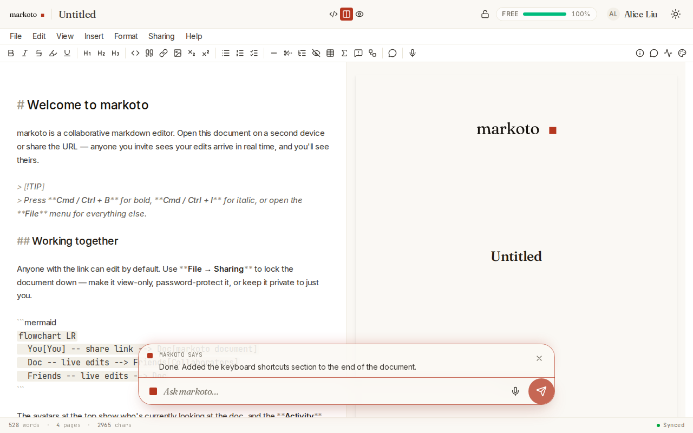
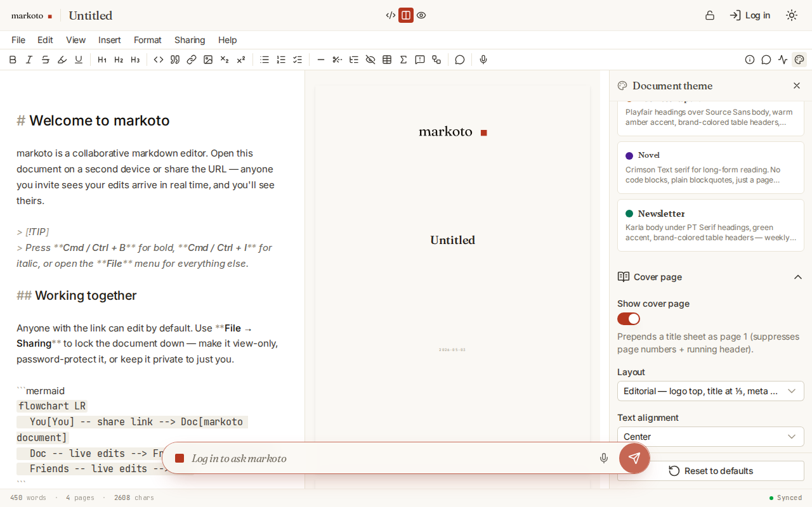

# markoto

**Rethinking the craft of writing.** markoto is a collaborative markdown editor
with live sync, a paged WYSIWYG preview, polished PDF export, and an AI writing
assistant that joins your document like a collaborator — built entirely on
EU-resident infrastructure.

**[Try it live at markoto.app](https://markoto.app)** — no account needed; public
documents work anonymously.

[](https://github.com/joelbarmettlerUZH/markoto/actions/workflows/ci.yml)
[](./LICENSE)
[](https://github.com/joelbarmettlerUZH/markoto/releases)



## What you get

- **Real-time collaboration** — Y.js CRDT + Hocuspocus sync; share a link and
  edits arrive live, with presence, per-author attribution, and a restorable
  activity log. Documents can be open, read-only, password-protected, or private.
- **True WYSIWYG for print** — the preview is paginated (A4/Letter, headers,
  footers, footnotes, cover pages) and the *same* theme CSS drives the
  server-rendered PDF export. What you see is literally what you ship.
- **Rich markdown** — GFM plus KaTeX math, Mermaid diagrams, alerts,
  footnotes, table of contents, page breaks, and a themable design system with
  presets, Google-Fonts picker, and per-document themes.
- **AI that edits with you** — ask markoto to write, restructure, research
  (web search + page fetch), generate images, or answer from your workspace
  knowledge base. The AI joins the document as a real CRDT client, so you watch
  it type. Voice input and live dictation included.
- **Workspaces & knowledge base** — role-based workspaces; uploaded files
  (PDF/DOCX/PPTX/…) are converted, chunked, embedded, and retrieved via hybrid
  pgvector + full-text search to ground AI answers.
- **MCP server** — connect Claude Desktop, Cursor, or your own scripts to your
  documents via personal access tokens.
- **EU data path** — every AI and storage sub-processor is EU-resident
  (Mistral, Jina, Staan, Black Forest Labs, OVHcloud) or DPF-covered, with a
  full GDPR/DSA compliance surface (consent, data export, account deletion,
  abuse reporting) built in.



## Self-hosting

markoto runs on a single Linux machine with Docker. One installer writes the
configuration, creates all credentials and starts the whole stack: the app, the
Hocuspocus sync server, the PDF renderer, Markitdown, Postgres with pgvector,
Valkey, object storage, the LiteLLM AI gateway and encrypted backups.

```sh
git clone https://github.com/joelbarmettlerUZH/md-online.git markoto && cd markoto
./install.sh
```

Needs Docker with Compose 5.0 or newer. Sign-in, AI providers (bring your own
key, or operator defaults including local models such as Ollama), HTTPS,
backups, upgrades and troubleshooting are covered in
**[docs/SELF-HOSTING.md](./docs/SELF-HOSTING.md)**. AI is optional and billing is
off: every account is on the free tier, with limits you set.

- **[docs/AI-MODELS.md](./docs/AI-MODELS.md)**: which models power which feature,
  recommended models for bring-your-own-key, custom embeddings.
- **[docs/ARCHITECTURE.md](./docs/ARCHITECTURE.md)**: how the pieces fit together.
- User documentation lives in `content/docs/` and is served at `/docs` on every
  instance.

The other files in `docs/` (`DEPLOY.md`, `DEPLOY-OVH.md`, `RUNBOOK.md`,
`SECRETS-ROTATION.md`, `BREACH-RESPONSE.md`, `GITHUB-CONFIG.md`, ...) describe how
**we** operate the hosted instance, published for transparency and as templates,
not required reading for self-hosters.

## Development

Prerequisites: [Bun](https://bun.sh) 1.4+, Docker Compose v2.20+, `make`.

```sh
bun install
make dev        # infra containers (Postgres, Valkey, S3, sync, renderer, …)
make dev-app    # Nuxt with HMR on the host
```

`make help` surfaces every common workflow; `docs/CHEATSHEET.md` is the flat
reference. The architecture overview is [`docs/ARCHITECTURE.md`](./docs/ARCHITECTURE.md);
engineering detail lives in [`AGENTS.md`](./AGENTS.md) with per-area deep-dives in sub-`AGENTS.md` files — written to be equally useful to
humans and AI coding agents.

Tests (3,200+ across five tiers — see [CONTRIBUTING.md](./CONTRIBUTING.md)):

```sh
bun run test               # unit + dom + nuxt, no Docker needed
bun run test:integration   # full REST + sync tier against a Docker stack
bun run flows:test         # Playwright flows (they double as the user docs!)
```

## License — "is this open source?"

markoto is **source-available** under the
[Functional Source License 1.1 with Apache-2.0 future grant](./LICENSE)
(FSL-1.1-ALv2):

- ✅ **Self-host it** for yourself, your team, or your company — free, for any
  internal purpose.
- ✅ **Read, modify, and contribute** — the full production codebase is here.
- ❌ **Resell it as a competing service** — offering markoto (or a substantially
  similar product) as a commercial offering is not permitted…
- ⏳ **…for two years per release.** Each release automatically converts to
  **Apache 2.0** two years after it ships. Old versions become genuinely open
  source on a rolling basis.

Learn more about FSL at [fsl.software](https://fsl.software).

## Contributing & security

- [CONTRIBUTING.md](./CONTRIBUTING.md) — dev setup, test tiers, PR conventions
  (PR titles become release notes verbatim).
- [SECURITY.md](./SECURITY.md) — vulnerability disclosure. Never open a public
  issue for a security problem.

---

markoto is built by [LatentSpace Labs GmbH](https://markoto.app/legal/imprint), Zurich.
