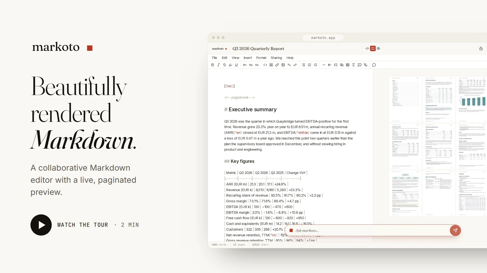
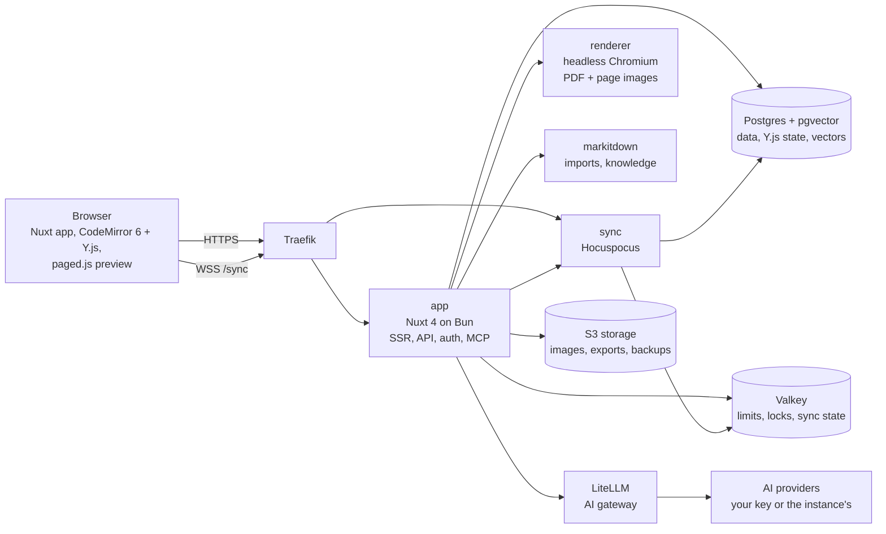

<p align="center">
  <a href="./.github/media/markoto-demo.mp4">
    
  </a>
</p>

<p align="center">
  <sub><b><a href="./.github/media/markoto-demo.mp4">Watch the two-minute tour</a></b> (MP4, 1080p, 1:59) ·
  Music by <a href="https://pixabay.com/users/poradovskyi-52868186/?utm_source=link-attribution&utm_medium=referral&utm_campaign=music&utm_content=511963">Andrii Poradovskyi</a> from <a href="https://pixabay.com/music//?utm_source=link-attribution&utm_medium=referral&utm_campaign=music&utm_content=511963">Pixabay</a></sub>
</p>

# markoto

**Beautifully rendered Markdown.** markoto is a collaborative Markdown editor
with a live, paginated preview. You write plain text on the left; the right
side lays it out as real A4 or Letter pages while you type, and the PDF you
export matches that preview page for page.

**[Try it on markoto.app](https://markoto.app)**: free, and no sign-up needed to
start writing. Or [host it yourself](#self-hosting) with one script.

[](https://github.com/joelbarmettlerUZH/markoto.app/actions/workflows/ci.yml)
[](./LICENSE)
[](https://github.com/joelbarmettlerUZH/markoto.app/releases)

## Why markoto

Markdown is the best way to write: plain text, portable, diffable, fast. It
has never been a good way to *hand something over*. The moment a report, a
proposal or a paper has to look finished, the text leaves Markdown for a word
processor, and the two versions drift apart.

markoto keeps you in Markdown all the way to the printed page. The document
is the Markdown; the layout comes from a theme; the preview *is* the PDF, not
an approximation of it. Around that core sit the things a real document
needs: people editing at the same time, comments, a history you can rewind,
files to draw facts from, and an AI assistant that edits the text with you
instead of pasting over it.

It is built for people who already like Markdown and need what they write to
look finished: reports, proposals, documentation, theses, handbooks,
newsletters.

## Contents

- [A tour of the features](#a-tour-of-the-features)
- [Connect your own AI agent (MCP)](#connect-your-own-ai-agent-mcp)
- [Self-hosting](#self-hosting)
- [How it is built](#how-it-is-built)
- [Privacy: an EU-only data path](#privacy-an-eu-only-data-path)
- [The hosted version](#the-hosted-version)
- [Development](#development)
- [License](#license)
- [Contributing and security](#contributing-and-security)

## A tour of the features

### Writing, with more than plain Markdown

A CodeMirror 6 editor with a formatting toolbar and a menu bar, so you never
have to remember syntax you don't use daily. On top of GitHub-flavoured
Markdown (tables, task lists, footnotes) markoto renders:

- **Math** with KaTeX (`$…$` and `$$…$$`) and **Mermaid diagrams** in fenced code blocks.
- **Alerts** (`> [!NOTE]`, `[!TIP]`, `[!WARNING]`, …), **definition lists**, **abbreviations**, **highlight**, **insert**, sub- and superscript, emoji shortcodes and smart typography.
- **Figures** with captions, image sizing and **attributes** (`{#id .class width=50%}`).
- **`[[toc]]`** for a table of contents (with page numbers in the PDF), **`<!-- pagebreak -->`** for a new page, and `<!-- private notes -->` that stay in the source but never render.
- Syntax highlighting for code fences in every common language.

New documents can start from a template, and each one carries a short
context (description, audience, language) that the AI takes into account.
The full syntax is in the [Markdown reference](./content/docs/writing/markdown-reference.md).

### A paged preview, and a PDF that matches it

The preview is not a scrolling web page: it is the document, paginated with
[paged.js](https://pagedjs.org) into A4 or Letter pages with running headers,
footers, page numbers, a cover page and footnotes at the foot of the page.
One function compiles the theme into the CSS that drives both the live
preview and the PDF, and the PDF is printed server-side by a headless
Chromium sidecar from the same print page. What you see is what you ship.

### Themes and custom CSS

Change the look without touching the Markdown. Pick one of eight built-in
themes, then adjust colours, fonts (a curated Google Fonts set, served by the
instance itself), heading scale, page size, headers and footers,
the table of contents and the cover page. Save a look as your own preset, or
set a default theme for a whole workspace.

For everything the panel doesn't cover there is **custom CSS** per document,
sanitised on the server (an at-rule allowlist, `url()` only to the document's
own uploads) so a shared document can't load anything from elsewhere.

### Real-time collaboration and comments

Documents are [Y.js](https://yjs.dev) CRDTs synced through a
[Hocuspocus](https://tiptap.dev/hocuspocus) server: share the link and edits
arrive live, with named cursors and presence. There is no save button and no
merge conflict. Each document is private, open to edit, view-only or
password-protected, and its link can also be shared as a QR code.

Comments sit next to the text they're about, with replies, @mentions and
resolve. Writing `@markoto` in a comment asks the AI about that passage; its
answer lands in the thread.

### Activity Log, with diffs and restore

Every change is recorded with who made it: a person, the in-editor AI, or an
external agent connected over MCP. Open any entry as a diff, and restore the
document to that exact state (content, title and theme) in one click. A
restore is itself a logged change, so it can be undone too.

### Workspaces and the knowledge base

Workspaces group documents and people with three roles (admin, editor,
viewer). Invitations go out by email and take effect once accepted.

Each workspace has a **knowledge base**: upload PDF, Word, PowerPoint, Excel,
HTML, EPUB, Markdown or text files, and markoto converts them to Markdown
(with Microsoft's [markitdown](https://github.com/microsoft/markitdown)),
splits them into heading-aware chunks, embeds them and stores them in
Postgres with pgvector. Retrieval is hybrid (vector search plus full-text,
fused by reciprocal rank), and the AI cites those files instead of guessing.
The original uploads are deleted once they are processed.

### AI that edits with you

The assistant is not a chat window beside your document. It joins the
document as a real Y.js collaborator: you ask in the prompt bar, it reads the
page, edits it, and you watch the changes arrive like a colleague's typing.
Every change it makes shows up in the Activity Log and can be restored.

- **An agent with tools**: about two dozen tools to read and replace text, insert sections, restyle the theme, comment, look at other documents you can open, search the workspace knowledge base, search the web, read a URL, render and look at the pages, and generate images into the document.
- **Rewrite a selection** in place, or ask in a comment with `@markoto`.
- **Voice**: speak a prompt instead of typing it, or use **live dictation** to stream speech into the editor as you talk.
- **Guard rails**: per-tool and per-session limits, and once a session has read text written by someone else, tools that reach outside the document (other documents, knowledge, the web) wait for your confirmation.
- **Bring your own key**: chat, image generation and transcription run on any OpenAI-compatible provider you connect under **Settings → AI provider**, or on a default the instance operator configured (including a local model such as Ollama). Calls on your own key never draw on markoto's AI budget.
- **EU-resident defaults**: the providers the stack ships with are Mistral (text and voice), Jina (embeddings and page reading), Staan (web search) and Black Forest Labs (images, on its EU endpoint), all routed through a self-hosted [LiteLLM](https://github.com/BerriAI/litellm) gateway.

Which model powers which feature, and which models we recommend for
bring-your-own-key, is in [docs/AI-MODELS.md](./docs/AI-MODELS.md).

### Import and export

- **Import** DOCX, PDF, PPTX, XLSX, HTML and EPUB through File → Import; they are converted to Markdown on the server.
- **Export** the paged PDF, or download the document as a plain `.md` file. A `.md` saved from markoto brings its theme along when you import it again.
- **Duplicate** a document, with its images, to start the next one.

## Connect your own AI agent (MCP)

markoto runs an [MCP](https://modelcontextprotocol.io) server at `/mcp`
(on the hosted service: `https://markoto.app/mcp`; on your own instance:
`https://<your-domain>/mcp`). An MCP client such as Claude Code, Claude
Desktop, Cursor or your own script can then read and edit your documents
with the same tool implementations the built-in AI uses. The edits go into
the live document, so collaborators watch them arrive, and the Activity Log
attributes them to the client ("Claude Desktop", "Cursor", …) acting on
your behalf.

The AI in that client is the client's own: markoto's writing assistant and
your AI provider settings are not involved.

### Create a personal access token

1. Sign in, open the profile menu (your avatar, top right) and choose **Integrations (MCP)**. The page is `/settings/integrations`.
2. Name the token after where it will live ("Claude Code on laptop") and press **Generate**.
3. Copy the token. It starts with `mkt_` and is shown exactly once: markoto stores only its SHA-256 hash. Lost it? Revoke it and create a new one.

A token acts as you and can never exceed your own access. New tokens carry
all four scopes:

| Scope | Allows |
|---|---|
| `documents:read` | List and read your documents, comments, themes, activity and page images; export as Markdown or PDF |
| `documents:write` | Create, edit and duplicate documents, set titles and themes, save theme presets, manage comments, generate images into a document |
| `knowledge:read` | Search and read knowledge files in workspaces you belong to |
| `web:fetch` | Web search and URL reading (when the instance has those providers) |

Tools for a scope the token lacks are not even listed to the client, and
every call is checked again against the scope and your access to the
document. Calls are rate-limited per token and per account, a connection
belongs to the token that opened it, and revoking a token on the
Integrations page stops it immediately. You can have up to 20 active tokens.

### Claude Code

```sh
claude mcp add --transport http markoto https://markoto.app/mcp \
  --header "Authorization: Bearer mkt_your_token"
```

### Cursor

In `~/.cursor/mcp.json` (or `.cursor/mcp.json` in a project):

```json
{
  "mcpServers": {
    "markoto": {
      "url": "https://markoto.app/mcp",
      "headers": { "Authorization": "Bearer mkt_your_token" }
    }
  }
}
```

### Claude Desktop

markoto authenticates with a bearer token (OAuth sign-in for MCP is not
implemented yet), so Claude Desktop connects through the
[`mcp-remote`](https://github.com/geelen/mcp-remote) bridge, which needs
Node.js. In `claude_desktop_config.json`:

```json
{
  "mcpServers": {
    "markoto": {
      "command": "npx",
      "args": ["mcp-remote", "https://markoto.app/mcp", "--header", "Authorization:${AUTH_HEADER}"],
      "env": { "AUTH_HEADER": "Bearer mkt_your_token" }
    }
  }
}
```

Any other client works the same way: the URL plus an
`Authorization: Bearer mkt_…` header. The Integrations page shows a
ready-made snippet with your instance's URL filled in. Treat a token like a
password. The user-facing guide is
[content/docs/account/mcp.md](./content/docs/account/mcp.md); the
implementation notes are in [server/mcp/AGENTS.md](./server/mcp/AGENTS.md).

## Self-hosting

The self-hosted instance runs the same code and images as markoto.app;
everything that differs is configuration. One installer configures and starts
the whole stack on a single Linux machine.

**You need** a Linux host with Docker Engine and the Compose plugin **v5.0 or
newer**, `openssl` and `curl`, about 6 GB of RAM and 15 GB of disk. For HTTPS,
a domain pointing at the host with ports 80 and 443 open.

```sh
git clone https://github.com/joelbarmettlerUZH/markoto.app.git markoto
cd markoto
./install.sh
```

**What `install.sh` does.** It asks for a domain (HTTPS through Let's
Encrypt) or a plain-HTTP port, the email addresses that become instance
admins, and optionally sign-in and AI keys. Then it checks Docker,
generates every secret with `openssl rand`, writes `.env` (mode 0600, secrets
never printed), pulls the signed release images matching your checkout (or
builds them), starts the stack and waits until the app reports healthy.
Re-running it is safe: existing secrets are kept. Every question also has a
flag for unattended installs:

```sh
./install.sh -y --domain docs.example.org --acme-email ops@example.org --admin-email you@example.org
./install.sh -y --http-port 8080 --admin-email you@example.org   # plain HTTP, e.g. behind your own proxy
```

After that, plain `docker compose ps / logs / up -d` work from the checkout,
because `.env` selects the compose files. The stack is Traefik (the only
published port), the app, the sync server, the PDF renderer, markitdown,
Postgres with pgvector, Valkey, SeaweedFS for S3-compatible storage, the
LiteLLM gateway and an encrypted backup job. Every container drops its Linux
capabilities, most run as non-root on a read-only filesystem, and the
services are split across purpose networks. Previews and PDFs need no CDN:
scripts, styles and fonts are served by the instance itself.

**Sign-in.** Without any sign-in provider the instance is anonymous-only:
anyone who can reach it can write, share and export public documents. To let
people own documents, use workspaces and AI, configure your own **OpenID
Connect** provider (Authentik, Keycloak, Authelia, Pocket ID, Zitadel, Dex, …)
with `NUXT_OAUTH_OIDC_ISSUER` / `_CLIENT_ID` / `_CLIENT_SECRET`, and/or
GitHub and Google OAuth apps.

**AI.** Optional, and off until you add something. Users can bring their own
OpenAI-compatible key, or you set instance defaults with
`NUXT_AI_DEFAULT_{CHAT,IMAGE,TRANSCRIBE}_MODEL` (plus `_BASE_URL` and
`_API_KEY` for any OpenAI-compatible endpoint, including Ollama on the same
host). `./install.sh --mistral-api-key …` sets up Mistral for chat and voice
in one go. Knowledge-base embeddings use Jina by default or any embeddings
provider you configure.

**Upgrades and backups.**

```sh
git pull                 # or: git checkout vX.Y.Z
./install.sh upgrade     # keeps .env, adds new secrets, pulls, restarts, waits for health
```

Migrations run automatically on start. Backups are on by default: a daily
`pg_dump`, encrypted with gpg and stored in the bucket (or in a separate
S3-compatible store you point it at), keeping the newest 14.
`./install.sh status`, `logs` and `reembed` cover the rest.

Billing is off on a self-hosted instance: everyone is on the free tier, with
limits you set. The full guide covers every variable, reverse proxies,
restores and troubleshooting:
**[docs/SELF-HOSTING.md](./docs/SELF-HOSTING.md)**.

## How it is built



- **One full-stack Nuxt 4 process** on Bun serves the UI (SSR), the REST API, sign-in and the MCP server.
- **Hocuspocus runs in its own container**, so long-lived WebSockets don't share the API's event loop. Y.js state is stored in Postgres, so a single `pg_dump` backs up every document and its full history.
- **The AI is a Y.js client.** Prompts start an agentic loop on the server that edits the document through the same sync path as people, and the MCP server reuses exactly the same tool implementations.
- **Every AI call goes through LiteLLM**, which gives one OpenAI-shaped API, per-user budgets on platform-paid usage and zero-cost pass-through for bring-your-own-key.
- **Sidecars stay isolated**: the PDF renderer runs Chromium with its sandbox and a network allowlist; markitdown only converts files.

The contributor-oriented overview is [docs/ARCHITECTURE.md](./docs/ARCHITECTURE.md).
Engineering detail lives in [AGENTS.md](./AGENTS.md) and the per-area
`AGENTS.md` files next to the code, written to be useful to people and to AI
coding agents alike.

## Privacy: an EU-only data path

markoto.app is operated by LatentSpace Labs GmbH in Zurich, and every
sub-processor that touches documents sits in the EU: OVHcloud (database and
object storage), Mistral AI (text and voice), Jina AI (embeddings, page
reading), Staan (web search) and Black Forest Labs (images, EU endpoint).
The rest (Stripe, Resend for email, Sentry in its Frankfurt region, and
GitHub and Google for sign-in only) are covered by the EU-US Data Privacy
Framework. There are no analytics trackers and no cookie banner, because
markoto uses only strictly necessary storage.

The hosted service also ships the user-facing side of GDPR: a data export,
account deletion with a 30-day grace period, IPs truncated before they are
logged, and abuse reporting. Every purpose for processing personal data is
kept in one registry ([server/legal/](./server/legal/)) that the privacy page
renders from.

On a self-hosted instance you are the operator: the data stays on your
machine, and AI features talk only to the providers you configure.

## The hosted version

[markoto.app](https://markoto.app) is free. You can write and share without
an account; signing in (GitHub or Google) adds owned documents, workspaces
and AI, including a monthly free allowance for the writing assistant. Paid
plans are coming soon.

## Development

You need [Bun](https://bun.sh) 1.4 or newer, Docker with Compose 5.0 or newer
(or rootless Podman), `make` and `openssl`. No external accounts or API keys.

```sh
make setup      # .env with generated secrets, then bun install for the root, sync-server and renderer
make dev        # infra containers: Postgres, Valkey, SeaweedFS, LiteLLM, sync, markitdown, renderer
make dev-app    # the Nuxt app on the host, with hot reload
```

Open the URL Nuxt prints (usually `http://localhost:3000`); anonymous editing
works as is. Sign-in and the AI assistant need OAuth and provider keys in
`.env`. The full setup, test tiers and conventions are in
[CONTRIBUTING.md](./CONTRIBUTING.md).

`make help` lists every workflow; [docs/CHEATSHEET.md](./docs/CHEATSHEET.md)
is the flat reference.

```sh
bun run test               # unit, DOM and Nuxt tiers, no Docker needed
bun run test:integration   # REST and sync tier against a Docker test stack
bun run flows:test         # Playwright flows, which double as the user docs
```

The user documentation lives in [content/docs/](./content/docs/) and is served
at `/docs` on every instance; its walkthroughs are recorded from the
Playwright flows, so the docs can't drift from the product. The other files
in `docs/` (deploy, runbook, secrets rotation, breach response, …) describe
how we operate the hosted instance, published for transparency.

## License

markoto is **source-available** under the
[Functional Source License 1.1 with an Apache 2.0 future grant](./LICENSE)
(FSL-1.1-ALv2). In plain words:

- You may **use, self-host, modify and redistribute** it, for yourself, your team or your company, for any purpose except one.
- That exception: you may not offer it, or something substantially similar built from it, **as a competing commercial product or service**.
- **Each release becomes Apache 2.0** two years after it is published, without that restriction. Older versions turn into ordinary open source on a rolling basis.

More about the license at [fsl.software](https://fsl.software).

## Contributing and security

- [CONTRIBUTING.md](./CONTRIBUTING.md): development setup, the test tiers and pull-request conventions (PR titles and descriptions become release notes verbatim).
- [SECURITY.md](./SECURITY.md): how to report a vulnerability. Please don't open a public issue for security problems.

---

markoto is made by [LatentSpace Labs GmbH](https://markoto.app/legal/imprint), Zurich.
