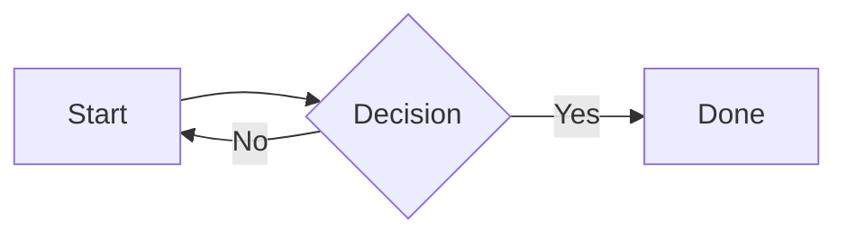

# Markdown reference

markoto renders standard markdown (CommonMark plus GitHub-style tables, task
lists and footnotes) and a set of extensions. Everything below shows up in
the live preview and survives PDF export. For a guided tour of the fancier
blocks see [Tables, alerts, math, and diagrams](/docs/writing/rich-content).

Raw HTML is not rendered: it is removed for safety. Use the syntax below.

## Text

| You type | You get |
|---|---|
| `**bold**`, `*italic*`, `~~strike~~` | **bold**, *italic*, ~~strike~~ |
| `==highlight==` | highlighted text |
| `++inserted++` | inserted (underlined) text |
| `H~2~O`, `E=mc^2^` | subscript and superscript |
| `[text](https://example.com)` | a link (opens in a new tab) |
| `https://example.com` | bare URLs and email addresses become links |
| `:rocket:` | emoji shortcodes |

Typography is automatic: `--` becomes an en dash, `---` an em dash, `...`
an ellipsis, and straight quotes become smart quotes. A single line break
inside a paragraph is kept as a line break; a blank line starts a new
paragraph.

## Structure

- Headings with `#` to `######`. Every heading gets an anchor id.
- When the theme numbers sections, `# References {.unnumbered}` (or the
  shorter `# References {-}`) leaves that heading without a number; the
  numbering of the other headings carries on as if it weren't there, and
  its table-of-contents entry has no number either.
- A section headed *References* (or Bibliography, Literatur, Références,
  Referencias, 参考文献 …) is the reference list: write each entry as an
  item of a numbered list or as its own paragraph, and the theme gives it
  a hanging indent or [1] labels.
- Lists: `-`, `*` or `+` for bullets, `1.` for numbers, indent two spaces to nest.
- Task lists: `- [ ] todo` and `- [x] done`.
- Definition lists: a term on one line, then `: definition` on the next.
- Blockquotes with `>`; horizontal rules with `---`.
- Footnotes: write `text[^1]` and later `[^1]: The note.` In the PDF they appear at the foot of the page.
- Abbreviations: `*[HTML]: HyperText Markup Language` gives every `HTML` a tooltip.

## Attributes

Curly braces after an element add an id, classes or inline style:

```markdown
# Title {#intro .lead}
[click](https://example.com){.btn}
```

A paragraph takes its attributes on the line after it. Only a safe set of
attributes survives (`class`, `id`, `style`, `width`, `height`, `title`,
`aria-*`, `role`).

## Images

Images render as figures, with the alt text as the caption.

```markdown


{width=50%}
{width=200 height=100}
{style="width: 50%; float: right"}
```

Bare numbers are pixels. Drag and drop or paste an image into the editor to
upload it (PNG, JPEG, GIF or WebP, up to 10 MB); markoto inserts the
markdown for you. A link around an image works too:
`[](https://example.com)`.

## Code

Fenced blocks with a language name get syntax highlighting (about 190
languages):

````markdown
```python
def f(x):
    return x + 1
```
````

## Tables

```markdown
| Left | Centre | Right |
|:-----|:------:|------:|
| a    |   b    |     c |
```

The colons in the separator row set the alignment. The **Insert** menu has a
table size picker.

A paragraph that starts with `Table:` (or just `:`) right above or below a
table is its caption:

```markdown
| Metric      | Q3 2026 |
|:------------|--------:|
| Net revenue |    48.6 |

Table: Key figures (CHF million)
```

The theme decides whether captions sit above or below the table and can
number them ("Table 1:"), so don't type the number yourself. In table
cells, a number and its unit (`+8.1 %`, `180 ms`, `CHF 48.6`) and short
codes like `SEV-1` never break across two lines.

## Math

Inline `$E = mc^2$`, or a block between `$$` lines:

```markdown
$$
\sum_{i=1}^{n} i = \frac{n(n+1)}{2}
$$
```

Write `\$` for a literal dollar sign. Broken math renders in red instead of
breaking the page.

## Alerts

A blockquote whose first line is exactly `[!NOTE]`, `[!TIP]`, `[!IMPORTANT]`,
`[!WARNING]` or `[!CAUTION]`:

```markdown
> [!TIP]
> Helpful suggestion.
```

Text after the marker on the first line (a custom title) is not supported.

## Diagrams

A fenced block with the language `mermaid`:

````markdown

````

Supported: flowchart, sequence, class, state, ER, Gantt, pie, mind map, Git
graph and timeline diagrams.

## Table of contents and page breaks

- `[[toc]]` on its own line inserts a table of contents of headings 1 to 4, with page numbers in the PDF.
- `<!-- pagebreak -->` on its own line starts a new page in the preview and the PDF.

## Private notes

`<!-- anything -->` is a comment: it stays in your markdown but is not shown
in the preview, the PDF or a shared view. It can span several lines or sit
inside a paragraph. Use it for to-dos and notes to yourself (the AI reads the
markdown too, so it also works as a brief for it). The toolbar has a button
for it.

## Not supported

- Raw HTML and `:::` containers (use alerts instead).
- Image sizing like `` (use `{width=50%}`).

## What's next

- [Tables, alerts, math, and diagrams](/docs/writing/rich-content): insert them from the menu.
- [Pick a theme](/docs/themes/pick-a-theme): how the result looks on the page.
