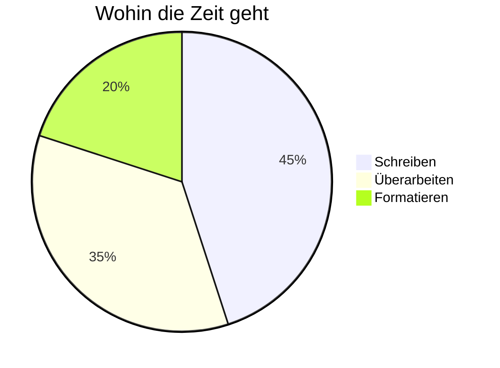

# Markdown-Spickzettel

Das Markdown, das du wirklich brauchst, von den Grundlagen bis zu Tabellen, Fussnoten, Formeln und Diagrammen. Jedes Beispiel zeigt den Quelltext neben seinem Ergebnis, dargestellt mit demselben Code wie die Vorschau von markoto.

Die Beschriftung jedes Beispiels sagt, woher die Syntax stammt:

- **CommonMark** ist der Markdown-Standard. Fast jeder Markdown-Editor unterstützt ihn.
- **GitHub Markdown** ist das, was GitHub darstellt: GitHub Flavored Markdown (Tabellen, Aufgabenlisten, Durchstreichen) plus Fussnoten, Hinweise, Formeln und Mermaid-Diagramme. Viele Editoren unterstützen das meiste davon.
- **markoto-Erweiterung** ist zusätzliche Syntax, die markoto darstellt. Andere Editoren zeigen sie unter Umständen als reinen Text.

## Überschriften

Ein `#` pro Ebene, von `#` (Titel) bis `######`. Nach den Rauten folgt ein Leerzeichen.

::sample{kind="commonmark"}
---
source: |
  # Titel
  ## Abschnitt
  ### Unterabschnitt
---
::

## Fett, kursiv und durchgestrichen

::sample{kind="commonmark"}
---
source: |
  **Fett**, *kursiv* und ***beides***.
  Unterstriche gehen auch: __fett__, _kursiv_.
---
::

::sample{kind="gfm"}
---
source: |
  ~~Durchgestrichen~~
---
::

Hervorhebung, eingefügter Text, tief- und hochgestellt sind Erweiterungen:

::sample{kind="markoto"}
---
source: |
  ==Hervorgehobener== und ++eingefügter++ Text.
  H~2~O und E = mc^2^
---
::

## Absätze und Zeilenumbrüche

Eine Leerzeile beginnt einen neuen Absatz. In markoto bleibt ein einfacher Zeilenumbruch innerhalb eines Absatzes ein Zeilenumbruch, wie in einer Chatnachricht. Reines CommonMark fügt die beiden Zeilen zu einer zusammen; beende in anderen Editoren eine Zeile deshalb mit zwei Leerzeichen oder einem Backslash, um einen Umbruch zu erzwingen.

::sample{kind="markoto"}
---
source: |
  Erste Zeile
  zweite Zeile, selber Absatz.

  Ein neuer Absatz.
---
::

Die Typografie passiert automatisch: `--` wird zum Halbgeviertstrich, `---` zum Geviertstrich, `...` zu einer Ellipse, und gerade Anführungszeichen werden zu typografischen.

## Listen

Aufzählungspunkte beginnen mit `-`, `*` oder `+`, nummerierte Einträge mit `1.`. Für Unterpunkte rückst du um zwei Leerzeichen ein.

::sample{kind="commonmark"}
---
source: |
  - Äpfel
  - Birnen
    - Williams
    - Conference

  1. Ofen vorheizen
  2. Teig anrühren
  3. 25 Minuten backen
---
::

Bei Aufgabenlisten folgen auf den Strich eckige Klammern. Ein `x` hakt das Kästchen ab.

::sample{kind="gfm"}
---
source: |
  - [x] Entwurf schreiben
  - [ ] Um Feedback bitten
  - [ ] PDF verschicken
---
::

## Links und Bilder

::sample{kind="commonmark"}
---
source: |
  [CommonMark-Hilfe](https://commonmark.org/help/)
  [Mit Tooltip](https://commonmark.org "Die Spezifikation")
---
::

Blosse Web- und E-Mail-Adressen werden ohne jede Syntax zu Links:

::sample{kind="gfm"}
---
source: |
  Die Spezifikation steht auf https://commonmark.org.
---
::

Ein Bild ist ein Link mit vorangestelltem `!`; der Text in den eckigen Klammern ist der Alternativtext. markoto zeigt ihn als Bildunterschrift. Geschweifte Klammern nach dem Bild legen seine Grösse fest; reine Zahlen sind Pixel.

::sample{kind="markoto"}
---
source: |
  {width=64}
---
::

Ziehe in markoto ein Bild in den Editor oder füge es ein, um es hochzuladen (PNG, JPEG, GIF oder WebP, bis 10 MB); das Markdown wird für dich eingefügt.

## Zitate und horizontale Linien

::sample{kind="commonmark"}
---
source: |
  > Markdown soll so leicht zu lesen
  > und so leicht zu schreiben sein wie möglich.

  ***

  Text nach der Linie.
---
::

Eine horizontale Linie besteht aus drei oder mehr `-`, `*` oder `_` auf einer eigenen Zeile. Verwende direkt unter einer Textzeile `***` oder `___`: `---` macht dort die Zeile darüber zu einer Überschrift.

## Code

Code im Fliesstext steht zwischen Backticks. Ein Codeblock beginnt mit drei Backticks; der Name der Sprache nach den öffnenden Backticks schaltet die Syntaxhervorhebung ein (rund 190 Sprachen).

::sample{kind="commonmark"}
---
source: |
  Führe zuerst `npm install` aus.

  ```python
  def greet(name):
      return f"Hallo, {name}!"
  ```
---
::

## Tabellen

Senkrechte Striche trennen die Spalten; die zweite Zeile trennt den Tabellenkopf ab. Doppelpunkte in dieser Zeile legen die Ausrichtung fest: links, zentriert oder rechts.

::sample{kind="gfm"}
---
source: |
  | Artikel | Menge | Preis |
  |:--------|:-----:|------:|
  | Papier  |   2   |  4.50 |
  | Stifte  |  12   |  9.00 |
---
::

Die Spalten müssen im Quelltext nicht bündig sein. Das Menü **Einfügen** von markoto hat eine Auswahl für die Tabellengrösse, sodass du die Trennzeile selten selbst tippst.

## Fussnoten

Eine Markierung im Text und die Anmerkung irgendwo darunter. Die Anmerkung wird automatisch nummeriert; in der Vorschau und im PDF von markoto steht sie unten auf der Seite.

::sample{kind="gfm"}
---
source: |
  Markdown erschien 2004.[^1]

  [^1]: Von John Gruber, zusammen mit Aaron Swartz.
---
::

## Hinweise

Ein Zitat, dessen erste Zeile genau `[!NOTE]`, `[!TIP]`, `[!IMPORTANT]`, `[!WARNING]` oder `[!CAUTION]` lautet. Text nach der Markierung auf dieser ersten Zeile unterstützt markoto nicht.

::sample{kind="gfm"}
---
source: |
  > [!TIP]
  > Mit Cmd/Ctrl + P druckst du das Dokument.

  > [!WARNING]
  > Damit wird die Datei für alle gelöscht.
---
::

## Formeln

LaTeX steht im Text zwischen einfachen Dollarzeichen, als Block zwischen `$$`-Zeilen. Für ein echtes Dollarzeichen schreibst du `\$`. In markoto erscheint eine fehlerhafte Formel rot, statt die Seite zu zerstören.

::sample{kind="gfm"}
---
source: |
  Einstein: $E = mc^2$

  $$
  \sum_{i=1}^{n} i = \frac{n(n+1)}{2}
  $$
---
::

## Diagramme

Ein Codeblock mit der Sprache `mermaid` wird zum Diagramm: Flussdiagramm, Sequenz-, Klassen-, Zustands-, ER-, Gantt- oder Kreisdiagramm, Mindmap, Git-Graph oder Zeitleiste.

````markdown

````

In markoto erscheint das Diagramm in der Vorschau und im PDF, in den Schriften und Farben des Dokuments:

::flow-strip{id="rich-content" frames="20" caption="Ein Mermaid-Kreisdiagramm in markoto: links der Quelltext, rechts die dargestellte Seite."}
::

## Definitionslisten und Abkürzungen

Ein Begriff auf einer Zeile und `: ` plus die Definition auf der nächsten. Eine Abkürzungszeile gibt jedem Vorkommen des Worts einen Tooltip.

::sample{kind="markoto"}
---
source: |
  Markdown
  : Ein Klartextformat zum Schreiben von Dokumenten.

  CommonMark
  : Die Spezifikation, der die meisten Editoren folgen.

  *[PDF]: Portable Document Format

  Exportiere das PDF über das Menü Datei.
---
::

## Attribute

Geschweifte Klammern nach einem Element fügen eine ID, Klassen oder einen Stil hinzu. Ein Absatz erhält sie auf der Zeile danach. Erhalten bleibt nur eine sichere Auswahl: `class`, `id`, `style`, `width`, `height`, `title`, `aria-*` und `role`.

::sample{kind="markoto"}
---
source: |
  ## Einleitung {#intro}

  Dieser Absatz ist zentriert.
  {style="text-align: center"}
---
::

## Inhaltsverzeichnis, Seitenumbrüche und private Notizen

- `[[toc]]` auf einer eigenen Zeile fügt ein Inhaltsverzeichnis der Überschriften 1 bis 4 ein. Im PDF hat es Seitenzahlen.
- `<!-- pagebreak -->` auf einer eigenen Zeile beginnt in der Vorschau und im PDF eine neue Seite.
- Alles andere zwischen `<!--` und `-->` ist eine private Notiz: Sie bleibt im Markdown, erscheint aber nicht in der Vorschau, im PDF oder in einer geteilten Ansicht.

::sample{kind="markoto"}
---
source: |
  [[toc]]

  ## Ergebnisse
  Die Tests sind bestanden. <!-- Zahlen mit Sam prüfen -->

  ## Nächste Schritte
  Veröffentlichen.
---
::

## Was in markoto nicht funktioniert

- **Rohes HTML** wird aus Sicherheitsgründen entfernt. Verwende stattdessen die Syntax oben.
- **`:::`-Container** werden nicht unterstützt; nimm einen Hinweis.
- **Bildgrössen im Alternativtext** wie `` funktionieren nicht; schreibe `{width=50%}`.

Jedes Detail, auch zu Bildunterschriften und den vollständigen Regeln für Attribute, steht in der [Markdown-Referenz](/docs/writing/markdown-reference) (auf Englisch).

## Selbst ausprobieren

Bearbeite das Markdown, und die Seiten folgen beim Tippen, so dargestellt, wie markoto sie darstellt. Solange du tippst, wird nichts gespeichert.

::try-it{theme="modern"}
---
source: |
  # Feldnotizen

  Ein kurzer Bericht mit der Syntax von dieser Seite.

  ## Befunde

  - [x] Überschriften, **fett** und *kursiv*
  - [x] Tabellen und Fussnoten[^1]
  - [ ] Dein eigener Text

  | Woche | Besuche | Veränderung |
  |:------|--------:|------------:|
  | 1     |    1240 |           – |
  | 2     |    1610 |        +30% |

  > [!TIP]
  > Mit `<!-- pagebreak -->` auf einer eigenen Zeile beginnst du eine neue Seite.

  Die Fläche eines Kreises ist $A = \pi r^2$.

  [^1]: Fussnoten erscheinen unten auf der Seite.
---
::

::cta{title="Probiere es mit deinem eigenen Markdown." secondary-label="Dokumentation lesen" secondary-to="/docs/writing/markdown-reference"}
markoto zeigt jede Seite beim Tippen und exportiert ein PDF, das ihr entspricht. Kostenlos auf markoto.app, ohne Registrierung.
::
