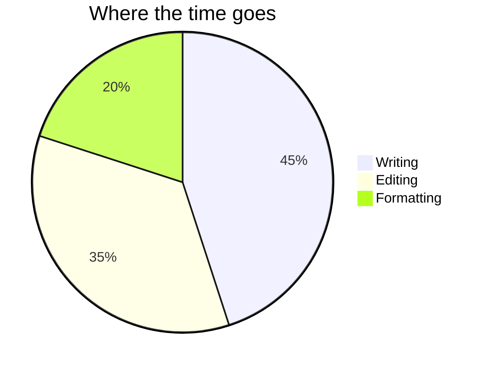

# Markdown cheat sheet

The Markdown you will actually use, from the basics to tables, footnotes, math and diagrams. Each example shows the source next to its result, rendered by the same code as markoto's preview.

The label on each example says where the syntax comes from:

- **CommonMark** is the Markdown standard. Almost every Markdown editor supports it.
- **GitHub Markdown** is what GitHub renders: GitHub Flavored Markdown (tables, task lists, strikethrough) plus footnotes, alerts, math and Mermaid diagrams. Many editors support most of it.
- **markoto extension** is extra syntax that markoto renders. Other editors may show it as plain text.

## Headings

One `#` per level, from `#` (title) to `######`. Leave a space after the hashes.

::sample{kind="commonmark"}
---
source: |
  # Title
  ## Section
  ### Subsection
---
::

## Bold, italic and strikethrough

::sample{kind="commonmark"}
---
source: |
  **Bold**, *italic* and ***both***.
  Underscores work too: __bold__, _italic_.
---
::

::sample{kind="gfm"}
---
source: |
  ~~Struck through~~
---
::

Highlight, inserted text, subscript and superscript are extensions:

::sample{kind="markoto"}
---
source: |
  ==Highlighted== and ++inserted++ text.
  H~2~O and E = mc^2^
---
::

## Paragraphs and line breaks

A blank line starts a new paragraph. In markoto a single line break inside a paragraph stays a line break, as in a chat message. Plain CommonMark joins the two lines into one, so in other editors end a line with two spaces or a backslash to force a break.

::sample{kind="markoto"}
---
source: |
  First line
  second line, same paragraph.

  A new paragraph.
---
::

Typography is automatic: `--` becomes an en dash, `---` an em dash, `...` an ellipsis, and straight quotes become curly ones.

## Lists

Bullets start with `-`, `*` or `+`, numbered items with `1.`. Indent by two spaces to nest.

::sample{kind="commonmark"}
---
source: |
  - Apples
  - Pears
    - Williams
    - Conference

  1. Preheat the oven
  2. Mix the dough
  3. Bake for 25 minutes
---
::

Task lists put brackets after the dash. An `x` ticks the box.

::sample{kind="gfm"}
---
source: |
  - [x] Write the draft
  - [ ] Ask for feedback
  - [ ] Send the PDF
---
::

## Links and images

::sample{kind="commonmark"}
---
source: |
  [CommonMark help](https://commonmark.org/help/)
  [With a tooltip](https://commonmark.org "The spec")
---
::

Bare web and email addresses become links without any syntax:

::sample{kind="gfm"}
---
source: |
  See https://commonmark.org for the spec.
---
::

An image is a link with `!` in front; the text in brackets is the alt text. markoto shows it as the caption. Curly braces after the image set its size; bare numbers are pixels.

::sample{kind="markoto"}
---
source: |
  {width=64}
---
::

In markoto, drag an image into the editor or paste it to upload it (PNG, JPEG, GIF or WebP, up to 10 MB); the Markdown is inserted for you.

## Quotes and horizontal rules

::sample{kind="commonmark"}
---
source: |
  > Markdown is intended to be as easy-to-read
  > and easy-to-write as is feasible.

  ***

  Text after the rule.
---
::

A horizontal rule is three or more `-`, `*` or `_` on their own line. Use `***` or `___` right under a line of text: `---` there turns the line above into a heading.

## Code

Inline code sits between backticks. A fenced block uses three backticks; the language name after the opening fence turns on syntax highlighting (about 190 languages).

::sample{kind="commonmark"}
---
source: |
  Run `npm install` first.

  ```python
  def greet(name):
      return f"Hello, {name}!"
  ```
---
::

## Tables

Pipes separate the columns; the second row separates the header. Colons in that row set the alignment: left, centre or right.

::sample{kind="gfm"}
---
source: |
  | Item    | Qty | Price |
  |:--------|:---:|------:|
  | Paper   |  2  |  4.50 |
  | Pencils | 12  |  9.00 |
---
::

The columns don't have to line up in the source. markoto's **Insert** menu has a table size picker, so you rarely type the separator row yourself.

## Footnotes

A marker in the text and the note anywhere below it. The note is numbered automatically; in markoto's preview and PDF it sits at the bottom of the page.

::sample{kind="gfm"}
---
source: |
  Markdown was released in 2004.[^1]

  [^1]: By John Gruber, with Aaron Swartz.
---
::

## Alerts

A quote whose first line is exactly `[!NOTE]`, `[!TIP]`, `[!IMPORTANT]`, `[!WARNING]` or `[!CAUTION]`. Text after the marker on that first line is not supported in markoto.

::sample{kind="gfm"}
---
source: |
  > [!TIP]
  > Press Cmd/Ctrl + P to print the document.

  > [!WARNING]
  > This deletes the file for everyone.
---
::

## Math

LaTeX between single dollars inline, between `$$` lines as a block. Write `\$` for a literal dollar sign. In markoto a broken formula shows in red instead of breaking the page.

::sample{kind="gfm"}
---
source: |
  Einstein: $E = mc^2$

  $$
  \sum_{i=1}^{n} i = \frac{n(n+1)}{2}
  $$
---
::

## Diagrams

A fenced block with the language `mermaid` becomes a diagram: flowchart, sequence, class, state, ER, Gantt, pie, mind map, Git graph or timeline.

````markdown

````

In markoto the diagram appears in the preview and the PDF in the document's fonts and colours:

::flow-strip{id="rich-content" frames="20" caption="A Mermaid pie chart in markoto: the source on the left, the rendered page on the right."}
::

## Definition lists and abbreviations

A term on one line and `: ` plus the definition on the next. An abbreviation line gives every occurrence of the word a tooltip.

::sample{kind="markoto"}
---
source: |
  Markdown
  : A plain-text format for writing documents.

  CommonMark
  : The specification most editors follow.

  *[PDF]: Portable Document Format

  Export the PDF from the File menu.
---
::

## Attributes

Curly braces after an element add an id, classes or a style. A paragraph takes them on the line after it. Only a safe set survives: `class`, `id`, `style`, `width`, `height`, `title`, `aria-*` and `role`.

::sample{kind="markoto"}
---
source: |
  ## Introduction {#intro}

  This paragraph is centred.
  {style="text-align: center"}
---
::

## Table of contents, page breaks and private notes

- `[[toc]]` on its own line inserts a table of contents of headings 1 to 4. In the PDF it has page numbers.
- `<!-- pagebreak -->` on its own line starts a new page in the preview and the PDF.
- Anything else between `<!--` and `-->` is a private note: it stays in the Markdown but doesn't appear in the preview, the PDF or a shared view.

::sample{kind="markoto"}
---
source: |
  [[toc]]

  ## Results
  The tests passed. <!-- check the numbers with Sam -->

  ## Next steps
  Ship it.
---
::

## What doesn't work in markoto

- **Raw HTML** is removed for safety. Use the syntax above instead.
- **`:::` containers** aren't supported; use an alert.
- **Image sizes in the alt text** like `` don't work; write `{width=50%}`.

Every detail, including image captions and the full attribute rules, is in the [Markdown reference](/docs/writing/markdown-reference).

## Try it yourself

Change the text on the left and the pages on the right follow, rendered the way markoto renders them. Nothing is saved while you type.

::try-it{theme="modern"}
---
source: |
  # Field notes

  A short report with the syntax from this page.

  ## Findings

  - [x] Headings, **bold** and *italic*
  - [x] Tables and footnotes[^1]
  - [ ] Your own text

  | Week | Visits | Change |
  |:-----|-------:|-------:|
  | 1    |  1,240 |      – |
  | 2    |  1,610 |   +30% |

  > [!TIP]
  > Add `<!-- pagebreak -->` on its own line to start a new page.

  The area of a circle is $A = \pi r^2$.

  [^1]: Footnotes appear at the foot of the page.
---
::

::cta{title="Try it with your own Markdown." secondary-label="Read the docs" secondary-to="/docs/writing/markdown-reference"}
markoto shows each page as you type and exports a PDF that matches it. Free on markoto.app, no sign-up needed.
::
