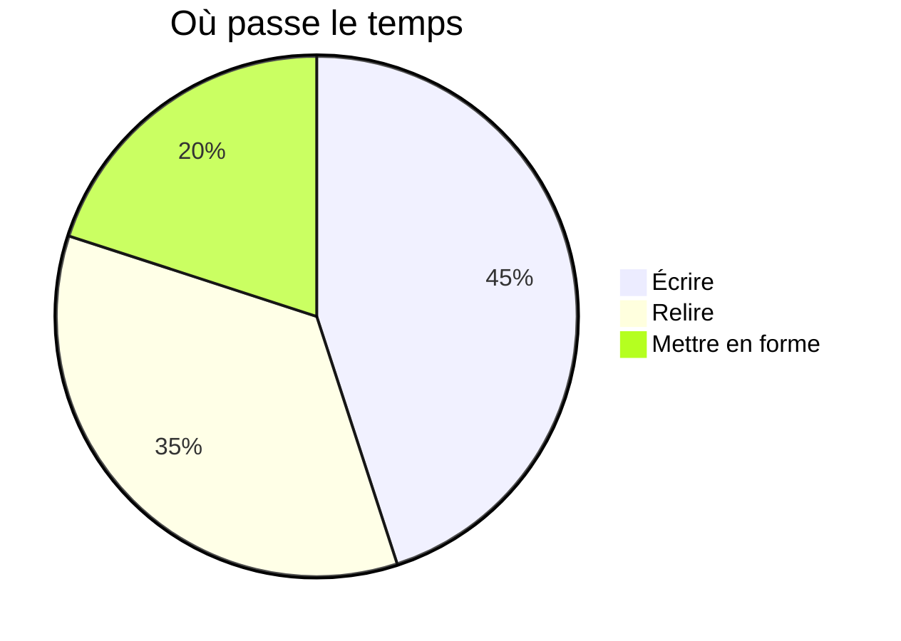

# Aide-mémoire Markdown

Le Markdown dont vous vous servirez vraiment, des bases aux tableaux, notes de bas de page, formules et diagrammes. Chaque exemple montre la source à côté de son résultat, rendu par le même code que l'aperçu de markoto.

L'étiquette de chaque exemple indique d'où vient la syntaxe :

- **CommonMark** est le standard Markdown. Presque tous les éditeurs Markdown le prennent en charge.
- **GitHub Markdown** est ce que GitHub affiche : GitHub Flavored Markdown (tableaux, listes de tâches, texte barré) plus les notes de bas de page, les encarts, les formules et les diagrammes Mermaid. Beaucoup d'éditeurs en prennent en charge l'essentiel.
- **Extension markoto** désigne une syntaxe supplémentaire que markoto affiche. D'autres éditeurs peuvent la montrer en texte brut.

## Titres

Un `#` par niveau, de `#` (titre principal) à `######`. Laissez une espace après les dièses.

::sample{kind="commonmark"}
---
source: |
  # Titre
  ## Section
  ### Sous-section
---
::

## Gras, italique et barré

::sample{kind="commonmark"}
---
source: |
  **Gras**, *italique* et ***les deux***.
  Les tirets bas marchent aussi : __gras__, _italique_.
---
::

::sample{kind="gfm"}
---
source: |
  ~~Barré~~
---
::

Le surlignage, le texte inséré, l'indice et l'exposant sont des extensions :

::sample{kind="markoto"}
---
source: |
  Texte ==surligné== et ++inséré++.
  H~2~O et E = mc^2^
---
::

## Paragraphes et retours à la ligne

Une ligne vide commence un nouveau paragraphe. Dans markoto, un simple retour à la ligne à l'intérieur d'un paragraphe reste un retour à la ligne, comme dans un message de chat. Le CommonMark pur réunit les deux lignes en une seule : dans d'autres éditeurs, terminez donc la ligne par deux espaces ou une barre oblique inverse pour forcer le retour.

::sample{kind="markoto"}
---
source: |
  Première ligne
  deuxième ligne, même paragraphe.

  Un nouveau paragraphe.
---
::

La typographie est automatique : `--` devient un tiret demi-cadratin, `---` un tiret cadratin, `...` des points de suspension, et les guillemets droits deviennent typographiques.

## Listes

Les puces commencent par `-`, `*` ou `+`, les éléments numérotés par `1.`. Indentez de deux espaces pour imbriquer.

::sample{kind="commonmark"}
---
source: |
  - Pommes
  - Poires
    - Williams
    - Conférence

  1. Préchauffer le four
  2. Préparer la pâte
  3. Cuire 25 minutes
---
::

Dans une liste de tâches, des crochets suivent le tiret. Un `x` coche la case.

::sample{kind="gfm"}
---
source: |
  - [x] Rédiger le brouillon
  - [ ] Demander des retours
  - [ ] Envoyer le PDF
---
::

## Liens et images

::sample{kind="commonmark"}
---
source: |
  [Aide CommonMark](https://commonmark.org/help/)
  [Avec une infobulle](https://commonmark.org "La spécification")
---
::

Les adresses web et e-mail seules deviennent des liens sans aucune syntaxe :

::sample{kind="gfm"}
---
source: |
  La spécification est sur https://commonmark.org.
---
::

Une image est un lien précédé de `!` ; le texte entre crochets est le texte alternatif, que markoto affiche comme légende. Des accolades après l'image fixent sa taille ; les nombres seuls sont des pixels.

::sample{kind="markoto"}
---
source: |
  {width=64}
---
::

Dans markoto, faites glisser une image dans l'éditeur ou collez-la pour l'importer (PNG, JPEG, GIF ou WebP, jusqu'à 10 Mo) ; le Markdown est inséré pour vous.

## Citations et lignes horizontales

::sample{kind="commonmark"}
---
source: |
  > Markdown doit être aussi facile à lire
  > et à écrire que possible.

  ***

  Texte après la ligne.
---
::

Une ligne horizontale, c'est au moins trois `-`, `*` ou `_` sur une ligne seule. Juste sous une ligne de texte, utilisez `***` ou `___` : à cet endroit, `---` transforme la ligne du dessus en titre.

## Code

Le code en ligne se place entre accents graves. Un bloc de code commence par trois accents graves ; le nom du langage après ceux d'ouverture active la coloration syntaxique (environ 190 langages).

::sample{kind="commonmark"}
---
source: |
  Lancez d'abord `npm install`.

  ```python
  def greet(name):
      return f"Bonjour, {name} !"
  ```
---
::

## Tableaux

Des barres verticales séparent les colonnes ; la deuxième ligne sépare l'en-tête. Les deux-points de cette ligne fixent l'alignement : à gauche, centré ou à droite.

::sample{kind="gfm"}
---
source: |
  | Article  | Qté | Prix |
  |:---------|:---:|-----:|
  | Papier   |  2  | 4.50 |
  | Crayons  | 12  | 9.00 |
---
::

Les colonnes n'ont pas besoin d'être alignées dans la source. Le menu **Insérer** de markoto propose un sélecteur de taille de tableau : vous tapez rarement la ligne de séparation vous-même.

## Notes de bas de page

Un appel dans le texte et la note n'importe où en dessous. La note est numérotée automatiquement ; dans l'aperçu et le PDF de markoto, elle se place en bas de la page.

::sample{kind="gfm"}
---
source: |
  Markdown est sorti en 2004.[^1]

  [^1]: Par John Gruber, avec Aaron Swartz.
---
::

## Encarts

Une citation dont la première ligne est exactement `[!NOTE]`, `[!TIP]`, `[!IMPORTANT]`, `[!WARNING]` ou `[!CAUTION]`. markoto ne prend pas en charge de texte après le marqueur sur cette première ligne.

::sample{kind="gfm"}
---
source: |
  > [!TIP]
  > Appuyez sur Cmd/Ctrl + P pour imprimer le document.

  > [!WARNING]
  > Cela supprime le fichier pour tout le monde.
---
::

## Formules

Du LaTeX entre dollars simples dans le texte, entre des lignes `$$` pour un bloc. Écrivez `\$` pour un vrai signe dollar. Dans markoto, une formule erronée s'affiche en rouge au lieu de casser la page.

::sample{kind="gfm"}
---
source: |
  Einstein : $E = mc^2$

  $$
  \sum_{i=1}^{n} i = \frac{n(n+1)}{2}
  $$
---
::

## Diagrammes

Un bloc de code avec le langage `mermaid` devient un diagramme : organigramme, diagramme de séquence, de classes, d'états, entité-relation, Gantt, circulaire, carte mentale, graphe Git ou frise chronologique.

````markdown

````

Dans markoto, le diagramme apparaît dans l'aperçu et le PDF avec les polices et les couleurs du document :

::flow-strip{id="rich-content" frames="20" caption="Un diagramme circulaire Mermaid dans markoto : la source à gauche, la page rendue à droite."}
::

## Listes de définitions et abréviations

Un terme sur une ligne, puis `: ` et la définition sur la suivante. Une ligne d'abréviation donne une infobulle à chaque occurrence du mot.

::sample{kind="markoto"}
---
source: |
  Markdown
  : Un format de texte brut pour écrire des documents.

  CommonMark
  : La spécification que suivent la plupart des éditeurs.

  *[PDF]: Portable Document Format

  Exportez le PDF depuis le menu Fichier.
---
::

## Attributs

Des accolades après un élément ajoutent un identifiant, des classes ou un style. Un paragraphe les reçoit sur la ligne qui le suit. Seule une liste sûre est conservée : `class`, `id`, `style`, `width`, `height`, `title`, `aria-*` et `role`.

::sample{kind="markoto"}
---
source: |
  ## Introduction {#intro}

  Ce paragraphe est centré.
  {style="text-align: center"}
---
::

## Table des matières, sauts de page et notes privées

- `[[toc]]` sur une ligne seule insère une table des matières des titres de niveau 1 à 4. Dans le PDF, elle a des numéros de page.
- `<!-- pagebreak -->` sur une ligne seule commence une nouvelle page dans l'aperçu et le PDF.
- Tout autre texte entre `<!--` et `-->` est une note privée : elle reste dans le Markdown mais n'apparaît ni dans l'aperçu, ni dans le PDF, ni dans une vue partagée.

::sample{kind="markoto"}
---
source: |
  [[toc]]

  ## Résultats
  Les tests sont passés. <!-- vérifier les chiffres avec Sam -->

  ## Prochaines étapes
  On livre.
---
::

## Ce qui ne marche pas dans markoto

- **Le HTML brut** est retiré par sécurité. Utilisez plutôt la syntaxe ci-dessus.
- **Les conteneurs `:::`** ne sont pas pris en charge ; utilisez un encart.
- **Les tailles d'image dans le texte alternatif**, comme ``, ne marchent pas ; écrivez `{width=50%}`.

Tous les détails, y compris les légendes d'images et les règles complètes des attributs, se trouvent dans la [référence Markdown](/docs/writing/markdown-reference) (en anglais).

## Essayez vous-même

Modifiez le Markdown et les pages suivent au fil de la frappe, rendues comme markoto les rend. Rien n'est enregistré pendant que vous tapez.

::try-it{theme="modern"}
---
source: |
  # Notes de terrain

  Un court rapport avec la syntaxe de cette page.

  ## Constats

  - [x] Titres, **gras** et *italique*
  - [x] Tableaux et notes de bas de page[^1]
  - [ ] Votre propre texte

  | Semaine | Visites | Évolution |
  |:--------|--------:|----------:|
  | 1       |    1240 |         – |
  | 2       |    1610 |      +30% |

  > [!TIP]
  > Ajoutez `<!-- pagebreak -->` sur une ligne seule pour commencer une nouvelle page.

  L'aire d'un disque est $A = \pi r^2$.

  [^1]: Les notes apparaissent en bas de la page.
---
::

::cta{title="Essayez avec votre propre Markdown." secondary-label="Lire la documentation" secondary-to="/docs/writing/markdown-reference"}
markoto affiche chaque page au fil de la frappe et exporte un PDF identique. Gratuit sur markoto.app, sans inscription.
::
