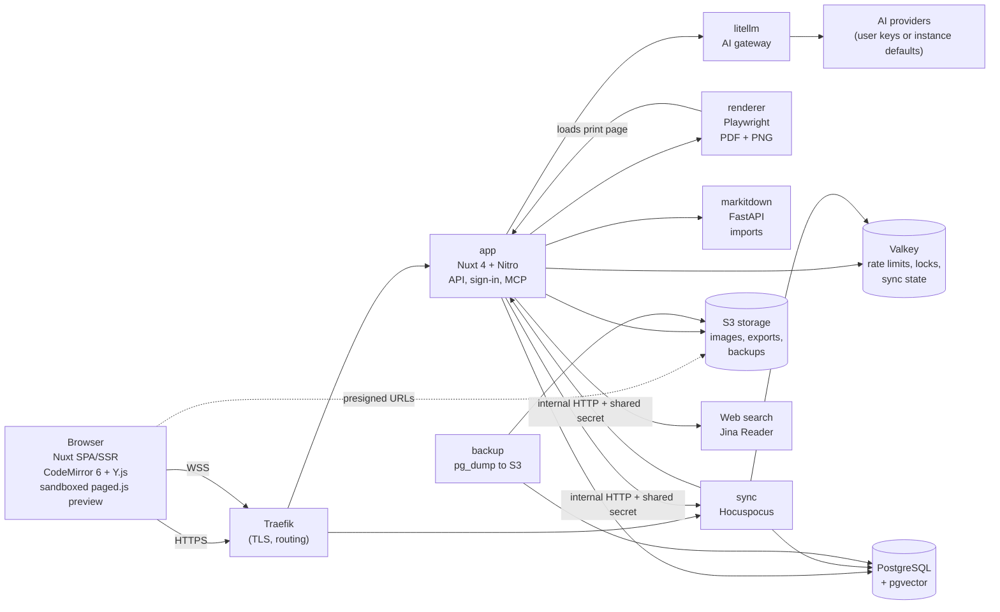

# Architecture

How markoto fits together: the services, how a document travels through them, the security model and the design decisions behind it. Rules for working in a specific folder live in the `AGENTS.md` file next to the code; topic guides live in [`docs/contributing/`](./contributing/).

- [The big picture](#the-big-picture)
- [Services](#services)
- [How a document is edited and saved](#how-a-document-is-edited-and-saved)
- [The AI joins as a collaborator](#the-ai-joins-as-a-collaborator)
- [Preview, themes and PDF](#preview-themes-and-pdf)
- [Workspaces and the knowledge base](#workspaces-and-the-knowledge-base)
- [Security model](#security-model)
- [Data stores](#data-stores)
- [Deployment shapes](#deployment-shapes)
- [Repository layout](#repository-layout)
- [Design decisions](#design-decisions)

## The big picture

markoto is a collaborative markdown editor. Documents are Y.js CRDTs synchronised by a Hocuspocus server. A Nuxt 4 app (SSR, the HTTP API, sign-in, the MCP server) serves the UI. Everything runs on Bun and is wired together with Docker Compose.

## Services

| Service | Directory | Role |
|---|---|---|
| `app` | `app/`, `server/`, `shared/` | One Bun process: Nuxt SSR, the Nitro API, sign-in (OAuth, OpenID Connect, workspace SSO), the MCP server at `/mcp`, background sweepers and workers. Applies Drizzle migrations at boot (`server/plugins/00-db-migrate.ts`). |
| `sync` | `sync-server/` | Hocuspocus WebSocket server. Persists Y.js state to Postgres (the `yjs_updates` log), keeps per-document attribution and diff baselines in Valkey, writes the activity log, snapshots long logs. |
| `renderer` | `renderer/` | Headless Playwright. Loads the app's internal print page and returns PDF and per-page PNGs. Internal only; every browser request is checked against an origin allowlist (`renderer/src/allowlist.ts`). |
| `markitdown` | `markitdown-server/` | Python FastAPI wrapper that converts DOCX/PDF/PPTX/XLSX/HTML/EPUB to markdown (imports, knowledge uploads, design extraction). Internal only, requires its own secret. |
| `litellm` | `deploy/config/litellm/` | LiteLLM proxy. Every AI call goes through it: one OpenAI-shaped API, per-user virtual keys with budgets, spend tracking. Custom providers in `deploy/config/litellm/custom_handlers.py` wrap embeddings, transcription and image generation. |
| `db-init` | `deploy/config/postgres/` | One-shot on every start: creates the app and LiteLLM database roles. |
| `postgres` | | PostgreSQL 16 with pgvector. |
| `valkey` | | Rate limits, session locks, per-document sync state. Losing it costs only transient state. |
| S3 storage | `deploy/config/seaweedfs/` in dev and self-host | Any S3-compatible service. |
| `backup` | `backup-server/` | Periodic encrypted `pg_dump` into its own bucket. |
| `traefik` + `socket-proxy` | `deploy/config/traefik/` (local TLS) | The only published service: TLS, routing, security headers, sticky sessions for sync. Reads Docker labels through a read-only socket proxy. |

Every stack lives in `deploy/compose/`, the third-party config it mounts in `deploy/config/`. Compose files are layered: `deploy/compose/compose.base.yml` holds the shared service shape and is `include:`d by the dev, local, prod and self-host files. Services sit on purpose-specific networks (`data`, `render`, `import`, `storage`, `egress`, …), most of them `internal: true`; see [SECURITY-HARDENING.md](./SECURITY-HARDENING.md).

## How a document is edited and saved

1. The browser calls `GET /api/docs/:id/token`. The server checks access (access mode, workspace role, share, password) and signs a document-scoped JWT, valid at most two hours and never past a share link's expiry (`server/utils/documents/docJwt.ts`). Viewers get a read-only token. For a document the caller may not open the response carries `token: null`, so no connection is possible.
2. The editor connects to Hocuspocus with that token. CodeMirror 6 is bound to a `Y.Text` through `y-codemirror.next`, so edits, cursors and presence travel as CRDT updates. Title, theme and comments live in the same `Y.Doc`.
3. A connection lives only as long as its authorization. Shortly before the token expires the server asks the client for a fresh one and renews in place; an unrenewed connection is closed (`sync-server/src/connection-expiry.ts`). When access becomes stricter (access mode, password, share expiry, membership) the app tells the sync server to close the affected connections, and tokens issued before the change no longer open the document.
4. Hocuspocus debounces changes for 2 seconds, then appends what changed as one row to `yjs_updates`, in its own transaction. A background job writes snapshots so loads stay short, and can prune history older than a configured retention (`sync-server/src/compaction.ts`). The Activity Log's diff and restore replay this log up to a row id. One `pg_dump` therefore backs up all content and history.
5. On each store the sync server records activity rows (edits, title and theme changes) with attribution (person, AI session, MCP client). The Activity Log diffs and restores by replaying stored updates up to a boundary.

## The AI joins as a collaborator

The AI edits documents as a Y.js client, not through a text-patching API. A prompt (prompt bar, selection rewrite or an `@markoto` comment mention) starts an agentic loop on the server (`server/utils/agentic/`):

- The provider is resolved per capability (chat, image, transcription): the user's own key, else the instance default, else unavailable (`server/utils/aiProviders/`). Every call goes through LiteLLM.
- The model calls Zod-defined tools: read and edit text, theme, comments, other documents, web search and page fetch, image generation, workspace knowledge search.
- Edits go through a Hocuspocus connection that identifies as `ai:assistant:<session>`, so collaborators watch them land live and the activity log attributes them.
- Per-tool caps and a per-session interaction cap stop runaway loops. Once a session has read text someone else wrote, tools that cross a boundary (other documents, knowledge, web) wait for the invoking user's confirmation.
- The MCP server (`server/mcp/`, personal access tokens) wraps the same tool implementations, so external clients edit documents the same way.

See [`docs/contributing/ai-tools.md`](./contributing/ai-tools.md), [`docs/contributing/mcp.md`](./contributing/mcp.md) and [AI-MODELS.md](./AI-MODELS.md).

## Preview, themes and PDF

Markdown is rendered by one markdown-it + DOMPurify pipeline (`app/utils/markdown/renderMarkdown.ts`). The preview is a paged view produced by paged.js inside an iframe sandboxed with `allow-scripts` and without `allow-same-origin`, so it runs in an opaque origin and talks to the editor only through a typed postMessage protocol (`app/utils/preview/previewFrame.ts`). One function, `themeToCss(theme)`, compiles the document theme into the CSS for both the live preview and the PDF.

Two PDF paths exist: the server path (`GET /api/docs/:id/pdf`) asks the renderer sidecar to load the internal print page and print it; the browser path (`Cmd/Ctrl+P`, File → Print) prints the same sandboxed paged output in the browser. Third-party browser assets (paged.js, Mermaid, KaTeX, highlight.js themes, web fonts) are copied from pinned npm packages at build time and served from the app's own origin under `/vendor/` with SRI (`modules/vendor-assets.ts`, `shared/utils/vendor/`).

## Workspaces and the knowledge base

Workspaces group documents and people. Roles are `admin`, `editor`, `viewer` and `guest` (`workspace_members`); a guest sees only documents shared with them. Uploaded knowledge files go from the browser to S3 by presigned PUT, are converted by markitdown, split into chunks, embedded through LiteLLM and stored in pgvector with a tsvector column. Retrieval is hybrid (vector plus full text) and exposed to the AI as a tool (`server/utils/knowledge/`).

## Security model

- **Default-deny API.** `server/middleware/auth.ts` requires a session for every `/api` route that is not on the explicit public list (`server/utils/auth/publicRoutes.ts`), and every route declares its own access policy (`defineApiHandler`). State-changing requests also pass an Origin / `Sec-Fetch-Site` check (`server/middleware/csrf.ts`). Sign-in is optional: anonymous visitors can create and edit public documents behind a terms and proof-of-work gate; ownership, workspaces, AI and settings need an account.
- **Authorization below the handler.** The access layer (`server/utils/access/`) decides with the pure rules in `shared/utils/documents/docPermissions.ts` and mints capability proofs (`DocAccess`, `WorkspaceAccess`, `UserScope`, `AdminActor`, `SystemActor`); every repo function that writes or returns tenant-private data demands one and uses the id inside it, and sub-resources are constrained to the proof's parent. Only `server/repos/` queries the database. A handler that forgets a check has no proof to pass, so it does not compile. Guarantees and limits: [SECURITY-HARDENING.md §D.5](./SECURITY-HARDENING.md#d5-tenancy-capability-proofs-below-the-handler).
- **Separate token scopes.** Document JWT, render token, preview file token, dictation token and MCP personal access tokens each work only for their own surface.
- **Internal plane.** Service-to-service routes (`/api/internal/**` on the app, `/internal/**` on the sync server, the render routes) are excluded from the public Traefik routers, require the shared secret (`X-Internal-Secret`, constant-time and rotation-aware, `shared/utils/security/internalSecret.ts`) or their own token, and answer 404 to any request that carries the edge proxy's forwarding headers (`server/utils/platform/internalRoutes.ts`).
- **Preview isolation.** Rendered content is attacker-influenced, so the preview and print iframes run in an opaque origin and load images with a short-lived document-scoped file token. The app sets a nonce-based Content-Security-Policy itself (`server/plugins/csp.ts`) with no third-party hosts.
- **Published pages on their own host.** With `NUXT_PUBLISH_PAGES_HOST` set (required by the hosted shape), published pages and custom domains are served from a hostname that serves nothing else, receives no cookie and is refused as an Origin for app requests (`server/middleware/00.custom-domain.ts`, `server/plugins/00-public-page-host.ts`). Self-hosted instances keep one origin unless they set it.
- **Outbound requests.** User-supplied URLs (AI provider base URLs, fetched images) pass an SSRF policy that refuses internal hostnames and private addresses (`server/utils/aiProviders/urlPolicy.ts`, `server/utils/platform/safeFetch.ts`).
- **Errors.** `server/error.ts` sanitises every error: 4xx keep their message and `data.code`, 5xx become a generic message.

Container hardening, CSP details and the renderer sandbox are in [SECURITY-HARDENING.md](./SECURITY-HARDENING.md). Request limits are in [reference/rate-limits.md](./reference/rate-limits.md).

## Data stores

| Data | Where |
|---|---|
| Application data (users, documents, workspaces, billing, audit and consent logs, …) | PostgreSQL via Drizzle; schema in `server/db/schema/` (one file per domain), migrations in `drizzle/` |
| Y.js document state | PostgreSQL, `yjs_updates` (append-only log of updates and snapshots per document, deleted with the `documents` row; layout in [`docs/contributing/sync-server.md`](contributing/sync-server.md#persistence)) |
| Knowledge chunks and embeddings | PostgreSQL, pgvector HNSW + GIN index |
| Per-document sync state, rate limits, locks | Valkey (sync state has a 24 h TTL) |
| Images, brand assets, rendered PDFs, data exports | S3 |
| Knowledge originals | S3, deleted after processing |
| Database backups | S3, separate bucket and credentials |
| Sessions | Sealed cookies (`nuxt-auth-utils`) |

## Deployment shapes

One codebase; configuration decides the shape:

| Shape | Compose file | Billing | Notes |
|---|---|---|---|
| Self-hosted | `deploy/compose/compose.selfhost.yml` (+ TLS, build, brand overlays), installed by `install.sh` | off | Everything in one stack, legal surfaces off. See [SELF-HOSTING.md](./SELF-HOSTING.md). |
| Hosted, free only (markoto.app) | `deploy/compose/compose.prod.yml`, Ansible in `infra/` | off; paid plans shown as "coming soon" | Managed Postgres and object storage. |
| Hosted with paid plans | same | on (`NUXT_BILLING_ENABLED=true`) | Stripe; plans map to LiteLLM budgets. |

Development uses `deploy/compose/compose.dev.yml` (infrastructure only, app on the host), `deploy/compose/compose.local.yml` (full stack with local TLS) and `deploy/compose/compose.test.yml` (disposable test stack). The app can run as several instances (sticky sessions for sync, Valkey-backed shared state, advisory-locked sweepers).

## Repository layout

| Path | Contents |
|---|---|
| `app/` | Vue frontend: `components/`, `composables/<domain>/`, `pages/`, `layouts/`, `utils/<domain>/`, `plugins/`, `middleware/` |
| `server/` | Nitro: `api/`, `routes/`, `middleware/`, `plugins/` (migrations, sweepers, workers), `db/schema/`, `repos/` (database access), `utils/<domain>/`, `mcp/`, `legal/` |
| `shared/` | Code for client and server: `config/`, `contracts/`, `types/`, `utils/<domain>/`, templates, audiences, languages, legal versions |
| `sync-server/` | Hocuspocus container |
| `renderer/`, `markitdown-server/`, `backup-server/` | Sidecars |
| `modules/` | Nuxt modules (vendored assets) |
| `drizzle/` | Generated migrations and snapshots |
| `content/` | User documentation (`/docs`), legal texts, marketing pages |
| `i18n/locales/` | UI translations |
| `infra/` | Ansible, LiteLLM config, env rendering for the hosted deployment |
| `tests/` | `unit/<domain>/`, `dom/`, `nuxt/`, `repos/`, `integration/`, `e2e/` (Playwright flows that double as documentation) |
| `docs/` | This file, self-hosting, AI models, security hardening, `contributing/`, `reference/`, `operations/` |

## Design decisions

- **Full-stack Nuxt on Bun.** One process serves SSR, API and sign-in. `nitro.preset` is `bun` because dependencies such as lib0 use Bun-specific conditional exports.
- **Y.js state in Postgres as an append-only log (`yjs_updates`).** A failed write cannot lose stored state, two sync instances writing one document both keep their updates, history is replayable up to any row, and one `pg_dump` covers everything. Our own table instead of a library: it is part of the app's schema (no lazy DDL), and snapshots, pruning and locking are ours to get right.
- **Hocuspocus in its own container.** Long-lived sockets and in-memory documents do not share the API's event loop.
- **Sticky sessions plus Valkey state instead of replicating Y.Docs.** Sync instances share attribution and diff baselines through Valkey; a client stays on one instance.
- **Postgres advisory locks for sweepers.** Only one app instance runs each sweeper; the lock is session-level, so it is held on a dedicated connection.
- **Audit log separate from the activity log.** The activity log is a user-facing feed; the audit log records security- and billing-relevant actions for operators.
- **Stripe webhooks deduplicated and reordered.** Stripe delivers at least once and out of order: event ids are recorded, and subscription events that arrive before checkout completion are stashed and replayed.
- **Billing behind a flag, off by default.** Self-hosted, free hosted and paid hosted run the same code. Billing endpoints answer 404 `billing/disabled` when off (not 503, which would make Stripe retry forever).
- **Every AI call through LiteLLM.** One OpenAI-shaped API, per-user budgets enforced by the proxy, uniform spend tracking; adding a provider is configuration.
- **Bring your own key.** Users or the operator choose the provider; platform-paid calls are limited to the instance defaults and web tools.
- **EU-resident AI providers on the hosted service.** Mistral (EU endpoint), Jina, the web search provider and BFL (EU endpoint), so no transfer outside the EU for AI processing.
- **Zod as the AI tool source of truth.** One schema generates the model-facing JSON schema and validates the arguments.
- **One `themeToCss()` for preview and print.** The preview is the PDF, not an approximation.
- **Server-rendered PDF in a Playwright sidecar.** Consistent output across browsers and server-side bytes for the AI's page tools, without a Chromium dependency in the app image.
- **Self-hosted browser assets.** No CDN receives visitors' IP addresses, the CSP has no third-party host, and air-gapped installs work.
- **Markitdown for imports.** A much smaller image than pandoc for an import-only use case.
- **Text enums instead of `pgEnum`.** Adding a value is a TypeScript-only change.
- **Errors sanitised in one framework-level handler.** A per-endpoint approach would miss new routes.
- **Account deletion with a 30-day grace period.** Users can cancel an accidental deletion; comments and log entries on other people's documents are anonymised rather than removed, so others' history stays readable.
- **Playwright flows double as user documentation.** Documentation that is also a test cannot drift from the product.
- **Compose `include:` instead of `-f` stacking.** Every environment stays a single `docker compose -f <file>` command.
- **Ansible for the hosted deployment.** The target is one Linux host; configuring it is Ansible's job, not a cloud-resource tool's.
