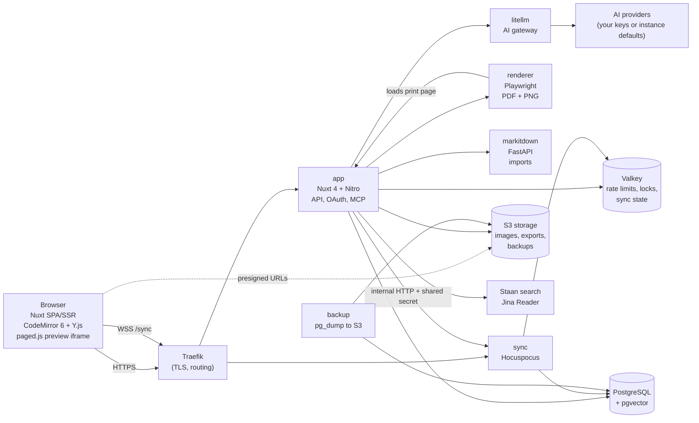

# Architecture

A contributor-friendly overview of how markoto fits together. It is distilled from the root [`AGENTS.md`](../AGENTS.md), which stays the authoritative, more detailed source (with per-area `AGENTS.md` files next to the code). Read this first, then follow the links for the area you are changing.

- [The big picture](#the-big-picture)
- [Services](#services)
- [How a document is edited and saved](#how-a-document-is-edited-and-saved)
- [The AI joins as a collaborator](#the-ai-joins-as-a-collaborator)
- [Preview, themes and PDF](#preview-themes-and-pdf)
- [Workspaces and the knowledge base](#workspaces-and-the-knowledge-base)
- [Auth and access control](#auth-and-access-control)
- [Deployment shapes](#deployment-shapes)
- [Repository layout](#repository-layout)
- [Decisions worth knowing](#decisions-worth-knowing)

## The big picture

markoto is a collaborative markdown editor. Documents are Y.js CRDTs synchronised by a Hocuspocus server. A Nuxt 4 app (SSR + the HTTP API + OAuth) serves the UI. Everything runs on Bun and is wired together with Docker Compose.

## Services

| Service | Directory | Role |
|---|---|---|
| `app` | `app/`, `server/`, `shared/` | One Bun process: Nuxt SSR, the Nitro REST API, OAuth/sign-in, the MCP server at `/mcp`, background sweepers and workers. Applies Drizzle migrations at boot. |
| `sync` | `sync-server/` | Hocuspocus WebSocket server. Persists Y.js state to Postgres (`yjs_documents` via `y-postgresql`), keeps per-document attribution and diff baselines in Valkey, writes the activity log. Separate container so long-lived sockets do not share the Nitro event loop. |
| `renderer` | `renderer/` | Headless Playwright. Renders the same print page the preview uses and returns PDF and per-page PNGs. Internal only. |
| `markitdown` | `markitdown-server/` | Python FastAPI wrapper converting DOCX/PDF/PPTX/XLSX/HTML/EPUB to markdown (imports and knowledge uploads). Internal only. |
| `litellm` | `infra/litellm/` | Self-hosted LiteLLM proxy. Every AI call goes through it (one OpenAI-shaped API, per-user virtual keys, spend tracking). Custom providers wrap Jina embeddings, Mistral transcription and BFL image generation. |
| `postgres` | | PostgreSQL 16 with pgvector: application data, Y.js state, knowledge vectors. |
| `valkey` | | Rate limits, session locks, per-document sync state. Losing it is harmless apart from transient limits. |
| S3 storage | `seaweedfs/` in self-host/dev | Image uploads, transient knowledge originals, rendered PDFs, data exports, backups. Any S3-compatible service works. |
| `backup` | `backup-server/` | Daily encrypted `pg_dump` into the bucket. |
| `traefik` | `traefik/` | The only published service: TLS, routing, security headers, sticky sessions for `/sync`. |

Compose files are layered: `docker-compose.base.yml` holds the shared service shape and is `include:`d by the dev, local, prod and self-host files. See [Deployment shapes](#deployment-shapes).

## How a document is edited and saved

1. The browser asks `GET /api/docs/:id/token`. The server checks access (access mode, workspace role, password) and mints a short-lived doc-scoped JWT (`readOnly` for viewers); for forbidden or password-gated documents it returns `token: null` and no connection is possible.
2. The editor connects to Hocuspocus over WebSocket with that token. CodeMirror 6 is bound to a `Y.Text` through `y-codemirror.next`, so edits, cursors and presence travel as CRDT updates. Comments, title and theme live in the same `Y.Doc` (`ymeta`, a comments array).
3. Hocuspocus debounces (about 2 seconds) and appends Y.js updates to `yjs_documents` in Postgres. Periodic compaction merges the rows. One `pg_dump` therefore backs up all content and history.
4. On flush the sync server records activity rows (edits, title and theme changes) with attribution (human, AI session, MCP client). The Activity Log UI diffs and restores by replaying `yjs_documents` up to a boundary row.

Read-only is enforced in four layers (token claim, Hocuspocus rejecting updates, CodeMirror compartments, UI) and password protection in three, so no single check carries the guarantee. Details: `server/AGENTS.md`, `sync-server/AGENTS.md`, `app/components/collab/AGENTS.md`.

## The AI joins as a collaborator

The AI is a real Y.js client, not a text-patching API. A prompt (from the prompt bar, a selection rewrite or an `@markoto` comment) starts an agentic loop on the server:

- The server resolves the user's provider per capability (chat, image, transcription): **the user's own key, else the instance default, else unavailable** (`server/utils/aiProviders/`).
- The loop calls the model through LiteLLM with about two dozen Zod-defined tools (read/replace/insert text, theme tools, comments, web search, page fetch, image generation, workspace knowledge search, ...).
- Tool calls edit the document through a `HocuspocusProvider` connected as `ai:assistant:<session>`, so collaborators watch edits land live. Status travels over awareness.
- Per-tool and per-session caps stop runaway loops. The monthly budget (per-user LiteLLM virtual key) only applies to platform-paid usage; calls on a user's own key cost the platform nothing.
- The same tool implementations power the **MCP server** (`/mcp`, personal access tokens, scoped wrappers), so external clients edit documents exactly like the in-app AI.

Details: `server/utils/agentic/AGENTS.md`, `server/mcp/AGENTS.md`, [`docs/AI-MODELS.md`](./AI-MODELS.md).

## Preview, themes and PDF

The preview is a paged (A4/Letter) view rendered inside a same-origin `srcdoc` iframe by paged.js. One function, `themeToCss(theme)`, compiles the document theme into the CSS that drives both the live preview and the server-rendered PDF; markdown is rendered by one markdown-it + DOMPurify pipeline (`app/utils/markdown/renderMarkdown.ts`). PDF export asks the renderer sidecar to load the internal print page and print it; there is deliberately no silent fallback to browser printing. Details: `app/utils/AGENTS.md`.

## Workspaces and the knowledge base

Workspaces group documents and members (roles `admin`, `editor`, `viewer`; `workspace_members` is the authorization source). Uploaded knowledge files go browser to S3 by presigned PUT, are converted by markitdown, split into heading-aware chunks, embedded (through LiteLLM; the model and dimension are operator-configurable) and stored in pgvector with a tsvector column. Retrieval is hybrid (vector + full-text, fused with Reciprocal Rank Fusion) and exposed to the AI as `search_knowledge`. Details: `server/utils/AGENTS.md`.

## Auth and access control

- Sign-in is optional. Anonymous users can create and edit public documents; ownership, workspaces, AI and settings need an account. Sessions are sealed cookies (`nuxt-auth-utils`); `SESSION_VERSION` invalidates old ones.
- Access modes per document: private, open edit, open view, password-protected; workspace roles override them.
- Authorization helpers are centralised in `server/utils/workspaces/workspaceAccess.ts` (`canEditDoc`, `canManageDoc`, `canManageWorkspace`); do not mix their concerns.
- Several scoped token surfaces exist (doc JWT, render token, dictation token, MCP personal access tokens), each unusable for the others.
- Errors are sanitised in one place (`server/error.ts`): 4xx pass through, 5xx become a generic message.
- Privacy and compliance features (consent, data export, account deletion, abuse reports, audit log) are keyed to registries in `server/legal/`. On a self-hosted instance the hosted-service legal surfaces are off by default.

## Deployment shapes

One codebase, three shapes; configuration decides:

| Shape | Compose file | Billing | Notes |
|---|---|---|---|
| **Self-hosted** | `docker-compose.selfhost.yml` (+ TLS / build overlays), installed by `install.sh` | off | Everything in one stack, free tier for everyone, legal surfaces off. See [SELF-HOSTING.md](./SELF-HOSTING.md). |
| **Hosted free-only SaaS** (markoto.app today) | `docker-compose.prod.yml`, Ansible in `infra/` | off, paid plans shown as "coming soon" with a waitlist | OVH managed Postgres and object storage. |
| **Hosted with paid plans** (later) | same | on (`NUXT_BILLING_ENABLED=true`) | Stripe checkout, plans map to per-user LiteLLM budgets. The Stripe code is dormant until the flag flips. |

Dev uses `docker-compose.dev.yml` (infra only, app on the host); `docker-compose.local.yml` is the full stack with mkcert TLS for pre-push verification; `docker-compose.test.yml` is the disposable test stack. The app is multi-instance-capable (sticky sessions for `/sync`, Valkey-backed shared state, advisory-locked sweepers) but runs as a single instance today.

## Repository layout

| Path | Contents |
|---|---|
| `app/` | Vue frontend: `components/`, `composables/`, `pages/`, `layouts/`, `utils/`, `plugins/` |
| `server/` | Nitro API (`api/`, `routes/`), `db/schema.ts`, `middleware/`, `plugins/` (migrations, sweepers, workers), `repos/`, `utils/` (incl. `agentic/`, `aiProviders/`), `mcp/`, `legal/` |
| `shared/` | Code used by client and server: types, theme compiler, config (`tiers`, `billingMode`, `instance`), audiences, languages, templates, legal registries |
| `sync-server/` | Hocuspocus container |
| `renderer/`, `markitdown-server/`, `backup-server/` | Sidecars |
| `drizzle/` | Generated migrations and snapshots (committed) |
| `content/docs/`, `content/legal/` | User documentation (rendered at `/docs`) and legal texts (`/legal/*`) |
| `i18n/locales/` | UI translations (en, de, fr, es, ja, zh) |
| `infra/` | Ansible, LiteLLM config and custom providers, env rendering for the hosted deployment |
| `tests/` | `unit/`, `dom/`, `nuxt/`, `repos/`, `integration/`, `e2e/` (Playwright flows) |
| `docs/` | Self-hosting, AI models, local/dev guides and the hosted operator's runbooks |

## Decisions worth knowing

| Decision | Why |
|---|---|
| Full-stack Nuxt on Bun | One process for SSR, API and auth; `nitro.preset: 'bun'` because some dependencies use Bun-specific exports. |
| Y.js state in Postgres | Append-only plus compaction is durable, and a single `pg_dump` covers everything. |
| Hocuspocus in its own container | Long-lived sockets and in-memory documents should not share the API's event loop. |
| Valkey for shared sync state, sticky sessions for `/sync` | Horizontal scaling without replicating Y.Docs across instances. |
| Everything AI through LiteLLM | Vendor-agnostic API, per-user budgets, uniform spend tracking; adding a provider is configuration. |
| Bring-your-own-key AI | Users (or the operator) choose the provider; the platform only pays for web search, page fetch and, on the hosted service, embeddings. |
| One `themeToCss()` for preview and print | The preview is the PDF, not an approximation of it. |
| Text enums instead of `pgEnum` | Adding a value is a TypeScript-only change. |
| Billing behind a flag | One codebase for self-hosted, free SaaS and paid SaaS. |
| Playwright flows double as docs | Documentation that is also a test cannot drift from the product. |

For the full decision log with rationale, see section 9 of [`AGENTS.md`](../AGENTS.md).
