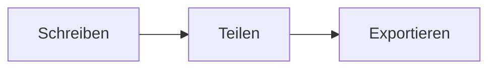

# Willkommen bei markoto

Du tippst Markdown, die Vorschau zeigt die Seite, die daraus wird, und das PDF sieht genauso aus. Auf einem breiten Bildschirm steht die Vorschau rechts, auf dem Handy hinter dem Auge oben. Dieses Demo zeigt zuerst die Markdown-Grundlagen und dann, was markoto noch kann. Ändere ruhig alles.

## Überschriften

Eine Zeile mit `#` beginnen für einen Titel, `##` für einen Abschnitt, `###` für einen Unterabschnitt.

### Ein Unterabschnitt

## Fett, kursiv und mehr

**Fett** (Cmd/Strg + B), *kursiv* (Cmd/Strg + I), ~~durchgestrichen~~ und ==markiert==. Den Rest findest du im Menü **Format**.

## Listen

- Ein Bindestrich beginnt einen Aufzählungspunkt
  - zwei Leerzeichen davor rücken ihn ein
- noch ein Punkt

1. Nummern gehen auch
2. und zählen selbst weiter

## Zum Ausprobieren

Ein `x` zwischen den Klammern hakt ein Kästchen ab.

- [ ] **Teilen.** Das Schloss oben rechts (oder **Freigabe → Freigabeeinstellungen…**) legt fest, was Leute mit dem Link dürfen: «Privat: nur du», «Jeder kann ansehen», «Jeder kann bearbeiten» oder «Passwortgeschützt».
- [ ] **Das Aussehen ändern.** Das Paletten-Symbol rechts öffnet das **Dokumentdesign**: Vorlagen, Schriften, Farben, Seitenformat, Kopf- und Fusszeile.
- [ ] **Die Titelseite bearbeiten.** Dieses Dokument beginnt mit einer. Im Design-Panel legt **Titelseite** Layout, Untertitel, Datum und Autoren fest oder schaltet sie aus.
- [ ] **Kommentieren.** Text markieren und auf **Kommentar hinzufügen** klicken. Schreib `@markoto` in einen Kommentar, dann antwortet die KI im Verlauf.
- [ ] **Die KI fragen.** Klick auf die Leiste unten («markoto fragen…») und versuch «Mach aus der Liste oben eine Tabelle». Die KI bearbeitet das Dokument wie eine Mitautorin, und du siehst ihr beim Tippen zu.
- [ ] **Sprechen statt tippen.** Das Mikrofon in der Werkzeugleiste startet das Diktat, das in der KI-Leiste nimmt eine gesprochene Anfrage entgegen.
- [ ] **Zurück in der Zeit.** Das Panel **Aktivität** rechts listet jede Änderung. Öffne eine, um zu sehen, was sich geändert hat, oder setz das Dokument mit **Wiederherstellen** auf diesen Stand zurück (auch das lässt sich rückgängig machen).
- [ ] **Als PDF exportieren.** **Datei → Exportieren → PDF**, oder Cmd/Strg + P zum Drucken.
- [ ] **Der KI eigenes Material geben.** Lad in einem Workspace PDFs, Word-Dateien oder Folien unter **Wissen** hoch. Die KI in den Dokumenten dieses Workspace schlägt darin nach.

> [!NOTE]
> Die KI, `@markoto` und Workspaces brauchen ein Konto. **Anmelden** oben rechts.

## Links

[Ein Link](https://commonmark.org/help/) öffnet sich in einem neuen Tab. Eine nackte Adresse wie https://commonmark.org wird von selbst zum Link.

## Bilder

{width=48}

Zieh ein Bild in den Editor oder füg es ein, um es hochzuladen. Der Alternativtext wird zur Bildunterschrift.

## Zitate

> Eine Zeile, die mit `>` beginnt, ist ein Zitat.

## Code

Inline-`Code` steht in Backticks. Abgegrenzte Blöcke bekommen Syntaxhervorhebung:

```python
def greet(name):
    return f"Hallo, {name}!"
```

## Tabellen

| Schaltfläche (oben Mitte) | Was du siehst |
| --- | --- |
| Bearbeiten | Nur das Markdown |
| Geteilte Ansicht | Markdown und Seiten nebeneinander |
| Vorschau | Nur die Seiten |

## Hinweise

> [!TIP]
> Ebenfalls verfügbar: `[!IMPORTANT]`, `[!WARNING]` und `[!CAUTION]`.

## Mathematik

Im Text wie $E = mc^2$ oder als Block:

$$
\sum_{i=1}^{n} i = \frac{n(n+1)}{2}
$$

## Diagramme



## Fussnoten

So fügst du eine Fussnote ein.[^1]

[^1]: Im PDF steht sie unten auf der Seite.

## Seitenumbrüche

Die Zeile darunter beginnt eine neue Seite.

<!-- pagebreak -->

## Notizen nur für dich

<!-- Text zwischen diesen Markierungen bleibt im Markdown, erscheint aber nie auf der Seite oder im PDF. -->

Die Zeile über dieser ist eine versteckte Notiz: Sie steht im Markdown, aber nicht auf der Seite. Praktisch für Erinnerungen an sich selbst.

## Jetzt du

Lösch alles und schreib los, oder öffne mit **Datei → Neues Dokument** ein leeres. Die ganze Syntax steht unter **Hilfe → Dokumentation**.
