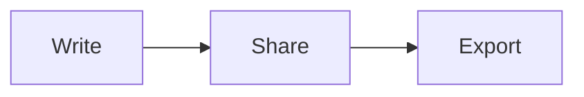

# Welcome to markoto

You type markdown; the preview shows the page it becomes, and the PDF looks the same. On a wide screen the preview sits on the right, on a phone behind the eye at the top. This demo shows the markdown basics first, then what markoto adds on top. Change anything you like.

## Headings

Start a line with `#` for a title, `##` for a section, `###` for a subsection.

### A subsection

## Bold, italic and more

**Bold** (Cmd/Ctrl + B), *italic* (Cmd/Ctrl + I), ~~strikethrough~~ and ==highlight==. The **Format** menu has the rest.

## Lists

- A dash starts a bullet
  - two spaces in front nest it
- another bullet

1. Numbers work too
2. and keep counting

## Things to try

Type an `x` between the brackets to tick a box.

- [ ] **Share it.** The lock icon at the top right (or **Sharing → Sharing settings…**) decides what people with the link can do: "Private: only you", "Anyone can view", "Anyone can edit" or "Password protected".
- [ ] **Change the look.** The palette icon on the right opens the **Document theme**: presets, fonts, colours, page size, header and footer.
- [ ] **Edit the cover page.** This document starts with one. In the theme panel, **Cover page** sets the layout, subtitle, date and authors, or turns it off.
- [ ] **Leave a comment.** Select some text and click **Add comment**. Write `@markoto` in a comment and the AI answers in the thread.
- [ ] **Ask the AI.** Click the bar at the bottom ("Ask markoto…") and try "Turn the list above into a table". It edits the document like a collaborator, and you watch it type.
- [ ] **Talk instead of typing.** The microphone in the toolbar starts dictation; the one in the AI bar takes a spoken request.
- [ ] **Go back in time.** The **Activity** panel on the right lists every change. Open one to see what changed, or **Restore** the document to that point (you can undo a restore too).
- [ ] **Export a PDF.** **File → Export → PDF**, or press Cmd/Ctrl + P to print.
- [ ] **Give the AI your material.** In a workspace, upload PDFs, Word files or slides under **Knowledge**. The AI in that workspace's documents looks things up in them.

> [!NOTE]
> The AI, `@markoto` and workspaces need an account. **Log in** at the top right.

## Links

[A link](https://commonmark.org/help/) opens in a new tab. A bare address like https://commonmark.org becomes a link on its own.

## Images

{width=48}

Drag an image into the editor, or paste one, to upload it. The alt text becomes the caption.

## Quotes

> A line that starts with `>` is a quote.

## Code

Inline `code` sits in backticks. Fenced blocks get syntax highlighting:

```python
def greet(name):
    return f"Hello, {name}!"
```

## Tables

| Button (top centre) | What you see |
| --- | --- |
| Edit | Only the markdown |
| Split View | Markdown and pages side by side |
| Preview | Only the pages |

## Alerts

> [!TIP]
> Also available: `[!IMPORTANT]`, `[!WARNING]` and `[!CAUTION]`.

## Math

Inline like $E = mc^2$, or as a block:

$$
\sum_{i=1}^{n} i = \frac{n(n+1)}{2}
$$

## Diagrams



## Footnotes

Add a footnote like this.[^1]

[^1]: In the PDF it sits at the bottom of the page.

## Page breaks

The line below starts a new page.

<!-- pagebreak -->

## Notes only you see

<!-- Text between these markers stays in the markdown but never shows up on the page or in the PDF. -->

The line above this one is a hidden note: it is in the markdown but not on the page. Good for reminders to yourself.

## Your turn

Delete everything and start writing, or open **File → New document** for an empty one. Every bit of syntax is in **Help → Documentation**.
