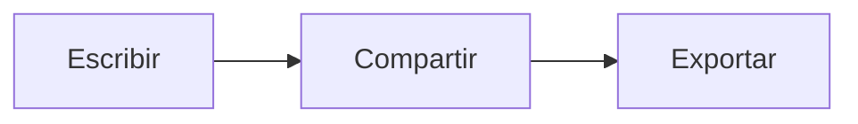

# Te damos la bienvenida a markoto

Escribes markdown; la vista previa muestra la página en la que se convierte, y el PDF se ve igual. En una pantalla ancha la vista previa está a la derecha; en el móvil, detrás del ojo de arriba. Esta demo muestra primero lo básico de markdown y después lo que markoto añade. Cambia lo que quieras.

## Encabezados

Empieza una línea con `#` para un título, `##` para una sección y `###` para una subsección.

### Una subsección

## Negrita, cursiva y más

**Negrita** (Cmd/Ctrl + B), *cursiva* (Cmd/Ctrl + I), ~~tachado~~ y ==resaltado==. El menú **Formato** tiene el resto.

## Listas

- Un guion empieza una viñeta
  - dos espacios delante la anidan
- otra viñeta

1. Los números también funcionan
2. y siguen contando solos

## Para probar

Escribe una `x` entre los corchetes para marcar una casilla.

- [ ] **Compártelo.** El candado de arriba a la derecha (o **Compartir → Configuración de uso compartido…**) decide qué puede hacer quien tenga el enlace: «Privado: solo tú», «Cualquiera puede ver», «Cualquiera puede editar» o «Protegido con contraseña».
- [ ] **Cambia el aspecto.** El icono de la paleta, a la derecha, abre el **Tema del documento**: plantillas, fuentes, colores, tamaño de página, encabezado y pie.
- [ ] **Edita la portada.** Este documento empieza con una. En el panel del tema, **Portada** define el diseño, el subtítulo, la fecha y los autores, o la desactiva.
- [ ] **Deja un comentario.** Selecciona texto y haz clic en **Añadir comentario**. Escribe `@markoto` en un comentario y la IA responde en el hilo.
- [ ] **Pregunta a la IA.** Haz clic en la barra de abajo («Pregúntale a markoto…») y prueba «Convierte la lista de arriba en una tabla». Edita el documento como una colaboradora más, y la ves escribir.
- [ ] **Habla en vez de escribir.** El micrófono de la barra de herramientas inicia el dictado; el de la barra de la IA recoge una petición hablada.
- [ ] **Vuelve atrás en el tiempo.** El panel **Actividad**, a la derecha, lista cada cambio. Abre uno para ver qué cambió, o pulsa **Restaurar** para volver a ese punto (una restauración también se puede deshacer).
- [ ] **Exporta un PDF.** **Archivo → Exportar → PDF**, o pulsa Cmd/Ctrl + P para imprimir.
- [ ] **Dale tu material a la IA.** En un espacio de trabajo, sube PDF, archivos de Word o presentaciones en **Conocimiento**. La IA de los documentos de ese espacio los consulta.

> [!NOTE]
> La IA, `@markoto` y los espacios de trabajo necesitan una cuenta. **Iniciar sesión** arriba a la derecha.

## Enlaces

[Un enlace](https://commonmark.org/help/) se abre en una pestaña nueva. Una dirección sola, como https://commonmark.org, se convierte en enlace por sí misma.

## Imágenes

{width=48}

Arrastra una imagen al editor, o pégala, para subirla. El texto alternativo se convierte en el pie de foto.

## Citas

> Una línea que empieza con `>` es una cita.

## Código

El `código` en línea va entre comillas invertidas. Los bloques delimitados tienen resaltado de sintaxis:

```python
def greet(name):
    return f"¡Hola, {name}!"
```

## Tablas

| Botón (arriba en el centro) | Qué ves |
| --- | --- |
| Editar | Solo el markdown |
| Vista dividida | El markdown y las páginas lado a lado |
| Vista previa | Solo las páginas |

## Avisos

> [!TIP]
> También disponibles: `[!IMPORTANT]`, `[!WARNING]` y `[!CAUTION]`.

## Matemáticas

En el texto, como $E = mc^2$, o en bloque:

$$
\sum_{i=1}^{n} i = \frac{n(n+1)}{2}
$$

## Diagramas



## Notas al pie

Añade una nota así.[^1]

[^1]: En el PDF aparece al pie de la página.

## Saltos de página

La línea de abajo empieza una página nueva.

<!-- pagebreak -->

## Notas solo para ti

<!-- El texto entre estas marcas se queda en el markdown, pero nunca aparece en la página ni en el PDF. -->

La línea de arriba es una nota oculta: está en el markdown, pero no en la página. Útil para recordatorios.

## Tu turno

Borra todo y empieza a escribir, o abre uno vacío con **Archivo → Nuevo documento**. Toda la sintaxis está en **Ayuda → Documentación**.
