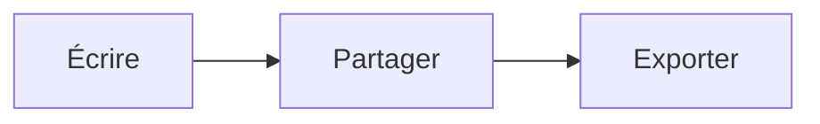

# Bienvenue dans markoto

Vous tapez du markdown ; l'aperçu montre la page qu'il devient, et le PDF est identique. Sur un grand écran, l'aperçu est à droite ; sur un téléphone, derrière l'œil en haut. Cette démo montre d'abord les bases du markdown, puis ce que markoto ajoute. Modifiez tout ce que vous voulez.

## Titres

Commencez une ligne par `#` pour un titre, `##` pour une section, `###` pour une sous-section.

### Une sous-section

## Gras, italique et plus

**Gras** (Cmd/Ctrl + B), *italique* (Cmd/Ctrl + I), ~~barré~~ et ==surligné==. Le menu **Format** propose le reste.

## Listes

- Un tiret commence une puce
  - deux espaces devant l'indentent
- une autre puce

1. Les numéros marchent aussi
2. et se suivent tout seuls

## À essayer

Tapez un `x` entre les crochets pour cocher une case.

- [ ] **Partager.** Le cadenas en haut à droite (ou **Partage → Paramètres de partage…**) décide de ce que peuvent faire les personnes qui ont le lien : « Privé : vous uniquement », « Tout le monde peut consulter », « Tout le monde peut modifier » ou « Protégé par mot de passe ».
- [ ] **Changer l'apparence.** L'icône palette à droite ouvre le **Thème du document** : modèles, polices, couleurs, format de page, en-tête et pied de page.
- [ ] **Modifier la page de couverture.** Ce document en a une. Dans le panneau du thème, **Page de couverture** règle la mise en page, le sous-titre, la date et les auteurs, ou la désactive.
- [ ] **Laisser un commentaire.** Sélectionnez du texte et cliquez sur **Ajouter un commentaire**. Écrivez `@markoto` dans un commentaire et l'IA répond dans le fil.
- [ ] **Demander à l'IA.** Cliquez sur la barre en bas (« Demandez à markoto… ») et essayez « Transforme la liste ci-dessus en tableau ». Elle modifie le document comme une collaboratrice, et vous la voyez taper.
- [ ] **Parler au lieu de taper.** Le micro de la barre d'outils lance la dictée ; celui de la barre de l'IA prend une demande à l'oral.
- [ ] **Remonter le temps.** Le panneau **Activité** à droite liste chaque modification. Ouvrez-en une pour voir ce qui a changé, ou **Restaurer** le document à ce moment-là (une restauration s'annule aussi).
- [ ] **Exporter en PDF.** **Fichier → Exporter → PDF**, ou Cmd/Ctrl + P pour imprimer.
- [ ] **Donner vos documents à l'IA.** Dans un espace de travail, téléversez des PDF, fichiers Word ou présentations sous **Connaissances**. L'IA des documents de cet espace y cherche ses réponses.

> [!NOTE]
> L'IA, `@markoto` et les espaces de travail nécessitent un compte. **Se connecter** en haut à droite.

## Liens

[Un lien](https://commonmark.org/help/) s'ouvre dans un nouvel onglet. Une adresse seule comme https://commonmark.org devient un lien d'elle-même.

## Images

{width=48}

Glissez une image dans l'éditeur, ou collez-la, pour la téléverser. Le texte alternatif devient la légende.

## Citations

> Une ligne qui commence par `>` est une citation.

## Code

Le `code` en ligne se met entre accents graves. Les blocs délimités ont la coloration syntaxique :

```python
def greet(name):
    return f"Bonjour, {name} !"
```

## Tableaux

| Bouton (en haut au centre) | Ce que vous voyez |
| --- | --- |
| Édition | Seulement le markdown |
| Vue partagée | Le markdown et les pages côte à côte |
| Aperçu | Seulement les pages |

## Encadrés

> [!TIP]
> Également disponibles : `[!IMPORTANT]`, `[!WARNING]` et `[!CAUTION]`.

## Mathématiques

Dans le texte comme $E = mc^2$, ou en bloc :

$$
\sum_{i=1}^{n} i = \frac{n(n+1)}{2}
$$

## Diagrammes



## Notes de bas de page

Ajoutez une note comme ceci.[^1]

[^1]: Dans le PDF, elle se place en bas de la page.

## Sauts de page

La ligne ci-dessous commence une nouvelle page.

<!-- pagebreak -->

## Notes visibles par vous seul

<!-- Le texte entre ces marques reste dans le markdown mais n'apparaît jamais sur la page ni dans le PDF. -->

La ligne au-dessus est une note cachée : elle est dans le markdown mais pas sur la page. Pratique pour vos pense-bêtes.

## À vous

Effacez tout et commencez à écrire, ou ouvrez-en un vide avec **Fichier → Nouveau document**. Toute la syntaxe se trouve dans **Aide → Documentation**.
