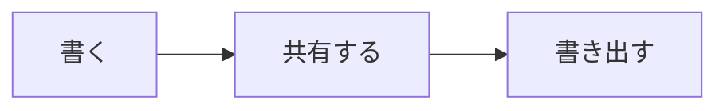

# markoto へようこそ

Markdown を入力すると、プレビューに仕上がりのページが表示されます（PDF も同じ見た目です）。広い画面ではプレビューは右側に、スマートフォンでは上部の目のアイコンの先にあります。このデモでは、まず Markdown の基本を、そのあと markoto ならではの機能を紹介します。自由に書き換えてみてください。

## 見出し

行の先頭に `#` を付けるとタイトル、`##` でセクション、`###` でサブセクションになります。

### サブセクション

## 太字・斜体など

**太字**（Cmd/Ctrl + B）、*斜体*（Cmd/Ctrl + I）、~~取り消し線~~、==ハイライト==。そのほかは **書式** メニューにあります。

## リスト

- ハイフンで箇条書きを始めます
  - 先頭にスペースを 2 つ入れると入れ子になります
- もう 1 つの項目

1. 番号付きリストも使えます
2. 番号は自動で続きます

## 試してみよう

かっこの間に `x` を入れるとチェックが付きます。

- [ ] **共有する。** 右上の鍵アイコン（または **共有 → 共有設定…**）で、リンクを知っている人ができることを選べます：「非公開 — 自分のみ」「誰でも閲覧可能」「誰でも編集可能」「パスワード保護」。
- [ ] **見た目を変える。** 右側のパレットアイコンで **ドキュメントテーマ** が開きます。プリセット、フォント、色、ページサイズ、ヘッダーとフッター。
- [ ] **表紙を編集する。** このドキュメントは表紙から始まります。テーマパネルの **表紙** で、レイアウト、サブタイトル、日付、著者を設定したり、表紙をオフにしたりできます。
- [ ] **コメントする。** テキストを選択して **コメントを追加** をクリック。コメントに `@markoto` と書くと、AI がスレッドで返信します。
- [ ] **AI に頼む。** 下のバー（「markotoに質問…」）をクリックして、「上のリストを表にして」と頼んでみてください。AI は共同編集者のようにドキュメントを書き換え、入力する様子がそのまま見えます。
- [ ] **入力の代わりに話す。** ツールバーのマイクでディクテーションが始まり、AI バーのマイクでは話した依頼を受け付けます。
- [ ] **過去に戻る。** 右側の **アクティビティ** パネルにすべての変更が並びます。開くと何が変わったかが見え、**復元** でその時点に戻せます（復元も元に戻せます）。
- [ ] **PDF に書き出す。** **ファイル → エクスポート → PDF**、または Cmd/Ctrl + P で印刷。
- [ ] **AI に資料を渡す。** ワークスペースの **ナレッジ** に PDF、Word ファイル、スライドをアップロードすると、そのワークスペースのドキュメントで AI がそれを調べて答えます。

> [!NOTE]
> AI、`@markoto`、ワークスペースにはアカウントが必要です。右上から **ログイン** してください。

## リンク

[リンク](https://commonmark.org/help/) は新しいタブで開きます。https://commonmark.org のような URL はそのままリンクになります。

## 画像

{width=48}

画像をエディタにドラッグするか貼り付けるとアップロードされます。代替テキストはキャプションになります。

## 引用

> `>` で始まる行は引用になります。

## コード

インラインの `コード` はバッククォートで囲みます。コードブロックにはシンタックスハイライトが付きます：

```python
def greet(name):
    return f"こんにちは、{name}さん！"
```

## 表

| ボタン（上部中央） | 表示されるもの |
| --- | --- |
| 編集 | Markdown だけ |
| 分割表示 | Markdown とページを並べて |
| プレビュー | ページだけ |

## アラート

> [!TIP]
> `[!IMPORTANT]`、`[!WARNING]`、`[!CAUTION]` も使えます。

## 数式

文中なら $E = mc^2$、ブロックなら：

$$
\sum_{i=1}^{n} i = \frac{n(n+1)}{2}
$$

## 図



## 脚注

脚注はこのように付けます。[^1]

[^1]: PDF ではページの下に表示されます。

## 改ページ

下の行から新しいページが始まります。

<!-- pagebreak -->

## 自分だけのメモ

<!-- この記号の間のテキストは Markdown には残りますが、ページにも PDF にも表示されません。 -->

この上の行は隠しメモです。Markdown には残りますが、ページには表示されません。自分用の覚え書きに便利です。

## さあ、どうぞ

すべて削除して書き始めるか、**ファイル → 新しいドキュメント** で空のドキュメントを開いてください。すべての書き方は **ヘルプ → ドキュメンテーション** にあります。
