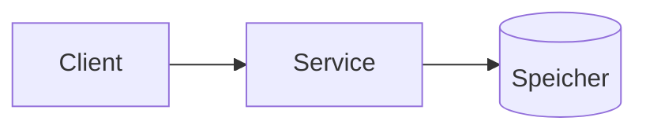

<!-- Ein Designdokument oder RFC: eine vorgeschlagene Änderung, so geschrieben, dass das Review Abschnitt für Abschnitt zustimmen oder widersprechen kann. Der Titelblock zeigt Titel, Team und Dokumentart (Untertitel) und das Datum. Die Tabelle unten ist der Dokumentkopf: Lass den Status in der ersten Zeile (Entwurf, Im Review, Angenommen, Abgelehnt, Ersetzt) und führe ihn nach, wenn sich der Entscheid bewegt. -->

| | |
|---|---|
| **Status** | Entwurf |
| **Verfasst von** | Name |
| **Review** | Name (Team) |
| **Erstellt** | JJJJ-MM-TT |
| **Zuletzt geändert** | JJJJ-MM-TT |
| **Ticket** | - |
| **Entscheid bis** | JJJJ-MM-TT |

# Zusammenfassung

<!-- Ein Absatz für alle, die nichts anderes lesen: das Problem in einem Satz, was du vorschlägst und was es kostet. {{description}} -->

# Motivation

<!-- Der heutige Zustand und warum er nicht genügt: was bricht, wie oft, für wen, mit Belegen (ein Incident, eine Messung, Supportaufwand). Nenne die Randbedingungen, die jede Lösung einhalten muss. Ein H2 kann den einen Vorfall oder das Beispiel schildern, das die Sache dringend gemacht hat. Eine Fussnote ([^1]) hält Quellen und Nebenbemerkungen aus der Argumentation heraus. -->

# Ziele

<!-- Drei bis fünf Ergebnisse, die sich nach der Einführung prüfen lassen (eine Zahl, eine Zeit, eine Eigenschaft). Keine Ziele, die eigentlich Lösungen sind. -->

- Erstes Ziel, mit messbarem Zielwert.
- Zweites Ziel.

## Nicht-Ziele

<!-- Was dieser Vorschlag bewusst nicht tut, damit das Review nicht darüber streitet. Verweise darauf, wo es später behandelt werden könnte. -->

- Erstes Nicht-Ziel.

# Vorschlag

## Überblick

<!-- Der Entwurf in zwei, drei Absätzen und, wenn es hilft, ein kleines Diagramm der Komponenten und wie Daten oder Anfragen zwischen ihnen fliessen. Ersetze oder lösche das Platzhalter-Diagramm. -->

## Detailentwurf

<!-- Ein H2 pro Teil des Entwurfs (Datenmodell, API, Migration, Fehlerbehandlung). Schnittstellen, Schemas oder Abfragen als Codeblock zeigen. Sage, was passiert, wenn ein Teil ausfällt. -->

# Geprüfte Alternativen

<!-- Jede ernsthafte Option, auch „nichts tun“, verglichen nach den Kriterien, die entscheiden. Die Zelle oben links bleibt leer, damit die erste Spalte als Zeilenbeschriftung gelesen wird; die vorgeschlagene Option im Tabellenkopf fett setzen. Danach pro verworfener Option ein kurzer Absatz, warum sie unterlag. -->

| | A: Option | **B: Option (Vorschlag)** | C: Nichts tun |
|---|---|---|---|
| Aufwand | | | |
| Risiko | | | |
| Kosten | | | |

# Entscheide

<!-- Die Entscheide, die das Review annehmen soll, je ein Absatz, beginnend mit einer fetten Marke (E1., E2. …), damit Kommentare darauf verweisen können. -->

**E1.** Erster Entscheid.

**E2.** Zweiter Entscheid.

# Einführungsplan

<!-- Die Phasen in Reihenfolge, je mit Umfang und dem Kriterium, das erfüllt sein muss, bevor die nächste beginnt. Sage, wie jede Phase zurückgerollt wird. -->

| Phase | Umfang | Abschlusskriterium |
|---|---|---|
| 1 | | |
| 2 | | |

# Risiken

<!-- Was nach der Einführung schiefgehen kann, wie wahrscheinlich und wie schwer, und was es mindert. -->

| Risiko | Wahrscheinlichkeit | Auswirkung | Massnahme |
|---|---|---|---|
| | Gering | Hoch | |

# Offene Fragen

<!-- Fragen, die vor dem Entscheid beantwortet sein müssen, je mit verantwortlicher Person. Abhaken und die Antwort in die Zeile schreiben, sobald geklärt. -->

- [ ] Erste Frage? (Verantwortlich: Name)
- [ ] Zweite Frage? (Verantwortlich: Name)
