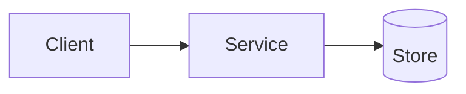

<!-- A design doc or RFC: one proposed change, written so reviewers can agree or object section by section. The title block prints the title, the team and document type (subtitle) and the date. The table below is the document header: keep Status in the first row (Draft, In review, Accepted, Rejected, Superseded) and update it as the decision moves. -->

| | |
|---|---|
| **Status** | Draft |
| **Authors** | Name |
| **Reviewers** | Name (team) |
| **Created** | YYYY-MM-DD |
| **Last updated** | YYYY-MM-DD |
| **Tracking issue** | — |
| **Decision deadline** | YYYY-MM-DD |

# Summary

<!-- One paragraph for someone who reads nothing else: the problem in one sentence, what you propose, and what it costs. {{description}} -->

# Motivation

<!-- The current state and why it is not good enough: what breaks, how often, for whom, with the evidence (an incident, a measurement, a support load). Name the constraints any solution must respect. An H2 can tell the one incident or example that made this urgent. A footnote ([^1]) keeps a source or side remark out of the argument. -->

# Goals

<!-- Three to five outcomes, each checkable after rollout (a number, a time, a property). Avoid goals that are really solutions. -->

- Goal one, with a measurable target.
- Goal two.

## Non-goals

<!-- What this proposal deliberately does not do, so reviewers do not argue about it. Point to where it might be handled later. -->

- Non-goal one.

# Proposal

## Overview

<!-- The design in two or three paragraphs and, if it helps, one small diagram of the components and how data or requests flow between them. Replace the placeholder diagram or delete it. -->

## Detailed design

<!-- One H2 per part of the design (data model, API, migration, failure handling). Show interfaces, schemas or queries in code blocks. Say what happens when each part fails. -->

# Alternatives considered

<!-- Every serious option, including doing nothing, compared on the criteria that decide it. Keep the top-left cell empty so the first column reads as row labels; mark the proposed option in bold in its header cell. Then one short paragraph per rejected option on why it lost. -->

| | A: Option | **B: Option (proposed)** | C: Do nothing |
|---|---|---|---|
| Effort | | | |
| Risk | | | |
| Cost | | | |

# Decisions

<!-- The decisions this document asks reviewers to accept, one paragraph each, opening with a bold label (D1., D2. …) so comments can refer to them. -->

**D1.** Decision one.

**D2.** Decision two.

# Rollout plan

<!-- Phases in order, each with its scope and the criterion that must hold before the next one starts. Say how each phase is rolled back. -->

| Phase | Scope | Exit criterion |
|---|---|---|
| 1 | | |
| 2 | | |

# Risks

<!-- What could go wrong after the change ships, how likely and how bad, and what reduces it. -->

| Risk | Likelihood | Impact | Mitigation |
|---|---|---|---|
| | Low | High | |

# Open questions

<!-- Questions that must be answered before the decision, each with an owner. Tick them off and write the answer in the line when resolved. -->

- [ ] Question one? (Owner: Name)
- [ ] Question two? (Owner: Name)
