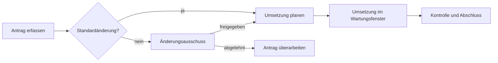

**Betriebshandbuch IT- und Netzbetrieb**

Stadtwerke Aarenfeld AG · Abteilung Betrieb · Ausgabe 2026, Version 4.2

Verantwortlich für den Inhalt: Martina Studer, Leiterin Betrieb. Freigegeben durch die Geschäftsleitung am 3. März 2026. Dieses Dokument ist intern und darf nicht an Dritte weitergegeben werden, ausser an Lieferanten mit gültiger Geheimhaltungsvereinbarung.

[[toc]]

<!-- pagebreak -->

# 1 Einleitung {#einleitung}

Die Stadtwerke versorgen rund 48 000 Haushalte und 2300 Betriebe mit Strom, Wasser und Glasfaser. Wo nötig, verweisen die Abschnitte auf weiterführende Arbeitsanweisungen. Eine befristete Ausnahme läuft nach 3 Monaten automatisch aus, wenn sie nicht verlängert wird. Eine gute Vorbereitung beginnt mit der Frage, was im schlimmsten Fall passieren kann. Im Bereich Dokumentenlenkung gilt der Grundsatz, dass jede Tätigkeit nachvollziehbar dokumentiert wird. Es richtet sich an alle Mitarbeitenden der Abteilung Betrieb sowie an externe Partner, die regelmässig für uns arbeiten.

## 1.1 Zweck dieses Handbuchs {#zweck}

Offensichtliche Messfehler werden markiert und nicht stillschweigend korrigiert. Wo dieses Handbuch und eine Arbeitsanweisung sich widersprechen, gilt bis zur Klärung die strengere Regel. Die Daten werden ausschliesslich in Rechenzentren in der Schweiz gespeichert. Am Standort Aarenfeld Ost gelten wegen der älteren Anlagen teilweise abweichende Wartungsintervalle.

Auch kleine Eingriffe können unerwartete Folgen haben, deshalb wird jeder Schritt vorher geplant. Dieses Handbuch beschreibt, wie die Stadtwerke Aarenfeld AG ihre Netze und ihre Informatik im Alltag betreiben. Meldet eine Kundin eine Störung telefonisch, wird ihre Rückrufnummer im Ticket erfasst. Einträge im Ereignisjournal werden nicht gelöscht, sondern bei Bedarf mit einem Nachtrag korrigiert. Die Lastspitzen treten typischerweise am Montagmorgen zwischen sieben und neun Uhr auf. Jeder Kunde erhält nach der Erfassung eine automatische Bestätigung mit der Ticketnummer. Die Kennzahlen werden monatlich ausgewertet und der Geschäftsleitung in einer kurzen Übersicht vorgelegt. Dabei werden die Personen einbezogen, die den Prozess täglich anwenden.

> [!NOTE]
> Dieses Handbuch wird laufend weiterentwickelt. Die Version und das Datum der letzten Änderung stehen im Änderungsverzeichnis im Anhang.

### 1.1.1 Häufige Fehler

Sobald ein Schwellwert überschritten ist, löst Lumen einen Alarm der Stufe 3 aus. Die Zielvorgabe für die Verfügbarkeit liegt bei 99,95 Prozent pro Kalenderjahr. Diese Regel hat sich bewährt, weil sie auch unter Zeitdruck einfach anzuwenden ist. Im Bereich Betriebsorganisation zeigt sich immer wieder, wie wichtig eine saubere Dokumentation ist. Das Handbuch ersetzt keine gesetzlichen Vorgaben, sondern konkretisiert sie für unsere Organisation. Der Ablauf ist bewusst schlank gehalten, damit er auch in hektischen Situationen eingehalten wird.

Die Erreichbarkeit des Pikettdienstes wird jeden Dienstag mit einem Testanruf geprüft. Die Aufbewahrungsfrist für Protokolle beträgt 9 Jahre, sofern das Gesetz keine längere Frist verlangt. Mehrkosten über 10 000 Franken müssen vorgängig bewilligt werden. Das Vier-Augen-Prinzip gilt für alle Eingriffe, die Konfigurationen produktiver Systeme verändern. Die Freigabe erteilt der Systemverantwortliche, sobald alle Tests erfolgreich abgeschlossen sind. Wichtige Entscheide werden schriftlich bestätigt, auch wenn sie zuvor mündlich besprochen wurden.

Die Dokumentation in Tessera, der Konfigurationsdatenbank, ist für alle Komponenten verbindlich. Die aktuelle Fassung ist immer die elektronische; gedruckte Exemplare sind nur am Tag des Ausdrucks gültig. Erst nach der Abnahme ist das Sicherheitsteam für die Anlage verantwortlich. Bei Unklarheiten entscheidet die Fachstelle Qualität und informiert anschliessend alle Betroffenen. Massnahmen, die den laufenden Betrieb beeinträchtigen können, werden mindestens 4 Arbeitstage im Voraus angekündigt. Die Erfahrungen der letzten Jahre zeigen, dass klare Übergaben zwischen den Schichten Fehler deutlich reduzieren.

Änderungen am Handbuch werden einmal pro Quartal gesammelt und gemeinsam freigegeben. Das Prinzip der minimalen Berechtigung gilt auch für technische Konten. Längere Arbeiten werden in Etappen geplant, damit jederzeit ein stabiler Zwischenstand erreicht ist. Für die Planung wird mit einer jährlichen Zunahme von rund 7 Prozent gerechnet.

Wer Zweifel an der Sicherheit eines Ablaufs hat, darf und soll die Arbeit stoppen. Wird ein Test nicht bestanden, bleibt die Änderung gesperrt, bis die Ursache geklärt ist. Kleinere Mängel dürfen mit einer Frist auch nach der Übergabe behoben werden. Technische Alarme betreffen den Zustand einer Anlage, fachliche Hinweise den Ablauf eines Prozesses. Für den Bereich Dokumentenlenkung ist ein jährlicher Überprüfungstermin im Kalender der Fachstelle Qualität eingetragen.

### 1.1.2 Praxisbeispiel

Ein Skript, das produktive Systeme verändert, wird wie jede andere Änderung behandelt. Die Schulungsunterlagen dazu liegen im Intranet und werden nach jeder grösseren Änderung aktualisiert. Provisorische Lösungen sind zulässig, müssen aber innerhalb von 4 Wochen durch eine dauerhafte Lösung ersetzt werden. Die Geschäftsleitung wird bei Ereignissen der Stufe 1 innerhalb einer Stunde informiert. Der Befehl `boreas job status` zeigt den aktuellen Zustand und eignet sich für eine erste Einschätzung. Rückmeldungen zu diesem Kapitel nimmt Samuel Gerber entgegen.

Die Auswertung erfolgt automatisch, wird aber vor der Veröffentlichung von einer Fachperson plausibilisiert. Eine Abweichung von mehr als 18 Prozent gegenüber dem Vormonat wird im nächsten Betriebsrapport begründet. Wer unsicher ist, wählt die höhere Priorität; eine spätere Herabstufung ist jederzeit möglich. Seither ist für jede Rolle festgelegt, wer sie im Fall einer Abwesenheit vertritt. Mobile Geräte des Pikettdienstes sind verschlüsselt und können aus der Ferne gesperrt werden.

Jede Änderung erhält eine eindeutige Kennung, zum Beispiel `INC-2026-1187`, damit sie später auffindbar bleibt. Der Wartungskalender in Kairos zeigt alle geplanten Arbeiten der nächsten 2 Wochen. Das Betriebsteam pflegt eine Liste offener Punkte, die in der Wochenbesprechung durchgegangen wird. Die Sicherheit der Mitarbeitenden geht jeder betrieblichen Überlegung vor. Vor jedem Eingriff wird geprüft, ob gleichzeitig andere Arbeiten geplant sind, die sich gegenseitig stören könnten. Ausnahmen sind möglich, müssen aber begründet und befristet werden.

Ersatzteile für kritische Komponenten werden am Standort Lindenbühl gelagert. Die Erfahrungen aus dem Ereignis vom Februar 2022 haben zu dieser Vorgabe geführt. Eine Eskalation an die nächste Stufe erfolgt spätestens nach 90 Minuten ohne erkennbaren Fortschritt. Die Vorgaben dieses Kapitels wurden mit den betroffenen Teams erarbeitet und mehrfach angepasst. Der Lagerbestand wird zweimal pro Jahr mit den Einträgen in Tessera abgeglichen.

### 1.1.3 Zweck und Geltungsbereich

Für den Bereich Handbuchpflege wird ein einfaches Ampelsystem verwendet. Die Netzleitstelle führt ein Ereignisjournal, in dem alle relevanten Vorkommnisse chronologisch erfasst sind. Bei Stufe Rot wird die Leiterin Betrieb in jedem Fall persönlich informiert. Die Verantwortung für den Bereich Dokumentenlenkung liegt im Normalbetrieb bei dem Betriebsteam.

Das Monitoring unterscheidet zwischen technischen Alarmen und fachlichen Hinweisen. Für Arbeiten bei Schnee und Eis gelten zusätzliche Sicherheitsvorgaben. Für Arbeiten am Standort Hohwacht ist zusätzlich die Zustimmung der lokalen Betriebsleitung erforderlich. Besuche werden im Besucherprotokoll mit Ein- und Austrittszeit erfasst. Abweichungen von dieser Vorgabe sind mit Seraina Caflisch abzusprechen.

Die Skripte liegen versioniert im internen Repository unter `betrieb/vorlagen`. Ausserhalb der regulären Arbeitszeit übernimmt der Pikettdienst die Erstbeurteilung. Fremdpersonal wird vor Arbeitsbeginn instruiert und erhält nur die Berechtigungen, die es tatsächlich benötigt. Lea Bachmann hat diesen Ablauf 2021 eingeführt, seither ist die Zahl der Rückfragen deutlich gesunken.

Vor der Übernahme einer neuen Anlage in den Betrieb findet eine gemeinsame Abnahme statt. Es richtet sich an alle Mitarbeitenden der Abteilung Betrieb sowie an externe Partner, die regelmässig für uns arbeiten. Wo dieses Handbuch und eine Arbeitsanweisung sich widersprechen, gilt bis zur Klärung die strengere Regel. Die Kosten für den Bereich Handbuchpflege werden im Budget der Abteilung Betrieb geführt. Mängel, die bei der Abnahme festgestellt werden, behebt der Netzbau vor der Übergabe.

Die Fahrzeuge des Pikettdienstes sind mit einer Grundausrüstung für die häufigsten Einsätze ausgestattet. Die Stadtwerke versorgen rund 48 000 Haushalte und 2300 Betriebe mit Strom, Wasser und Glasfaser. Deshalb werden sie regelmässig geübt, auch wenn sie im Alltag selten gebraucht werden. Eine solche Unterbrechung wird nicht diskutiert, sondern sofort umgesetzt und erst danach besprochen. Die Konfigurationsdatenbank Tessera ist redundant aufgebaut und läuft an zwei getrennten Standorten. Berechtigungen werden quartalsweise überprüft, nicht mehr benötigte Rechte werden entzogen.

## 1.2 Aufbau und Lesehilfe

Bei Arbeiten in Unterwerken gilt immer die Regel, dass niemand allein vor Ort ist. Jedes Jahr im Herbst werden die Erfahrungen aus dem Sommerbetrieb ausgewertet. Sie sind ein Kompromiss zwischen Sicherheit, Aufwand und Verständlichkeit. Das Journal ist im Nachhinein die wichtigste Quelle für die Analyse von Störungen. Im Bereich Betriebsorganisation gilt der Grundsatz, dass jede Tätigkeit nachvollziehbar dokumentiert wird.

Table: Rollen und Verantwortlichkeiten (V = verantwortlich, M = mitwirkend, I = informiert)

| Aufgabe | Netzleitstelle | Rechenzentrum | Servicedesk | Leitung Betrieb |
|:--|:-:|:-:|:-:|:-:|
| Erstbeurteilung | V | M | I | I |
| Schalthandlung | V | | | I |
| Wiederherstellung Server | I | V | I | |
| Information Öffentlichkeit | M | | M | V |
| Nachbesprechung | M | M | M | V |

### 1.2.1 Kennzahlen

Im Winter verschieben sich die Schwerpunkte, weil Lastspitzen und Witterung andere Risiken bringen. Erfahrungsgemäss entstehen die meisten Verzögerungen nicht bei der Ausführung, sondern bei der Abstimmung zwischen den beteiligten Teams. Ein nicht beantworteter Testanruf wird wie eine Störung behandelt und nachverfolgt. Für den Bereich Dokumentenlenkung steht eine Checkliste zur Verfügung, die vor jedem Einsatz durchgegangen wird. Ein Ausfall von Aquila hat keinen direkten Einfluss auf die Versorgung, erschwert aber die Arbeit erheblich. In der Netzleitstelle hängt eine gedruckte Liste der wichtigsten Telefonnummern, falls die elektronischen Systeme ausfallen.[^1]

Die Ergebnisse fliessen in die jährliche Risikobeurteilung ein. Das Protokoll enthält mindestens Datum, Uhrzeit, beteiligte Personen, betroffene Anlagen und das Ergebnis. Eine halbe Stunde Dokumentation spart im Ereignisfall oft mehrere Stunden Suche. Die aktuelle Fassung ist immer die elektronische; gedruckte Exemplare sind nur am Tag des Ausdrucks gültig. Das Handbuch ersetzt keine gesetzlichen Vorgaben, sondern konkretisiert sie für unsere Organisation. Die Erreichbarkeit des Pikettdienstes wird jeden Freitag mit einem Testanruf geprüft.

Bei Unklarheiten entscheidet die Fachstelle Qualität und informiert anschliessend alle Betroffenen. Gerade bei seltenen Tätigkeiten lohnt sich ein kurzer Blick in die Arbeitsanweisung, bevor man beginnt. Diese Regel hat sich bewährt, weil sie auch unter Zeitdruck einfach anzuwenden ist. Der Ablauf ist bewusst schlank gehalten, damit er auch in hektischen Situationen eingehalten wird. Lieferzeiten von mehr als 3 Wochen werden in der Ersatzteilplanung ausdrücklich berücksichtigt. Wo Automatisierung möglich ist, wird sie manuellen Abläufen vorgezogen, sofern sie überwacht wird.

Dieses Handbuch beschreibt, wie die Stadtwerke Aarenfeld AG ihre Netze und ihre Informatik im Alltag betreiben. Für jedes Wartungsfenster wird ein Rückfallplan erstellt, der ohne Rücksprache ausgeführt werden kann. Wird ein Test nicht bestanden, bleibt die Änderung gesperrt, bis die Ursache geklärt ist. Neue Werkzeuge werden zuerst in der Testumgebung erprobt, bevor sie im Betrieb eingesetzt werden. Die Überwachungsplattform Lumen meldet Grenzwertverletzungen automatisch an das Sicherheitsteam.

Für wiederkehrende Aufgaben sind Vorlagen hinterlegt, die Schreibarbeit sparen und Lücken vermeiden. Zugangsdaten werden nie per E-Mail verschickt, sondern ausschliesslich über den Passworttresor geteilt. Die Abteilung Betrieb arbeitet eng mit der Abteilung Netzbau zusammen, die neue Anlagen erstellt. Jede Übung endet mit einer Nachbesprechung, deren Erkenntnisse in die nächste Planung einfliessen. Der Schichtrapport wird bei jeder Übergabe gemeinsam durchgegangen und von beiden Seiten visiert. Wer eine bessere Lösung kennt, ist ausdrücklich eingeladen, sie vorzuschlagen.

### 1.2.2 Kontrollen

Wer eine Störung entdeckt, eröffnet sofort ein Ticket und ordnet es der passenden Kategorie zu. Offensichtliche Messfehler werden markiert und nicht stillschweigend korrigiert. Die Teams treffen sich alle zwei Wochen zu einem kurzen Austausch über aktuelle Themen. Eine gute Vorbereitung beginnt mit der Frage, was im schlimmsten Fall passieren kann. Zwischen sechs und zweiundzwanzig Uhr ist die Netzleitstelle mit mindestens zwei Personen besetzt. Kurze, regelmässige Übungen sind wirksamer als eine einzige grosse Übung pro Jahr.

Die Priorität eines Ereignisses ergibt sich aus seiner Auswirkung und seiner Dringlichkeit. Das Prinzip der minimalen Berechtigung gilt auch für technische Konten. Der Wartungskalender in Kairos zeigt alle geplanten Arbeiten der nächsten 3 Wochen. Die Freigabe erteilt das Sicherheitsteam, sobald alle Tests erfolgreich abgeschlossen sind. Das Vier-Augen-Prinzip gilt für alle Eingriffe, die Konfigurationen produktiver Systeme verändern.

Längere Arbeiten werden in Etappen geplant, damit jederzeit ein stabiler Zwischenstand erreicht ist. Die Lastspitzen treten typischerweise am Dienstagmorgen zwischen sieben und neun Uhr auf. Wichtige Entscheide werden schriftlich bestätigt, auch wenn sie zuvor mündlich besprochen wurden. Jedes technische Konto hat eine verantwortliche Person, die in Tessera eingetragen ist. Bei Stufe Rot wird die Leiterin Betrieb in jedem Fall persönlich informiert. Die Geschäftsleitung wird bei Ereignissen der Stufe 2 innerhalb einer Stunde informiert.

Bei Überschneidungen wird die Arbeit mit dem geringeren Risiko verschoben. Eine Eskalation an die nächste Stufe erfolgt spätestens nach 30 Minuten ohne erkennbaren Fortschritt. Die Eskalationsstufen sind in [Abschnitt 5.3](#eskalation) beschrieben. Rückfragen werden innerhalb eines Arbeitstags beantwortet, dringende Fälle sofort. Alle Vorgaben in diesem Abschnitt gelten sinngemäss auch für externe Dienstleister. Das Monitoring unterscheidet zwischen technischen Alarmen und fachlichen Hinweisen.

Für den Bereich Betriebsorganisation wird ein einfaches Ampelsystem verwendet. Wie Änderungen in einem Wartungsfenster umgesetzt werden, zeigt [Abschnitt 6.4](#wartungsfenster). Seither ist für jede Rolle festgelegt, wer sie im Fall einer Abwesenheit vertritt. Sobald ein Schwellwert überschritten ist, löst Lumen einen Alarm der Stufe 2 aus. Im Bereich Dokumentenlenkung arbeiten derzeit 43 Fachpersonen, verteilt auf mehrere Teams.

## 1.3 Gültigkeit und Änderungen {#gueltigkeit}

Das Betriebsteam pflegt eine Liste offener Punkte, die in der Wochenbesprechung durchgegangen wird. Rückmeldungen zu diesem Kapitel nimmt Fabian Zollinger entgegen. Es richtet sich an alle Mitarbeitenden der Abteilung Betrieb sowie an externe Partner, die regelmässig für uns arbeiten. Die Ausrüstung wird nach jedem Einsatz kontrolliert und ergänzt.

### 1.3.1 Ablauf im Normalbetrieb

Die Messwerte werden alle 60 Sekunden erfasst und während 3 Monaten aufbewahrt. Wo dieses Handbuch und eine Arbeitsanweisung sich widersprechen, gilt bis zur Klärung die strengere Regel. Wer unsicher ist, wählt die höhere Priorität; eine spätere Herabstufung ist jederzeit möglich. Die eingesetzten Werkzeuge werden zentral beschafft, damit Schulung und Wartung einheitlich bleiben. Die Rollen sind in [Abschnitt 2.2](#rollen) im Einzelnen festgelegt. Die Stadtwerke versorgen rund 48 000 Haushalte und 2300 Betriebe mit Strom, Wasser und Glasfaser. Die Prozessbeschreibung wird bei Bedarf, mindestens aber alle 11 Jahre überarbeitet.

Fabian Zollinger hat diesen Ablauf 2023 eingeführt, seither ist die Zahl der Rückfragen deutlich gesunken. Deshalb werden sie regelmässig geübt, auch wenn sie im Alltag selten gebraucht werden. Im Zweifelsfall hat die Versorgungssicherheit Vorrang vor Termin- und Kostenzielen. Besuche werden im Besucherprotokoll mit Ein- und Austrittszeit erfasst.

Die Verantwortung für den Bereich Betriebsorganisation liegt im Normalbetrieb bei der Leiterin Betrieb. Damals fehlte eine klare Zuständigkeit, und wichtige Informationen erreichten die Netzleitstelle zu spät. Eine Abweichung von mehr als 21 Prozent gegenüber dem Vormonat wird im nächsten Betriebsrapport begründet. Die Konfigurationsdatenbank Tessera ist redundant aufgebaut und läuft an zwei getrennten Standorten. Jede Änderung erhält eine eindeutige Kennung, zum Beispiel `RZ-WA-12`, damit sie später auffindbar bleibt. Corinne Aebischer koordiniert als Ansprechperson die Arbeiten im Bereich Dokumentenlenkung.

Fehlende Teile werden im Ticket vermerkt und innerhalb einer Woche nachbeschafft. Auch kleine Eingriffe können unerwartete Folgen haben, deshalb wird jeder Schritt vorher geplant. In der Netzleitstelle hängt eine gedruckte Liste der wichtigsten Telefonnummern, falls die elektronischen Systeme ausfallen. Die Vorgaben dieses Kapitels wurden mit den betroffenen Teams erarbeitet und mehrfach angepasst. Erfahrungsgemäss entstehen die meisten Verzögerungen nicht bei der Ausführung, sondern bei der Abstimmung zwischen den beteiligten Teams.

Die aktuelle Fassung ist immer die elektronische; gedruckte Exemplare sind nur am Tag des Ausdrucks gültig. Im Bereich Betriebsorganisation zeigt sich immer wieder, wie wichtig eine saubere Dokumentation ist. Die Fahrzeuge des Pikettdienstes sind mit einer Grundausrüstung für die häufigsten Einsätze ausgestattet. Erst nach der Abnahme ist die Fachstelle Qualität für die Anlage verantwortlich. Der Befehl `boreas job status` zeigt den aktuellen Zustand und eignet sich für eine erste Einschätzung. Technische Alarme betreffen den Zustand einer Anlage, fachliche Hinweise den Ablauf eines Prozesses.

### 1.3.2 Kontrollen

Die meisten Abläufe in diesem Bereich lassen sich in weniger als einer Stunde erlernen. Wer eine Arbeit übernimmt, bestätigt dies im Ticket, damit niemand doppelt arbeitet. Das Handbuch ersetzt keine gesetzlichen Vorgaben, sondern konkretisiert sie für unsere Organisation. Der Lagerbestand wird zweimal pro Jahr mit den Einträgen in Tessera abgeglichen. Persönliche Schutzausrüstung wird vor jedem Einsatz kontrolliert und bei Mängeln sofort ersetzt.

Ersatzteile für kritische Komponenten werden am Standort Lindenbühl gelagert. Dieses Handbuch beschreibt, wie die Stadtwerke Aarenfeld AG ihre Netze und ihre Informatik im Alltag betreiben. Ein Ausfall von Kairos hat keinen direkten Einfluss auf die Versorgung, erschwert aber die Arbeit erheblich. Bei Arbeiten in Unterwerken gilt immer die Regel, dass niemand allein vor Ort ist. Abweichungen von dieser Vorgabe sind mit Samuel Gerber abzusprechen.

Die Zielvorgabe für die Verfügbarkeit liegt bei 99,8 Prozent pro Kalenderjahr. Änderungen am Handbuch werden einmal pro Quartal gesammelt und gemeinsam freigegeben. Dabei werden die Personen einbezogen, die den Prozess täglich anwenden. Massnahmen, die den laufenden Betrieb beeinträchtigen können, werden mindestens 2 Arbeitstage im Voraus angekündigt. Ausnahmen sind möglich, müssen aber begründet und befristet werden.

Ausserhalb der regulären Arbeitszeit übernimmt der Pikettdienst die Erstbeurteilung. Mehrkosten über 5000 Franken müssen vorgängig bewilligt werden. Ein guter Prozess ist einer, den man nicht nachschlagen muss, weil er sich selbst erklärt. Schwieriger ist es, sie auch nachts und unter Druck zuverlässig einzuhalten. Eine gute Vorbereitung beginnt mit der Frage, was im schlimmsten Fall passieren kann.

Im Bereich Dokumentenlenkung gilt der Grundsatz, dass jede Tätigkeit nachvollziehbar dokumentiert wird. Die Fachstelle Qualität prüft die Angaben vor der Freigabe und hält Abweichungen im Ticketsystem Kairos fest. Im Winter verschieben sich die Schwerpunkte, weil Lastspitzen und Witterung andere Risiken bringen. Die Teams treffen sich alle zwei Wochen zu einem kurzen Austausch über aktuelle Themen. Die Erreichbarkeit des Pikettdienstes wird jeden Montag mit einem Testanruf geprüft.

### 1.3.3 Häufige Fehler

Die Abteilung Betrieb arbeitet eng mit der Abteilung Netzbau zusammen, die neue Anlagen erstellt. Kurze, regelmässige Übungen sind wirksamer als eine einzige grosse Übung pro Jahr. Für die Zusammenarbeit mit den Gemeinden im Versorgungsgebiet gibt es feste Ansprechpersonen. Für Arbeiten am Standort Hohwacht ist zusätzlich die Zustimmung der lokalen Betriebsleitung erforderlich.

Messgeräte werden jährlich kalibriert, das Kalibrierprotokoll wird in Tessera hinterlegt. Die Kommunikation nach aussen läuft ausschliesslich über die dafür bestimmte Stelle. Mängel, die bei der Abnahme festgestellt werden, behebt der Netzbau vor der Übergabe. Für Fragen zum Bereich Handbuchpflege ist Ursina Lötscher die erste Anlaufstelle. Für die Planung wird mit einer jährlichen Zunahme von rund 15 Prozent gerechnet. Die Werte aus Lumen dienen als Grundlage für die Kapazitätsplanung der kommenden Jahre.

Was nicht dokumentiert ist, gilt im Betrieb als nicht geschehen. Alle Vorgaben in diesem Abschnitt gelten sinngemäss auch für externe Dienstleister. Ein Verstoss gegen die Vorgaben wird nicht als persönliches Versagen behandelt, sondern als Anlass, den Prozess zu verbessern. Die Skripte liegen versioniert im internen Repository unter `betrieb/skripte`. Die Ergebnisse fliessen in die jährliche Risikobeurteilung ein. Die Zuständigkeiten sind in der Rollenbeschreibung festgehalten und werden jährlich überprüft.

Das Vier-Augen-Prinzip gilt für alle Eingriffe, die Konfigurationen produktiver Systeme verändern. Ein kurzer Hinweis im Schichtrapport genügt, wenn keine weiteren Schritte nötig sind. Der Schichtrapport wird bei jeder Übergabe gemeinsam durchgegangen und von beiden Seiten visiert. Für den Bereich Handbuchpflege wird ein einfaches Ampelsystem verwendet. Diese Regel hat sich bewährt, weil sie auch unter Zeitdruck einfach anzuwenden ist.

## 1.4 Begriffe und Abkürzungen

Eine befristete Ausnahme läuft nach 8 Monaten automatisch aus, wenn sie nicht verlängert wird. Wo Automatisierung möglich ist, wird sie manuellen Abläufen vorgezogen, sofern sie überwacht wird. Die Auswertung erfolgt automatisch, wird aber vor der Veröffentlichung von einer Fachperson plausibilisiert. Wer Zweifel an der Sicherheit eines Ablaufs hat, darf und soll die Arbeit stoppen. Mobile Geräte des Pikettdienstes sind verschlüsselt und können aus der Ferne gesperrt werden.

### 1.4.1 Praxisbeispiel

Eine Eskalation an die nächste Stufe erfolgt spätestens nach 60 Minuten ohne erkennbaren Fortschritt. Bei Überschneidungen wird die Arbeit mit dem geringeren Risiko verschoben. Für die Berechnung der Verfügbarkeit siehe [Abschnitt 9.3](#kennzahlen). Jedes technische Konto hat eine verantwortliche Person, die in Tessera eingetragen ist. Offensichtliche Messfehler werden markiert und nicht stillschweigend korrigiert.

Es richtet sich an alle Mitarbeitenden der Abteilung Betrieb sowie an externe Partner, die regelmässig für uns arbeiten. Die Sicherheit der Mitarbeitenden geht jeder betrieblichen Überlegung vor. Die Verantwortung für den Bereich Handbuchpflege liegt im Normalbetrieb bei der Netzleitstelle. Jedes Jahr im Herbst werden die Erfahrungen aus dem Sommerbetrieb ausgewertet.

Berechtigungen werden quartalsweise überprüft, nicht mehr benötigte Rechte werden entzogen. Fehlen Angaben in Tessera, gilt die Komponente als nicht inventarisiert und darf nicht verändert werden. Die Stadtwerke versorgen rund 48 000 Haushalte und 2300 Betriebe mit Strom, Wasser und Glasfaser. Der Wartungskalender in Kairos zeigt alle geplanten Arbeiten der nächsten 6 Wochen. Sie sind ein Kompromiss zwischen Sicherheit, Aufwand und Verständlichkeit. Das Prinzip der minimalen Berechtigung gilt auch für technische Konten.

Die Aufbewahrungsfrist für Protokolle beträgt 4 Jahre, sofern das Gesetz keine längere Frist verlangt. Das Journal ist im Nachhinein die wichtigste Quelle für die Analyse von Störungen. Kleinere Mängel dürfen mit einer Frist auch nach der Übergabe behoben werden. Die Erfahrungen aus dem Ereignis vom Februar 2019 haben zu dieser Vorgabe geführt. Die Stellvertretung ist im Dienstplan sichtbar und wird bei jeder Änderung neu bestätigt. Das Vorgehen bei Sicherheitsvorfällen folgt [Abschnitt 7.4](#sicherheitsvorfaelle).

Die Netzleitstelle führt ein Ereignisjournal, in dem alle relevanten Vorkommnisse chronologisch erfasst sind. Im Zweifelsfall hat die Versorgungssicherheit Vorrang vor Termin- und Kostenzielen. Wo dieses Handbuch und eine Arbeitsanweisung sich widersprechen, gilt bis zur Klärung die strengere Regel. Rückmeldungen zu diesem Kapitel nimmt Martina Studer entgegen. Die Wiederherstellung aus Sicherungen ist in [Abschnitt 8.3](#wiederherstellung) erklärt. Die Prozessbeschreibung wird bei Bedarf, mindestens aber alle 3 Jahre überarbeitet. Rückfragen werden innerhalb eines Arbeitstags beantwortet, dringende Fälle sofort.

### 1.4.2 Dokumentation

Jede Änderung erhält eine eindeutige Kennung, zum Beispiel `INC-2026-1187`, damit sie später auffindbar bleibt. Längere Arbeiten werden in Etappen geplant, damit jederzeit ein stabiler Zwischenstand erreicht ist. Das Monitoring unterscheidet zwischen technischen Alarmen und fachlichen Hinweisen. Pascal Rüegsegger koordiniert als Ansprechperson die Arbeiten im Bereich Handbuchpflege.

Für den Bereich Handbuchpflege steht eine Checkliste zur Verfügung, die vor jedem Einsatz durchgegangen wird. Die Messwerte werden alle 10 Sekunden erfasst und während 8 Monaten aufbewahrt. Die Netzleitstelle kann jederzeit verlangen, dass eine laufende Arbeit unterbrochen wird. Wo nötig, verweisen die Abschnitte auf weiterführende Arbeitsanweisungen. Eine solche Unterbrechung wird nicht diskutiert, sondern sofort umgesetzt und erst danach besprochen.

Grün bedeutet Normalbetrieb, Gelb erhöhte Aufmerksamkeit und Rot unmittelbaren Handlungsbedarf. Das Handbuch ersetzt keine gesetzlichen Vorgaben, sondern konkretisiert sie für unsere Organisation. Die Zahl der offenen Tickets soll Ende Monat 62 nicht überschreiten. Die Erfahrung zeigt, dass gut vorbereitete Einsätze im Durchschnitt um 23 Prozent kürzer dauern.

Damals fehlte eine klare Zuständigkeit, und wichtige Informationen erreichten die Netzleitstelle zu spät. Martina Studer hat diesen Ablauf 2023 eingeführt, seither ist die Zahl der Rückfragen deutlich gesunken. Im Bereich Dokumentenlenkung gilt der Grundsatz, dass jede Tätigkeit nachvollziehbar dokumentiert wird. Dieses Handbuch beschreibt, wie die Stadtwerke Aarenfeld AG ihre Netze und ihre Informatik im Alltag betreiben. Die Freigabe erteilt die Netzleitstelle, sobald alle Tests erfolgreich abgeschlossen sind. Fehlende Teile werden im Ticket vermerkt und innerhalb einer Woche nachbeschafft.

Auch kleine Eingriffe können unerwartete Folgen haben, deshalb wird jeder Schritt vorher geplant. Die Ausrüstung wird nach jedem Einsatz kontrolliert und ergänzt. Die aktuelle Fassung ist immer die elektronische; gedruckte Exemplare sind nur am Tag des Ausdrucks gültig. Die Dokumentation in Tessera, der Konfigurationsdatenbank, ist für alle Komponenten verbindlich. Ergänzende Hinweise enthält der [Leitfaden des Branchenverbands](https://www.example.org/leitfaden/netzbetrieb).

[^1]: Gemäss Beschluss der Geschäftsleitung vom 12. Januar 2026.

<!-- pagebreak -->

# 2 Organisation und Verantwortlichkeiten {#organisation}

Die Rollen sind bewusst unabhängig von Personen beschrieben, damit Vertretungen reibungslos funktionieren. Abhängigkeiten zu anderen Systemen sind im Voraus zu klären, insbesondere zu Aquila. Der Pikettdienst wird im Wochenrhythmus von Freitag zu Freitag übergeben. Wer eine Arbeit übernimmt, bestätigt dies im Ticket, damit niemand doppelt arbeitet. Die Leiterin Betrieb berichtet direkt an den Geschäftsführer und vertritt die Abteilung in der Geschäftsleitung.

## 2.1 Organigramm der Abteilung Betrieb {#organigramm}

Die Abteilung Betrieb ist in die Teams Netzleitstelle, Rechenzentrum, Netzwerk und Servicedesk gegliedert. Sobald ein Schwellwert überschritten ist, löst Lumen einen Alarm der Stufe 2 aus. Jedes Team hat eine Teamleitung, die für Personalplanung, Ausbildung und die Einhaltung der Prozesse zuständig ist. Einträge im Ereignisjournal werden nicht gelöscht, sondern bei Bedarf mit einem Nachtrag korrigiert. Erfahrungsgemäss entstehen die meisten Verzögerungen nicht bei der Ausführung, sondern bei der Abstimmung zwischen den beteiligten Teams. Pikettleistende müssen innerhalb von dreissig Minuten am Standort Birkenmatt eintreffen können.


### 2.1.1 Zweck und Geltungsbereich

Deshalb werden sie regelmässig geübt, auch wenn sie im Alltag selten gebraucht werden. Die Daten werden ausschliesslich in Rechenzentren in der Schweiz gespeichert. Technische Alarme betreffen den Zustand einer Anlage, fachliche Hinweise den Ablauf eines Prozesses. Begriffe, die hier nicht erklärt werden, stehen im [Glossar](#glossar). Gerade bei seltenen Tätigkeiten lohnt sich ein kurzer Blick in die Arbeitsanweisung, bevor man beginnt. Im Bereich Schichtplanung arbeiten derzeit 46 Fachpersonen, verteilt auf mehrere Teams.

Abweichungen von dieser Vorgabe sind mit Seraina Caflisch abzusprechen. Vor jedem Eingriff wird geprüft, ob gleichzeitig andere Arbeiten geplant sind, die sich gegenseitig stören könnten. Die Fachstelle Qualität prüft die Angaben vor der Freigabe und hält Abweichungen im Ticketsystem Kairos fest. Die Geschäftsleitung wird bei Ereignissen der Stufe 3 innerhalb einer Stunde informiert. Wer eine Störung entdeckt, eröffnet sofort ein Ticket und ordnet es der passenden Kategorie zu.

Für Arbeiten bei Schnee und Eis gelten zusätzliche Sicherheitsvorgaben. Vor der Übernahme einer neuen Anlage in den Betrieb findet eine gemeinsame Abnahme statt. Private Geräte sind für betriebliche Aufgaben nicht zugelassen. Mehrkosten über 5000 Franken müssen vorgängig bewilligt werden. Für wiederkehrende Aufgaben sind Vorlagen hinterlegt, die Schreibarbeit sparen und Lücken vermeiden.

Bei Arbeiten in Unterwerken gilt immer die Regel, dass niemand allein vor Ort ist. Bei Überschneidungen wird die Arbeit mit dem geringeren Risiko verschoben. Lieferzeiten von mehr als 3 Wochen werden in der Ersatzteilplanung ausdrücklich berücksichtigt. Dabei werden die Personen einbezogen, die den Prozess täglich anwenden.

Offensichtliche Messfehler werden markiert und nicht stillschweigend korrigiert. Für die Zusammenarbeit mit den Gemeinden im Versorgungsgebiet gibt es feste Ansprechpersonen. Wer den Pikettdienst leistet, regelt [Abschnitt 2.4](#pikett). Zugangsdaten werden nie per E-Mail verschickt, sondern ausschliesslich über den Passworttresor geteilt. Fehlen Angaben in Tessera, gilt die Komponente als nicht inventarisiert und darf nicht verändert werden. Die Zuständigkeiten sind in der Rollenbeschreibung festgehalten und werden jährlich überprüft.

Die Verantwortung für den Bereich Schichtplanung liegt im Normalbetrieb bei der Netzleitstelle. Für Fragen zum Bereich Linienorganisation ist Samuel Gerber die erste Anlaufstelle. Die Erreichbarkeit des Pikettdienstes wird jeden Donnerstag mit einem Testanruf geprüft. Ausserhalb der regulären Arbeitszeit übernimmt der Pikettdienst die Erstbeurteilung.

### 2.1.2 Sonderfälle

Das Journal ist im Nachhinein die wichtigste Quelle für die Analyse von Störungen. Ein kurzer Hinweis im Schichtrapport genügt, wenn keine weiteren Schritte nötig sind. Messgeräte werden jährlich kalibriert, das Kalibrierprotokoll wird in Tessera hinterlegt. Wer unsicher ist, wählt die höhere Priorität; eine spätere Herabstufung ist jederzeit möglich. Die Priorität eines Ereignisses ergibt sich aus seiner Auswirkung und seiner Dringlichkeit.

Die Abteilung Betrieb arbeitet eng mit der Abteilung Netzbau zusammen, die neue Anlagen erstellt. Das Vier-Augen-Prinzip gilt für alle Eingriffe, die Konfigurationen produktiver Systeme verändern. Wer Zweifel an der Sicherheit eines Ablaufs hat, darf und soll die Arbeit stoppen. Die eingesetzten Werkzeuge werden zentral beschafft, damit Schulung und Wartung einheitlich bleiben.

Ein Ausfall von Kairos hat keinen direkten Einfluss auf die Versorgung, erschwert aber die Arbeit erheblich. Die Lastspitzen treten typischerweise am Donnerstagmorgen zwischen sieben und neun Uhr auf. Jedes Jahr im Herbst werden die Erfahrungen aus dem Sommerbetrieb ausgewertet. Die Ergebnisse fliessen in die jährliche Risikobeurteilung ein. Eine Eskalation an die nächste Stufe erfolgt spätestens nach 60 Minuten ohne erkennbaren Fortschritt.

Neue Werkzeuge werden zuerst in der Testumgebung erprobt, bevor sie im Betrieb eingesetzt werden. Fremdpersonal wird vor Arbeitsbeginn instruiert und erhält nur die Berechtigungen, die es tatsächlich benötigt. Wird ein Test nicht bestanden, bleibt die Änderung gesperrt, bis die Ursache geklärt ist. Besuche werden im Besucherprotokoll mit Ein- und Austrittszeit erfasst. Die Arbeitsanweisungen sind fortlaufend nummeriert, etwa `AA-NET-004`, und im Dokumentenverzeichnis abgelegt.

Die Stellvertretung ist im Dienstplan sichtbar und wird bei jeder Änderung neu bestätigt. Das Protokoll enthält mindestens Datum, Uhrzeit, beteiligte Personen, betroffene Anlagen und das Ergebnis. Für jedes Wartungsfenster wird ein Rückfallplan erstellt, der ohne Rücksprache ausgeführt werden kann. Wichtige Entscheide werden schriftlich bestätigt, auch wenn sie zuvor mündlich besprochen wurden. Ein nicht beantworteter Testanruf wird wie eine Störung behandelt und nachverfolgt. Das Betriebsteam pflegt eine Liste offener Punkte, die in der Wochenbesprechung durchgegangen wird.

### 2.1.3 Schnittstellen zu anderen Prozessen

Neue Mitarbeitende arbeiten in den ersten 5 Wochen nur zusammen mit einer erfahrenen Fachperson. Änderungen am Handbuch werden einmal pro Quartal gesammelt und gemeinsam freigegeben. Offene Fragen werden am Ende jeder Schicht notiert und an die nächste Schicht übergeben. Wo nötig, verweisen die Abschnitte auf weiterführende Arbeitsanweisungen. Kleinere Mängel dürfen mit einer Frist auch nach der Übergabe behoben werden.

Wo Automatisierung möglich ist, wird sie manuellen Abläufen vorgezogen, sofern sie überwacht wird. Die Prioritäten sind in [Abschnitt 5.2](#prioritaeten) definiert. Jedes technische Konto hat eine verantwortliche Person, die in Tessera eingetragen ist. Für Arbeiten am Standort Seewil ist zusätzlich die Zustimmung der lokalen Betriebsleitung erforderlich. Die Sicherheit der Mitarbeitenden geht jeder betrieblichen Überlegung vor.

Kurze, regelmässige Übungen sind wirksamer als eine einzige grosse Übung pro Jahr. Die Kosten für den Bereich Schichtplanung werden im Budget der Abteilung Betrieb geführt. Wer eine bessere Lösung kennt, ist ausdrücklich eingeladen, sie vorzuschlagen. Die meisten Abläufe in diesem Bereich lassen sich in weniger als einer Stunde erlernen. Diese Regel hat sich bewährt, weil sie auch unter Zeitdruck einfach anzuwenden ist. Massnahmen, die den laufenden Betrieb beeinträchtigen können, werden mindestens 6 Arbeitstage im Voraus angekündigt.

Berechtigungen werden quartalsweise überprüft, nicht mehr benötigte Rechte werden entzogen. Die Netzleitstelle führt ein Ereignisjournal, in dem alle relevanten Vorkommnisse chronologisch erfasst sind. Jedes Team hat eine Teamleitung, die für Personalplanung, Ausbildung und die Einhaltung der Prozesse zuständig ist. Die Rollen sind bewusst unabhängig von Personen beschrieben, damit Vertretungen reibungslos funktionieren.

Zwischen sechs und zweiundzwanzig Uhr ist die Netzleitstelle mit mindestens zwei Personen besetzt. Die Kommunikation nach aussen läuft ausschliesslich über die dafür bestimmte Stelle. Mobile Geräte des Pikettdienstes sind verschlüsselt und können aus der Ferne gesperrt werden. Die Abteilung Betrieb ist in die Teams Netzleitstelle, Rechenzentrum, Netzwerk und Servicedesk gegliedert.

### 2.1.4 Werkzeuge

Mängel, die bei der Abnahme festgestellt werden, behebt der Netzbau vor der Übergabe. Für den Bereich Linienorganisation wird ein einfaches Ampelsystem verwendet. Das Prinzip der minimalen Berechtigung gilt auch für technische Konten. Pikettleistende müssen innerhalb von dreissig Minuten am Standort Birkenmatt eintreffen können. Für den Bereich Stellvertretungen steht eine Checkliste zur Verfügung, die vor jedem Einsatz durchgegangen wird. Die Geschäftsleitung wird bei Ereignissen der Stufe 3 innerhalb einer Stunde informiert.

Der Pikettdienst wird im Wochenrhythmus von Freitag zu Freitag übergeben. Die Teams treffen sich alle zwei Wochen zu einem kurzen Austausch über aktuelle Themen. Die Leiterin Betrieb berichtet direkt an den Geschäftsführer und vertritt die Abteilung in der Geschäftsleitung. Ein guter Prozess ist einer, den man nicht nachschlagen muss, weil er sich selbst erklärt. Eine gute Vorbereitung beginnt mit der Frage, was im schlimmsten Fall passieren kann.

Einträge im Ereignisjournal werden nicht gelöscht, sondern bei Bedarf mit einem Nachtrag korrigiert. Im Bereich Stellvertretungen gilt der Grundsatz, dass jede Tätigkeit nachvollziehbar dokumentiert wird. Die Kennzahlen werden monatlich ausgewertet und der Geschäftsleitung in einer kurzen Übersicht vorgelegt. Private Geräte sind für betriebliche Aufgaben nicht zugelassen. Die Messwerte werden alle 15 Sekunden erfasst und während 10 Monaten aufbewahrt.

Die Aufbewahrungsfrist für Protokolle beträgt 5 Jahre, sofern das Gesetz keine längere Frist verlangt. Die Dokumentation in Tessera, der Konfigurationsdatenbank, ist für alle Komponenten verbindlich. Schwieriger ist es, sie auch nachts und unter Druck zuverlässig einzuhalten. Die Daten werden ausschliesslich in Rechenzentren in der Schweiz gespeichert. Rückfragen werden innerhalb eines Arbeitstags beantwortet, dringende Fälle sofort. Rückmeldungen zu diesem Kapitel nimmt Pascal Rüegsegger entgegen.

Damals fehlte eine klare Zuständigkeit, und wichtige Informationen erreichten die Netzleitstelle zu spät. Jede Übung endet mit einer Nachbesprechung, deren Erkenntnisse in die nächste Planung einfliessen. Der Schichtrapport wird bei jeder Übergabe gemeinsam durchgegangen und von beiden Seiten visiert. Für Fragen zum Bereich Stellvertretungen ist Samuel Gerber die erste Anlaufstelle. Die Konfigurationsdatenbank Tessera ist redundant aufgebaut und läuft an zwei getrennten Standorten. Für die Zusammenarbeit mit den Gemeinden im Versorgungsgebiet gibt es feste Ansprechpersonen.

## 2.2 Rollen und Aufgaben {#rollen}

Sobald ein Schwellwert überschritten ist, löst Lumen einen Alarm der Stufe 1 aus. Erfahrungsgemäss entstehen die meisten Verzögerungen nicht bei der Ausführung, sondern bei der Abstimmung zwischen den beteiligten Teams. Die Zielvorgabe für die Verfügbarkeit liegt bei 99,8 Prozent pro Kalenderjahr. Für Arbeiten bei Schnee und Eis gelten zusätzliche Sicherheitsvorgaben. Ein kurzer Hinweis im Schichtrapport genügt, wenn keine weiteren Schritte nötig sind. Ausnahmen sind möglich, müssen aber begründet und befristet werden.

Table: Wartungsfenster nach Standort

| Standort | Anlagen | Wochentag | Zeitfenster |
|:--|--:|:--|:--|
| Birkenmatt | 8 | Freitag | 22:00 bis 04:00 |
| Hohwacht | 3 | Mittwoch | 22:00 bis 04:00 |
| Aarenfeld Ost | 3 | Donnerstag | 23:00 bis 05:00 |
| Seewil | 8 | Donnerstag | 22:00 bis 04:00 |
| Lindenbühl | 5 | Mittwoch | 20:00 bis 02:00 |
| Rotach | 3 | Dienstag | 20:00 bis 02:00 |

### 2.2.1 Dokumentation

Die Schulungsunterlagen dazu liegen im Intranet und werden nach jeder grösseren Änderung aktualisiert. Längere Arbeiten werden in Etappen geplant, damit jederzeit ein stabiler Zwischenstand erreicht ist. Im Winter verschieben sich die Schwerpunkte, weil Lastspitzen und Witterung andere Risiken bringen. Die Prozessbeschreibung wird bei Bedarf, mindestens aber alle 11 Jahre überarbeitet.

Das Journal ist im Nachhinein die wichtigste Quelle für die Analyse von Störungen. Ein Verstoss gegen die Vorgaben wird nicht als persönliches Versagen behandelt, sondern als Anlass, den Prozess zu verbessern. Die Vorgaben stützen sich auf die [Empfehlungen zur Informationssicherheit](https://www.example.com/sicherheit/empfehlungen). Lieferzeiten von mehr als 8 Wochen werden in der Ersatzteilplanung ausdrücklich berücksichtigt. Die Auswertung erfolgt automatisch, wird aber vor der Veröffentlichung von einer Fachperson plausibilisiert.

Sie sind ein Kompromiss zwischen Sicherheit, Aufwand und Verständlichkeit. Im Bereich Linienorganisation arbeiten derzeit 62 Fachpersonen, verteilt auf mehrere Teams. Die Vorgaben dieses Kapitels wurden mit den betroffenen Teams erarbeitet und mehrfach angepasst. Der Systemverantwortliche prüft die Angaben vor der Freigabe und hält Abweichungen im Ticketsystem Kairos fest. Eine gute Einführung bietet das [Merkblatt zur Arbeitssicherheit](https://www.example.org/merkblatt/arbeitssicherheit). Die Arbeitsanweisungen sind fortlaufend nummeriert, etwa `QS-AUD-03`, und im Dokumentenverzeichnis abgelegt. Bei Stufe Rot wird die Leiterin Betrieb in jedem Fall persönlich informiert.

Das Monitoring unterscheidet zwischen technischen Alarmen und fachlichen Hinweisen. Zugangsdaten werden nie per E-Mail verschickt, sondern ausschliesslich über den Passworttresor geteilt. Neue Werkzeuge werden zuerst in der Testumgebung erprobt, bevor sie im Betrieb eingesetzt werden. Bei Arbeiten in Unterwerken gilt immer die Regel, dass niemand allein vor Ort ist.

Die eingesetzten Werkzeuge werden zentral beschafft, damit Schulung und Wartung einheitlich bleiben. Der Wartungskalender in Kairos zeigt alle geplanten Arbeiten der nächsten 10 Wochen. Die Ausrüstung wird nach jedem Einsatz kontrolliert und ergänzt. Am Standort Birkenmatt gelten wegen der älteren Anlagen teilweise abweichende Wartungsintervalle.

Im Zweifelsfall hat die Versorgungssicherheit Vorrang vor Termin- und Kostenzielen. Änderungen am Handbuch werden einmal pro Quartal gesammelt und gemeinsam freigegeben. Vor jedem Eingriff wird geprüft, ob gleichzeitig andere Arbeiten geplant sind, die sich gegenseitig stören könnten. Ausserhalb der regulären Arbeitszeit übernimmt der Pikettdienst die Erstbeurteilung.

Jedes Jahr im Herbst werden die Erfahrungen aus dem Sommerbetrieb ausgewertet. Wer eine Störung entdeckt, eröffnet sofort ein Ticket und ordnet es der passenden Kategorie zu. Die Skripte liegen versioniert im internen Repository unter `rz/konfiguration`. Wer eine Arbeit übernimmt, bestätigt dies im Ticket, damit niemand doppelt arbeitet.

### 2.2.2 Sonderfälle

Offensichtliche Messfehler werden markiert und nicht stillschweigend korrigiert. Jedes Team hat eine Teamleitung, die für Personalplanung, Ausbildung und die Einhaltung der Prozesse zuständig ist. Die Fahrzeuge des Pikettdienstes sind mit einer Grundausrüstung für die häufigsten Einsätze ausgestattet. Die Rollen sind bewusst unabhängig von Personen beschrieben, damit Vertretungen reibungslos funktionieren. Die Verantwortung für den Bereich Pikettorganisation liegt im Normalbetrieb bei der Leiterin Betrieb. Für den Bereich Schichtplanung ist ein jährlicher Überprüfungstermin im Kalender der Fachstelle Qualität eingetragen.

Die Abteilung Betrieb ist in die Teams Netzleitstelle, Rechenzentrum, Netzwerk und Servicedesk gegliedert. Die Zuständigkeiten sind in der Rollenbeschreibung festgehalten und werden jährlich überprüft. In der Netzleitstelle hängt eine gedruckte Liste der wichtigsten Telefonnummern, falls die elektronischen Systeme ausfallen. Fremdpersonal wird vor Arbeitsbeginn instruiert und erhält nur die Berechtigungen, die es tatsächlich benötigt. Die Freigabe erteilt der Pikettdienst, sobald alle Tests erfolgreich abgeschlossen sind. Corinne Aebischer hat diesen Ablauf 2020 eingeführt, seither ist die Zahl der Rückfragen deutlich gesunken.

Pikettleistende müssen innerhalb von dreissig Minuten am Standort Birkenmatt eintreffen können. Der Pikettdienst wird im Wochenrhythmus von Freitag zu Freitag übergeben. Besuche werden im Besucherprotokoll mit Ein- und Austrittszeit erfasst. Die Erfahrungen aus dem Ereignis vom Februar 2025 haben zu dieser Vorgabe geführt.

Technische Alarme betreffen den Zustand einer Anlage, fachliche Hinweise den Ablauf eines Prozesses. Die Abteilung Betrieb arbeitet eng mit der Abteilung Netzbau zusammen, die neue Anlagen erstellt. Ersatzteile für kritische Komponenten werden am Standort Birkenmatt gelagert. Die Kommunikation nach aussen läuft ausschliesslich über die dafür bestimmte Stelle.

Die Leiterin Betrieb berichtet direkt an den Geschäftsführer und vertritt die Abteilung in der Geschäftsleitung. Ein nicht beantworteter Testanruf wird wie eine Störung behandelt und nachverfolgt. Die Geschäftsleitung wird bei Ereignissen der Stufe 2 innerhalb einer Stunde informiert. Ein Skript, das produktive Systeme verändert, wird wie jede andere Änderung behandelt. Diese Regel hat sich bewährt, weil sie auch unter Zeitdruck einfach anzuwenden ist.

Erst nach der Abnahme ist die Netzleitstelle für die Anlage verantwortlich. Das Betriebsteam pflegt eine Liste offener Punkte, die in der Wochenbesprechung durchgegangen wird. Die Zahl der offenen Tickets soll Ende Monat 78 nicht überschreiten. Eine Abweichung von mehr als 7 Prozent gegenüber dem Vormonat wird im nächsten Betriebsrapport begründet. Persönliche Schutzausrüstung wird vor jedem Einsatz kontrolliert und bei Mängeln sofort ersetzt. Die Teams treffen sich alle zwei Wochen zu einem kurzen Austausch über aktuelle Themen.

### 2.2.3 Ablauf im Normalbetrieb

Für die Planung wird mit einer jährlichen Zunahme von rund 5 Prozent gerechnet. Mängel, die bei der Abnahme festgestellt werden, behebt der Netzbau vor der Übergabe. Die Priorität eines Ereignisses ergibt sich aus seiner Auswirkung und seiner Dringlichkeit. Für wiederkehrende Aufgaben sind Vorlagen hinterlegt, die Schreibarbeit sparen und Lücken vermeiden.

Die Aufbewahrungsfrist für Protokolle beträgt 9 Jahre, sofern das Gesetz keine längere Frist verlangt. Die Daten werden ausschliesslich in Rechenzentren in der Schweiz gespeichert. Alle Vorgaben in diesem Abschnitt gelten sinngemäss auch für externe Dienstleister. Die Werte aus Lumen dienen als Grundlage für die Kapazitätsplanung der kommenden Jahre. Wer Zweifel an der Sicherheit eines Ablaufs hat, darf und soll die Arbeit stoppen. Abweichungen von dieser Vorgabe sind mit Corinne Aebischer abzusprechen.

Eine solche Unterbrechung wird nicht diskutiert, sondern sofort umgesetzt und erst danach besprochen. Für Arbeiten bei Schnee und Eis gelten zusätzliche Sicherheitsvorgaben. Im Winter verschieben sich die Schwerpunkte, weil Lastspitzen und Witterung andere Risiken bringen. Die Stellvertretung ist im Dienstplan sichtbar und wird bei jeder Änderung neu bestätigt. Aktuelle Warnungen veröffentlicht das [nationale Zentrum für Cybersicherheit](https://www.example.net/warnungen).

Jede Änderung erhält eine eindeutige Kennung, zum Beispiel `QS-AUD-03`, damit sie später auffindbar bleibt. Gerade bei seltenen Tätigkeiten lohnt sich ein kurzer Blick in die Arbeitsanweisung, bevor man beginnt. Im Bereich Schichtplanung gilt der Grundsatz, dass jede Tätigkeit nachvollziehbar dokumentiert wird. Das Journal ist im Nachhinein die wichtigste Quelle für die Analyse von Störungen. Seither ist für jede Rolle festgelegt, wer sie im Fall einer Abwesenheit vertritt. Der Schichtrapport wird bei jeder Übergabe gemeinsam durchgegangen und von beiden Seiten visiert.

Die Messwerte werden alle 15 Sekunden erfasst und während 12 Monaten aufbewahrt. Die Schulungsunterlagen dazu liegen im Intranet und werden nach jeder grösseren Änderung aktualisiert. Eine Eskalation an die nächste Stufe erfolgt spätestens nach 60 Minuten ohne erkennbaren Fortschritt. Zum Wiederanlauf nach einem Notfall siehe [Abschnitt 12.3](#wiederanlauf). Längere Arbeiten werden in Etappen geplant, damit jederzeit ein stabiler Zwischenstand erreicht ist. Sie sind ein Kompromiss zwischen Sicherheit, Aufwand und Verständlichkeit.

Auch kleine Eingriffe können unerwartete Folgen haben, deshalb wird jeder Schritt vorher geplant. Private Geräte sind für betriebliche Aufgaben nicht zugelassen. Schwieriger ist es, sie auch nachts und unter Druck zuverlässig einzuhalten. Die Auswertung erfolgt automatisch, wird aber vor der Veröffentlichung von einer Fachperson plausibilisiert. Damals fehlte eine klare Zuständigkeit, und wichtige Informationen erreichten die Netzleitstelle zu spät. Vor der Übernahme einer neuen Anlage in den Betrieb findet eine gemeinsame Abnahme statt.

### 2.2.4 Werkzeuge

Lieferzeiten von mehr als 9 Wochen werden in der Ersatzteilplanung ausdrücklich berücksichtigt. Zugangsdaten werden nie per E-Mail verschickt, sondern ausschliesslich über den Passworttresor geteilt. Rückfragen werden innerhalb eines Arbeitstags beantwortet, dringende Fälle sofort. Externe Prüfstellen erhalten nur begleiteten Zugang zu den technischen Räumen. Das Vier-Augen-Prinzip gilt für alle Eingriffe, die Konfigurationen produktiver Systeme verändern. Am Standort Lindenbühl gelten wegen der älteren Anlagen teilweise abweichende Wartungsintervalle.

Wer eine Störung entdeckt, eröffnet sofort ein Ticket und ordnet es der passenden Kategorie zu. Jede Übung endet mit einer Nachbesprechung, deren Erkenntnisse in die nächste Planung einfliessen. Fehlende Teile werden im Ticket vermerkt und innerhalb einer Woche nachbeschafft. Der Wartungskalender in Kairos zeigt alle geplanten Arbeiten der nächsten 10 Wochen. Die Erreichbarkeit des Pikettdienstes wird jeden Freitag mit einem Testanruf geprüft. Jedes Jahr im Herbst werden die Erfahrungen aus dem Sommerbetrieb ausgewertet.

Bei Überschneidungen wird die Arbeit mit dem geringeren Risiko verschoben. Bei Arbeiten in Unterwerken gilt immer die Regel, dass niemand allein vor Ort ist. Kurze, regelmässige Übungen sind wirksamer als eine einzige grosse Übung pro Jahr. Wo nötig, verweisen die Abschnitte auf weiterführende Arbeitsanweisungen. Im Bereich Schichtplanung zeigt sich immer wieder, wie wichtig eine saubere Dokumentation ist. Die Erfahrung zeigt, dass gut vorbereitete Einsätze im Durchschnitt um 21 Prozent kürzer dauern.

Deshalb werden sie regelmässig geübt, auch wenn sie im Alltag selten gebraucht werden. Ein guter Prozess ist einer, den man nicht nachschlagen muss, weil er sich selbst erklärt. Im Zweifelsfall hat die Versorgungssicherheit Vorrang vor Termin- und Kostenzielen. Die meisten Abläufe in diesem Bereich lassen sich in weniger als einer Stunde erlernen. Dabei werden die Personen einbezogen, die den Prozess täglich anwenden.

## 2.3 Schichtbetrieb

Der Pikettdienst prüft die Angaben vor der Freigabe und hält Abweichungen im Ticketsystem Kairos fest. Eine gute Vorbereitung beginnt mit der Frage, was im schlimmsten Fall passieren kann. Wo Automatisierung möglich ist, wird sie manuellen Abläufen vorgezogen, sofern sie überwacht wird. Fehlen Angaben in Tessera, gilt die Komponente als nicht inventarisiert und darf nicht verändert werden. Die Erfahrungen aus dem Ereignis vom Februar 2020 haben zu dieser Vorgabe geführt. Jedes Team hat eine Teamleitung, die für Personalplanung, Ausbildung und die Einhaltung der Prozesse zuständig ist.

### 2.3.1 Praxisbeispiel

Die Fahrzeuge des Pikettdienstes sind mit einer Grundausrüstung für die häufigsten Einsätze ausgestattet. Die eingesetzten Werkzeuge werden zentral beschafft, damit Schulung und Wartung einheitlich bleiben. Die Lastspitzen treten typischerweise am Donnerstagmorgen zwischen sieben und neun Uhr auf. Neue Mitarbeitende arbeiten in den ersten 3 Wochen nur zusammen mit einer erfahrenen Fachperson. Das Ticketsystem Kairos ist redundant aufgebaut und läuft an zwei getrennten Standorten. Die Überwachungsplattform Lumen meldet Grenzwertverletzungen automatisch an die Schichtleitung.

Besuche werden im Besucherprotokoll mit Ein- und Austrittszeit erfasst. Die Ergebnisse fliessen in die jährliche Risikobeurteilung ein. Die Leiterin Betrieb berichtet direkt an den Geschäftsführer und vertritt die Abteilung in der Geschäftsleitung. Die Arbeitsanweisungen sind fortlaufend nummeriert, etwa `AA-BET-017`, und im Dokumentenverzeichnis abgelegt. Die Rollen sind bewusst unabhängig von Personen beschrieben, damit Vertretungen reibungslos funktionieren. Die Zuständigkeiten sind in der Rollenbeschreibung festgehalten und werden jährlich überprüft.

Mehrkosten über 10 000 Franken müssen vorgängig bewilligt werden. Offene Fragen werden am Ende jeder Schicht notiert und an die nächste Schicht übergeben. Für wiederkehrende Aufgaben sind Vorlagen hinterlegt, die Schreibarbeit sparen und Lücken vermeiden. Die Kennzahlen werden monatlich ausgewertet und der Geschäftsleitung in einer kurzen Übersicht vorgelegt. Die Abteilung Betrieb ist in die Teams Netzleitstelle, Rechenzentrum, Netzwerk und Servicedesk gegliedert.

Die Kommunikation nach aussen läuft ausschliesslich über die dafür bestimmte Stelle. Kleinere Mängel dürfen mit einer Frist auch nach der Übergabe behoben werden. Erst nach der Abnahme ist der Systemverantwortliche für die Anlage verantwortlich. Die Zielvorgabe für die Verfügbarkeit liegt bei 99,95 Prozent pro Kalenderjahr. Pikettleistende müssen innerhalb von dreissig Minuten am Standort Birkenmatt eintreffen können.

Das Protokoll enthält mindestens Datum, Uhrzeit, beteiligte Personen, betroffene Anlagen und das Ergebnis. Samuel Gerber hat diesen Ablauf 2020 eingeführt, seither ist die Zahl der Rückfragen deutlich gesunken. Der Pikettdienst wird im Wochenrhythmus von Freitag zu Freitag übergeben. Die Priorität eines Ereignisses ergibt sich aus seiner Auswirkung und seiner Dringlichkeit. Die Ausrüstung wird nach jedem Einsatz kontrolliert und ergänzt.

### 2.3.2 Sonderfälle

Die Kosten für den Bereich Stellvertretungen werden im Budget der Abteilung Betrieb geführt. Ausnahmen sind möglich, müssen aber begründet und befristet werden. Alle Vorgaben in diesem Abschnitt gelten sinngemäss auch für externe Dienstleister. Für den Bereich Schichtplanung steht eine Checkliste zur Verfügung, die vor jedem Einsatz durchgegangen wird. Das Monitoring unterscheidet zwischen technischen Alarmen und fachlichen Hinweisen.

Provisorische Lösungen sind zulässig, müssen aber innerhalb von 4 Wochen durch eine dauerhafte Lösung ersetzt werden. Für jedes Wartungsfenster wird ein Rückfallplan erstellt, der ohne Rücksprache ausgeführt werden kann. Grün bedeutet Normalbetrieb, Gelb erhöhte Aufmerksamkeit und Rot unmittelbaren Handlungsbedarf. Die Stellvertretung ist im Dienstplan sichtbar und wird bei jeder Änderung neu bestätigt. Ein kurzer Hinweis im Schichtrapport genügt, wenn keine weiteren Schritte nötig sind.

Seither ist für jede Rolle festgelegt, wer sie im Fall einer Abwesenheit vertritt. Längere Arbeiten werden in Etappen geplant, damit jederzeit ein stabiler Zwischenstand erreicht ist. Wer eine Arbeit übernimmt, bestätigt dies im Ticket, damit niemand doppelt arbeitet. Ein Ausfall von Nimbus hat keinen direkten Einfluss auf die Versorgung, erschwert aber die Arbeit erheblich.

Ersatzteile für kritische Komponenten werden am Standort Lindenbühl gelagert. Für die Zusammenarbeit mit den Gemeinden im Versorgungsgebiet gibt es feste Ansprechpersonen. Die Werte aus Kairos dienen als Grundlage für die Kapazitätsplanung der kommenden Jahre. Was nicht dokumentiert ist, gilt im Betrieb als nicht geschehen.

Fremdpersonal wird vor Arbeitsbeginn instruiert und erhält nur die Berechtigungen, die es tatsächlich benötigt. Die Daten werden ausschliesslich in Rechenzentren in der Schweiz gespeichert. Ein Skript, das produktive Systeme verändert, wird wie jede andere Änderung behandelt. Mobile Geräte des Pikettdienstes sind verschlüsselt und können aus der Ferne gesperrt werden. In der Netzleitstelle hängt eine gedruckte Liste der wichtigsten Telefonnummern, falls die elektronischen Systeme ausfallen. Erfahrungsgemäss entstehen die meisten Verzögerungen nicht bei der Ausführung, sondern bei der Abstimmung zwischen den beteiligten Teams.

### 2.3.3 Schnittstellen zu anderen Prozessen

Für die Planung wird mit einer jährlichen Zunahme von rund 13 Prozent gerechnet. Zwischen sechs und zweiundzwanzig Uhr ist die Netzleitstelle mit mindestens zwei Personen besetzt. Eine halbe Stunde Dokumentation spart im Ereignisfall oft mehrere Stunden Suche. Das Betriebsteam pflegt eine Liste offener Punkte, die in der Wochenbesprechung durchgegangen wird.

Das Vier-Augen-Prinzip gilt für alle Eingriffe, die Konfigurationen produktiver Systeme verändern. Die Abteilung Betrieb arbeitet eng mit der Abteilung Netzbau zusammen, die neue Anlagen erstellt. Vor der Übernahme einer neuen Anlage in den Betrieb findet eine gemeinsame Abnahme statt. Vor jedem Eingriff wird geprüft, ob gleichzeitig andere Arbeiten geplant sind, die sich gegenseitig stören könnten. Messgeräte werden jährlich kalibriert, das Kalibrierprotokoll wird in Tessera hinterlegt. Die Vorgaben dieses Kapitels wurden mit den betroffenen Teams erarbeitet und mehrfach angepasst.

Die Geschäftsleitung wird bei Ereignissen der Stufe 1 innerhalb einer Stunde informiert. Eine befristete Ausnahme läuft nach 3 Monaten automatisch aus, wenn sie nicht verlängert wird. Sie sind ein Kompromiss zwischen Sicherheit, Aufwand und Verständlichkeit. Berechtigungen werden quartalsweise überprüft, nicht mehr benötigte Rechte werden entzogen.

Die Auswertung erfolgt automatisch, wird aber vor der Veröffentlichung von einer Fachperson plausibilisiert. Bei Überschneidungen wird die Arbeit mit dem geringeren Risiko verschoben. Neue Werkzeuge werden zuerst in der Testumgebung erprobt, bevor sie im Betrieb eingesetzt werden. Ein nicht beantworteter Testanruf wird wie eine Störung behandelt und nachverfolgt.

Schwieriger ist es, sie auch nachts und unter Druck zuverlässig einzuhalten. Abhängigkeiten zu anderen Systemen sind im Voraus zu klären, insbesondere zu Nimbus. Jedes Team hat eine Teamleitung, die für Personalplanung, Ausbildung und die Einhaltung der Prozesse zuständig ist. Wer Zweifel an der Sicherheit eines Ablaufs hat, darf und soll die Arbeit stoppen. Die Teams treffen sich alle zwei Wochen zu einem kurzen Austausch über aktuelle Themen.

### 2.3.4 Rollen und Stellvertretung

Diese Regel hat sich bewährt, weil sie auch unter Zeitdruck einfach anzuwenden ist. Bei Arbeiten in Unterwerken gilt immer die Regel, dass niemand allein vor Ort ist. Die Messwerte werden alle 10 Sekunden erfasst und während 10 Monaten aufbewahrt. Persönliche Schutzausrüstung wird vor jedem Einsatz kontrolliert und bei Mängeln sofort ersetzt. Wo nötig, verweisen die Abschnitte auf weiterführende Arbeitsanweisungen. Der Ablauf ist bewusst schlank gehalten, damit er auch in hektischen Situationen eingehalten wird.

Technische Alarme betreffen den Zustand einer Anlage, fachliche Hinweise den Ablauf eines Prozesses. Besuche werden im Besucherprotokoll mit Ein- und Austrittszeit erfasst. Jede Übung endet mit einer Nachbesprechung, deren Erkenntnisse in die nächste Planung einfliessen. Für Arbeiten am Standort Birkenmatt ist zusätzlich die Zustimmung der lokalen Betriebsleitung erforderlich. Die Ergebnisse fliessen in die jährliche Risikobeurteilung ein.

Wo Automatisierung möglich ist, wird sie manuellen Abläufen vorgezogen, sofern sie überwacht wird. Rückmeldungen zu diesem Kapitel nimmt Jonas Wyss entgegen. Die Prozessbeschreibung wird bei Bedarf, mindestens aber alle 3 Jahre überarbeitet. Die Netzleitstelle kann jederzeit verlangen, dass eine laufende Arbeit unterbrochen wird. Der Pikettdienst prüft die Angaben vor der Freigabe und hält Abweichungen im Ticketsystem Kairos fest. Im Bereich Pikettorganisation arbeiten derzeit 68 Fachpersonen, verteilt auf mehrere Teams.

## 2.4 Pikettdienst {#pikett}

Mehrkosten über 10 000 Franken müssen vorgängig bewilligt werden. Auch kleine Eingriffe können unerwartete Folgen haben, deshalb wird jeder Schritt vorher geplant. Pikettleistende müssen innerhalb von dreissig Minuten am Standort Birkenmatt eintreffen können. Erst nach der Abnahme ist die Fachstelle Qualität für die Anlage verantwortlich.

### 2.4.1 Risiken

Jedes Jahr im Herbst werden die Erfahrungen aus dem Sommerbetrieb ausgewertet. Für Fragen zum Bereich Linienorganisation ist Pascal Rüegsegger die erste Anlaufstelle. Bei Stufe Rot wird die Leiterin Betrieb in jedem Fall persönlich informiert. Die Sicherheit der Mitarbeitenden geht jeder betrieblichen Überlegung vor. Die Überwachungsplattform Lumen meldet Grenzwertverletzungen automatisch an den Pikettdienst. Die Freigabe erteilt der Systemverantwortliche, sobald alle Tests erfolgreich abgeschlossen sind.

Die Skripte liegen versioniert im internen Repository unter `betrieb/vorlagen`. Jedes technische Konto hat eine verantwortliche Person, die in Tessera eingetragen ist. Die Priorität eines Ereignisses ergibt sich aus seiner Auswirkung und seiner Dringlichkeit. Die Fahrzeuge des Pikettdienstes sind mit einer Grundausrüstung für die häufigsten Einsätze ausgestattet. Die Erfahrungen der letzten Jahre zeigen, dass klare Übergaben zwischen den Schichten Fehler deutlich reduzieren. Eine Eskalation an die nächste Stufe erfolgt spätestens nach 60 Minuten ohne erkennbaren Fortschritt.

Im Bereich Linienorganisation zeigt sich immer wieder, wie wichtig eine saubere Dokumentation ist. Massnahmen, die den laufenden Betrieb beeinträchtigen können, werden mindestens 3 Arbeitstage im Voraus angekündigt. Eine solche Unterbrechung wird nicht diskutiert, sondern sofort umgesetzt und erst danach besprochen. Die Leiterin Betrieb berichtet direkt an den Geschäftsführer und vertritt die Abteilung in der Geschäftsleitung.

Damals fehlte eine klare Zuständigkeit, und wichtige Informationen erreichten die Netzleitstelle zu spät. Für Arbeiten bei Schnee und Eis gelten zusätzliche Sicherheitsvorgaben. Kleinere Mängel dürfen mit einer Frist auch nach der Übergabe behoben werden. Ausserhalb der regulären Arbeitszeit übernimmt der Pikettdienst die Erstbeurteilung. Die Rollen sind bewusst unabhängig von Personen beschrieben, damit Vertretungen reibungslos funktionieren.

Deshalb werden sie regelmässig geübt, auch wenn sie im Alltag selten gebraucht werden. Wer eine bessere Lösung kennt, ist ausdrücklich eingeladen, sie vorzuschlagen. Ein Ausfall von Boreas hat keinen direkten Einfluss auf die Versorgung, erschwert aber die Arbeit erheblich. Einträge im Ereignisjournal werden nicht gelöscht, sondern bei Bedarf mit einem Nachtrag korrigiert. Die Abteilung Betrieb ist in die Teams Netzleitstelle, Rechenzentrum, Netzwerk und Servicedesk gegliedert.

Wer eine Arbeit übernimmt, bestätigt dies im Ticket, damit niemand doppelt arbeitet. Die Zielvorgabe für die Verfügbarkeit liegt bei 99,95 Prozent pro Kalenderjahr. Die Eskalationsstufen sind in [Abschnitt 5.3](#eskalation) beschrieben. Wer eine Störung entdeckt, eröffnet sofort ein Ticket und ordnet es der passenden Kategorie zu. Im Winter verschieben sich die Schwerpunkte, weil Lastspitzen und Witterung andere Risiken bringen. Wichtige Entscheide werden schriftlich bestätigt, auch wenn sie zuvor mündlich besprochen wurden. Für die Zusammenarbeit mit den Gemeinden im Versorgungsgebiet gibt es feste Ansprechpersonen.

### 2.4.2 Schnittstellen zu anderen Prozessen

Längere Arbeiten werden in Etappen geplant, damit jederzeit ein stabiler Zwischenstand erreicht ist. Jede Änderung erhält eine eindeutige Kennung, zum Beispiel `INC-2026-1187`, damit sie später auffindbar bleibt. Neue Mitarbeitende arbeiten in den ersten 8 Wochen nur zusammen mit einer erfahrenen Fachperson. Für wiederkehrende Aufgaben sind Vorlagen hinterlegt, die Schreibarbeit sparen und Lücken vermeiden.

Die Arbeitsanweisungen sind fortlaufend nummeriert, etwa `CHG-2026-0412`, und im Dokumentenverzeichnis abgelegt. Der Befehl `lumen status --zone rz1` zeigt den aktuellen Zustand und eignet sich für eine erste Einschätzung. Mobile Geräte des Pikettdienstes sind verschlüsselt und können aus der Ferne gesperrt werden. Fehlende Teile werden im Ticket vermerkt und innerhalb einer Woche nachbeschafft.

Ein Skript, das produktive Systeme verändert, wird wie jede andere Änderung behandelt. Sobald ein Schwellwert überschritten ist, löst Lumen einen Alarm der Stufe 1 aus. In der Netzleitstelle hängt eine gedruckte Liste der wichtigsten Telefonnummern, falls die elektronischen Systeme ausfallen. Gerade bei seltenen Tätigkeiten lohnt sich ein kurzer Blick in die Arbeitsanweisung, bevor man beginnt. Offensichtliche Messfehler werden markiert und nicht stillschweigend korrigiert. Dabei werden die Personen einbezogen, die den Prozess täglich anwenden.

Der Pikettdienst wird im Wochenrhythmus von Freitag zu Freitag übergeben. Der Lagerbestand wird zweimal pro Jahr mit den Einträgen in Tessera abgeglichen. Die Ausrüstung wird nach jedem Einsatz kontrolliert und ergänzt. Ein Verstoss gegen die Vorgaben wird nicht als persönliches Versagen behandelt, sondern als Anlass, den Prozess zu verbessern.

Wird ein Test nicht bestanden, bleibt die Änderung gesperrt, bis die Ursache geklärt ist. Die Stellvertretung ist im Dienstplan sichtbar und wird bei jeder Änderung neu bestätigt. Ein nicht beantworteter Testanruf wird wie eine Störung behandelt und nachverfolgt. Jedes Team hat eine Teamleitung, die für Personalplanung, Ausbildung und die Einhaltung der Prozesse zuständig ist.

Die Kennzahlen werden monatlich ausgewertet und der Geschäftsleitung in einer kurzen Übersicht vorgelegt. Die Erreichbarkeit des Pikettdienstes wird jeden Freitag mit einem Testanruf geprüft. Im Zweifelsfall hat die Versorgungssicherheit Vorrang vor Termin- und Kostenzielen. Rückfragen werden innerhalb eines Arbeitstags beantwortet, dringende Fälle sofort. Die Vorgaben dieses Kapitels wurden mit den betroffenen Teams erarbeitet und mehrfach angepasst.

### 2.4.3 Kontrollen

Bei Überschneidungen wird die Arbeit mit dem geringeren Risiko verschoben. Die Geschäftsleitung wird bei Ereignissen der Stufe 3 innerhalb einer Stunde informiert. Für Arbeiten am Standort Seewil ist zusätzlich die Zustimmung der lokalen Betriebsleitung erforderlich. Mängel, die bei der Abnahme festgestellt werden, behebt der Netzbau vor der Übergabe.

Die Prozessbeschreibung wird bei Bedarf, mindestens aber alle 11 Jahre überarbeitet. Lieferzeiten von mehr als 2 Wochen werden in der Ersatzteilplanung ausdrücklich berücksichtigt. Änderungen am Handbuch werden einmal pro Quartal gesammelt und gemeinsam freigegeben. Die Werte aus Tessera dienen als Grundlage für die Kapazitätsplanung der kommenden Jahre. Die Abteilung Betrieb arbeitet eng mit der Abteilung Netzbau zusammen, die neue Anlagen erstellt. Die Messwerte werden alle 30 Sekunden erfasst und während 6 Monaten aufbewahrt.

Das Vier-Augen-Prinzip gilt für alle Eingriffe, die Konfigurationen produktiver Systeme verändern. Private Geräte sind für betriebliche Aufgaben nicht zugelassen. Pikettleistende müssen innerhalb von dreissig Minuten am Standort Birkenmatt eintreffen können. Im Bereich Stellvertretungen gilt der Grundsatz, dass jede Tätigkeit nachvollziehbar dokumentiert wird. Das Monitoring unterscheidet zwischen technischen Alarmen und fachlichen Hinweisen. Bei Unklarheiten entscheidet das Betriebsteam und informiert anschliessend alle Betroffenen.

Die Sicherheit der Mitarbeitenden geht jeder betrieblichen Überlegung vor. Die Freigabe erteilt das Betriebsteam, sobald alle Tests erfolgreich abgeschlossen sind. Am Standort Seewil gelten wegen der älteren Anlagen teilweise abweichende Wartungsintervalle. Wie Änderungen in einem Wartungsfenster umgesetzt werden, zeigt [Abschnitt 6.4](#wartungsfenster). Die Dokumentation in Tessera, der Konfigurationsdatenbank, ist für alle Komponenten verbindlich. Mehrkosten über 20 000 Franken müssen vorgängig bewilligt werden. Wo nötig, verweisen die Abschnitte auf weiterführende Arbeitsanweisungen.

Die Erfahrung zeigt, dass gut vorbereitete Einsätze im Durchschnitt um 6 Prozent kürzer dauern. Rückmeldungen zu diesem Kapitel nimmt Lea Bachmann entgegen. Schwieriger ist es, sie auch nachts und unter Druck zuverlässig einzuhalten. Offene Fragen werden am Ende jeder Schicht notiert und an die nächste Schicht übergeben. Neue Werkzeuge werden zuerst in der Testumgebung erprobt, bevor sie im Betrieb eingesetzt werden. Diese Regel hat sich bewährt, weil sie auch unter Zeitdruck einfach anzuwenden ist.

Das Betriebsteam pflegt eine Liste offener Punkte, die in der Wochenbesprechung durchgegangen wird. Erfahrungsgemäss entstehen die meisten Verzögerungen nicht bei der Ausführung, sondern bei der Abstimmung zwischen den beteiligten Teams. Auch kleine Eingriffe können unerwartete Folgen haben, deshalb wird jeder Schritt vorher geplant. Eine Eskalation an die nächste Stufe erfolgt spätestens nach 60 Minuten ohne erkennbaren Fortschritt. Das Protokoll enthält mindestens Datum, Uhrzeit, beteiligte Personen, betroffene Anlagen und das Ergebnis.

### 2.4.4 Praxisbeispiel

Die Kommunikation nach aussen läuft ausschliesslich über die dafür bestimmte Stelle. Grün bedeutet Normalbetrieb, Gelb erhöhte Aufmerksamkeit und Rot unmittelbaren Handlungsbedarf. Die Rollen sind in [Abschnitt 2.2](#rollen) im Einzelnen festgelegt. Eine Abweichung von mehr als 20 Prozent gegenüber dem Vormonat wird im nächsten Betriebsrapport begründet. Die meisten Abläufe in diesem Bereich lassen sich in weniger als einer Stunde erlernen. Die eingesetzten Werkzeuge werden zentral beschafft, damit Schulung und Wartung einheitlich bleiben.

Für die Planung wird mit einer jährlichen Zunahme von rund 7 Prozent gerechnet. Für die Berechnung der Verfügbarkeit siehe [Abschnitt 9.3](#kennzahlen). Im Bereich Pikettorganisation arbeiten derzeit 52 Fachpersonen, verteilt auf mehrere Teams. Vor jedem Eingriff wird geprüft, ob gleichzeitig andere Arbeiten geplant sind, die sich gegenseitig stören könnten. Die Schulungsunterlagen dazu liegen im Intranet und werden nach jeder grösseren Änderung aktualisiert. Der Ablauf ist bewusst schlank gehalten, damit er auch in hektischen Situationen eingehalten wird. Die Erfahrungen der letzten Jahre zeigen, dass klare Übergaben zwischen den Schichten Fehler deutlich reduzieren.

Die Rollen sind bewusst unabhängig von Personen beschrieben, damit Vertretungen reibungslos funktionieren. Die Zuständigkeiten sind in der Rollenbeschreibung festgehalten und werden jährlich überprüft. Das Prinzip der minimalen Berechtigung gilt auch für technische Konten. Die Netzleitstelle führt ein Ereignisjournal, in dem alle relevanten Vorkommnisse chronologisch erfasst sind.

Jedes Jahr im Herbst werden die Erfahrungen aus dem Sommerbetrieb ausgewertet. Damals fehlte eine klare Zuständigkeit, und wichtige Informationen erreichten die Netzleitstelle zu spät. Sie sind ein Kompromiss zwischen Sicherheit, Aufwand und Verständlichkeit. Alle Vorgaben in diesem Abschnitt gelten sinngemäss auch für externe Dienstleister. Die Abteilung Betrieb ist in die Teams Netzleitstelle, Rechenzentrum, Netzwerk und Servicedesk gegliedert.

Der Pikettdienst prüft die Angaben vor der Freigabe und hält Abweichungen im Ticketsystem Kairos fest. Das Vorgehen bei Sicherheitsvorfällen folgt [Abschnitt 7.4](#sicherheitsvorfaelle). Wer eine Störung entdeckt, eröffnet sofort ein Ticket und ordnet es der passenden Kategorie zu. Die Auswertung erfolgt automatisch, wird aber vor der Veröffentlichung von einer Fachperson plausibilisiert. Technische Alarme betreffen den Zustand einer Anlage, fachliche Hinweise den Ablauf eines Prozesses.

## 2.5 Zusammenarbeit mit anderen Abteilungen

Wer unsicher ist, wählt die höhere Priorität; eine spätere Herabstufung ist jederzeit möglich. Im Bereich Schichtplanung zeigt sich immer wieder, wie wichtig eine saubere Dokumentation ist. Ein Skript, das produktive Systeme verändert, wird wie jede andere Änderung behandelt. Der Pikettdienst wird im Wochenrhythmus von Freitag zu Freitag übergeben. Jede Änderung erhält eine eindeutige Kennung, zum Beispiel `INC-2026-1187`, damit sie später auffindbar bleibt.

Eine befristete Ausnahme läuft nach 11 Monaten automatisch aus, wenn sie nicht verlängert wird. Für den Bereich Linienorganisation steht eine Checkliste zur Verfügung, die vor jedem Einsatz durchgegangen wird. Fehlende Teile werden im Ticket vermerkt und innerhalb einer Woche nachbeschafft. Für Arbeiten bei Schnee und Eis gelten zusätzliche Sicherheitsvorgaben. Jedes Team hat eine Teamleitung, die für Personalplanung, Ausbildung und die Einhaltung der Prozesse zuständig ist. Die Ergebnisse fliessen in die jährliche Risikobeurteilung ein. Für Kundinnen mit medizinischen Geräten zu Hause gilt bei Versorgungsunterbrüchen eine bevorzugte Behandlung. Die Anliegen der Kunden werden nach Dringlichkeit und nicht nach Eingangszeit bearbeitet.

### 2.5.1 Ablauf im Normalbetrieb

Die Lastspitzen treten typischerweise am Freitagmorgen zwischen sieben und neun Uhr auf. Das Ticketsystem Kairos ist redundant aufgebaut und läuft an zwei getrennten Standorten. Persönliche Schutzausrüstung wird vor jedem Einsatz kontrolliert und bei Mängeln sofort ersetzt. Ein Verstoss gegen die Vorgaben wird nicht als persönliches Versagen behandelt, sondern als Anlass, den Prozess zu verbessern.

Die Skripte liegen versioniert im internen Repository unter `rz/konfiguration`. Der Wartungskalender in Kairos zeigt alle geplanten Arbeiten der nächsten 6 Wochen. Erst nach der Abnahme ist die Leiterin Betrieb für die Anlage verantwortlich. Messgeräte werden jährlich kalibriert, das Kalibrierprotokoll wird in Tessera hinterlegt.

Für wiederkehrende Aufgaben sind Vorlagen hinterlegt, die Schreibarbeit sparen und Lücken vermeiden. Die Teams treffen sich alle zwei Wochen zu einem kurzen Austausch über aktuelle Themen. Offensichtliche Messfehler werden markiert und nicht stillschweigend korrigiert. Ein kurzer Hinweis im Schichtrapport genügt, wenn keine weiteren Schritte nötig sind. Die Vorgaben dieses Kapitels wurden mit den betroffenen Teams erarbeitet und mehrfach angepasst. Für Arbeiten am Standort Aarenfeld Ost ist zusätzlich die Zustimmung der lokalen Betriebsleitung erforderlich.

Die Stellvertretung ist im Dienstplan sichtbar und wird bei jeder Änderung neu bestätigt. Für die Zusammenarbeit mit den Gemeinden im Versorgungsgebiet gibt es feste Ansprechpersonen. Was nicht dokumentiert ist, gilt im Betrieb als nicht geschehen. Einträge im Ereignisjournal werden nicht gelöscht, sondern bei Bedarf mit einem Nachtrag korrigiert. Ergänzende Hinweise enthält der [Leitfaden des Branchenverbands](https://www.example.org/leitfaden/netzbetrieb). Die Leiterin Betrieb berichtet direkt an den Geschäftsführer und vertritt die Abteilung in der Geschäftsleitung. Die Prozessbeschreibung wird bei Bedarf, mindestens aber alle 3 Jahre überarbeitet.

Die Messwerte werden alle 10 Sekunden erfasst und während 9 Monaten aufbewahrt. Deshalb werden sie regelmässig geübt, auch wenn sie im Alltag selten gebraucht werden. Ausnahmen sind möglich, müssen aber begründet und befristet werden. Pikettleistende müssen innerhalb von dreissig Minuten am Standort Birkenmatt eintreffen können.

Provisorische Lösungen sind zulässig, müssen aber innerhalb von 2 Wochen durch eine dauerhafte Lösung ersetzt werden. In der Netzleitstelle hängt eine gedruckte Liste der wichtigsten Telefonnummern, falls die elektronischen Systeme ausfallen. Das Monitoring unterscheidet zwischen technischen Alarmen und fachlichen Hinweisen. Kleinere Mängel dürfen mit einer Frist auch nach der Übergabe behoben werden.

### 2.5.2 Sonderfälle

Änderungen am Handbuch werden einmal pro Quartal gesammelt und gemeinsam freigegeben. Die Erfahrung zeigt, dass gut vorbereitete Einsätze im Durchschnitt um 6 Prozent kürzer dauern. Wer eine Arbeit übernimmt, bestätigt dies im Ticket, damit niemand doppelt arbeitet. Abhängigkeiten zu anderen Systemen sind im Voraus zu klären, insbesondere zu Tessera.

Im Bereich Stellvertretungen gilt der Grundsatz, dass jede Tätigkeit nachvollziehbar dokumentiert wird. Fremdpersonal wird vor Arbeitsbeginn instruiert und erhält nur die Berechtigungen, die es tatsächlich benötigt. Massnahmen, die den laufenden Betrieb beeinträchtigen können, werden mindestens 10 Arbeitstage im Voraus angekündigt. Im Winter verschieben sich die Schwerpunkte, weil Lastspitzen und Witterung andere Risiken bringen. Das Betriebsteam pflegt eine Liste offener Punkte, die in der Wochenbesprechung durchgegangen wird.

Die Sicherheit der Mitarbeitenden geht jeder betrieblichen Überlegung vor. Rückfragen werden innerhalb eines Arbeitstags beantwortet, dringende Fälle sofort. Dabei werden die Personen einbezogen, die den Prozess täglich anwenden. Eine gute Vorbereitung beginnt mit der Frage, was im schlimmsten Fall passieren kann. Der Befehl `tessera ci show` zeigt den aktuellen Zustand und eignet sich für eine erste Einschätzung. Die Verantwortung für den Bereich Schichtplanung liegt im Normalbetrieb bei dem Betriebsteam.

Die Freigabe erteilt das Sicherheitsteam, sobald alle Tests erfolgreich abgeschlossen sind. Fehlen Angaben in Tessera, gilt die Komponente als nicht inventarisiert und darf nicht verändert werden. Eine Abweichung von mehr als 8 Prozent gegenüber dem Vormonat wird im nächsten Betriebsrapport begründet. Vor jedem Eingriff wird geprüft, ob gleichzeitig andere Arbeiten geplant sind, die sich gegenseitig stören könnten. Die Zielvorgabe für die Verfügbarkeit liegt bei 99,9 Prozent pro Kalenderjahr. Die Rollen sind bewusst unabhängig von Personen beschrieben, damit Vertretungen reibungslos funktionieren.

Das Prinzip der minimalen Berechtigung gilt auch für technische Konten. Vor der Übernahme einer neuen Anlage in den Betrieb findet eine gemeinsame Abnahme statt. Die Priorität eines Ereignisses ergibt sich aus seiner Auswirkung und seiner Dringlichkeit. Sobald ein Schwellwert überschritten ist, löst Lumen einen Alarm der Stufe 1 aus.

### 2.5.3 Kontrollen

Auch kleine Eingriffe können unerwartete Folgen haben, deshalb wird jeder Schritt vorher geplant. Die Erfahrungen der letzten Jahre zeigen, dass klare Übergaben zwischen den Schichten Fehler deutlich reduzieren. Im Bereich Schichtplanung arbeiten derzeit 71 Fachpersonen, verteilt auf mehrere Teams. Lieferzeiten von mehr als 6 Wochen werden in der Ersatzteilplanung ausdrücklich berücksichtigt.

Eine solche Unterbrechung wird nicht diskutiert, sondern sofort umgesetzt und erst danach besprochen. Der Systemverantwortliche prüft die Angaben vor der Freigabe und hält Abweichungen im Ticketsystem Kairos fest. Seraina Caflisch hat diesen Ablauf 2019 eingeführt, seither ist die Zahl der Rückfragen deutlich gesunken. Mehrkosten über 10 000 Franken müssen vorgängig bewilligt werden. Die Arbeitsanweisungen sind fortlaufend nummeriert, etwa `AA-BET-017`, und im Dokumentenverzeichnis abgelegt. Die Netzleitstelle kann jederzeit verlangen, dass eine laufende Arbeit unterbrochen wird.

Der Pikettdienst wird im Wochenrhythmus von Freitag zu Freitag übergeben. Wer unsicher ist, wählt die höhere Priorität; eine spätere Herabstufung ist jederzeit möglich. Seither ist für jede Rolle festgelegt, wer sie im Fall einer Abwesenheit vertritt. Private Geräte sind für betriebliche Aufgaben nicht zugelassen. Die Erfahrungen aus dem Ereignis vom Februar 2023 haben zu dieser Vorgabe geführt. Externe Prüfstellen erhalten nur begleiteten Zugang zu den technischen Räumen.

Die Abteilung Betrieb ist in die Teams Netzleitstelle, Rechenzentrum, Netzwerk und Servicedesk gegliedert. Für den Bereich Pikettorganisation wird ein einfaches Ampelsystem verwendet. Jedes Team hat eine Teamleitung, die für Personalplanung, Ausbildung und die Einhaltung der Prozesse zuständig ist. Eine befristete Ausnahme läuft nach 7 Monaten automatisch aus, wenn sie nicht verlängert wird. Das Vier-Augen-Prinzip gilt für alle Eingriffe, die Konfigurationen produktiver Systeme verändern.

<!-- pagebreak -->

# 3 Netzbetrieb {#netzbetrieb}

Erfahrungsgemäss entstehen die meisten Verzögerungen nicht bei der Ausführung, sondern bei der Abstimmung zwischen den beteiligten Teams. Jedes technische Konto hat eine verantwortliche Person, die in Tessera eingetragen ist. Die Aufbewahrungsfrist für Protokolle beträgt 12 Jahre, sofern das Gesetz keine längere Frist verlangt. Zwischen sechs und zweiundzwanzig Uhr ist die Netzleitstelle mit mindestens zwei Personen besetzt. Mängel, die bei der Abnahme festgestellt werden, behebt der Netzbau vor der Übergabe. Schalthandlungen im Mittelspannungsnetz werden nur auf Anweisung der Netzleitstelle ausgeführt.

## 3.1 Netzführung und Netzleitstelle {#netzfuehrung}

Die fünf Sicherheitsregeln werden vor jeder Arbeit an elektrischen Anlagen in der vorgeschriebenen Reihenfolge angewendet. Bei Gewitterwarnungen wird die Besetzung der Netzleitstelle vorsorglich verstärkt. Jede Änderung erhält eine eindeutige Kennung, zum Beispiel `RZ-WA-12`, damit sie später auffindbar bleibt. Die Überwachungsplattform Lumen meldet Grenzwertverletzungen automatisch an die Fachstelle Qualität. Die Schulungsunterlagen dazu liegen im Intranet und werden nach jeder grösseren Änderung aktualisiert.


> [!WARNING]
> Schalthandlungen ohne gültigen Schaltauftrag sind verboten. Das gilt auch bei Zeitdruck und auch für erfahrene Fachpersonen.

### 3.1.1 Rollen und Stellvertretung

Rückmeldungen zu diesem Kapitel nimmt Corinne Aebischer entgegen. Für Arbeiten bei Schnee und Eis gelten zusätzliche Sicherheitsvorgaben. Kurze, regelmässige Übungen sind wirksamer als eine einzige grosse Übung pro Jahr. Ein guter Prozess ist einer, den man nicht nachschlagen muss, weil er sich selbst erklärt.

Messgeräte werden jährlich kalibriert, das Kalibrierprotokoll wird in Tessera hinterlegt. Im Zweifelsfall hat die Versorgungssicherheit Vorrang vor Termin- und Kostenzielen. Jede Übung endet mit einer Nachbesprechung, deren Erkenntnisse in die nächste Planung einfliessen. Für den Bereich Lastverteilung steht eine Checkliste zur Verfügung, die vor jedem Einsatz durchgegangen wird.

Der Ablauf ist bewusst schlank gehalten, damit er auch in hektischen Situationen eingehalten wird. Vor jeder Schalthandlung wird der Schaltauftrag laut vorgelesen und von der ausführenden Person wiederholt. Die Spannung im Niederspannungsnetz soll innerhalb von zehn Prozent um den Nennwert bleiben. Die Ausrüstung wird nach jedem Einsatz kontrolliert und ergänzt. Neue Werkzeuge werden zuerst in der Testumgebung erprobt, bevor sie im Betrieb eingesetzt werden.

Das Monitoring unterscheidet zwischen technischen Alarmen und fachlichen Hinweisen. Für jedes Wartungsfenster wird ein Rückfallplan erstellt, der ohne Rücksprache ausgeführt werden kann. Besuche werden im Besucherprotokoll mit Ein- und Austrittszeit erfasst. Für wiederkehrende Aufgaben sind Vorlagen hinterlegt, die Schreibarbeit sparen und Lücken vermeiden.

Schwieriger ist es, sie auch nachts und unter Druck zuverlässig einzuhalten. Einträge im Ereignisjournal werden nicht gelöscht, sondern bei Bedarf mit einem Nachtrag korrigiert. In der Netzleitstelle hängt eine gedruckte Liste der wichtigsten Telefonnummern, falls die elektronischen Systeme ausfallen. Bei Unklarheiten entscheidet das Betriebsteam und informiert anschliessend alle Betroffenen. Die Wiederherstellung aus Sicherungen ist in [Abschnitt 8.3](#wiederherstellung) erklärt.

Das Leitsystem Aquila zeigt den Schaltzustand aller fernsteuerbaren Schalter in Echtzeit. Grün bedeutet Normalbetrieb, Gelb erhöhte Aufmerksamkeit und Rot unmittelbaren Handlungsbedarf. Alle Vorgaben in diesem Abschnitt gelten sinngemäss auch für externe Dienstleister. Die Lastspitzen treten typischerweise am Mittwochmorgen zwischen sieben und neun Uhr auf.

Die Prozessbeschreibung wird bei Bedarf, mindestens aber alle 10 Jahre überarbeitet. Änderungen am Handbuch werden einmal pro Quartal gesammelt und gemeinsam freigegeben. Die Netzleitstelle führt ein Ereignisjournal, in dem alle relevanten Vorkommnisse chronologisch erfasst sind. Für den Bereich Fernwirktechnik ist ein jährlicher Überprüfungstermin im Kalender der Fachstelle Qualität eingetragen.

Wird ein Test nicht bestanden, bleibt die Änderung gesperrt, bis die Ursache geklärt ist. Die Skripte liegen versioniert im internen Repository unter `betrieb/vorlagen`. Zugangsdaten werden nie per E-Mail verschickt, sondern ausschliesslich über den Passworttresor geteilt. Die Zuständigkeiten sind in der Rollenbeschreibung festgehalten und werden jährlich überprüft.

Deshalb werden sie regelmässig geübt, auch wenn sie im Alltag selten gebraucht werden. Ein Verstoss gegen die Vorgaben wird nicht als persönliches Versagen behandelt, sondern als Anlass, den Prozess zu verbessern. Ein nicht beantworteter Testanruf wird wie eine Störung behandelt und nachverfolgt. Die Kommunikation nach aussen läuft ausschliesslich über die dafür bestimmte Stelle.

### 3.1.2 Sonderfälle

Die Kennzahlen werden monatlich ausgewertet und der Geschäftsleitung in einer kurzen Übersicht vorgelegt. Im Bereich Netzführung zeigt sich immer wieder, wie wichtig eine saubere Dokumentation ist. Die Teams treffen sich alle zwei Wochen zu einem kurzen Austausch über aktuelle Themen. Provisorische Lösungen sind zulässig, müssen aber innerhalb von 12 Wochen durch eine dauerhafte Lösung ersetzt werden.

Für Fragen zum Bereich Schaltbetrieb ist Seraina Caflisch die erste Anlaufstelle. Die Erfahrungen der letzten Jahre zeigen, dass klare Übergaben zwischen den Schichten Fehler deutlich reduzieren. Massnahmen, die den laufenden Betrieb beeinträchtigen können, werden mindestens 11 Arbeitstage im Voraus angekündigt. Technische Alarme betreffen den Zustand einer Anlage, fachliche Hinweise den Ablauf eines Prozesses. Die Kosten für den Bereich Schaltbetrieb werden im Budget der Abteilung Betrieb geführt. Bei Überschneidungen wird die Arbeit mit dem geringeren Risiko verschoben.

Die Werte aus Kairos dienen als Grundlage für die Kapazitätsplanung der kommenden Jahre. Eine Freischaltung gilt erst als abgeschlossen, wenn die Erdung vor Ort sichtbar angebracht ist. Diese Regel hat sich bewährt, weil sie auch unter Zeitdruck einfach anzuwenden ist. Wer eine Störung entdeckt, eröffnet sofort ein Ticket und ordnet es der passenden Kategorie zu.

Offene Fragen werden am Ende jeder Schicht notiert und an die nächste Schicht übergeben. Die Schichtleitung prüft die Angaben vor der Freigabe und hält Abweichungen im Ticketsystem Kairos fest. Eine Abweichung von mehr als 23 Prozent gegenüber dem Vormonat wird im nächsten Betriebsrapport begründet. Das Prinzip der minimalen Berechtigung gilt auch für technische Konten. Die Erfahrung zeigt, dass gut vorbereitete Einsätze im Durchschnitt um 9 Prozent kürzer dauern. Bei Arbeiten in Unterwerken gilt immer die Regel, dass niemand allein vor Ort ist.

Die Geschäftsleitung wird bei Ereignissen der Stufe 1 innerhalb einer Stunde informiert. Seither ist für jede Rolle festgelegt, wer sie im Fall einer Abwesenheit vertritt. Fehlende Teile werden im Ticket vermerkt und innerhalb einer Woche nachbeschafft. Lieferzeiten von mehr als 2 Wochen werden in der Ersatzteilplanung ausdrücklich berücksichtigt. Die Netzleitstelle überwacht rund um die Uhr das Mittelspannungsnetz mit seinen 37 Transformatorenstationen.

Für die Planung wird mit einer jährlichen Zunahme von rund 18 Prozent gerechnet. Die Freigabe erteilt das Sicherheitsteam, sobald alle Tests erfolgreich abgeschlossen sind. Vor der Übernahme einer neuen Anlage in den Betrieb findet eine gemeinsame Abnahme statt. Schalthandlungen im Mittelspannungsnetz werden nur auf Anweisung der Netzleitstelle ausgeführt. Die Dokumentation in Tessera, der Konfigurationsdatenbank, ist für alle Komponenten verbindlich. Erst nach der Abnahme ist die Schichtleitung für die Anlage verantwortlich.

### 3.1.3 Zweck und Geltungsbereich

Ersatzteile für kritische Komponenten werden am Standort Seewil gelagert. Der Schichtrapport wird bei jeder Übergabe gemeinsam durchgegangen und von beiden Seiten visiert. Eine halbe Stunde Dokumentation spart im Ereignisfall oft mehrere Stunden Suche. Mobile Geräte des Pikettdienstes sind verschlüsselt und können aus der Ferne gesperrt werden. Die Daten werden ausschliesslich in Rechenzentren in der Schweiz gespeichert. Für die Zusammenarbeit mit den Gemeinden im Versorgungsgebiet gibt es feste Ansprechpersonen.

Mängel, die bei der Abnahme festgestellt werden, behebt der Netzbau vor der Übergabe. Ausnahmen sind möglich, müssen aber begründet und befristet werden. Bei Gewitterwarnungen wird die Besetzung der Netzleitstelle vorsorglich verstärkt. Ausserhalb der regulären Arbeitszeit übernimmt der Pikettdienst die Erstbeurteilung. Für Arbeiten bei Schnee und Eis gelten zusätzliche Sicherheitsvorgaben. Die fünf Sicherheitsregeln werden vor jeder Arbeit an elektrischen Anlagen in der vorgeschriebenen Reihenfolge angewendet.

Für den Bereich Fernwirktechnik steht eine Checkliste zur Verfügung, die vor jedem Einsatz durchgegangen wird. Neue Mitarbeitende arbeiten in den ersten 4 Wochen nur zusammen mit einer erfahrenen Fachperson. Wer eine bessere Lösung kennt, ist ausdrücklich eingeladen, sie vorzuschlagen. Der Wartungskalender in Kairos zeigt alle geplanten Arbeiten der nächsten 5 Wochen. Der Befehl `kairos ticket list --offen` zeigt den aktuellen Zustand und eignet sich für eine erste Einschätzung. Ein guter Prozess ist einer, den man nicht nachschlagen muss, weil er sich selbst erklärt.

Ursina Lötscher hat diesen Ablauf 2020 eingeführt, seither ist die Zahl der Rückfragen deutlich gesunken. Kurze, regelmässige Übungen sind wirksamer als eine einzige grosse Übung pro Jahr. Die Ausrüstung wird nach jedem Einsatz kontrolliert und ergänzt. Vor jedem Eingriff wird geprüft, ob gleichzeitig andere Arbeiten geplant sind, die sich gegenseitig stören könnten.

Vor jeder Schalthandlung wird der Schaltauftrag laut vorgelesen und von der ausführenden Person wiederholt. Die Messwerte werden alle 10 Sekunden erfasst und während 7 Monaten aufbewahrt. Erfahrungsgemäss entstehen die meisten Verzögerungen nicht bei der Ausführung, sondern bei der Abstimmung zwischen den beteiligten Teams. Das Leitsystem Aquila zeigt den Schaltzustand aller fernsteuerbaren Schalter in Echtzeit.

Wo Automatisierung möglich ist, wird sie manuellen Abläufen vorgezogen, sofern sie überwacht wird. Zwischen sechs und zweiundzwanzig Uhr ist die Netzleitstelle mit mindestens zwei Personen besetzt. Die Ergebnisse fliessen in die jährliche Risikobeurteilung ein. Auch kleine Eingriffe können unerwartete Folgen haben, deshalb wird jeder Schritt vorher geplant.

Abhängigkeiten zu anderen Systemen sind im Voraus zu klären, insbesondere zu Aquila. Private Geräte sind für betriebliche Aufgaben nicht zugelassen. Fremdpersonal wird vor Arbeitsbeginn instruiert und erhält nur die Berechtigungen, die es tatsächlich benötigt. Das Betriebsteam pflegt eine Liste offener Punkte, die in der Wochenbesprechung durchgegangen wird.

### 3.1.4 Werkzeuge

Sobald ein Schwellwert überschritten ist, löst Lumen einen Alarm der Stufe 1 aus. Wer unsicher ist, wählt die höhere Priorität; eine spätere Herabstufung ist jederzeit möglich. Alle Vorgaben in diesem Abschnitt gelten sinngemäss auch für externe Dienstleister. Die Spannung im Niederspannungsnetz soll innerhalb von zehn Prozent um den Nennwert bleiben. Wo nötig, verweisen die Abschnitte auf weiterführende Arbeitsanweisungen.

Im Bereich Netzschutz arbeiten derzeit 44 Fachpersonen, verteilt auf mehrere Teams. Neue Werkzeuge werden zuerst in der Testumgebung erprobt, bevor sie im Betrieb eingesetzt werden. Die Stellvertretung ist im Dienstplan sichtbar und wird bei jeder Änderung neu bestätigt. Die Überwachungsplattform Lumen meldet Grenzwertverletzungen automatisch an den Pikettdienst.

Für wiederkehrende Aufgaben sind Vorlagen hinterlegt, die Schreibarbeit sparen und Lücken vermeiden. Ein Skript, das produktive Systeme verändert, wird wie jede andere Änderung behandelt. Jede Übung endet mit einer Nachbesprechung, deren Erkenntnisse in die nächste Planung einfliessen. Die Verantwortung für den Bereich Netzführung liegt im Normalbetrieb bei der Netzleitstelle. Die Kennzahlen werden monatlich ausgewertet und der Geschäftsleitung in einer kurzen Übersicht vorgelegt. Sie sind ein Kompromiss zwischen Sicherheit, Aufwand und Verständlichkeit.

Im Bereich Lastverteilung gilt der Grundsatz, dass jede Tätigkeit nachvollziehbar dokumentiert wird. Für jedes Wartungsfenster wird ein Rückfallplan erstellt, der ohne Rücksprache ausgeführt werden kann. Für den Bereich Lastverteilung ist ein jährlicher Überprüfungstermin im Kalender der Fachstelle Qualität eingetragen. Eine Freischaltung gilt erst als abgeschlossen, wenn die Erdung vor Ort sichtbar angebracht ist.

Ein Ausfall von Lumen hat keinen direkten Einfluss auf die Versorgung, erschwert aber die Arbeit erheblich. Wichtige Entscheide werden schriftlich bestätigt, auch wenn sie zuvor mündlich besprochen wurden. Wird ein Test nicht bestanden, bleibt die Änderung gesperrt, bis die Ursache geklärt ist. Damals fehlte eine klare Zuständigkeit, und wichtige Informationen erreichten die Netzleitstelle zu spät. Grün bedeutet Normalbetrieb, Gelb erhöhte Aufmerksamkeit und Rot unmittelbaren Handlungsbedarf.

Offene Fragen werden am Ende jeder Schicht notiert und an die nächste Schicht übergeben. Dabei werden die Personen einbezogen, die den Prozess täglich anwenden. Eine befristete Ausnahme läuft nach 4 Monaten automatisch aus, wenn sie nicht verlängert wird. Bei Arbeiten in Unterwerken gilt immer die Regel, dass niemand allein vor Ort ist. Abweichungen von dieser Vorgabe sind mit Jonas Wyss abzusprechen.

Die Vorgaben dieses Kapitels wurden mit den betroffenen Teams erarbeitet und mehrfach angepasst. Schwieriger ist es, sie auch nachts und unter Druck zuverlässig einzuhalten. Jedes Jahr im Herbst werden die Erfahrungen aus dem Sommerbetrieb ausgewertet. Bei Überschneidungen wird die Arbeit mit dem geringeren Risiko verschoben. Bei Unklarheiten entscheidet der Pikettdienst und informiert anschliessend alle Betroffenen. Die Teams treffen sich alle zwei Wochen zu einem kurzen Austausch über aktuelle Themen.

## 3.2 Schalthandlungen {#schalthandlungen}

Die Überwachungsplattform Lumen ist redundant aufgebaut und läuft an zwei getrennten Standorten. Kleinere Mängel dürfen mit einer Frist auch nach der Übergabe behoben werden. Die Prozessbeschreibung wird bei Bedarf, mindestens aber alle 3 Jahre überarbeitet. Lieferzeiten von mehr als 8 Wochen werden in der Ersatzteilplanung ausdrücklich berücksichtigt. Schalthandlungen im Mittelspannungsnetz werden nur auf Anweisung der Netzleitstelle ausgeführt.

Table: Kennzahlen des ersten Halbjahres

| Monat | Verfügbarkeit | Störungen | Mittlere Wiederherstellungszeit |
|:--|--:|--:|--:|
| Januar | 99,92 % | 27 | 48 min |
| Februar | 99,93 % | 45 | 69 min |
| März | 99,98 % | 32 | 27 min |
| April | 99,99 % | 48 | 63 min |
| Mai | 99,99 % | 15 | 54 min |
| Juni | 99,94 % | 42 | 53 min |

Für überschlägige Rechnungen genügt die Wirkleistung $P = U \cdot I \cdot \cos\varphi$, wobei für das Mittelspannungsnetz $U = 16\,\text{kV}$ eingesetzt wird.

### 3.2.1 Übergangsregelungen

Rückfragen werden innerhalb eines Arbeitstags beantwortet, dringende Fälle sofort. Die Netzleitstelle überwacht rund um die Uhr das Mittelspannungsnetz mit seinen 30 Transformatorenstationen. Der Schichtrapport wird bei jeder Übergabe gemeinsam durchgegangen und von beiden Seiten visiert. Für Arbeiten am Standort Birkenmatt ist zusätzlich die Zustimmung der lokalen Betriebsleitung erforderlich. Persönliche Schutzausrüstung wird vor jedem Einsatz kontrolliert und bei Mängeln sofort ersetzt.[^2]

Am Standort Lindenbühl gelten wegen der älteren Anlagen teilweise abweichende Wartungsintervalle. Mobile Geräte des Pikettdienstes sind verschlüsselt und können aus der Ferne gesperrt werden. Bei Gewitterwarnungen wird die Besetzung der Netzleitstelle vorsorglich verstärkt. In der Netzleitstelle hängt eine gedruckte Liste der wichtigsten Telefonnummern, falls die elektronischen Systeme ausfallen. Externe Prüfstellen erhalten nur begleiteten Zugang zu den technischen Räumen. Einträge im Ereignisjournal werden nicht gelöscht, sondern bei Bedarf mit einem Nachtrag korrigiert.

Ausnahmen sind möglich, müssen aber begründet und befristet werden. Massnahmen, die den laufenden Betrieb beeinträchtigen können, werden mindestens 7 Arbeitstage im Voraus angekündigt. Deshalb werden sie regelmässig geübt, auch wenn sie im Alltag selten gebraucht werden. Ersatzteile für kritische Komponenten werden am Standort Lindenbühl gelagert.

Längere Arbeiten werden in Etappen geplant, damit jederzeit ein stabiler Zwischenstand erreicht ist. Die fünf Sicherheitsregeln werden vor jeder Arbeit an elektrischen Anlagen in der vorgeschriebenen Reihenfolge angewendet. Jedes technische Konto hat eine verantwortliche Person, die in Tessera eingetragen ist. Die Netzleitstelle kann jederzeit verlangen, dass eine laufende Arbeit unterbrochen wird.

Bei Stufe Rot wird die Leiterin Betrieb in jedem Fall persönlich informiert. Die eingesetzten Werkzeuge werden zentral beschafft, damit Schulung und Wartung einheitlich bleiben. Die Fahrzeuge des Pikettdienstes sind mit einer Grundausrüstung für die häufigsten Einsätze ausgestattet. Wer eine bessere Lösung kennt, ist ausdrücklich eingeladen, sie vorzuschlagen.

Die Freigabe erteilt das Betriebsteam, sobald alle Tests erfolgreich abgeschlossen sind. Das Leitsystem Aquila zeigt den Schaltzustand aller fernsteuerbaren Schalter in Echtzeit. Vor jeder Schalthandlung wird der Schaltauftrag laut vorgelesen und von der ausführenden Person wiederholt. Jede Änderung erhält eine eindeutige Kennung, zum Beispiel `AA-NET-004`, damit sie später auffindbar bleibt.

Für den Bereich Lastverteilung steht eine Checkliste zur Verfügung, die vor jedem Einsatz durchgegangen wird. Die Daten werden ausschliesslich in Rechenzentren in der Schweiz gespeichert. Neue Mitarbeitende arbeiten in den ersten 12 Wochen nur zusammen mit einer erfahrenen Fachperson. Berechtigungen werden quartalsweise überprüft, nicht mehr benötigte Rechte werden entzogen. Ausserhalb der regulären Arbeitszeit übernimmt der Pikettdienst die Erstbeurteilung.

### 3.2.2 Kennzahlen

Ein guter Prozess ist einer, den man nicht nachschlagen muss, weil er sich selbst erklärt. Die Kommunikation nach aussen läuft ausschliesslich über die dafür bestimmte Stelle. Die Erfahrungen der letzten Jahre zeigen, dass klare Übergaben zwischen den Schichten Fehler deutlich reduzieren. Die Aufbewahrungsfrist für Protokolle beträgt 5 Jahre, sofern das Gesetz keine längere Frist verlangt.

Für die Planung wird mit einer jährlichen Zunahme von rund 15 Prozent gerechnet. Die Spannung im Niederspannungsnetz soll innerhalb von zehn Prozent um den Nennwert bleiben. Rückmeldungen zu diesem Kapitel nimmt Reto Hänggi entgegen. Wer Zweifel an der Sicherheit eines Ablaufs hat, darf und soll die Arbeit stoppen. Technische Alarme betreffen den Zustand einer Anlage, fachliche Hinweise den Ablauf eines Prozesses. Die Skripte liegen versioniert im internen Repository unter `rz/konfiguration`.

Die Ausrüstung wird nach jedem Einsatz kontrolliert und ergänzt. Vor jedem Eingriff wird geprüft, ob gleichzeitig andere Arbeiten geplant sind, die sich gegenseitig stören könnten. Die Auswertung erfolgt automatisch, wird aber vor der Veröffentlichung von einer Fachperson plausibilisiert. Fehlende Teile werden im Ticket vermerkt und innerhalb einer Woche nachbeschafft. Die Erfahrung zeigt, dass gut vorbereitete Einsätze im Durchschnitt um 23 Prozent kürzer dauern. Die Stellvertretung ist im Dienstplan sichtbar und wird bei jeder Änderung neu bestätigt.

Wer unsicher ist, wählt die höhere Priorität; eine spätere Herabstufung ist jederzeit möglich. Das Monitoring unterscheidet zwischen technischen Alarmen und fachlichen Hinweisen. Die Zahl der offenen Tickets soll Ende Monat 79 nicht überschreiten. Die Dokumentation in Tessera, der Konfigurationsdatenbank, ist für alle Komponenten verbindlich.

Messgeräte werden jährlich kalibriert, das Kalibrierprotokoll wird in Tessera hinterlegt. Das Vier-Augen-Prinzip gilt für alle Eingriffe, die Konfigurationen produktiver Systeme verändern. Für den Bereich Netzschutz wird ein einfaches Ampelsystem verwendet. Begriffe, die hier nicht erklärt werden, stehen im [Glossar](#glossar). Ein Skript, das produktive Systeme verändert, wird wie jede andere Änderung behandelt. Abhängigkeiten zu anderen Systemen sind im Voraus zu klären, insbesondere zu Lumen.

Im Winter verschieben sich die Schwerpunkte, weil Lastspitzen und Witterung andere Risiken bringen. Wichtige Entscheide werden schriftlich bestätigt, auch wenn sie zuvor mündlich besprochen wurden. Die Ergebnisse fliessen in die jährliche Risikobeurteilung ein. Die Geschäftsleitung wird bei Ereignissen der Stufe 1 innerhalb einer Stunde informiert. Erfahrungsgemäss entstehen die meisten Verzögerungen nicht bei der Ausführung, sondern bei der Abstimmung zwischen den beteiligten Teams.

### 3.2.3 Risiken

Eine befristete Ausnahme läuft nach 3 Monaten automatisch aus, wenn sie nicht verlängert wird. Damals fehlte eine klare Zuständigkeit, und wichtige Informationen erreichten die Netzleitstelle zu spät. Im Zweifelsfall hat die Versorgungssicherheit Vorrang vor Termin- und Kostenzielen. Die Zielvorgabe für die Verfügbarkeit liegt bei 99,5 Prozent pro Kalenderjahr. Mehrkosten über 5000 Franken müssen vorgängig bewilligt werden.

Vor der Übernahme einer neuen Anlage in den Betrieb findet eine gemeinsame Abnahme statt. Seither ist für jede Rolle festgelegt, wer sie im Fall einer Abwesenheit vertritt. Eine Freischaltung gilt erst als abgeschlossen, wenn die Erdung vor Ort sichtbar angebracht ist. Abweichungen von dieser Vorgabe sind mit Nadia Imhof abzusprechen. Fehlen Angaben in Tessera, gilt die Komponente als nicht inventarisiert und darf nicht verändert werden.

Die Netzleitstelle überwacht rund um die Uhr das Mittelspannungsnetz mit seinen 61 Transformatorenstationen. Samuel Gerber koordiniert als Ansprechperson die Arbeiten im Bereich Netzführung. Wo nötig, verweisen die Abschnitte auf weiterführende Arbeitsanweisungen. Wer den Pikettdienst leistet, regelt [Abschnitt 2.4](#pikett). Kleinere Mängel dürfen mit einer Frist auch nach der Übergabe behoben werden.

Schalthandlungen im Mittelspannungsnetz werden nur auf Anweisung der Netzleitstelle ausgeführt. Eine gute Vorbereitung beginnt mit der Frage, was im schlimmsten Fall passieren kann. Erst nach der Abnahme ist das Betriebsteam für die Anlage verantwortlich. Im Bereich Schaltbetrieb arbeiten derzeit 42 Fachpersonen, verteilt auf mehrere Teams. Lieferzeiten von mehr als 8 Wochen werden in der Ersatzteilplanung ausdrücklich berücksichtigt.

Alle Vorgaben in diesem Abschnitt gelten sinngemäss auch für externe Dienstleister. Wer eine Störung entdeckt, eröffnet sofort ein Ticket und ordnet es der passenden Kategorie zu. Provisorische Lösungen sind zulässig, müssen aber innerhalb von 11 Wochen durch eine dauerhafte Lösung ersetzt werden. Bei Gewitterwarnungen wird die Besetzung der Netzleitstelle vorsorglich verstärkt. Im Bereich Lastverteilung gilt der Grundsatz, dass jede Tätigkeit nachvollziehbar dokumentiert wird.

Wer eine Arbeit übernimmt, bestätigt dies im Ticket, damit niemand doppelt arbeitet. Die Vorgaben dieses Kapitels wurden mit den betroffenen Teams erarbeitet und mehrfach angepasst. Die fünf Sicherheitsregeln werden vor jeder Arbeit an elektrischen Anlagen in der vorgeschriebenen Reihenfolge angewendet. Die Teams treffen sich alle zwei Wochen zu einem kurzen Austausch über aktuelle Themen.

### 3.2.4 Praxisbeispiel

Fremdpersonal wird vor Arbeitsbeginn instruiert und erhält nur die Berechtigungen, die es tatsächlich benötigt. Gerade bei seltenen Tätigkeiten lohnt sich ein kurzer Blick in die Arbeitsanweisung, bevor man beginnt. Neue Werkzeuge werden zuerst in der Testumgebung erprobt, bevor sie im Betrieb eingesetzt werden. Ersatzteile für kritische Komponenten werden am Standort Birkenmatt gelagert.

Jede Übung endet mit einer Nachbesprechung, deren Erkenntnisse in die nächste Planung einfliessen. Sobald ein Schwellwert überschritten ist, löst Lumen einen Alarm der Stufe 2 aus. In der Netzleitstelle hängt eine gedruckte Liste der wichtigsten Telefonnummern, falls die elektronischen Systeme ausfallen. Vor jeder Schalthandlung wird der Schaltauftrag laut vorgelesen und von der ausführenden Person wiederholt. Für den Bereich Spannungshaltung ist ein jährlicher Überprüfungstermin im Kalender der Fachstelle Qualität eingetragen.

Dabei werden die Personen einbezogen, die den Prozess täglich anwenden. Der Ablauf ist bewusst schlank gehalten, damit er auch in hektischen Situationen eingehalten wird. Das Leitsystem Aquila zeigt den Schaltzustand aller fernsteuerbaren Schalter in Echtzeit. Die Erfahrungen aus dem Ereignis vom Februar 2020 haben zu dieser Vorgabe geführt. Wo Automatisierung möglich ist, wird sie manuellen Abläufen vorgezogen, sofern sie überwacht wird. Kurze, regelmässige Übungen sind wirksamer als eine einzige grosse Übung pro Jahr.

Berechtigungen werden quartalsweise überprüft, nicht mehr benötigte Rechte werden entzogen. Jedes technische Konto hat eine verantwortliche Person, die in Tessera eingetragen ist. Ausnahmen sind möglich, müssen aber begründet und befristet werden. Die Spannung im Niederspannungsnetz soll innerhalb von zehn Prozent um den Nennwert bleiben. Mobile Geräte des Pikettdienstes sind verschlüsselt und können aus der Ferne gesperrt werden.

Die Aufbewahrungsfrist für Protokolle beträgt 10 Jahre, sofern das Gesetz keine längere Frist verlangt. Bei Arbeiten in Unterwerken gilt immer die Regel, dass niemand allein vor Ort ist. Die Prozessbeschreibung wird bei Bedarf, mindestens aber alle 2 Jahre überarbeitet. Die Verantwortung für den Bereich Spannungshaltung liegt im Normalbetrieb bei dem Sicherheitsteam.

Ein kurzer Hinweis im Schichtrapport genügt, wenn keine weiteren Schritte nötig sind. Grün bedeutet Normalbetrieb, Gelb erhöhte Aufmerksamkeit und Rot unmittelbaren Handlungsbedarf. Diese Regel hat sich bewährt, weil sie auch unter Zeitdruck einfach anzuwenden ist. Ein Ausfall von Boreas hat keinen direkten Einfluss auf die Versorgung, erschwert aber die Arbeit erheblich. Die Kommunikation nach aussen läuft ausschliesslich über die dafür bestimmte Stelle.

## 3.3 Lastmanagement

Auch kleine Eingriffe können unerwartete Folgen haben, deshalb wird jeder Schritt vorher geplant. Die Priorität eines Ereignisses ergibt sich aus seiner Auswirkung und seiner Dringlichkeit. Externe Prüfstellen erhalten nur begleiteten Zugang zu den technischen Räumen. Der Schichtrapport wird bei jeder Übergabe gemeinsam durchgegangen und von beiden Seiten visiert. Der Befehl `boreas job status` zeigt den aktuellen Zustand und eignet sich für eine erste Einschätzung. Die Fahrzeuge des Pikettdienstes sind mit einer Grundausrüstung für die häufigsten Einsätze ausgestattet.

Die Konfigurationsdatenbank Tessera ist redundant aufgebaut und läuft an zwei getrennten Standorten. Eine solche Unterbrechung wird nicht diskutiert, sondern sofort umgesetzt und erst danach besprochen. Bei Überschneidungen wird die Arbeit mit dem geringeren Risiko verschoben. Im Winter verschieben sich die Schwerpunkte, weil Lastspitzen und Witterung andere Risiken bringen. Die Messwerte werden alle 30 Sekunden erfasst und während 11 Monaten aufbewahrt. Bei geplanten Unterbrüchen werden die betroffenen Kunden mindestens fünf Tage vorher schriftlich informiert. Die Ergebnisse fliessen in die jährliche Risikobeurteilung ein. Ein Kunde, der wiederholt von Störungen betroffen ist, wird von der zuständigen Fachperson persönlich kontaktiert.

```bash
aquila schaltzustand --uw birkenmatt --format kurz
aquila auftrag anzeigen --nummer SA-2026-0331
aquila auftrag quittieren --nummer SA-2026-0331 --person "Reto Hänggi"
```

### 3.3.1 Werkzeuge

Wer Zweifel an der Sicherheit eines Ablaufs hat, darf und soll die Arbeit stoppen. Nadia Imhof hat diesen Ablauf 2025 eingeführt, seither ist die Zahl der Rückfragen deutlich gesunken. Das Prinzip der minimalen Berechtigung gilt auch für technische Konten. Neue Mitarbeitende arbeiten in den ersten 5 Wochen nur zusammen mit einer erfahrenen Fachperson.

Die Ausrüstung wird nach jedem Einsatz kontrolliert und ergänzt. Für jedes Wartungsfenster wird ein Rückfallplan erstellt, der ohne Rücksprache ausgeführt werden kann. Die meisten Abläufe in diesem Bereich lassen sich in weniger als einer Stunde erlernen. Für wiederkehrende Aufgaben sind Vorlagen hinterlegt, die Schreibarbeit sparen und Lücken vermeiden. Die Daten werden ausschliesslich in Rechenzentren in der Schweiz gespeichert. Persönliche Schutzausrüstung wird vor jedem Einsatz kontrolliert und bei Mängeln sofort ersetzt.

Eine befristete Ausnahme läuft nach 6 Monaten automatisch aus, wenn sie nicht verlängert wird. Für die Zusammenarbeit mit den Gemeinden im Versorgungsgebiet gibt es feste Ansprechpersonen. Deshalb werden sie regelmässig geübt, auch wenn sie im Alltag selten gebraucht werden. Der Lagerbestand wird zweimal pro Jahr mit den Einträgen in Tessera abgeglichen.

Das Betriebsteam pflegt eine Liste offener Punkte, die in der Wochenbesprechung durchgegangen wird. Die Stellvertretung ist im Dienstplan sichtbar und wird bei jeder Änderung neu bestätigt. Rückfragen werden innerhalb eines Arbeitstags beantwortet, dringende Fälle sofort. Das Protokoll enthält mindestens Datum, Uhrzeit, beteiligte Personen, betroffene Anlagen und das Ergebnis. Für die Planung wird mit einer jährlichen Zunahme von rund 12 Prozent gerechnet. Vor der Übernahme einer neuen Anlage in den Betrieb findet eine gemeinsame Abnahme statt.

Für Arbeiten am Standort Seewil ist zusätzlich die Zustimmung der lokalen Betriebsleitung erforderlich. Einträge im Ereignisjournal werden nicht gelöscht, sondern bei Bedarf mit einem Nachtrag korrigiert. Wo nötig, verweisen die Abschnitte auf weiterführende Arbeitsanweisungen. Das Monitoring unterscheidet zwischen technischen Alarmen und fachlichen Hinweisen. Wer eine bessere Lösung kennt, ist ausdrücklich eingeladen, sie vorzuschlagen. Schalthandlungen im Mittelspannungsnetz werden nur auf Anweisung der Netzleitstelle ausgeführt.

### 3.3.2 Ablauf im Normalbetrieb

Fehlende Teile werden im Ticket vermerkt und innerhalb einer Woche nachbeschafft. Die Skripte liegen versioniert im internen Repository unter `betrieb/vorlagen`. Sie sind ein Kompromiss zwischen Sicherheit, Aufwand und Verständlichkeit. Rückmeldungen zu diesem Kapitel nimmt Jonas Wyss entgegen. Corinne Aebischer koordiniert als Ansprechperson die Arbeiten im Bereich Fernwirktechnik.

Längere Arbeiten werden in Etappen geplant, damit jederzeit ein stabiler Zwischenstand erreicht ist. Die eingesetzten Werkzeuge werden zentral beschafft, damit Schulung und Wartung einheitlich bleiben. Zwischen sechs und zweiundzwanzig Uhr ist die Netzleitstelle mit mindestens zwei Personen besetzt. Kleinere Mängel dürfen mit einer Frist auch nach der Übergabe behoben werden. Mehrkosten über 20 000 Franken müssen vorgängig bewilligt werden. Provisorische Lösungen sind zulässig, müssen aber innerhalb von 6 Wochen durch eine dauerhafte Lösung ersetzt werden.

Die Dokumentation in Tessera, der Konfigurationsdatenbank, ist für alle Komponenten verbindlich. Ein Skript, das produktive Systeme verändert, wird wie jede andere Änderung behandelt. Schwieriger ist es, sie auch nachts und unter Druck zuverlässig einzuhalten. Die Netzleitstelle führt ein Ereignisjournal, in dem alle relevanten Vorkommnisse chronologisch erfasst sind. Die Erreichbarkeit des Pikettdienstes wird jeden Freitag mit einem Testanruf geprüft.

Die Lastspitzen treten typischerweise am Dienstagmorgen zwischen sieben und neun Uhr auf. Die Abteilung Betrieb arbeitet eng mit der Abteilung Netzbau zusammen, die neue Anlagen erstellt. Die fünf Sicherheitsregeln werden vor jeder Arbeit an elektrischen Anlagen in der vorgeschriebenen Reihenfolge angewendet. Im Bereich Lastverteilung gilt der Grundsatz, dass jede Tätigkeit nachvollziehbar dokumentiert wird. Änderungen am Handbuch werden einmal pro Quartal gesammelt und gemeinsam freigegeben.

Die Geschäftsleitung wird bei Ereignissen der Stufe 2 innerhalb einer Stunde informiert. Am Standort Seewil gelten wegen der älteren Anlagen teilweise abweichende Wartungsintervalle. Wo Automatisierung möglich ist, wird sie manuellen Abläufen vorgezogen, sofern sie überwacht wird. Ersatzteile für kritische Komponenten werden am Standort Birkenmatt gelagert.

### 3.3.3 Dokumentation

Die Zahl der offenen Tickets soll Ende Monat 64 nicht überschreiten. Die Zuständigkeiten sind in der Rollenbeschreibung festgehalten und werden jährlich überprüft. Eine gute Vorbereitung beginnt mit der Frage, was im schlimmsten Fall passieren kann. Vor jedem Eingriff wird geprüft, ob gleichzeitig andere Arbeiten geplant sind, die sich gegenseitig stören könnten. Die Sicherheit der Mitarbeitenden geht jeder betrieblichen Überlegung vor. Messgeräte werden jährlich kalibriert, das Kalibrierprotokoll wird in Tessera hinterlegt.

Private Geräte sind für betriebliche Aufgaben nicht zugelassen. Jedes Jahr im Herbst werden die Erfahrungen aus dem Sommerbetrieb ausgewertet. Mängel, die bei der Abnahme festgestellt werden, behebt der Netzbau vor der Übergabe. Erst nach der Abnahme ist die Leiterin Betrieb für die Anlage verantwortlich. Lieferzeiten von mehr als 9 Wochen werden in der Ersatzteilplanung ausdrücklich berücksichtigt. Ein nicht beantworteter Testanruf wird wie eine Störung behandelt und nachverfolgt.

Gerade bei seltenen Tätigkeiten lohnt sich ein kurzer Blick in die Arbeitsanweisung, bevor man beginnt. Erfahrungsgemäss entstehen die meisten Verzögerungen nicht bei der Ausführung, sondern bei der Abstimmung zwischen den beteiligten Teams. Alle Vorgaben in diesem Abschnitt gelten sinngemäss auch für externe Dienstleister. Eine solche Unterbrechung wird nicht diskutiert, sondern sofort umgesetzt und erst danach besprochen.

Abhängigkeiten zu anderen Systemen sind im Voraus zu klären, insbesondere zu Lumen. Vor jeder Schalthandlung wird der Schaltauftrag laut vorgelesen und von der ausführenden Person wiederholt. Eine Freischaltung gilt erst als abgeschlossen, wenn die Erdung vor Ort sichtbar angebracht ist. Bei Gewitterwarnungen wird die Besetzung der Netzleitstelle vorsorglich verstärkt. Die Kennzahlen werden monatlich ausgewertet und der Geschäftsleitung in einer kurzen Übersicht vorgelegt. Bei Überschneidungen wird die Arbeit mit dem geringeren Risiko verschoben.

### 3.3.4 Übergangsregelungen

Eine Abweichung von mehr als 7 Prozent gegenüber dem Vormonat wird im nächsten Betriebsrapport begründet. Im Zweifelsfall hat die Versorgungssicherheit Vorrang vor Termin- und Kostenzielen. Jede Übung endet mit einer Nachbesprechung, deren Erkenntnisse in die nächste Planung einfliessen. Für den Bereich Netzschutz ist ein jährlicher Überprüfungstermin im Kalender der Fachstelle Qualität eingetragen. Für jedes Wartungsfenster wird ein Rückfallplan erstellt, der ohne Rücksprache ausgeführt werden kann. Die Teams treffen sich alle zwei Wochen zu einem kurzen Austausch über aktuelle Themen.

Wer unsicher ist, wählt die höhere Priorität; eine spätere Herabstufung ist jederzeit möglich. Sobald ein Schwellwert überschritten ist, löst Lumen einen Alarm der Stufe 2 aus. Die Zielvorgabe für die Verfügbarkeit liegt bei 99,8 Prozent pro Kalenderjahr. Für Fragen zum Bereich Lastverteilung ist Lea Bachmann die erste Anlaufstelle.

Kurze, regelmässige Übungen sind wirksamer als eine einzige grosse Übung pro Jahr. Der Befehl `lumen status --zone rz1` zeigt den aktuellen Zustand und eignet sich für eine erste Einschätzung. Der Wartungskalender in Kairos zeigt alle geplanten Arbeiten der nächsten 10 Wochen. Die Kommunikation nach aussen läuft ausschliesslich über die dafür bestimmte Stelle.

Ein guter Prozess ist einer, den man nicht nachschlagen muss, weil er sich selbst erklärt. Seither ist für jede Rolle festgelegt, wer sie im Fall einer Abwesenheit vertritt. Abweichungen von dieser Vorgabe sind mit Reto Hänggi abzusprechen. Ein Ausfall von Boreas hat keinen direkten Einfluss auf die Versorgung, erschwert aber die Arbeit erheblich. Die Schulungsunterlagen dazu liegen im Intranet und werden nach jeder grösseren Änderung aktualisiert. Die Vorgaben dieses Kapitels wurden mit den betroffenen Teams erarbeitet und mehrfach angepasst.

## 3.4 Netzschutz und Selektivität

Die Netzleitstelle überwacht rund um die Uhr das Mittelspannungsnetz mit seinen 26 Transformatorenstationen. Wo nötig, verweisen die Abschnitte auf weiterführende Arbeitsanweisungen. Berechtigungen werden quartalsweise überprüft, nicht mehr benötigte Rechte werden entzogen. Das Vier-Augen-Prinzip gilt für alle Eingriffe, die Konfigurationen produktiver Systeme verändern. Wird ein Test nicht bestanden, bleibt die Änderung gesperrt, bis die Ursache geklärt ist.

### 3.4.1 Häufige Fehler

Für die Planung wird mit einer jährlichen Zunahme von rund 13 Prozent gerechnet. Die Arbeitsanweisungen sind fortlaufend nummeriert, etwa `QS-AUD-03`, und im Dokumentenverzeichnis abgelegt. Bei Unklarheiten entscheidet die Netzleitstelle und informiert anschliessend alle Betroffenen. Im Winter verschieben sich die Schwerpunkte, weil Lastspitzen und Witterung andere Risiken bringen. Die Auswertung erfolgt automatisch, wird aber vor der Veröffentlichung von einer Fachperson plausibilisiert.

Die Daten werden ausschliesslich in Rechenzentren in der Schweiz gespeichert. Ausnahmen sind möglich, müssen aber begründet und befristet werden. Das Protokoll enthält mindestens Datum, Uhrzeit, beteiligte Personen, betroffene Anlagen und das Ergebnis. Die Sicherungsumgebung Boreas ist redundant aufgebaut und läuft an zwei getrennten Standorten. Ein kurzer Hinweis im Schichtrapport genügt, wenn keine weiteren Schritte nötig sind.

Das Leitsystem Aquila zeigt den Schaltzustand aller fernsteuerbaren Schalter in Echtzeit. Zugangsdaten werden nie per E-Mail verschickt, sondern ausschliesslich über den Passworttresor geteilt. Die Netzleitstelle kann jederzeit verlangen, dass eine laufende Arbeit unterbrochen wird. Die meisten Abläufe in diesem Bereich lassen sich in weniger als einer Stunde erlernen.

Die Priorität eines Ereignisses ergibt sich aus seiner Auswirkung und seiner Dringlichkeit. Jede Änderung erhält eine eindeutige Kennung, zum Beispiel `INC-2026-1187`, damit sie später auffindbar bleibt. Die Prioritäten sind in [Abschnitt 5.2](#prioritaeten) definiert. Für wiederkehrende Aufgaben sind Vorlagen hinterlegt, die Schreibarbeit sparen und Lücken vermeiden. Die fünf Sicherheitsregeln werden vor jeder Arbeit an elektrischen Anlagen in der vorgeschriebenen Reihenfolge angewendet.

Persönliche Schutzausrüstung wird vor jedem Einsatz kontrolliert und bei Mängeln sofort ersetzt. Im Bereich Netzschutz zeigt sich immer wieder, wie wichtig eine saubere Dokumentation ist. Wer eine Arbeit übernimmt, bestätigt dies im Ticket, damit niemand doppelt arbeitet. Zum Wiederanlauf nach einem Notfall siehe [Abschnitt 12.3](#wiederanlauf). Die Spannung im Niederspannungsnetz soll innerhalb von zehn Prozent um den Nennwert bleiben.

### 3.4.2 Sonderfälle

Die Verantwortung für den Bereich Spannungshaltung liegt im Normalbetrieb bei dem Systemverantwortlichen. Schalthandlungen im Mittelspannungsnetz werden nur auf Anweisung der Netzleitstelle ausgeführt. Besuche werden im Besucherprotokoll mit Ein- und Austrittszeit erfasst. Die Abteilung Betrieb arbeitet eng mit der Abteilung Netzbau zusammen, die neue Anlagen erstellt.

Ein Verstoss gegen die Vorgaben wird nicht als persönliches Versagen behandelt, sondern als Anlass, den Prozess zu verbessern. Neue Mitarbeitende arbeiten in den ersten 5 Wochen nur zusammen mit einer erfahrenen Fachperson. Offene Fragen werden am Ende jeder Schicht notiert und an die nächste Schicht übergeben. Die Aufbewahrungsfrist für Protokolle beträgt 11 Jahre, sofern das Gesetz keine längere Frist verlangt.

Das Journal ist im Nachhinein die wichtigste Quelle für die Analyse von Störungen. Änderungen am Handbuch werden einmal pro Quartal gesammelt und gemeinsam freigegeben. Bei Arbeiten in Unterwerken gilt immer die Regel, dass niemand allein vor Ort ist. Das Monitoring unterscheidet zwischen technischen Alarmen und fachlichen Hinweisen. Fehlen Angaben in Tessera, gilt die Komponente als nicht inventarisiert und darf nicht verändert werden.

Im Bereich Netzschutz gilt der Grundsatz, dass jede Tätigkeit nachvollziehbar dokumentiert wird. Die Eskalationsstufen sind in [Abschnitt 5.3](#eskalation) beschrieben. Mehrkosten über 20 000 Franken müssen vorgängig bewilligt werden. Die Erfahrungen der letzten Jahre zeigen, dass klare Übergaben zwischen den Schichten Fehler deutlich reduzieren. Provisorische Lösungen sind zulässig, müssen aber innerhalb von 5 Wochen durch eine dauerhafte Lösung ersetzt werden.

Am Standort Birkenmatt gelten wegen der älteren Anlagen teilweise abweichende Wartungsintervalle. Sie sind ein Kompromiss zwischen Sicherheit, Aufwand und Verständlichkeit. Was nicht dokumentiert ist, gilt im Betrieb als nicht geschehen. Die Freigabe erteilt der Pikettdienst, sobald alle Tests erfolgreich abgeschlossen sind. Rückfragen werden innerhalb eines Arbeitstags beantwortet, dringende Fälle sofort. Einträge im Ereignisjournal werden nicht gelöscht, sondern bei Bedarf mit einem Nachtrag korrigiert.

### 3.4.3 Praxisbeispiel

Das Betriebsteam pflegt eine Liste offener Punkte, die in der Wochenbesprechung durchgegangen wird. Die Zuständigkeiten sind in der Rollenbeschreibung festgehalten und werden jährlich überprüft. Die Skripte liegen versioniert im internen Repository unter `betrieb/skripte`. Wo Automatisierung möglich ist, wird sie manuellen Abläufen vorgezogen, sofern sie überwacht wird. Für Arbeiten am Standort Birkenmatt ist zusätzlich die Zustimmung der lokalen Betriebsleitung erforderlich.

Bei Gewitterwarnungen wird die Besetzung der Netzleitstelle vorsorglich verstärkt. Eine Abweichung von mehr als 9 Prozent gegenüber dem Vormonat wird im nächsten Betriebsrapport begründet. Die Kosten für den Bereich Netzführung werden im Budget der Abteilung Betrieb geführt. Eine Freischaltung gilt erst als abgeschlossen, wenn die Erdung vor Ort sichtbar angebracht ist. Vor jeder Schalthandlung wird der Schaltauftrag laut vorgelesen und von der ausführenden Person wiederholt. Das Betriebsteam prüft die Angaben vor der Freigabe und hält Abweichungen im Ticketsystem Kairos fest.

Für den Bereich Spannungshaltung ist ein jährlicher Überprüfungstermin im Kalender der Fachstelle Qualität eingetragen. Die Dokumentation in Tessera, der Konfigurationsdatenbank, ist für alle Komponenten verbindlich. Jedes technische Konto hat eine verantwortliche Person, die in Tessera eingetragen ist. Die Kennzahlen werden monatlich ausgewertet und der Geschäftsleitung in einer kurzen Übersicht vorgelegt. Das Prinzip der minimalen Berechtigung gilt auch für technische Konten.

Dabei werden die Personen einbezogen, die den Prozess täglich anwenden. Diese Regel hat sich bewährt, weil sie auch unter Zeitdruck einfach anzuwenden ist. Die Werte aus Tessera dienen als Grundlage für die Kapazitätsplanung der kommenden Jahre. Vor der Übernahme einer neuen Anlage in den Betrieb findet eine gemeinsame Abnahme statt. Die Vorgaben stützen sich auf die [Empfehlungen zur Informationssicherheit](https://www.example.com/sicherheit/empfehlungen).

Die Ausrüstung wird nach jedem Einsatz kontrolliert und ergänzt. Jedes Jahr im Herbst werden die Erfahrungen aus dem Sommerbetrieb ausgewertet. Die Kommunikation nach aussen läuft ausschliesslich über die dafür bestimmte Stelle. Die eingesetzten Werkzeuge werden zentral beschafft, damit Schulung und Wartung einheitlich bleiben. Fehlende Teile werden im Ticket vermerkt und innerhalb einer Woche nachbeschafft.

### 3.4.4 Schulung und Einarbeitung

Technische Alarme betreffen den Zustand einer Anlage, fachliche Hinweise den Ablauf eines Prozesses. Eine gute Vorbereitung beginnt mit der Frage, was im schlimmsten Fall passieren kann. Sobald ein Schwellwert überschritten ist, löst Lumen einen Alarm der Stufe 2 aus. Für die Zusammenarbeit mit den Gemeinden im Versorgungsgebiet gibt es feste Ansprechpersonen. Die Zielvorgabe für die Verfügbarkeit liegt bei 99,8 Prozent pro Kalenderjahr. Eine halbe Stunde Dokumentation spart im Ereignisfall oft mehrere Stunden Suche.

Zwischen sechs und zweiundzwanzig Uhr ist die Netzleitstelle mit mindestens zwei Personen besetzt. Im Zweifelsfall hat die Versorgungssicherheit Vorrang vor Termin- und Kostenzielen. Die Schulungsunterlagen dazu liegen im Intranet und werden nach jeder grösseren Änderung aktualisiert. Massnahmen, die den laufenden Betrieb beeinträchtigen können, werden mindestens 5 Arbeitstage im Voraus angekündigt. Die Erreichbarkeit des Pikettdienstes wird jeden Donnerstag mit einem Testanruf geprüft.

Wer unsicher ist, wählt die höhere Priorität; eine spätere Herabstufung ist jederzeit möglich. Erfahrungsgemäss entstehen die meisten Verzögerungen nicht bei der Ausführung, sondern bei der Abstimmung zwischen den beteiligten Teams. Die Vorgaben dieses Kapitels wurden mit den betroffenen Teams erarbeitet und mehrfach angepasst. Das Leitsystem Aquila zeigt den Schaltzustand aller fernsteuerbaren Schalter in Echtzeit. Die Geschäftsleitung wird bei Ereignissen der Stufe 1 innerhalb einer Stunde informiert. Ein nicht beantworteter Testanruf wird wie eine Störung behandelt und nachverfolgt. Wie Änderungen in einem Wartungsfenster umgesetzt werden, zeigt [Abschnitt 6.4](#wartungsfenster).

Damals fehlte eine klare Zuständigkeit, und wichtige Informationen erreichten die Netzleitstelle zu spät. Im Winter verschieben sich die Schwerpunkte, weil Lastspitzen und Witterung andere Risiken bringen. Wo nötig, verweisen die Abschnitte auf weiterführende Arbeitsanweisungen. Bei Stufe Rot wird die Leiterin Betrieb in jedem Fall persönlich informiert.

## 3.5 Arbeiten an elektrischen Anlagen

Die Lastspitzen treten typischerweise am Dienstagmorgen zwischen sieben und neun Uhr auf. Neue Werkzeuge werden zuerst in der Testumgebung erprobt, bevor sie im Betrieb eingesetzt werden. Persönliche Schutzausrüstung wird vor jedem Einsatz kontrolliert und bei Mängeln sofort ersetzt. Für die Planung wird mit einer jährlichen Zunahme von rund 17 Prozent gerechnet. Offensichtliche Messfehler werden markiert und nicht stillschweigend korrigiert.

In der Netzleitstelle hängt eine gedruckte Liste der wichtigsten Telefonnummern, falls die elektronischen Systeme ausfallen. Die Zufriedenheit der Kundinnen wird einmal pro Jahr mit einer kurzen Umfrage erhoben. Abweichungen von dieser Vorgabe sind mit Corinne Aebischer abzusprechen. Wer eine bessere Lösung kennt, ist ausdrücklich eingeladen, sie vorzuschlagen. Für den Bereich Lastverteilung steht eine Checkliste zur Verfügung, die vor jedem Einsatz durchgegangen wird. Rückmeldungen einer Kundin werden ernst genommen, auch wenn sie sich auf den ersten Blick als unbegründet erweisen. Für wiederkehrende Aufgaben sind Vorlagen hinterlegt, die Schreibarbeit sparen und Lücken vermeiden. Die Netzleitstelle überwacht rund um die Uhr das Mittelspannungsnetz mit seinen 79 Transformatorenstationen.

### 3.5.1 Ablauf im Normalbetrieb

Der Wartungskalender in Kairos zeigt alle geplanten Arbeiten der nächsten 12 Wochen. Besuche werden im Besucherprotokoll mit Ein- und Austrittszeit erfasst. Grün bedeutet Normalbetrieb, Gelb erhöhte Aufmerksamkeit und Rot unmittelbaren Handlungsbedarf. Schalthandlungen im Mittelspannungsnetz werden nur auf Anweisung der Netzleitstelle ausgeführt.

Eine befristete Ausnahme läuft nach 12 Monaten automatisch aus, wenn sie nicht verlängert wird. Fremdpersonal wird vor Arbeitsbeginn instruiert und erhält nur die Berechtigungen, die es tatsächlich benötigt. Die Spannung im Niederspannungsnetz soll innerhalb von zehn Prozent um den Nennwert bleiben. Die fünf Sicherheitsregeln werden vor jeder Arbeit an elektrischen Anlagen in der vorgeschriebenen Reihenfolge angewendet. Die Fahrzeuge des Pikettdienstes sind mit einer Grundausrüstung für die häufigsten Einsätze ausgestattet. Die meisten Abläufe in diesem Bereich lassen sich in weniger als einer Stunde erlernen.

Das Protokoll enthält mindestens Datum, Uhrzeit, beteiligte Personen, betroffene Anlagen und das Ergebnis. Wer eine Arbeit übernimmt, bestätigt dies im Ticket, damit niemand doppelt arbeitet. Der Schichtrapport wird bei jeder Übergabe gemeinsam durchgegangen und von beiden Seiten visiert. Mobile Geräte des Pikettdienstes sind verschlüsselt und können aus der Ferne gesperrt werden. Lieferzeiten von mehr als 2 Wochen werden in der Ersatzteilplanung ausdrücklich berücksichtigt. Im Bereich Schaltbetrieb gilt der Grundsatz, dass jede Tätigkeit nachvollziehbar dokumentiert wird.

Wichtige Entscheide werden schriftlich bestätigt, auch wenn sie zuvor mündlich besprochen wurden. Bei Arbeiten in Unterwerken gilt immer die Regel, dass niemand allein vor Ort ist. Die Verantwortung für den Bereich Lastverteilung liegt im Normalbetrieb bei dem Betriebsteam. Die Daten werden ausschliesslich in Rechenzentren in der Schweiz gespeichert. Die Priorität eines Ereignisses ergibt sich aus seiner Auswirkung und seiner Dringlichkeit. Ein kurzer Hinweis im Schichtrapport genügt, wenn keine weiteren Schritte nötig sind.

Die Erfahrung zeigt, dass gut vorbereitete Einsätze im Durchschnitt um 25 Prozent kürzer dauern. Kleinere Mängel dürfen mit einer Frist auch nach der Übergabe behoben werden. Eine Freischaltung gilt erst als abgeschlossen, wenn die Erdung vor Ort sichtbar angebracht ist. Seither ist für jede Rolle festgelegt, wer sie im Fall einer Abwesenheit vertritt. Bei Gewitterwarnungen wird die Besetzung der Netzleitstelle vorsorglich verstärkt.

### 3.5.2 Schnittstellen zu anderen Prozessen

Erst nach der Abnahme ist der Pikettdienst für die Anlage verantwortlich. Das Journal ist im Nachhinein die wichtigste Quelle für die Analyse von Störungen. Kurze, regelmässige Übungen sind wirksamer als eine einzige grosse Übung pro Jahr. Auch kleine Eingriffe können unerwartete Folgen haben, deshalb wird jeder Schritt vorher geplant. Das Monitoring unterscheidet zwischen technischen Alarmen und fachlichen Hinweisen. Vor jeder Schalthandlung wird der Schaltauftrag laut vorgelesen und von der ausführenden Person wiederholt.

Was nicht dokumentiert ist, gilt im Betrieb als nicht geschehen. Die Ergebnisse fliessen in die jährliche Risikobeurteilung ein. Berechtigungen werden quartalsweise überprüft, nicht mehr benötigte Rechte werden entzogen. Ausnahmen sind möglich, müssen aber begründet und befristet werden.

Bei Überschneidungen wird die Arbeit mit dem geringeren Risiko verschoben. Abhängigkeiten zu anderen Systemen sind im Voraus zu klären, insbesondere zu Nimbus. Ein Skript, das produktive Systeme verändert, wird wie jede andere Änderung behandelt. Einträge im Ereignisjournal werden nicht gelöscht, sondern bei Bedarf mit einem Nachtrag korrigiert. Die Stellvertretung ist im Dienstplan sichtbar und wird bei jeder Änderung neu bestätigt.

Die Erfahrungen aus dem Ereignis vom Februar 2022 haben zu dieser Vorgabe geführt. Die Prozessbeschreibung wird bei Bedarf, mindestens aber alle 11 Jahre überarbeitet. Die Dokumentation in Tessera, der Konfigurationsdatenbank, ist für alle Komponenten verbindlich. Für den Bereich Schaltbetrieb ist ein jährlicher Überprüfungstermin im Kalender der Fachstelle Qualität eingetragen. Eine gute Vorbereitung beginnt mit der Frage, was im schlimmsten Fall passieren kann. Wird ein Test nicht bestanden, bleibt die Änderung gesperrt, bis die Ursache geklärt ist.

Deshalb werden sie regelmässig geübt, auch wenn sie im Alltag selten gebraucht werden. Seraina Caflisch hat diesen Ablauf 2020 eingeführt, seither ist die Zahl der Rückfragen deutlich gesunken. Rückmeldungen zu diesem Kapitel nimmt Pascal Rüegsegger entgegen. Längere Arbeiten werden in Etappen geplant, damit jederzeit ein stabiler Zwischenstand erreicht ist. Schwieriger ist es, sie auch nachts und unter Druck zuverlässig einzuhalten.

### 3.5.3 Übergangsregelungen

Das Leitsystem Aquila zeigt den Schaltzustand aller fernsteuerbaren Schalter in Echtzeit. Die Messwerte werden alle 30 Sekunden erfasst und während 10 Monaten aufbewahrt. Die Erfahrungen der letzten Jahre zeigen, dass klare Übergaben zwischen den Schichten Fehler deutlich reduzieren. Die Aufbewahrungsfrist für Protokolle beträgt 10 Jahre, sofern das Gesetz keine längere Frist verlangt. Mängel, die bei der Abnahme festgestellt werden, behebt der Netzbau vor der Übergabe.

Die Zuständigkeiten sind in der Rollenbeschreibung festgehalten und werden jährlich überprüft. Jede Änderung erhält eine eindeutige Kennung, zum Beispiel `CHG-2026-0412`, damit sie später auffindbar bleibt. Eine halbe Stunde Dokumentation spart im Ereignisfall oft mehrere Stunden Suche. Im Bereich Netzführung arbeiten derzeit 25 Fachpersonen, verteilt auf mehrere Teams. Fehlen Angaben in Tessera, gilt die Komponente als nicht inventarisiert und darf nicht verändert werden. Neue Mitarbeitende arbeiten in den ersten 11 Wochen nur zusammen mit einer erfahrenen Fachperson.

Gerade bei seltenen Tätigkeiten lohnt sich ein kurzer Blick in die Arbeitsanweisung, bevor man beginnt. Die Zielvorgabe für die Verfügbarkeit liegt bei 99,5 Prozent pro Kalenderjahr. Die Ausrüstung wird nach jedem Einsatz kontrolliert und ergänzt. Massnahmen, die den laufenden Betrieb beeinträchtigen können, werden mindestens 9 Arbeitstage im Voraus angekündigt.

Wo Automatisierung möglich ist, wird sie manuellen Abläufen vorgezogen, sofern sie überwacht wird. Die eingesetzten Werkzeuge werden zentral beschafft, damit Schulung und Wartung einheitlich bleiben. Die Überwachungsplattform Lumen meldet Grenzwertverletzungen automatisch an den Pikettdienst. Die Netzleitstelle überwacht rund um die Uhr das Mittelspannungsnetz mit seinen 48 Transformatorenstationen. Für den Bereich Lastverteilung wird ein einfaches Ampelsystem verwendet. Im Bereich Netzschutz zeigt sich immer wieder, wie wichtig eine saubere Dokumentation ist.

### 3.5.4 Kennzahlen

Für die Zusammenarbeit mit den Gemeinden im Versorgungsgebiet gibt es feste Ansprechpersonen. Die Schulungsunterlagen dazu liegen im Intranet und werden nach jeder grösseren Änderung aktualisiert. Das Vier-Augen-Prinzip gilt für alle Eingriffe, die Konfigurationen produktiver Systeme verändern. Jedes Jahr im Herbst werden die Erfahrungen aus dem Sommerbetrieb ausgewertet. Die fünf Sicherheitsregeln werden vor jeder Arbeit an elektrischen Anlagen in der vorgeschriebenen Reihenfolge angewendet.

Ein Verstoss gegen die Vorgaben wird nicht als persönliches Versagen behandelt, sondern als Anlass, den Prozess zu verbessern. Eine Eskalation an die nächste Stufe erfolgt spätestens nach 60 Minuten ohne erkennbaren Fortschritt. Mehrkosten über 20 000 Franken müssen vorgängig bewilligt werden. Erfahrungsgemäss entstehen die meisten Verzögerungen nicht bei der Ausführung, sondern bei der Abstimmung zwischen den beteiligten Teams. Offene Fragen werden am Ende jeder Schicht notiert und an die nächste Schicht übergeben.

Wer Zweifel an der Sicherheit eines Ablaufs hat, darf und soll die Arbeit stoppen. Die Lastspitzen treten typischerweise am Freitagmorgen zwischen sieben und neun Uhr auf. Schalthandlungen im Mittelspannungsnetz werden nur auf Anweisung der Netzleitstelle ausgeführt. Der Lagerbestand wird zweimal pro Jahr mit den Einträgen in Tessera abgeglichen. Die Spannung im Niederspannungsnetz soll innerhalb von zehn Prozent um den Nennwert bleiben. Ausserhalb der regulären Arbeitszeit übernimmt der Pikettdienst die Erstbeurteilung.

Der Befehl `boreas job status` zeigt den aktuellen Zustand und eignet sich für eine erste Einschätzung. Abweichungen von dieser Vorgabe sind mit Corinne Aebischer abzusprechen. Die Zahl der offenen Tickets soll Ende Monat 26 nicht überschreiten. Der Wartungskalender in Kairos zeigt alle geplanten Arbeiten der nächsten 6 Wochen. Die Rollen sind in [Abschnitt 2.2](#rollen) im Einzelnen festgelegt. Die Fahrzeuge des Pikettdienstes sind mit einer Grundausrüstung für die häufigsten Einsätze ausgestattet.

[^2]: Die Werte gelten für das Versorgungsgebiet ohne die Gemeinde Rotach, die über ein eigenes Netz verfügt.

<!-- pagebreak -->

# 4 Rechenzentrum und Infrastruktur {#rechenzentrum}

Steigt die Raumtemperatur über 28 Grad, alarmiert Lumen den Pikettdienst. Bei Unklarheiten entscheidet das Betriebsteam und informiert anschliessend alle Betroffenen. Für wiederkehrende Aufgaben sind Vorlagen hinterlegt, die Schreibarbeit sparen und Lücken vermeiden. Die meisten Abläufe in diesem Bereich lassen sich in weniger als einer Stunde erlernen. Fehlende Teile werden im Ticket vermerkt und innerhalb einer Woche nachbeschafft.

## 4.1 Standorte und Räume

Rückfragen werden innerhalb eines Arbeitstags beantwortet, dringende Fälle sofort. Mobile Geräte des Pikettdienstes sind verschlüsselt und können aus der Ferne gesperrt werden. Für den Bereich Stromversorgung steht eine Checkliste zur Verfügung, die vor jedem Einsatz durchgegangen wird. Ein nicht beantworteter Testanruf wird wie eine Störung behandelt und nachverfolgt. Zugangsdaten werden nie per E-Mail verschickt, sondern ausschliesslich über den Passworttresor geteilt.


### 4.1.1 Kontrollen

Der Notstromgenerator wird jeden ersten Dienstag im Monat unter Last getestet. Die Ergebnisse fliessen in die jährliche Risikobeurteilung ein. Ausnahmen sind möglich, müssen aber begründet und befristet werden. Für Arbeiten bei Schnee und Eis gelten zusätzliche Sicherheitsvorgaben.

Technische Alarme betreffen den Zustand einer Anlage, fachliche Hinweise den Ablauf eines Prozesses. Abhängigkeiten zu anderen Systemen sind im Voraus zu klären, insbesondere zu Tessera. Eine solche Unterbrechung wird nicht diskutiert, sondern sofort umgesetzt und erst danach besprochen. Jede Übung endet mit einer Nachbesprechung, deren Erkenntnisse in die nächste Planung einfliessen. Die Verantwortung für den Bereich Speichersysteme liegt im Normalbetrieb bei dem Sicherheitsteam.

Das Prinzip der minimalen Berechtigung gilt auch für technische Konten. Die Vorgaben dieses Kapitels wurden mit den betroffenen Teams erarbeitet und mehrfach angepasst. In der Netzleitstelle hängt eine gedruckte Liste der wichtigsten Telefonnummern, falls die elektronischen Systeme ausfallen. Sobald ein Schwellwert überschritten ist, löst Lumen einen Alarm der Stufe 3 aus.

Was nicht dokumentiert ist, gilt im Betrieb als nicht geschehen. Die Erfahrung zeigt, dass gut vorbereitete Einsätze im Durchschnitt um 10 Prozent kürzer dauern. Der Zustand der unterbrechungsfreien Stromversorgung wird täglich automatisch geprüft. Fremdpersonal wird vor Arbeitsbeginn instruiert und erhält nur die Berechtigungen, die es tatsächlich benötigt. Die Kommunikation nach aussen läuft ausschliesslich über die dafür bestimmte Stelle. Berechtigungen werden quartalsweise überprüft, nicht mehr benötigte Rechte werden entzogen. Für die Berechnung der Verfügbarkeit siehe [Abschnitt 9.3](#kennzahlen).

Für den Bereich Stromversorgung ist ein jährlicher Überprüfungstermin im Kalender der Fachstelle Qualität eingetragen. Im Zweifelsfall hat die Versorgungssicherheit Vorrang vor Termin- und Kostenzielen. Grün bedeutet Normalbetrieb, Gelb erhöhte Aufmerksamkeit und Rot unmittelbaren Handlungsbedarf. Vor der Übernahme einer neuen Anlage in den Betrieb findet eine gemeinsame Abnahme statt. Virtuelle Server werden aus genehmigten Vorlagen erstellt und nie von Hand aufgesetzt. Die Batterien der USV werden nach 7 Jahren ersetzt, unabhängig vom gemessenen Zustand.

### 4.1.2 Schulung und Einarbeitung

Die Dokumentation in Tessera, der Konfigurationsdatenbank, ist für alle Komponenten verbindlich. Lieferzeiten von mehr als 12 Wochen werden in der Ersatzteilplanung ausdrücklich berücksichtigt. Ein kurzer Hinweis im Schichtrapport genügt, wenn keine weiteren Schritte nötig sind. Die Teams treffen sich alle zwei Wochen zu einem kurzen Austausch über aktuelle Themen.

Die Priorität eines Ereignisses ergibt sich aus seiner Auswirkung und seiner Dringlichkeit. Die Kühlleistung ist so ausgelegt, dass der Ausfall eines Klimageräts ohne Einschränkung überbrückt wird. Bei Überschneidungen wird die Arbeit mit dem geringeren Risiko verschoben. Ein Skript, das produktive Systeme verändert, wird wie jede andere Änderung behandelt. Die Freigabe erteilt der Systemverantwortliche, sobald alle Tests erfolgreich abgeschlossen sind. Seither ist für jede Rolle festgelegt, wer sie im Fall einer Abwesenheit vertritt.

Bei Stufe Rot wird die Leiterin Betrieb in jedem Fall persönlich informiert. Das Rechenzentrum Hohwacht und der Ausweichstandort Lindenbühl sind über zwei getrennte Glasfasertrassen verbunden. Ein guter Prozess ist einer, den man nicht nachschlagen muss, weil er sich selbst erklärt. Die Prozessbeschreibung wird bei Bedarf, mindestens aber alle 7 Jahre überarbeitet. Eine Abweichung von mehr als 12 Prozent gegenüber dem Vormonat wird im nächsten Betriebsrapport begründet.

Wer unsicher ist, wählt die höhere Priorität; eine spätere Herabstufung ist jederzeit möglich. Die eingesetzten Werkzeuge werden zentral beschafft, damit Schulung und Wartung einheitlich bleiben. Eine gute Vorbereitung beginnt mit der Frage, was im schlimmsten Fall passieren kann. Für die Zusammenarbeit mit den Gemeinden im Versorgungsgebiet gibt es feste Ansprechpersonen. Diese Regel hat sich bewährt, weil sie auch unter Zeitdruck einfach anzuwenden ist.

Messgeräte werden jährlich kalibriert, das Kalibrierprotokoll wird in Tessera hinterlegt. Offensichtliche Messfehler werden markiert und nicht stillschweigend korrigiert. Kleinere Mängel dürfen mit einer Frist auch nach der Übergabe behoben werden. Provisorische Lösungen sind zulässig, müssen aber innerhalb von 6 Wochen durch eine dauerhafte Lösung ersetzt werden. Eine befristete Ausnahme läuft nach 9 Monaten automatisch aus, wenn sie nicht verlängert wird.

### 4.1.3 Ablauf im Normalbetrieb

Neue Mitarbeitende arbeiten in den ersten 5 Wochen nur zusammen mit einer erfahrenen Fachperson. Wer Zweifel an der Sicherheit eines Ablaufs hat, darf und soll die Arbeit stoppen. Im Bereich Rechenzentrumsbetrieb gilt der Grundsatz, dass jede Tätigkeit nachvollziehbar dokumentiert wird. Persönliche Schutzausrüstung wird vor jedem Einsatz kontrolliert und bei Mängeln sofort ersetzt. Für jedes Wartungsfenster wird ein Rückfallplan erstellt, der ohne Rücksprache ausgeführt werden kann.

Wichtige Entscheide werden schriftlich bestätigt, auch wenn sie zuvor mündlich besprochen wurden. Auch kleine Eingriffe können unerwartete Folgen haben, deshalb wird jeder Schritt vorher geplant. Ausserhalb der regulären Arbeitszeit übernimmt der Pikettdienst die Erstbeurteilung. Massnahmen, die den laufenden Betrieb beeinträchtigen können, werden mindestens 9 Arbeitstage im Voraus angekündigt. Die Abteilung Betrieb arbeitet eng mit der Abteilung Netzbau zusammen, die neue Anlagen erstellt.

Die Skripte liegen versioniert im internen Repository unter `betrieb/skripte`. Deshalb werden sie regelmässig geübt, auch wenn sie im Alltag selten gebraucht werden. Die Überwachungsplattform Lumen meldet Grenzwertverletzungen automatisch an die Netzleitstelle. Die Zahl der offenen Tickets soll Ende Monat 54 nicht überschreiten.

Das Protokoll enthält mindestens Datum, Uhrzeit, beteiligte Personen, betroffene Anlagen und das Ergebnis. Der Befehl `kairos ticket list --offen` zeigt den aktuellen Zustand und eignet sich für eine erste Einschätzung. Die Werte aus Aquila dienen als Grundlage für die Kapazitätsplanung der kommenden Jahre. Steigt die Raumtemperatur über 30 Grad, alarmiert Lumen den Pikettdienst. Für Fragen zum Bereich Stromversorgung ist Dario Bernasconi die erste Anlaufstelle. Wird ein Test nicht bestanden, bleibt die Änderung gesperrt, bis die Ursache geklärt ist.

Die Erreichbarkeit des Pikettdienstes wird jeden Dienstag mit einem Testanruf geprüft. Der Notstromgenerator wird jeden ersten Mittwoch im Monat unter Last getestet. Eine Eskalation an die nächste Stufe erfolgt spätestens nach 60 Minuten ohne erkennbaren Fortschritt. Abweichungen von dieser Vorgabe sind mit Ursina Lötscher abzusprechen. Fehlen Angaben in Tessera, gilt die Komponente als nicht inventarisiert und darf nicht verändert werden. Wer eine bessere Lösung kennt, ist ausdrücklich eingeladen, sie vorzuschlagen.

### 4.1.4 Rollen und Stellvertretung

Wer eine Arbeit übernimmt, bestätigt dies im Ticket, damit niemand doppelt arbeitet. Änderungen am Handbuch werden einmal pro Quartal gesammelt und gemeinsam freigegeben. Das Vorgehen bei Sicherheitsvorfällen folgt [Abschnitt 7.4](#sicherheitsvorfaelle). Im Bereich Stromversorgung arbeiten derzeit 73 Fachpersonen, verteilt auf mehrere Teams. Die Stellvertretung ist im Dienstplan sichtbar und wird bei jeder Änderung neu bestätigt. Die Konfigurationsdatenbank Tessera ist redundant aufgebaut und läuft an zwei getrennten Standorten.

Technische Alarme betreffen den Zustand einer Anlage, fachliche Hinweise den Ablauf eines Prozesses. Das Vier-Augen-Prinzip gilt für alle Eingriffe, die Konfigurationen produktiver Systeme verändern. Abhängigkeiten zu anderen Systemen sind im Voraus zu klären, insbesondere zu Kairos. Bei Arbeiten in Unterwerken gilt immer die Regel, dass niemand allein vor Ort ist. Wer eine Störung entdeckt, eröffnet sofort ein Ticket und ordnet es der passenden Kategorie zu.

Die Schulungsunterlagen dazu liegen im Intranet und werden nach jeder grösseren Änderung aktualisiert. Was nicht dokumentiert ist, gilt im Betrieb als nicht geschehen. Der Zustand der unterbrechungsfreien Stromversorgung wird täglich automatisch geprüft. Die Erfahrungen aus dem Ereignis vom Februar 2022 haben zu dieser Vorgabe geführt. Am Standort Hohwacht gelten wegen der älteren Anlagen teilweise abweichende Wartungsintervalle. Die Fahrzeuge des Pikettdienstes sind mit einer Grundausrüstung für die häufigsten Einsätze ausgestattet.

## 4.2 Stromversorgung und Kühlung {#strom-kuehlung}

Die Aufbewahrungsfrist für Protokolle beträgt 6 Jahre, sofern das Gesetz keine längere Frist verlangt. Die Messwerte werden alle 15 Sekunden erfasst und während 12 Monaten aufbewahrt. Die Auswertung erfolgt automatisch, wird aber vor der Veröffentlichung von einer Fachperson plausibilisiert. Im Winter verschieben sich die Schwerpunkte, weil Lastspitzen und Witterung andere Risiken bringen. In der Netzleitstelle hängt eine gedruckte Liste der wichtigsten Telefonnummern, falls die elektronischen Systeme ausfallen. Das Monitoring unterscheidet zwischen technischen Alarmen und fachlichen Hinweisen.

Table: Sicherungszyklen

| Daten | Häufigkeit | Aufbewahrung | Speicherort |
|:--|:--|:--|:--|
| Datenbanken Leittechnik | stündlich | 30 Tage | Hohwacht, Lindenbühl |
| Dateiablagen | täglich | 90 Tage | Hohwacht, Lindenbühl |
| Konfigurationen | bei jeder Änderung | 2 Jahre | Tessera, Boreas |
| Jahresabschluss | jährlich | 10 Jahre | Band, Tresor Seewil |

### 4.2.1 Kontrollen

Jedes Jahr im Herbst werden die Erfahrungen aus dem Sommerbetrieb ausgewertet. Für den Bereich Speichersysteme wird ein einfaches Ampelsystem verwendet. Grün bedeutet Normalbetrieb, Gelb erhöhte Aufmerksamkeit und Rot unmittelbaren Handlungsbedarf. Das Journal ist im Nachhinein die wichtigste Quelle für die Analyse von Störungen.

Die Ausrüstung wird nach jedem Einsatz kontrolliert und ergänzt. Dabei werden die Personen einbezogen, die den Prozess täglich anwenden. Reto Hänggi koordiniert als Ansprechperson die Arbeiten im Bereich Rechenzentrumsbetrieb. Die Netzleitstelle kann jederzeit verlangen, dass eine laufende Arbeit unterbrochen wird. Die Batterien der USV werden nach 11 Jahren ersetzt, unabhängig vom gemessenen Zustand. Das Rechenzentrum Hohwacht und der Ausweichstandort Lindenbühl sind über zwei getrennte Glasfasertrassen verbunden.

Virtuelle Server werden aus genehmigten Vorlagen erstellt und nie von Hand aufgesetzt. Die Kühlleistung ist so ausgelegt, dass der Ausfall eines Klimageräts ohne Einschränkung überbrückt wird. Eine solche Unterbrechung wird nicht diskutiert, sondern sofort umgesetzt und erst danach besprochen. Die Zielvorgabe für die Verfügbarkeit liegt bei 99,8 Prozent pro Kalenderjahr. Die Vorgaben dieses Kapitels wurden mit den betroffenen Teams erarbeitet und mehrfach angepasst.

Einträge im Ereignisjournal werden nicht gelöscht, sondern bei Bedarf mit einem Nachtrag korrigiert. Für den Bereich Speichersysteme ist ein jährlicher Überprüfungstermin im Kalender der Fachstelle Qualität eingetragen. Ein Ausfall von Boreas hat keinen direkten Einfluss auf die Versorgung, erschwert aber die Arbeit erheblich. Jede Übung endet mit einer Nachbesprechung, deren Erkenntnisse in die nächste Planung einfliessen.

Ursina Lötscher hat diesen Ablauf 2025 eingeführt, seither ist die Zahl der Rückfragen deutlich gesunken. Die Verantwortung für den Bereich Klimatisierung liegt im Normalbetrieb bei der Leiterin Betrieb. Schwieriger ist es, sie auch nachts und unter Druck zuverlässig einzuhalten. Die Erfahrungen der letzten Jahre zeigen, dass klare Übergaben zwischen den Schichten Fehler deutlich reduzieren. Die Wiederherstellung aus Sicherungen ist in [Abschnitt 8.3](#wiederherstellung) erklärt. Ein Skript, das produktive Systeme verändert, wird wie jede andere Änderung behandelt. Erfahrungsgemäss entstehen die meisten Verzögerungen nicht bei der Ausführung, sondern bei der Abstimmung zwischen den beteiligten Teams.

Besuche werden im Besucherprotokoll mit Ein- und Austrittszeit erfasst. Jedes technische Konto hat eine verantwortliche Person, die in Tessera eingetragen ist. Im Bereich Rechenzentrumsbetrieb zeigt sich immer wieder, wie wichtig eine saubere Dokumentation ist. Ein guter Prozess ist einer, den man nicht nachschlagen muss, weil er sich selbst erklärt.

### 4.2.2 Ablauf im Normalbetrieb

Für den Bereich Klimatisierung steht eine Checkliste zur Verfügung, die vor jedem Einsatz durchgegangen wird. Eine gute Einführung bietet das [Merkblatt zur Arbeitssicherheit](https://www.example.org/merkblatt/arbeitssicherheit). Sobald ein Schwellwert überschritten ist, löst Lumen einen Alarm der Stufe 2 aus. Diese Regel hat sich bewährt, weil sie auch unter Zeitdruck einfach anzuwenden ist. Neue Werkzeuge werden zuerst in der Testumgebung erprobt, bevor sie im Betrieb eingesetzt werden. Eine Abweichung von mehr als 20 Prozent gegenüber dem Vormonat wird im nächsten Betriebsrapport begründet. Die Kommunikation nach aussen läuft ausschliesslich über die dafür bestimmte Stelle.

Erst nach der Abnahme ist das Sicherheitsteam für die Anlage verantwortlich. Die Skripte liegen versioniert im internen Repository unter `betrieb/vorlagen`. Offene Fragen werden am Ende jeder Schicht notiert und an die nächste Schicht übergeben. Sie sind ein Kompromiss zwischen Sicherheit, Aufwand und Verständlichkeit. Die eingesetzten Werkzeuge werden zentral beschafft, damit Schulung und Wartung einheitlich bleiben. Jede Änderung erhält eine eindeutige Kennung, zum Beispiel `AA-BET-017`, damit sie später auffindbar bleibt.

Die Lastspitzen treten typischerweise am Donnerstagmorgen zwischen sieben und neun Uhr auf. Die Daten werden ausschliesslich in Rechenzentren in der Schweiz gespeichert. Mängel, die bei der Abnahme festgestellt werden, behebt der Netzbau vor der Übergabe. Die Prozessbeschreibung wird bei Bedarf, mindestens aber alle 5 Jahre überarbeitet. Der Notstromgenerator wird jeden ersten Mittwoch im Monat unter Last getestet. Ersatzteile für kritische Komponenten werden am Standort Lindenbühl gelagert.

Steigt die Raumtemperatur über 28 Grad, alarmiert Lumen den Pikettdienst. Damals fehlte eine klare Zuständigkeit, und wichtige Informationen erreichten die Netzleitstelle zu spät. Der Befehl `boreas job status` zeigt den aktuellen Zustand und eignet sich für eine erste Einschätzung. Kurze, regelmässige Übungen sind wirksamer als eine einzige grosse Übung pro Jahr.

Fehlende Teile werden im Ticket vermerkt und innerhalb einer Woche nachbeschafft. Die Priorität eines Ereignisses ergibt sich aus seiner Auswirkung und seiner Dringlichkeit. Das Protokoll enthält mindestens Datum, Uhrzeit, beteiligte Personen, betroffene Anlagen und das Ergebnis. Auch kleine Eingriffe können unerwartete Folgen haben, deshalb wird jeder Schritt vorher geplant. Eine gute Vorbereitung beginnt mit der Frage, was im schlimmsten Fall passieren kann.

Vor jedem Eingriff wird geprüft, ob gleichzeitig andere Arbeiten geplant sind, die sich gegenseitig stören könnten. Persönliche Schutzausrüstung wird vor jedem Einsatz kontrolliert und bei Mängeln sofort ersetzt. Abhängigkeiten zu anderen Systemen sind im Voraus zu klären, insbesondere zu Kairos. Die Erreichbarkeit des Pikettdienstes wird jeden Donnerstag mit einem Testanruf geprüft. Die Freigabe erteilt der Pikettdienst, sobald alle Tests erfolgreich abgeschlossen sind.

### 4.2.3 Rollen und Stellvertretung

Der Zustand der unterbrechungsfreien Stromversorgung wird täglich automatisch geprüft. Der Ablauf ist bewusst schlank gehalten, damit er auch in hektischen Situationen eingehalten wird. Die Kennzahlen werden monatlich ausgewertet und der Geschäftsleitung in einer kurzen Übersicht vorgelegt. Rückfragen werden innerhalb eines Arbeitstags beantwortet, dringende Fälle sofort. Die Abteilung Betrieb arbeitet eng mit der Abteilung Netzbau zusammen, die neue Anlagen erstellt. Der Schichtrapport wird bei jeder Übergabe gemeinsam durchgegangen und von beiden Seiten visiert.

Längere Arbeiten werden in Etappen geplant, damit jederzeit ein stabiler Zwischenstand erreicht ist. Massnahmen, die den laufenden Betrieb beeinträchtigen können, werden mindestens 9 Arbeitstage im Voraus angekündigt. Lieferzeiten von mehr als 6 Wochen werden in der Ersatzteilplanung ausdrücklich berücksichtigt. Die Erfahrungen aus dem Ereignis vom Februar 2023 haben zu dieser Vorgabe geführt. Alle Vorgaben in diesem Abschnitt gelten sinngemäss auch für externe Dienstleister. Berechtigungen werden quartalsweise überprüft, nicht mehr benötigte Rechte werden entzogen.

Wird ein Test nicht bestanden, bleibt die Änderung gesperrt, bis die Ursache geklärt ist. Wer eine Störung entdeckt, eröffnet sofort ein Ticket und ordnet es der passenden Kategorie zu. Die Fachstelle Qualität prüft die Angaben vor der Freigabe und hält Abweichungen im Ticketsystem Kairos fest. In der Netzleitstelle hängt eine gedruckte Liste der wichtigsten Telefonnummern, falls die elektronischen Systeme ausfallen.

Die Sicherheit der Mitarbeitenden geht jeder betrieblichen Überlegung vor. Die Ergebnisse fliessen in die jährliche Risikobeurteilung ein. Technische Alarme betreffen den Zustand einer Anlage, fachliche Hinweise den Ablauf eines Prozesses. Die Werte aus Kairos dienen als Grundlage für die Kapazitätsplanung der kommenden Jahre.

Provisorische Lösungen sind zulässig, müssen aber innerhalb von 2 Wochen durch eine dauerhafte Lösung ersetzt werden. Die Batterien der USV werden nach 4 Jahren ersetzt, unabhängig vom gemessenen Zustand. Das Rechenzentrum Hohwacht und der Ausweichstandort Lindenbühl sind über zwei getrennte Glasfasertrassen verbunden. Im Winter verschieben sich die Schwerpunkte, weil Lastspitzen und Witterung andere Risiken bringen. Bei Arbeiten in Unterwerken gilt immer die Regel, dass niemand allein vor Ort ist.

Messgeräte werden jährlich kalibriert, das Kalibrierprotokoll wird in Tessera hinterlegt. Wo Automatisierung möglich ist, wird sie manuellen Abläufen vorgezogen, sofern sie überwacht wird. Die Kühlleistung ist so ausgelegt, dass der Ausfall eines Klimageräts ohne Einschränkung überbrückt wird. Die Geschäftsleitung wird bei Ereignissen der Stufe 2 innerhalb einer Stunde informiert.

### 4.2.4 Schulung und Einarbeitung

Kleinere Mängel dürfen mit einer Frist auch nach der Übergabe behoben werden. Was nicht dokumentiert ist, gilt im Betrieb als nicht geschehen. Gerade bei seltenen Tätigkeiten lohnt sich ein kurzer Blick in die Arbeitsanweisung, bevor man beginnt. Rückmeldungen zu diesem Kapitel nimmt Reto Hänggi entgegen. Wo nötig, verweisen die Abschnitte auf weiterführende Arbeitsanweisungen.

Die Erfahrung zeigt, dass gut vorbereitete Einsätze im Durchschnitt um 18 Prozent kürzer dauern. Am Standort Aarenfeld Ost gelten wegen der älteren Anlagen teilweise abweichende Wartungsintervalle. Wer unsicher ist, wählt die höhere Priorität; eine spätere Herabstufung ist jederzeit möglich. Mobile Geräte des Pikettdienstes sind verschlüsselt und können aus der Ferne gesperrt werden.

Ein Verstoss gegen die Vorgaben wird nicht als persönliches Versagen behandelt, sondern als Anlass, den Prozess zu verbessern. Für den Bereich Speichersysteme ist ein jährlicher Überprüfungstermin im Kalender der Fachstelle Qualität eingetragen. Erfahrungsgemäss entstehen die meisten Verzögerungen nicht bei der Ausführung, sondern bei der Abstimmung zwischen den beteiligten Teams. Wer eine Arbeit übernimmt, bestätigt dies im Ticket, damit niemand doppelt arbeitet. Virtuelle Server werden aus genehmigten Vorlagen erstellt und nie von Hand aufgesetzt. Samuel Gerber koordiniert als Ansprechperson die Arbeiten im Bereich Rechenzentrumsbetrieb.

Das Monitoring unterscheidet zwischen technischen Alarmen und fachlichen Hinweisen. Ein Ausfall von Lumen hat keinen direkten Einfluss auf die Versorgung, erschwert aber die Arbeit erheblich. Die Schulungsunterlagen dazu liegen im Intranet und werden nach jeder grösseren Änderung aktualisiert. Die Fahrzeuge des Pikettdienstes sind mit einer Grundausrüstung für die häufigsten Einsätze ausgestattet. Dabei werden die Personen einbezogen, die den Prozess täglich anwenden. Das Vier-Augen-Prinzip gilt für alle Eingriffe, die Konfigurationen produktiver Systeme verändern.

Die eingesetzten Werkzeuge werden zentral beschafft, damit Schulung und Wartung einheitlich bleiben. Die Auswertung erfolgt automatisch, wird aber vor der Veröffentlichung von einer Fachperson plausibilisiert. Die Daten werden ausschliesslich in Rechenzentren in der Schweiz gespeichert. Der Lagerbestand wird zweimal pro Jahr mit den Einträgen in Tessera abgeglichen.

## 4.3 Server und Virtualisierung

Wichtige Entscheide werden schriftlich bestätigt, auch wenn sie zuvor mündlich besprochen wurden. Die Netzleitstelle führt ein Ereignisjournal, in dem alle relevanten Vorkommnisse chronologisch erfasst sind. Die Zahl der offenen Tickets soll Ende Monat 45 nicht überschreiten. Die Stellvertretung ist im Dienstplan sichtbar und wird bei jeder Änderung neu bestätigt.

```yaml
vorlage: linux-standard-2026
cpu: 4
speicher_gb: 16
netz:
  segment: rz1-intern
  dns: [10.20.0.10, 10.20.0.11]
ueberwachung:
  lumen_agent: true
  profil: server-basis
```

### 4.3.1 Rollen und Stellvertretung

Der Notstromgenerator wird jeden ersten Freitag im Monat unter Last getestet. Deshalb werden sie regelmässig geübt, auch wenn sie im Alltag selten gebraucht werden. Einträge im Ereignisjournal werden nicht gelöscht, sondern bei Bedarf mit einem Nachtrag korrigiert. Wer eine bessere Lösung kennt, ist ausdrücklich eingeladen, sie vorzuschlagen. Steigt die Raumtemperatur über 30 Grad, alarmiert Lumen den Pikettdienst.

Ersatzteile für kritische Komponenten werden am Standort Lindenbühl gelagert. Neue Werkzeuge werden zuerst in der Testumgebung erprobt, bevor sie im Betrieb eingesetzt werden. Die Zielvorgabe für die Verfügbarkeit liegt bei 99,9 Prozent pro Kalenderjahr. Grün bedeutet Normalbetrieb, Gelb erhöhte Aufmerksamkeit und Rot unmittelbaren Handlungsbedarf. Für Fragen zum Bereich Klimatisierung ist Corinne Aebischer die erste Anlaufstelle.

Bei Unklarheiten entscheidet die Schichtleitung und informiert anschliessend alle Betroffenen. Wer Zweifel an der Sicherheit eines Ablaufs hat, darf und soll die Arbeit stoppen. Ein guter Prozess ist einer, den man nicht nachschlagen muss, weil er sich selbst erklärt. Offensichtliche Messfehler werden markiert und nicht stillschweigend korrigiert. Neue Mitarbeitende arbeiten in den ersten 9 Wochen nur zusammen mit einer erfahrenen Fachperson. Für wiederkehrende Aufgaben sind Vorlagen hinterlegt, die Schreibarbeit sparen und Lücken vermeiden.

Der Zustand der unterbrechungsfreien Stromversorgung wird täglich automatisch geprüft. Die Prozessbeschreibung wird bei Bedarf, mindestens aber alle 10 Jahre überarbeitet. Erst nach der Abnahme ist die Leiterin Betrieb für die Anlage verantwortlich. Bei Stufe Rot wird die Leiterin Betrieb in jedem Fall persönlich informiert. Die Erreichbarkeit des Pikettdienstes wird jeden Montag mit einem Testanruf geprüft.

Die Arbeitsanweisungen sind fortlaufend nummeriert, etwa `CHG-2026-0412`, und im Dokumentenverzeichnis abgelegt. Die Lastspitzen treten typischerweise am Freitagmorgen zwischen sieben und neun Uhr auf. Das Prinzip der minimalen Berechtigung gilt auch für technische Konten. Ausnahmen sind möglich, müssen aber begründet und befristet werden.

Die Vorgaben dieses Kapitels wurden mit den betroffenen Teams erarbeitet und mehrfach angepasst. Schwieriger ist es, sie auch nachts und unter Druck zuverlässig einzuhalten. Reto Hänggi hat diesen Ablauf 2021 eingeführt, seither ist die Zahl der Rückfragen deutlich gesunken. Ausserhalb der regulären Arbeitszeit übernimmt der Pikettdienst die Erstbeurteilung. Die Dokumentation in Tessera, der Konfigurationsdatenbank, ist für alle Komponenten verbindlich.

Zwischen sechs und zweiundzwanzig Uhr ist die Netzleitstelle mit mindestens zwei Personen besetzt. Sobald ein Schwellwert überschritten ist, löst Lumen einen Alarm der Stufe 1 aus. Der Befehl `tessera ci show` zeigt den aktuellen Zustand und eignet sich für eine erste Einschätzung. Für den Bereich Virtualisierung wird ein einfaches Ampelsystem verwendet.

### 4.3.2 Dokumentation

Die Skripte liegen versioniert im internen Repository unter `netz/arbeitsanweisungen`. Besuche werden im Besucherprotokoll mit Ein- und Austrittszeit erfasst. Sie sind ein Kompromiss zwischen Sicherheit, Aufwand und Verständlichkeit. Die Verantwortung für den Bereich Speichersysteme liegt im Normalbetrieb bei dem Systemverantwortlichen. Vor der Übernahme einer neuen Anlage in den Betrieb findet eine gemeinsame Abnahme statt.

In der Netzleitstelle hängt eine gedruckte Liste der wichtigsten Telefonnummern, falls die elektronischen Systeme ausfallen. Begriffe, die hier nicht erklärt werden, stehen im [Glossar](#glossar). Die Messwerte werden alle 10 Sekunden erfasst und während 7 Monaten aufbewahrt. Die Batterien der USV werden nach 10 Jahren ersetzt, unabhängig vom gemessenen Zustand. Eine solche Unterbrechung wird nicht diskutiert, sondern sofort umgesetzt und erst danach besprochen. Die Zuständigkeiten sind in der Rollenbeschreibung festgehalten und werden jährlich überprüft.

Das Rechenzentrum Hohwacht und der Ausweichstandort Lindenbühl sind über zwei getrennte Glasfasertrassen verbunden. Offene Fragen werden am Ende jeder Schicht notiert und an die nächste Schicht übergeben. Die Priorität eines Ereignisses ergibt sich aus seiner Auswirkung und seiner Dringlichkeit. Alle Vorgaben in diesem Abschnitt gelten sinngemäss auch für externe Dienstleister.

Die Sicherheit der Mitarbeitenden geht jeder betrieblichen Überlegung vor. Persönliche Schutzausrüstung wird vor jedem Einsatz kontrolliert und bei Mängeln sofort ersetzt. Die Erfahrung zeigt, dass gut vorbereitete Einsätze im Durchschnitt um 9 Prozent kürzer dauern. Wer den Pikettdienst leistet, regelt [Abschnitt 2.4](#pikett). Die Kühlleistung ist so ausgelegt, dass der Ausfall eines Klimageräts ohne Einschränkung überbrückt wird. Wird ein Test nicht bestanden, bleibt die Änderung gesperrt, bis die Ursache geklärt ist. Im Bereich Stromversorgung zeigt sich immer wieder, wie wichtig eine saubere Dokumentation ist.

Im Zweifelsfall hat die Versorgungssicherheit Vorrang vor Termin- und Kostenzielen. Die meisten Abläufe in diesem Bereich lassen sich in weniger als einer Stunde erlernen. Abweichungen von dieser Vorgabe sind mit Dario Bernasconi abzusprechen. Aktuelle Warnungen veröffentlicht das [nationale Zentrum für Cybersicherheit](https://www.example.net/warnungen). Das Monitoring unterscheidet zwischen technischen Alarmen und fachlichen Hinweisen. Im Winter verschieben sich die Schwerpunkte, weil Lastspitzen und Witterung andere Risiken bringen.

Die Kosten für den Bereich Virtualisierung werden im Budget der Abteilung Betrieb geführt. Virtuelle Server werden aus genehmigten Vorlagen erstellt und nie von Hand aufgesetzt. Die Ergebnisse fliessen in die jährliche Risikobeurteilung ein. Die Überwachungsplattform Lumen meldet Grenzwertverletzungen automatisch an das Betriebsteam.

### 4.3.3 Praxisbeispiel

Ein kurzer Hinweis im Schichtrapport genügt, wenn keine weiteren Schritte nötig sind. Zugangsdaten werden nie per E-Mail verschickt, sondern ausschliesslich über den Passworttresor geteilt. Änderungen am Handbuch werden einmal pro Quartal gesammelt und gemeinsam freigegeben. Eine befristete Ausnahme läuft nach 6 Monaten automatisch aus, wenn sie nicht verlängert wird.

Für die Zusammenarbeit mit den Gemeinden im Versorgungsgebiet gibt es feste Ansprechpersonen. Eine Abweichung von mehr als 18 Prozent gegenüber dem Vormonat wird im nächsten Betriebsrapport begründet. Die Zahl der offenen Tickets soll Ende Monat 45 nicht überschreiten. Was nicht dokumentiert ist, gilt im Betrieb als nicht geschehen. Wer eine Arbeit übernimmt, bestätigt dies im Ticket, damit niemand doppelt arbeitet.

Der Notstromgenerator wird jeden ersten Montag im Monat unter Last getestet. Abhängigkeiten zu anderen Systemen sind im Voraus zu klären, insbesondere zu Kairos. Für die Planung wird mit einer jährlichen Zunahme von rund 9 Prozent gerechnet. Die Netzleitstelle führt ein Ereignisjournal, in dem alle relevanten Vorkommnisse chronologisch erfasst sind. Die Prioritäten sind in [Abschnitt 5.2](#prioritaeten) definiert.

Die Auswertung erfolgt automatisch, wird aber vor der Veröffentlichung von einer Fachperson plausibilisiert. Technische Alarme betreffen den Zustand einer Anlage, fachliche Hinweise den Ablauf eines Prozesses. Steigt die Raumtemperatur über 29 Grad, alarmiert Lumen den Pikettdienst. Externe Prüfstellen erhalten nur begleiteten Zugang zu den technischen Räumen.

Die Zielvorgabe für die Verfügbarkeit liegt bei 99,8 Prozent pro Kalenderjahr. Jedes Jahr im Herbst werden die Erfahrungen aus dem Sommerbetrieb ausgewertet. Neue Werkzeuge werden zuerst in der Testumgebung erprobt, bevor sie im Betrieb eingesetzt werden. Auch kleine Eingriffe können unerwartete Folgen haben, deshalb wird jeder Schritt vorher geplant.

Wo Automatisierung möglich ist, wird sie manuellen Abläufen vorgezogen, sofern sie überwacht wird. Wo nötig, verweisen die Abschnitte auf weiterführende Arbeitsanweisungen. Damals fehlte eine klare Zuständigkeit, und wichtige Informationen erreichten die Netzleitstelle zu spät. Die Schulungsunterlagen dazu liegen im Intranet und werden nach jeder grösseren Änderung aktualisiert. Jede Änderung erhält eine eindeutige Kennung, zum Beispiel `CHG-2026-0412`, damit sie später auffindbar bleibt. Längere Arbeiten werden in Etappen geplant, damit jederzeit ein stabiler Zwischenstand erreicht ist.

### 4.3.4 Schnittstellen zu anderen Prozessen

Das Protokoll enthält mindestens Datum, Uhrzeit, beteiligte Personen, betroffene Anlagen und das Ergebnis. Die Fahrzeuge des Pikettdienstes sind mit einer Grundausrüstung für die häufigsten Einsätze ausgestattet. Wer eine Störung entdeckt, eröffnet sofort ein Ticket und ordnet es der passenden Kategorie zu. Die Ausrüstung wird nach jedem Einsatz kontrolliert und ergänzt.

Eine halbe Stunde Dokumentation spart im Ereignisfall oft mehrere Stunden Suche. Einträge im Ereignisjournal werden nicht gelöscht, sondern bei Bedarf mit einem Nachtrag korrigiert. Wer Zweifel an der Sicherheit eines Ablaufs hat, darf und soll die Arbeit stoppen. Rückmeldungen zu diesem Kapitel nimmt Martina Studer entgegen. Rückfragen werden innerhalb eines Arbeitstags beantwortet, dringende Fälle sofort.

Lieferzeiten von mehr als 8 Wochen werden in der Ersatzteilplanung ausdrücklich berücksichtigt. Der Zustand der unterbrechungsfreien Stromversorgung wird täglich automatisch geprüft. Die Lastspitzen treten typischerweise am Montagmorgen zwischen sieben und neun Uhr auf. Ein Ausfall von Boreas hat keinen direkten Einfluss auf die Versorgung, erschwert aber die Arbeit erheblich. Die Teams treffen sich alle zwei Wochen zu einem kurzen Austausch über aktuelle Themen. Diese Regel hat sich bewährt, weil sie auch unter Zeitdruck einfach anzuwenden ist.

Ausserhalb der regulären Arbeitszeit übernimmt der Pikettdienst die Erstbeurteilung. Seraina Caflisch koordiniert als Ansprechperson die Arbeiten im Bereich Rechenzentrumsbetrieb. Messgeräte werden jährlich kalibriert, das Kalibrierprotokoll wird in Tessera hinterlegt. Das Prinzip der minimalen Berechtigung gilt auch für technische Konten.

Die Vorgaben dieses Kapitels wurden mit den betroffenen Teams erarbeitet und mehrfach angepasst. Eine gute Vorbereitung beginnt mit der Frage, was im schlimmsten Fall passieren kann. Zum Wiederanlauf nach einem Notfall siehe [Abschnitt 12.3](#wiederanlauf). Bei Stufe Rot wird die Leiterin Betrieb in jedem Fall persönlich informiert. Der Wartungskalender in Kairos zeigt alle geplanten Arbeiten der nächsten 7 Wochen. Der Schichtrapport wird bei jeder Übergabe gemeinsam durchgegangen und von beiden Seiten visiert.

## 4.4 Speicher und Netzwerk im Rechenzentrum

Im Bereich Stromversorgung arbeiten derzeit 44 Fachpersonen, verteilt auf mehrere Teams. Das Rechenzentrum Hohwacht und der Ausweichstandort Lindenbühl sind über zwei getrennte Glasfasertrassen verbunden. Offensichtliche Messfehler werden markiert und nicht stillschweigend korrigiert. Die Erfahrungen der letzten Jahre zeigen, dass klare Übergaben zwischen den Schichten Fehler deutlich reduzieren. Ausnahmen sind möglich, müssen aber begründet und befristet werden.

### 4.4.1 Praxisbeispiel

Alle Vorgaben in diesem Abschnitt gelten sinngemäss auch für externe Dienstleister. Das Journal ist im Nachhinein die wichtigste Quelle für die Analyse von Störungen. Bei Arbeiten in Unterwerken gilt immer die Regel, dass niemand allein vor Ort ist. Pascal Rüegsegger hat diesen Ablauf 2023 eingeführt, seither ist die Zahl der Rückfragen deutlich gesunken.

Dabei werden die Personen einbezogen, die den Prozess täglich anwenden. Die Kühlleistung ist so ausgelegt, dass der Ausfall eines Klimageräts ohne Einschränkung überbrückt wird. Die Abteilung Betrieb arbeitet eng mit der Abteilung Netzbau zusammen, die neue Anlagen erstellt. Die Erfahrung zeigt, dass gut vorbereitete Einsätze im Durchschnitt um 10 Prozent kürzer dauern.

Die Zuständigkeiten sind in der Rollenbeschreibung festgehalten und werden jährlich überprüft. Ein Verstoss gegen die Vorgaben wird nicht als persönliches Versagen behandelt, sondern als Anlass, den Prozess zu verbessern. Die Freigabe erteilt der Pikettdienst, sobald alle Tests erfolgreich abgeschlossen sind. Erfahrungsgemäss entstehen die meisten Verzögerungen nicht bei der Ausführung, sondern bei der Abstimmung zwischen den beteiligten Teams. Ein guter Prozess ist einer, den man nicht nachschlagen muss, weil er sich selbst erklärt. Die Erreichbarkeit des Pikettdienstes wird jeden Freitag mit einem Testanruf geprüft.

Virtuelle Server werden aus genehmigten Vorlagen erstellt und nie von Hand aufgesetzt. Die Batterien der USV werden nach 7 Jahren ersetzt, unabhängig vom gemessenen Zustand. Die Werte aus Tessera dienen als Grundlage für die Kapazitätsplanung der kommenden Jahre. Die Messwerte werden alle 30 Sekunden erfasst und während 7 Monaten aufbewahrt. Sobald ein Schwellwert überschritten ist, löst Lumen einen Alarm der Stufe 3 aus. Fehlende Teile werden im Ticket vermerkt und innerhalb einer Woche nachbeschafft.

Mängel, die bei der Abnahme festgestellt werden, behebt der Netzbau vor der Übergabe. Die Verantwortung für den Bereich Rechenzentrumsbetrieb liegt im Normalbetrieb bei der Schichtleitung. Neue Mitarbeitende arbeiten in den ersten 3 Wochen nur zusammen mit einer erfahrenen Fachperson. Die Priorität eines Ereignisses ergibt sich aus seiner Auswirkung und seiner Dringlichkeit. Der Notstromgenerator wird jeden ersten Dienstag im Monat unter Last getestet. Bei Überschneidungen wird die Arbeit mit dem geringeren Risiko verschoben.

### 4.4.2 Dokumentation

Mehrkosten über 20 000 Franken müssen vorgängig bewilligt werden. Für die Zusammenarbeit mit den Gemeinden im Versorgungsgebiet gibt es feste Ansprechpersonen. Wer eine Arbeit übernimmt, bestätigt dies im Ticket, damit niemand doppelt arbeitet. Vor jedem Eingriff wird geprüft, ob gleichzeitig andere Arbeiten geplant sind, die sich gegenseitig stören könnten. Steigt die Raumtemperatur über 30 Grad, alarmiert Lumen den Pikettdienst.

Für den Bereich Rechenzentrumsbetrieb ist ein jährlicher Überprüfungstermin im Kalender der Fachstelle Qualität eingetragen. Gerade bei seltenen Tätigkeiten lohnt sich ein kurzer Blick in die Arbeitsanweisung, bevor man beginnt. Externe Prüfstellen erhalten nur begleiteten Zugang zu den technischen Räumen. Wer eine bessere Lösung kennt, ist ausdrücklich eingeladen, sie vorzuschlagen.

Berechtigungen werden quartalsweise überprüft, nicht mehr benötigte Rechte werden entzogen. Abweichungen von dieser Vorgabe sind mit Reto Hänggi abzusprechen. Massnahmen, die den laufenden Betrieb beeinträchtigen können, werden mindestens 8 Arbeitstage im Voraus angekündigt. Deshalb werden sie regelmässig geübt, auch wenn sie im Alltag selten gebraucht werden.

Die Skripte liegen versioniert im internen Repository unter `betrieb/skripte`. Eine befristete Ausnahme läuft nach 6 Monaten automatisch aus, wenn sie nicht verlängert wird. Der Verzeichnisdienst Nimbus ist redundant aufgebaut und läuft an zwei getrennten Standorten. Grün bedeutet Normalbetrieb, Gelb erhöhte Aufmerksamkeit und Rot unmittelbaren Handlungsbedarf. Die Eskalationsstufen sind in [Abschnitt 5.3](#eskalation) beschrieben.

Wird ein Test nicht bestanden, bleibt die Änderung gesperrt, bis die Ursache geklärt ist. Das Protokoll enthält mindestens Datum, Uhrzeit, beteiligte Personen, betroffene Anlagen und das Ergebnis. Wer unsicher ist, wählt die höhere Priorität; eine spätere Herabstufung ist jederzeit möglich. Die Erfahrungen aus dem Ereignis vom Februar 2020 haben zu dieser Vorgabe geführt.

Eine solche Unterbrechung wird nicht diskutiert, sondern sofort umgesetzt und erst danach besprochen. Jedes technische Konto hat eine verantwortliche Person, die in Tessera eingetragen ist. Die Schulungsunterlagen dazu liegen im Intranet und werden nach jeder grösseren Änderung aktualisiert. Vor der Übernahme einer neuen Anlage in den Betrieb findet eine gemeinsame Abnahme statt. Wichtige Entscheide werden schriftlich bestätigt, auch wenn sie zuvor mündlich besprochen wurden. Persönliche Schutzausrüstung wird vor jedem Einsatz kontrolliert und bei Mängeln sofort ersetzt.

### 4.4.3 Schulung und Einarbeitung

Die Kommunikation nach aussen läuft ausschliesslich über die dafür bestimmte Stelle. Ein Ausfall von Kairos hat keinen direkten Einfluss auf die Versorgung, erschwert aber die Arbeit erheblich. Offene Fragen werden am Ende jeder Schicht notiert und an die nächste Schicht übergeben. Fehlen Angaben in Tessera, gilt die Komponente als nicht inventarisiert und darf nicht verändert werden.

Wo Automatisierung möglich ist, wird sie manuellen Abläufen vorgezogen, sofern sie überwacht wird. Jede Übung endet mit einer Nachbesprechung, deren Erkenntnisse in die nächste Planung einfliessen. Im Bereich Rechenzentrumsbetrieb gilt der Grundsatz, dass jede Tätigkeit nachvollziehbar dokumentiert wird. Die Aufbewahrungsfrist für Protokolle beträgt 5 Jahre, sofern das Gesetz keine längere Frist verlangt. Kleinere Mängel dürfen mit einer Frist auch nach der Übergabe behoben werden.

Für Arbeiten am Standort Hohwacht ist zusätzlich die Zustimmung der lokalen Betriebsleitung erforderlich. Der Zustand der unterbrechungsfreien Stromversorgung wird täglich automatisch geprüft. Für den Bereich Speichersysteme wird ein einfaches Ampelsystem verwendet. Wie Änderungen in einem Wartungsfenster umgesetzt werden, zeigt [Abschnitt 6.4](#wartungsfenster). Längere Arbeiten werden in Etappen geplant, damit jederzeit ein stabiler Zwischenstand erreicht ist.

Die Arbeitsanweisungen sind fortlaufend nummeriert, etwa `RZ-WA-12`, und im Dokumentenverzeichnis abgelegt. Diese Regel hat sich bewährt, weil sie auch unter Zeitdruck einfach anzuwenden ist. Das Betriebsteam pflegt eine Liste offener Punkte, die in der Wochenbesprechung durchgegangen wird. Die Dokumentation in Tessera, der Konfigurationsdatenbank, ist für alle Komponenten verbindlich. Abhängigkeiten zu anderen Systemen sind im Voraus zu klären, insbesondere zu Boreas. Technische Alarme betreffen den Zustand einer Anlage, fachliche Hinweise den Ablauf eines Prozesses.

Sie sind ein Kompromiss zwischen Sicherheit, Aufwand und Verständlichkeit. Die Zielvorgabe für die Verfügbarkeit liegt bei 99,5 Prozent pro Kalenderjahr. Mobile Geräte des Pikettdienstes sind verschlüsselt und können aus der Ferne gesperrt werden. Ein kurzer Hinweis im Schichtrapport genügt, wenn keine weiteren Schritte nötig sind. Am Standort Hohwacht gelten wegen der älteren Anlagen teilweise abweichende Wartungsintervalle. Das Prinzip der minimalen Berechtigung gilt auch für technische Konten.

### 4.4.4 Rollen und Stellvertretung

Besuche werden im Besucherprotokoll mit Ein- und Austrittszeit erfasst. Die Zuständigkeiten sind in der Rollenbeschreibung festgehalten und werden jährlich überprüft. Eine Eskalation an die nächste Stufe erfolgt spätestens nach 15 Minuten ohne erkennbaren Fortschritt. Bei Unklarheiten entscheidet der Systemverantwortliche und informiert anschliessend alle Betroffenen. Das Rechenzentrum Hohwacht und der Ausweichstandort Lindenbühl sind über zwei getrennte Glasfasertrassen verbunden.

Der Lagerbestand wird zweimal pro Jahr mit den Einträgen in Tessera abgeglichen. Im Bereich Rechenzentrumsbetrieb arbeiten derzeit 23 Fachpersonen, verteilt auf mehrere Teams. Die Kennzahlen werden monatlich ausgewertet und der Geschäftsleitung in einer kurzen Übersicht vorgelegt. Die Kühlleistung ist so ausgelegt, dass der Ausfall eines Klimageräts ohne Einschränkung überbrückt wird.

Die Erfahrung zeigt, dass gut vorbereitete Einsätze im Durchschnitt um 16 Prozent kürzer dauern. Das Journal ist im Nachhinein die wichtigste Quelle für die Analyse von Störungen. Lieferzeiten von mehr als 4 Wochen werden in der Ersatzteilplanung ausdrücklich berücksichtigt. Die Prozessbeschreibung wird bei Bedarf, mindestens aber alle 12 Jahre überarbeitet. Ein Skript, das produktive Systeme verändert, wird wie jede andere Änderung behandelt. Virtuelle Server werden aus genehmigten Vorlagen erstellt und nie von Hand aufgesetzt.

Erst nach der Abnahme ist die Schichtleitung für die Anlage verantwortlich. Die Batterien der USV werden nach 2 Jahren ersetzt, unabhängig vom gemessenen Zustand. Die Netzleitstelle kann jederzeit verlangen, dass eine laufende Arbeit unterbrochen wird. Die Fahrzeuge des Pikettdienstes sind mit einer Grundausrüstung für die häufigsten Einsätze ausgestattet. Sobald ein Schwellwert überschritten ist, löst Lumen einen Alarm der Stufe 3 aus. Die Ergebnisse fliessen in die jährliche Risikobeurteilung ein.

Im Bereich Stromversorgung zeigt sich immer wieder, wie wichtig eine saubere Dokumentation ist. Jede Änderung erhält eine eindeutige Kennung, zum Beispiel `QS-AUD-03`, damit sie später auffindbar bleibt. Steigt die Raumtemperatur über 29 Grad, alarmiert Lumen den Pikettdienst. Änderungen am Handbuch werden einmal pro Quartal gesammelt und gemeinsam freigegeben. Der Notstromgenerator wird jeden ersten Montag im Monat unter Last getestet. Fehlende Teile werden im Ticket vermerkt und innerhalb einer Woche nachbeschafft.

## 4.5 Zutritt und physische Sicherheit

Erfahrungsgemäss entstehen die meisten Verzögerungen nicht bei der Ausführung, sondern bei der Abstimmung zwischen den beteiligten Teams. Die Überwachungsplattform Lumen meldet Grenzwertverletzungen automatisch an die Schichtleitung. Die eingesetzten Werkzeuge werden zentral beschafft, damit Schulung und Wartung einheitlich bleiben. Die Ausrüstung wird nach jedem Einsatz kontrolliert und ergänzt.

Die Erfahrungen der letzten Jahre zeigen, dass klare Übergaben zwischen den Schichten Fehler deutlich reduzieren. Rückfragen werden innerhalb eines Arbeitstags beantwortet, dringende Fälle sofort. Die Erreichbarkeit des Pikettdienstes wird jeden Mittwoch mit einem Testanruf geprüft. Muss ein Kunde den Zutritt zu einer Anlage ermöglichen, wird der Termin vorgängig mit ihm abgesprochen. Gegenüber Kunden wird keine Ursache genannt, bevor sie gesichert ist. Ein nicht beantworteter Testanruf wird wie eine Störung behandelt und nachverfolgt.

### 4.5.1 Kennzahlen

Im Zweifelsfall hat die Versorgungssicherheit Vorrang vor Termin- und Kostenzielen. Wer eine bessere Lösung kennt, ist ausdrücklich eingeladen, sie vorzuschlagen. Für die Zusammenarbeit mit den Gemeinden im Versorgungsgebiet gibt es feste Ansprechpersonen. Mängel, die bei der Abnahme festgestellt werden, behebt der Netzbau vor der Übergabe. Wer unsicher ist, wählt die höhere Priorität; eine spätere Herabstufung ist jederzeit möglich. Für den Bereich Virtualisierung ist ein jährlicher Überprüfungstermin im Kalender der Fachstelle Qualität eingetragen.

Die Abteilung Betrieb arbeitet eng mit der Abteilung Netzbau zusammen, die neue Anlagen erstellt. Schwieriger ist es, sie auch nachts und unter Druck zuverlässig einzuhalten. Wo nötig, verweisen die Abschnitte auf weiterführende Arbeitsanweisungen. Private Geräte sind für betriebliche Aufgaben nicht zugelassen. Kurze, regelmässige Übungen sind wirksamer als eine einzige grosse Übung pro Jahr. Persönliche Schutzausrüstung wird vor jedem Einsatz kontrolliert und bei Mängeln sofort ersetzt.

Für Arbeiten bei Schnee und Eis gelten zusätzliche Sicherheitsvorgaben. Jedes Jahr im Herbst werden die Erfahrungen aus dem Sommerbetrieb ausgewertet. Die meisten Abläufe in diesem Bereich lassen sich in weniger als einer Stunde erlernen. Für jedes Wartungsfenster wird ein Rückfallplan erstellt, der ohne Rücksprache ausgeführt werden kann. Der Wartungskalender in Kairos zeigt alle geplanten Arbeiten der nächsten 3 Wochen.

Die Lastspitzen treten typischerweise am Dienstagmorgen zwischen sieben und neun Uhr auf. Eine gute Vorbereitung beginnt mit der Frage, was im schlimmsten Fall passieren kann. Die Messwerte werden alle 60 Sekunden erfasst und während 11 Monaten aufbewahrt. Das Vier-Augen-Prinzip gilt für alle Eingriffe, die Konfigurationen produktiver Systeme verändern. Ersatzteile für kritische Komponenten werden am Standort Seewil gelagert. Bei Stufe Rot wird die Leiterin Betrieb in jedem Fall persönlich informiert.

Fehlen Angaben in Tessera, gilt die Komponente als nicht inventarisiert und darf nicht verändert werden. Seither ist für jede Rolle festgelegt, wer sie im Fall einer Abwesenheit vertritt. Die Vorgaben dieses Kapitels wurden mit den betroffenen Teams erarbeitet und mehrfach angepasst. Für Arbeiten am Standort Hohwacht ist zusätzlich die Zustimmung der lokalen Betriebsleitung erforderlich. Ursina Lötscher hat diesen Ablauf 2025 eingeführt, seither ist die Zahl der Rückfragen deutlich gesunken. Das Protokoll enthält mindestens Datum, Uhrzeit, beteiligte Personen, betroffene Anlagen und das Ergebnis.

### 4.5.2 Schnittstellen zu anderen Prozessen

Der Zustand der unterbrechungsfreien Stromversorgung wird täglich automatisch geprüft. Die Verantwortung für den Bereich Stromversorgung liegt im Normalbetrieb bei der Fachstelle Qualität. Die Geschäftsleitung wird bei Ereignissen der Stufe 1 innerhalb einer Stunde informiert. Für wiederkehrende Aufgaben sind Vorlagen hinterlegt, die Schreibarbeit sparen und Lücken vermeiden. Das Monitoring unterscheidet zwischen technischen Alarmen und fachlichen Hinweisen.

Wo Automatisierung möglich ist, wird sie manuellen Abläufen vorgezogen, sofern sie überwacht wird. Wichtige Entscheide werden schriftlich bestätigt, auch wenn sie zuvor mündlich besprochen wurden. Die Daten werden ausschliesslich in Rechenzentren in der Schweiz gespeichert. Gerade bei seltenen Tätigkeiten lohnt sich ein kurzer Blick in die Arbeitsanweisung, bevor man beginnt. Mehrkosten über 5000 Franken müssen vorgängig bewilligt werden.

Die Netzleitstelle führt ein Ereignisjournal, in dem alle relevanten Vorkommnisse chronologisch erfasst sind. Das Prinzip der minimalen Berechtigung gilt auch für technische Konten. Offensichtliche Messfehler werden markiert und nicht stillschweigend korrigiert. Das Rechenzentrum Hohwacht und der Ausweichstandort Lindenbühl sind über zwei getrennte Glasfasertrassen verbunden. Eine Abweichung von mehr als 13 Prozent gegenüber dem Vormonat wird im nächsten Betriebsrapport begründet. Bei Unklarheiten entscheidet das Betriebsteam und informiert anschliessend alle Betroffenen.

Die Erfahrung zeigt, dass gut vorbereitete Einsätze im Durchschnitt um 17 Prozent kürzer dauern. Eine Eskalation an die nächste Stufe erfolgt spätestens nach 90 Minuten ohne erkennbaren Fortschritt. Was nicht dokumentiert ist, gilt im Betrieb als nicht geschehen. Für Fragen zum Bereich Stromversorgung ist Pascal Rüegsegger die erste Anlaufstelle. Besuche werden im Besucherprotokoll mit Ein- und Austrittszeit erfasst.

Die Überwachungsplattform Lumen ist redundant aufgebaut und läuft an zwei getrennten Standorten. Die Erfahrungen aus dem Ereignis vom Februar 2021 haben zu dieser Vorgabe geführt. Die Kennzahlen werden monatlich ausgewertet und der Geschäftsleitung in einer kurzen Übersicht vorgelegt. Für den Bereich Rechenzentrumsbetrieb wird ein einfaches Ampelsystem verwendet.

Ein Skript, das produktive Systeme verändert, wird wie jede andere Änderung behandelt. Abweichungen von dieser Vorgabe sind mit Jonas Wyss abzusprechen. Mobile Geräte des Pikettdienstes sind verschlüsselt und können aus der Ferne gesperrt werden. Ausnahmen sind möglich, müssen aber begründet und befristet werden. Ein guter Prozess ist einer, den man nicht nachschlagen muss, weil er sich selbst erklärt.

### 4.5.3 Häufige Fehler

Der Schichtrapport wird bei jeder Übergabe gemeinsam durchgegangen und von beiden Seiten visiert. Diese Regel hat sich bewährt, weil sie auch unter Zeitdruck einfach anzuwenden ist. Auch kleine Eingriffe können unerwartete Folgen haben, deshalb wird jeder Schritt vorher geplant. Der Notstromgenerator wird jeden ersten Montag im Monat unter Last getestet. Steigt die Raumtemperatur über 28 Grad, alarmiert Lumen den Pikettdienst. Jede Änderung erhält eine eindeutige Kennung, zum Beispiel `INC-2026-1187`, damit sie später auffindbar bleibt.

Änderungen am Handbuch werden einmal pro Quartal gesammelt und gemeinsam freigegeben. Die Batterien der USV werden nach 3 Jahren ersetzt, unabhängig vom gemessenen Zustand. Sobald ein Schwellwert überschritten ist, löst Lumen einen Alarm der Stufe 1 aus. Die Dokumentation in Tessera, der Konfigurationsdatenbank, ist für alle Komponenten verbindlich. Massnahmen, die den laufenden Betrieb beeinträchtigen können, werden mindestens 4 Arbeitstage im Voraus angekündigt.

Die Teams treffen sich alle zwei Wochen zu einem kurzen Austausch über aktuelle Themen. Erfahrungsgemäss entstehen die meisten Verzögerungen nicht bei der Ausführung, sondern bei der Abstimmung zwischen den beteiligten Teams. Die Arbeitsanweisungen sind fortlaufend nummeriert, etwa `INC-2026-1187`, und im Dokumentenverzeichnis abgelegt. Die Kühlleistung ist so ausgelegt, dass der Ausfall eines Klimageräts ohne Einschränkung überbrückt wird. Die Zahl der offenen Tickets soll Ende Monat 38 nicht überschreiten. Die Skripte liegen versioniert im internen Repository unter `betrieb/skripte`.

Im Bereich Stromversorgung arbeiten derzeit 22 Fachpersonen, verteilt auf mehrere Teams. Virtuelle Server werden aus genehmigten Vorlagen erstellt und nie von Hand aufgesetzt. Dabei werden die Personen einbezogen, die den Prozess täglich anwenden. Rückfragen werden innerhalb eines Arbeitstags beantwortet, dringende Fälle sofort. Ein kurzer Hinweis im Schichtrapport genügt, wenn keine weiteren Schritte nötig sind.

<!-- pagebreak -->

# 5 Störungsmanagement {#stoerungen}

Störungen werden in vier Prioritäten eingeteilt, wobei Priorität 1 einen Versorgungsunterbruch für mehr als hundert Anschlüsse bedeutet. Neue Werkzeuge werden zuerst in der Testumgebung erprobt, bevor sie im Betrieb eingesetzt werden. Die Priorität eines Ereignisses ergibt sich aus seiner Auswirkung und seiner Dringlichkeit. Die Abteilung Betrieb arbeitet eng mit der Abteilung Netzbau zusammen, die neue Anlagen erstellt. Abhängigkeiten zu anderen Systemen sind im Voraus zu klären, insbesondere zu Boreas.

## 5.1 Erfassung und Erstbeurteilung {#erfassung}

Bei Priorität 1 übernimmt die Netzleitstelle die Gesamtkoordination, bis die Störung behoben ist. Ziel der Nachbesprechung ist nicht die Suche nach Schuldigen, sondern das Verständnis der Ursachen. Jedes Jahr im Herbst werden die Erfahrungen aus dem Sommerbetrieb ausgewertet. Die Stellvertretung ist im Dienstplan sichtbar und wird bei jeder Änderung neu bestätigt. Eine halbe Stunde Dokumentation spart im Ereignisfall oft mehrere Stunden Suche. Ausserhalb der regulären Arbeitszeit übernimmt der Pikettdienst die Erstbeurteilung.


Im Winter verschieben sich die Schwerpunkte, weil Lastspitzen und Witterung andere Risiken bringen. Sie sind ein Kompromiss zwischen Sicherheit, Aufwand und Verständlichkeit. Wiederkehrende Störungen werden als Problem erfasst und von einer benannten Person verfolgt. Längere Arbeiten werden in Etappen geplant, damit jederzeit ein stabiler Zwischenstand erreicht ist. Die Daten der Kunden werden nur für die Erbringung der vereinbarten Leistung verwendet. Schwieriger ist es, sie auch nachts und unter Druck zuverlässig einzuhalten. Eine Kundin hat jederzeit das Recht, Auskunft über die zu ihr gespeicherten Daten zu verlangen.

> [!TIP]
> Im Zweifel lieber früh eskalieren. Eine unnötige Eskalation kostet wenige Minuten, eine verpasste unter Umständen Stunden.

### 5.1.1 Dokumentation

Die meisten Abläufe in diesem Bereich lassen sich in weniger als einer Stunde erlernen. Bei Überschneidungen wird die Arbeit mit dem geringeren Risiko verschoben. Vor der Übernahme einer neuen Anlage in den Betrieb findet eine gemeinsame Abnahme statt. Im Zweifelsfall hat die Versorgungssicherheit Vorrang vor Termin- und Kostenzielen. Offene Fragen werden am Ende jeder Schicht notiert und an die nächste Schicht übergeben.

Die Messwerte werden alle 60 Sekunden erfasst und während 4 Monaten aufbewahrt. Jede Störung der Priorität 1 oder 2 wird innerhalb von fünf Arbeitstagen nachbesprochen. Das Protokoll enthält mindestens Datum, Uhrzeit, beteiligte Personen, betroffene Anlagen und das Ergebnis. Erst nach der Abnahme ist die Netzleitstelle für die Anlage verantwortlich.

Ein Verstoss gegen die Vorgaben wird nicht als persönliches Versagen behandelt, sondern als Anlass, den Prozess zu verbessern. Die Werte aus Boreas dienen als Grundlage für die Kapazitätsplanung der kommenden Jahre. Wo Automatisierung möglich ist, wird sie manuellen Abläufen vorgezogen, sofern sie überwacht wird. Die eingesetzten Werkzeuge werden zentral beschafft, damit Schulung und Wartung einheitlich bleiben. Grün bedeutet Normalbetrieb, Gelb erhöhte Aufmerksamkeit und Rot unmittelbaren Handlungsbedarf.

Wer eine Störung entdeckt, eröffnet sofort ein Ticket und ordnet es der passenden Kategorie zu. Im Bereich Störungsbearbeitung gilt der Grundsatz, dass jede Tätigkeit nachvollziehbar dokumentiert wird. In der Netzleitstelle hängt eine gedruckte Liste der wichtigsten Telefonnummern, falls die elektronischen Systeme ausfallen. Fabian Zollinger hat diesen Ablauf 2020 eingeführt, seither ist die Zahl der Rückfragen deutlich gesunken. Eine Störung ist jede ungeplante Unterbrechung oder Beeinträchtigung eines Dienstes.

Die Prozessbeschreibung wird bei Bedarf, mindestens aber alle 12 Jahre überarbeitet. Bei Unklarheiten entscheidet die Netzleitstelle und informiert anschliessend alle Betroffenen. Deshalb werden sie regelmässig geübt, auch wenn sie im Alltag selten gebraucht werden. Ersatzteile für kritische Komponenten werden am Standort Aarenfeld Ost gelagert.

Die Aufbewahrungsfrist für Protokolle beträgt 6 Jahre, sofern das Gesetz keine längere Frist verlangt. Private Geräte sind für betriebliche Aufgaben nicht zugelassen. Fehlen Angaben in Tessera, gilt die Komponente als nicht inventarisiert und darf nicht verändert werden. Die Auswertung erfolgt automatisch, wird aber vor der Veröffentlichung von einer Fachperson plausibilisiert. Die Vorgaben dieses Kapitels wurden mit den betroffenen Teams erarbeitet und mehrfach angepasst.

### 5.1.2 Praxisbeispiel

Die Kommunikation nach aussen läuft ausschliesslich über die dafür bestimmte Stelle. Das Vier-Augen-Prinzip gilt für alle Eingriffe, die Konfigurationen produktiver Systeme verändern. Wird ein Test nicht bestanden, bleibt die Änderung gesperrt, bis die Ursache geklärt ist. Bei Stufe Rot wird die Leiterin Betrieb in jedem Fall persönlich informiert.

Für Arbeiten bei Schnee und Eis gelten zusätzliche Sicherheitsvorgaben. Bei Arbeiten in Unterwerken gilt immer die Regel, dass niemand allein vor Ort ist. Der Befehl `boreas job status` zeigt den aktuellen Zustand und eignet sich für eine erste Einschätzung. Eine gute Vorbereitung beginnt mit der Frage, was im schlimmsten Fall passieren kann. Eine befristete Ausnahme läuft nach 6 Monaten automatisch aus, wenn sie nicht verlängert wird. Die Ausrüstung wird nach jedem Einsatz kontrolliert und ergänzt.

Die Zuständigkeiten sind in der Rollenbeschreibung festgehalten und werden jährlich überprüft. Wichtige Entscheide werden schriftlich bestätigt, auch wenn sie zuvor mündlich besprochen wurden. Die Kennzahlen werden monatlich ausgewertet und der Geschäftsleitung in einer kurzen Übersicht vorgelegt. Jedes technische Konto hat eine verantwortliche Person, die in Tessera eingetragen ist. Das Journal ist im Nachhinein die wichtigste Quelle für die Analyse von Störungen.

Berechtigungen werden quartalsweise überprüft, nicht mehr benötigte Rechte werden entzogen. Die Rollen sind in [Abschnitt 2.2](#rollen) im Einzelnen festgelegt. Im Bereich Störungsbearbeitung zeigt sich immer wieder, wie wichtig eine saubere Dokumentation ist. Die Netzleitstelle führt ein Ereignisjournal, in dem alle relevanten Vorkommnisse chronologisch erfasst sind. Die Daten werden ausschliesslich in Rechenzentren in der Schweiz gespeichert. Eine solche Unterbrechung wird nicht diskutiert, sondern sofort umgesetzt und erst danach besprochen.

Gerade bei seltenen Tätigkeiten lohnt sich ein kurzer Blick in die Arbeitsanweisung, bevor man beginnt. Zugangsdaten werden nie per E-Mail verschickt, sondern ausschliesslich über den Passworttresor geteilt. Mängel, die bei der Abnahme festgestellt werden, behebt der Netzbau vor der Übergabe. Wer eine bessere Lösung kennt, ist ausdrücklich eingeladen, sie vorzuschlagen. Massnahmen, die den laufenden Betrieb beeinträchtigen können, werden mindestens 7 Arbeitstage im Voraus angekündigt.

### 5.1.3 Rollen und Stellvertretung

Die Schichtleitung prüft die Angaben vor der Freigabe und hält Abweichungen im Ticketsystem Kairos fest. Die Arbeitsanweisungen sind fortlaufend nummeriert, etwa `RZ-WA-12`, und im Dokumentenverzeichnis abgelegt. Am Standort Aarenfeld Ost gelten wegen der älteren Anlagen teilweise abweichende Wartungsintervalle. Änderungen am Handbuch werden einmal pro Quartal gesammelt und gemeinsam freigegeben.

Im Bereich Störungsbearbeitung arbeiten derzeit 45 Fachpersonen, verteilt auf mehrere Teams. Für den Bereich Ursachenanalyse ist ein jährlicher Überprüfungstermin im Kalender der Fachstelle Qualität eingetragen. Dabei werden die Personen einbezogen, die den Prozess täglich anwenden. Lieferzeiten von mehr als 2 Wochen werden in der Ersatzteilplanung ausdrücklich berücksichtigt. Sobald ein Schwellwert überschritten ist, löst Lumen einen Alarm der Stufe 1 aus.

Bei Priorität 1 übernimmt die Netzleitstelle die Gesamtkoordination, bis die Störung behoben ist. Jede Übung endet mit einer Nachbesprechung, deren Erkenntnisse in die nächste Planung einfliessen. Neue Mitarbeitende arbeiten in den ersten 6 Wochen nur zusammen mit einer erfahrenen Fachperson. Ziel der Nachbesprechung ist nicht die Suche nach Schuldigen, sondern das Verständnis der Ursachen. Die Kosten für den Bereich Erstbeurteilung werden im Budget der Abteilung Betrieb geführt.

Mobile Geräte des Pikettdienstes sind verschlüsselt und können aus der Ferne gesperrt werden. Damals fehlte eine klare Zuständigkeit, und wichtige Informationen erreichten die Netzleitstelle zu spät. Zwischen sechs und zweiundzwanzig Uhr ist die Netzleitstelle mit mindestens zwei Personen besetzt. Die Überwachungsplattform Lumen meldet Grenzwertverletzungen automatisch an das Betriebsteam.

Abweichungen von dieser Vorgabe sind mit Reto Hänggi abzusprechen. Die Erfahrung zeigt, dass gut vorbereitete Einsätze im Durchschnitt um 5 Prozent kürzer dauern. Störungen werden in vier Prioritäten eingeteilt, wobei Priorität 1 einen Versorgungsunterbruch für mehr als hundert Anschlüsse bedeutet. Fehlende Teile werden im Ticket vermerkt und innerhalb einer Woche nachbeschafft. Die Dokumentation in Tessera, der Konfigurationsdatenbank, ist für alle Komponenten verbindlich.

Die Priorität eines Ereignisses ergibt sich aus seiner Auswirkung und seiner Dringlichkeit. Neue Werkzeuge werden zuerst in der Testumgebung erprobt, bevor sie im Betrieb eingesetzt werden. Ein Ausfall von Kairos hat keinen direkten Einfluss auf die Versorgung, erschwert aber die Arbeit erheblich. Die Erreichbarkeit des Pikettdienstes wird jeden Dienstag mit einem Testanruf geprüft. Ergänzende Hinweise enthält der [Leitfaden des Branchenverbands](https://www.example.org/leitfaden/netzbetrieb). Wiederkehrende Störungen werden als Problem erfasst und von einer benannten Person verfolgt. Für die Zusammenarbeit mit den Gemeinden im Versorgungsgebiet gibt es feste Ansprechpersonen.

### 5.1.4 Sonderfälle

Jede Störung der Priorität 1 oder 2 wird innerhalb von fünf Arbeitstagen nachbesprochen. Die Sicherungsumgebung Boreas ist redundant aufgebaut und läuft an zwei getrennten Standorten. Für Arbeiten am Standort Rotach ist zusätzlich die Zustimmung der lokalen Betriebsleitung erforderlich. Die Verantwortung für den Bereich Störungsbearbeitung liegt im Normalbetrieb bei der Leiterin Betrieb. Die Netzleitstelle kann jederzeit verlangen, dass eine laufende Arbeit unterbrochen wird. Einträge im Ereignisjournal werden nicht gelöscht, sondern bei Bedarf mit einem Nachtrag korrigiert.

Die Lastspitzen treten typischerweise am Montagmorgen zwischen sieben und neun Uhr auf. Wer unsicher ist, wählt die höhere Priorität; eine spätere Herabstufung ist jederzeit möglich. Mehrkosten über 10 000 Franken müssen vorgängig bewilligt werden. Für die Planung wird mit einer jährlichen Zunahme von rund 5 Prozent gerechnet. Für wiederkehrende Aufgaben sind Vorlagen hinterlegt, die Schreibarbeit sparen und Lücken vermeiden. Offensichtliche Messfehler werden markiert und nicht stillschweigend korrigiert.

Im Winter verschieben sich die Schwerpunkte, weil Lastspitzen und Witterung andere Risiken bringen. Die meisten Abläufe in diesem Bereich lassen sich in weniger als einer Stunde erlernen. Deshalb werden sie regelmässig geübt, auch wenn sie im Alltag selten gebraucht werden. Rückfragen werden innerhalb eines Arbeitstags beantwortet, dringende Fälle sofort. Eine Störung ist jede ungeplante Unterbrechung oder Beeinträchtigung eines Dienstes. Für die Berechnung der Verfügbarkeit siehe [Abschnitt 9.3](#kennzahlen).

Seither ist für jede Rolle festgelegt, wer sie im Fall einer Abwesenheit vertritt. Kleinere Mängel dürfen mit einer Frist auch nach der Übergabe behoben werden. Eine halbe Stunde Dokumentation spart im Ereignisfall oft mehrere Stunden Suche. Kurze, regelmässige Übungen sind wirksamer als eine einzige grosse Übung pro Jahr. Ursina Lötscher koordiniert als Ansprechperson die Arbeiten im Bereich Erstbeurteilung. Die Zielvorgabe für die Verfügbarkeit liegt bei 99,8 Prozent pro Kalenderjahr.

## 5.2 Prioritäten {#prioritaeten}

Die Fahrzeuge des Pikettdienstes sind mit einer Grundausrüstung für die häufigsten Einsätze ausgestattet. Was nicht dokumentiert ist, gilt im Betrieb als nicht geschehen. Ein guter Prozess ist einer, den man nicht nachschlagen muss, weil er sich selbst erklärt. Ein kurzer Hinweis im Schichtrapport genügt, wenn keine weiteren Schritte nötig sind. Das Vier-Augen-Prinzip gilt für alle Eingriffe, die Konfigurationen produktiver Systeme verändern. Alle Vorgaben in diesem Abschnitt gelten sinngemäss auch für externe Dienstleister.

Table: Eskalationsstufen und Reaktionszeiten

| Stufe | Auslöser | Informiert wird | Reaktionszeit |
|:--|:--|:--|--:|
| 1 | Einzelner Dienst beeinträchtigt | Schichtleitung | 30 min |
| 2 | Mehrere Dienste oder über 100 Anschlüsse | Leiterin Betrieb | 15 min |
| 3 | Versorgung grossflächig unterbrochen | Geschäftsleitung, Krisenstab | sofort |
| 4 | Gefahr für Personen | Blaulichtorganisationen, Geschäftsleitung | sofort |

### 5.2.1 Ablauf im Normalbetrieb

Wer eine Störung entdeckt, eröffnet sofort ein Ticket und ordnet es der passenden Kategorie zu. Auch kleine Eingriffe können unerwartete Folgen haben, deshalb wird jeder Schritt vorher geplant. Ein nicht beantworteter Testanruf wird wie eine Störung behandelt und nachverfolgt. Die Geschäftsleitung wird bei Ereignissen der Stufe 3 innerhalb einer Stunde informiert.[^3]

Eine gute Vorbereitung beginnt mit der Frage, was im schlimmsten Fall passieren kann. Schwieriger ist es, sie auch nachts und unter Druck zuverlässig einzuhalten. Jonas Wyss hat diesen Ablauf 2021 eingeführt, seither ist die Zahl der Rückfragen deutlich gesunken. Bei Überschneidungen wird die Arbeit mit dem geringeren Risiko verschoben.

Jedes technische Konto hat eine verantwortliche Person, die in Tessera eingetragen ist. Grün bedeutet Normalbetrieb, Gelb erhöhte Aufmerksamkeit und Rot unmittelbaren Handlungsbedarf. Wer eine Arbeit übernimmt, bestätigt dies im Ticket, damit niemand doppelt arbeitet. Ein Verstoss gegen die Vorgaben wird nicht als persönliches Versagen behandelt, sondern als Anlass, den Prozess zu verbessern. Bei Stufe Rot wird die Leiterin Betrieb in jedem Fall persönlich informiert. Erst nach der Abnahme ist die Fachstelle Qualität für die Anlage verantwortlich.

Der Schichtrapport wird bei jeder Übergabe gemeinsam durchgegangen und von beiden Seiten visiert. Der Lagerbestand wird zweimal pro Jahr mit den Einträgen in Tessera abgeglichen. Am Standort Rotach gelten wegen der älteren Anlagen teilweise abweichende Wartungsintervalle. Das Monitoring unterscheidet zwischen technischen Alarmen und fachlichen Hinweisen. Sie sind ein Kompromiss zwischen Sicherheit, Aufwand und Verständlichkeit. Eine befristete Ausnahme läuft nach 9 Monaten automatisch aus, wenn sie nicht verlängert wird.

Private Geräte sind für betriebliche Aufgaben nicht zugelassen. Die Abteilung Betrieb arbeitet eng mit der Abteilung Netzbau zusammen, die neue Anlagen erstellt. Wo nötig, verweisen die Abschnitte auf weiterführende Arbeitsanweisungen. Für den Bereich Ursachenanalyse wird ein einfaches Ampelsystem verwendet. Ausserhalb der regulären Arbeitszeit übernimmt der Pikettdienst die Erstbeurteilung.

### 5.2.2 Rollen und Stellvertretung

Die Ausrüstung wird nach jedem Einsatz kontrolliert und ergänzt. Für den Bereich Ursachenanalyse ist ein jährlicher Überprüfungstermin im Kalender der Fachstelle Qualität eingetragen. Provisorische Lösungen sind zulässig, müssen aber innerhalb von 4 Wochen durch eine dauerhafte Lösung ersetzt werden. Die Daten werden ausschliesslich in Rechenzentren in der Schweiz gespeichert. Jede Änderung erhält eine eindeutige Kennung, zum Beispiel `INC-2026-1187`, damit sie später auffindbar bleibt. Ziel der Nachbesprechung ist nicht die Suche nach Schuldigen, sondern das Verständnis der Ursachen.

Ausnahmen sind möglich, müssen aber begründet und befristet werden. Jedes Jahr im Herbst werden die Erfahrungen aus dem Sommerbetrieb ausgewertet. Die Sicherheit der Mitarbeitenden geht jeder betrieblichen Überlegung vor. Störungen werden in vier Prioritäten eingeteilt, wobei Priorität 1 einen Versorgungsunterbruch für mehr als hundert Anschlüsse bedeutet. Das Protokoll enthält mindestens Datum, Uhrzeit, beteiligte Personen, betroffene Anlagen und das Ergebnis.

Die eingesetzten Werkzeuge werden zentral beschafft, damit Schulung und Wartung einheitlich bleiben. Bei Priorität 1 übernimmt die Netzleitstelle die Gesamtkoordination, bis die Störung behoben ist. Zwischen sechs und zweiundzwanzig Uhr ist die Netzleitstelle mit mindestens zwei Personen besetzt. Persönliche Schutzausrüstung wird vor jedem Einsatz kontrolliert und bei Mängeln sofort ersetzt. Wiederkehrende Störungen werden als Problem erfasst und von einer benannten Person verfolgt. Mängel, die bei der Abnahme festgestellt werden, behebt der Netzbau vor der Übergabe.

Ein Skript, das produktive Systeme verändert, wird wie jede andere Änderung behandelt. Die Zahl der offenen Tickets soll Ende Monat 47 nicht überschreiten. Das Vorgehen bei Sicherheitsvorfällen folgt [Abschnitt 7.4](#sicherheitsvorfaelle). Die Zuständigkeiten sind in der Rollenbeschreibung festgehalten und werden jährlich überprüft. Die Kommunikation nach aussen läuft ausschliesslich über die dafür bestimmte Stelle. Das Betriebsteam pflegt eine Liste offener Punkte, die in der Wochenbesprechung durchgegangen wird.

### 5.2.3 Werkzeuge

Offene Fragen werden am Ende jeder Schicht notiert und an die nächste Schicht übergeben. Die Erfahrungen aus dem Ereignis vom Februar 2019 haben zu dieser Vorgabe geführt. Die Erfahrung zeigt, dass gut vorbereitete Einsätze im Durchschnitt um 11 Prozent kürzer dauern. Die Netzleitstelle führt ein Ereignisjournal, in dem alle relevanten Vorkommnisse chronologisch erfasst sind. Einträge im Ereignisjournal werden nicht gelöscht, sondern bei Bedarf mit einem Nachtrag korrigiert. Für Arbeiten bei Schnee und Eis gelten zusätzliche Sicherheitsvorgaben.

Jede Störung der Priorität 1 oder 2 wird innerhalb von fünf Arbeitstagen nachbesprochen. Mobile Geräte des Pikettdienstes sind verschlüsselt und können aus der Ferne gesperrt werden. Die Netzleitstelle kann jederzeit verlangen, dass eine laufende Arbeit unterbrochen wird. Bei Unklarheiten entscheidet der Pikettdienst und informiert anschliessend alle Betroffenen. Technische Alarme betreffen den Zustand einer Anlage, fachliche Hinweise den Ablauf eines Prozesses. Eine Störung ist jede ungeplante Unterbrechung oder Beeinträchtigung eines Dienstes.

Die Erfahrungen der letzten Jahre zeigen, dass klare Übergaben zwischen den Schichten Fehler deutlich reduzieren. Die Lastspitzen treten typischerweise am Dienstagmorgen zwischen sieben und neun Uhr auf. Messgeräte werden jährlich kalibriert, das Kalibrierprotokoll wird in Tessera hinterlegt. Die Wiederherstellung aus Sicherungen ist in [Abschnitt 8.3](#wiederherstellung) erklärt. Eine solche Unterbrechung wird nicht diskutiert, sondern sofort umgesetzt und erst danach besprochen. Dabei werden die Personen einbezogen, die den Prozess täglich anwenden. Im Zweifelsfall hat die Versorgungssicherheit Vorrang vor Termin- und Kostenzielen.

Wer eine bessere Lösung kennt, ist ausdrücklich eingeladen, sie vorzuschlagen. Offensichtliche Messfehler werden markiert und nicht stillschweigend korrigiert. Für den Bereich Erstbeurteilung steht eine Checkliste zur Verfügung, die vor jedem Einsatz durchgegangen wird. Wer unsicher ist, wählt die höhere Priorität; eine spätere Herabstufung ist jederzeit möglich.

### 5.2.4 Dokumentation

Erfahrungsgemäss entstehen die meisten Verzögerungen nicht bei der Ausführung, sondern bei der Abstimmung zwischen den beteiligten Teams. Ersatzteile für kritische Komponenten werden am Standort Rotach gelagert. Jede Übung endet mit einer Nachbesprechung, deren Erkenntnisse in die nächste Planung einfliessen. Ein Ausfall von Boreas hat keinen direkten Einfluss auf die Versorgung, erschwert aber die Arbeit erheblich. Für die Planung wird mit einer jährlichen Zunahme von rund 22 Prozent gerechnet. Für Fragen zum Bereich Störungsbearbeitung ist Seraina Caflisch die erste Anlaufstelle.

Die Teams treffen sich alle zwei Wochen zu einem kurzen Austausch über aktuelle Themen. Rückmeldungen zu diesem Kapitel nimmt Martina Studer entgegen. In der Netzleitstelle hängt eine gedruckte Liste der wichtigsten Telefonnummern, falls die elektronischen Systeme ausfallen. Für die Zusammenarbeit mit den Gemeinden im Versorgungsgebiet gibt es feste Ansprechpersonen. Im Bereich Ursachenanalyse gilt der Grundsatz, dass jede Tätigkeit nachvollziehbar dokumentiert wird.

Die Arbeitsanweisungen sind fortlaufend nummeriert, etwa `INC-2026-1187`, und im Dokumentenverzeichnis abgelegt. Die Vorgaben dieses Kapitels wurden mit den betroffenen Teams erarbeitet und mehrfach angepasst. Berechtigungen werden quartalsweise überprüft, nicht mehr benötigte Rechte werden entzogen. Die Kennzahlen werden monatlich ausgewertet und der Geschäftsleitung in einer kurzen Übersicht vorgelegt. Vor jedem Eingriff wird geprüft, ob gleichzeitig andere Arbeiten geplant sind, die sich gegenseitig stören könnten. Das Prinzip der minimalen Berechtigung gilt auch für technische Konten.

## 5.3 Eskalation {#eskalation}

Ein kurzer Hinweis im Schichtrapport genügt, wenn keine weiteren Schritte nötig sind. Eine halbe Stunde Dokumentation spart im Ereignisfall oft mehrere Stunden Suche. Zugangsdaten werden nie per E-Mail verschickt, sondern ausschliesslich über den Passworttresor geteilt. Die Priorität eines Ereignisses ergibt sich aus seiner Auswirkung und seiner Dringlichkeit. Wer eine Störung entdeckt, eröffnet sofort ein Ticket und ordnet es der passenden Kategorie zu.

```bash
# Erstbeurteilung: Zustand der wichtigsten Dienste abfragen
lumen status --zone rz1 --nur-alarme
# Offene Tickets der Priorität 1 und 2 anzeigen
kairos ticket list --offen --prio 1,2
#Ende der Erstbeurteilung
```

### 5.3.1 Kontrollen

Alle Vorgaben in diesem Abschnitt gelten sinngemäss auch für externe Dienstleister. Die Zielvorgabe für die Verfügbarkeit liegt bei 99,95 Prozent pro Kalenderjahr. Fehlen Angaben in Tessera, gilt die Komponente als nicht inventarisiert und darf nicht verändert werden. Begriffe, die hier nicht erklärt werden, stehen im [Glossar](#glossar). Deshalb werden sie regelmässig geübt, auch wenn sie im Alltag selten gebraucht werden.

Bei Stufe Rot wird die Leiterin Betrieb in jedem Fall persönlich informiert. Der Schichtrapport wird bei jeder Übergabe gemeinsam durchgegangen und von beiden Seiten visiert. Der Wartungskalender in Kairos zeigt alle geplanten Arbeiten der nächsten 6 Wochen. Das Betriebsteam prüft die Angaben vor der Freigabe und hält Abweichungen im Ticketsystem Kairos fest. Das Vier-Augen-Prinzip gilt für alle Eingriffe, die Konfigurationen produktiver Systeme verändern. Die meisten Abläufe in diesem Bereich lassen sich in weniger als einer Stunde erlernen.

Wo nötig, verweisen die Abschnitte auf weiterführende Arbeitsanweisungen. Die Dokumentation in Tessera, der Konfigurationsdatenbank, ist für alle Komponenten verbindlich. Ein guter Prozess ist einer, den man nicht nachschlagen muss, weil er sich selbst erklärt. Abweichungen von dieser Vorgabe sind mit Corinne Aebischer abzusprechen. Am Standort Birkenmatt gelten wegen der älteren Anlagen teilweise abweichende Wartungsintervalle. Störungen werden in vier Prioritäten eingeteilt, wobei Priorität 1 einen Versorgungsunterbruch für mehr als hundert Anschlüsse bedeutet.

Ziel der Nachbesprechung ist nicht die Suche nach Schuldigen, sondern das Verständnis der Ursachen. Eine befristete Ausnahme läuft nach 2 Monaten automatisch aus, wenn sie nicht verlängert wird. Private Geräte sind für betriebliche Aufgaben nicht zugelassen. Zwischen sechs und zweiundzwanzig Uhr ist die Netzleitstelle mit mindestens zwei Personen besetzt. Bei Priorität 1 übernimmt die Netzleitstelle die Gesamtkoordination, bis die Störung behoben ist. Bei Überschneidungen wird die Arbeit mit dem geringeren Risiko verschoben.

Jede Änderung erhält eine eindeutige Kennung, zum Beispiel `AA-NET-004`, damit sie später auffindbar bleibt. Mehrkosten über 10 000 Franken müssen vorgängig bewilligt werden. Sobald ein Schwellwert überschritten ist, löst Lumen einen Alarm der Stufe 3 aus. Seither ist für jede Rolle festgelegt, wer sie im Fall einer Abwesenheit vertritt. Wiederkehrende Störungen werden als Problem erfasst und von einer benannten Person verfolgt. Die Aufbewahrungsfrist für Protokolle beträgt 10 Jahre, sofern das Gesetz keine längere Frist verlangt.

Lieferzeiten von mehr als 5 Wochen werden in der Ersatzteilplanung ausdrücklich berücksichtigt. Für Arbeiten am Standort Lindenbühl ist zusätzlich die Zustimmung der lokalen Betriebsleitung erforderlich. Ausserhalb der regulären Arbeitszeit übernimmt der Pikettdienst die Erstbeurteilung. Die Abteilung Betrieb arbeitet eng mit der Abteilung Netzbau zusammen, die neue Anlagen erstellt.

### 5.3.2 Zweck und Geltungsbereich

Der Befehl `aquila schaltzustand --uw birkenmatt` zeigt den aktuellen Zustand und eignet sich für eine erste Einschätzung. Wer den Pikettdienst leistet, regelt [Abschnitt 2.4](#pikett). Lea Bachmann hat diesen Ablauf 2024 eingeführt, seither ist die Zahl der Rückfragen deutlich gesunken. Das Protokoll enthält mindestens Datum, Uhrzeit, beteiligte Personen, betroffene Anlagen und das Ergebnis. Änderungen am Handbuch werden einmal pro Quartal gesammelt und gemeinsam freigegeben.

Diese Regel hat sich bewährt, weil sie auch unter Zeitdruck einfach anzuwenden ist. Schwieriger ist es, sie auch nachts und unter Druck zuverlässig einzuhalten. Die Kommunikation nach aussen läuft ausschliesslich über die dafür bestimmte Stelle. Eine Störung ist jede ungeplante Unterbrechung oder Beeinträchtigung eines Dienstes. Ein Verstoss gegen die Vorgaben wird nicht als persönliches Versagen behandelt, sondern als Anlass, den Prozess zu verbessern.

Im Winter verschieben sich die Schwerpunkte, weil Lastspitzen und Witterung andere Risiken bringen. Die Verantwortung für den Bereich Eskalation liegt im Normalbetrieb bei dem Sicherheitsteam. Massnahmen, die den laufenden Betrieb beeinträchtigen können, werden mindestens 12 Arbeitstage im Voraus angekündigt. Jede Störung der Priorität 1 oder 2 wird innerhalb von fünf Arbeitstagen nachbesprochen.

Ausnahmen sind möglich, müssen aber begründet und befristet werden. Die Ergebnisse fliessen in die jährliche Risikobeurteilung ein. Für den Bereich Störungsbearbeitung wird ein einfaches Ampelsystem verwendet. Besuche werden im Besucherprotokoll mit Ein- und Austrittszeit erfasst. Die Freigabe erteilt der Pikettdienst, sobald alle Tests erfolgreich abgeschlossen sind. Die Überwachungsplattform Lumen meldet Grenzwertverletzungen automatisch an das Betriebsteam.

Kleinere Mängel dürfen mit einer Frist auch nach der Übergabe behoben werden. Sie sind ein Kompromiss zwischen Sicherheit, Aufwand und Verständlichkeit. Persönliche Schutzausrüstung wird vor jedem Einsatz kontrolliert und bei Mängeln sofort ersetzt. Eine Abweichung von mehr als 18 Prozent gegenüber dem Vormonat wird im nächsten Betriebsrapport begründet. Damals fehlte eine klare Zuständigkeit, und wichtige Informationen erreichten die Netzleitstelle zu spät. Bei Unklarheiten entscheidet die Fachstelle Qualität und informiert anschliessend alle Betroffenen.

Neue Mitarbeitende arbeiten in den ersten 9 Wochen nur zusammen mit einer erfahrenen Fachperson. Mobile Geräte des Pikettdienstes sind verschlüsselt und können aus der Ferne gesperrt werden. Die Erfahrungen der letzten Jahre zeigen, dass klare Übergaben zwischen den Schichten Fehler deutlich reduzieren. Längere Arbeiten werden in Etappen geplant, damit jederzeit ein stabiler Zwischenstand erreicht ist.

Der Lagerbestand wird zweimal pro Jahr mit den Einträgen in Tessera abgeglichen. Die Arbeitsanweisungen sind fortlaufend nummeriert, etwa `QS-AUD-03`, und im Dokumentenverzeichnis abgelegt. Die Erreichbarkeit des Pikettdienstes wird jeden Donnerstag mit einem Testanruf geprüft. Im Bereich Ursachenanalyse arbeiten derzeit 20 Fachpersonen, verteilt auf mehrere Teams. Die Fahrzeuge des Pikettdienstes sind mit einer Grundausrüstung für die häufigsten Einsätze ausgestattet.

### 5.3.3 Schnittstellen zu anderen Prozessen

Eine gute Vorbereitung beginnt mit der Frage, was im schlimmsten Fall passieren kann. Die Teams treffen sich alle zwei Wochen zu einem kurzen Austausch über aktuelle Themen. Die Schulungsunterlagen dazu liegen im Intranet und werden nach jeder grösseren Änderung aktualisiert. Das Journal ist im Nachhinein die wichtigste Quelle für die Analyse von Störungen. Gerade bei seltenen Tätigkeiten lohnt sich ein kurzer Blick in die Arbeitsanweisung, bevor man beginnt. Die Erfahrungen aus dem Ereignis vom Februar 2024 haben zu dieser Vorgabe geführt.

Wer unsicher ist, wählt die höhere Priorität; eine spätere Herabstufung ist jederzeit möglich. Die Messwerte werden alle 30 Sekunden erfasst und während 4 Monaten aufbewahrt. Dabei werden die Personen einbezogen, die den Prozess täglich anwenden. Die Netzleitstelle kann jederzeit verlangen, dass eine laufende Arbeit unterbrochen wird. Im Bereich Störungsbearbeitung gilt der Grundsatz, dass jede Tätigkeit nachvollziehbar dokumentiert wird.

Eine solche Unterbrechung wird nicht diskutiert, sondern sofort umgesetzt und erst danach besprochen. Grün bedeutet Normalbetrieb, Gelb erhöhte Aufmerksamkeit und Rot unmittelbaren Handlungsbedarf. Das Vier-Augen-Prinzip gilt für alle Eingriffe, die Konfigurationen produktiver Systeme verändern. Offensichtliche Messfehler werden markiert und nicht stillschweigend korrigiert. Bei Arbeiten in Unterwerken gilt immer die Regel, dass niemand allein vor Ort ist.

Die Werte aus Boreas dienen als Grundlage für die Kapazitätsplanung der kommenden Jahre. Auch kleine Eingriffe können unerwartete Folgen haben, deshalb wird jeder Schritt vorher geplant. Für wiederkehrende Aufgaben sind Vorlagen hinterlegt, die Schreibarbeit sparen und Lücken vermeiden. Abhängigkeiten zu anderen Systemen sind im Voraus zu klären, insbesondere zu Aquila. Wichtige Entscheide werden schriftlich bestätigt, auch wenn sie zuvor mündlich besprochen wurden. Die Zuständigkeiten sind in der Rollenbeschreibung festgehalten und werden jährlich überprüft.

Die Zielvorgabe für die Verfügbarkeit liegt bei 99,95 Prozent pro Kalenderjahr. Störungen werden in vier Prioritäten eingeteilt, wobei Priorität 1 einen Versorgungsunterbruch für mehr als hundert Anschlüsse bedeutet. Wer Zweifel an der Sicherheit eines Ablaufs hat, darf und soll die Arbeit stoppen. Die Kosten für den Bereich Erstbeurteilung werden im Budget der Abteilung Betrieb geführt. Im Bereich Erstbeurteilung zeigt sich immer wieder, wie wichtig eine saubere Dokumentation ist. Die Dokumentation in Tessera, der Konfigurationsdatenbank, ist für alle Komponenten verbindlich.

### 5.3.4 Dokumentation

Reto Hänggi koordiniert als Ansprechperson die Arbeiten im Bereich Ursachenanalyse. Ziel der Nachbesprechung ist nicht die Suche nach Schuldigen, sondern das Verständnis der Ursachen. Für jedes Wartungsfenster wird ein Rückfallplan erstellt, der ohne Rücksprache ausgeführt werden kann. Eine Eskalation an die nächste Stufe erfolgt spätestens nach 60 Minuten ohne erkennbaren Fortschritt. Deshalb werden sie regelmässig geübt, auch wenn sie im Alltag selten gebraucht werden. Erfahrungsgemäss entstehen die meisten Verzögerungen nicht bei der Ausführung, sondern bei der Abstimmung zwischen den beteiligten Teams.

Bei Priorität 1 übernimmt die Netzleitstelle die Gesamtkoordination, bis die Störung behoben ist. Für Fragen zum Bereich Eskalation ist Ursina Lötscher die erste Anlaufstelle. Zugangsdaten werden nie per E-Mail verschickt, sondern ausschliesslich über den Passworttresor geteilt. Zwischen sechs und zweiundzwanzig Uhr ist die Netzleitstelle mit mindestens zwei Personen besetzt. Was nicht dokumentiert ist, gilt im Betrieb als nicht geschehen. Wiederkehrende Störungen werden als Problem erfasst und von einer benannten Person verfolgt.

Die Auswertung erfolgt automatisch, wird aber vor der Veröffentlichung von einer Fachperson plausibilisiert. Die Kennzahlen werden monatlich ausgewertet und der Geschäftsleitung in einer kurzen Übersicht vorgelegt. Berechtigungen werden quartalsweise überprüft, nicht mehr benötigte Rechte werden entzogen. Der Befehl `aquila schaltzustand --uw birkenmatt` zeigt den aktuellen Zustand und eignet sich für eine erste Einschätzung. Die Daten werden ausschliesslich in Rechenzentren in der Schweiz gespeichert.

Der Systemverantwortliche prüft die Angaben vor der Freigabe und hält Abweichungen im Ticketsystem Kairos fest. Jede Übung endet mit einer Nachbesprechung, deren Erkenntnisse in die nächste Planung einfliessen. Die Prioritäten sind in [Abschnitt 5.2](#prioritaeten) definiert. Wer eine Störung entdeckt, eröffnet sofort ein Ticket und ordnet es der passenden Kategorie zu. Wer eine bessere Lösung kennt, ist ausdrücklich eingeladen, sie vorzuschlagen. Die Aufbewahrungsfrist für Protokolle beträgt 4 Jahre, sofern das Gesetz keine längere Frist verlangt. Wird ein Test nicht bestanden, bleibt die Änderung gesperrt, bis die Ursache geklärt ist.

Änderungen am Handbuch werden einmal pro Quartal gesammelt und gemeinsam freigegeben. Massnahmen, die den laufenden Betrieb beeinträchtigen können, werden mindestens 7 Arbeitstage im Voraus angekündigt. Eine Störung ist jede ungeplante Unterbrechung oder Beeinträchtigung eines Dienstes. Einträge im Ereignisjournal werden nicht gelöscht, sondern bei Bedarf mit einem Nachtrag korrigiert. Ein Ausfall von Lumen hat keinen direkten Einfluss auf die Versorgung, erschwert aber die Arbeit erheblich. Ausnahmen sind möglich, müssen aber begründet und befristet werden.

## 5.4 Nachbearbeitung und Problemmanagement

Bei Überschneidungen wird die Arbeit mit dem geringeren Risiko verschoben. Fremdpersonal wird vor Arbeitsbeginn instruiert und erhält nur die Berechtigungen, die es tatsächlich benötigt. Ein Skript, das produktive Systeme verändert, wird wie jede andere Änderung behandelt. Jede Störung der Priorität 1 oder 2 wird innerhalb von fünf Arbeitstagen nachbesprochen. Vor jedem Eingriff wird geprüft, ob gleichzeitig andere Arbeiten geplant sind, die sich gegenseitig stören könnten.

### 5.4.1 Dokumentation

Für den Bereich Eskalation steht eine Checkliste zur Verfügung, die vor jedem Einsatz durchgegangen wird. Besuche werden im Besucherprotokoll mit Ein- und Austrittszeit erfasst. Die meisten Abläufe in diesem Bereich lassen sich in weniger als einer Stunde erlernen. Die Erfahrung zeigt, dass gut vorbereitete Einsätze im Durchschnitt um 19 Prozent kürzer dauern.

Wer eine Arbeit übernimmt, bestätigt dies im Ticket, damit niemand doppelt arbeitet. Sobald ein Schwellwert überschritten ist, löst Lumen einen Alarm der Stufe 2 aus. Der Wartungskalender in Kairos zeigt alle geplanten Arbeiten der nächsten 9 Wochen. Der Schichtrapport wird bei jeder Übergabe gemeinsam durchgegangen und von beiden Seiten visiert. Die Erfahrungen der letzten Jahre zeigen, dass klare Übergaben zwischen den Schichten Fehler deutlich reduzieren.

Die Stellvertretung ist im Dienstplan sichtbar und wird bei jeder Änderung neu bestätigt. Eine Abweichung von mehr als 9 Prozent gegenüber dem Vormonat wird im nächsten Betriebsrapport begründet. Kleinere Mängel dürfen mit einer Frist auch nach der Übergabe behoben werden. Im Zweifelsfall hat die Versorgungssicherheit Vorrang vor Termin- und Kostenzielen. Am Standort Rotach gelten wegen der älteren Anlagen teilweise abweichende Wartungsintervalle. Eine halbe Stunde Dokumentation spart im Ereignisfall oft mehrere Stunden Suche.

Reto Hänggi hat diesen Ablauf 2021 eingeführt, seither ist die Zahl der Rückfragen deutlich gesunken. Damals fehlte eine klare Zuständigkeit, und wichtige Informationen erreichten die Netzleitstelle zu spät. Das Monitoring unterscheidet zwischen technischen Alarmen und fachlichen Hinweisen. Ein guter Prozess ist einer, den man nicht nachschlagen muss, weil er sich selbst erklärt. Jede Änderung erhält eine eindeutige Kennung, zum Beispiel `RZ-WA-12`, damit sie später auffindbar bleibt. Externe Prüfstellen erhalten nur begleiteten Zugang zu den technischen Räumen.

Die Überwachungsplattform Lumen meldet Grenzwertverletzungen automatisch an die Schichtleitung. Das Protokoll enthält mindestens Datum, Uhrzeit, beteiligte Personen, betroffene Anlagen und das Ergebnis. Mehrkosten über 20 000 Franken müssen vorgängig bewilligt werden. Dabei werden die Personen einbezogen, die den Prozess täglich anwenden. Der Ablauf ist bewusst schlank gehalten, damit er auch in hektischen Situationen eingehalten wird. Bei Stufe Rot wird die Leiterin Betrieb in jedem Fall persönlich informiert.

### 5.4.2 Zweck und Geltungsbereich

Wo nötig, verweisen die Abschnitte auf weiterführende Arbeitsanweisungen. Der Lagerbestand wird zweimal pro Jahr mit den Einträgen in Tessera abgeglichen. Eine befristete Ausnahme läuft nach 2 Monaten automatisch aus, wenn sie nicht verlängert wird. Auch kleine Eingriffe können unerwartete Folgen haben, deshalb wird jeder Schritt vorher geplant.

Kurze, regelmässige Übungen sind wirksamer als eine einzige grosse Übung pro Jahr. Die Ergebnisse fliessen in die jährliche Risikobeurteilung ein. Ein nicht beantworteter Testanruf wird wie eine Störung behandelt und nachverfolgt. Für den Bereich Ursachenanalyse ist ein jährlicher Überprüfungstermin im Kalender der Fachstelle Qualität eingetragen. Wichtige Entscheide werden schriftlich bestätigt, auch wenn sie zuvor mündlich besprochen wurden. Technische Alarme betreffen den Zustand einer Anlage, fachliche Hinweise den Ablauf eines Prozesses.

Fehlen Angaben in Tessera, gilt die Komponente als nicht inventarisiert und darf nicht verändert werden. Ausserhalb der regulären Arbeitszeit übernimmt der Pikettdienst die Erstbeurteilung. Provisorische Lösungen sind zulässig, müssen aber innerhalb von 9 Wochen durch eine dauerhafte Lösung ersetzt werden. Ein Verstoss gegen die Vorgaben wird nicht als persönliches Versagen behandelt, sondern als Anlass, den Prozess zu verbessern. Die Sicherheit der Mitarbeitenden geht jeder betrieblichen Überlegung vor. Die Messwerte werden alle 60 Sekunden erfasst und während 10 Monaten aufbewahrt.

Für den Bereich Erstbeurteilung wird ein einfaches Ampelsystem verwendet. Neue Werkzeuge werden zuerst in der Testumgebung erprobt, bevor sie im Betrieb eingesetzt werden. Ziel der Nachbesprechung ist nicht die Suche nach Schuldigen, sondern das Verständnis der Ursachen. Die Priorität eines Ereignisses ergibt sich aus seiner Auswirkung und seiner Dringlichkeit.

Deshalb werden sie regelmässig geübt, auch wenn sie im Alltag selten gebraucht werden. In der Netzleitstelle hängt eine gedruckte Liste der wichtigsten Telefonnummern, falls die elektronischen Systeme ausfallen. Mängel, die bei der Abnahme festgestellt werden, behebt der Netzbau vor der Übergabe. Die Netzleitstelle kann jederzeit verlangen, dass eine laufende Arbeit unterbrochen wird. Die Auswertung erfolgt automatisch, wird aber vor der Veröffentlichung von einer Fachperson plausibilisiert.

### 5.4.3 Ablauf im Normalbetrieb

Der Befehl `aquila schaltzustand --uw birkenmatt` zeigt den aktuellen Zustand und eignet sich für eine erste Einschätzung. Fehlende Teile werden im Ticket vermerkt und innerhalb einer Woche nachbeschafft. Zugangsdaten werden nie per E-Mail verschickt, sondern ausschliesslich über den Passworttresor geteilt. Wer unsicher ist, wählt die höhere Priorität; eine spätere Herabstufung ist jederzeit möglich. Für Fragen zum Bereich Störungsbearbeitung ist Dario Bernasconi die erste Anlaufstelle. Die Vorgaben stützen sich auf die [Empfehlungen zur Informationssicherheit](https://www.example.com/sicherheit/empfehlungen).

Vor der Übernahme einer neuen Anlage in den Betrieb findet eine gemeinsame Abnahme statt. Jedes technische Konto hat eine verantwortliche Person, die in Tessera eingetragen ist. Die Kommunikation nach aussen läuft ausschliesslich über die dafür bestimmte Stelle. Eine gute Vorbereitung beginnt mit der Frage, was im schlimmsten Fall passieren kann. Mobile Geräte des Pikettdienstes sind verschlüsselt und können aus der Ferne gesperrt werden.

Eine Störung ist jede ungeplante Unterbrechung oder Beeinträchtigung eines Dienstes. Ursina Lötscher koordiniert als Ansprechperson die Arbeiten im Bereich Störungsbearbeitung. Bei Priorität 1 übernimmt die Netzleitstelle die Gesamtkoordination, bis die Störung behoben ist. Erst nach der Abnahme ist das Betriebsteam für die Anlage verantwortlich. Die Prozessbeschreibung wird bei Bedarf, mindestens aber alle 12 Jahre überarbeitet.

Die Werte aus Nimbus dienen als Grundlage für die Kapazitätsplanung der kommenden Jahre. Das Prinzip der minimalen Berechtigung gilt auch für technische Konten. Jede Störung der Priorität 1 oder 2 wird innerhalb von fünf Arbeitstagen nachbesprochen. Die Verantwortung für den Bereich Erstbeurteilung liegt im Normalbetrieb bei der Leiterin Betrieb. Die Teams treffen sich alle zwei Wochen zu einem kurzen Austausch über aktuelle Themen. Ersatzteile für kritische Komponenten werden am Standort Hohwacht gelagert.

Jedes Jahr im Herbst werden die Erfahrungen aus dem Sommerbetrieb ausgewertet. Die Erfahrungen aus dem Ereignis vom Februar 2024 haben zu dieser Vorgabe geführt. Die Erfahrung zeigt, dass gut vorbereitete Einsätze im Durchschnitt um 6 Prozent kürzer dauern. Grün bedeutet Normalbetrieb, Gelb erhöhte Aufmerksamkeit und Rot unmittelbaren Handlungsbedarf. Besuche werden im Besucherprotokoll mit Ein- und Austrittszeit erfasst. Der Wartungskalender in Kairos zeigt alle geplanten Arbeiten der nächsten 10 Wochen.

### 5.4.4 Übergangsregelungen

Rückfragen werden innerhalb eines Arbeitstags beantwortet, dringende Fälle sofort. Die Ausrüstung wird nach jedem Einsatz kontrolliert und ergänzt. Wiederkehrende Störungen werden als Problem erfasst und von einer benannten Person verfolgt. Das Leitsystem Aquila ist redundant aufgebaut und läuft an zwei getrennten Standorten.

Neue Mitarbeitende arbeiten in den ersten 2 Wochen nur zusammen mit einer erfahrenen Fachperson. Die Arbeitsanweisungen sind fortlaufend nummeriert, etwa `INC-2026-1187`, und im Dokumentenverzeichnis abgelegt. Eine Eskalation an die nächste Stufe erfolgt spätestens nach 90 Minuten ohne erkennbaren Fortschritt. Abhängigkeiten zu anderen Systemen sind im Voraus zu klären, insbesondere zu Nimbus.

Wer eine bessere Lösung kennt, ist ausdrücklich eingeladen, sie vorzuschlagen. Die Aufbewahrungsfrist für Protokolle beträgt 4 Jahre, sofern das Gesetz keine längere Frist verlangt. Die Erfahrungen der letzten Jahre zeigen, dass klare Übergaben zwischen den Schichten Fehler deutlich reduzieren. Das Monitoring unterscheidet zwischen technischen Alarmen und fachlichen Hinweisen. Zum Wiederanlauf nach einem Notfall siehe [Abschnitt 12.3](#wiederanlauf). Die eingesetzten Werkzeuge werden zentral beschafft, damit Schulung und Wartung einheitlich bleiben.

Einträge im Ereignisjournal werden nicht gelöscht, sondern bei Bedarf mit einem Nachtrag korrigiert. Störungen werden in vier Prioritäten eingeteilt, wobei Priorität 1 einen Versorgungsunterbruch für mehr als hundert Anschlüsse bedeutet. Die Kosten für den Bereich Ursachenanalyse werden im Budget der Abteilung Betrieb geführt. Die Kennzahlen werden monatlich ausgewertet und der Geschäftsleitung in einer kurzen Übersicht vorgelegt. Sie sind ein Kompromiss zwischen Sicherheit, Aufwand und Verständlichkeit.

Für jedes Wartungsfenster wird ein Rückfallplan erstellt, der ohne Rücksprache ausgeführt werden kann. Die Vorgaben dieses Kapitels wurden mit den betroffenen Teams erarbeitet und mehrfach angepasst. Die Skripte liegen versioniert im internen Repository unter `betrieb/skripte`. Die Freigabe erteilt die Fachstelle Qualität, sobald alle Tests erfolgreich abgeschlossen sind. Das Vier-Augen-Prinzip gilt für alle Eingriffe, die Konfigurationen produktiver Systeme verändern. Offene Fragen werden am Ende jeder Schicht notiert und an die nächste Schicht übergeben.

## 5.5 Information der Betroffenen {#information}

Ein kurzer Hinweis im Schichtrapport genügt, wenn keine weiteren Schritte nötig sind. Zwischen sechs und zweiundzwanzig Uhr ist die Netzleitstelle mit mindestens zwei Personen besetzt. Bei Stufe Rot wird die Leiterin Betrieb in jedem Fall persönlich informiert. Für die Zusammenarbeit mit den Gemeinden im Versorgungsgebiet gibt es feste Ansprechpersonen.

Längere Arbeiten werden in Etappen geplant, damit jederzeit ein stabiler Zwischenstand erreicht ist. Grosse Kunden aus Industrie und Gewerbe haben eine feste Ansprechperson im Betrieb. Wer eine Arbeit übernimmt, bestätigt dies im Ticket, damit niemand doppelt arbeitet. Die Kundinnen und Kunden werden über die Website und per SMS über grössere Störungen informiert. Bei Unklarheiten entscheidet die Leiterin Betrieb und informiert anschliessend alle Betroffenen. Die Schichtleitung prüft die Angaben vor der Freigabe und hält Abweichungen im Ticketsystem Kairos fest.

### 5.5.1 Praxisbeispiel

Eine Abweichung von mehr als 14 Prozent gegenüber dem Vormonat wird im nächsten Betriebsrapport begründet. Die Überwachungsplattform Lumen meldet Grenzwertverletzungen automatisch an den Systemverantwortlichen. Das Betriebsteam pflegt eine Liste offener Punkte, die in der Wochenbesprechung durchgegangen wird. Die Eskalationsstufen sind in [Abschnitt 5.3](#eskalation) beschrieben. Die Erreichbarkeit des Pikettdienstes wird jeden Montag mit einem Testanruf geprüft.

Berechtigungen werden quartalsweise überprüft, nicht mehr benötigte Rechte werden entzogen. Ein nicht beantworteter Testanruf wird wie eine Störung behandelt und nachverfolgt. Wer eine Störung entdeckt, eröffnet sofort ein Ticket und ordnet es der passenden Kategorie zu. Alle Vorgaben in diesem Abschnitt gelten sinngemäss auch für externe Dienstleister.

Im Winter verschieben sich die Schwerpunkte, weil Lastspitzen und Witterung andere Risiken bringen. Die Lastspitzen treten typischerweise am Mittwochmorgen zwischen sieben und neun Uhr auf. Für Arbeiten bei Schnee und Eis gelten zusätzliche Sicherheitsvorgaben. Mehrkosten über 10 000 Franken müssen vorgängig bewilligt werden. Ziel der Nachbesprechung ist nicht die Suche nach Schuldigen, sondern das Verständnis der Ursachen.

Offensichtliche Messfehler werden markiert und nicht stillschweigend korrigiert. Die Messwerte werden alle 60 Sekunden erfasst und während 4 Monaten aufbewahrt. Eine befristete Ausnahme läuft nach 9 Monaten automatisch aus, wenn sie nicht verlängert wird. Die Dokumentation in Tessera, der Konfigurationsdatenbank, ist für alle Komponenten verbindlich. Auch kleine Eingriffe können unerwartete Folgen haben, deshalb wird jeder Schritt vorher geplant. Die Auswertung erfolgt automatisch, wird aber vor der Veröffentlichung von einer Fachperson plausibilisiert.

Die Zahl der offenen Tickets soll Ende Monat 75 nicht überschreiten. Das Journal ist im Nachhinein die wichtigste Quelle für die Analyse von Störungen. Die Kommunikation nach aussen läuft ausschliesslich über die dafür bestimmte Stelle. Eine Störung ist jede ungeplante Unterbrechung oder Beeinträchtigung eines Dienstes.

### 5.5.2 Schnittstellen zu anderen Prozessen

Für wiederkehrende Aufgaben sind Vorlagen hinterlegt, die Schreibarbeit sparen und Lücken vermeiden. Änderungen am Handbuch werden einmal pro Quartal gesammelt und gemeinsam freigegeben. Dabei werden die Personen einbezogen, die den Prozess täglich anwenden. Provisorische Lösungen sind zulässig, müssen aber innerhalb von 3 Wochen durch eine dauerhafte Lösung ersetzt werden. Mängel, die bei der Abnahme festgestellt werden, behebt der Netzbau vor der Übergabe. Bei Arbeiten in Unterwerken gilt immer die Regel, dass niemand allein vor Ort ist.

Ausserhalb der regulären Arbeitszeit übernimmt der Pikettdienst die Erstbeurteilung. Die Netzleitstelle führt ein Ereignisjournal, in dem alle relevanten Vorkommnisse chronologisch erfasst sind. Lieferzeiten von mehr als 3 Wochen werden in der Ersatzteilplanung ausdrücklich berücksichtigt. Vor der Übernahme einer neuen Anlage in den Betrieb findet eine gemeinsame Abnahme statt.

Bei Priorität 1 übernimmt die Netzleitstelle die Gesamtkoordination, bis die Störung behoben ist. Jedes technische Konto hat eine verantwortliche Person, die in Tessera eingetragen ist. Jede Übung endet mit einer Nachbesprechung, deren Erkenntnisse in die nächste Planung einfliessen. Ein Skript, das produktive Systeme verändert, wird wie jede andere Änderung behandelt. Wie Änderungen in einem Wartungsfenster umgesetzt werden, zeigt [Abschnitt 6.4](#wartungsfenster). Wo nötig, verweisen die Abschnitte auf weiterführende Arbeitsanweisungen. Die Erfahrung zeigt, dass gut vorbereitete Einsätze im Durchschnitt um 11 Prozent kürzer dauern.

Jede Störung der Priorität 1 oder 2 wird innerhalb von fünf Arbeitstagen nachbesprochen. Erfahrungsgemäss entstehen die meisten Verzögerungen nicht bei der Ausführung, sondern bei der Abstimmung zwischen den beteiligten Teams. Die Werte aus Lumen dienen als Grundlage für die Kapazitätsplanung der kommenden Jahre. Ersatzteile für kritische Komponenten werden am Standort Seewil gelagert. Wiederkehrende Störungen werden als Problem erfasst und von einer benannten Person verfolgt. Die Ausrüstung wird nach jedem Einsatz kontrolliert und ergänzt.

### 5.5.3 Sonderfälle

Wo Automatisierung möglich ist, wird sie manuellen Abläufen vorgezogen, sofern sie überwacht wird. Die Daten werden ausschliesslich in Rechenzentren in der Schweiz gespeichert. Für die Planung wird mit einer jährlichen Zunahme von rund 25 Prozent gerechnet. Für den Bereich Ursachenanalyse ist ein jährlicher Überprüfungstermin im Kalender der Fachstelle Qualität eingetragen.

Damals fehlte eine klare Zuständigkeit, und wichtige Informationen erreichten die Netzleitstelle zu spät. Für den Bereich Eskalation steht eine Checkliste zur Verfügung, die vor jedem Einsatz durchgegangen wird. Die Geschäftsleitung wird bei Ereignissen der Stufe 2 innerhalb einer Stunde informiert. Die Schulungsunterlagen dazu liegen im Intranet und werden nach jeder grösseren Änderung aktualisiert. Die Zuständigkeiten sind in der Rollenbeschreibung festgehalten und werden jährlich überprüft.

Die Arbeitsanweisungen sind fortlaufend nummeriert, etwa `AA-NET-004`, und im Dokumentenverzeichnis abgelegt. Die Aufbewahrungsfrist für Protokolle beträgt 2 Jahre, sofern das Gesetz keine längere Frist verlangt. Die Ergebnisse fliessen in die jährliche Risikobeurteilung ein. Die Zielvorgabe für die Verfügbarkeit liegt bei 99,5 Prozent pro Kalenderjahr.

Rückfragen werden innerhalb eines Arbeitstags beantwortet, dringende Fälle sofort. Die Sicherheit der Mitarbeitenden geht jeder betrieblichen Überlegung vor. Die Teams treffen sich alle zwei Wochen zu einem kurzen Austausch über aktuelle Themen. Wer Zweifel an der Sicherheit eines Ablaufs hat, darf und soll die Arbeit stoppen. Jede Änderung erhält eine eindeutige Kennung, zum Beispiel `RZ-WA-12`, damit sie später auffindbar bleibt. Für jedes Wartungsfenster wird ein Rückfallplan erstellt, der ohne Rücksprache ausgeführt werden kann.

Externe Prüfstellen erhalten nur begleiteten Zugang zu den technischen Räumen. Was nicht dokumentiert ist, gilt im Betrieb als nicht geschehen. Vor jedem Eingriff wird geprüft, ob gleichzeitig andere Arbeiten geplant sind, die sich gegenseitig stören könnten. Ein Verstoss gegen die Vorgaben wird nicht als persönliches Versagen behandelt, sondern als Anlass, den Prozess zu verbessern.

### 5.5.4 Rollen und Stellvertretung

Abhängigkeiten zu anderen Systemen sind im Voraus zu klären, insbesondere zu Lumen. Wer unsicher ist, wählt die höhere Priorität; eine spätere Herabstufung ist jederzeit möglich. Neue Werkzeuge werden zuerst in der Testumgebung erprobt, bevor sie im Betrieb eingesetzt werden. Die Fahrzeuge des Pikettdienstes sind mit einer Grundausrüstung für die häufigsten Einsätze ausgestattet. Die Priorität eines Ereignisses ergibt sich aus seiner Auswirkung und seiner Dringlichkeit. Der Wartungskalender in Kairos zeigt alle geplanten Arbeiten der nächsten 3 Wochen.

Das Leitsystem Aquila ist redundant aufgebaut und läuft an zwei getrennten Standorten. Sie sind ein Kompromiss zwischen Sicherheit, Aufwand und Verständlichkeit. Die Überwachungsplattform Lumen meldet Grenzwertverletzungen automatisch an die Schichtleitung. Störungen werden in vier Prioritäten eingeteilt, wobei Priorität 1 einen Versorgungsunterbruch für mehr als hundert Anschlüsse bedeutet.

Neue Mitarbeitende arbeiten in den ersten 2 Wochen nur zusammen mit einer erfahrenen Fachperson. Längere Arbeiten werden in Etappen geplant, damit jederzeit ein stabiler Zwischenstand erreicht ist. Im Zweifelsfall hat die Versorgungssicherheit Vorrang vor Termin- und Kostenzielen. Besuche werden im Besucherprotokoll mit Ein- und Austrittszeit erfasst. Die Stellvertretung ist im Dienstplan sichtbar und wird bei jeder Änderung neu bestätigt. Das Monitoring unterscheidet zwischen technischen Alarmen und fachlichen Hinweisen.

Eine gute Vorbereitung beginnt mit der Frage, was im schlimmsten Fall passieren kann. Die Vorgaben dieses Kapitels wurden mit den betroffenen Teams erarbeitet und mehrfach angepasst. Kurze, regelmässige Übungen sind wirksamer als eine einzige grosse Übung pro Jahr. Die Verantwortung für den Bereich Erstbeurteilung liegt im Normalbetrieb bei dem Betriebsteam.

[^3]: Die Liste der Standardänderungen wird vom Änderungsausschuss geführt.

<!-- pagebreak -->

# 6 Änderungsmanagement {#aenderungen}

Das Betriebsteam pflegt eine Liste offener Punkte, die in der Wochenbesprechung durchgegangen wird. Die Prozessbeschreibung wird bei Bedarf, mindestens aber alle 8 Jahre überarbeitet. Das reguläre Wartungsfenster liegt in der Nacht von Dienstag auf Mittwoch zwischen 22 und 4 Uhr. Wichtige Entscheide werden schriftlich bestätigt, auch wenn sie zuvor mündlich besprochen wurden.

## 6.1 Arten von Änderungen

Der Änderungsausschuss tagt jeden Freitag um zehn Uhr und behandelt alle offenen Anträge. Die Schichtleitung prüft die Angaben vor der Freigabe und hält Abweichungen im Ticketsystem Kairos fest. Die meisten Abläufe in diesem Bereich lassen sich in weniger als einer Stunde erlernen. Jede Änderung an produktiven Systemen durchläuft das Änderungsverfahren, auch wenn sie klein erscheint. Offene Fragen werden am Ende jeder Schicht notiert und an die nächste Schicht übergeben. Bei Stufe Rot wird die Leiterin Betrieb in jedem Fall persönlich informiert.

### 6.1.1 Kennzahlen

Im Bereich Wartungsfenster zeigt sich immer wieder, wie wichtig eine saubere Dokumentation ist. Die Freigabe erteilt die Fachstelle Qualität, sobald alle Tests erfolgreich abgeschlossen sind. Fehlen Angaben in Tessera, gilt die Komponente als nicht inventarisiert und darf nicht verändert werden. Der Befehl `aquila schaltzustand --uw birkenmatt` zeigt den aktuellen Zustand und eignet sich für eine erste Einschätzung. Die Zahl der offenen Tickets soll Ende Monat 46 nicht überschreiten.

Rückmeldungen zu diesem Kapitel nimmt Reto Hänggi entgegen. Eine befristete Ausnahme läuft nach 10 Monaten automatisch aus, wenn sie nicht verlängert wird. Die Erreichbarkeit des Pikettdienstes wird jeden Mittwoch mit einem Testanruf geprüft. Erst nach der Abnahme ist die Schichtleitung für die Anlage verantwortlich.

Das Vier-Augen-Prinzip gilt für alle Eingriffe, die Konfigurationen produktiver Systeme verändern. Lieferzeiten von mehr als 12 Wochen werden in der Ersatzteilplanung ausdrücklich berücksichtigt. Der Lagerbestand wird zweimal pro Jahr mit den Einträgen in Tessera abgeglichen. Massnahmen, die den laufenden Betrieb beeinträchtigen können, werden mindestens 4 Arbeitstage im Voraus angekündigt.

Grün bedeutet Normalbetrieb, Gelb erhöhte Aufmerksamkeit und Rot unmittelbaren Handlungsbedarf. Ausnahmen sind möglich, müssen aber begründet und befristet werden. Fremdpersonal wird vor Arbeitsbeginn instruiert und erhält nur die Berechtigungen, die es tatsächlich benötigt. Im Bereich Freigabeverfahren gilt der Grundsatz, dass jede Tätigkeit nachvollziehbar dokumentiert wird. Fehlende Teile werden im Ticket vermerkt und innerhalb einer Woche nachbeschafft. Jedes technische Konto hat eine verantwortliche Person, die in Tessera eingetragen ist.

Ein guter Prozess ist einer, den man nicht nachschlagen muss, weil er sich selbst erklärt. Notfalländerungen werden nachträglich innerhalb von zwei Arbeitstagen dokumentiert. Das Journal ist im Nachhinein die wichtigste Quelle für die Analyse von Störungen. Die Skripte liegen versioniert im internen Repository unter `betrieb/vorlagen`. Ausserhalb der regulären Arbeitszeit übernimmt der Pikettdienst die Erstbeurteilung. Zwischen sechs und zweiundzwanzig Uhr ist die Netzleitstelle mit mindestens zwei Personen besetzt.

### 6.1.2 Ablauf im Normalbetrieb

Private Geräte sind für betriebliche Aufgaben nicht zugelassen. Standardänderungen sind vorab genehmigt und dürfen ohne Sitzung des Änderungsausschusses ausgeführt werden. Zugangsdaten werden nie per E-Mail verschickt, sondern ausschliesslich über den Passworttresor geteilt. Für den Bereich Freigabeverfahren wird ein einfaches Ampelsystem verwendet. Die Abteilung Betrieb arbeitet eng mit der Abteilung Netzbau zusammen, die neue Anlagen erstellt. Schwieriger ist es, sie auch nachts und unter Druck zuverlässig einzuhalten.

Für die Planung wird mit einer jährlichen Zunahme von rund 25 Prozent gerechnet. Vor der Übernahme einer neuen Anlage in den Betrieb findet eine gemeinsame Abnahme statt. Offensichtliche Messfehler werden markiert und nicht stillschweigend korrigiert. Persönliche Schutzausrüstung wird vor jedem Einsatz kontrolliert und bei Mängeln sofort ersetzt.

Eine solche Unterbrechung wird nicht diskutiert, sondern sofort umgesetzt und erst danach besprochen. Im Winter verschieben sich die Schwerpunkte, weil Lastspitzen und Witterung andere Risiken bringen. Alle Vorgaben in diesem Abschnitt gelten sinngemäss auch für externe Dienstleister. Ein Antrag ohne Rückfallplan wird nicht behandelt. Für Fragen zum Bereich Änderungsplanung ist Seraina Caflisch die erste Anlaufstelle. Der Schichtrapport wird bei jeder Übergabe gemeinsam durchgegangen und von beiden Seiten visiert.

Die Netzleitstelle kann jederzeit verlangen, dass eine laufende Arbeit unterbrochen wird. Die Ausrüstung wird nach jedem Einsatz kontrolliert und ergänzt. Neue Werkzeuge werden zuerst in der Testumgebung erprobt, bevor sie im Betrieb eingesetzt werden. Die Erfahrungen der letzten Jahre zeigen, dass klare Übergaben zwischen den Schichten Fehler deutlich reduzieren. Die Daten werden ausschliesslich in Rechenzentren in der Schweiz gespeichert. Die Rollen sind in [Abschnitt 2.2](#rollen) im Einzelnen festgelegt. Externe Prüfstellen erhalten nur begleiteten Zugang zu den technischen Räumen.

Der Ablauf ist bewusst schlank gehalten, damit er auch in hektischen Situationen eingehalten wird. Im Bereich Wartungsfenster arbeiten derzeit 58 Fachpersonen, verteilt auf mehrere Teams. Für wiederkehrende Aufgaben sind Vorlagen hinterlegt, die Schreibarbeit sparen und Lücken vermeiden. Für Arbeiten am Standort Seewil ist zusätzlich die Zustimmung der lokalen Betriebsleitung erforderlich.

### 6.1.3 Dokumentation

Wo nötig, verweisen die Abschnitte auf weiterführende Arbeitsanweisungen. Die Kommunikation nach aussen läuft ausschliesslich über die dafür bestimmte Stelle. Die Teams treffen sich alle zwei Wochen zu einem kurzen Austausch über aktuelle Themen. Auch kleine Eingriffe können unerwartete Folgen haben, deshalb wird jeder Schritt vorher geplant.

Wer eine Arbeit übernimmt, bestätigt dies im Ticket, damit niemand doppelt arbeitet. Die Arbeitsanweisungen sind fortlaufend nummeriert, etwa `INC-2026-1187`, und im Dokumentenverzeichnis abgelegt. Eine halbe Stunde Dokumentation spart im Ereignisfall oft mehrere Stunden Suche. Am Standort Rotach gelten wegen der älteren Anlagen teilweise abweichende Wartungsintervalle. Für die Berechnung der Verfügbarkeit siehe [Abschnitt 9.3](#kennzahlen). Die Netzleitstelle führt ein Ereignisjournal, in dem alle relevanten Vorkommnisse chronologisch erfasst sind.

Wer eine Störung entdeckt, eröffnet sofort ein Ticket und ordnet es der passenden Kategorie zu. Abhängigkeiten zu anderen Systemen sind im Voraus zu klären, insbesondere zu Lumen. Eine Eskalation an die nächste Stufe erfolgt spätestens nach 45 Minuten ohne erkennbaren Fortschritt. Die Prozessbeschreibung wird bei Bedarf, mindestens aber alle 7 Jahre überarbeitet.

Die Erfahrungen aus dem Ereignis vom Februar 2019 haben zu dieser Vorgabe geführt. Der Änderungsausschuss tagt jeden Mittwoch um zehn Uhr und behandelt alle offenen Anträge. Für jedes Wartungsfenster wird ein Rückfallplan erstellt, der ohne Rücksprache ausgeführt werden kann. Diese Regel hat sich bewährt, weil sie auch unter Zeitdruck einfach anzuwenden ist. Messgeräte werden jährlich kalibriert, das Kalibrierprotokoll wird in Tessera hinterlegt. Ein Skript, das produktive Systeme verändert, wird wie jede andere Änderung behandelt.

Jede Änderung an produktiven Systemen durchläuft das Änderungsverfahren, auch wenn sie klein erscheint. Längere Arbeiten werden in Etappen geplant, damit jederzeit ein stabiler Zwischenstand erreicht ist. Die eingesetzten Werkzeuge werden zentral beschafft, damit Schulung und Wartung einheitlich bleiben. Die Überwachungsplattform Lumen meldet Grenzwertverletzungen automatisch an die Netzleitstelle. Die Geschäftsleitung wird bei Ereignissen der Stufe 3 innerhalb einer Stunde informiert.

### 6.1.4 Übergangsregelungen

Ein Ausfall von Tessera hat keinen direkten Einfluss auf die Versorgung, erschwert aber die Arbeit erheblich. Bei Arbeiten in Unterwerken gilt immer die Regel, dass niemand allein vor Ort ist. Die Lastspitzen treten typischerweise am Mittwochmorgen zwischen sieben und neun Uhr auf. Mobile Geräte des Pikettdienstes sind verschlüsselt und können aus der Ferne gesperrt werden. Die meisten Abläufe in diesem Bereich lassen sich in weniger als einer Stunde erlernen. In der Netzleitstelle hängt eine gedruckte Liste der wichtigsten Telefonnummern, falls die elektronischen Systeme ausfallen.

Das reguläre Wartungsfenster liegt in der Nacht von Dienstag auf Mittwoch zwischen 22 und 4 Uhr. Die Werte aus Aquila dienen als Grundlage für die Kapazitätsplanung der kommenden Jahre. Das Vorgehen bei Sicherheitsvorfällen folgt [Abschnitt 7.4](#sicherheitsvorfaelle). Besuche werden im Besucherprotokoll mit Ein- und Austrittszeit erfasst. Der Wartungskalender in Kairos zeigt alle geplanten Arbeiten der nächsten 5 Wochen. Wichtige Entscheide werden schriftlich bestätigt, auch wenn sie zuvor mündlich besprochen wurden. Das Prinzip der minimalen Berechtigung gilt auch für technische Konten.

Technische Alarme betreffen den Zustand einer Anlage, fachliche Hinweise den Ablauf eines Prozesses. Erst nach der Abnahme ist das Betriebsteam für die Anlage verantwortlich. Rückfragen werden innerhalb eines Arbeitstags beantwortet, dringende Fälle sofort. Die Dokumentation in Tessera, der Konfigurationsdatenbank, ist für alle Komponenten verbindlich.

## 6.2 Antrag und Bewertung {#antrag}

Notfalländerungen werden nachträglich innerhalb von zwei Arbeitstagen dokumentiert. Die Sicherheit der Mitarbeitenden geht jeder betrieblichen Überlegung vor. Jede Änderung erhält eine eindeutige Kennung, zum Beispiel `CHG-2026-0412`, damit sie später auffindbar bleibt. Sobald ein Schwellwert überschritten ist, löst Lumen einen Alarm der Stufe 3 aus. Die Kennzahlen werden monatlich ausgewertet und der Geschäftsleitung in einer kurzen Übersicht vorgelegt.

Table: Rollen und Verantwortlichkeiten (V = verantwortlich, M = mitwirkend, I = informiert)

| Aufgabe | Netzleitstelle | Rechenzentrum | Servicedesk | Leitung Betrieb |
|:--|:-:|:-:|:-:|:-:|
| Erstbeurteilung | V | M | I | I |
| Schalthandlung | V | | | I |
| Wiederherstellung Server | I | V | I | |
| Information Öffentlichkeit | M | | M | V |
| Nachbesprechung | M | M | M | V |

### 6.2.1 Kennzahlen

Fehlen Angaben in Tessera, gilt die Komponente als nicht inventarisiert und darf nicht verändert werden. Die Vorgaben dieses Kapitels wurden mit den betroffenen Teams erarbeitet und mehrfach angepasst. Die Wiederherstellung aus Sicherungen ist in [Abschnitt 8.3](#wiederherstellung) erklärt. Die Zielvorgabe für die Verfügbarkeit liegt bei 99,95 Prozent pro Kalenderjahr. Die Erreichbarkeit des Pikettdienstes wird jeden Freitag mit einem Testanruf geprüft.[^4]

Das Protokoll enthält mindestens Datum, Uhrzeit, beteiligte Personen, betroffene Anlagen und das Ergebnis. Bei Unklarheiten entscheidet der Systemverantwortliche und informiert anschliessend alle Betroffenen. Die Stellvertretung ist im Dienstplan sichtbar und wird bei jeder Änderung neu bestätigt. Standardänderungen sind vorab genehmigt und dürfen ohne Sitzung des Änderungsausschusses ausgeführt werden. Jedes technische Konto hat eine verantwortliche Person, die in Tessera eingetragen ist.

Die Priorität eines Ereignisses ergibt sich aus seiner Auswirkung und seiner Dringlichkeit. Ein nicht beantworteter Testanruf wird wie eine Störung behandelt und nachverfolgt. Ein Verstoss gegen die Vorgaben wird nicht als persönliches Versagen behandelt, sondern als Anlass, den Prozess zu verbessern. Bei Überschneidungen wird die Arbeit mit dem geringeren Risiko verschoben.

Ersatzteile für kritische Komponenten werden am Standort Rotach gelagert. Begriffe, die hier nicht erklärt werden, stehen im [Glossar](#glossar). Die Kosten für den Bereich Änderungsplanung werden im Budget der Abteilung Betrieb geführt. Die Fahrzeuge des Pikettdienstes sind mit einer Grundausrüstung für die häufigsten Einsätze ausgestattet. Der Befehl `tessera ci show` zeigt den aktuellen Zustand und eignet sich für eine erste Einschätzung.

Die Aufbewahrungsfrist für Protokolle beträgt 7 Jahre, sofern das Gesetz keine längere Frist verlangt. Änderungen am Handbuch werden einmal pro Quartal gesammelt und gemeinsam freigegeben. Die Zahl der offenen Tickets soll Ende Monat 31 nicht überschreiten. Wer eine bessere Lösung kennt, ist ausdrücklich eingeladen, sie vorzuschlagen. Die Abteilung Betrieb arbeitet eng mit der Abteilung Netzbau zusammen, die neue Anlagen erstellt. Offene Fragen werden am Ende jeder Schicht notiert und an die nächste Schicht übergeben.

Persönliche Schutzausrüstung wird vor jedem Einsatz kontrolliert und bei Mängeln sofort ersetzt. Dabei werden die Personen einbezogen, die den Prozess täglich anwenden. Ein Antrag ohne Rückfallplan wird nicht behandelt. Provisorische Lösungen sind zulässig, müssen aber innerhalb von 10 Wochen durch eine dauerhafte Lösung ersetzt werden. Fremdpersonal wird vor Arbeitsbeginn instruiert und erhält nur die Berechtigungen, die es tatsächlich benötigt.

### 6.2.2 Übergangsregelungen

Fehlende Teile werden im Ticket vermerkt und innerhalb einer Woche nachbeschafft. Die Erfahrungen der letzten Jahre zeigen, dass klare Übergaben zwischen den Schichten Fehler deutlich reduzieren. Das Betriebsteam pflegt eine Liste offener Punkte, die in der Wochenbesprechung durchgegangen wird. Eine gute Einführung bietet das [Merkblatt zur Arbeitssicherheit](https://www.example.org/merkblatt/arbeitssicherheit). Alle Vorgaben in diesem Abschnitt gelten sinngemäss auch für externe Dienstleister. Wird ein Test nicht bestanden, bleibt die Änderung gesperrt, bis die Ursache geklärt ist.

Wer unsicher ist, wählt die höhere Priorität; eine spätere Herabstufung ist jederzeit möglich. Wer Zweifel an der Sicherheit eines Ablaufs hat, darf und soll die Arbeit stoppen. Offensichtliche Messfehler werden markiert und nicht stillschweigend korrigiert. Wer den Pikettdienst leistet, regelt [Abschnitt 2.4](#pikett). Im Bereich Freigabeverfahren arbeiten derzeit 22 Fachpersonen, verteilt auf mehrere Teams.

Für Fragen zum Bereich Wartungsfenster ist Samuel Gerber die erste Anlaufstelle. Massnahmen, die den laufenden Betrieb beeinträchtigen können, werden mindestens 11 Arbeitstage im Voraus angekündigt. Auch kleine Eingriffe können unerwartete Folgen haben, deshalb wird jeder Schritt vorher geplant. Das Monitoring unterscheidet zwischen technischen Alarmen und fachlichen Hinweisen. Der Änderungsausschuss tagt jeden Mittwoch um zehn Uhr und behandelt alle offenen Anträge.

Im Bereich Freigabeverfahren zeigt sich immer wieder, wie wichtig eine saubere Dokumentation ist. Die Freigabe erteilt die Schichtleitung, sobald alle Tests erfolgreich abgeschlossen sind. Der Lagerbestand wird zweimal pro Jahr mit den Einträgen in Tessera abgeglichen. Diese Regel hat sich bewährt, weil sie auch unter Zeitdruck einfach anzuwenden ist.

Rückmeldungen zu diesem Kapitel nimmt Ursina Lötscher entgegen. Eine solche Unterbrechung wird nicht diskutiert, sondern sofort umgesetzt und erst danach besprochen. Lieferzeiten von mehr als 11 Wochen werden in der Ersatzteilplanung ausdrücklich berücksichtigt. Eine Abweichung von mehr als 19 Prozent gegenüber dem Vormonat wird im nächsten Betriebsrapport begründet.

Vor jedem Eingriff wird geprüft, ob gleichzeitig andere Arbeiten geplant sind, die sich gegenseitig stören könnten. Private Geräte sind für betriebliche Aufgaben nicht zugelassen. Jede Übung endet mit einer Nachbesprechung, deren Erkenntnisse in die nächste Planung einfliessen. Die Zuständigkeiten sind in der Rollenbeschreibung festgehalten und werden jährlich überprüft. Neue Mitarbeitende arbeiten in den ersten 2 Wochen nur zusammen mit einer erfahrenen Fachperson.

### 6.2.3 Risiken

Für den Bereich Wartungsfenster ist ein jährlicher Überprüfungstermin im Kalender der Fachstelle Qualität eingetragen. Bei Arbeiten in Unterwerken gilt immer die Regel, dass niemand allein vor Ort ist. Jede Änderung an produktiven Systemen durchläuft das Änderungsverfahren, auch wenn sie klein erscheint. Mobile Geräte des Pikettdienstes sind verschlüsselt und können aus der Ferne gesperrt werden. Die Geschäftsleitung wird bei Ereignissen der Stufe 3 innerhalb einer Stunde informiert.

Abweichungen von dieser Vorgabe sind mit Pascal Rüegsegger abzusprechen. Ein guter Prozess ist einer, den man nicht nachschlagen muss, weil er sich selbst erklärt. Kurze, regelmässige Übungen sind wirksamer als eine einzige grosse Übung pro Jahr. Damals fehlte eine klare Zuständigkeit, und wichtige Informationen erreichten die Netzleitstelle zu spät.

Das reguläre Wartungsfenster liegt in der Nacht von Dienstag auf Mittwoch zwischen 22 und 4 Uhr. Erfahrungsgemäss entstehen die meisten Verzögerungen nicht bei der Ausführung, sondern bei der Abstimmung zwischen den beteiligten Teams. Die Netzleitstelle führt ein Ereignisjournal, in dem alle relevanten Vorkommnisse chronologisch erfasst sind. Besuche werden im Besucherprotokoll mit Ein- und Austrittszeit erfasst. Die Ausrüstung wird nach jedem Einsatz kontrolliert und ergänzt.

Längere Arbeiten werden in Etappen geplant, damit jederzeit ein stabiler Zwischenstand erreicht ist. Notfalländerungen werden nachträglich innerhalb von zwei Arbeitstagen dokumentiert. Mängel, die bei der Abnahme festgestellt werden, behebt der Netzbau vor der Übergabe. Wer eine Störung entdeckt, eröffnet sofort ein Ticket und ordnet es der passenden Kategorie zu. Was nicht dokumentiert ist, gilt im Betrieb als nicht geschehen.

Das Journal ist im Nachhinein die wichtigste Quelle für die Analyse von Störungen. Die Kommunikation nach aussen läuft ausschliesslich über die dafür bestimmte Stelle. Die Kennzahlen werden monatlich ausgewertet und der Geschäftsleitung in einer kurzen Übersicht vorgelegt. Grün bedeutet Normalbetrieb, Gelb erhöhte Aufmerksamkeit und Rot unmittelbaren Handlungsbedarf. Die Stellvertretung ist im Dienstplan sichtbar und wird bei jeder Änderung neu bestätigt. Wichtige Entscheide werden schriftlich bestätigt, auch wenn sie zuvor mündlich besprochen wurden.

### 6.2.4 Dokumentation

Jedes technische Konto hat eine verantwortliche Person, die in Tessera eingetragen ist. Die Auswertung erfolgt automatisch, wird aber vor der Veröffentlichung von einer Fachperson plausibilisiert. Für Arbeiten bei Schnee und Eis gelten zusätzliche Sicherheitsvorgaben. Standardänderungen sind vorab genehmigt und dürfen ohne Sitzung des Änderungsausschusses ausgeführt werden.

Eine Eskalation an die nächste Stufe erfolgt spätestens nach 90 Minuten ohne erkennbaren Fortschritt. Zugangsdaten werden nie per E-Mail verschickt, sondern ausschliesslich über den Passworttresor geteilt. Im Zweifelsfall hat die Versorgungssicherheit Vorrang vor Termin- und Kostenzielen. Neue Werkzeuge werden zuerst in der Testumgebung erprobt, bevor sie im Betrieb eingesetzt werden. Bei Überschneidungen wird die Arbeit mit dem geringeren Risiko verschoben.

Die Ergebnisse fliessen in die jährliche Risikobeurteilung ein. Die Dokumentation in Tessera, der Konfigurationsdatenbank, ist für alle Komponenten verbindlich. Die Erfahrungen aus dem Ereignis vom Februar 2024 haben zu dieser Vorgabe geführt. Erst nach der Abnahme ist die Schichtleitung für die Anlage verantwortlich.

Die Teams treffen sich alle zwei Wochen zu einem kurzen Austausch über aktuelle Themen. In der Netzleitstelle hängt eine gedruckte Liste der wichtigsten Telefonnummern, falls die elektronischen Systeme ausfallen. Die Kosten für den Bereich Freigabeverfahren werden im Budget der Abteilung Betrieb geführt. Technische Alarme betreffen den Zustand einer Anlage, fachliche Hinweise den Ablauf eines Prozesses. Seither ist für jede Rolle festgelegt, wer sie im Fall einer Abwesenheit vertritt.

Die Skripte liegen versioniert im internen Repository unter `rz/konfiguration`. Deshalb werden sie regelmässig geübt, auch wenn sie im Alltag selten gebraucht werden. Ein Antrag ohne Rückfallplan wird nicht behandelt. Die meisten Abläufe in diesem Bereich lassen sich in weniger als einer Stunde erlernen. Die Überwachungsplattform Lumen ist redundant aufgebaut und läuft an zwei getrennten Standorten. Mehrkosten über 10 000 Franken müssen vorgängig bewilligt werden.

Die Schulungsunterlagen dazu liegen im Intranet und werden nach jeder grösseren Änderung aktualisiert. Offene Fragen werden am Ende jeder Schicht notiert und an die nächste Schicht übergeben. Die Verantwortung für den Bereich Rückfallplanung liegt im Normalbetrieb bei dem Pikettdienst. Wer eine bessere Lösung kennt, ist ausdrücklich eingeladen, sie vorzuschlagen. Die Aufbewahrungsfrist für Protokolle beträgt 10 Jahre, sofern das Gesetz keine längere Frist verlangt.

## 6.3 Freigabe durch den Änderungsausschuss

Bei Stufe Rot wird die Leiterin Betrieb in jedem Fall persönlich informiert. Am Standort Lindenbühl gelten wegen der älteren Anlagen teilweise abweichende Wartungsintervalle. Die Abteilung Betrieb arbeitet eng mit der Abteilung Netzbau zusammen, die neue Anlagen erstellt. Der Änderungsausschuss tagt jeden Freitag um zehn Uhr und behandelt alle offenen Anträge. Jedes Jahr im Herbst werden die Erfahrungen aus dem Sommerbetrieb ausgewertet. Wer unsicher ist, wählt die höhere Priorität; eine spätere Herabstufung ist jederzeit möglich.



### 6.3.1 Zweck und Geltungsbereich

Schwieriger ist es, sie auch nachts und unter Druck zuverlässig einzuhalten. Jede Änderung erhält eine eindeutige Kennung, zum Beispiel `RZ-WA-12`, damit sie später auffindbar bleibt. Eine gute Vorbereitung beginnt mit der Frage, was im schlimmsten Fall passieren kann. Ausnahmen sind möglich, müssen aber begründet und befristet werden. Wird ein Test nicht bestanden, bleibt die Änderung gesperrt, bis die Ursache geklärt ist.

Die Fahrzeuge des Pikettdienstes sind mit einer Grundausrüstung für die häufigsten Einsätze ausgestattet. Die Erfahrung zeigt, dass gut vorbereitete Einsätze im Durchschnitt um 19 Prozent kürzer dauern. Die Vorgaben dieses Kapitels wurden mit den betroffenen Teams erarbeitet und mehrfach angepasst. Der Befehl `lumen status --zone rz1` zeigt den aktuellen Zustand und eignet sich für eine erste Einschätzung. Eine befristete Ausnahme läuft nach 2 Monaten automatisch aus, wenn sie nicht verlängert wird. Die Erfahrungen der letzten Jahre zeigen, dass klare Übergaben zwischen den Schichten Fehler deutlich reduzieren.

Fremdpersonal wird vor Arbeitsbeginn instruiert und erhält nur die Berechtigungen, die es tatsächlich benötigt. Für den Bereich Änderungsplanung ist ein jährlicher Überprüfungstermin im Kalender der Fachstelle Qualität eingetragen. Die Freigabe erteilt die Fachstelle Qualität, sobald alle Tests erfolgreich abgeschlossen sind. Jede Änderung an produktiven Systemen durchläuft das Änderungsverfahren, auch wenn sie klein erscheint. Lieferzeiten von mehr als 6 Wochen werden in der Ersatzteilplanung ausdrücklich berücksichtigt.

Fehlen Angaben in Tessera, gilt die Komponente als nicht inventarisiert und darf nicht verändert werden. Die Arbeitsanweisungen sind fortlaufend nummeriert, etwa `INC-2026-1187`, und im Dokumentenverzeichnis abgelegt. Bei Arbeiten in Unterwerken gilt immer die Regel, dass niemand allein vor Ort ist. Dabei werden die Personen einbezogen, die den Prozess täglich anwenden. Vor der Übernahme einer neuen Anlage in den Betrieb findet eine gemeinsame Abnahme statt.

Für wiederkehrende Aufgaben sind Vorlagen hinterlegt, die Schreibarbeit sparen und Lücken vermeiden. Für Fragen zum Bereich Freigabeverfahren ist Lea Bachmann die erste Anlaufstelle. Die Zuständigkeiten sind in der Rollenbeschreibung festgehalten und werden jährlich überprüft. Das reguläre Wartungsfenster liegt in der Nacht von Dienstag auf Mittwoch zwischen 22 und 4 Uhr.

### 6.3.2 Kennzahlen

Die Werte aus Kairos dienen als Grundlage für die Kapazitätsplanung der kommenden Jahre. Wer Zweifel an der Sicherheit eines Ablaufs hat, darf und soll die Arbeit stoppen. Die Priorität eines Ereignisses ergibt sich aus seiner Auswirkung und seiner Dringlichkeit. Die Überwachungsplattform Lumen meldet Grenzwertverletzungen automatisch an die Fachstelle Qualität. Ursina Lötscher hat diesen Ablauf 2023 eingeführt, seither ist die Zahl der Rückfragen deutlich gesunken. Notfalländerungen werden nachträglich innerhalb von zwei Arbeitstagen dokumentiert.

Die Sicherheit der Mitarbeitenden geht jeder betrieblichen Überlegung vor. Im Bereich Änderungsplanung gilt der Grundsatz, dass jede Tätigkeit nachvollziehbar dokumentiert wird. Vor jedem Eingriff wird geprüft, ob gleichzeitig andere Arbeiten geplant sind, die sich gegenseitig stören könnten. Zwischen sechs und zweiundzwanzig Uhr ist die Netzleitstelle mit mindestens zwei Personen besetzt. Die Ausrüstung wird nach jedem Einsatz kontrolliert und ergänzt. Provisorische Lösungen sind zulässig, müssen aber innerhalb von 12 Wochen durch eine dauerhafte Lösung ersetzt werden.

Samuel Gerber koordiniert als Ansprechperson die Arbeiten im Bereich Freigabeverfahren. Kleinere Mängel dürfen mit einer Frist auch nach der Übergabe behoben werden. Wo Automatisierung möglich ist, wird sie manuellen Abläufen vorgezogen, sofern sie überwacht wird. Das Prinzip der minimalen Berechtigung gilt auch für technische Konten. Für jedes Wartungsfenster wird ein Rückfallplan erstellt, der ohne Rücksprache ausgeführt werden kann. Neue Mitarbeitende arbeiten in den ersten 7 Wochen nur zusammen mit einer erfahrenen Fachperson.

Änderungen am Handbuch werden einmal pro Quartal gesammelt und gemeinsam freigegeben. Das Vier-Augen-Prinzip gilt für alle Eingriffe, die Konfigurationen produktiver Systeme verändern. Ein nicht beantworteter Testanruf wird wie eine Störung behandelt und nachverfolgt. Die Messwerte werden alle 10 Sekunden erfasst und während 3 Monaten aufbewahrt. Bei Unklarheiten entscheidet die Netzleitstelle und informiert anschliessend alle Betroffenen. Im Bereich Freigabeverfahren arbeiten derzeit 33 Fachpersonen, verteilt auf mehrere Teams.

Die Erfahrungen aus dem Ereignis vom Februar 2021 haben zu dieser Vorgabe geführt. Alle Vorgaben in diesem Abschnitt gelten sinngemäss auch für externe Dienstleister. Bei Überschneidungen wird die Arbeit mit dem geringeren Risiko verschoben. Neue Werkzeuge werden zuerst in der Testumgebung erprobt, bevor sie im Betrieb eingesetzt werden.

### 6.3.3 Ablauf im Normalbetrieb

Messgeräte werden jährlich kalibriert, das Kalibrierprotokoll wird in Tessera hinterlegt. Die Zielvorgabe für die Verfügbarkeit liegt bei 99,95 Prozent pro Kalenderjahr. Jedes technische Konto hat eine verantwortliche Person, die in Tessera eingetragen ist. Standardänderungen sind vorab genehmigt und dürfen ohne Sitzung des Änderungsausschusses ausgeführt werden.

Ein Verstoss gegen die Vorgaben wird nicht als persönliches Versagen behandelt, sondern als Anlass, den Prozess zu verbessern. Jede Übung endet mit einer Nachbesprechung, deren Erkenntnisse in die nächste Planung einfliessen. Für die Zusammenarbeit mit den Gemeinden im Versorgungsgebiet gibt es feste Ansprechpersonen. Im Zweifelsfall hat die Versorgungssicherheit Vorrang vor Termin- und Kostenzielen. Für die Planung wird mit einer jährlichen Zunahme von rund 24 Prozent gerechnet. Offensichtliche Messfehler werden markiert und nicht stillschweigend korrigiert.

Ein Antrag ohne Rückfallplan wird nicht behandelt. Grün bedeutet Normalbetrieb, Gelb erhöhte Aufmerksamkeit und Rot unmittelbaren Handlungsbedarf. Technische Alarme betreffen den Zustand einer Anlage, fachliche Hinweise den Ablauf eines Prozesses. Das Betriebsteam pflegt eine Liste offener Punkte, die in der Wochenbesprechung durchgegangen wird.

Private Geräte sind für betriebliche Aufgaben nicht zugelassen. Im Winter verschieben sich die Schwerpunkte, weil Lastspitzen und Witterung andere Risiken bringen. Externe Prüfstellen erhalten nur begleiteten Zugang zu den technischen Räumen. Der Schichtrapport wird bei jeder Übergabe gemeinsam durchgegangen und von beiden Seiten visiert. Das Betriebsteam prüft die Angaben vor der Freigabe und hält Abweichungen im Ticketsystem Kairos fest. Erfahrungsgemäss entstehen die meisten Verzögerungen nicht bei der Ausführung, sondern bei der Abstimmung zwischen den beteiligten Teams.

Abhängigkeiten zu anderen Systemen sind im Voraus zu klären, insbesondere zu Aquila. Die Erreichbarkeit des Pikettdienstes wird jeden Freitag mit einem Testanruf geprüft. Für Arbeiten bei Schnee und Eis gelten zusätzliche Sicherheitsvorgaben. Rückmeldungen zu diesem Kapitel nimmt Samuel Gerber entgegen. Für den Bereich Rückfallplanung wird ein einfaches Ampelsystem verwendet. Der Änderungsausschuss tagt jeden Mittwoch um zehn Uhr und behandelt alle offenen Anträge.

### 6.3.4 Dokumentation

Die Kosten für den Bereich Rückfallplanung werden im Budget der Abteilung Betrieb geführt. Die Abteilung Betrieb arbeitet eng mit der Abteilung Netzbau zusammen, die neue Anlagen erstellt. Seither ist für jede Rolle festgelegt, wer sie im Fall einer Abwesenheit vertritt. Schwieriger ist es, sie auch nachts und unter Druck zuverlässig einzuhalten. Eine solche Unterbrechung wird nicht diskutiert, sondern sofort umgesetzt und erst danach besprochen. Das Ticketsystem Kairos ist redundant aufgebaut und läuft an zwei getrennten Standorten.

Besuche werden im Besucherprotokoll mit Ein- und Austrittszeit erfasst. Mobile Geräte des Pikettdienstes sind verschlüsselt und können aus der Ferne gesperrt werden. Die Prioritäten sind in [Abschnitt 5.2](#prioritaeten) definiert. Die Aufbewahrungsfrist für Protokolle beträgt 3 Jahre, sofern das Gesetz keine längere Frist verlangt. Fehlen Angaben in Tessera, gilt die Komponente als nicht inventarisiert und darf nicht verändert werden. Sobald ein Schwellwert überschritten ist, löst Lumen einen Alarm der Stufe 2 aus.

Mehrkosten über 5000 Franken müssen vorgängig bewilligt werden. Das Monitoring unterscheidet zwischen technischen Alarmen und fachlichen Hinweisen. Die Stellvertretung ist im Dienstplan sichtbar und wird bei jeder Änderung neu bestätigt. Die Verantwortung für den Bereich Rückfallplanung liegt im Normalbetrieb bei der Fachstelle Qualität. Für den Bereich Freigabeverfahren steht eine Checkliste zur Verfügung, die vor jedem Einsatz durchgegangen wird.

Das Journal ist im Nachhinein die wichtigste Quelle für die Analyse von Störungen. Ausserhalb der regulären Arbeitszeit übernimmt der Pikettdienst die Erstbeurteilung. Die Kennzahlen werden monatlich ausgewertet und der Geschäftsleitung in einer kurzen Übersicht vorgelegt. Offene Fragen werden am Ende jeder Schicht notiert und an die nächste Schicht übergeben. Das reguläre Wartungsfenster liegt in der Nacht von Dienstag auf Mittwoch zwischen 22 und 4 Uhr.

## 6.4 Umsetzung im Wartungsfenster {#wartungsfenster}

Im Bereich Freigabeverfahren zeigt sich immer wieder, wie wichtig eine saubere Dokumentation ist. Was nicht dokumentiert ist, gilt im Betrieb als nicht geschehen. Lieferzeiten von mehr als 3 Wochen werden in der Ersatzteilplanung ausdrücklich berücksichtigt. Die Prozessbeschreibung wird bei Bedarf, mindestens aber alle 6 Jahre überarbeitet.

Wer Zweifel an der Sicherheit eines Ablaufs hat, darf und soll die Arbeit stoppen. Beschwerden von Kunden werden innerhalb von zehn Arbeitstagen schriftlich beantwortet. Gerade bei seltenen Tätigkeiten lohnt sich ein kurzer Blick in die Arbeitsanweisung, bevor man beginnt. Notfalländerungen werden nachträglich innerhalb von zwei Arbeitstagen dokumentiert. Die Daten werden ausschliesslich in Rechenzentren in der Schweiz gespeichert. Ein Kunde kann eine Unterbrechung auch online melden; das Formular ist rund um die Uhr verfügbar.

### 6.4.1 Sonderfälle

Jede Änderung an produktiven Systemen durchläuft das Änderungsverfahren, auch wenn sie klein erscheint. Die Schulungsunterlagen dazu liegen im Intranet und werden nach jeder grösseren Änderung aktualisiert. Das Protokoll enthält mindestens Datum, Uhrzeit, beteiligte Personen, betroffene Anlagen und das Ergebnis. Die Freigabe erteilt der Systemverantwortliche, sobald alle Tests erfolgreich abgeschlossen sind. Zum Wiederanlauf nach einem Notfall siehe [Abschnitt 12.3](#wiederanlauf).

Ein Skript, das produktive Systeme verändert, wird wie jede andere Änderung behandelt. Für wiederkehrende Aufgaben sind Vorlagen hinterlegt, die Schreibarbeit sparen und Lücken vermeiden. Die Zahl der offenen Tickets soll Ende Monat 78 nicht überschreiten. Die meisten Abläufe in diesem Bereich lassen sich in weniger als einer Stunde erlernen. Für Arbeiten am Standort Rotach ist zusätzlich die Zustimmung der lokalen Betriebsleitung erforderlich. Wichtige Entscheide werden schriftlich bestätigt, auch wenn sie zuvor mündlich besprochen wurden.

Der Wartungskalender in Kairos zeigt alle geplanten Arbeiten der nächsten 6 Wochen. Die Priorität eines Ereignisses ergibt sich aus seiner Auswirkung und seiner Dringlichkeit. Abweichungen von dieser Vorgabe sind mit Fabian Zollinger abzusprechen. Berechtigungen werden quartalsweise überprüft, nicht mehr benötigte Rechte werden entzogen.

Für jedes Wartungsfenster wird ein Rückfallplan erstellt, der ohne Rücksprache ausgeführt werden kann. Die Teams treffen sich alle zwei Wochen zu einem kurzen Austausch über aktuelle Themen. Die eingesetzten Werkzeuge werden zentral beschafft, damit Schulung und Wartung einheitlich bleiben. Zwischen sechs und zweiundzwanzig Uhr ist die Netzleitstelle mit mindestens zwei Personen besetzt. Änderungen am Handbuch werden einmal pro Quartal gesammelt und gemeinsam freigegeben.

Jede Änderung erhält eine eindeutige Kennung, zum Beispiel `RZ-WA-12`, damit sie später auffindbar bleibt. Standardänderungen sind vorab genehmigt und dürfen ohne Sitzung des Änderungsausschusses ausgeführt werden. Deshalb werden sie regelmässig geübt, auch wenn sie im Alltag selten gebraucht werden. Im Bereich Änderungsplanung gilt der Grundsatz, dass jede Tätigkeit nachvollziehbar dokumentiert wird. Im Zweifelsfall hat die Versorgungssicherheit Vorrang vor Termin- und Kostenzielen. Rückfragen werden innerhalb eines Arbeitstags beantwortet, dringende Fälle sofort.

Ersatzteile für kritische Komponenten werden am Standort Seewil gelagert. Die Vorgaben dieses Kapitels wurden mit den betroffenen Teams erarbeitet und mehrfach angepasst. Ein Antrag ohne Rückfallplan wird nicht behandelt. Bei Überschneidungen wird die Arbeit mit dem geringeren Risiko verschoben. Die Arbeitsanweisungen sind fortlaufend nummeriert, etwa `AA-BET-017`, und im Dokumentenverzeichnis abgelegt.

Damals fehlte eine klare Zuständigkeit, und wichtige Informationen erreichten die Netzleitstelle zu spät. Wer eine Arbeit übernimmt, bestätigt dies im Ticket, damit niemand doppelt arbeitet. Bei Arbeiten in Unterwerken gilt immer die Regel, dass niemand allein vor Ort ist. Die Ausrüstung wird nach jedem Einsatz kontrolliert und ergänzt.

Dabei werden die Personen einbezogen, die den Prozess täglich anwenden. Eine Abweichung von mehr als 5 Prozent gegenüber dem Vormonat wird im nächsten Betriebsrapport begründet. Ein kurzer Hinweis im Schichtrapport genügt, wenn keine weiteren Schritte nötig sind. Am Standort Aarenfeld Ost gelten wegen der älteren Anlagen teilweise abweichende Wartungsintervalle. Die Zuständigkeiten sind in der Rollenbeschreibung festgehalten und werden jährlich überprüft. Die Geschäftsleitung wird bei Ereignissen der Stufe 2 innerhalb einer Stunde informiert.

### 6.4.2 Dokumentation

Bei Stufe Rot wird die Leiterin Betrieb in jedem Fall persönlich informiert. Die Erreichbarkeit des Pikettdienstes wird jeden Dienstag mit einem Testanruf geprüft. Die Fahrzeuge des Pikettdienstes sind mit einer Grundausrüstung für die häufigsten Einsätze ausgestattet. Private Geräte sind für betriebliche Aufgaben nicht zugelassen. Die Netzleitstelle führt ein Ereignisjournal, in dem alle relevanten Vorkommnisse chronologisch erfasst sind.

Ein guter Prozess ist einer, den man nicht nachschlagen muss, weil er sich selbst erklärt. Eine gute Vorbereitung beginnt mit der Frage, was im schlimmsten Fall passieren kann. Technische Alarme betreffen den Zustand einer Anlage, fachliche Hinweise den Ablauf eines Prozesses. Für den Bereich Rückfallplanung ist ein jährlicher Überprüfungstermin im Kalender der Fachstelle Qualität eingetragen. Wo Automatisierung möglich ist, wird sie manuellen Abläufen vorgezogen, sofern sie überwacht wird.

Persönliche Schutzausrüstung wird vor jedem Einsatz kontrolliert und bei Mängeln sofort ersetzt. Ein nicht beantworteter Testanruf wird wie eine Störung behandelt und nachverfolgt. Die Auswertung erfolgt automatisch, wird aber vor der Veröffentlichung von einer Fachperson plausibilisiert. Jedes Jahr im Herbst werden die Erfahrungen aus dem Sommerbetrieb ausgewertet.

Der Änderungsausschuss tagt jeden Dienstag um zehn Uhr und behandelt alle offenen Anträge. Das Vier-Augen-Prinzip gilt für alle Eingriffe, die Konfigurationen produktiver Systeme verändern. Diese Regel hat sich bewährt, weil sie auch unter Zeitdruck einfach anzuwenden ist. Fremdpersonal wird vor Arbeitsbeginn instruiert und erhält nur die Berechtigungen, die es tatsächlich benötigt. Im Winter verschieben sich die Schwerpunkte, weil Lastspitzen und Witterung andere Risiken bringen.

Grün bedeutet Normalbetrieb, Gelb erhöhte Aufmerksamkeit und Rot unmittelbaren Handlungsbedarf. Eine Eskalation an die nächste Stufe erfolgt spätestens nach 90 Minuten ohne erkennbaren Fortschritt. Vor jedem Eingriff wird geprüft, ob gleichzeitig andere Arbeiten geplant sind, die sich gegenseitig stören könnten. Mängel, die bei der Abnahme festgestellt werden, behebt der Netzbau vor der Übergabe.

Offensichtliche Messfehler werden markiert und nicht stillschweigend korrigiert. Der Lagerbestand wird zweimal pro Jahr mit den Einträgen in Tessera abgeglichen. Das Sicherheitsteam prüft die Angaben vor der Freigabe und hält Abweichungen im Ticketsystem Kairos fest. Der Schichtrapport wird bei jeder Übergabe gemeinsam durchgegangen und von beiden Seiten visiert.

Mehrkosten über 10 000 Franken müssen vorgängig bewilligt werden. Für die Zusammenarbeit mit den Gemeinden im Versorgungsgebiet gibt es feste Ansprechpersonen. Ausnahmen sind möglich, müssen aber begründet und befristet werden. Die Dokumentation in Tessera, der Konfigurationsdatenbank, ist für alle Komponenten verbindlich. Die Überwachungsplattform Lumen meldet Grenzwertverletzungen automatisch an die Schichtleitung. Die Ergebnisse fliessen in die jährliche Risikobeurteilung ein. Die Eskalationsstufen sind in [Abschnitt 5.3](#eskalation) beschrieben.

Massnahmen, die den laufenden Betrieb beeinträchtigen können, werden mindestens 6 Arbeitstage im Voraus angekündigt. Ein Verstoss gegen die Vorgaben wird nicht als persönliches Versagen behandelt, sondern als Anlass, den Prozess zu verbessern. Notfalländerungen werden nachträglich innerhalb von zwei Arbeitstagen dokumentiert. Jede Änderung an produktiven Systemen durchläuft das Änderungsverfahren, auch wenn sie klein erscheint. Das Protokoll enthält mindestens Datum, Uhrzeit, beteiligte Personen, betroffene Anlagen und das Ergebnis.

### 6.4.3 Häufige Fehler

Fehlen Angaben in Tessera, gilt die Komponente als nicht inventarisiert und darf nicht verändert werden. Der Verzeichnisdienst Nimbus ist redundant aufgebaut und läuft an zwei getrennten Standorten. Die Prozessbeschreibung wird bei Bedarf, mindestens aber alle 2 Jahre überarbeitet. Gerade bei seltenen Tätigkeiten lohnt sich ein kurzer Blick in die Arbeitsanweisung, bevor man beginnt.

Reto Hänggi hat diesen Ablauf 2023 eingeführt, seither ist die Zahl der Rückfragen deutlich gesunken. Die Erfahrungen aus dem Ereignis vom Februar 2021 haben zu dieser Vorgabe geführt. Das reguläre Wartungsfenster liegt in der Nacht von Dienstag auf Mittwoch zwischen 22 und 4 Uhr. Die Aufbewahrungsfrist für Protokolle beträgt 6 Jahre, sofern das Gesetz keine längere Frist verlangt. Zugangsdaten werden nie per E-Mail verschickt, sondern ausschliesslich über den Passworttresor geteilt. Das Betriebsteam pflegt eine Liste offener Punkte, die in der Wochenbesprechung durchgegangen wird.

Vor der Übernahme einer neuen Anlage in den Betrieb findet eine gemeinsame Abnahme statt. Die Teams treffen sich alle zwei Wochen zu einem kurzen Austausch über aktuelle Themen. Für Arbeiten bei Schnee und Eis gelten zusätzliche Sicherheitsvorgaben. Der Wartungskalender in Kairos zeigt alle geplanten Arbeiten der nächsten 3 Wochen.

Kurze, regelmässige Übungen sind wirksamer als eine einzige grosse Übung pro Jahr. Bei Unklarheiten entscheidet das Sicherheitsteam und informiert anschliessend alle Betroffenen. Standardänderungen sind vorab genehmigt und dürfen ohne Sitzung des Änderungsausschusses ausgeführt werden. Seither ist für jede Rolle festgelegt, wer sie im Fall einer Abwesenheit vertritt. Ersatzteile für kritische Komponenten werden am Standort Birkenmatt gelagert.

Die Kosten für den Bereich Rückfallplanung werden im Budget der Abteilung Betrieb geführt. Im Bereich Freigabeverfahren arbeiten derzeit 57 Fachpersonen, verteilt auf mehrere Teams. Die Vorgaben dieses Kapitels wurden mit den betroffenen Teams erarbeitet und mehrfach angepasst. Das Monitoring unterscheidet zwischen technischen Alarmen und fachlichen Hinweisen. Jede Übung endet mit einer Nachbesprechung, deren Erkenntnisse in die nächste Planung einfliessen. Provisorische Lösungen sind zulässig, müssen aber innerhalb von 12 Wochen durch eine dauerhafte Lösung ersetzt werden.

Die meisten Abläufe in diesem Bereich lassen sich in weniger als einer Stunde erlernen. Für wiederkehrende Aufgaben sind Vorlagen hinterlegt, die Schreibarbeit sparen und Lücken vermeiden. Für den Bereich Rückfallplanung steht eine Checkliste zur Verfügung, die vor jedem Einsatz durchgegangen wird. Ein Antrag ohne Rückfallplan wird nicht behandelt. Wie Änderungen in einem Wartungsfenster umgesetzt werden, zeigt [Abschnitt 6.4](#wartungsfenster).

Ein Skript, das produktive Systeme verändert, wird wie jede andere Änderung behandelt. Ausserhalb der regulären Arbeitszeit übernimmt der Pikettdienst die Erstbeurteilung. Die Stellvertretung ist im Dienstplan sichtbar und wird bei jeder Änderung neu bestätigt. Wird ein Test nicht bestanden, bleibt die Änderung gesperrt, bis die Ursache geklärt ist. Jede Änderung erhält eine eindeutige Kennung, zum Beispiel `AA-BET-017`, damit sie später auffindbar bleibt.

### 6.4.4 Schulung und Einarbeitung

Kleinere Mängel dürfen mit einer Frist auch nach der Übergabe behoben werden. Zwischen sechs und zweiundzwanzig Uhr ist die Netzleitstelle mit mindestens zwei Personen besetzt. Martina Studer koordiniert als Ansprechperson die Arbeiten im Bereich Freigabeverfahren. Die Daten werden ausschliesslich in Rechenzentren in der Schweiz gespeichert. Abhängigkeiten zu anderen Systemen sind im Voraus zu klären, insbesondere zu Nimbus. Die Rollen sind in [Abschnitt 2.2](#rollen) im Einzelnen festgelegt. Wichtige Entscheide werden schriftlich bestätigt, auch wenn sie zuvor mündlich besprochen wurden.

Messgeräte werden jährlich kalibriert, das Kalibrierprotokoll wird in Tessera hinterlegt. Eine Abweichung von mehr als 21 Prozent gegenüber dem Vormonat wird im nächsten Betriebsrapport begründet. Die Zuständigkeiten sind in der Rollenbeschreibung festgehalten und werden jährlich überprüft. Die Verantwortung für den Bereich Änderungsplanung liegt im Normalbetrieb bei der Netzleitstelle. Die Sicherheit der Mitarbeitenden geht jeder betrieblichen Überlegung vor. Wer eine Arbeit übernimmt, bestätigt dies im Ticket, damit niemand doppelt arbeitet.

Mobile Geräte des Pikettdienstes sind verschlüsselt und können aus der Ferne gesperrt werden. Lieferzeiten von mehr als 8 Wochen werden in der Ersatzteilplanung ausdrücklich berücksichtigt. Die Werte aus Boreas dienen als Grundlage für die Kapazitätsplanung der kommenden Jahre. Die Kommunikation nach aussen läuft ausschliesslich über die dafür bestimmte Stelle.

Im Bereich Änderungsplanung gilt der Grundsatz, dass jede Tätigkeit nachvollziehbar dokumentiert wird. Am Standort Rotach gelten wegen der älteren Anlagen teilweise abweichende Wartungsintervalle. Der Änderungsausschuss tagt jeden Donnerstag um zehn Uhr und behandelt alle offenen Anträge. Bei Stufe Rot wird die Leiterin Betrieb in jedem Fall persönlich informiert.

Neue Mitarbeitende arbeiten in den ersten 5 Wochen nur zusammen mit einer erfahrenen Fachperson. Für jedes Wartungsfenster wird ein Rückfallplan erstellt, der ohne Rücksprache ausgeführt werden kann. Ein nicht beantworteter Testanruf wird wie eine Störung behandelt und nachverfolgt. Jedes Jahr im Herbst werden die Erfahrungen aus dem Sommerbetrieb ausgewertet. Grün bedeutet Normalbetrieb, Gelb erhöhte Aufmerksamkeit und Rot unmittelbaren Handlungsbedarf.

Ein kurzer Hinweis im Schichtrapport genügt, wenn keine weiteren Schritte nötig sind. Wo Automatisierung möglich ist, wird sie manuellen Abläufen vorgezogen, sofern sie überwacht wird. Diese Regel hat sich bewährt, weil sie auch unter Zeitdruck einfach anzuwenden ist. Eine halbe Stunde Dokumentation spart im Ereignisfall oft mehrere Stunden Suche.

## 6.5 Abschluss und Kontrolle

Für den Bereich Freigabeverfahren wird ein einfaches Ampelsystem verwendet. Die Auswertung erfolgt automatisch, wird aber vor der Veröffentlichung von einer Fachperson plausibilisiert. Für Fragen zum Bereich Wartungsfenster ist Nadia Imhof die erste Anlaufstelle. Sie sind ein Kompromiss zwischen Sicherheit, Aufwand und Verständlichkeit.

### 6.5.1 Zweck und Geltungsbereich

Das Vier-Augen-Prinzip gilt für alle Eingriffe, die Konfigurationen produktiver Systeme verändern. Notfalländerungen werden nachträglich innerhalb von zwei Arbeitstagen dokumentiert. Im Bereich Rückfallplanung zeigt sich immer wieder, wie wichtig eine saubere Dokumentation ist. Die Ergebnisse fliessen in die jährliche Risikobeurteilung ein. Eine Eskalation an die nächste Stufe erfolgt spätestens nach 60 Minuten ohne erkennbaren Fortschritt. Das Journal ist im Nachhinein die wichtigste Quelle für die Analyse von Störungen.

Der Ablauf ist bewusst schlank gehalten, damit er auch in hektischen Situationen eingehalten wird. Die Arbeitsanweisungen sind fortlaufend nummeriert, etwa `QS-AUD-03`, und im Dokumentenverzeichnis abgelegt. In der Netzleitstelle hängt eine gedruckte Liste der wichtigsten Telefonnummern, falls die elektronischen Systeme ausfallen. Für die Berechnung der Verfügbarkeit siehe [Abschnitt 9.3](#kennzahlen). Jede Änderung an produktiven Systemen durchläuft das Änderungsverfahren, auch wenn sie klein erscheint.

Die Abteilung Betrieb arbeitet eng mit der Abteilung Netzbau zusammen, die neue Anlagen erstellt. Die Netzleitstelle führt ein Ereignisjournal, in dem alle relevanten Vorkommnisse chronologisch erfasst sind. Damals fehlte eine klare Zuständigkeit, und wichtige Informationen erreichten die Netzleitstelle zu spät. Ein guter Prozess ist einer, den man nicht nachschlagen muss, weil er sich selbst erklärt. Offene Fragen werden am Ende jeder Schicht notiert und an die nächste Schicht übergeben.

Die Fahrzeuge des Pikettdienstes sind mit einer Grundausrüstung für die häufigsten Einsätze ausgestattet. Fremdpersonal wird vor Arbeitsbeginn instruiert und erhält nur die Berechtigungen, die es tatsächlich benötigt. Für die Planung wird mit einer jährlichen Zunahme von rund 10 Prozent gerechnet. Deshalb werden sie regelmässig geübt, auch wenn sie im Alltag selten gebraucht werden. Der Verzeichnisdienst Nimbus ist redundant aufgebaut und läuft an zwei getrennten Standorten. Bei Arbeiten in Unterwerken gilt immer die Regel, dass niemand allein vor Ort ist.

Die Geschäftsleitung wird bei Ereignissen der Stufe 3 innerhalb einer Stunde informiert. Offensichtliche Messfehler werden markiert und nicht stillschweigend korrigiert. Für Arbeiten bei Schnee und Eis gelten zusätzliche Sicherheitsvorgaben. Private Geräte sind für betriebliche Aufgaben nicht zugelassen. Erfahrungsgemäss entstehen die meisten Verzögerungen nicht bei der Ausführung, sondern bei der Abstimmung zwischen den beteiligten Teams.

Die Vorgaben dieses Kapitels wurden mit den betroffenen Teams erarbeitet und mehrfach angepasst. Im Bereich Freigabeverfahren arbeiten derzeit 37 Fachpersonen, verteilt auf mehrere Teams. Das reguläre Wartungsfenster liegt in der Nacht von Dienstag auf Mittwoch zwischen 22 und 4 Uhr. Die Teams treffen sich alle zwei Wochen zu einem kurzen Austausch über aktuelle Themen. Wer unsicher ist, wählt die höhere Priorität; eine spätere Herabstufung ist jederzeit möglich. Im Zweifelsfall hat die Versorgungssicherheit Vorrang vor Termin- und Kostenzielen.

### 6.5.2 Praxisbeispiel

Der Lagerbestand wird zweimal pro Jahr mit den Einträgen in Tessera abgeglichen. Standardänderungen sind vorab genehmigt und dürfen ohne Sitzung des Änderungsausschusses ausgeführt werden. Die Messwerte werden alle 15 Sekunden erfasst und während 7 Monaten aufbewahrt. Die Zielvorgabe für die Verfügbarkeit liegt bei 99,8 Prozent pro Kalenderjahr. Die Lastspitzen treten typischerweise am Dienstagmorgen zwischen sieben und neun Uhr auf. Die Erfahrungen der letzten Jahre zeigen, dass klare Übergaben zwischen den Schichten Fehler deutlich reduzieren.

Wird ein Test nicht bestanden, bleibt die Änderung gesperrt, bis die Ursache geklärt ist. Externe Prüfstellen erhalten nur begleiteten Zugang zu den technischen Räumen. Die Netzleitstelle kann jederzeit verlangen, dass eine laufende Arbeit unterbrochen wird. Eine gute Vorbereitung beginnt mit der Frage, was im schlimmsten Fall passieren kann. Ein Antrag ohne Rückfallplan wird nicht behandelt.

Die Ausrüstung wird nach jedem Einsatz kontrolliert und ergänzt. Wer Zweifel an der Sicherheit eines Ablaufs hat, darf und soll die Arbeit stoppen. Messgeräte werden jährlich kalibriert, das Kalibrierprotokoll wird in Tessera hinterlegt. Ausnahmen sind möglich, müssen aber begründet und befristet werden. Die Erreichbarkeit des Pikettdienstes wird jeden Mittwoch mit einem Testanruf geprüft. Im Winter verschieben sich die Schwerpunkte, weil Lastspitzen und Witterung andere Risiken bringen.

Die Verantwortung für den Bereich Freigabeverfahren liegt im Normalbetrieb bei der Fachstelle Qualität. Änderungen am Handbuch werden einmal pro Quartal gesammelt und gemeinsam freigegeben. Das Prinzip der minimalen Berechtigung gilt auch für technische Konten. Kurze, regelmässige Übungen sind wirksamer als eine einzige grosse Übung pro Jahr.

Wer eine bessere Lösung kennt, ist ausdrücklich eingeladen, sie vorzuschlagen. Die Kommunikation nach aussen läuft ausschliesslich über die dafür bestimmte Stelle. Für die Zusammenarbeit mit den Gemeinden im Versorgungsgebiet gibt es feste Ansprechpersonen. Die Stellvertretung ist im Dienstplan sichtbar und wird bei jeder Änderung neu bestätigt. Die Skripte liegen versioniert im internen Repository unter `rz/konfiguration`.

Schwieriger ist es, sie auch nachts und unter Druck zuverlässig einzuhalten. Ausserhalb der regulären Arbeitszeit übernimmt der Pikettdienst die Erstbeurteilung. Eine Abweichung von mehr als 7 Prozent gegenüber dem Vormonat wird im nächsten Betriebsrapport begründet. Für wiederkehrende Aufgaben sind Vorlagen hinterlegt, die Schreibarbeit sparen und Lücken vermeiden.

### 6.5.3 Häufige Fehler

Die Sicherheit der Mitarbeitenden geht jeder betrieblichen Überlegung vor. Kleinere Mängel dürfen mit einer Frist auch nach der Übergabe behoben werden. Die Freigabe erteilt die Netzleitstelle, sobald alle Tests erfolgreich abgeschlossen sind. Was nicht dokumentiert ist, gilt im Betrieb als nicht geschehen. Jede Übung endet mit einer Nachbesprechung, deren Erkenntnisse in die nächste Planung einfliessen.

Die Schulungsunterlagen dazu liegen im Intranet und werden nach jeder grösseren Änderung aktualisiert. Eine solche Unterbrechung wird nicht diskutiert, sondern sofort umgesetzt und erst danach besprochen. Für den Bereich Änderungsplanung ist ein jährlicher Überprüfungstermin im Kalender der Fachstelle Qualität eingetragen. Die meisten Abläufe in diesem Bereich lassen sich in weniger als einer Stunde erlernen.

Grün bedeutet Normalbetrieb, Gelb erhöhte Aufmerksamkeit und Rot unmittelbaren Handlungsbedarf. Erst nach der Abnahme ist die Netzleitstelle für die Anlage verantwortlich. Am Standort Birkenmatt gelten wegen der älteren Anlagen teilweise abweichende Wartungsintervalle. Notfalländerungen werden nachträglich innerhalb von zwei Arbeitstagen dokumentiert.

Gerade bei seltenen Tätigkeiten lohnt sich ein kurzer Blick in die Arbeitsanweisung, bevor man beginnt. Die Kosten für den Bereich Wartungsfenster werden im Budget der Abteilung Betrieb geführt. Ein Ausfall von Boreas hat keinen direkten Einfluss auf die Versorgung, erschwert aber die Arbeit erheblich. Die Priorität eines Ereignisses ergibt sich aus seiner Auswirkung und seiner Dringlichkeit.

Mehrkosten über 20 000 Franken müssen vorgängig bewilligt werden. Jede Änderung an produktiven Systemen durchläuft das Änderungsverfahren, auch wenn sie klein erscheint. Der Änderungsausschuss tagt jeden Dienstag um zehn Uhr und behandelt alle offenen Anträge. Ersatzteile für kritische Komponenten werden am Standort Aarenfeld Ost gelagert. Der Schichtrapport wird bei jeder Übergabe gemeinsam durchgegangen und von beiden Seiten visiert. Fabian Zollinger hat diesen Ablauf 2025 eingeführt, seither ist die Zahl der Rückfragen deutlich gesunken.

[^4]: Massgebend ist die Zeit zwischen Eingang der Meldung und dem ersten Eingriff vor Ort.

<!-- pagebreak -->

# 7 Informationssicherheit {#sicherheit}

Die Netze für Leittechnik und Büroinformatik sind strikt voneinander getrennt. Abhängigkeiten zu anderen Systemen sind im Voraus zu klären, insbesondere zu Nimbus. Fehlende Teile werden im Ticket vermerkt und innerhalb einer Woche nachbeschafft. Ein Verstoss gegen die Vorgaben wird nicht als persönliches Versagen behandelt, sondern als Anlass, den Prozess zu verbessern.

## 7.1 Grundsätze {#grundsaetze-sicherheit}

Mängel, die bei der Abnahme festgestellt werden, behebt der Netzbau vor der Übergabe. Der Wartungskalender in Kairos zeigt alle geplanten Arbeiten der nächsten 11 Wochen. Die Erfahrung zeigt, dass gut vorbereitete Einsätze im Durchschnitt um 14 Prozent kürzer dauern. Jeder Verdacht auf einen Sicherheitsvorfall wird sofort dem Sicherheitsteam gemeldet. Fernzugriffe auf die Leittechnik sind nur über die gesicherte Zwischenstation in der Netzleitstelle erlaubt.

> [!IMPORTANT]
> Ein vermuteter Sicherheitsvorfall wird nie auf eigene Faust untersucht. Zuerst melden, dann gemeinsam mit dem Sicherheitsteam handeln.

### 7.1.1 Zweck und Geltungsbereich

Eine halbe Stunde Dokumentation spart im Ereignisfall oft mehrere Stunden Suche. Passwörter für administrative Konten werden nach jeder Verwendung automatisch neu gesetzt. Sie sind ein Kompromiss zwischen Sicherheit, Aufwand und Verständlichkeit. Vor jedem Eingriff wird geprüft, ob gleichzeitig andere Arbeiten geplant sind, die sich gegenseitig stören könnten.

Persönliche Schutzausrüstung wird vor jedem Einsatz kontrolliert und bei Mängeln sofort ersetzt. Für Arbeiten bei Schnee und Eis gelten zusätzliche Sicherheitsvorgaben. Wo nötig, verweisen die Abschnitte auf weiterführende Arbeitsanweisungen. Für den Bereich Sicherheitsvorfälle wird ein einfaches Ampelsystem verwendet.

Samuel Gerber koordiniert als Ansprechperson die Arbeiten im Bereich Netzwerksegmentierung. Das Leitsystem Aquila ist redundant aufgebaut und läuft an zwei getrennten Standorten. Diese Regel hat sich bewährt, weil sie auch unter Zeitdruck einfach anzuwenden ist. Sicherheitsupdates mit hoher Dringlichkeit werden innerhalb von 9 Tagen eingespielt. Die Kennzahlen werden monatlich ausgewertet und der Geschäftsleitung in einer kurzen Übersicht vorgelegt.

Wer eine Arbeit übernimmt, bestätigt dies im Ticket, damit niemand doppelt arbeitet. Die Mitarbeitenden absolvieren jährlich eine kurze Schulung zu Phishing und sicherem Verhalten. Für Arbeiten am Standort Hohwacht ist zusätzlich die Zustimmung der lokalen Betriebsleitung erforderlich. Die Abteilung Betrieb arbeitet eng mit der Abteilung Netzbau zusammen, die neue Anlagen erstellt. Die Arbeitsanweisungen sind fortlaufend nummeriert, etwa `CHG-2026-0412`, und im Dokumentenverzeichnis abgelegt. Bei Überschneidungen wird die Arbeit mit dem geringeren Risiko verschoben.

Zugangsdaten werden nie per E-Mail verschickt, sondern ausschliesslich über den Passworttresor geteilt. Im Bereich Schwachstellenmanagement arbeiten derzeit 39 Fachpersonen, verteilt auf mehrere Teams. Die Zielvorgabe für die Verfügbarkeit liegt bei 99,8 Prozent pro Kalenderjahr. Die Dokumentation in Tessera, der Konfigurationsdatenbank, ist für alle Komponenten verbindlich.

Die Erfahrungen aus dem Ereignis vom Februar 2025 haben zu dieser Vorgabe geführt. Wer eine Störung entdeckt, eröffnet sofort ein Ticket und ordnet es der passenden Kategorie zu. Eine befristete Ausnahme läuft nach 3 Monaten automatisch aus, wenn sie nicht verlängert wird. Fehlen Angaben in Tessera, gilt die Komponente als nicht inventarisiert und darf nicht verändert werden. Vor der Übernahme einer neuen Anlage in den Betrieb findet eine gemeinsame Abnahme statt. Ein Skript, das produktive Systeme verändert, wird wie jede andere Änderung behandelt.

### 7.1.2 Schnittstellen zu anderen Prozessen

Einträge im Ereignisjournal werden nicht gelöscht, sondern bei Bedarf mit einem Nachtrag korrigiert. In der Netzleitstelle hängt eine gedruckte Liste der wichtigsten Telefonnummern, falls die elektronischen Systeme ausfallen. Wird ein Test nicht bestanden, bleibt die Änderung gesperrt, bis die Ursache geklärt ist. Externe Prüfstellen erhalten nur begleiteten Zugang zu den technischen Räumen. Die Vorgaben dieses Kapitels wurden mit den betroffenen Teams erarbeitet und mehrfach angepasst.

Der Ablauf ist bewusst schlank gehalten, damit er auch in hektischen Situationen eingehalten wird. Private Geräte sind für betriebliche Aufgaben nicht zugelassen. Bei Unklarheiten entscheidet der Systemverantwortliche und informiert anschliessend alle Betroffenen. Im Winter verschieben sich die Schwerpunkte, weil Lastspitzen und Witterung andere Risiken bringen.

Wer Zweifel an der Sicherheit eines Ablaufs hat, darf und soll die Arbeit stoppen. Rückfragen werden innerhalb eines Arbeitstags beantwortet, dringende Fälle sofort. Neue Mitarbeitende arbeiten in den ersten 6 Wochen nur zusammen mit einer erfahrenen Fachperson. Erfahrungsgemäss entstehen die meisten Verzögerungen nicht bei der Ausführung, sondern bei der Abstimmung zwischen den beteiligten Teams. Wo Automatisierung möglich ist, wird sie manuellen Abläufen vorgezogen, sofern sie überwacht wird. Technische Alarme betreffen den Zustand einer Anlage, fachliche Hinweise den Ablauf eines Prozesses.

Ein nicht beantworteter Testanruf wird wie eine Störung behandelt und nachverfolgt. Die eingesetzten Werkzeuge werden zentral beschafft, damit Schulung und Wartung einheitlich bleiben. Für den Bereich Netzwerksegmentierung steht eine Checkliste zur Verfügung, die vor jedem Einsatz durchgegangen wird. Die Prozessbeschreibung wird bei Bedarf, mindestens aber alle 11 Jahre überarbeitet. Jedes Jahr im Herbst werden die Erfahrungen aus dem Sommerbetrieb ausgewertet. Die Auswertung erfolgt automatisch, wird aber vor der Veröffentlichung von einer Fachperson plausibilisiert.

Jedes technische Konto hat eine verantwortliche Person, die in Tessera eingetragen ist. Wichtige Entscheide werden schriftlich bestätigt, auch wenn sie zuvor mündlich besprochen wurden. Kleinere Mängel dürfen mit einer Frist auch nach der Übergabe behoben werden. Alle Vorgaben in diesem Abschnitt gelten sinngemäss auch für externe Dienstleister. Die Kommunikation nach aussen läuft ausschliesslich über die dafür bestimmte Stelle. Ein guter Prozess ist einer, den man nicht nachschlagen muss, weil er sich selbst erklärt.

### 7.1.3 Risiken

Berechtigungen werden quartalsweise überprüft, nicht mehr benötigte Rechte werden entzogen. Die Stellvertretung ist im Dienstplan sichtbar und wird bei jeder Änderung neu bestätigt. Seither ist für jede Rolle festgelegt, wer sie im Fall einer Abwesenheit vertritt. Die Werte aus Tessera dienen als Grundlage für die Kapazitätsplanung der kommenden Jahre. Das Monitoring unterscheidet zwischen technischen Alarmen und fachlichen Hinweisen. Die Überwachungsplattform Lumen meldet Grenzwertverletzungen automatisch an das Betriebsteam.

Ausnahmen sind möglich, müssen aber begründet und befristet werden. Eine Eskalation an die nächste Stufe erfolgt spätestens nach 45 Minuten ohne erkennbaren Fortschritt. Ausserhalb der regulären Arbeitszeit übernimmt der Pikettdienst die Erstbeurteilung. Die Netzleitstelle führt ein Ereignisjournal, in dem alle relevanten Vorkommnisse chronologisch erfasst sind. Die Priorität eines Ereignisses ergibt sich aus seiner Auswirkung und seiner Dringlichkeit. Für jedes Wartungsfenster wird ein Rückfallplan erstellt, der ohne Rücksprache ausgeführt werden kann.

Offensichtliche Messfehler werden markiert und nicht stillschweigend korrigiert. Abweichungen von dieser Vorgabe sind mit Martina Studer abzusprechen. Jonas Wyss hat diesen Ablauf 2021 eingeführt, seither ist die Zahl der Rückfragen deutlich gesunken. Ein Verstoss gegen die Vorgaben wird nicht als persönliches Versagen behandelt, sondern als Anlass, den Prozess zu verbessern. Der Pikettdienst prüft die Angaben vor der Freigabe und hält Abweichungen im Ticketsystem Kairos fest. Das Betriebsteam pflegt eine Liste offener Punkte, die in der Wochenbesprechung durchgegangen wird.

Messgeräte werden jährlich kalibriert, das Kalibrierprotokoll wird in Tessera hinterlegt. Eine halbe Stunde Dokumentation spart im Ereignisfall oft mehrere Stunden Suche. Mängel, die bei der Abnahme festgestellt werden, behebt der Netzbau vor der Übergabe. Provisorische Lösungen sind zulässig, müssen aber innerhalb von 6 Wochen durch eine dauerhafte Lösung ersetzt werden. Mehrkosten über 20 000 Franken müssen vorgängig bewilligt werden.

Der Wartungskalender in Kairos zeigt alle geplanten Arbeiten der nächsten 3 Wochen. Fernzugriffe auf die Leittechnik sind nur über die gesicherte Zwischenstation in der Netzleitstelle erlaubt. Bei Arbeiten in Unterwerken gilt immer die Regel, dass niemand allein vor Ort ist. Jeder Verdacht auf einen Sicherheitsvorfall wird sofort dem Sicherheitsteam gemeldet.

## 7.2 Zugriffe und Berechtigungen {#berechtigungen}

Der Lagerbestand wird zweimal pro Jahr mit den Einträgen in Tessera abgeglichen. Sie sind ein Kompromiss zwischen Sicherheit, Aufwand und Verständlichkeit. Das Journal ist im Nachhinein die wichtigste Quelle für die Analyse von Störungen. Sicherheitsupdates mit hoher Dringlichkeit werden innerhalb von 2 Tagen eingespielt. Damals fehlte eine klare Zuständigkeit, und wichtige Informationen erreichten die Netzleitstelle zu spät.

Die Geschäftsleitung wird bei Ereignissen der Stufe 1 innerhalb einer Stunde informiert. Die Kunden im Versorgungsgebiet Seewil sind wegen der Freileitungen häufiger von Sturmschäden betroffen. Eine Abweichung von mehr als 10 Prozent gegenüber dem Vormonat wird im nächsten Betriebsrapport begründet. Längere Arbeiten werden in Etappen geplant, damit jederzeit ein stabiler Zwischenstand erreicht ist. Hat eine Kundin einen Schaden erlitten, wird der Fall an die Rechtsabteilung weitergeleitet. Die Mitarbeitenden absolvieren jährlich eine kurze Schulung zu Phishing und sicherem Verhalten.

Table: Wartungsfenster nach Standort

| Standort | Anlagen | Wochentag | Zeitfenster |
|:--|--:|:--|:--|
| Birkenmatt | 3 | Montag | 22:00 bis 04:00 |
| Hohwacht | 6 | Montag | 20:00 bis 02:00 |
| Aarenfeld Ost | 5 | Dienstag | 23:00 bis 05:00 |
| Seewil | 8 | Donnerstag | 23:00 bis 05:00 |
| Lindenbühl | 8 | Freitag | 20:00 bis 02:00 |
| Rotach | 7 | Montag | 23:00 bis 05:00 |

### 7.2.1 Schnittstellen zu anderen Prozessen

Diese Regel hat sich bewährt, weil sie auch unter Zeitdruck einfach anzuwenden ist. Deshalb werden sie regelmässig geübt, auch wenn sie im Alltag selten gebraucht werden. Die Schulungsunterlagen dazu liegen im Intranet und werden nach jeder grösseren Änderung aktualisiert. Was nicht dokumentiert ist, gilt im Betrieb als nicht geschehen.[^5]

Passwörter für administrative Konten werden nach jeder Verwendung automatisch neu gesetzt. Die Netze für Leittechnik und Büroinformatik sind strikt voneinander getrennt. Auch kleine Eingriffe können unerwartete Folgen haben, deshalb wird jeder Schritt vorher geplant. Für die Zusammenarbeit mit den Gemeinden im Versorgungsgebiet gibt es feste Ansprechpersonen. Bei Stufe Rot wird die Leiterin Betrieb in jedem Fall persönlich informiert.

Der Befehl `aquila schaltzustand --uw birkenmatt` zeigt den aktuellen Zustand und eignet sich für eine erste Einschätzung. Das Protokoll enthält mindestens Datum, Uhrzeit, beteiligte Personen, betroffene Anlagen und das Ergebnis. Eine gute Vorbereitung beginnt mit der Frage, was im schlimmsten Fall passieren kann. Externe Prüfstellen erhalten nur begleiteten Zugang zu den technischen Räumen.

Die Messwerte werden alle 60 Sekunden erfasst und während 12 Monaten aufbewahrt. Die Freigabe erteilt die Schichtleitung, sobald alle Tests erfolgreich abgeschlossen sind. Die Aufbewahrungsfrist für Protokolle beträgt 10 Jahre, sofern das Gesetz keine längere Frist verlangt. Das Vorgehen bei Sicherheitsvorfällen folgt [Abschnitt 7.4](#sicherheitsvorfaelle). Besuche werden im Besucherprotokoll mit Ein- und Austrittszeit erfasst.

Zugangsdaten werden nie per E-Mail verschickt, sondern ausschliesslich über den Passworttresor geteilt. Der Schichtrapport wird bei jeder Übergabe gemeinsam durchgegangen und von beiden Seiten visiert. Ein Ausfall von Lumen hat keinen direkten Einfluss auf die Versorgung, erschwert aber die Arbeit erheblich. Eine solche Unterbrechung wird nicht diskutiert, sondern sofort umgesetzt und erst danach besprochen.

Das Vier-Augen-Prinzip gilt für alle Eingriffe, die Konfigurationen produktiver Systeme verändern. Für Arbeiten bei Schnee und Eis gelten zusätzliche Sicherheitsvorgaben. Für die Planung wird mit einer jährlichen Zunahme von rund 17 Prozent gerechnet. Die Ausrüstung wird nach jedem Einsatz kontrolliert und ergänzt.

Die Teams treffen sich alle zwei Wochen zu einem kurzen Austausch über aktuelle Themen. Das Prinzip der minimalen Berechtigung gilt auch für technische Konten. Neue Werkzeuge werden zuerst in der Testumgebung erprobt, bevor sie im Betrieb eingesetzt werden. Die Zielvorgabe für die Verfügbarkeit liegt bei 99,5 Prozent pro Kalenderjahr.

### 7.2.2 Kontrollen

Die Erfahrung zeigt, dass gut vorbereitete Einsätze im Durchschnitt um 15 Prozent kürzer dauern. Wichtige Entscheide werden schriftlich bestätigt, auch wenn sie zuvor mündlich besprochen wurden. Gerade bei seltenen Tätigkeiten lohnt sich ein kurzer Blick in die Arbeitsanweisung, bevor man beginnt. Die Verantwortung für den Bereich Schwachstellenmanagement liegt im Normalbetrieb bei dem Systemverantwortlichen. Schwieriger ist es, sie auch nachts und unter Druck zuverlässig einzuhalten.

Die meisten Abläufe in diesem Bereich lassen sich in weniger als einer Stunde erlernen. Bei Unklarheiten entscheidet der Systemverantwortliche und informiert anschliessend alle Betroffenen. Die Kosten für den Bereich Sicherheitsvorfälle werden im Budget der Abteilung Betrieb geführt. Vor jedem Eingriff wird geprüft, ob gleichzeitig andere Arbeiten geplant sind, die sich gegenseitig stören könnten. Änderungen am Handbuch werden einmal pro Quartal gesammelt und gemeinsam freigegeben.

Abhängigkeiten zu anderen Systemen sind im Voraus zu klären, insbesondere zu Nimbus. In der Netzleitstelle hängt eine gedruckte Liste der wichtigsten Telefonnummern, falls die elektronischen Systeme ausfallen. Die Netzleitstelle kann jederzeit verlangen, dass eine laufende Arbeit unterbrochen wird. Die Fahrzeuge des Pikettdienstes sind mit einer Grundausrüstung für die häufigsten Einsätze ausgestattet. Ausserhalb der regulären Arbeitszeit übernimmt der Pikettdienst die Erstbeurteilung. Die Zahl der offenen Tickets soll Ende Monat 33 nicht überschreiten.

Wer eine Arbeit übernimmt, bestätigt dies im Ticket, damit niemand doppelt arbeitet. Rückmeldungen zu diesem Kapitel nimmt Ursina Lötscher entgegen. Alle Vorgaben in diesem Abschnitt gelten sinngemäss auch für externe Dienstleister. Fehlende Teile werden im Ticket vermerkt und innerhalb einer Woche nachbeschafft. Die Zuständigkeiten sind in der Rollenbeschreibung festgehalten und werden jährlich überprüft.

Im Bereich Schwachstellenmanagement zeigt sich immer wieder, wie wichtig eine saubere Dokumentation ist. Ein Skript, das produktive Systeme verändert, wird wie jede andere Änderung behandelt. Jede Änderung erhält eine eindeutige Kennung, zum Beispiel `AA-BET-017`, damit sie später auffindbar bleibt. Technische Alarme betreffen den Zustand einer Anlage, fachliche Hinweise den Ablauf eines Prozesses. Die Abteilung Betrieb arbeitet eng mit der Abteilung Netzbau zusammen, die neue Anlagen erstellt.

Jede Übung endet mit einer Nachbesprechung, deren Erkenntnisse in die nächste Planung einfliessen. Ursina Lötscher hat diesen Ablauf 2023 eingeführt, seither ist die Zahl der Rückfragen deutlich gesunken. Messgeräte werden jährlich kalibriert, das Kalibrierprotokoll wird in Tessera hinterlegt. Die Priorität eines Ereignisses ergibt sich aus seiner Auswirkung und seiner Dringlichkeit. Seither ist für jede Rolle festgelegt, wer sie im Fall einer Abwesenheit vertritt.

### 7.2.3 Ablauf im Normalbetrieb

Die Netzleitstelle führt ein Ereignisjournal, in dem alle relevanten Vorkommnisse chronologisch erfasst sind. Die eingesetzten Werkzeuge werden zentral beschafft, damit Schulung und Wartung einheitlich bleiben. Fernzugriffe auf die Leittechnik sind nur über die gesicherte Zwischenstation in der Netzleitstelle erlaubt. Für Arbeiten am Standort Seewil ist zusätzlich die Zustimmung der lokalen Betriebsleitung erforderlich. Eine Eskalation an die nächste Stufe erfolgt spätestens nach 15 Minuten ohne erkennbaren Fortschritt. Jeder Verdacht auf einen Sicherheitsvorfall wird sofort dem Sicherheitsteam gemeldet.

Erfahrungsgemäss entstehen die meisten Verzögerungen nicht bei der Ausführung, sondern bei der Abstimmung zwischen den beteiligten Teams. Sicherheitsupdates mit hoher Dringlichkeit werden innerhalb von 2 Tagen eingespielt. Neue Mitarbeitende arbeiten in den ersten 6 Wochen nur zusammen mit einer erfahrenen Fachperson. Sie sind ein Kompromiss zwischen Sicherheit, Aufwand und Verständlichkeit. Die Kommunikation nach aussen läuft ausschliesslich über die dafür bestimmte Stelle.

Jedes Jahr im Herbst werden die Erfahrungen aus dem Sommerbetrieb ausgewertet. Diese Regel hat sich bewährt, weil sie auch unter Zeitdruck einfach anzuwenden ist. Die Überwachungsplattform Lumen meldet Grenzwertverletzungen automatisch an die Fachstelle Qualität. Die Mitarbeitenden absolvieren jährlich eine kurze Schulung zu Phishing und sicherem Verhalten. Die Vorgaben dieses Kapitels wurden mit den betroffenen Teams erarbeitet und mehrfach angepasst.

Im Zweifelsfall hat die Versorgungssicherheit Vorrang vor Termin- und Kostenzielen. Längere Arbeiten werden in Etappen geplant, damit jederzeit ein stabiler Zwischenstand erreicht ist. Die Sicherheit der Mitarbeitenden geht jeder betrieblichen Überlegung vor. Ein kurzer Hinweis im Schichtrapport genügt, wenn keine weiteren Schritte nötig sind. Wird ein Test nicht bestanden, bleibt die Änderung gesperrt, bis die Ursache geklärt ist. Passwörter für administrative Konten werden nach jeder Verwendung automatisch neu gesetzt.

Lieferzeiten von mehr als 9 Wochen werden in der Ersatzteilplanung ausdrücklich berücksichtigt. Im Bereich Netzwerksegmentierung arbeiten derzeit 43 Fachpersonen, verteilt auf mehrere Teams. Eine gute Vorbereitung beginnt mit der Frage, was im schlimmsten Fall passieren kann. Wer Zweifel an der Sicherheit eines Ablaufs hat, darf und soll die Arbeit stoppen. Das Monitoring unterscheidet zwischen technischen Alarmen und fachlichen Hinweisen. Die Wiederherstellung aus Sicherungen ist in [Abschnitt 8.3](#wiederherstellung) erklärt.

### 7.2.4 Schulung und Einarbeitung

Die Netze für Leittechnik und Büroinformatik sind strikt voneinander getrennt. Was nicht dokumentiert ist, gilt im Betrieb als nicht geschehen. Jedes technische Konto hat eine verantwortliche Person, die in Tessera eingetragen ist. Mehrkosten über 50 000 Franken müssen vorgängig bewilligt werden. Die Arbeitsanweisungen sind fortlaufend nummeriert, etwa `RZ-WA-12`, und im Dokumentenverzeichnis abgelegt. Vor der Übernahme einer neuen Anlage in den Betrieb findet eine gemeinsame Abnahme statt.

Die Schulungsunterlagen dazu liegen im Intranet und werden nach jeder grösseren Änderung aktualisiert. Die Daten werden ausschliesslich in Rechenzentren in der Schweiz gespeichert. Mängel, die bei der Abnahme festgestellt werden, behebt der Netzbau vor der Übergabe. Ein Verstoss gegen die Vorgaben wird nicht als persönliches Versagen behandelt, sondern als Anlass, den Prozess zu verbessern. Eine Abweichung von mehr als 11 Prozent gegenüber dem Vormonat wird im nächsten Betriebsrapport begründet.

Der Schichtrapport wird bei jeder Übergabe gemeinsam durchgegangen und von beiden Seiten visiert. Externe Prüfstellen erhalten nur begleiteten Zugang zu den technischen Räumen. Die Teams treffen sich alle zwei Wochen zu einem kurzen Austausch über aktuelle Themen. Eine halbe Stunde Dokumentation spart im Ereignisfall oft mehrere Stunden Suche. Neue Werkzeuge werden zuerst in der Testumgebung erprobt, bevor sie im Betrieb eingesetzt werden.

Berechtigungen werden quartalsweise überprüft, nicht mehr benötigte Rechte werden entzogen. Die Lastspitzen treten typischerweise am Freitagmorgen zwischen sieben und neun Uhr auf. Für den Bereich Schwachstellenmanagement wird ein einfaches Ampelsystem verwendet. Die Erfahrungen der letzten Jahre zeigen, dass klare Übergaben zwischen den Schichten Fehler deutlich reduzieren.

Die Geschäftsleitung wird bei Ereignissen der Stufe 2 innerhalb einer Stunde informiert. Für die Planung wird mit einer jährlichen Zunahme von rund 9 Prozent gerechnet. Am Standort Hohwacht gelten wegen der älteren Anlagen teilweise abweichende Wartungsintervalle. Die Erfahrungen aus dem Ereignis vom Februar 2025 haben zu dieser Vorgabe geführt. Ein Ausfall von Nimbus hat keinen direkten Einfluss auf die Versorgung, erschwert aber die Arbeit erheblich.

## 7.3 Schwachstellen und Updates

Die meisten Abläufe in diesem Bereich lassen sich in weniger als einer Stunde erlernen. Persönliche Schutzausrüstung wird vor jedem Einsatz kontrolliert und bei Mängeln sofort ersetzt. Eine befristete Ausnahme läuft nach 2 Monaten automatisch aus, wenn sie nicht verlängert wird. Die Verantwortung für den Bereich Netzwerksegmentierung liegt im Normalbetrieb bei dem Sicherheitsteam. Private Geräte sind für betriebliche Aufgaben nicht zugelassen.

### 7.3.1 Kennzahlen

Zwischen sechs und zweiundzwanzig Uhr ist die Netzleitstelle mit mindestens zwei Personen besetzt. Im Winter verschieben sich die Schwerpunkte, weil Lastspitzen und Witterung andere Risiken bringen. Für wiederkehrende Aufgaben sind Vorlagen hinterlegt, die Schreibarbeit sparen und Lücken vermeiden. Ein nicht beantworteter Testanruf wird wie eine Störung behandelt und nachverfolgt. Das Vier-Augen-Prinzip gilt für alle Eingriffe, die Konfigurationen produktiver Systeme verändern. Für die Zusammenarbeit mit den Gemeinden im Versorgungsgebiet gibt es feste Ansprechpersonen.

Änderungen am Handbuch werden einmal pro Quartal gesammelt und gemeinsam freigegeben. Bei Unklarheiten entscheidet der Systemverantwortliche und informiert anschliessend alle Betroffenen. Auch kleine Eingriffe können unerwartete Folgen haben, deshalb wird jeder Schritt vorher geplant. Bei Überschneidungen wird die Arbeit mit dem geringeren Risiko verschoben. Massnahmen, die den laufenden Betrieb beeinträchtigen können, werden mindestens 11 Arbeitstage im Voraus angekündigt. Das Protokoll enthält mindestens Datum, Uhrzeit, beteiligte Personen, betroffene Anlagen und das Ergebnis.

Die Ausrüstung wird nach jedem Einsatz kontrolliert und ergänzt. Ein guter Prozess ist einer, den man nicht nachschlagen muss, weil er sich selbst erklärt. Offene Fragen werden am Ende jeder Schicht notiert und an die nächste Schicht übergeben. Die Zielvorgabe für die Verfügbarkeit liegt bei 99,5 Prozent pro Kalenderjahr. Die Priorität eines Ereignisses ergibt sich aus seiner Auswirkung und seiner Dringlichkeit. Schwieriger ist es, sie auch nachts und unter Druck zuverlässig einzuhalten.

Im Bereich Sicherheitsvorfälle gilt der Grundsatz, dass jede Tätigkeit nachvollziehbar dokumentiert wird. Die Werte aus Tessera dienen als Grundlage für die Kapazitätsplanung der kommenden Jahre. Der Befehl `lumen status --zone rz1` zeigt den aktuellen Zustand und eignet sich für eine erste Einschätzung. Mobile Geräte des Pikettdienstes sind verschlüsselt und können aus der Ferne gesperrt werden. Technische Alarme betreffen den Zustand einer Anlage, fachliche Hinweise den Ablauf eines Prozesses. Zugangsdaten werden nie per E-Mail verschickt, sondern ausschliesslich über den Passworttresor geteilt.

Dabei werden die Personen einbezogen, die den Prozess täglich anwenden. Provisorische Lösungen sind zulässig, müssen aber innerhalb von 6 Wochen durch eine dauerhafte Lösung ersetzt werden. Die Erfahrung zeigt, dass gut vorbereitete Einsätze im Durchschnitt um 5 Prozent kürzer dauern. Ausnahmen sind möglich, müssen aber begründet und befristet werden.

### 7.3.2 Sonderfälle

Die Aufbewahrungsfrist für Protokolle beträgt 5 Jahre, sofern das Gesetz keine längere Frist verlangt. Sicherheitsupdates mit hoher Dringlichkeit werden innerhalb von 6 Tagen eingespielt. Für Arbeiten bei Schnee und Eis gelten zusätzliche Sicherheitsvorgaben. Die Netzleitstelle kann jederzeit verlangen, dass eine laufende Arbeit unterbrochen wird. Die Ergebnisse fliessen in die jährliche Risikobeurteilung ein.

Die Sicherheit der Mitarbeitenden geht jeder betrieblichen Überlegung vor. Erst nach der Abnahme ist das Betriebsteam für die Anlage verantwortlich. Besuche werden im Besucherprotokoll mit Ein- und Austrittszeit erfasst. Neue Mitarbeitende arbeiten in den ersten 11 Wochen nur zusammen mit einer erfahrenen Fachperson. Bei Arbeiten in Unterwerken gilt immer die Regel, dass niemand allein vor Ort ist.

Wer eine Arbeit übernimmt, bestätigt dies im Ticket, damit niemand doppelt arbeitet. Im Bereich Zugriffskontrolle arbeiten derzeit 39 Fachpersonen, verteilt auf mehrere Teams. Fremdpersonal wird vor Arbeitsbeginn instruiert und erhält nur die Berechtigungen, die es tatsächlich benötigt. Die Stellvertretung ist im Dienstplan sichtbar und wird bei jeder Änderung neu bestätigt.

Passwörter für administrative Konten werden nach jeder Verwendung automatisch neu gesetzt. Was nicht dokumentiert ist, gilt im Betrieb als nicht geschehen. Erfahrungsgemäss entstehen die meisten Verzögerungen nicht bei der Ausführung, sondern bei der Abstimmung zwischen den beteiligten Teams. Das Monitoring unterscheidet zwischen technischen Alarmen und fachlichen Hinweisen. Eine gute Vorbereitung beginnt mit der Frage, was im schlimmsten Fall passieren kann. Der Lagerbestand wird zweimal pro Jahr mit den Einträgen in Tessera abgeglichen.

Wo nötig, verweisen die Abschnitte auf weiterführende Arbeitsanweisungen. Die Kosten für den Bereich Schwachstellenmanagement werden im Budget der Abteilung Betrieb geführt. Kleinere Mängel dürfen mit einer Frist auch nach der Übergabe behoben werden. Jedes Jahr im Herbst werden die Erfahrungen aus dem Sommerbetrieb ausgewertet.

Für jedes Wartungsfenster wird ein Rückfallplan erstellt, der ohne Rücksprache ausgeführt werden kann. Sobald ein Schwellwert überschritten ist, löst Lumen einen Alarm der Stufe 2 aus. Begriffe, die hier nicht erklärt werden, stehen im [Glossar](#glossar). Gerade bei seltenen Tätigkeiten lohnt sich ein kurzer Blick in die Arbeitsanweisung, bevor man beginnt. Jeder Verdacht auf einen Sicherheitsvorfall wird sofort dem Sicherheitsteam gemeldet. Das Betriebsteam prüft die Angaben vor der Freigabe und hält Abweichungen im Ticketsystem Kairos fest.

### 7.3.3 Kontrollen

Die Mitarbeitenden absolvieren jährlich eine kurze Schulung zu Phishing und sicherem Verhalten. Die Netze für Leittechnik und Büroinformatik sind strikt voneinander getrennt. Ein Skript, das produktive Systeme verändert, wird wie jede andere Änderung behandelt. Eine Eskalation an die nächste Stufe erfolgt spätestens nach 60 Minuten ohne erkennbaren Fortschritt. Wer eine bessere Lösung kennt, ist ausdrücklich eingeladen, sie vorzuschlagen. Wer den Pikettdienst leistet, regelt [Abschnitt 2.4](#pikett). Abhängigkeiten zu anderen Systemen sind im Voraus zu klären, insbesondere zu Lumen.

Ersatzteile für kritische Komponenten werden am Standort Birkenmatt gelagert. Rückfragen werden innerhalb eines Arbeitstags beantwortet, dringende Fälle sofort. Neue Werkzeuge werden zuerst in der Testumgebung erprobt, bevor sie im Betrieb eingesetzt werden. Fernzugriffe auf die Leittechnik sind nur über die gesicherte Zwischenstation in der Netzleitstelle erlaubt. Eine solche Unterbrechung wird nicht diskutiert, sondern sofort umgesetzt und erst danach besprochen. Messgeräte werden jährlich kalibriert, das Kalibrierprotokoll wird in Tessera hinterlegt.

Jede Änderung erhält eine eindeutige Kennung, zum Beispiel `AA-NET-004`, damit sie später auffindbar bleibt. Der Schichtrapport wird bei jeder Übergabe gemeinsam durchgegangen und von beiden Seiten visiert. Externe Prüfstellen erhalten nur begleiteten Zugang zu den technischen Räumen. Die Messwerte werden alle 30 Sekunden erfasst und während 6 Monaten aufbewahrt. Jede Übung endet mit einer Nachbesprechung, deren Erkenntnisse in die nächste Planung einfliessen. Corinne Aebischer koordiniert als Ansprechperson die Arbeiten im Bereich Netzwerksegmentierung.

Die Abteilung Betrieb arbeitet eng mit der Abteilung Netzbau zusammen, die neue Anlagen erstellt. In der Netzleitstelle hängt eine gedruckte Liste der wichtigsten Telefonnummern, falls die elektronischen Systeme ausfallen. Für den Bereich Sicherheitsvorfälle wird ein einfaches Ampelsystem verwendet. Eine befristete Ausnahme läuft nach 8 Monaten automatisch aus, wenn sie nicht verlängert wird.

Fehlende Teile werden im Ticket vermerkt und innerhalb einer Woche nachbeschafft. Die Freigabe erteilt die Leiterin Betrieb, sobald alle Tests erfolgreich abgeschlossen sind. Mängel, die bei der Abnahme festgestellt werden, behebt der Netzbau vor der Übergabe. Ausserhalb der regulären Arbeitszeit übernimmt der Pikettdienst die Erstbeurteilung.

### 7.3.4 Praxisbeispiel

Berechtigungen werden quartalsweise überprüft, nicht mehr benötigte Rechte werden entzogen. Diese Regel hat sich bewährt, weil sie auch unter Zeitdruck einfach anzuwenden ist. Wird ein Test nicht bestanden, bleibt die Änderung gesperrt, bis die Ursache geklärt ist. Änderungen am Handbuch werden einmal pro Quartal gesammelt und gemeinsam freigegeben.

Die Kennzahlen werden monatlich ausgewertet und der Geschäftsleitung in einer kurzen Übersicht vorgelegt. Alle Vorgaben in diesem Abschnitt gelten sinngemäss auch für externe Dienstleister. Für Fragen zum Bereich Sicherheitsvorfälle ist Martina Studer die erste Anlaufstelle. Die Dokumentation in Tessera, der Konfigurationsdatenbank, ist für alle Komponenten verbindlich. Ein guter Prozess ist einer, den man nicht nachschlagen muss, weil er sich selbst erklärt.

Die Zielvorgabe für die Verfügbarkeit liegt bei 99,5 Prozent pro Kalenderjahr. Die Zuständigkeiten sind in der Rollenbeschreibung festgehalten und werden jährlich überprüft. Rückmeldungen zu diesem Kapitel nimmt Jonas Wyss entgegen. Im Bereich Schwachstellenmanagement zeigt sich immer wieder, wie wichtig eine saubere Dokumentation ist. Die Auswertung erfolgt automatisch, wird aber vor der Veröffentlichung von einer Fachperson plausibilisiert. Technische Alarme betreffen den Zustand einer Anlage, fachliche Hinweise den Ablauf eines Prozesses.

Der Befehl `tessera ci show` zeigt den aktuellen Zustand und eignet sich für eine erste Einschätzung. Private Geräte sind für betriebliche Aufgaben nicht zugelassen. Die Ausrüstung wird nach jedem Einsatz kontrolliert und ergänzt. Grün bedeutet Normalbetrieb, Gelb erhöhte Aufmerksamkeit und Rot unmittelbaren Handlungsbedarf. Sie sind ein Kompromiss zwischen Sicherheit, Aufwand und Verständlichkeit. Offensichtliche Messfehler werden markiert und nicht stillschweigend korrigiert.

Die Fahrzeuge des Pikettdienstes sind mit einer Grundausrüstung für die häufigsten Einsätze ausgestattet. Die Arbeitsanweisungen sind fortlaufend nummeriert, etwa `QS-AUD-03`, und im Dokumentenverzeichnis abgelegt. Die Vorgaben dieses Kapitels wurden mit den betroffenen Teams erarbeitet und mehrfach angepasst. Wer Zweifel an der Sicherheit eines Ablaufs hat, darf und soll die Arbeit stoppen.

## 7.4 Umgang mit Sicherheitsvorfällen {#sicherheitsvorfaelle}

Sicherheitsupdates mit hoher Dringlichkeit werden innerhalb von 9 Tagen eingespielt. Für den Bereich Netzwerksegmentierung ist ein jährlicher Überprüfungstermin im Kalender der Fachstelle Qualität eingetragen. Provisorische Lösungen sind zulässig, müssen aber innerhalb von 8 Wochen durch eine dauerhafte Lösung ersetzt werden. Für den Bereich Schwachstellenmanagement steht eine Checkliste zur Verfügung, die vor jedem Einsatz durchgegangen wird. Die Werte aus Nimbus dienen als Grundlage für die Kapazitätsplanung der kommenden Jahre. Zugangsdaten werden nie per E-Mail verschickt, sondern ausschliesslich über den Passworttresor geteilt.

### 7.4.1 Häufige Fehler

Fehlen Angaben in Tessera, gilt die Komponente als nicht inventarisiert und darf nicht verändert werden. Offene Fragen werden am Ende jeder Schicht notiert und an die nächste Schicht übergeben. Die Prioritäten sind in [Abschnitt 5.2](#prioritaeten) definiert. Die Sicherheit der Mitarbeitenden geht jeder betrieblichen Überlegung vor. Passwörter für administrative Konten werden nach jeder Verwendung automatisch neu gesetzt. Zwischen sechs und zweiundzwanzig Uhr ist die Netzleitstelle mit mindestens zwei Personen besetzt. Der Wartungskalender in Kairos zeigt alle geplanten Arbeiten der nächsten 10 Wochen.

Die Ergebnisse fliessen in die jährliche Risikobeurteilung ein. Eine gute Vorbereitung beginnt mit der Frage, was im schlimmsten Fall passieren kann. Wichtige Entscheide werden schriftlich bestätigt, auch wenn sie zuvor mündlich besprochen wurden. Wo Automatisierung möglich ist, wird sie manuellen Abläufen vorgezogen, sofern sie überwacht wird. Aktuelle Warnungen veröffentlicht das [nationale Zentrum für Cybersicherheit](https://www.example.net/warnungen).

Ein Ausfall von Kairos hat keinen direkten Einfluss auf die Versorgung, erschwert aber die Arbeit erheblich. Massnahmen, die den laufenden Betrieb beeinträchtigen können, werden mindestens 4 Arbeitstage im Voraus angekündigt. Jeder Verdacht auf einen Sicherheitsvorfall wird sofort dem Sicherheitsteam gemeldet. Was nicht dokumentiert ist, gilt im Betrieb als nicht geschehen.

Auch kleine Eingriffe können unerwartete Folgen haben, deshalb wird jeder Schritt vorher geplant. Das Vier-Augen-Prinzip gilt für alle Eingriffe, die Konfigurationen produktiver Systeme verändern. Die Skripte liegen versioniert im internen Repository unter `betrieb/skripte`. Für wiederkehrende Aufgaben sind Vorlagen hinterlegt, die Schreibarbeit sparen und Lücken vermeiden. Ein kurzer Hinweis im Schichtrapport genügt, wenn keine weiteren Schritte nötig sind.

Die Mitarbeitenden absolvieren jährlich eine kurze Schulung zu Phishing und sicherem Verhalten. Jedes technische Konto hat eine verantwortliche Person, die in Tessera eingetragen ist. Ein nicht beantworteter Testanruf wird wie eine Störung behandelt und nachverfolgt. Die Netze für Leittechnik und Büroinformatik sind strikt voneinander getrennt.

Für die Zusammenarbeit mit den Gemeinden im Versorgungsgebiet gibt es feste Ansprechpersonen. Fernzugriffe auf die Leittechnik sind nur über die gesicherte Zwischenstation in der Netzleitstelle erlaubt. Für die Planung wird mit einer jährlichen Zunahme von rund 7 Prozent gerechnet. Eine halbe Stunde Dokumentation spart im Ereignisfall oft mehrere Stunden Suche. Die Verantwortung für den Bereich Zugriffskontrolle liegt im Normalbetrieb bei der Netzleitstelle. Das Monitoring unterscheidet zwischen technischen Alarmen und fachlichen Hinweisen.

Die Aufbewahrungsfrist für Protokolle beträgt 3 Jahre, sofern das Gesetz keine längere Frist verlangt. Kleinere Mängel dürfen mit einer Frist auch nach der Übergabe behoben werden. Sobald ein Schwellwert überschritten ist, löst Lumen einen Alarm der Stufe 1 aus. Vor der Übernahme einer neuen Anlage in den Betrieb findet eine gemeinsame Abnahme statt. Mehrkosten über 5000 Franken müssen vorgängig bewilligt werden. Die Kommunikation nach aussen läuft ausschliesslich über die dafür bestimmte Stelle.

### 7.4.2 Risiken

Im Bereich Netzwerksegmentierung arbeiten derzeit 73 Fachpersonen, verteilt auf mehrere Teams. Für Arbeiten bei Schnee und Eis gelten zusätzliche Sicherheitsvorgaben. Die Erreichbarkeit des Pikettdienstes wird jeden Freitag mit einem Testanruf geprüft. Neue Mitarbeitende arbeiten in den ersten 12 Wochen nur zusammen mit einer erfahrenen Fachperson. Eine Abweichung von mehr als 9 Prozent gegenüber dem Vormonat wird im nächsten Betriebsrapport begründet.

Jedes Jahr im Herbst werden die Erfahrungen aus dem Sommerbetrieb ausgewertet. Persönliche Schutzausrüstung wird vor jedem Einsatz kontrolliert und bei Mängeln sofort ersetzt. Die Lastspitzen treten typischerweise am Dienstagmorgen zwischen sieben und neun Uhr auf. Der Lagerbestand wird zweimal pro Jahr mit den Einträgen in Tessera abgeglichen. Im Bereich Netzwerksegmentierung gilt der Grundsatz, dass jede Tätigkeit nachvollziehbar dokumentiert wird. Das Betriebsteam pflegt eine Liste offener Punkte, die in der Wochenbesprechung durchgegangen wird.

Die Kennzahlen werden monatlich ausgewertet und der Geschäftsleitung in einer kurzen Übersicht vorgelegt. Fremdpersonal wird vor Arbeitsbeginn instruiert und erhält nur die Berechtigungen, die es tatsächlich benötigt. Eine befristete Ausnahme läuft nach 11 Monaten automatisch aus, wenn sie nicht verlängert wird. Rückfragen werden innerhalb eines Arbeitstags beantwortet, dringende Fälle sofort. Gerade bei seltenen Tätigkeiten lohnt sich ein kurzer Blick in die Arbeitsanweisung, bevor man beginnt. Fehlende Teile werden im Ticket vermerkt und innerhalb einer Woche nachbeschafft.

Der Schichtrapport wird bei jeder Übergabe gemeinsam durchgegangen und von beiden Seiten visiert. Die Zuständigkeiten sind in der Rollenbeschreibung festgehalten und werden jährlich überprüft. Die Zahl der offenen Tickets soll Ende Monat 62 nicht überschreiten. Martina Studer koordiniert als Ansprechperson die Arbeiten im Bereich Zugriffskontrolle.

Berechtigungen werden quartalsweise überprüft, nicht mehr benötigte Rechte werden entzogen. Wer eine bessere Lösung kennt, ist ausdrücklich eingeladen, sie vorzuschlagen. Jede Übung endet mit einer Nachbesprechung, deren Erkenntnisse in die nächste Planung einfliessen. Externe Prüfstellen erhalten nur begleiteten Zugang zu den technischen Räumen. Ausnahmen sind möglich, müssen aber begründet und befristet werden. Lieferzeiten von mehr als 9 Wochen werden in der Ersatzteilplanung ausdrücklich berücksichtigt.

Im Zweifelsfall hat die Versorgungssicherheit Vorrang vor Termin- und Kostenzielen. Die Netzleitstelle kann jederzeit verlangen, dass eine laufende Arbeit unterbrochen wird. Eine Eskalation an die nächste Stufe erfolgt spätestens nach 30 Minuten ohne erkennbaren Fortschritt. Offensichtliche Messfehler werden markiert und nicht stillschweigend korrigiert.

Wer unsicher ist, wählt die höhere Priorität; eine spätere Herabstufung ist jederzeit möglich. Änderungen am Handbuch werden einmal pro Quartal gesammelt und gemeinsam freigegeben. Die Abteilung Betrieb arbeitet eng mit der Abteilung Netzbau zusammen, die neue Anlagen erstellt. Deshalb werden sie regelmässig geübt, auch wenn sie im Alltag selten gebraucht werden. Sicherheitsupdates mit hoher Dringlichkeit werden innerhalb von 11 Tagen eingespielt. Ein Verstoss gegen die Vorgaben wird nicht als persönliches Versagen behandelt, sondern als Anlass, den Prozess zu verbessern.

### 7.4.3 Sonderfälle

Die Werte aus Aquila dienen als Grundlage für die Kapazitätsplanung der kommenden Jahre. Bei Stufe Rot wird die Leiterin Betrieb in jedem Fall persönlich informiert. Wo nötig, verweisen die Abschnitte auf weiterführende Arbeitsanweisungen. Bei Arbeiten in Unterwerken gilt immer die Regel, dass niemand allein vor Ort ist. Wer eine Störung entdeckt, eröffnet sofort ein Ticket und ordnet es der passenden Kategorie zu.

Die Dokumentation in Tessera, der Konfigurationsdatenbank, ist für alle Komponenten verbindlich. Provisorische Lösungen sind zulässig, müssen aber innerhalb von 5 Wochen durch eine dauerhafte Lösung ersetzt werden. Zum Wiederanlauf nach einem Notfall siehe [Abschnitt 12.3](#wiederanlauf). Die Erfahrungen der letzten Jahre zeigen, dass klare Übergaben zwischen den Schichten Fehler deutlich reduzieren. Der Verzeichnisdienst Nimbus ist redundant aufgebaut und läuft an zwei getrennten Standorten. Die Teams treffen sich alle zwei Wochen zu einem kurzen Austausch über aktuelle Themen.

Kurze, regelmässige Übungen sind wirksamer als eine einzige grosse Übung pro Jahr. Ein Skript, das produktive Systeme verändert, wird wie jede andere Änderung behandelt. Wer Zweifel an der Sicherheit eines Ablaufs hat, darf und soll die Arbeit stoppen. Jeder Verdacht auf einen Sicherheitsvorfall wird sofort dem Sicherheitsteam gemeldet. Seither ist für jede Rolle festgelegt, wer sie im Fall einer Abwesenheit vertritt. Besuche werden im Besucherprotokoll mit Ein- und Austrittszeit erfasst.

Massnahmen, die den laufenden Betrieb beeinträchtigen können, werden mindestens 5 Arbeitstage im Voraus angekündigt. Die Erfahrungen aus dem Ereignis vom Februar 2023 haben zu dieser Vorgabe geführt. Ergänzende Hinweise enthält der [Leitfaden des Branchenverbands](https://www.example.org/leitfaden/netzbetrieb). Die Geschäftsleitung wird bei Ereignissen der Stufe 3 innerhalb einer Stunde informiert. Private Geräte sind für betriebliche Aufgaben nicht zugelassen. Neue Werkzeuge werden zuerst in der Testumgebung erprobt, bevor sie im Betrieb eingesetzt werden. Wer eine Arbeit übernimmt, bestätigt dies im Ticket, damit niemand doppelt arbeitet.

Die Netze für Leittechnik und Büroinformatik sind strikt voneinander getrennt. Fernzugriffe auf die Leittechnik sind nur über die gesicherte Zwischenstation in der Netzleitstelle erlaubt. Die Mitarbeitenden absolvieren jährlich eine kurze Schulung zu Phishing und sicherem Verhalten. Der Wartungskalender in Kairos zeigt alle geplanten Arbeiten der nächsten 4 Wochen. Die Leiterin Betrieb prüft die Angaben vor der Freigabe und hält Abweichungen im Ticketsystem Kairos fest.

Die Skripte liegen versioniert im internen Repository unter `betrieb/vorlagen`. Rückmeldungen zu diesem Kapitel nimmt Reto Hänggi entgegen. Die Messwerte werden alle 30 Sekunden erfasst und während 8 Monaten aufbewahrt. Für Fragen zum Bereich Zugriffskontrolle ist Dario Bernasconi die erste Anlaufstelle. Erst nach der Abnahme ist die Schichtleitung für die Anlage verantwortlich. Was nicht dokumentiert ist, gilt im Betrieb als nicht geschehen.

### 7.4.4 Rollen und Stellvertretung

Die Sicherheit der Mitarbeitenden geht jeder betrieblichen Überlegung vor. Erfahrungsgemäss entstehen die meisten Verzögerungen nicht bei der Ausführung, sondern bei der Abstimmung zwischen den beteiligten Teams. Wichtige Entscheide werden schriftlich bestätigt, auch wenn sie zuvor mündlich besprochen wurden. Im Bereich Sicherheitsvorfälle arbeiten derzeit 33 Fachpersonen, verteilt auf mehrere Teams. Für jedes Wartungsfenster wird ein Rückfallplan erstellt, der ohne Rücksprache ausgeführt werden kann. Passwörter für administrative Konten werden nach jeder Verwendung automatisch neu gesetzt.

Die Daten werden ausschliesslich in Rechenzentren in der Schweiz gespeichert. Für wiederkehrende Aufgaben sind Vorlagen hinterlegt, die Schreibarbeit sparen und Lücken vermeiden. Sie sind ein Kompromiss zwischen Sicherheit, Aufwand und Verständlichkeit. Die Eskalationsstufen sind in [Abschnitt 5.3](#eskalation) beschrieben. Alle Vorgaben in diesem Abschnitt gelten sinngemäss auch für externe Dienstleister. Die Priorität eines Ereignisses ergibt sich aus seiner Auswirkung und seiner Dringlichkeit.

Damals fehlte eine klare Zuständigkeit, und wichtige Informationen erreichten die Netzleitstelle zu spät. Ausserhalb der regulären Arbeitszeit übernimmt der Pikettdienst die Erstbeurteilung. Die Lastspitzen treten typischerweise am Montagmorgen zwischen sieben und neun Uhr auf. Das Betriebsteam pflegt eine Liste offener Punkte, die in der Wochenbesprechung durchgegangen wird. Der Ablauf ist bewusst schlank gehalten, damit er auch in hektischen Situationen eingehalten wird. Für Arbeiten am Standort Hohwacht ist zusätzlich die Zustimmung der lokalen Betriebsleitung erforderlich.

Im Bereich Sicherheitsvorfälle zeigt sich immer wieder, wie wichtig eine saubere Dokumentation ist. Eine befristete Ausnahme läuft nach 7 Monaten automatisch aus, wenn sie nicht verlängert wird. Das Protokoll enthält mindestens Datum, Uhrzeit, beteiligte Personen, betroffene Anlagen und das Ergebnis. Der Lagerbestand wird zweimal pro Jahr mit den Einträgen in Tessera abgeglichen.

Jonas Wyss koordiniert als Ansprechperson die Arbeiten im Bereich Netzwerksegmentierung. Fehlende Teile werden im Ticket vermerkt und innerhalb einer Woche nachbeschafft. Am Standort Lindenbühl gelten wegen der älteren Anlagen teilweise abweichende Wartungsintervalle. Mehrkosten über 5000 Franken müssen vorgängig bewilligt werden.

Abhängigkeiten zu anderen Systemen sind im Voraus zu klären, insbesondere zu Boreas. In der Netzleitstelle hängt eine gedruckte Liste der wichtigsten Telefonnummern, falls die elektronischen Systeme ausfallen. Diese Regel hat sich bewährt, weil sie auch unter Zeitdruck einfach anzuwenden ist. Die Zuständigkeiten sind in der Rollenbeschreibung festgehalten und werden jährlich überprüft. Die meisten Abläufe in diesem Bereich lassen sich in weniger als einer Stunde erlernen. Ein Ausfall von Lumen hat keinen direkten Einfluss auf die Versorgung, erschwert aber die Arbeit erheblich.

## 7.5 Sensibilisierung

Die Netzleitstelle kann jederzeit verlangen, dass eine laufende Arbeit unterbrochen wird. Persönliche Schutzausrüstung wird vor jedem Einsatz kontrolliert und bei Mängeln sofort ersetzt. Die Schulungsunterlagen dazu liegen im Intranet und werden nach jeder grösseren Änderung aktualisiert. Bei Überschneidungen wird die Arbeit mit dem geringeren Risiko verschoben.

### 7.5.1 Ablauf im Normalbetrieb

Der Schichtrapport wird bei jeder Übergabe gemeinsam durchgegangen und von beiden Seiten visiert. Im Bereich Sicherheitsvorfälle gilt der Grundsatz, dass jede Tätigkeit nachvollziehbar dokumentiert wird. Die Verantwortung für den Bereich Sicherheitsvorfälle liegt im Normalbetrieb bei der Schichtleitung. Jedes technische Konto hat eine verantwortliche Person, die in Tessera eingetragen ist. Die Ausrüstung wird nach jedem Einsatz kontrolliert und ergänzt. Für den Bereich Schwachstellenmanagement steht eine Checkliste zur Verfügung, die vor jedem Einsatz durchgegangen wird.

Die Überwachungsplattform Lumen meldet Grenzwertverletzungen automatisch an das Sicherheitsteam. Die Kommunikation nach aussen läuft ausschliesslich über die dafür bestimmte Stelle. Die Erfahrung zeigt, dass gut vorbereitete Einsätze im Durchschnitt um 25 Prozent kürzer dauern. Sicherheitsupdates mit hoher Dringlichkeit werden innerhalb von 12 Tagen eingespielt. Fehlen Angaben in Tessera, gilt die Komponente als nicht inventarisiert und darf nicht verändert werden.

Für die Zusammenarbeit mit den Gemeinden im Versorgungsgebiet gibt es feste Ansprechpersonen. Jede Übung endet mit einer Nachbesprechung, deren Erkenntnisse in die nächste Planung einfliessen. Die Werte aus Aquila dienen als Grundlage für die Kapazitätsplanung der kommenden Jahre. Wer eine bessere Lösung kennt, ist ausdrücklich eingeladen, sie vorzuschlagen. Ein guter Prozess ist einer, den man nicht nachschlagen muss, weil er sich selbst erklärt.

Eine Abweichung von mehr als 18 Prozent gegenüber dem Vormonat wird im nächsten Betriebsrapport begründet. Auch kleine Eingriffe können unerwartete Folgen haben, deshalb wird jeder Schritt vorher geplant. Jede Änderung erhält eine eindeutige Kennung, zum Beispiel `QS-AUD-03`, damit sie später auffindbar bleibt. Jeder Verdacht auf einen Sicherheitsvorfall wird sofort dem Sicherheitsteam gemeldet.

Mängel, die bei der Abnahme festgestellt werden, behebt der Netzbau vor der Übergabe. Für Arbeiten bei Schnee und Eis gelten zusätzliche Sicherheitsvorgaben. Das Prinzip der minimalen Berechtigung gilt auch für technische Konten. Für den Bereich Sicherheitsvorfälle ist ein jährlicher Überprüfungstermin im Kalender der Fachstelle Qualität eingetragen.

### 7.5.2 Kennzahlen

Eine halbe Stunde Dokumentation spart im Ereignisfall oft mehrere Stunden Suche. Mobile Geräte des Pikettdienstes sind verschlüsselt und können aus der Ferne gesperrt werden. Seither ist für jede Rolle festgelegt, wer sie im Fall einer Abwesenheit vertritt. Private Geräte sind für betriebliche Aufgaben nicht zugelassen. Rückfragen werden innerhalb eines Arbeitstags beantwortet, dringende Fälle sofort. Die Konfigurationsdatenbank Tessera ist redundant aufgebaut und läuft an zwei getrennten Standorten.

Jedes Jahr im Herbst werden die Erfahrungen aus dem Sommerbetrieb ausgewertet. Die Netzleitstelle führt ein Ereignisjournal, in dem alle relevanten Vorkommnisse chronologisch erfasst sind. Bei Unklarheiten entscheidet die Schichtleitung und informiert anschliessend alle Betroffenen. Rückmeldungen zu diesem Kapitel nimmt Fabian Zollinger entgegen. Die Mitarbeitenden absolvieren jährlich eine kurze Schulung zu Phishing und sicherem Verhalten. Die Teams treffen sich alle zwei Wochen zu einem kurzen Austausch über aktuelle Themen.

Ein Skript, das produktive Systeme verändert, wird wie jede andere Änderung behandelt. Die Prozessbeschreibung wird bei Bedarf, mindestens aber alle 11 Jahre überarbeitet. Die eingesetzten Werkzeuge werden zentral beschafft, damit Schulung und Wartung einheitlich bleiben. Im Zweifelsfall hat die Versorgungssicherheit Vorrang vor Termin- und Kostenzielen.

Die Arbeitsanweisungen sind fortlaufend nummeriert, etwa `QS-AUD-03`, und im Dokumentenverzeichnis abgelegt. Die Netze für Leittechnik und Büroinformatik sind strikt voneinander getrennt. Die Vorgaben dieses Kapitels wurden mit den betroffenen Teams erarbeitet und mehrfach angepasst. Eine gute Vorbereitung beginnt mit der Frage, was im schlimmsten Fall passieren kann. Die Abteilung Betrieb arbeitet eng mit der Abteilung Netzbau zusammen, die neue Anlagen erstellt.

Die Stellvertretung ist im Dienstplan sichtbar und wird bei jeder Änderung neu bestätigt. Der Befehl `boreas job status` zeigt den aktuellen Zustand und eignet sich für eine erste Einschätzung. Ein Verstoss gegen die Vorgaben wird nicht als persönliches Versagen behandelt, sondern als Anlass, den Prozess zu verbessern. Fernzugriffe auf die Leittechnik sind nur über die gesicherte Zwischenstation in der Netzleitstelle erlaubt. Längere Arbeiten werden in Etappen geplant, damit jederzeit ein stabiler Zwischenstand erreicht ist.

### 7.5.3 Praxisbeispiel

Alle Vorgaben in diesem Abschnitt gelten sinngemäss auch für externe Dienstleister. Passwörter für administrative Konten werden nach jeder Verwendung automatisch neu gesetzt. Besuche werden im Besucherprotokoll mit Ein- und Austrittszeit erfasst. Die Geschäftsleitung wird bei Ereignissen der Stufe 2 innerhalb einer Stunde informiert. Messgeräte werden jährlich kalibriert, das Kalibrierprotokoll wird in Tessera hinterlegt.

Änderungen am Handbuch werden einmal pro Quartal gesammelt und gemeinsam freigegeben. Wer eine Arbeit übernimmt, bestätigt dies im Ticket, damit niemand doppelt arbeitet. Im Bereich Netzwerksegmentierung arbeiten derzeit 56 Fachpersonen, verteilt auf mehrere Teams. Die Freigabe erteilt der Systemverantwortliche, sobald alle Tests erfolgreich abgeschlossen sind.

Eine befristete Ausnahme läuft nach 3 Monaten automatisch aus, wenn sie nicht verlängert wird. Wird ein Test nicht bestanden, bleibt die Änderung gesperrt, bis die Ursache geklärt ist. Im Winter verschieben sich die Schwerpunkte, weil Lastspitzen und Witterung andere Risiken bringen. Das Protokoll enthält mindestens Datum, Uhrzeit, beteiligte Personen, betroffene Anlagen und das Ergebnis.

Schwieriger ist es, sie auch nachts und unter Druck zuverlässig einzuhalten. Die Aufbewahrungsfrist für Protokolle beträgt 7 Jahre, sofern das Gesetz keine längere Frist verlangt. Abhängigkeiten zu anderen Systemen sind im Voraus zu klären, insbesondere zu Boreas. Die Messwerte werden alle 30 Sekunden erfasst und während 10 Monaten aufbewahrt.

Deshalb werden sie regelmässig geübt, auch wenn sie im Alltag selten gebraucht werden. Fabian Zollinger hat diesen Ablauf 2023 eingeführt, seither ist die Zahl der Rückfragen deutlich gesunken. Wer eine Störung entdeckt, eröffnet sofort ein Ticket und ordnet es der passenden Kategorie zu. Für wiederkehrende Aufgaben sind Vorlagen hinterlegt, die Schreibarbeit sparen und Lücken vermeiden. Die Sicherheit der Mitarbeitenden geht jeder betrieblichen Überlegung vor. Die Erfahrungen der letzten Jahre zeigen, dass klare Übergaben zwischen den Schichten Fehler deutlich reduzieren.

[^5]: Ausgenommen sind Systeme, die vom Hersteller nur mit Verzögerung aktualisiert werden dürfen.

<!-- pagebreak -->

# 8 Datensicherung und Wiederherstellung {#datensicherung}

Bei Überschneidungen wird die Arbeit mit dem geringeren Risiko verschoben. Das Betriebsteam pflegt eine Liste offener Punkte, die in der Wochenbesprechung durchgegangen wird. Bei Arbeiten in Unterwerken gilt immer die Regel, dass niemand allein vor Ort ist. Der Ablauf ist bewusst schlank gehalten, damit er auch in hektischen Situationen eingehalten wird. Das Vier-Augen-Prinzip gilt für alle Eingriffe, die Konfigurationen produktiver Systeme verändern. Im Bereich Aufbewahrung gilt der Grundsatz, dass jede Tätigkeit nachvollziehbar dokumentiert wird.

## 8.1 Sicherungskonzept {#sicherungskonzept}

Provisorische Lösungen sind zulässig, müssen aber innerhalb von 11 Wochen durch eine dauerhafte Lösung ersetzt werden. Die Verantwortung für den Bereich Datensicherung liegt im Normalbetrieb bei der Netzleitstelle. Alle produktiven Systeme werden täglich gesichert, die Datenbanken zusätzlich stündlich. Sicherungsbänder werden verschlüsselt und nur mit Begleitprotokoll transportiert. Die Daten werden ausschliesslich in Rechenzentren in der Schweiz gespeichert. Zugangsdaten werden nie per E-Mail verschickt, sondern ausschliesslich über den Passworttresor geteilt.

> [!NOTE]
> Eine Sicherung, deren Wiederherstellung nie geprüft wurde, ist keine Sicherung.

### 8.1.1 Übergangsregelungen

Ein nicht beantworteter Testanruf wird wie eine Störung behandelt und nachverfolgt. Die Zielvorgabe für die Verfügbarkeit liegt bei 99,95 Prozent pro Kalenderjahr. Grün bedeutet Normalbetrieb, Gelb erhöhte Aufmerksamkeit und Rot unmittelbaren Handlungsbedarf. Die Überwachungsplattform Lumen meldet Grenzwertverletzungen automatisch an das Sicherheitsteam. Jede Änderung erhält eine eindeutige Kennung, zum Beispiel `RZ-WA-12`, damit sie später auffindbar bleibt.

Die Sicherungsumgebung Boreas meldet fehlgeschlagene Sicherungen direkt an den Pikettdienst. Eine solche Unterbrechung wird nicht diskutiert, sondern sofort umgesetzt und erst danach besprochen. Die Vorgaben stützen sich auf die [Empfehlungen zur Informationssicherheit](https://www.example.com/sicherheit/empfehlungen). Vor der Übernahme einer neuen Anlage in den Betrieb findet eine gemeinsame Abnahme statt. Der Lagerbestand wird zweimal pro Jahr mit den Einträgen in Tessera abgeglichen. Die Zuständigkeiten sind in der Rollenbeschreibung festgehalten und werden jährlich überprüft.

Das Monitoring unterscheidet zwischen technischen Alarmen und fachlichen Hinweisen. Eine Kopie jeder Sicherung liegt unveränderbar am Ausweichstandort Lindenbühl. Damals fehlte eine klare Zuständigkeit, und wichtige Informationen erreichten die Netzleitstelle zu spät. Am Standort Hohwacht gelten wegen der älteren Anlagen teilweise abweichende Wartungsintervalle.

Technische Alarme betreffen den Zustand einer Anlage, fachliche Hinweise den Ablauf eines Prozesses. Ausserhalb der regulären Arbeitszeit übernimmt der Pikettdienst die Erstbeurteilung. Dabei werden die Personen einbezogen, die den Prozess täglich anwenden. Die Skripte liegen versioniert im internen Repository unter `betrieb/skripte`. Der Systemverantwortliche prüft die Angaben vor der Freigabe und hält Abweichungen im Ticketsystem Kairos fest.

Bei Unklarheiten entscheidet die Netzleitstelle und informiert anschliessend alle Betroffenen. Wer Zweifel an der Sicherheit eines Ablaufs hat, darf und soll die Arbeit stoppen. Wiederherstellungstests werden für jedes kritische System mindestens zweimal pro Jahr durchgeführt. Mängel, die bei der Abnahme festgestellt werden, behebt der Netzbau vor der Übergabe. Offene Fragen werden am Ende jeder Schicht notiert und an die nächste Schicht übergeben.

Die Erreichbarkeit des Pikettdienstes wird jeden Mittwoch mit einem Testanruf geprüft. Neue Werkzeuge werden zuerst in der Testumgebung erprobt, bevor sie im Betrieb eingesetzt werden. Persönliche Schutzausrüstung wird vor jedem Einsatz kontrolliert und bei Mängeln sofort ersetzt. Ein kurzer Hinweis im Schichtrapport genügt, wenn keine weiteren Schritte nötig sind. Für Arbeiten bei Schnee und Eis gelten zusätzliche Sicherheitsvorgaben. Wie Änderungen in einem Wartungsfenster umgesetzt werden, zeigt [Abschnitt 6.4](#wartungsfenster).

### 8.1.2 Sonderfälle

Für jedes Wartungsfenster wird ein Rückfallplan erstellt, der ohne Rücksprache ausgeführt werden kann. Für die Planung wird mit einer jährlichen Zunahme von rund 24 Prozent gerechnet. Eine gute Vorbereitung beginnt mit der Frage, was im schlimmsten Fall passieren kann. Eine Sicherung gilt erst als vorhanden, wenn ihre Wiederherstellung erfolgreich getestet wurde.

Das Prinzip der minimalen Berechtigung gilt auch für technische Konten. Wichtige Entscheide werden schriftlich bestätigt, auch wenn sie zuvor mündlich besprochen wurden. Diese Regel hat sich bewährt, weil sie auch unter Zeitdruck einfach anzuwenden ist. Gerade bei seltenen Tätigkeiten lohnt sich ein kurzer Blick in die Arbeitsanweisung, bevor man beginnt. Der Schichtrapport wird bei jeder Übergabe gemeinsam durchgegangen und von beiden Seiten visiert. Was nicht dokumentiert ist, gilt im Betrieb als nicht geschehen.

Die Netzleitstelle kann jederzeit verlangen, dass eine laufende Arbeit unterbrochen wird. Wo nötig, verweisen die Abschnitte auf weiterführende Arbeitsanweisungen. Wer eine bessere Lösung kennt, ist ausdrücklich eingeladen, sie vorzuschlagen. Für den Bereich Archivierung ist ein jährlicher Überprüfungstermin im Kalender der Fachstelle Qualität eingetragen. Externe Prüfstellen erhalten nur begleiteten Zugang zu den technischen Räumen.

Eine Eskalation an die nächste Stufe erfolgt spätestens nach 15 Minuten ohne erkennbaren Fortschritt. Die Netzleitstelle führt ein Ereignisjournal, in dem alle relevanten Vorkommnisse chronologisch erfasst sind. Das Ticketsystem Kairos ist redundant aufgebaut und läuft an zwei getrennten Standorten. Kleinere Mängel dürfen mit einer Frist auch nach der Übergabe behoben werden.

Einträge im Ereignisjournal werden nicht gelöscht, sondern bei Bedarf mit einem Nachtrag korrigiert. Wer eine Arbeit übernimmt, bestätigt dies im Ticket, damit niemand doppelt arbeitet. Eine Abweichung von mehr als 14 Prozent gegenüber dem Vormonat wird im nächsten Betriebsrapport begründet. Abweichungen von dieser Vorgabe sind mit Pascal Rüegsegger abzusprechen. Berechtigungen werden quartalsweise überprüft, nicht mehr benötigte Rechte werden entzogen. Die Kennzahlen werden monatlich ausgewertet und der Geschäftsleitung in einer kurzen Übersicht vorgelegt.

Rückmeldungen zu diesem Kapitel nimmt Corinne Aebischer entgegen. Ausnahmen sind möglich, müssen aber begründet und befristet werden. Alle Vorgaben in diesem Abschnitt gelten sinngemäss auch für externe Dienstleister. Im Zweifelsfall hat die Versorgungssicherheit Vorrang vor Termin- und Kostenzielen. Eine befristete Ausnahme läuft nach 8 Monaten automatisch aus, wenn sie nicht verlängert wird. Die Auswertung erfolgt automatisch, wird aber vor der Veröffentlichung von einer Fachperson plausibilisiert.

### 8.1.3 Häufige Fehler

Abhängigkeiten zu anderen Systemen sind im Voraus zu klären, insbesondere zu Tessera. Bei Stufe Rot wird die Leiterin Betrieb in jedem Fall persönlich informiert. Fehlende Teile werden im Ticket vermerkt und innerhalb einer Woche nachbeschafft. Die Erfahrungen aus dem Ereignis vom Februar 2023 haben zu dieser Vorgabe geführt. Die Messwerte werden alle 10 Sekunden erfasst und während 10 Monaten aufbewahrt. Im Bereich Wiederherstellung gilt der Grundsatz, dass jede Tätigkeit nachvollziehbar dokumentiert wird.

Eine halbe Stunde Dokumentation spart im Ereignisfall oft mehrere Stunden Suche. Alle produktiven Systeme werden täglich gesichert, die Datenbanken zusätzlich stündlich. Wird ein Test nicht bestanden, bleibt die Änderung gesperrt, bis die Ursache geklärt ist. Die Ergebnisse fliessen in die jährliche Risikobeurteilung ein.

Im Bereich Aufbewahrung zeigt sich immer wieder, wie wichtig eine saubere Dokumentation ist. Sie sind ein Kompromiss zwischen Sicherheit, Aufwand und Verständlichkeit. Die Abteilung Betrieb arbeitet eng mit der Abteilung Netzbau zusammen, die neue Anlagen erstellt. Die Aufbewahrungsfrist für Protokolle beträgt 6 Jahre, sofern das Gesetz keine längere Frist verlangt.

Die Verantwortung für den Bereich Datensicherung liegt im Normalbetrieb bei der Fachstelle Qualität. Die Kommunikation nach aussen läuft ausschliesslich über die dafür bestimmte Stelle. Die Überwachungsplattform Lumen meldet Grenzwertverletzungen automatisch an die Fachstelle Qualität. Die Priorität eines Ereignisses ergibt sich aus seiner Auswirkung und seiner Dringlichkeit. Die Zielvorgabe für die Verfügbarkeit liegt bei 99,8 Prozent pro Kalenderjahr.

Bei Überschneidungen wird die Arbeit mit dem geringeren Risiko verschoben. Besuche werden im Besucherprotokoll mit Ein- und Austrittszeit erfasst. Jedes Jahr im Herbst werden die Erfahrungen aus dem Sommerbetrieb ausgewertet. Im Bereich Aufbewahrung arbeiten derzeit 24 Fachpersonen, verteilt auf mehrere Teams. Ein Verstoss gegen die Vorgaben wird nicht als persönliches Versagen behandelt, sondern als Anlass, den Prozess zu verbessern.

Die Fahrzeuge des Pikettdienstes sind mit einer Grundausrüstung für die häufigsten Einsätze ausgestattet. Ein guter Prozess ist einer, den man nicht nachschlagen muss, weil er sich selbst erklärt. Der Befehl `kairos ticket list --offen` zeigt den aktuellen Zustand und eignet sich für eine erste Einschätzung. Die Ausrüstung wird nach jedem Einsatz kontrolliert und ergänzt.

### 8.1.4 Schulung und Einarbeitung

Für den Bereich Aufbewahrung steht eine Checkliste zur Verfügung, die vor jedem Einsatz durchgegangen wird. Kurze, regelmässige Übungen sind wirksamer als eine einzige grosse Übung pro Jahr. Wer unsicher ist, wählt die höhere Priorität; eine spätere Herabstufung ist jederzeit möglich. Die Daten werden ausschliesslich in Rechenzentren in der Schweiz gespeichert. Die Teams treffen sich alle zwei Wochen zu einem kurzen Austausch über aktuelle Themen. Die Skripte liegen versioniert im internen Repository unter `betrieb/skripte`.

Bei Unklarheiten entscheidet die Netzleitstelle und informiert anschliessend alle Betroffenen. Für den Bereich Wiederherstellung wird ein einfaches Ampelsystem verwendet. Eine Kopie jeder Sicherung liegt unveränderbar am Ausweichstandort Lindenbühl. Die Sicherungsumgebung Boreas meldet fehlgeschlagene Sicherungen direkt an den Pikettdienst.

Wiederherstellungstests werden für jedes kritische System mindestens zweimal pro Jahr durchgeführt. Das Monitoring unterscheidet zwischen technischen Alarmen und fachlichen Hinweisen. Ersatzteile für kritische Komponenten werden am Standort Lindenbühl gelagert. Sicherungsbänder werden verschlüsselt und nur mit Begleitprotokoll transportiert.

Mobile Geräte des Pikettdienstes sind verschlüsselt und können aus der Ferne gesperrt werden. Pascal Rüegsegger hat diesen Ablauf 2024 eingeführt, seither ist die Zahl der Rückfragen deutlich gesunken. Die Rollen sind in [Abschnitt 2.2](#rollen) im Einzelnen festgelegt. Schwieriger ist es, sie auch nachts und unter Druck zuverlässig einzuhalten. Eine Sicherung gilt erst als vorhanden, wenn ihre Wiederherstellung erfolgreich getestet wurde. Die Geschäftsleitung wird bei Ereignissen der Stufe 3 innerhalb einer Stunde informiert.

Deshalb werden sie regelmässig geübt, auch wenn sie im Alltag selten gebraucht werden. Eine gute Vorbereitung beginnt mit der Frage, was im schlimmsten Fall passieren kann. Ein kurzer Hinweis im Schichtrapport genügt, wenn keine weiteren Schritte nötig sind. Diese Regel hat sich bewährt, weil sie auch unter Zeitdruck einfach anzuwenden ist. Wichtige Entscheide werden schriftlich bestätigt, auch wenn sie zuvor mündlich besprochen wurden. Für die Berechnung der Verfügbarkeit siehe [Abschnitt 9.3](#kennzahlen).

Für die Planung wird mit einer jährlichen Zunahme von rund 8 Prozent gerechnet. Die Dokumentation in Tessera, der Konfigurationsdatenbank, ist für alle Komponenten verbindlich. Fehlen Angaben in Tessera, gilt die Komponente als nicht inventarisiert und darf nicht verändert werden. Private Geräte sind für betriebliche Aufgaben nicht zugelassen.

## 8.2 Täglicher Sicherungsbetrieb

Neue Werkzeuge werden zuerst in der Testumgebung erprobt, bevor sie im Betrieb eingesetzt werden. Im Winter verschieben sich die Schwerpunkte, weil Lastspitzen und Witterung andere Risiken bringen. Das Betriebsteam pflegt eine Liste offener Punkte, die in der Wochenbesprechung durchgegangen wird. Die Werte aus Nimbus dienen als Grundlage für die Kapazitätsplanung der kommenden Jahre. Jede Änderung erhält eine eindeutige Kennung, zum Beispiel `QS-AUD-03`, damit sie später auffindbar bleibt.

Table: Kennzahlen des ersten Halbjahres

| Monat | Verfügbarkeit | Störungen | Mittlere Wiederherstellungszeit |
|:--|--:|--:|--:|
| Januar | 99,95 % | 39 | 78 min |
| Februar | 99,94 % | 30 | 35 min |
| März | 99,92 % | 36 | 91 min |
| April | 99,92 % | 20 | 83 min |
| Mai | 99,98 % | 12 | 70 min |
| Juni | 99,96 % | 36 | 71 min |

### 8.2.1 Werkzeuge

Wer eine Arbeit übernimmt, bestätigt dies im Ticket, damit niemand doppelt arbeitet. Einträge im Ereignisjournal werden nicht gelöscht, sondern bei Bedarf mit einem Nachtrag korrigiert. Zugangsdaten werden nie per E-Mail verschickt, sondern ausschliesslich über den Passworttresor geteilt. Das Vorgehen bei Sicherheitsvorfällen folgt [Abschnitt 7.4](#sicherheitsvorfaelle). Fremdpersonal wird vor Arbeitsbeginn instruiert und erhält nur die Berechtigungen, die es tatsächlich benötigt.[^6]

Berechtigungen werden quartalsweise überprüft, nicht mehr benötigte Rechte werden entzogen. Das Leitsystem Aquila ist redundant aufgebaut und läuft an zwei getrennten Standorten. Lieferzeiten von mehr als 10 Wochen werden in der Ersatzteilplanung ausdrücklich berücksichtigt. Die Stellvertretung ist im Dienstplan sichtbar und wird bei jeder Änderung neu bestätigt.

Wer Zweifel an der Sicherheit eines Ablaufs hat, darf und soll die Arbeit stoppen. Technische Alarme betreffen den Zustand einer Anlage, fachliche Hinweise den Ablauf eines Prozesses. Für den Bereich Archivierung ist ein jährlicher Überprüfungstermin im Kalender der Fachstelle Qualität eingetragen. Massnahmen, die den laufenden Betrieb beeinträchtigen können, werden mindestens 3 Arbeitstage im Voraus angekündigt. Alle Vorgaben in diesem Abschnitt gelten sinngemäss auch für externe Dienstleister.

Die Kennzahlen werden monatlich ausgewertet und der Geschäftsleitung in einer kurzen Übersicht vorgelegt. Wer eine Störung entdeckt, eröffnet sofort ein Ticket und ordnet es der passenden Kategorie zu. Grün bedeutet Normalbetrieb, Gelb erhöhte Aufmerksamkeit und Rot unmittelbaren Handlungsbedarf. Der Lagerbestand wird zweimal pro Jahr mit den Einträgen in Tessera abgeglichen. Damals fehlte eine klare Zuständigkeit, und wichtige Informationen erreichten die Netzleitstelle zu spät. Vor jedem Eingriff wird geprüft, ob gleichzeitig andere Arbeiten geplant sind, die sich gegenseitig stören könnten.

Die Netzleitstelle führt ein Ereignisjournal, in dem alle relevanten Vorkommnisse chronologisch erfasst sind. Die Erfahrungen aus dem Ereignis vom Februar 2023 haben zu dieser Vorgabe geführt. Ausnahmen sind möglich, müssen aber begründet und befristet werden. Die Wiederherstellung aus Sicherungen ist in [Abschnitt 8.3](#wiederherstellung) erklärt. Eine befristete Ausnahme läuft nach 7 Monaten automatisch aus, wenn sie nicht verlängert wird.

### 8.2.2 Schulung und Einarbeitung

Der Ablauf ist bewusst schlank gehalten, damit er auch in hektischen Situationen eingehalten wird. Alle produktiven Systeme werden täglich gesichert, die Datenbanken zusätzlich stündlich. Die Freigabe erteilt die Netzleitstelle, sobald alle Tests erfolgreich abgeschlossen sind. Im Zweifelsfall hat die Versorgungssicherheit Vorrang vor Termin- und Kostenzielen.

Ein Ausfall von Kairos hat keinen direkten Einfluss auf die Versorgung, erschwert aber die Arbeit erheblich. Die Priorität eines Ereignisses ergibt sich aus seiner Auswirkung und seiner Dringlichkeit. Eine halbe Stunde Dokumentation spart im Ereignisfall oft mehrere Stunden Suche. Die eingesetzten Werkzeuge werden zentral beschafft, damit Schulung und Wartung einheitlich bleiben.

Offensichtliche Messfehler werden markiert und nicht stillschweigend korrigiert. Die Kosten für den Bereich Wiederherstellung werden im Budget der Abteilung Betrieb geführt. Wo Automatisierung möglich ist, wird sie manuellen Abläufen vorgezogen, sofern sie überwacht wird. Die Arbeitsanweisungen sind fortlaufend nummeriert, etwa `AA-BET-017`, und im Dokumentenverzeichnis abgelegt. Die Erfahrungen der letzten Jahre zeigen, dass klare Übergaben zwischen den Schichten Fehler deutlich reduzieren.

Die Fahrzeuge des Pikettdienstes sind mit einer Grundausrüstung für die häufigsten Einsätze ausgestattet. Die Erreichbarkeit des Pikettdienstes wird jeden Donnerstag mit einem Testanruf geprüft. Ausserhalb der regulären Arbeitszeit übernimmt der Pikettdienst die Erstbeurteilung. Die Abteilung Betrieb arbeitet eng mit der Abteilung Netzbau zusammen, die neue Anlagen erstellt.

Kleinere Mängel dürfen mit einer Frist auch nach der Übergabe behoben werden. Ein guter Prozess ist einer, den man nicht nachschlagen muss, weil er sich selbst erklärt. Die Daten werden ausschliesslich in Rechenzentren in der Schweiz gespeichert. Die Aufbewahrungsfrist für Protokolle beträgt 12 Jahre, sofern das Gesetz keine längere Frist verlangt. Die Zuständigkeiten sind in der Rollenbeschreibung festgehalten und werden jährlich überprüft.

Die Schulungsunterlagen dazu liegen im Intranet und werden nach jeder grösseren Änderung aktualisiert. Eine Kopie jeder Sicherung liegt unveränderbar am Ausweichstandort Lindenbühl. Seither ist für jede Rolle festgelegt, wer sie im Fall einer Abwesenheit vertritt. Änderungen am Handbuch werden einmal pro Quartal gesammelt und gemeinsam freigegeben. Begriffe, die hier nicht erklärt werden, stehen im [Glossar](#glossar). Bei Stufe Rot wird die Leiterin Betrieb in jedem Fall persönlich informiert.

### 8.2.3 Praxisbeispiel

Längere Arbeiten werden in Etappen geplant, damit jederzeit ein stabiler Zwischenstand erreicht ist. Das Protokoll enthält mindestens Datum, Uhrzeit, beteiligte Personen, betroffene Anlagen und das Ergebnis. Persönliche Schutzausrüstung wird vor jedem Einsatz kontrolliert und bei Mängeln sofort ersetzt. Für die Zusammenarbeit mit den Gemeinden im Versorgungsgebiet gibt es feste Ansprechpersonen. Wiederherstellungstests werden für jedes kritische System mindestens zweimal pro Jahr durchgeführt.

Die Sicherungsumgebung Boreas meldet fehlgeschlagene Sicherungen direkt an den Pikettdienst. Die Auswertung erfolgt automatisch, wird aber vor der Veröffentlichung von einer Fachperson plausibilisiert. Die Zahl der offenen Tickets soll Ende Monat 62 nicht überschreiten. Provisorische Lösungen sind zulässig, müssen aber innerhalb von 8 Wochen durch eine dauerhafte Lösung ersetzt werden. Ein Skript, das produktive Systeme verändert, wird wie jede andere Änderung behandelt. Rückfragen werden innerhalb eines Arbeitstags beantwortet, dringende Fälle sofort.

Eine Sicherung gilt erst als vorhanden, wenn ihre Wiederherstellung erfolgreich getestet wurde. Sicherungsbänder werden verschlüsselt und nur mit Begleitprotokoll transportiert. Die Lastspitzen treten typischerweise am Donnerstagmorgen zwischen sieben und neun Uhr auf. Das Journal ist im Nachhinein die wichtigste Quelle für die Analyse von Störungen.

Die Erfahrung zeigt, dass gut vorbereitete Einsätze im Durchschnitt um 23 Prozent kürzer dauern. Die Teams treffen sich alle zwei Wochen zu einem kurzen Austausch über aktuelle Themen. Für den Bereich Aufbewahrung wird ein einfaches Ampelsystem verwendet. Wichtige Entscheide werden schriftlich bestätigt, auch wenn sie zuvor mündlich besprochen wurden. Der Befehl `kairos ticket list --offen` zeigt den aktuellen Zustand und eignet sich für eine erste Einschätzung. Die Prozessbeschreibung wird bei Bedarf, mindestens aber alle 6 Jahre überarbeitet.

Für wiederkehrende Aufgaben sind Vorlagen hinterlegt, die Schreibarbeit sparen und Lücken vermeiden. Diese Regel hat sich bewährt, weil sie auch unter Zeitdruck einfach anzuwenden ist. Die Skripte liegen versioniert im internen Repository unter `netz/arbeitsanweisungen`. Vor der Übernahme einer neuen Anlage in den Betrieb findet eine gemeinsame Abnahme statt. Wer unsicher ist, wählt die höhere Priorität; eine spätere Herabstufung ist jederzeit möglich. Wer den Pikettdienst leistet, regelt [Abschnitt 2.4](#pikett).

### 8.2.4 Übergangsregelungen

Abweichungen von dieser Vorgabe sind mit Corinne Aebischer abzusprechen. Am Standort Rotach gelten wegen der älteren Anlagen teilweise abweichende Wartungsintervalle. Dabei werden die Personen einbezogen, die den Prozess täglich anwenden. Die Werte aus Lumen dienen als Grundlage für die Kapazitätsplanung der kommenden Jahre. Mehrkosten über 5000 Franken müssen vorgängig bewilligt werden. Für Arbeiten bei Schnee und Eis gelten zusätzliche Sicherheitsvorgaben.

Eine Abweichung von mehr als 19 Prozent gegenüber dem Vormonat wird im nächsten Betriebsrapport begründet. Kurze, regelmässige Übungen sind wirksamer als eine einzige grosse Übung pro Jahr. Gerade bei seltenen Tätigkeiten lohnt sich ein kurzer Blick in die Arbeitsanweisung, bevor man beginnt. Wer Zweifel an der Sicherheit eines Ablaufs hat, darf und soll die Arbeit stoppen.

Wo nötig, verweisen die Abschnitte auf weiterführende Arbeitsanweisungen. Wer eine Störung entdeckt, eröffnet sofort ein Ticket und ordnet es der passenden Kategorie zu. In der Netzleitstelle hängt eine gedruckte Liste der wichtigsten Telefonnummern, falls die elektronischen Systeme ausfallen. Wer eine Arbeit übernimmt, bestätigt dies im Ticket, damit niemand doppelt arbeitet.

Das Prinzip der minimalen Berechtigung gilt auch für technische Konten. Für jedes Wartungsfenster wird ein Rückfallplan erstellt, der ohne Rücksprache ausgeführt werden kann. Das Betriebsteam prüft die Angaben vor der Freigabe und hält Abweichungen im Ticketsystem Kairos fest. Was nicht dokumentiert ist, gilt im Betrieb als nicht geschehen.

## 8.3 Wiederherstellung {#wiederherstellung}

Offene Fragen werden am Ende jeder Schicht notiert und an die nächste Schicht übergeben. Fabian Zollinger hat diesen Ablauf 2025 eingeführt, seither ist die Zahl der Rückfragen deutlich gesunken. Massnahmen, die den laufenden Betrieb beeinträchtigen können, werden mindestens 10 Arbeitstage im Voraus angekündigt. Deshalb werden sie regelmässig geübt, auch wenn sie im Alltag selten gebraucht werden.

Der Lagerbestand wird zweimal pro Jahr mit den Einträgen in Tessera abgeglichen. Die Zielvorgabe für die Verfügbarkeit liegt bei 99,8 Prozent pro Kalenderjahr. Wartungsarbeiten, die Kundinnen direkt betreffen, werden möglichst ausserhalb der Hauptzeiten geplant. Für jeden Kunden mit Sondervertrag ist die vereinbarte Wiederherstellungszeit in Tessera hinterlegt. Externe Prüfstellen erhalten nur begleiteten Zugang zu den technischen Räumen. Ein nicht beantworteter Testanruf wird wie eine Störung behandelt und nachverfolgt.

```bash
#!/bin/sh
# Wiederherstellungstest einer Datenbank in die Testumgebung
boreas restore --system leittechnik-db --ziel test-rz2 --stand gestern
boreas verify --system leittechnik-db --ziel test-rz2
```

### 8.3.1 Kennzahlen

Messgeräte werden jährlich kalibriert, das Kalibrierprotokoll wird in Tessera hinterlegt. Die Freigabe erteilt das Betriebsteam, sobald alle Tests erfolgreich abgeschlossen sind. Eine solche Unterbrechung wird nicht diskutiert, sondern sofort umgesetzt und erst danach besprochen. Erfahrungsgemäss entstehen die meisten Verzögerungen nicht bei der Ausführung, sondern bei der Abstimmung zwischen den beteiligten Teams. Eine befristete Ausnahme läuft nach 9 Monaten automatisch aus, wenn sie nicht verlängert wird.

Offensichtliche Messfehler werden markiert und nicht stillschweigend korrigiert. Damals fehlte eine klare Zuständigkeit, und wichtige Informationen erreichten die Netzleitstelle zu spät. Die Netzleitstelle führt ein Ereignisjournal, in dem alle relevanten Vorkommnisse chronologisch erfasst sind. Alle produktiven Systeme werden täglich gesichert, die Datenbanken zusätzlich stündlich.

Im Winter verschieben sich die Schwerpunkte, weil Lastspitzen und Witterung andere Risiken bringen. Die Arbeitsanweisungen sind fortlaufend nummeriert, etwa `AA-NET-004`, und im Dokumentenverzeichnis abgelegt. Im Bereich Aufbewahrung zeigt sich immer wieder, wie wichtig eine saubere Dokumentation ist. Die Priorität eines Ereignisses ergibt sich aus seiner Auswirkung und seiner Dringlichkeit.

Die Abteilung Betrieb arbeitet eng mit der Abteilung Netzbau zusammen, die neue Anlagen erstellt. Mobile Geräte des Pikettdienstes sind verschlüsselt und können aus der Ferne gesperrt werden. Jedes technische Konto hat eine verantwortliche Person, die in Tessera eingetragen ist. Die Kosten für den Bereich Archivierung werden im Budget der Abteilung Betrieb geführt. Im Bereich Aufbewahrung gilt der Grundsatz, dass jede Tätigkeit nachvollziehbar dokumentiert wird. Für Arbeiten am Standort Lindenbühl ist zusätzlich die Zustimmung der lokalen Betriebsleitung erforderlich.

Ein guter Prozess ist einer, den man nicht nachschlagen muss, weil er sich selbst erklärt. Die Vorgaben dieses Kapitels wurden mit den betroffenen Teams erarbeitet und mehrfach angepasst. Ein Verstoss gegen die Vorgaben wird nicht als persönliches Versagen behandelt, sondern als Anlass, den Prozess zu verbessern. Ersatzteile für kritische Komponenten werden am Standort Lindenbühl gelagert. Die Netzleitstelle kann jederzeit verlangen, dass eine laufende Arbeit unterbrochen wird.

Das Monitoring unterscheidet zwischen technischen Alarmen und fachlichen Hinweisen. Alle Vorgaben in diesem Abschnitt gelten sinngemäss auch für externe Dienstleister. Der Wartungskalender in Kairos zeigt alle geplanten Arbeiten der nächsten 6 Wochen. Die Erfahrungen aus dem Ereignis vom Februar 2021 haben zu dieser Vorgabe geführt.

Besuche werden im Besucherprotokoll mit Ein- und Austrittszeit erfasst. Private Geräte sind für betriebliche Aufgaben nicht zugelassen. Mängel, die bei der Abnahme festgestellt werden, behebt der Netzbau vor der Übergabe. Die Kommunikation nach aussen läuft ausschliesslich über die dafür bestimmte Stelle.

### 8.3.2 Zweck und Geltungsbereich

Eine Kopie jeder Sicherung liegt unveränderbar am Ausweichstandort Lindenbühl. Zwischen sechs und zweiundzwanzig Uhr ist die Netzleitstelle mit mindestens zwei Personen besetzt. Die Sicherungsumgebung Boreas meldet fehlgeschlagene Sicherungen direkt an den Pikettdienst. Grün bedeutet Normalbetrieb, Gelb erhöhte Aufmerksamkeit und Rot unmittelbaren Handlungsbedarf. Die Fahrzeuge des Pikettdienstes sind mit einer Grundausrüstung für die häufigsten Einsätze ausgestattet.

Das Vier-Augen-Prinzip gilt für alle Eingriffe, die Konfigurationen produktiver Systeme verändern. Sicherungsbänder werden verschlüsselt und nur mit Begleitprotokoll transportiert. Die Geschäftsleitung wird bei Ereignissen der Stufe 3 innerhalb einer Stunde informiert. Bei Stufe Rot wird die Leiterin Betrieb in jedem Fall persönlich informiert.

Einträge im Ereignisjournal werden nicht gelöscht, sondern bei Bedarf mit einem Nachtrag korrigiert. Änderungen am Handbuch werden einmal pro Quartal gesammelt und gemeinsam freigegeben. Wo Automatisierung möglich ist, wird sie manuellen Abläufen vorgezogen, sofern sie überwacht wird. Seither ist für jede Rolle festgelegt, wer sie im Fall einer Abwesenheit vertritt. Wiederherstellungstests werden für jedes kritische System mindestens zweimal pro Jahr durchgeführt. Eine Sicherung gilt erst als vorhanden, wenn ihre Wiederherstellung erfolgreich getestet wurde.

Wer eine bessere Lösung kennt, ist ausdrücklich eingeladen, sie vorzuschlagen. Im Zweifelsfall hat die Versorgungssicherheit Vorrang vor Termin- und Kostenzielen. Rückfragen werden innerhalb eines Arbeitstags beantwortet, dringende Fälle sofort. Kleinere Mängel dürfen mit einer Frist auch nach der Übergabe behoben werden.

Diese Regel hat sich bewährt, weil sie auch unter Zeitdruck einfach anzuwenden ist. Schwieriger ist es, sie auch nachts und unter Druck zuverlässig einzuhalten. Die Zuständigkeiten sind in der Rollenbeschreibung festgehalten und werden jährlich überprüft. Die Skripte liegen versioniert im internen Repository unter `netz/arbeitsanweisungen`. Die Verantwortung für den Bereich Datensicherung liegt im Normalbetrieb bei der Fachstelle Qualität. Ausserhalb der regulären Arbeitszeit übernimmt der Pikettdienst die Erstbeurteilung.

Ausnahmen sind möglich, müssen aber begründet und befristet werden. Zugangsdaten werden nie per E-Mail verschickt, sondern ausschliesslich über den Passworttresor geteilt. Für die Planung wird mit einer jährlichen Zunahme von rund 18 Prozent gerechnet. Die Prioritäten sind in [Abschnitt 5.2](#prioritaeten) definiert. Die Zahl der offenen Tickets soll Ende Monat 26 nicht überschreiten. Wo nötig, verweisen die Abschnitte auf weiterführende Arbeitsanweisungen.

Wer eine Arbeit übernimmt, bestätigt dies im Ticket, damit niemand doppelt arbeitet. Der Befehl `kairos ticket list --offen` zeigt den aktuellen Zustand und eignet sich für eine erste Einschätzung. Wichtige Entscheide werden schriftlich bestätigt, auch wenn sie zuvor mündlich besprochen wurden. Fehlende Teile werden im Ticket vermerkt und innerhalb einer Woche nachbeschafft. Lieferzeiten von mehr als 3 Wochen werden in der Ersatzteilplanung ausdrücklich berücksichtigt. Wer eine Störung entdeckt, eröffnet sofort ein Ticket und ordnet es der passenden Kategorie zu.

### 8.3.3 Sonderfälle

Ein kurzer Hinweis im Schichtrapport genügt, wenn keine weiteren Schritte nötig sind. Die Teams treffen sich alle zwei Wochen zu einem kurzen Austausch über aktuelle Themen. Am Standort Lindenbühl gelten wegen der älteren Anlagen teilweise abweichende Wartungsintervalle. Mehrkosten über 5000 Franken müssen vorgängig bewilligt werden.

Was nicht dokumentiert ist, gilt im Betrieb als nicht geschehen. Auch kleine Eingriffe können unerwartete Folgen haben, deshalb wird jeder Schritt vorher geplant. Massnahmen, die den laufenden Betrieb beeinträchtigen können, werden mindestens 8 Arbeitstage im Voraus angekündigt. Sobald ein Schwellwert überschritten ist, löst Lumen einen Alarm der Stufe 2 aus.

Das Prinzip der minimalen Berechtigung gilt auch für technische Konten. Dabei werden die Personen einbezogen, die den Prozess täglich anwenden. Abhängigkeiten zu anderen Systemen sind im Voraus zu klären, insbesondere zu Kairos. Wer Zweifel an der Sicherheit eines Ablaufs hat, darf und soll die Arbeit stoppen. Die Erfahrung zeigt, dass gut vorbereitete Einsätze im Durchschnitt um 21 Prozent kürzer dauern.

Die Sicherungsumgebung Boreas ist redundant aufgebaut und läuft an zwei getrennten Standorten. Im Bereich Aufbewahrung zeigt sich immer wieder, wie wichtig eine saubere Dokumentation ist. Neue Werkzeuge werden zuerst in der Testumgebung erprobt, bevor sie im Betrieb eingesetzt werden. Die Priorität eines Ereignisses ergibt sich aus seiner Auswirkung und seiner Dringlichkeit. Vor jedem Eingriff wird geprüft, ob gleichzeitig andere Arbeiten geplant sind, die sich gegenseitig stören könnten.

Die Erfahrungen der letzten Jahre zeigen, dass klare Übergaben zwischen den Schichten Fehler deutlich reduzieren. Alle produktiven Systeme werden täglich gesichert, die Datenbanken zusätzlich stündlich. Im Winter verschieben sich die Schwerpunkte, weil Lastspitzen und Witterung andere Risiken bringen. Die Arbeitsanweisungen sind fortlaufend nummeriert, etwa `AA-BET-017`, und im Dokumentenverzeichnis abgelegt. Für den Bereich Aufbewahrung wird ein einfaches Ampelsystem verwendet. Die Netzleitstelle führt ein Ereignisjournal, in dem alle relevanten Vorkommnisse chronologisch erfasst sind.

Eine gute Vorbereitung beginnt mit der Frage, was im schlimmsten Fall passieren kann. Im Bereich Archivierung arbeiten derzeit 21 Fachpersonen, verteilt auf mehrere Teams. Eine befristete Ausnahme läuft nach 5 Monaten automatisch aus, wenn sie nicht verlängert wird. Die meisten Abläufe in diesem Bereich lassen sich in weniger als einer Stunde erlernen. Ursina Lötscher koordiniert als Ansprechperson die Arbeiten im Bereich Aufbewahrung. Im Bereich Wiederherstellung gilt der Grundsatz, dass jede Tätigkeit nachvollziehbar dokumentiert wird.

### 8.3.4 Werkzeuge

Die Aufbewahrungsfrist für Protokolle beträgt 12 Jahre, sofern das Gesetz keine längere Frist verlangt. Damals fehlte eine klare Zuständigkeit, und wichtige Informationen erreichten die Netzleitstelle zu spät. Für den Bereich Aufbewahrung ist ein jährlicher Überprüfungstermin im Kalender der Fachstelle Qualität eingetragen. Die Freigabe erteilt die Netzleitstelle, sobald alle Tests erfolgreich abgeschlossen sind. Offensichtliche Messfehler werden markiert und nicht stillschweigend korrigiert.

Der Wartungskalender in Kairos zeigt alle geplanten Arbeiten der nächsten 4 Wochen. Fremdpersonal wird vor Arbeitsbeginn instruiert und erhält nur die Berechtigungen, die es tatsächlich benötigt. Alle Vorgaben in diesem Abschnitt gelten sinngemäss auch für externe Dienstleister. Technische Alarme betreffen den Zustand einer Anlage, fachliche Hinweise den Ablauf eines Prozesses. Die Sicherungsumgebung Boreas meldet fehlgeschlagene Sicherungen direkt an den Pikettdienst. Das Journal ist im Nachhinein die wichtigste Quelle für die Analyse von Störungen.

Persönliche Schutzausrüstung wird vor jedem Einsatz kontrolliert und bei Mängeln sofort ersetzt. In der Netzleitstelle hängt eine gedruckte Liste der wichtigsten Telefonnummern, falls die elektronischen Systeme ausfallen. Messgeräte werden jährlich kalibriert, das Kalibrierprotokoll wird in Tessera hinterlegt. Ersatzteile für kritische Komponenten werden am Standort Birkenmatt gelagert. Längere Arbeiten werden in Etappen geplant, damit jederzeit ein stabiler Zwischenstand erreicht ist. Der Lagerbestand wird zweimal pro Jahr mit den Einträgen in Tessera abgeglichen.

Eine Eskalation an die nächste Stufe erfolgt spätestens nach 90 Minuten ohne erkennbaren Fortschritt. Sicherungsbänder werden verschlüsselt und nur mit Begleitprotokoll transportiert. Für den Bereich Datensicherung steht eine Checkliste zur Verfügung, die vor jedem Einsatz durchgegangen wird. Mängel, die bei der Abnahme festgestellt werden, behebt der Netzbau vor der Übergabe.

Wer unsicher ist, wählt die höhere Priorität; eine spätere Herabstufung ist jederzeit möglich. Externe Prüfstellen erhalten nur begleiteten Zugang zu den technischen Räumen. Das Protokoll enthält mindestens Datum, Uhrzeit, beteiligte Personen, betroffene Anlagen und das Ergebnis. Grün bedeutet Normalbetrieb, Gelb erhöhte Aufmerksamkeit und Rot unmittelbaren Handlungsbedarf. Die Lastspitzen treten typischerweise am Montagmorgen zwischen sieben und neun Uhr auf. Die Stellvertretung ist im Dienstplan sichtbar und wird bei jeder Änderung neu bestätigt.

## 8.4 Archivierung und Aufbewahrungsfristen

Die Werte aus Boreas dienen als Grundlage für die Kapazitätsplanung der kommenden Jahre. Erfahrungsgemäss entstehen die meisten Verzögerungen nicht bei der Ausführung, sondern bei der Abstimmung zwischen den beteiligten Teams. Wiederherstellungstests werden für jedes kritische System mindestens zweimal pro Jahr durchgeführt. Die Erreichbarkeit des Pikettdienstes wird jeden Montag mit einem Testanruf geprüft. Eine solche Unterbrechung wird nicht diskutiert, sondern sofort umgesetzt und erst danach besprochen. Ein Verstoss gegen die Vorgaben wird nicht als persönliches Versagen behandelt, sondern als Anlass, den Prozess zu verbessern.

### 8.4.1 Werkzeuge

Eine Sicherung gilt erst als vorhanden, wenn ihre Wiederherstellung erfolgreich getestet wurde. Im Zweifelsfall hat die Versorgungssicherheit Vorrang vor Termin- und Kostenzielen. Für die Zusammenarbeit mit den Gemeinden im Versorgungsgebiet gibt es feste Ansprechpersonen. Eine Kopie jeder Sicherung liegt unveränderbar am Ausweichstandort Lindenbühl. Die Messwerte werden alle 30 Sekunden erfasst und während 5 Monaten aufbewahrt.

Fehlende Teile werden im Ticket vermerkt und innerhalb einer Woche nachbeschafft. Eine gute Einführung bietet das [Merkblatt zur Arbeitssicherheit](https://www.example.org/merkblatt/arbeitssicherheit). Das Betriebsteam prüft die Angaben vor der Freigabe und hält Abweichungen im Ticketsystem Kairos fest. Die Kennzahlen werden monatlich ausgewertet und der Geschäftsleitung in einer kurzen Übersicht vorgelegt. Provisorische Lösungen sind zulässig, müssen aber innerhalb von 3 Wochen durch eine dauerhafte Lösung ersetzt werden.

Die Sicherheit der Mitarbeitenden geht jeder betrieblichen Überlegung vor. Für Fragen zum Bereich Aufbewahrung ist Jonas Wyss die erste Anlaufstelle. Die Vorgaben dieses Kapitels wurden mit den betroffenen Teams erarbeitet und mehrfach angepasst. Die Zuständigkeiten sind in der Rollenbeschreibung festgehalten und werden jährlich überprüft.

Erst nach der Abnahme ist die Fachstelle Qualität für die Anlage verantwortlich. Die Kommunikation nach aussen läuft ausschliesslich über die dafür bestimmte Stelle. Deshalb werden sie regelmässig geübt, auch wenn sie im Alltag selten gebraucht werden. Kurze, regelmässige Übungen sind wirksamer als eine einzige grosse Übung pro Jahr. Am Standort Hohwacht gelten wegen der älteren Anlagen teilweise abweichende Wartungsintervalle. Kleinere Mängel dürfen mit einer Frist auch nach der Übergabe behoben werden.

Was nicht dokumentiert ist, gilt im Betrieb als nicht geschehen. Bei Überschneidungen wird die Arbeit mit dem geringeren Risiko verschoben. Gerade bei seltenen Tätigkeiten lohnt sich ein kurzer Blick in die Arbeitsanweisung, bevor man beginnt. Ein guter Prozess ist einer, den man nicht nachschlagen muss, weil er sich selbst erklärt. Zum Wiederanlauf nach einem Notfall siehe [Abschnitt 12.3](#wiederanlauf). Sobald ein Schwellwert überschritten ist, löst Lumen einen Alarm der Stufe 1 aus.

Fehlen Angaben in Tessera, gilt die Komponente als nicht inventarisiert und darf nicht verändert werden. Für Arbeiten bei Schnee und Eis gelten zusätzliche Sicherheitsvorgaben. Änderungen am Handbuch werden einmal pro Quartal gesammelt und gemeinsam freigegeben. Die Eskalationsstufen sind in [Abschnitt 5.3](#eskalation) beschrieben. Die Ergebnisse fliessen in die jährliche Risikobeurteilung ein.

### 8.4.2 Praxisbeispiel

Eine halbe Stunde Dokumentation spart im Ereignisfall oft mehrere Stunden Suche. Für Arbeiten am Standort Rotach ist zusätzlich die Zustimmung der lokalen Betriebsleitung erforderlich. Alle produktiven Systeme werden täglich gesichert, die Datenbanken zusätzlich stündlich. Im Winter verschieben sich die Schwerpunkte, weil Lastspitzen und Witterung andere Risiken bringen. Die Skripte liegen versioniert im internen Repository unter `rz/konfiguration`. Bei Unklarheiten entscheidet die Netzleitstelle und informiert anschliessend alle Betroffenen.

Zugangsdaten werden nie per E-Mail verschickt, sondern ausschliesslich über den Passworttresor geteilt. Wer eine bessere Lösung kennt, ist ausdrücklich eingeladen, sie vorzuschlagen. Ausnahmen sind möglich, müssen aber begründet und befristet werden. Wer eine Störung entdeckt, eröffnet sofort ein Ticket und ordnet es der passenden Kategorie zu. Der Befehl `kairos ticket list --offen` zeigt den aktuellen Zustand und eignet sich für eine erste Einschätzung.

Dabei werden die Personen einbezogen, die den Prozess täglich anwenden. Die Ausrüstung wird nach jedem Einsatz kontrolliert und ergänzt. Bei Arbeiten in Unterwerken gilt immer die Regel, dass niemand allein vor Ort ist. Vor jedem Eingriff wird geprüft, ob gleichzeitig andere Arbeiten geplant sind, die sich gegenseitig stören könnten.

Der Wartungskalender in Kairos zeigt alle geplanten Arbeiten der nächsten 10 Wochen. Eine gute Vorbereitung beginnt mit der Frage, was im schlimmsten Fall passieren kann. Abweichungen von dieser Vorgabe sind mit Lea Bachmann abzusprechen. Die Zielvorgabe für die Verfügbarkeit liegt bei 99,9 Prozent pro Kalenderjahr.

Seither ist für jede Rolle festgelegt, wer sie im Fall einer Abwesenheit vertritt. Schwieriger ist es, sie auch nachts und unter Druck zuverlässig einzuhalten. Für wiederkehrende Aufgaben sind Vorlagen hinterlegt, die Schreibarbeit sparen und Lücken vermeiden. Die meisten Abläufe in diesem Bereich lassen sich in weniger als einer Stunde erlernen.

Wer eine Arbeit übernimmt, bestätigt dies im Ticket, damit niemand doppelt arbeitet. Die Kosten für den Bereich Aufbewahrung werden im Budget der Abteilung Betrieb geführt. Das Ticketsystem Kairos ist redundant aufgebaut und läuft an zwei getrennten Standorten. Die Sicherungsumgebung Boreas meldet fehlgeschlagene Sicherungen direkt an den Pikettdienst. Neue Werkzeuge werden zuerst in der Testumgebung erprobt, bevor sie im Betrieb eingesetzt werden.

### 8.4.3 Rollen und Stellvertretung

Im Bereich Wiederherstellung zeigt sich immer wieder, wie wichtig eine saubere Dokumentation ist. Ein Skript, das produktive Systeme verändert, wird wie jede andere Änderung behandelt. Eine Eskalation an die nächste Stufe erfolgt spätestens nach 30 Minuten ohne erkennbaren Fortschritt. Für jedes Wartungsfenster wird ein Rückfallplan erstellt, der ohne Rücksprache ausgeführt werden kann.

Offene Fragen werden am Ende jeder Schicht notiert und an die nächste Schicht übergeben. Das Prinzip der minimalen Berechtigung gilt auch für technische Konten. Mobile Geräte des Pikettdienstes sind verschlüsselt und können aus der Ferne gesperrt werden. Sicherungsbänder werden verschlüsselt und nur mit Begleitprotokoll transportiert.

Längere Arbeiten werden in Etappen geplant, damit jederzeit ein stabiler Zwischenstand erreicht ist. Wer Zweifel an der Sicherheit eines Ablaufs hat, darf und soll die Arbeit stoppen. Bei Stufe Rot wird die Leiterin Betrieb in jedem Fall persönlich informiert. Das Betriebsteam pflegt eine Liste offener Punkte, die in der Wochenbesprechung durchgegangen wird. Wiederherstellungstests werden für jedes kritische System mindestens zweimal pro Jahr durchgeführt.

Die Auswertung erfolgt automatisch, wird aber vor der Veröffentlichung von einer Fachperson plausibilisiert. Ein kurzer Hinweis im Schichtrapport genügt, wenn keine weiteren Schritte nötig sind. Die Verantwortung für den Bereich Datensicherung liegt im Normalbetrieb bei der Leiterin Betrieb. Die Netzleitstelle führt ein Ereignisjournal, in dem alle relevanten Vorkommnisse chronologisch erfasst sind. Fremdpersonal wird vor Arbeitsbeginn instruiert und erhält nur die Berechtigungen, die es tatsächlich benötigt.

Eine Kopie jeder Sicherung liegt unveränderbar am Ausweichstandort Lindenbühl. Die Priorität eines Ereignisses ergibt sich aus seiner Auswirkung und seiner Dringlichkeit. Eine Sicherung gilt erst als vorhanden, wenn ihre Wiederherstellung erfolgreich getestet wurde. Die Prozessbeschreibung wird bei Bedarf, mindestens aber alle 9 Jahre überarbeitet. Die Zahl der offenen Tickets soll Ende Monat 77 nicht überschreiten.

Ersatzteile für kritische Komponenten werden am Standort Lindenbühl gelagert. Die Schulungsunterlagen dazu liegen im Intranet und werden nach jeder grösseren Änderung aktualisiert. Wird ein Test nicht bestanden, bleibt die Änderung gesperrt, bis die Ursache geklärt ist. Die Freigabe erteilt der Pikettdienst, sobald alle Tests erfolgreich abgeschlossen sind. Die Werte aus Kairos dienen als Grundlage für die Kapazitätsplanung der kommenden Jahre.

[^6]: Die Bänder werden im Tresor der Zweigstelle Seewil gelagert.

<!-- pagebreak -->

# 9 Überwachung und Kennzahlen {#ueberwachung}

Ausserhalb der regulären Arbeitszeit übernimmt der Pikettdienst die Erstbeurteilung. Damals fehlte eine klare Zuständigkeit, und wichtige Informationen erreichten die Netzleitstelle zu spät. Grün bedeutet Normalbetrieb, Gelb erhöhte Aufmerksamkeit und Rot unmittelbaren Handlungsbedarf. Im Bereich Alarmierung arbeiten derzeit 70 Fachpersonen, verteilt auf mehrere Teams. Die Fahrzeuge des Pikettdienstes sind mit einer Grundausrüstung für die häufigsten Einsätze ausgestattet. Die Messwerte werden alle 15 Sekunden erfasst und während 8 Monaten aufbewahrt.

## 9.1 Überwachungsplattform Lumen {#lumen}

Besuche werden im Besucherprotokoll mit Ein- und Austrittszeit erfasst. Nadia Imhof hat diesen Ablauf 2022 eingeführt, seither ist die Zahl der Rückfragen deutlich gesunken. Im Bereich Kennzahlen gilt der Grundsatz, dass jede Tätigkeit nachvollziehbar dokumentiert wird. Auch kleine Eingriffe können unerwartete Folgen haben, deshalb wird jeder Schritt vorher geplant. Sobald ein Schwellwert überschritten ist, löst Lumen einen Alarm der Stufe 3 aus. Der Monatsbericht wird bis zum fünften Arbeitstag des Folgemonats erstellt.

### 9.1.1 Schnittstellen zu anderen Prozessen

Die wichtigsten Kennzahlen sind Verfügbarkeit, mittlere Wiederherstellungszeit und Anzahl Störungen pro Monat. Fehlen Angaben in Tessera, gilt die Komponente als nicht inventarisiert und darf nicht verändert werden. Das Journal ist im Nachhinein die wichtigste Quelle für die Analyse von Störungen. Einträge im Ereignisjournal werden nicht gelöscht, sondern bei Bedarf mit einem Nachtrag korrigiert. Messgeräte werden jährlich kalibriert, das Kalibrierprotokoll wird in Tessera hinterlegt.

Wichtige Entscheide werden schriftlich bestätigt, auch wenn sie zuvor mündlich besprochen wurden. Jedes Jahr im Herbst werden die Erfahrungen aus dem Sommerbetrieb ausgewertet. Trends sind aussagekräftiger als Einzelwerte, deshalb zeigen alle Berichte die letzten zwölf Monate. Externe Prüfstellen erhalten nur begleiteten Zugang zu den technischen Räumen. Massnahmen, die den laufenden Betrieb beeinträchtigen können, werden mindestens 12 Arbeitstage im Voraus angekündigt.

Rückmeldungen zu diesem Kapitel nimmt Samuel Gerber entgegen. Deshalb werden sie regelmässig geübt, auch wenn sie im Alltag selten gebraucht werden. Wie Änderungen in einem Wartungsfenster umgesetzt werden, zeigt [Abschnitt 6.4](#wartungsfenster). Im Winter verschieben sich die Schwerpunkte, weil Lastspitzen und Witterung andere Risiken bringen. Alarme, die regelmässig ohne Handlungsbedarf auslösen, werden überprüft und angepasst. Für Fragen zum Bereich Überwachung ist Seraina Caflisch die erste Anlaufstelle.

Was nicht dokumentiert ist, gilt im Betrieb als nicht geschehen. Für die Zusammenarbeit mit den Gemeinden im Versorgungsgebiet gibt es feste Ansprechpersonen. Der Befehl `aquila schaltzustand --uw birkenmatt` zeigt den aktuellen Zustand und eignet sich für eine erste Einschätzung. Für den Bereich Überwachung wird ein einfaches Ampelsystem verwendet.

Private Geräte sind für betriebliche Aufgaben nicht zugelassen. Erst nach der Abnahme ist das Sicherheitsteam für die Anlage verantwortlich. Eine solche Unterbrechung wird nicht diskutiert, sondern sofort umgesetzt und erst danach besprochen. Abweichungen von dieser Vorgabe sind mit Corinne Aebischer abzusprechen. Die Abteilung Betrieb arbeitet eng mit der Abteilung Netzbau zusammen, die neue Anlagen erstellt. Die Überwachungsplattform Lumen erfasst rund 14 000 Messpunkte aus Netz und Informatik.

Vor der Übernahme einer neuen Anlage in den Betrieb findet eine gemeinsame Abnahme statt. Lieferzeiten von mehr als 8 Wochen werden in der Ersatzteilplanung ausdrücklich berücksichtigt. Die Zielvorgabe für die Verfügbarkeit liegt bei 99,9 Prozent pro Kalenderjahr. Berechtigungen werden quartalsweise überprüft, nicht mehr benötigte Rechte werden entzogen. Ausnahmen sind möglich, müssen aber begründet und befristet werden.

### 9.1.2 Kennzahlen

Die Zuständigkeiten sind in der Rollenbeschreibung festgehalten und werden jährlich überprüft. Bei Überschneidungen wird die Arbeit mit dem geringeren Risiko verschoben. Im Bereich Berichtswesen zeigt sich immer wieder, wie wichtig eine saubere Dokumentation ist. Technische Alarme betreffen den Zustand einer Anlage, fachliche Hinweise den Ablauf eines Prozesses.

Für die Planung wird mit einer jährlichen Zunahme von rund 14 Prozent gerechnet. Jeder Alarm hat eine verantwortliche Stelle und eine dokumentierte Erstmassnahme. Jedes technische Konto hat eine verantwortliche Person, die in Tessera eingetragen ist. Mehrkosten über 20 000 Franken müssen vorgängig bewilligt werden. Die Ausrüstung wird nach jedem Einsatz kontrolliert und ergänzt.

Für wiederkehrende Aufgaben sind Vorlagen hinterlegt, die Schreibarbeit sparen und Lücken vermeiden. Mobile Geräte des Pikettdienstes sind verschlüsselt und können aus der Ferne gesperrt werden. Neue Werkzeuge werden zuerst in der Testumgebung erprobt, bevor sie im Betrieb eingesetzt werden. Wer eine Arbeit übernimmt, bestätigt dies im Ticket, damit niemand doppelt arbeitet. Die Stellvertretung ist im Dienstplan sichtbar und wird bei jeder Änderung neu bestätigt.

Die Erfahrungen aus dem Ereignis vom Februar 2024 haben zu dieser Vorgabe geführt. Die Lastspitzen treten typischerweise am Mittwochmorgen zwischen sieben und neun Uhr auf. Längere Arbeiten werden in Etappen geplant, damit jederzeit ein stabiler Zwischenstand erreicht ist. Änderungen am Handbuch werden einmal pro Quartal gesammelt und gemeinsam freigegeben.

Die Skripte liegen versioniert im internen Repository unter `betrieb/vorlagen`. Die Aufbewahrungsfrist für Protokolle beträgt 5 Jahre, sofern das Gesetz keine längere Frist verlangt. Abhängigkeiten zu anderen Systemen sind im Voraus zu klären, insbesondere zu Kairos. Ein Skript, das produktive Systeme verändert, wird wie jede andere Änderung behandelt. Fremdpersonal wird vor Arbeitsbeginn instruiert und erhält nur die Berechtigungen, die es tatsächlich benötigt.

Die Prozessbeschreibung wird bei Bedarf, mindestens aber alle 5 Jahre überarbeitet. Die Rollen sind in [Abschnitt 2.2](#rollen) im Einzelnen festgelegt. Die Leiterin Betrieb prüft die Angaben vor der Freigabe und hält Abweichungen im Ticketsystem Kairos fest. Eine halbe Stunde Dokumentation spart im Ereignisfall oft mehrere Stunden Suche. Der Wartungskalender in Kairos zeigt alle geplanten Arbeiten der nächsten 10 Wochen. Zugangsdaten werden nie per E-Mail verschickt, sondern ausschliesslich über den Passworttresor geteilt.

### 9.1.3 Kontrollen

Wo Automatisierung möglich ist, wird sie manuellen Abläufen vorgezogen, sofern sie überwacht wird. Wird ein Test nicht bestanden, bleibt die Änderung gesperrt, bis die Ursache geklärt ist. Persönliche Schutzausrüstung wird vor jedem Einsatz kontrolliert und bei Mängeln sofort ersetzt. Bei Arbeiten in Unterwerken gilt immer die Regel, dass niemand allein vor Ort ist. Ein guter Prozess ist einer, den man nicht nachschlagen muss, weil er sich selbst erklärt. Für jedes Wartungsfenster wird ein Rückfallplan erstellt, der ohne Rücksprache ausgeführt werden kann.

Wer eine Störung entdeckt, eröffnet sofort ein Ticket und ordnet es der passenden Kategorie zu. Im Bereich Kennzahlen arbeiten derzeit 52 Fachpersonen, verteilt auf mehrere Teams. Die Netzleitstelle kann jederzeit verlangen, dass eine laufende Arbeit unterbrochen wird. Eine Abweichung von mehr als 17 Prozent gegenüber dem Vormonat wird im nächsten Betriebsrapport begründet.

Nadia Imhof hat diesen Ablauf 2024 eingeführt, seither ist die Zahl der Rückfragen deutlich gesunken. Die Kommunikation nach aussen läuft ausschliesslich über die dafür bestimmte Stelle. Schwieriger ist es, sie auch nachts und unter Druck zuverlässig einzuhalten. Dabei werden die Personen einbezogen, die den Prozess täglich anwenden. Der Schichtrapport wird bei jeder Übergabe gemeinsam durchgegangen und von beiden Seiten visiert. Die wichtigsten Kennzahlen sind Verfügbarkeit, mittlere Wiederherstellungszeit und Anzahl Störungen pro Monat.

Der Monatsbericht wird bis zum fünften Arbeitstag des Folgemonats erstellt. Im Bereich Alarmierung gilt der Grundsatz, dass jede Tätigkeit nachvollziehbar dokumentiert wird. Die Fahrzeuge des Pikettdienstes sind mit einer Grundausrüstung für die häufigsten Einsätze ausgestattet. Besuche werden im Besucherprotokoll mit Ein- und Austrittszeit erfasst. Trends sind aussagekräftiger als Einzelwerte, deshalb zeigen alle Berichte die letzten zwölf Monate.

Bei Stufe Rot wird die Leiterin Betrieb in jedem Fall persönlich informiert. Sie sind ein Kompromiss zwischen Sicherheit, Aufwand und Verständlichkeit. Der Lagerbestand wird zweimal pro Jahr mit den Einträgen in Tessera abgeglichen. Provisorische Lösungen sind zulässig, müssen aber innerhalb von 9 Wochen durch eine dauerhafte Lösung ersetzt werden. Rückmeldungen zu diesem Kapitel nimmt Fabian Zollinger entgegen. Für die Berechnung der Verfügbarkeit siehe [Abschnitt 9.3](#kennzahlen).

### 9.1.4 Übergangsregelungen

Die Ergebnisse fliessen in die jährliche Risikobeurteilung ein. Diese Regel hat sich bewährt, weil sie auch unter Zeitdruck einfach anzuwenden ist. Die Erfahrung zeigt, dass gut vorbereitete Einsätze im Durchschnitt um 10 Prozent kürzer dauern. Kurze, regelmässige Übungen sind wirksamer als eine einzige grosse Übung pro Jahr. Für den Bereich Kennzahlen steht eine Checkliste zur Verfügung, die vor jedem Einsatz durchgegangen wird.

Das Journal ist im Nachhinein die wichtigste Quelle für die Analyse von Störungen. Alarme, die regelmässig ohne Handlungsbedarf auslösen, werden überprüft und angepasst. Das Protokoll enthält mindestens Datum, Uhrzeit, beteiligte Personen, betroffene Anlagen und das Ergebnis. Die eingesetzten Werkzeuge werden zentral beschafft, damit Schulung und Wartung einheitlich bleiben.

Zwischen sechs und zweiundzwanzig Uhr ist die Netzleitstelle mit mindestens zwei Personen besetzt. Die Sicherheit der Mitarbeitenden geht jeder betrieblichen Überlegung vor. Jedes Jahr im Herbst werden die Erfahrungen aus dem Sommerbetrieb ausgewertet. Kleinere Mängel dürfen mit einer Frist auch nach der Übergabe behoben werden. Rückfragen werden innerhalb eines Arbeitstags beantwortet, dringende Fälle sofort. Die Konfigurationsdatenbank Tessera ist redundant aufgebaut und läuft an zwei getrennten Standorten.

Abweichungen von dieser Vorgabe sind mit Corinne Aebischer abzusprechen. Die Zielvorgabe für die Verfügbarkeit liegt bei 99,5 Prozent pro Kalenderjahr. Erst nach der Abnahme ist der Pikettdienst für die Anlage verantwortlich. Ausserhalb der regulären Arbeitszeit übernimmt der Pikettdienst die Erstbeurteilung. Offene Fragen werden am Ende jeder Schicht notiert und an die nächste Schicht übergeben. Die Messwerte werden alle 10 Sekunden erfasst und während 11 Monaten aufbewahrt.

## 9.2 Alarmierung

Für Arbeiten am Standort Rotach ist zusätzlich die Zustimmung der lokalen Betriebsleitung erforderlich. Im Bereich Kennzahlen zeigt sich immer wieder, wie wichtig eine saubere Dokumentation ist. Fehlen Angaben in Tessera, gilt die Komponente als nicht inventarisiert und darf nicht verändert werden. Im Winter verschieben sich die Schwerpunkte, weil Lastspitzen und Witterung andere Risiken bringen. Jeder Alarm hat eine verantwortliche Stelle und eine dokumentierte Erstmassnahme. Die Geschäftsleitung wird bei Ereignissen der Stufe 1 innerhalb einer Stunde informiert.

Table: Sicherungszyklen

| Daten | Häufigkeit | Aufbewahrung | Speicherort |
|:--|:--|:--|:--|
| Datenbanken Leittechnik | stündlich | 30 Tage | Hohwacht, Lindenbühl |
| Dateiablagen | täglich | 90 Tage | Hohwacht, Lindenbühl |
| Konfigurationen | bei jeder Änderung | 2 Jahre | Tessera, Boreas |
| Jahresabschluss | jährlich | 10 Jahre | Band, Tresor Seewil |

Die Verfügbarkeit eines Dienstes wird aus der mittleren Betriebszeit zwischen Ausfällen (MTBF) und der mittleren Wiederherstellungszeit (MTTR) berechnet:

$$
A = \frac{\mathrm{MTBF}}{\mathrm{MTBF} + \mathrm{MTTR}}
$$

Bei einer MTBF von 2000 Stunden und einer MTTR von 2 Stunden ergibt sich $A \approx 99{,}9\,\%$. Für die Jahresverfügbarkeit gilt entsprechend $A_\text{Jahr} = 1 - \frac{t_\text{Ausfall}}{8760\,\text{h}}$.

### 9.2.1 Schulung und Einarbeitung

Ein Ausfall von Nimbus hat keinen direkten Einfluss auf die Versorgung, erschwert aber die Arbeit erheblich. Bei Überschneidungen wird die Arbeit mit dem geringeren Risiko verschoben. Seither ist für jede Rolle festgelegt, wer sie im Fall einer Abwesenheit vertritt. Neue Werkzeuge werden zuerst in der Testumgebung erprobt, bevor sie im Betrieb eingesetzt werden.[^7]

Das Betriebsteam pflegt eine Liste offener Punkte, die in der Wochenbesprechung durchgegangen wird. Private Geräte sind für betriebliche Aufgaben nicht zugelassen. Mehrkosten über 10 000 Franken müssen vorgängig bewilligt werden. Die Überwachungsplattform Lumen erfasst rund 14 000 Messpunkte aus Netz und Informatik. Damals fehlte eine klare Zuständigkeit, und wichtige Informationen erreichten die Netzleitstelle zu spät.

Samuel Gerber koordiniert als Ansprechperson die Arbeiten im Bereich Berichtswesen. Die Kennzahlen werden monatlich ausgewertet und der Geschäftsleitung in einer kurzen Übersicht vorgelegt. Änderungen am Handbuch werden einmal pro Quartal gesammelt und gemeinsam freigegeben. Die Aufbewahrungsfrist für Protokolle beträgt 11 Jahre, sofern das Gesetz keine längere Frist verlangt.

Wer eine Arbeit übernimmt, bestätigt dies im Ticket, damit niemand doppelt arbeitet. Für den Bereich Berichtswesen ist ein jährlicher Überprüfungstermin im Kalender der Fachstelle Qualität eingetragen. Das Prinzip der minimalen Berechtigung gilt auch für technische Konten. Am Standort Birkenmatt gelten wegen der älteren Anlagen teilweise abweichende Wartungsintervalle.

Die meisten Abläufe in diesem Bereich lassen sich in weniger als einer Stunde erlernen. Für die Zusammenarbeit mit den Gemeinden im Versorgungsgebiet gibt es feste Ansprechpersonen. Wird ein Test nicht bestanden, bleibt die Änderung gesperrt, bis die Ursache geklärt ist. Für den Bereich Kennzahlen wird ein einfaches Ampelsystem verwendet. Wer unsicher ist, wählt die höhere Priorität; eine spätere Herabstufung ist jederzeit möglich. Für Arbeiten bei Schnee und Eis gelten zusätzliche Sicherheitsvorgaben.

In der Netzleitstelle hängt eine gedruckte Liste der wichtigsten Telefonnummern, falls die elektronischen Systeme ausfallen. Bei Unklarheiten entscheidet das Betriebsteam und informiert anschliessend alle Betroffenen. Vor jedem Eingriff wird geprüft, ob gleichzeitig andere Arbeiten geplant sind, die sich gegenseitig stören könnten. Die Stellvertretung ist im Dienstplan sichtbar und wird bei jeder Änderung neu bestätigt. Die Priorität eines Ereignisses ergibt sich aus seiner Auswirkung und seiner Dringlichkeit.

### 9.2.2 Schnittstellen zu anderen Prozessen

Wer eine Störung entdeckt, eröffnet sofort ein Ticket und ordnet es der passenden Kategorie zu. Persönliche Schutzausrüstung wird vor jedem Einsatz kontrolliert und bei Mängeln sofort ersetzt. Fremdpersonal wird vor Arbeitsbeginn instruiert und erhält nur die Berechtigungen, die es tatsächlich benötigt. Die Freigabe erteilt der Systemverantwortliche, sobald alle Tests erfolgreich abgeschlossen sind. Eine Abweichung von mehr als 24 Prozent gegenüber dem Vormonat wird im nächsten Betriebsrapport begründet. Gerade bei seltenen Tätigkeiten lohnt sich ein kurzer Blick in die Arbeitsanweisung, bevor man beginnt.

Die Vorgaben dieses Kapitels wurden mit den betroffenen Teams erarbeitet und mehrfach angepasst. Wo nötig, verweisen die Abschnitte auf weiterführende Arbeitsanweisungen. Bei Arbeiten in Unterwerken gilt immer die Regel, dass niemand allein vor Ort ist. Vor der Übernahme einer neuen Anlage in den Betrieb findet eine gemeinsame Abnahme statt.

Die Arbeitsanweisungen sind fortlaufend nummeriert, etwa `RZ-WA-12`, und im Dokumentenverzeichnis abgelegt. Die Werte aus Kairos dienen als Grundlage für die Kapazitätsplanung der kommenden Jahre. Sobald ein Schwellwert überschritten ist, löst Lumen einen Alarm der Stufe 1 aus. Der Monatsbericht wird bis zum fünften Arbeitstag des Folgemonats erstellt. Für jedes Wartungsfenster wird ein Rückfallplan erstellt, der ohne Rücksprache ausgeführt werden kann. Schwieriger ist es, sie auch nachts und unter Druck zuverlässig einzuhalten.

Die Kommunikation nach aussen läuft ausschliesslich über die dafür bestimmte Stelle. Trends sind aussagekräftiger als Einzelwerte, deshalb zeigen alle Berichte die letzten zwölf Monate. Aktuelle Warnungen veröffentlicht das [nationale Zentrum für Cybersicherheit](https://www.example.net/warnungen). Externe Prüfstellen erhalten nur begleiteten Zugang zu den technischen Räumen. Im Zweifelsfall hat die Versorgungssicherheit Vorrang vor Termin- und Kostenzielen. Die wichtigsten Kennzahlen sind Verfügbarkeit, mittlere Wiederherstellungszeit und Anzahl Störungen pro Monat.

Das Journal ist im Nachhinein die wichtigste Quelle für die Analyse von Störungen. Für Fragen zum Bereich Berichtswesen ist Samuel Gerber die erste Anlaufstelle. Kurze, regelmässige Übungen sind wirksamer als eine einzige grosse Übung pro Jahr. Das Monitoring unterscheidet zwischen technischen Alarmen und fachlichen Hinweisen. Diese Regel hat sich bewährt, weil sie auch unter Zeitdruck einfach anzuwenden ist.

### 9.2.3 Kontrollen

Die Erfahrungen der letzten Jahre zeigen, dass klare Übergaben zwischen den Schichten Fehler deutlich reduzieren. Erfahrungsgemäss entstehen die meisten Verzögerungen nicht bei der Ausführung, sondern bei der Abstimmung zwischen den beteiligten Teams. Messgeräte werden jährlich kalibriert, das Kalibrierprotokoll wird in Tessera hinterlegt. Die Schulungsunterlagen dazu liegen im Intranet und werden nach jeder grösseren Änderung aktualisiert. Die Erfahrung zeigt, dass gut vorbereitete Einsätze im Durchschnitt um 9 Prozent kürzer dauern. Die Zahl der offenen Tickets soll Ende Monat 48 nicht überschreiten.

Wer eine bessere Lösung kennt, ist ausdrücklich eingeladen, sie vorzuschlagen. Das Vorgehen bei Sicherheitsvorfällen folgt [Abschnitt 7.4](#sicherheitsvorfaelle). Mobile Geräte des Pikettdienstes sind verschlüsselt und können aus der Ferne gesperrt werden. Neue Mitarbeitende arbeiten in den ersten 9 Wochen nur zusammen mit einer erfahrenen Fachperson. Die Prozessbeschreibung wird bei Bedarf, mindestens aber alle 4 Jahre überarbeitet. Im Bereich Kennzahlen arbeiten derzeit 67 Fachpersonen, verteilt auf mehrere Teams.

Offene Fragen werden am Ende jeder Schicht notiert und an die nächste Schicht übergeben. Erst nach der Abnahme ist die Fachstelle Qualität für die Anlage verantwortlich. Einträge im Ereignisjournal werden nicht gelöscht, sondern bei Bedarf mit einem Nachtrag korrigiert. Ein nicht beantworteter Testanruf wird wie eine Störung behandelt und nachverfolgt. Dabei werden die Personen einbezogen, die den Prozess täglich anwenden.

Jeder Alarm hat eine verantwortliche Stelle und eine dokumentierte Erstmassnahme. Sie sind ein Kompromiss zwischen Sicherheit, Aufwand und Verständlichkeit. Jedes Jahr im Herbst werden die Erfahrungen aus dem Sommerbetrieb ausgewertet. Lieferzeiten von mehr als 9 Wochen werden in der Ersatzteilplanung ausdrücklich berücksichtigt.

Ersatzteile für kritische Komponenten werden am Standort Lindenbühl gelagert. Die Zuständigkeiten sind in der Rollenbeschreibung festgehalten und werden jährlich überprüft. Seither ist für jede Rolle festgelegt, wer sie im Fall einer Abwesenheit vertritt. Alarme, die regelmässig ohne Handlungsbedarf auslösen, werden überprüft und angepasst. Die Überwachungsplattform Lumen erfasst rund 14 000 Messpunkte aus Netz und Informatik. Der Lagerbestand wird zweimal pro Jahr mit den Einträgen in Tessera abgeglichen.

### 9.2.4 Praxisbeispiel

Die Geschäftsleitung wird bei Ereignissen der Stufe 2 innerhalb einer Stunde informiert. Die Ausrüstung wird nach jedem Einsatz kontrolliert und ergänzt. Zwischen sechs und zweiundzwanzig Uhr ist die Netzleitstelle mit mindestens zwei Personen besetzt. Die Abteilung Betrieb arbeitet eng mit der Abteilung Netzbau zusammen, die neue Anlagen erstellt.

Das Betriebsteam pflegt eine Liste offener Punkte, die in der Wochenbesprechung durchgegangen wird. Jede Übung endet mit einer Nachbesprechung, deren Erkenntnisse in die nächste Planung einfliessen. Deshalb werden sie regelmässig geübt, auch wenn sie im Alltag selten gebraucht werden. Die Auswertung erfolgt automatisch, wird aber vor der Veröffentlichung von einer Fachperson plausibilisiert. Die Fahrzeuge des Pikettdienstes sind mit einer Grundausrüstung für die häufigsten Einsätze ausgestattet.

Alle Vorgaben in diesem Abschnitt gelten sinngemäss auch für externe Dienstleister. Auch kleine Eingriffe können unerwartete Folgen haben, deshalb wird jeder Schritt vorher geplant. Mängel, die bei der Abnahme festgestellt werden, behebt der Netzbau vor der Übergabe. Der Wartungskalender in Kairos zeigt alle geplanten Arbeiten der nächsten 10 Wochen.

Die Dokumentation in Tessera, der Konfigurationsdatenbank, ist für alle Komponenten verbindlich. Abhängigkeiten zu anderen Systemen sind im Voraus zu klären, insbesondere zu Tessera. Die Lastspitzen treten typischerweise am Mittwochmorgen zwischen sieben und neun Uhr auf. Ausserhalb der regulären Arbeitszeit übernimmt der Pikettdienst die Erstbeurteilung. Die Verantwortung für den Bereich Überwachung liegt im Normalbetrieb bei dem Betriebsteam. Das Vier-Augen-Prinzip gilt für alle Eingriffe, die Konfigurationen produktiver Systeme verändern.

Die Netzleitstelle führt ein Ereignisjournal, in dem alle relevanten Vorkommnisse chronologisch erfasst sind. Die Messwerte werden alle 10 Sekunden erfasst und während 10 Monaten aufbewahrt. Der Befehl `tessera ci show` zeigt den aktuellen Zustand und eignet sich für eine erste Einschätzung. Bei Stufe Rot wird die Leiterin Betrieb in jedem Fall persönlich informiert. Zugangsdaten werden nie per E-Mail verschickt, sondern ausschliesslich über den Passworttresor geteilt. Wird ein Test nicht bestanden, bleibt die Änderung gesperrt, bis die Ursache geklärt ist.

## 9.3 Kennzahlen und Berechnung {#kennzahlen}

Damals fehlte eine klare Zuständigkeit, und wichtige Informationen erreichten die Netzleitstelle zu spät. Die Netzleitstelle kann jederzeit verlangen, dass eine laufende Arbeit unterbrochen wird. Rückfragen werden innerhalb eines Arbeitstags beantwortet, dringende Fälle sofort. Die Aufbewahrungsfrist für Protokolle beträgt 12 Jahre, sofern das Gesetz keine längere Frist verlangt. Fremdpersonal wird vor Arbeitsbeginn instruiert und erhält nur die Berechtigungen, die es tatsächlich benötigt. Berechtigungen werden quartalsweise überprüft, nicht mehr benötigte Rechte werden entzogen.


```sql
SELECT dienst,
       round(100.0 * sum(verfuegbar_sekunden) / sum(soll_sekunden), 3) AS verfuegbarkeit
FROM lumen_messwerte
WHERE monat = '2026-06'
GROUP BY dienst
ORDER BY verfuegbarkeit;
```

### 9.3.1 Schnittstellen zu anderen Prozessen

Fehlende Teile werden im Ticket vermerkt und innerhalb einer Woche nachbeschafft. Der Monatsbericht wird bis zum fünften Arbeitstag des Folgemonats erstellt. Für die Zusammenarbeit mit den Gemeinden im Versorgungsgebiet gibt es feste Ansprechpersonen. Die Fachstelle Qualität prüft die Angaben vor der Freigabe und hält Abweichungen im Ticketsystem Kairos fest. Bei Unklarheiten entscheidet die Schichtleitung und informiert anschliessend alle Betroffenen.

Trends sind aussagekräftiger als Einzelwerte, deshalb zeigen alle Berichte die letzten zwölf Monate. Das Prinzip der minimalen Berechtigung gilt auch für technische Konten. Die Sicherheit der Mitarbeitenden geht jeder betrieblichen Überlegung vor. Abweichungen von dieser Vorgabe sind mit Samuel Gerber abzusprechen.

Vor jedem Eingriff wird geprüft, ob gleichzeitig andere Arbeiten geplant sind, die sich gegenseitig stören könnten. Die wichtigsten Kennzahlen sind Verfügbarkeit, mittlere Wiederherstellungszeit und Anzahl Störungen pro Monat. Änderungen am Handbuch werden einmal pro Quartal gesammelt und gemeinsam freigegeben. Die Freigabe erteilt die Leiterin Betrieb, sobald alle Tests erfolgreich abgeschlossen sind. Wo Automatisierung möglich ist, wird sie manuellen Abläufen vorgezogen, sofern sie überwacht wird. Rückmeldungen zu diesem Kapitel nimmt Jonas Wyss entgegen.

Die Vorgaben dieses Kapitels wurden mit den betroffenen Teams erarbeitet und mehrfach angepasst. Wer Zweifel an der Sicherheit eines Ablaufs hat, darf und soll die Arbeit stoppen. Offensichtliche Messfehler werden markiert und nicht stillschweigend korrigiert. Private Geräte sind für betriebliche Aufgaben nicht zugelassen. Diese Regel hat sich bewährt, weil sie auch unter Zeitdruck einfach anzuwenden ist. Für den Bereich Überwachung ist ein jährlicher Überprüfungstermin im Kalender der Fachstelle Qualität eingetragen.

Die Arbeitsanweisungen sind fortlaufend nummeriert, etwa `RZ-WA-12`, und im Dokumentenverzeichnis abgelegt. Die Wiederherstellung aus Sicherungen ist in [Abschnitt 8.3](#wiederherstellung) erklärt. Die Priorität eines Ereignisses ergibt sich aus seiner Auswirkung und seiner Dringlichkeit. Die Überwachungsplattform Lumen meldet Grenzwertverletzungen automatisch an das Betriebsteam. Eine Eskalation an die nächste Stufe erfolgt spätestens nach 90 Minuten ohne erkennbaren Fortschritt. Gerade bei seltenen Tätigkeiten lohnt sich ein kurzer Blick in die Arbeitsanweisung, bevor man beginnt. Wo nötig, verweisen die Abschnitte auf weiterführende Arbeitsanweisungen.

Vor der Übernahme einer neuen Anlage in den Betrieb findet eine gemeinsame Abnahme statt. Einträge im Ereignisjournal werden nicht gelöscht, sondern bei Bedarf mit einem Nachtrag korrigiert. Dabei werden die Personen einbezogen, die den Prozess täglich anwenden. Mobile Geräte des Pikettdienstes sind verschlüsselt und können aus der Ferne gesperrt werden. Mehrkosten über 10 000 Franken müssen vorgängig bewilligt werden.

Fehlen Angaben in Tessera, gilt die Komponente als nicht inventarisiert und darf nicht verändert werden. Die Kommunikation nach aussen läuft ausschliesslich über die dafür bestimmte Stelle. In der Netzleitstelle hängt eine gedruckte Liste der wichtigsten Telefonnummern, falls die elektronischen Systeme ausfallen. Für Arbeiten am Standort Seewil ist zusätzlich die Zustimmung der lokalen Betriebsleitung erforderlich. Jeder Alarm hat eine verantwortliche Stelle und eine dokumentierte Erstmassnahme.

### 9.3.2 Rollen und Stellvertretung

Besuche werden im Besucherprotokoll mit Ein- und Austrittszeit erfasst. Grün bedeutet Normalbetrieb, Gelb erhöhte Aufmerksamkeit und Rot unmittelbaren Handlungsbedarf. Erfahrungsgemäss entstehen die meisten Verzögerungen nicht bei der Ausführung, sondern bei der Abstimmung zwischen den beteiligten Teams. Die Überwachungsplattform Lumen erfasst rund 14 000 Messpunkte aus Netz und Informatik. Die Erfahrungen aus dem Ereignis vom Februar 2022 haben zu dieser Vorgabe geführt.

Die Kennzahlen werden monatlich ausgewertet und der Geschäftsleitung in einer kurzen Übersicht vorgelegt. Wichtige Entscheide werden schriftlich bestätigt, auch wenn sie zuvor mündlich besprochen wurden. Ein guter Prozess ist einer, den man nicht nachschlagen muss, weil er sich selbst erklärt. Alarme, die regelmässig ohne Handlungsbedarf auslösen, werden überprüft und angepasst. Sobald ein Schwellwert überschritten ist, löst Lumen einen Alarm der Stufe 1 aus.

Für Arbeiten bei Schnee und Eis gelten zusätzliche Sicherheitsvorgaben. Die Fahrzeuge des Pikettdienstes sind mit einer Grundausrüstung für die häufigsten Einsätze ausgestattet. Erst nach der Abnahme ist die Fachstelle Qualität für die Anlage verantwortlich. Wer eine bessere Lösung kennt, ist ausdrücklich eingeladen, sie vorzuschlagen. Die Daten werden ausschliesslich in Rechenzentren in der Schweiz gespeichert.

Eine Abweichung von mehr als 10 Prozent gegenüber dem Vormonat wird im nächsten Betriebsrapport begründet. Die Stellvertretung ist im Dienstplan sichtbar und wird bei jeder Änderung neu bestätigt. Technische Alarme betreffen den Zustand einer Anlage, fachliche Hinweise den Ablauf eines Prozesses. Eine befristete Ausnahme läuft nach 5 Monaten automatisch aus, wenn sie nicht verlängert wird. Die Erfahrungen der letzten Jahre zeigen, dass klare Übergaben zwischen den Schichten Fehler deutlich reduzieren.

Der Schichtrapport wird bei jeder Übergabe gemeinsam durchgegangen und von beiden Seiten visiert. Die eingesetzten Werkzeuge werden zentral beschafft, damit Schulung und Wartung einheitlich bleiben. Ein nicht beantworteter Testanruf wird wie eine Störung behandelt und nachverfolgt. Ein Ausfall von Aquila hat keinen direkten Einfluss auf die Versorgung, erschwert aber die Arbeit erheblich. Wer unsicher ist, wählt die höhere Priorität; eine spätere Herabstufung ist jederzeit möglich. Die meisten Abläufe in diesem Bereich lassen sich in weniger als einer Stunde erlernen.

Ausserhalb der regulären Arbeitszeit übernimmt der Pikettdienst die Erstbeurteilung. Im Winter verschieben sich die Schwerpunkte, weil Lastspitzen und Witterung andere Risiken bringen. Die Geschäftsleitung wird bei Ereignissen der Stufe 1 innerhalb einer Stunde informiert. Im Bereich Überwachung arbeiten derzeit 33 Fachpersonen, verteilt auf mehrere Teams. Wer eine Arbeit übernimmt, bestätigt dies im Ticket, damit niemand doppelt arbeitet.

Bei Stufe Rot wird die Leiterin Betrieb in jedem Fall persönlich informiert. Die Teams treffen sich alle zwei Wochen zu einem kurzen Austausch über aktuelle Themen. Wird ein Test nicht bestanden, bleibt die Änderung gesperrt, bis die Ursache geklärt ist. Die Prozessbeschreibung wird bei Bedarf, mindestens aber alle 6 Jahre überarbeitet. Das Betriebsteam pflegt eine Liste offener Punkte, die in der Wochenbesprechung durchgegangen wird. Der Wartungskalender in Kairos zeigt alle geplanten Arbeiten der nächsten 10 Wochen.

### 9.3.3 Kontrollen

Messgeräte werden jährlich kalibriert, das Kalibrierprotokoll wird in Tessera hinterlegt. Zugangsdaten werden nie per E-Mail verschickt, sondern ausschliesslich über den Passworttresor geteilt. Trends sind aussagekräftiger als Einzelwerte, deshalb zeigen alle Berichte die letzten zwölf Monate. Die Verantwortung für den Bereich Alarmierung liegt im Normalbetrieb bei dem Pikettdienst. Fremdpersonal wird vor Arbeitsbeginn instruiert und erhält nur die Berechtigungen, die es tatsächlich benötigt. Der Monatsbericht wird bis zum fünften Arbeitstag des Folgemonats erstellt.

Das Protokoll enthält mindestens Datum, Uhrzeit, beteiligte Personen, betroffene Anlagen und das Ergebnis. Externe Prüfstellen erhalten nur begleiteten Zugang zu den technischen Räumen. Sie sind ein Kompromiss zwischen Sicherheit, Aufwand und Verständlichkeit. Die Netzleitstelle führt ein Ereignisjournal, in dem alle relevanten Vorkommnisse chronologisch erfasst sind.

Corinne Aebischer hat diesen Ablauf 2021 eingeführt, seither ist die Zahl der Rückfragen deutlich gesunken. Alle Vorgaben in diesem Abschnitt gelten sinngemäss auch für externe Dienstleister. Für wiederkehrende Aufgaben sind Vorlagen hinterlegt, die Schreibarbeit sparen und Lücken vermeiden. Die Zahl der offenen Tickets soll Ende Monat 30 nicht überschreiten. Die Erreichbarkeit des Pikettdienstes wird jeden Freitag mit einem Testanruf geprüft. Jede Übung endet mit einer Nachbesprechung, deren Erkenntnisse in die nächste Planung einfliessen.

Die Sicherheit der Mitarbeitenden geht jeder betrieblichen Überlegung vor. Die Schulungsunterlagen dazu liegen im Intranet und werden nach jeder grösseren Änderung aktualisiert. Die Vorgaben dieses Kapitels wurden mit den betroffenen Teams erarbeitet und mehrfach angepasst. Ausnahmen sind möglich, müssen aber begründet und befristet werden.

Die Überwachungsplattform Lumen meldet Grenzwertverletzungen automatisch an den Pikettdienst. Die wichtigsten Kennzahlen sind Verfügbarkeit, mittlere Wiederherstellungszeit und Anzahl Störungen pro Monat. Die Netzleitstelle kann jederzeit verlangen, dass eine laufende Arbeit unterbrochen wird. Für jedes Wartungsfenster wird ein Rückfallplan erstellt, der ohne Rücksprache ausgeführt werden kann. Die Kosten für den Bereich Alarmierung werden im Budget der Abteilung Betrieb geführt.

Eine Eskalation an die nächste Stufe erfolgt spätestens nach 15 Minuten ohne erkennbaren Fortschritt. Kurze, regelmässige Übungen sind wirksamer als eine einzige grosse Übung pro Jahr. Für Fragen zum Bereich Alarmierung ist Dario Bernasconi die erste Anlaufstelle. Am Standort Hohwacht gelten wegen der älteren Anlagen teilweise abweichende Wartungsintervalle. Die Arbeitsanweisungen sind fortlaufend nummeriert, etwa `AA-BET-017`, und im Dokumentenverzeichnis abgelegt. Eine gute Vorbereitung beginnt mit der Frage, was im schlimmsten Fall passieren kann.

### 9.3.4 Häufige Fehler

Neue Mitarbeitende arbeiten in den ersten 12 Wochen nur zusammen mit einer erfahrenen Fachperson. Bei Unklarheiten entscheidet das Betriebsteam und informiert anschliessend alle Betroffenen. Provisorische Lösungen sind zulässig, müssen aber innerhalb von 3 Wochen durch eine dauerhafte Lösung ersetzt werden. Begriffe, die hier nicht erklärt werden, stehen im [Glossar](#glossar). Die Zuständigkeiten sind in der Rollenbeschreibung festgehalten und werden jährlich überprüft. Jeder Alarm hat eine verantwortliche Stelle und eine dokumentierte Erstmassnahme.

Die Aufbewahrungsfrist für Protokolle beträgt 9 Jahre, sofern das Gesetz keine längere Frist verlangt. Fehlende Teile werden im Ticket vermerkt und innerhalb einer Woche nachbeschafft. Die Überwachungsplattform Lumen erfasst rund 14 000 Messpunkte aus Netz und Informatik. Änderungen am Handbuch werden einmal pro Quartal gesammelt und gemeinsam freigegeben. Abhängigkeiten zu anderen Systemen sind im Voraus zu klären, insbesondere zu Tessera.

Die Zielvorgabe für die Verfügbarkeit liegt bei 99,8 Prozent pro Kalenderjahr. Alarme, die regelmässig ohne Handlungsbedarf auslösen, werden überprüft und angepasst. Für den Bereich Kennzahlen ist ein jährlicher Überprüfungstermin im Kalender der Fachstelle Qualität eingetragen. Die Erfahrungen aus dem Ereignis vom Februar 2019 haben zu dieser Vorgabe geführt. Abweichungen von dieser Vorgabe sind mit Reto Hänggi abzusprechen.

Das Journal ist im Nachhinein die wichtigste Quelle für die Analyse von Störungen. Rückmeldungen zu diesem Kapitel nimmt Fabian Zollinger entgegen. Eine halbe Stunde Dokumentation spart im Ereignisfall oft mehrere Stunden Suche. In der Netzleitstelle hängt eine gedruckte Liste der wichtigsten Telefonnummern, falls die elektronischen Systeme ausfallen.

Bei Arbeiten in Unterwerken gilt immer die Regel, dass niemand allein vor Ort ist. Eine Abweichung von mehr als 23 Prozent gegenüber dem Vormonat wird im nächsten Betriebsrapport begründet. Die Messwerte werden alle 10 Sekunden erfasst und während 8 Monaten aufbewahrt. Massnahmen, die den laufenden Betrieb beeinträchtigen können, werden mindestens 8 Arbeitstage im Voraus angekündigt. Wer Zweifel an der Sicherheit eines Ablaufs hat, darf und soll die Arbeit stoppen.

Seither ist für jede Rolle festgelegt, wer sie im Fall einer Abwesenheit vertritt. Private Geräte sind für betriebliche Aufgaben nicht zugelassen. Kleinere Mängel dürfen mit einer Frist auch nach der Übergabe behoben werden. Jedes Jahr im Herbst werden die Erfahrungen aus dem Sommerbetrieb ausgewertet. Gerade bei seltenen Tätigkeiten lohnt sich ein kurzer Blick in die Arbeitsanweisung, bevor man beginnt.

## 9.4 Berichte

Für die Planung wird mit einer jährlichen Zunahme von rund 20 Prozent gerechnet. Ein Skript, das produktive Systeme verändert, wird wie jede andere Änderung behandelt. Lieferzeiten von mehr als 9 Wochen werden in der Ersatzteilplanung ausdrücklich berücksichtigt. Die Daten werden ausschliesslich in Rechenzentren in der Schweiz gespeichert. Für den Bereich Überwachung wird ein einfaches Ampelsystem verwendet. Offene Fragen werden am Ende jeder Schicht notiert und an die nächste Schicht übergeben.

Im Zweifelsfall hat die Versorgungssicherheit Vorrang vor Termin- und Kostenzielen. Meldet eine Kundin eine Störung telefonisch, wird ihre Rückrufnummer im Ticket erfasst. Die eingesetzten Werkzeuge werden zentral beschafft, damit Schulung und Wartung einheitlich bleiben. Jedes technische Konto hat eine verantwortliche Person, die in Tessera eingetragen ist. Die Ausrüstung wird nach jedem Einsatz kontrolliert und ergänzt. Jeder Kunde erhält nach der Erfassung eine automatische Bestätigung mit der Ticketnummer. Die Freigabe erteilt die Leiterin Betrieb, sobald alle Tests erfolgreich abgeschlossen sind.

### 9.4.1 Ablauf im Normalbetrieb

Seraina Caflisch koordiniert als Ansprechperson die Arbeiten im Bereich Kennzahlen. Wer eine bessere Lösung kennt, ist ausdrücklich eingeladen, sie vorzuschlagen. Wer den Pikettdienst leistet, regelt [Abschnitt 2.4](#pikett). Für Arbeiten bei Schnee und Eis gelten zusätzliche Sicherheitsvorgaben. Eine solche Unterbrechung wird nicht diskutiert, sondern sofort umgesetzt und erst danach besprochen. Mängel, die bei der Abnahme festgestellt werden, behebt der Netzbau vor der Übergabe. Der Monatsbericht wird bis zum fünften Arbeitstag des Folgemonats erstellt.

Rückfragen werden innerhalb eines Arbeitstags beantwortet, dringende Fälle sofort. Persönliche Schutzausrüstung wird vor jedem Einsatz kontrolliert und bei Mängeln sofort ersetzt. Ein nicht beantworteter Testanruf wird wie eine Störung behandelt und nachverfolgt. Trends sind aussagekräftiger als Einzelwerte, deshalb zeigen alle Berichte die letzten zwölf Monate. Das Vier-Augen-Prinzip gilt für alle Eingriffe, die Konfigurationen produktiver Systeme verändern. Alle Vorgaben in diesem Abschnitt gelten sinngemäss auch für externe Dienstleister.

Im Bereich Überwachung gilt der Grundsatz, dass jede Tätigkeit nachvollziehbar dokumentiert wird. Zugangsdaten werden nie per E-Mail verschickt, sondern ausschliesslich über den Passworttresor geteilt. Wer unsicher ist, wählt die höhere Priorität; eine spätere Herabstufung ist jederzeit möglich. Messgeräte werden jährlich kalibriert, das Kalibrierprotokoll wird in Tessera hinterlegt. Ein guter Prozess ist einer, den man nicht nachschlagen muss, weil er sich selbst erklärt.

Berechtigungen werden quartalsweise überprüft, nicht mehr benötigte Rechte werden entzogen. Die Erreichbarkeit des Pikettdienstes wird jeden Mittwoch mit einem Testanruf geprüft. Für wiederkehrende Aufgaben sind Vorlagen hinterlegt, die Schreibarbeit sparen und Lücken vermeiden. Wo nötig, verweisen die Abschnitte auf weiterführende Arbeitsanweisungen. Die Zahl der offenen Tickets soll Ende Monat 80 nicht überschreiten. Neue Werkzeuge werden zuerst in der Testumgebung erprobt, bevor sie im Betrieb eingesetzt werden.

Die Lastspitzen treten typischerweise am Donnerstagmorgen zwischen sieben und neun Uhr auf. Ausnahmen sind möglich, müssen aber begründet und befristet werden. Die wichtigsten Kennzahlen sind Verfügbarkeit, mittlere Wiederherstellungszeit und Anzahl Störungen pro Monat. Grün bedeutet Normalbetrieb, Gelb erhöhte Aufmerksamkeit und Rot unmittelbaren Handlungsbedarf. Die Priorität eines Ereignisses ergibt sich aus seiner Auswirkung und seiner Dringlichkeit. Für Arbeiten am Standort Aarenfeld Ost ist zusätzlich die Zustimmung der lokalen Betriebsleitung erforderlich.

### 9.4.2 Häufige Fehler

Die Netzleitstelle führt ein Ereignisjournal, in dem alle relevanten Vorkommnisse chronologisch erfasst sind. Was nicht dokumentiert ist, gilt im Betrieb als nicht geschehen. Für den Bereich Berichtswesen steht eine Checkliste zur Verfügung, die vor jedem Einsatz durchgegangen wird. Jede Übung endet mit einer Nachbesprechung, deren Erkenntnisse in die nächste Planung einfliessen. Wo Automatisierung möglich ist, wird sie manuellen Abläufen vorgezogen, sofern sie überwacht wird.

Externe Prüfstellen erhalten nur begleiteten Zugang zu den technischen Räumen. Die Vorgaben dieses Kapitels wurden mit den betroffenen Teams erarbeitet und mehrfach angepasst. Im Bereich Kennzahlen zeigt sich immer wieder, wie wichtig eine saubere Dokumentation ist. Die Abteilung Betrieb arbeitet eng mit der Abteilung Netzbau zusammen, die neue Anlagen erstellt. Der Schichtrapport wird bei jeder Übergabe gemeinsam durchgegangen und von beiden Seiten visiert. Jeder Alarm hat eine verantwortliche Stelle und eine dokumentierte Erstmassnahme.

Die Verantwortung für den Bereich Überwachung liegt im Normalbetrieb bei dem Systemverantwortlichen. Die Prioritäten sind in [Abschnitt 5.2](#prioritaeten) definiert. Die Überwachungsplattform Lumen erfasst rund 14 000 Messpunkte aus Netz und Informatik. Ein Verstoss gegen die Vorgaben wird nicht als persönliches Versagen behandelt, sondern als Anlass, den Prozess zu verbessern. Auch kleine Eingriffe können unerwartete Folgen haben, deshalb wird jeder Schritt vorher geplant. Neue Mitarbeitende arbeiten in den ersten 6 Wochen nur zusammen mit einer erfahrenen Fachperson. Die Prozessbeschreibung wird bei Bedarf, mindestens aber alle 3 Jahre überarbeitet.

Für die Zusammenarbeit mit den Gemeinden im Versorgungsgebiet gibt es feste Ansprechpersonen. Alarme, die regelmässig ohne Handlungsbedarf auslösen, werden überprüft und angepasst. Die Kommunikation nach aussen läuft ausschliesslich über die dafür bestimmte Stelle. Abweichungen von dieser Vorgabe sind mit Martina Studer abzusprechen. Die Kosten für den Bereich Überwachung werden im Budget der Abteilung Betrieb geführt. Das Prinzip der minimalen Berechtigung gilt auch für technische Konten.

### 9.4.3 Rollen und Stellvertretung

Erst nach der Abnahme ist die Schichtleitung für die Anlage verantwortlich. Bei Arbeiten in Unterwerken gilt immer die Regel, dass niemand allein vor Ort ist. Das Journal ist im Nachhinein die wichtigste Quelle für die Analyse von Störungen. Das Betriebsteam prüft die Angaben vor der Freigabe und hält Abweichungen im Ticketsystem Kairos fest. Das Monitoring unterscheidet zwischen technischen Alarmen und fachlichen Hinweisen. Die Fahrzeuge des Pikettdienstes sind mit einer Grundausrüstung für die häufigsten Einsätze ausgestattet.

Jede Änderung erhält eine eindeutige Kennung, zum Beispiel `AA-BET-017`, damit sie später auffindbar bleibt. Das Betriebsteam pflegt eine Liste offener Punkte, die in der Wochenbesprechung durchgegangen wird. Rückmeldungen zu diesem Kapitel nimmt Corinne Aebischer entgegen. Die Auswertung erfolgt automatisch, wird aber vor der Veröffentlichung von einer Fachperson plausibilisiert. Das Protokoll enthält mindestens Datum, Uhrzeit, beteiligte Personen, betroffene Anlagen und das Ergebnis.

Änderungen am Handbuch werden einmal pro Quartal gesammelt und gemeinsam freigegeben. Die Ergebnisse fliessen in die jährliche Risikobeurteilung ein. Kleinere Mängel dürfen mit einer Frist auch nach der Übergabe behoben werden. Technische Alarme betreffen den Zustand einer Anlage, fachliche Hinweise den Ablauf eines Prozesses. Sie sind ein Kompromiss zwischen Sicherheit, Aufwand und Verständlichkeit.

Lieferzeiten von mehr als 3 Wochen werden in der Ersatzteilplanung ausdrücklich berücksichtigt. Deshalb werden sie regelmässig geübt, auch wenn sie im Alltag selten gebraucht werden. Mehrkosten über 50 000 Franken müssen vorgängig bewilligt werden. Zum Wiederanlauf nach einem Notfall siehe [Abschnitt 12.3](#wiederanlauf). Die Überwachungsplattform Lumen meldet Grenzwertverletzungen automatisch an die Schichtleitung. Vor der Übernahme einer neuen Anlage in den Betrieb findet eine gemeinsame Abnahme statt.

Der Lagerbestand wird zweimal pro Jahr mit den Einträgen in Tessera abgeglichen. Schwieriger ist es, sie auch nachts und unter Druck zuverlässig einzuhalten. Der Ablauf ist bewusst schlank gehalten, damit er auch in hektischen Situationen eingehalten wird. Jedes Jahr im Herbst werden die Erfahrungen aus dem Sommerbetrieb ausgewertet. Für die Planung wird mit einer jährlichen Zunahme von rund 12 Prozent gerechnet. Längere Arbeiten werden in Etappen geplant, damit jederzeit ein stabiler Zwischenstand erreicht ist.

[^7]: Messpunkte ohne Alarmregel werden nur aufgezeichnet.

<!-- pagebreak -->

# 10 Servicezeiten und Anfragen {#service}

Eine Eskalation an die nächste Stufe erfolgt spätestens nach 90 Minuten ohne erkennbaren Fortschritt. Am Standort Rotach gelten wegen der älteren Anlagen teilweise abweichende Wartungsintervalle. Zwischen sechs und zweiundzwanzig Uhr ist die Netzleitstelle mit mindestens zwei Personen besetzt. Die Daten werden ausschliesslich in Rechenzentren in der Schweiz gespeichert.

## 10.1 Servicedesk {#servicedesk}

Wer eine Störung entdeckt, eröffnet sofort ein Ticket und ordnet es der passenden Kategorie zu. Dabei werden die Personen einbezogen, die den Prozess täglich anwenden. Die Sicherungsumgebung Boreas ist redundant aufgebaut und läuft an zwei getrennten Standorten. Das Vier-Augen-Prinzip gilt für alle Eingriffe, die Konfigurationen produktiver Systeme verändern. Die Dokumentation in Tessera, der Konfigurationsdatenbank, ist für alle Komponenten verbindlich.

Im Zweifelsfall hat die Versorgungssicherheit Vorrang vor Termin- und Kostenzielen. Ausserhalb dieser Zeiten nimmt der Pikettdienst dringende Meldungen über die Störungsnummer entgegen. Bei Überschneidungen wird die Arbeit mit dem geringeren Risiko verschoben. Im Bereich Anfragebearbeitung gilt der Grundsatz, dass jede Tätigkeit nachvollziehbar dokumentiert wird. Der Servicedesk ist werktags von sieben bis achtzehn Uhr telefonisch erreichbar. Für Kundinnen mit medizinischen Geräten zu Hause gilt bei Versorgungsunterbrüchen eine bevorzugte Behandlung. Die Anliegen der Kunden werden nach Dringlichkeit und nicht nach Eingangszeit bearbeitet.

### 10.1.1 Rollen und Stellvertretung

Die Schulungsunterlagen dazu liegen im Intranet und werden nach jeder grösseren Änderung aktualisiert. Für jedes Wartungsfenster wird ein Rückfallplan erstellt, der ohne Rücksprache ausgeführt werden kann. Offene Fragen werden am Ende jeder Schicht notiert und an die nächste Schicht übergeben. Der Servicedesk misst monatlich, wie viele Anfragen beim ersten Kontakt gelöst werden.

Grün bedeutet Normalbetrieb, Gelb erhöhte Aufmerksamkeit und Rot unmittelbaren Handlungsbedarf. Die eingesetzten Werkzeuge werden zentral beschafft, damit Schulung und Wartung einheitlich bleiben. Im Winter verschieben sich die Schwerpunkte, weil Lastspitzen und Witterung andere Risiken bringen. Die Zielvorgabe für die Verfügbarkeit liegt bei 99,95 Prozent pro Kalenderjahr. Die Teams treffen sich alle zwei Wochen zu einem kurzen Austausch über aktuelle Themen.

Zugangsdaten werden nie per E-Mail verschickt, sondern ausschliesslich über den Passworttresor geteilt. Die Messwerte werden alle 10 Sekunden erfasst und während 5 Monaten aufbewahrt. Eine halbe Stunde Dokumentation spart im Ereignisfall oft mehrere Stunden Suche. Fehlende Teile werden im Ticket vermerkt und innerhalb einer Woche nachbeschafft. Wo nötig, verweisen die Abschnitte auf weiterführende Arbeitsanweisungen.

Wird ein Test nicht bestanden, bleibt die Änderung gesperrt, bis die Ursache geklärt ist. Sobald ein Schwellwert überschritten ist, löst Lumen einen Alarm der Stufe 3 aus. Im Bereich Beschwerdemanagement zeigt sich immer wieder, wie wichtig eine saubere Dokumentation ist. Bei Unklarheiten entscheidet die Netzleitstelle und informiert anschliessend alle Betroffenen. Für wiederkehrende Aufgaben sind Vorlagen hinterlegt, die Schreibarbeit sparen und Lücken vermeiden. Die Abteilung Betrieb arbeitet eng mit der Abteilung Netzbau zusammen, die neue Anlagen erstellt.

Berechtigungen werden quartalsweise überprüft, nicht mehr benötigte Rechte werden entzogen. Wer Zweifel an der Sicherheit eines Ablaufs hat, darf und soll die Arbeit stoppen. Die Eskalationsstufen sind in [Abschnitt 5.3](#eskalation) beschrieben. Die Zuständigkeiten sind in der Rollenbeschreibung festgehalten und werden jährlich überprüft. Die Kennzahlen werden monatlich ausgewertet und der Geschäftsleitung in einer kurzen Übersicht vorgelegt. Die Netzleitstelle führt ein Ereignisjournal, in dem alle relevanten Vorkommnisse chronologisch erfasst sind. Ein Skript, das produktive Systeme verändert, wird wie jede andere Änderung behandelt.

### 10.1.2 Kennzahlen

Die Stellvertretung ist im Dienstplan sichtbar und wird bei jeder Änderung neu bestätigt. Die Aufbewahrungsfrist für Protokolle beträgt 6 Jahre, sofern das Gesetz keine längere Frist verlangt. Die Werte aus Nimbus dienen als Grundlage für die Kapazitätsplanung der kommenden Jahre. Die Prozessbeschreibung wird bei Bedarf, mindestens aber alle 7 Jahre überarbeitet.

Private Geräte sind für betriebliche Aufgaben nicht zugelassen. Die Servicezeiten für Sonderverträge können von den Standardzeiten abweichen. Einträge im Ereignisjournal werden nicht gelöscht, sondern bei Bedarf mit einem Nachtrag korrigiert. Jedes technische Konto hat eine verantwortliche Person, die in Tessera eingetragen ist.

Mängel, die bei der Abnahme festgestellt werden, behebt der Netzbau vor der Übergabe. Anfragen werden im Ticketsystem Kairos erfasst und innerhalb eines Arbeitstags beantwortet. Eine befristete Ausnahme läuft nach 9 Monaten automatisch aus, wenn sie nicht verlängert wird. Telefonische Anfragen werden kurz zusammengefasst und im Ticket festgehalten.

Neue Werkzeuge werden zuerst in der Testumgebung erprobt, bevor sie im Betrieb eingesetzt werden. Jede Übung endet mit einer Nachbesprechung, deren Erkenntnisse in die nächste Planung einfliessen. Die Netzleitstelle kann jederzeit verlangen, dass eine laufende Arbeit unterbrochen wird. Die Erfahrungen aus dem Ereignis vom Februar 2023 haben zu dieser Vorgabe geführt. Jede Änderung erhält eine eindeutige Kennung, zum Beispiel `INC-2026-1187`, damit sie später auffindbar bleibt. Änderungen am Handbuch werden einmal pro Quartal gesammelt und gemeinsam freigegeben.

Was nicht dokumentiert ist, gilt im Betrieb als nicht geschehen. Abhängigkeiten zu anderen Systemen sind im Voraus zu klären, insbesondere zu Tessera. Seither ist für jede Rolle festgelegt, wer sie im Fall einer Abwesenheit vertritt. Abweichungen von dieser Vorgabe sind mit Corinne Aebischer abzusprechen. Die Ergebnisse fliessen in die jährliche Risikobeurteilung ein.

Mobile Geräte des Pikettdienstes sind verschlüsselt und können aus der Ferne gesperrt werden. Wie Änderungen in einem Wartungsfenster umgesetzt werden, zeigt [Abschnitt 6.4](#wartungsfenster). Die Erreichbarkeit des Pikettdienstes wird jeden Montag mit einem Testanruf geprüft. Die Zahl der offenen Tickets soll Ende Monat 53 nicht überschreiten. Der Schichtrapport wird bei jeder Übergabe gemeinsam durchgegangen und von beiden Seiten visiert. Bei Arbeiten in Unterwerken gilt immer die Regel, dass niemand allein vor Ort ist.

### 10.1.3 Zweck und Geltungsbereich

Vor jedem Eingriff wird geprüft, ob gleichzeitig andere Arbeiten geplant sind, die sich gegenseitig stören könnten. Technische Alarme betreffen den Zustand einer Anlage, fachliche Hinweise den Ablauf eines Prozesses. Rückfragen werden innerhalb eines Arbeitstags beantwortet, dringende Fälle sofort. Lieferzeiten von mehr als 4 Wochen werden in der Ersatzteilplanung ausdrücklich berücksichtigt. Vor der Übernahme einer neuen Anlage in den Betrieb findet eine gemeinsame Abnahme statt. Ein guter Prozess ist einer, den man nicht nachschlagen muss, weil er sich selbst erklärt.

Längere Arbeiten werden in Etappen geplant, damit jederzeit ein stabiler Zwischenstand erreicht ist. Die Priorität eines Ereignisses ergibt sich aus seiner Auswirkung und seiner Dringlichkeit. Ein nicht beantworteter Testanruf wird wie eine Störung behandelt und nachverfolgt. Für Fragen zum Bereich Servicezeiten ist Jonas Wyss die erste Anlaufstelle. Erst nach der Abnahme ist die Leiterin Betrieb für die Anlage verantwortlich. Das Monitoring unterscheidet zwischen technischen Alarmen und fachlichen Hinweisen.

Die Auswertung erfolgt automatisch, wird aber vor der Veröffentlichung von einer Fachperson plausibilisiert. Alle Vorgaben in diesem Abschnitt gelten sinngemäss auch für externe Dienstleister. Wer eine bessere Lösung kennt, ist ausdrücklich eingeladen, sie vorzuschlagen. Dabei werden die Personen einbezogen, die den Prozess täglich anwenden. Für den Bereich Servicedesk wird ein einfaches Ampelsystem verwendet. Der Pikettdienst prüft die Angaben vor der Freigabe und hält Abweichungen im Ticketsystem Kairos fest.

Der Wartungskalender in Kairos zeigt alle geplanten Arbeiten der nächsten 12 Wochen. Das Protokoll enthält mindestens Datum, Uhrzeit, beteiligte Personen, betroffene Anlagen und das Ergebnis. Der Servicedesk misst monatlich, wie viele Anfragen beim ersten Kontakt gelöst werden. Der Servicedesk ist werktags von sieben bis achtzehn Uhr telefonisch erreichbar. Am Standort Rotach gelten wegen der älteren Anlagen teilweise abweichende Wartungsintervalle.

### 10.1.4 Kontrollen

Ein Ausfall von Kairos hat keinen direkten Einfluss auf die Versorgung, erschwert aber die Arbeit erheblich. Ausserhalb dieser Zeiten nimmt der Pikettdienst dringende Meldungen über die Störungsnummer entgegen. Die Erfahrungen der letzten Jahre zeigen, dass klare Übergaben zwischen den Schichten Fehler deutlich reduzieren. Damals fehlte eine klare Zuständigkeit, und wichtige Informationen erreichten die Netzleitstelle zu spät. Die eingesetzten Werkzeuge werden zentral beschafft, damit Schulung und Wartung einheitlich bleiben.

Die Fahrzeuge des Pikettdienstes sind mit einer Grundausrüstung für die häufigsten Einsätze ausgestattet. Die Rollen sind in [Abschnitt 2.2](#rollen) im Einzelnen festgelegt. Diese Regel hat sich bewährt, weil sie auch unter Zeitdruck einfach anzuwenden ist. Der Ablauf ist bewusst schlank gehalten, damit er auch in hektischen Situationen eingehalten wird. Ein kurzer Hinweis im Schichtrapport genügt, wenn keine weiteren Schritte nötig sind. Auch kleine Eingriffe können unerwartete Folgen haben, deshalb wird jeder Schritt vorher geplant.

Die Freigabe erteilt die Leiterin Betrieb, sobald alle Tests erfolgreich abgeschlossen sind. Das Vier-Augen-Prinzip gilt für alle Eingriffe, die Konfigurationen produktiver Systeme verändern. Die Geschäftsleitung wird bei Ereignissen der Stufe 1 innerhalb einer Stunde informiert. Für die Zusammenarbeit mit den Gemeinden im Versorgungsgebiet gibt es feste Ansprechpersonen.

Für den Bereich Beschwerdemanagement ist ein jährlicher Überprüfungstermin im Kalender der Fachstelle Qualität eingetragen. Massnahmen, die den laufenden Betrieb beeinträchtigen können, werden mindestens 5 Arbeitstage im Voraus angekündigt. Für die Berechnung der Verfügbarkeit siehe [Abschnitt 9.3](#kennzahlen). Wer unsicher ist, wählt die höhere Priorität; eine spätere Herabstufung ist jederzeit möglich. Fehlende Teile werden im Ticket vermerkt und innerhalb einer Woche nachbeschafft.

## 10.2 Servicezeiten und Erreichbarkeit

Fehlen Angaben in Tessera, gilt die Komponente als nicht inventarisiert und darf nicht verändert werden. Sobald ein Schwellwert überschritten ist, löst Lumen einen Alarm der Stufe 1 aus. Offene Fragen werden am Ende jeder Schicht notiert und an die nächste Schicht übergeben. Eine Abweichung von mehr als 5 Prozent gegenüber dem Vormonat wird im nächsten Betriebsrapport begründet. Bei Stufe Rot wird die Leiterin Betrieb in jedem Fall persönlich informiert.

Wer eine Störung entdeckt, eröffnet sofort ein Ticket und ordnet es der passenden Kategorie zu. Ein Kunde, der wiederholt von Störungen betroffen ist, wird von der zuständigen Fachperson persönlich kontaktiert. Bei geplanten Unterbrüchen werden die betroffenen Kunden mindestens fünf Tage vorher schriftlich informiert. Wird ein Test nicht bestanden, bleibt die Änderung gesperrt, bis die Ursache geklärt ist. Wo nötig, verweisen die Abschnitte auf weiterführende Arbeitsanweisungen. Jedes Jahr im Herbst werden die Erfahrungen aus dem Sommerbetrieb ausgewertet. Die Kosten für den Bereich Servicedesk werden im Budget der Abteilung Betrieb geführt. Ausnahmen sind möglich, müssen aber begründet und befristet werden.

Table: Eskalationsstufen und Reaktionszeiten

| Stufe | Auslöser | Informiert wird | Reaktionszeit |
|:--|:--|:--|--:|
| 1 | Einzelner Dienst beeinträchtigt | Schichtleitung | 30 min |
| 2 | Mehrere Dienste oder über 100 Anschlüsse | Leiterin Betrieb | 15 min |
| 3 | Versorgung grossflächig unterbrochen | Geschäftsleitung, Krisenstab | sofort |
| 4 | Gefahr für Personen | Blaulichtorganisationen, Geschäftsleitung | sofort |

### 10.2.1 Risiken

Die Servicezeiten für Sonderverträge können von den Standardzeiten abweichen. Offensichtliche Messfehler werden markiert und nicht stillschweigend korrigiert. Ausserhalb der regulären Arbeitszeit übernimmt der Pikettdienst die Erstbeurteilung. Wer eine Arbeit übernimmt, bestätigt dies im Ticket, damit niemand doppelt arbeitet. Anfragen werden im Ticketsystem Kairos erfasst und innerhalb eines Arbeitstags beantwortet.

Zwischen sechs und zweiundzwanzig Uhr ist die Netzleitstelle mit mindestens zwei Personen besetzt. Berechtigungen werden quartalsweise überprüft, nicht mehr benötigte Rechte werden entzogen. Mehrkosten über 50 000 Franken müssen vorgängig bewilligt werden. Ein Verstoss gegen die Vorgaben wird nicht als persönliches Versagen behandelt, sondern als Anlass, den Prozess zu verbessern. Telefonische Anfragen werden kurz zusammengefasst und im Ticket festgehalten.

Das Prinzip der minimalen Berechtigung gilt auch für technische Konten. Rückmeldungen zu diesem Kapitel nimmt Dario Bernasconi entgegen. Fremdpersonal wird vor Arbeitsbeginn instruiert und erhält nur die Berechtigungen, die es tatsächlich benötigt. Abhängigkeiten zu anderen Systemen sind im Voraus zu klären, insbesondere zu Boreas. Die Erfahrungen aus dem Ereignis vom Februar 2024 haben zu dieser Vorgabe geführt.

Die Skripte liegen versioniert im internen Repository unter `rz/konfiguration`. Die Teams treffen sich alle zwei Wochen zu einem kurzen Austausch über aktuelle Themen. Die Daten werden ausschliesslich in Rechenzentren in der Schweiz gespeichert. Ergänzende Hinweise enthält der [Leitfaden des Branchenverbands](https://www.example.org/leitfaden/netzbetrieb). Jede Änderung erhält eine eindeutige Kennung, zum Beispiel `CHG-2026-0412`, damit sie später auffindbar bleibt. Kurze, regelmässige Übungen sind wirksamer als eine einzige grosse Übung pro Jahr. Neue Mitarbeitende arbeiten in den ersten 2 Wochen nur zusammen mit einer erfahrenen Fachperson.

### 10.2.2 Schnittstellen zu anderen Prozessen

Die Lastspitzen treten typischerweise am Mittwochmorgen zwischen sieben und neun Uhr auf. Persönliche Schutzausrüstung wird vor jedem Einsatz kontrolliert und bei Mängeln sofort ersetzt. Sie sind ein Kompromiss zwischen Sicherheit, Aufwand und Verständlichkeit. Die Kennzahlen werden monatlich ausgewertet und der Geschäftsleitung in einer kurzen Übersicht vorgelegt.

Private Geräte sind für betriebliche Aufgaben nicht zugelassen. Die Vorgaben dieses Kapitels wurden mit den betroffenen Teams erarbeitet und mehrfach angepasst. Mängel, die bei der Abnahme festgestellt werden, behebt der Netzbau vor der Übergabe. Die Zielvorgabe für die Verfügbarkeit liegt bei 99,9 Prozent pro Kalenderjahr. Für die Planung wird mit einer jährlichen Zunahme von rund 7 Prozent gerechnet. Ein nicht beantworteter Testanruf wird wie eine Störung behandelt und nachverfolgt.

Die Netzleitstelle kann jederzeit verlangen, dass eine laufende Arbeit unterbrochen wird. Änderungen am Handbuch werden einmal pro Quartal gesammelt und gemeinsam freigegeben. Die Verantwortung für den Bereich Servicezeiten liegt im Normalbetrieb bei der Fachstelle Qualität. Die Stellvertretung ist im Dienstplan sichtbar und wird bei jeder Änderung neu bestätigt. Der Befehl `boreas job status` zeigt den aktuellen Zustand und eignet sich für eine erste Einschätzung. Rückfragen werden innerhalb eines Arbeitstags beantwortet, dringende Fälle sofort.

Jedes technische Konto hat eine verantwortliche Person, die in Tessera eingetragen ist. Im Bereich Servicezeiten gilt der Grundsatz, dass jede Tätigkeit nachvollziehbar dokumentiert wird. Die Überwachungsplattform Lumen meldet Grenzwertverletzungen automatisch an das Betriebsteam. Das Betriebsteam pflegt eine Liste offener Punkte, die in der Wochenbesprechung durchgegangen wird. Die Aufbewahrungsfrist für Protokolle beträgt 7 Jahre, sofern das Gesetz keine längere Frist verlangt. Für wiederkehrende Aufgaben sind Vorlagen hinterlegt, die Schreibarbeit sparen und Lücken vermeiden.

### 10.2.3 Kontrollen

Seither ist für jede Rolle festgelegt, wer sie im Fall einer Abwesenheit vertritt. Gerade bei seltenen Tätigkeiten lohnt sich ein kurzer Blick in die Arbeitsanweisung, bevor man beginnt. Die Werte aus Tessera dienen als Grundlage für die Kapazitätsplanung der kommenden Jahre. Besuche werden im Besucherprotokoll mit Ein- und Austrittszeit erfasst.

In der Netzleitstelle hängt eine gedruckte Liste der wichtigsten Telefonnummern, falls die elektronischen Systeme ausfallen. Der Servicedesk ist werktags von sieben bis achtzehn Uhr telefonisch erreichbar. Ausserhalb dieser Zeiten nimmt der Pikettdienst dringende Meldungen über die Störungsnummer entgegen. Die meisten Abläufe in diesem Bereich lassen sich in weniger als einer Stunde erlernen.

Der Lagerbestand wird zweimal pro Jahr mit den Einträgen in Tessera abgeglichen. Für Fragen zum Bereich Beschwerdemanagement ist Ursina Lötscher die erste Anlaufstelle. Wichtige Entscheide werden schriftlich bestätigt, auch wenn sie zuvor mündlich besprochen wurden. Die Freigabe erteilt das Betriebsteam, sobald alle Tests erfolgreich abgeschlossen sind.

Die Erfahrungen der letzten Jahre zeigen, dass klare Übergaben zwischen den Schichten Fehler deutlich reduzieren. Der Ablauf ist bewusst schlank gehalten, damit er auch in hektischen Situationen eingehalten wird. Pascal Rüegsegger koordiniert als Ansprechperson die Arbeiten im Bereich Servicezeiten. Für Arbeiten am Standort Birkenmatt ist zusätzlich die Zustimmung der lokalen Betriebsleitung erforderlich. Messgeräte werden jährlich kalibriert, das Kalibrierprotokoll wird in Tessera hinterlegt.

Der Servicedesk misst monatlich, wie viele Anfragen beim ersten Kontakt gelöst werden. Die Prozessbeschreibung wird bei Bedarf, mindestens aber alle 8 Jahre überarbeitet. Die Erreichbarkeit des Pikettdienstes wird jeden Dienstag mit einem Testanruf geprüft. Einträge im Ereignisjournal werden nicht gelöscht, sondern bei Bedarf mit einem Nachtrag korrigiert.

### 10.2.4 Sonderfälle

Jede Übung endet mit einer Nachbesprechung, deren Erkenntnisse in die nächste Planung einfliessen. Wer eine Störung entdeckt, eröffnet sofort ein Ticket und ordnet es der passenden Kategorie zu. Ein Skript, das produktive Systeme verändert, wird wie jede andere Änderung behandelt. Bei Stufe Rot wird die Leiterin Betrieb in jedem Fall persönlich informiert. Der Wartungskalender in Kairos zeigt alle geplanten Arbeiten der nächsten 11 Wochen.

Die eingesetzten Werkzeuge werden zentral beschafft, damit Schulung und Wartung einheitlich bleiben. Wo nötig, verweisen die Abschnitte auf weiterführende Arbeitsanweisungen. Eine solche Unterbrechung wird nicht diskutiert, sondern sofort umgesetzt und erst danach besprochen. Die Sicherheit der Mitarbeitenden geht jeder betrieblichen Überlegung vor. Auch kleine Eingriffe können unerwartete Folgen haben, deshalb wird jeder Schritt vorher geplant. Die Servicezeiten für Sonderverträge können von den Standardzeiten abweichen.

Für den Bereich Servicedesk ist ein jährlicher Überprüfungstermin im Kalender der Fachstelle Qualität eingetragen. Im Bereich Anfragebearbeitung zeigt sich immer wieder, wie wichtig eine saubere Dokumentation ist. Die Priorität eines Ereignisses ergibt sich aus seiner Auswirkung und seiner Dringlichkeit. Damals fehlte eine klare Zuständigkeit, und wichtige Informationen erreichten die Netzleitstelle zu spät.

Ein kurzer Hinweis im Schichtrapport genügt, wenn keine weiteren Schritte nötig sind. Die Arbeitsanweisungen sind fortlaufend nummeriert, etwa `RZ-WA-12`, und im Dokumentenverzeichnis abgelegt. Zwischen sechs und zweiundzwanzig Uhr ist die Netzleitstelle mit mindestens zwei Personen besetzt. Im Winter verschieben sich die Schwerpunkte, weil Lastspitzen und Witterung andere Risiken bringen. Für jedes Wartungsfenster wird ein Rückfallplan erstellt, der ohne Rücksprache ausgeführt werden kann. Im Bereich Beschwerdemanagement arbeiten derzeit 48 Fachpersonen, verteilt auf mehrere Teams.

## 10.3 Bearbeitung von Anfragen

Anfragen werden im Ticketsystem Kairos erfasst und innerhalb eines Arbeitstags beantwortet. Telefonische Anfragen werden kurz zusammengefasst und im Ticket festgehalten. Provisorische Lösungen sind zulässig, müssen aber innerhalb von 9 Wochen durch eine dauerhafte Lösung ersetzt werden. Bei Unklarheiten entscheidet die Schichtleitung und informiert anschliessend alle Betroffenen. Rückmeldungen zu diesem Kapitel nimmt Corinne Aebischer entgegen.

Ein guter Prozess ist einer, den man nicht nachschlagen muss, weil er sich selbst erklärt. Rückmeldungen einer Kundin werden ernst genommen, auch wenn sie sich auf den ersten Blick als unbegründet erweisen. Das Protokoll enthält mindestens Datum, Uhrzeit, beteiligte Personen, betroffene Anlagen und das Ergebnis. Im Zweifelsfall hat die Versorgungssicherheit Vorrang vor Termin- und Kostenzielen. Alle Vorgaben in diesem Abschnitt gelten sinngemäss auch für externe Dienstleister. Die Zufriedenheit der Kundinnen wird einmal pro Jahr mit einer kurzen Umfrage erhoben. Ein Ausfall von Aquila hat keinen direkten Einfluss auf die Versorgung, erschwert aber die Arbeit erheblich. Die Ergebnisse fliessen in die jährliche Risikobeurteilung ein.

### 10.3.1 Übergangsregelungen

Die Kosten für den Bereich Beschwerdemanagement werden im Budget der Abteilung Betrieb geführt. Das Journal ist im Nachhinein die wichtigste Quelle für die Analyse von Störungen. Fehlen Angaben in Tessera, gilt die Komponente als nicht inventarisiert und darf nicht verändert werden. Eine Eskalation an die nächste Stufe erfolgt spätestens nach 60 Minuten ohne erkennbaren Fortschritt. Die Skripte liegen versioniert im internen Repository unter `rz/konfiguration`. Massnahmen, die den laufenden Betrieb beeinträchtigen können, werden mindestens 8 Arbeitstage im Voraus angekündigt.

Private Geräte sind für betriebliche Aufgaben nicht zugelassen. Erfahrungsgemäss entstehen die meisten Verzögerungen nicht bei der Ausführung, sondern bei der Abstimmung zwischen den beteiligten Teams. Eine befristete Ausnahme läuft nach 12 Monaten automatisch aus, wenn sie nicht verlängert wird. Die Erfahrungen aus dem Ereignis vom Februar 2022 haben zu dieser Vorgabe geführt. Der Schichtrapport wird bei jeder Übergabe gemeinsam durchgegangen und von beiden Seiten visiert. Rückfragen werden innerhalb eines Arbeitstags beantwortet, dringende Fälle sofort.

Abhängigkeiten zu anderen Systemen sind im Voraus zu klären, insbesondere zu Tessera. Kleinere Mängel dürfen mit einer Frist auch nach der Übergabe behoben werden. Neue Werkzeuge werden zuerst in der Testumgebung erprobt, bevor sie im Betrieb eingesetzt werden. Diese Regel hat sich bewährt, weil sie auch unter Zeitdruck einfach anzuwenden ist. Sie sind ein Kompromiss zwischen Sicherheit, Aufwand und Verständlichkeit. Technische Alarme betreffen den Zustand einer Anlage, fachliche Hinweise den Ablauf eines Prozesses.

Die Zahl der offenen Tickets soll Ende Monat 41 nicht überschreiten. Berechtigungen werden quartalsweise überprüft, nicht mehr benötigte Rechte werden entzogen. Die Lastspitzen treten typischerweise am Freitagmorgen zwischen sieben und neun Uhr auf. Die Kommunikation nach aussen läuft ausschliesslich über die dafür bestimmte Stelle.

Vor jedem Eingriff wird geprüft, ob gleichzeitig andere Arbeiten geplant sind, die sich gegenseitig stören könnten. Im Bereich Servicezeiten gilt der Grundsatz, dass jede Tätigkeit nachvollziehbar dokumentiert wird. Der Servicedesk ist werktags von sieben bis achtzehn Uhr telefonisch erreichbar. Die Kennzahlen werden monatlich ausgewertet und der Geschäftsleitung in einer kurzen Übersicht vorgelegt.

Die Dokumentation in Tessera, der Konfigurationsdatenbank, ist für alle Komponenten verbindlich. Die Zuständigkeiten sind in der Rollenbeschreibung festgehalten und werden jährlich überprüft. Wer eine bessere Lösung kennt, ist ausdrücklich eingeladen, sie vorzuschlagen. Ausserhalb dieser Zeiten nimmt der Pikettdienst dringende Meldungen über die Störungsnummer entgegen.

### 10.3.2 Schulung und Einarbeitung

Was nicht dokumentiert ist, gilt im Betrieb als nicht geschehen. Am Standort Birkenmatt gelten wegen der älteren Anlagen teilweise abweichende Wartungsintervalle. Ein Verstoss gegen die Vorgaben wird nicht als persönliches Versagen behandelt, sondern als Anlass, den Prozess zu verbessern. Dabei werden die Personen einbezogen, die den Prozess täglich anwenden. Die Freigabe erteilt der Pikettdienst, sobald alle Tests erfolgreich abgeschlossen sind. Die meisten Abläufe in diesem Bereich lassen sich in weniger als einer Stunde erlernen.

Das Prinzip der minimalen Berechtigung gilt auch für technische Konten. Die Abteilung Betrieb arbeitet eng mit der Abteilung Netzbau zusammen, die neue Anlagen erstellt. Die Verantwortung für den Bereich Anfragebearbeitung liegt im Normalbetrieb bei dem Pikettdienst. Jede Übung endet mit einer Nachbesprechung, deren Erkenntnisse in die nächste Planung einfliessen. In der Netzleitstelle hängt eine gedruckte Liste der wichtigsten Telefonnummern, falls die elektronischen Systeme ausfallen.

Vor der Übernahme einer neuen Anlage in den Betrieb findet eine gemeinsame Abnahme statt. Das Vorgehen bei Sicherheitsvorfällen folgt [Abschnitt 7.4](#sicherheitsvorfaelle). Wo Automatisierung möglich ist, wird sie manuellen Abläufen vorgezogen, sofern sie überwacht wird. Persönliche Schutzausrüstung wird vor jedem Einsatz kontrolliert und bei Mängeln sofort ersetzt. Die Erfahrungen der letzten Jahre zeigen, dass klare Übergaben zwischen den Schichten Fehler deutlich reduzieren.

Fremdpersonal wird vor Arbeitsbeginn instruiert und erhält nur die Berechtigungen, die es tatsächlich benötigt. Das Vier-Augen-Prinzip gilt für alle Eingriffe, die Konfigurationen produktiver Systeme verändern. Die Zielvorgabe für die Verfügbarkeit liegt bei 99,5 Prozent pro Kalenderjahr. Wer unsicher ist, wählt die höhere Priorität; eine spätere Herabstufung ist jederzeit möglich.

Die Netzleitstelle führt ein Ereignisjournal, in dem alle relevanten Vorkommnisse chronologisch erfasst sind. Die Überwachungsplattform Lumen meldet Grenzwertverletzungen automatisch an das Sicherheitsteam. Gerade bei seltenen Tätigkeiten lohnt sich ein kurzer Blick in die Arbeitsanweisung, bevor man beginnt. Lieferzeiten von mehr als 7 Wochen werden in der Ersatzteilplanung ausdrücklich berücksichtigt.

Wer Zweifel an der Sicherheit eines Ablaufs hat, darf und soll die Arbeit stoppen. Das Ticketsystem Kairos ist redundant aufgebaut und läuft an zwei getrennten Standorten. Der Servicedesk misst monatlich, wie viele Anfragen beim ersten Kontakt gelöst werden. Auch kleine Eingriffe können unerwartete Folgen haben, deshalb wird jeder Schritt vorher geplant. Seither ist für jede Rolle festgelegt, wer sie im Fall einer Abwesenheit vertritt. Für die Planung wird mit einer jährlichen Zunahme von rund 11 Prozent gerechnet.

### 10.3.3 Kontrollen

Für den Bereich Servicedesk wird ein einfaches Ampelsystem verwendet. Wird ein Test nicht bestanden, bleibt die Änderung gesperrt, bis die Ursache geklärt ist. Die Arbeitsanweisungen sind fortlaufend nummeriert, etwa `CHG-2026-0412`, und im Dokumentenverzeichnis abgelegt. Bei Überschneidungen wird die Arbeit mit dem geringeren Risiko verschoben. Eine solche Unterbrechung wird nicht diskutiert, sondern sofort umgesetzt und erst danach besprochen. Anfragen werden im Ticketsystem Kairos erfasst und innerhalb eines Arbeitstags beantwortet.

Die Fahrzeuge des Pikettdienstes sind mit einer Grundausrüstung für die häufigsten Einsätze ausgestattet. Die Priorität eines Ereignisses ergibt sich aus seiner Auswirkung und seiner Dringlichkeit. Der Wartungskalender in Kairos zeigt alle geplanten Arbeiten der nächsten 9 Wochen. Kurze, regelmässige Übungen sind wirksamer als eine einzige grosse Übung pro Jahr. Wichtige Entscheide werden schriftlich bestätigt, auch wenn sie zuvor mündlich besprochen wurden.

Die Servicezeiten für Sonderverträge können von den Standardzeiten abweichen. Externe Prüfstellen erhalten nur begleiteten Zugang zu den technischen Räumen. Zugangsdaten werden nie per E-Mail verschickt, sondern ausschliesslich über den Passworttresor geteilt. Ausserhalb der regulären Arbeitszeit übernimmt der Pikettdienst die Erstbeurteilung.

Sobald ein Schwellwert überschritten ist, löst Lumen einen Alarm der Stufe 3 aus. Deshalb werden sie regelmässig geübt, auch wenn sie im Alltag selten gebraucht werden. Das Journal ist im Nachhinein die wichtigste Quelle für die Analyse von Störungen. Telefonische Anfragen werden kurz zusammengefasst und im Ticket festgehalten. Die Wiederherstellung aus Sicherungen ist in [Abschnitt 8.3](#wiederherstellung) erklärt.

Zwischen sechs und zweiundzwanzig Uhr ist die Netzleitstelle mit mindestens zwei Personen besetzt. Für den Bereich Anfragebearbeitung ist ein jährlicher Überprüfungstermin im Kalender der Fachstelle Qualität eingetragen. Fehlende Teile werden im Ticket vermerkt und innerhalb einer Woche nachbeschafft. Ein Ausfall von Boreas hat keinen direkten Einfluss auf die Versorgung, erschwert aber die Arbeit erheblich. Für wiederkehrende Aufgaben sind Vorlagen hinterlegt, die Schreibarbeit sparen und Lücken vermeiden. Ein guter Prozess ist einer, den man nicht nachschlagen muss, weil er sich selbst erklärt.

### 10.3.4 Werkzeuge

Offene Fragen werden am Ende jeder Schicht notiert und an die nächste Schicht übergeben. Jede Änderung erhält eine eindeutige Kennung, zum Beispiel `AA-BET-017`, damit sie später auffindbar bleibt. Für jedes Wartungsfenster wird ein Rückfallplan erstellt, der ohne Rücksprache ausgeführt werden kann. Die Stellvertretung ist im Dienstplan sichtbar und wird bei jeder Änderung neu bestätigt. Die Ergebnisse fliessen in die jährliche Risikobeurteilung ein. Das Betriebsteam pflegt eine Liste offener Punkte, die in der Wochenbesprechung durchgegangen wird.

Die Skripte liegen versioniert im internen Repository unter `betrieb/vorlagen`. Der Ablauf ist bewusst schlank gehalten, damit er auch in hektischen Situationen eingehalten wird. Die Erreichbarkeit des Pikettdienstes wird jeden Montag mit einem Testanruf geprüft. Eine Abweichung von mehr als 25 Prozent gegenüber dem Vormonat wird im nächsten Betriebsrapport begründet. Der Befehl `lumen status --zone rz1` zeigt den aktuellen Zustand und eignet sich für eine erste Einschätzung.

Die Prozessbeschreibung wird bei Bedarf, mindestens aber alle 12 Jahre überarbeitet. Sie sind ein Kompromiss zwischen Sicherheit, Aufwand und Verständlichkeit. Ein nicht beantworteter Testanruf wird wie eine Störung behandelt und nachverfolgt. Ein kurzer Hinweis im Schichtrapport genügt, wenn keine weiteren Schritte nötig sind. Das Betriebsteam prüft die Angaben vor der Freigabe und hält Abweichungen im Ticketsystem Kairos fest.

Provisorische Lösungen sind zulässig, müssen aber innerhalb von 5 Wochen durch eine dauerhafte Lösung ersetzt werden. Ausserhalb dieser Zeiten nimmt der Pikettdienst dringende Meldungen über die Störungsnummer entgegen. Mehrkosten über 10 000 Franken müssen vorgängig bewilligt werden. Der Servicedesk ist werktags von sieben bis achtzehn Uhr telefonisch erreichbar.

## 10.4 Beschwerden und Rückmeldungen {#beschwerden}

Ein Verstoss gegen die Vorgaben wird nicht als persönliches Versagen behandelt, sondern als Anlass, den Prozess zu verbessern. Neue Mitarbeitende arbeiten in den ersten 9 Wochen nur zusammen mit einer erfahrenen Fachperson. Die Erfahrungen aus dem Ereignis vom Februar 2023 haben zu dieser Vorgabe geführt. Für die Zusammenarbeit mit den Gemeinden im Versorgungsgebiet gibt es feste Ansprechpersonen. Nadia Imhof koordiniert als Ansprechperson die Arbeiten im Bereich Beschwerdemanagement. Eine halbe Stunde Dokumentation spart im Ereignisfall oft mehrere Stunden Suche.

Die Verantwortung für den Bereich Anfragebearbeitung liegt im Normalbetrieb bei dem Betriebsteam. Die Daten werden ausschliesslich in Rechenzentren in der Schweiz gespeichert. Rückmeldungen zu diesem Kapitel nimmt Dario Bernasconi entgegen. Gegenüber Kunden wird keine Ursache genannt, bevor sie gesichert ist. Die Kommunikation nach aussen läuft ausschliesslich über die dafür bestimmte Stelle. Muss ein Kunde den Zutritt zu einer Anlage ermöglichen, wird der Termin vorgängig mit ihm abgesprochen.

### 10.4.1 Ablauf im Normalbetrieb

Persönliche Schutzausrüstung wird vor jedem Einsatz kontrolliert und bei Mängeln sofort ersetzt. Neue Werkzeuge werden zuerst in der Testumgebung erprobt, bevor sie im Betrieb eingesetzt werden. Wo Automatisierung möglich ist, wird sie manuellen Abläufen vorgezogen, sofern sie überwacht wird. Im Bereich Anfragebearbeitung arbeiten derzeit 23 Fachpersonen, verteilt auf mehrere Teams. Die Teams treffen sich alle zwei Wochen zu einem kurzen Austausch über aktuelle Themen.

Im Bereich Servicezeiten zeigt sich immer wieder, wie wichtig eine saubere Dokumentation ist. Kleinere Mängel dürfen mit einer Frist auch nach der Übergabe behoben werden. Die Schulungsunterlagen dazu liegen im Intranet und werden nach jeder grösseren Änderung aktualisiert. Der Schichtrapport wird bei jeder Übergabe gemeinsam durchgegangen und von beiden Seiten visiert.

Messgeräte werden jährlich kalibriert, das Kalibrierprotokoll wird in Tessera hinterlegt. Für Arbeiten am Standort Birkenmatt ist zusätzlich die Zustimmung der lokalen Betriebsleitung erforderlich. Im Winter verschieben sich die Schwerpunkte, weil Lastspitzen und Witterung andere Risiken bringen. Abweichungen von dieser Vorgabe sind mit Corinne Aebischer abzusprechen.

Berechtigungen werden quartalsweise überprüft, nicht mehr benötigte Rechte werden entzogen. Wer unsicher ist, wählt die höhere Priorität; eine spätere Herabstufung ist jederzeit möglich. Der Servicedesk misst monatlich, wie viele Anfragen beim ersten Kontakt gelöst werden. Eine befristete Ausnahme läuft nach 11 Monaten automatisch aus, wenn sie nicht verlängert wird. Einträge im Ereignisjournal werden nicht gelöscht, sondern bei Bedarf mit einem Nachtrag korrigiert.

Technische Alarme betreffen den Zustand einer Anlage, fachliche Hinweise den Ablauf eines Prozesses. Ein Skript, das produktive Systeme verändert, wird wie jede andere Änderung behandelt. Ersatzteile für kritische Komponenten werden am Standort Birkenmatt gelagert. Dario Bernasconi hat diesen Ablauf 2025 eingeführt, seither ist die Zahl der Rückfragen deutlich gesunken. Mobile Geräte des Pikettdienstes sind verschlüsselt und können aus der Ferne gesperrt werden.

Ausnahmen sind möglich, müssen aber begründet und befristet werden. Die Vorgaben dieses Kapitels wurden mit den betroffenen Teams erarbeitet und mehrfach angepasst. Anfragen werden im Ticketsystem Kairos erfasst und innerhalb eines Arbeitstags beantwortet. Für den Bereich Servicedesk steht eine Checkliste zur Verfügung, die vor jedem Einsatz durchgegangen wird. Der Wartungskalender in Kairos zeigt alle geplanten Arbeiten der nächsten 3 Wochen.

### 10.4.2 Kontrollen

Der Lagerbestand wird zweimal pro Jahr mit den Einträgen in Tessera abgeglichen. Das Protokoll enthält mindestens Datum, Uhrzeit, beteiligte Personen, betroffene Anlagen und das Ergebnis. Die Fahrzeuge des Pikettdienstes sind mit einer Grundausrüstung für die häufigsten Einsätze ausgestattet. Bei Unklarheiten entscheidet die Schichtleitung und informiert anschliessend alle Betroffenen. Im Zweifelsfall hat die Versorgungssicherheit Vorrang vor Termin- und Kostenzielen. Damals fehlte eine klare Zuständigkeit, und wichtige Informationen erreichten die Netzleitstelle zu spät.

Die Servicezeiten für Sonderverträge können von den Standardzeiten abweichen. Telefonische Anfragen werden kurz zusammengefasst und im Ticket festgehalten. Die Geschäftsleitung wird bei Ereignissen der Stufe 2 innerhalb einer Stunde informiert. Die eingesetzten Werkzeuge werden zentral beschafft, damit Schulung und Wartung einheitlich bleiben.

Fehlende Teile werden im Ticket vermerkt und innerhalb einer Woche nachbeschafft. Fremdpersonal wird vor Arbeitsbeginn instruiert und erhält nur die Berechtigungen, die es tatsächlich benötigt. Wo nötig, verweisen die Abschnitte auf weiterführende Arbeitsanweisungen. Die Aufbewahrungsfrist für Protokolle beträgt 5 Jahre, sofern das Gesetz keine längere Frist verlangt. Die Zielvorgabe für die Verfügbarkeit liegt bei 99,8 Prozent pro Kalenderjahr.

Eine gute Vorbereitung beginnt mit der Frage, was im schlimmsten Fall passieren kann. Die Kennzahlen werden monatlich ausgewertet und der Geschäftsleitung in einer kurzen Übersicht vorgelegt. Seither ist für jede Rolle festgelegt, wer sie im Fall einer Abwesenheit vertritt. Bei Arbeiten in Unterwerken gilt immer die Regel, dass niemand allein vor Ort ist.

Auch kleine Eingriffe können unerwartete Folgen haben, deshalb wird jeder Schritt vorher geplant. Die Auswertung erfolgt automatisch, wird aber vor der Veröffentlichung von einer Fachperson plausibilisiert. Ein Ausfall von Lumen hat keinen direkten Einfluss auf die Versorgung, erschwert aber die Arbeit erheblich. Massnahmen, die den laufenden Betrieb beeinträchtigen können, werden mindestens 2 Arbeitstage im Voraus angekündigt. Die Arbeitsanweisungen sind fortlaufend nummeriert, etwa `AA-BET-017`, und im Dokumentenverzeichnis abgelegt. Am Standort Rotach gelten wegen der älteren Anlagen teilweise abweichende Wartungsintervalle. Begriffe, die hier nicht erklärt werden, stehen im [Glossar](#glossar).

### 10.4.3 Sonderfälle

Die Werte aus Kairos dienen als Grundlage für die Kapazitätsplanung der kommenden Jahre. Grün bedeutet Normalbetrieb, Gelb erhöhte Aufmerksamkeit und Rot unmittelbaren Handlungsbedarf. Für Fragen zum Bereich Servicezeiten ist Samuel Gerber die erste Anlaufstelle. Die Ausrüstung wird nach jedem Einsatz kontrolliert und ergänzt. Wird ein Test nicht bestanden, bleibt die Änderung gesperrt, bis die Ursache geklärt ist. Private Geräte sind für betriebliche Aufgaben nicht zugelassen.

Abhängigkeiten zu anderen Systemen sind im Voraus zu klären, insbesondere zu Boreas. Die Netzleitstelle führt ein Ereignisjournal, in dem alle relevanten Vorkommnisse chronologisch erfasst sind. Jede Übung endet mit einer Nachbesprechung, deren Erkenntnisse in die nächste Planung einfliessen. Der Servicedesk ist werktags von sieben bis achtzehn Uhr telefonisch erreichbar. Der Systemverantwortliche prüft die Angaben vor der Freigabe und hält Abweichungen im Ticketsystem Kairos fest. Ausserhalb dieser Zeiten nimmt der Pikettdienst dringende Meldungen über die Störungsnummer entgegen.

Deshalb werden sie regelmässig geübt, auch wenn sie im Alltag selten gebraucht werden. Die Netzleitstelle kann jederzeit verlangen, dass eine laufende Arbeit unterbrochen wird. Die Stellvertretung ist im Dienstplan sichtbar und wird bei jeder Änderung neu bestätigt. Die Messwerte werden alle 60 Sekunden erfasst und während 8 Monaten aufbewahrt. Die Verantwortung für den Bereich Servicedesk liegt im Normalbetrieb bei der Fachstelle Qualität. Die Vorgaben stützen sich auf die [Empfehlungen zur Informationssicherheit](https://www.example.com/sicherheit/empfehlungen).

Samuel Gerber koordiniert als Ansprechperson die Arbeiten im Bereich Beschwerdemanagement. Wer den Pikettdienst leistet, regelt [Abschnitt 2.4](#pikett). Die Priorität eines Ereignisses ergibt sich aus seiner Auswirkung und seiner Dringlichkeit. Sobald ein Schwellwert überschritten ist, löst Lumen einen Alarm der Stufe 2 aus. Eine Abweichung von mehr als 19 Prozent gegenüber dem Vormonat wird im nächsten Betriebsrapport begründet. Der Befehl `kairos ticket list --offen` zeigt den aktuellen Zustand und eignet sich für eine erste Einschätzung.

### 10.4.4 Risiken

Die Zahl der offenen Tickets soll Ende Monat 38 nicht überschreiten. Mängel, die bei der Abnahme festgestellt werden, behebt der Netzbau vor der Übergabe. Ein nicht beantworteter Testanruf wird wie eine Störung behandelt und nachverfolgt. Eine halbe Stunde Dokumentation spart im Ereignisfall oft mehrere Stunden Suche.

Alle Vorgaben in diesem Abschnitt gelten sinngemäss auch für externe Dienstleister. Offene Fragen werden am Ende jeder Schicht notiert und an die nächste Schicht übergeben. Das Journal ist im Nachhinein die wichtigste Quelle für die Analyse von Störungen. Erst nach der Abnahme ist das Betriebsteam für die Anlage verantwortlich. Rückmeldungen zu diesem Kapitel nimmt Fabian Zollinger entgegen. Dabei werden die Personen einbezogen, die den Prozess täglich anwenden.

Die Abteilung Betrieb arbeitet eng mit der Abteilung Netzbau zusammen, die neue Anlagen erstellt. Jede Änderung erhält eine eindeutige Kennung, zum Beispiel `QS-AUD-03`, damit sie später auffindbar bleibt. Die Sicherungsumgebung Boreas ist redundant aufgebaut und läuft an zwei getrennten Standorten. Eine Eskalation an die nächste Stufe erfolgt spätestens nach 90 Minuten ohne erkennbaren Fortschritt. Der Servicedesk misst monatlich, wie viele Anfragen beim ersten Kontakt gelöst werden.

Die Teams treffen sich alle zwei Wochen zu einem kurzen Austausch über aktuelle Themen. Was nicht dokumentiert ist, gilt im Betrieb als nicht geschehen. Die Dokumentation in Tessera, der Konfigurationsdatenbank, ist für alle Komponenten verbindlich. Diese Regel hat sich bewährt, weil sie auch unter Zeitdruck einfach anzuwenden ist. Eine befristete Ausnahme läuft nach 3 Monaten automatisch aus, wenn sie nicht verlängert wird. Die Prioritäten sind in [Abschnitt 5.2](#prioritaeten) definiert.

<!-- pagebreak -->

# 11 Lieferanten und Verträge {#lieferanten}

Die Skripte liegen versioniert im internen Repository unter `betrieb/vorlagen`. Mehrkosten über 10 000 Franken müssen vorgängig bewilligt werden. Einträge im Ereignisjournal werden nicht gelöscht, sondern bei Bedarf mit einem Nachtrag korrigiert. Im Bereich Beschaffung arbeiten derzeit 55 Fachpersonen, verteilt auf mehrere Teams.

## 11.1 Auswahl und Bewertung

Provisorische Lösungen sind zulässig, müssen aber innerhalb von 5 Wochen durch eine dauerhafte Lösung ersetzt werden. Änderungen am Handbuch werden einmal pro Quartal gesammelt und gemeinsam freigegeben. Die Kosten für den Bereich Vertragsüberwachung werden im Budget der Abteilung Betrieb geführt. Die Einhaltung der vereinbarten Reaktionszeiten wird quartalsweise ausgewertet. Die Daten werden ausschliesslich in Rechenzentren in der Schweiz gespeichert.

### 11.1.1 Schnittstellen zu anderen Prozessen

Der Wartungskalender in Kairos zeigt alle geplanten Arbeiten der nächsten 3 Wochen. Wer eine Arbeit übernimmt, bestätigt dies im Ticket, damit niemand doppelt arbeitet. Neue Lieferanten werden vor Vertragsabschluss auf ihre Informationssicherheit geprüft. Für die Zusammenarbeit mit den Gemeinden im Versorgungsgebiet gibt es feste Ansprechpersonen. Wichtige Entscheide werden schriftlich bestätigt, auch wenn sie zuvor mündlich besprochen wurden.

Schwieriger ist es, sie auch nachts und unter Druck zuverlässig einzuhalten. Für den Bereich Vertragsüberwachung wird ein einfaches Ampelsystem verwendet. Eine Liste aller Verträge mit Ablaufdatum wird in Tessera geführt. Die Prozessbeschreibung wird bei Bedarf, mindestens aber alle 8 Jahre überarbeitet. Für alle kritischen Komponenten bestehen Wartungsverträge mit festgelegten Reaktionszeiten. Die Kommunikation nach aussen läuft ausschliesslich über die dafür bestimmte Stelle.

Erfahrungsgemäss entstehen die meisten Verzögerungen nicht bei der Ausführung, sondern bei der Abstimmung zwischen den beteiligten Teams. Zwischen sechs und zweiundzwanzig Uhr ist die Netzleitstelle mit mindestens zwei Personen besetzt. Abweichungen von dieser Vorgabe sind mit Nadia Imhof abzusprechen. Eine gute Vorbereitung beginnt mit der Frage, was im schlimmsten Fall passieren kann. Für den Bereich Vertragsüberwachung ist ein jährlicher Überprüfungstermin im Kalender der Fachstelle Qualität eingetragen. Messgeräte werden jährlich kalibriert, das Kalibrierprotokoll wird in Tessera hinterlegt.

Lieferanten erhalten Zugang zu unseren Systemen nur über individuelle, befristete Konten. Das Prinzip der minimalen Berechtigung gilt auch für technische Konten. Neue Werkzeuge werden zuerst in der Testumgebung erprobt, bevor sie im Betrieb eingesetzt werden. Wer Zweifel an der Sicherheit eines Ablaufs hat, darf und soll die Arbeit stoppen. Eine solche Unterbrechung wird nicht diskutiert, sondern sofort umgesetzt und erst danach besprochen. Im Zweifelsfall hat die Versorgungssicherheit Vorrang vor Termin- und Kostenzielen.

Wer unsicher ist, wählt die höhere Priorität; eine spätere Herabstufung ist jederzeit möglich. Die Schulungsunterlagen dazu liegen im Intranet und werden nach jeder grösseren Änderung aktualisiert. Bei Stufe Rot wird die Leiterin Betrieb in jedem Fall persönlich informiert. Längere Arbeiten werden in Etappen geplant, damit jederzeit ein stabiler Zwischenstand erreicht ist.

### 11.1.2 Zweck und Geltungsbereich

Das Betriebsteam pflegt eine Liste offener Punkte, die in der Wochenbesprechung durchgegangen wird. Die Lastspitzen treten typischerweise am Freitagmorgen zwischen sieben und neun Uhr auf. Die Netzleitstelle führt ein Ereignisjournal, in dem alle relevanten Vorkommnisse chronologisch erfasst sind. Das Protokoll enthält mindestens Datum, Uhrzeit, beteiligte Personen, betroffene Anlagen und das Ergebnis. Rückfragen werden innerhalb eines Arbeitstags beantwortet, dringende Fälle sofort.

Bei Überschneidungen wird die Arbeit mit dem geringeren Risiko verschoben. Verträge mit einer Laufzeit über drei Jahre benötigen die Zustimmung der Geschäftsleitung. Am Standort Seewil gelten wegen der älteren Anlagen teilweise abweichende Wartungsintervalle. Die Freigabe erteilt das Sicherheitsteam, sobald alle Tests erfolgreich abgeschlossen sind.

Für wiederkehrende Aufgaben sind Vorlagen hinterlegt, die Schreibarbeit sparen und Lücken vermeiden. Die Ergebnisse fliessen in die jährliche Risikobeurteilung ein. Das Monitoring unterscheidet zwischen technischen Alarmen und fachlichen Hinweisen. Für jedes Wartungsfenster wird ein Rückfallplan erstellt, der ohne Rücksprache ausgeführt werden kann. Die Fahrzeuge des Pikettdienstes sind mit einer Grundausrüstung für die häufigsten Einsätze ausgestattet.

Für Fragen zum Bereich Lieferantenmanagement ist Jonas Wyss die erste Anlaufstelle. Wer eine bessere Lösung kennt, ist ausdrücklich eingeladen, sie vorzuschlagen. Mobile Geräte des Pikettdienstes sind verschlüsselt und können aus der Ferne gesperrt werden. Gerade bei seltenen Tätigkeiten lohnt sich ein kurzer Blick in die Arbeitsanweisung, bevor man beginnt. Eine Abweichung von mehr als 23 Prozent gegenüber dem Vormonat wird im nächsten Betriebsrapport begründet.

Technische Alarme betreffen den Zustand einer Anlage, fachliche Hinweise den Ablauf eines Prozesses. Die Erreichbarkeit des Pikettdienstes wird jeden Dienstag mit einem Testanruf geprüft. Fehlende Teile werden im Ticket vermerkt und innerhalb einer Woche nachbeschafft. Berechtigungen werden quartalsweise überprüft, nicht mehr benötigte Rechte werden entzogen.

Zugangsdaten werden nie per E-Mail verschickt, sondern ausschliesslich über den Passworttresor geteilt. Alle Vorgaben in diesem Abschnitt gelten sinngemäss auch für externe Dienstleister. Die Erfahrungen der letzten Jahre zeigen, dass klare Übergaben zwischen den Schichten Fehler deutlich reduzieren. Martina Studer koordiniert als Ansprechperson die Arbeiten im Bereich Vertragsüberwachung. Die Überwachungsplattform Lumen meldet Grenzwertverletzungen automatisch an die Fachstelle Qualität. Private Geräte sind für betriebliche Aufgaben nicht zugelassen.

### 11.1.3 Kontrollen

Im Bereich Beschaffung gilt der Grundsatz, dass jede Tätigkeit nachvollziehbar dokumentiert wird. Im Bereich Wartungsverträge zeigt sich immer wieder, wie wichtig eine saubere Dokumentation ist. Die eingesetzten Werkzeuge werden zentral beschafft, damit Schulung und Wartung einheitlich bleiben. Für die Planung wird mit einer jährlichen Zunahme von rund 6 Prozent gerechnet. Für Arbeiten bei Schnee und Eis gelten zusätzliche Sicherheitsvorgaben. Eine befristete Ausnahme läuft nach 11 Monaten automatisch aus, wenn sie nicht verlängert wird.

Jedes technische Konto hat eine verantwortliche Person, die in Tessera eingetragen ist. Wo nötig, verweisen die Abschnitte auf weiterführende Arbeitsanweisungen. Sie sind ein Kompromiss zwischen Sicherheit, Aufwand und Verständlichkeit. Offene Fragen werden am Ende jeder Schicht notiert und an die nächste Schicht übergeben. Die Abteilung Betrieb arbeitet eng mit der Abteilung Netzbau zusammen, die neue Anlagen erstellt. Besuche werden im Besucherprotokoll mit Ein- und Austrittszeit erfasst.

Einträge im Ereignisjournal werden nicht gelöscht, sondern bei Bedarf mit einem Nachtrag korrigiert. Ersatzteile für kritische Komponenten werden am Standort Seewil gelagert. Die Sicherheit der Mitarbeitenden geht jeder betrieblichen Überlegung vor. Kurze, regelmässige Übungen sind wirksamer als eine einzige grosse Übung pro Jahr. Die Aufbewahrungsfrist für Protokolle beträgt 10 Jahre, sofern das Gesetz keine längere Frist verlangt. Jede Übung endet mit einer Nachbesprechung, deren Erkenntnisse in die nächste Planung einfliessen.

Die Vorgaben dieses Kapitels wurden mit den betroffenen Teams erarbeitet und mehrfach angepasst. Die Einhaltung der vereinbarten Reaktionszeiten wird quartalsweise ausgewertet. Neue Lieferanten werden vor Vertragsabschluss auf ihre Informationssicherheit geprüft. Ausserhalb der regulären Arbeitszeit übernimmt der Pikettdienst die Erstbeurteilung.

Eine Liste aller Verträge mit Ablaufdatum wird in Tessera geführt. Im Winter verschieben sich die Schwerpunkte, weil Lastspitzen und Witterung andere Risiken bringen. Zum Wiederanlauf nach einem Notfall siehe [Abschnitt 12.3](#wiederanlauf). Deshalb werden sie regelmässig geübt, auch wenn sie im Alltag selten gebraucht werden. Grün bedeutet Normalbetrieb, Gelb erhöhte Aufmerksamkeit und Rot unmittelbaren Handlungsbedarf. Die Netzleitstelle kann jederzeit verlangen, dass eine laufende Arbeit unterbrochen wird.

### 11.1.4 Häufige Fehler

Wo Automatisierung möglich ist, wird sie manuellen Abläufen vorgezogen, sofern sie überwacht wird. Für Arbeiten am Standort Birkenmatt ist zusätzlich die Zustimmung der lokalen Betriebsleitung erforderlich. Die Erfahrungen aus dem Ereignis vom Februar 2020 haben zu dieser Vorgabe geführt. Zwischen sechs und zweiundzwanzig Uhr ist die Netzleitstelle mit mindestens zwei Personen besetzt. Kleinere Mängel dürfen mit einer Frist auch nach der Übergabe behoben werden. Die Daten werden ausschliesslich in Rechenzentren in der Schweiz gespeichert.

Lieferanten erhalten Zugang zu unseren Systemen nur über individuelle, befristete Konten. Die Teams treffen sich alle zwei Wochen zu einem kurzen Austausch über aktuelle Themen. Damals fehlte eine klare Zuständigkeit, und wichtige Informationen erreichten die Netzleitstelle zu spät. Wird ein Test nicht bestanden, bleibt die Änderung gesperrt, bis die Ursache geklärt ist. Messgeräte werden jährlich kalibriert, das Kalibrierprotokoll wird in Tessera hinterlegt. Wer Zweifel an der Sicherheit eines Ablaufs hat, darf und soll die Arbeit stoppen.

Das Journal ist im Nachhinein die wichtigste Quelle für die Analyse von Störungen. Die Prozessbeschreibung wird bei Bedarf, mindestens aber alle 5 Jahre überarbeitet. Die Auswertung erfolgt automatisch, wird aber vor der Veröffentlichung von einer Fachperson plausibilisiert. Für alle kritischen Komponenten bestehen Wartungsverträge mit festgelegten Reaktionszeiten.

Das Prinzip der minimalen Berechtigung gilt auch für technische Konten. Vor der Übernahme einer neuen Anlage in den Betrieb findet eine gemeinsame Abnahme statt. Ausnahmen sind möglich, müssen aber begründet und befristet werden. Rückmeldungen zu diesem Kapitel nimmt Corinne Aebischer entgegen.

Neue Mitarbeitende arbeiten in den ersten 10 Wochen nur zusammen mit einer erfahrenen Fachperson. Fehlen Angaben in Tessera, gilt die Komponente als nicht inventarisiert und darf nicht verändert werden. Sobald ein Schwellwert überschritten ist, löst Lumen einen Alarm der Stufe 1 aus. Eine solche Unterbrechung wird nicht diskutiert, sondern sofort umgesetzt und erst danach besprochen. Ein Verstoss gegen die Vorgaben wird nicht als persönliches Versagen behandelt, sondern als Anlass, den Prozess zu verbessern. Die Kennzahlen werden monatlich ausgewertet und der Geschäftsleitung in einer kurzen Übersicht vorgelegt.

## 11.2 Wartungsverträge und Reaktionszeiten {#reaktionszeiten}

Persönliche Schutzausrüstung wird vor jedem Einsatz kontrolliert und bei Mängeln sofort ersetzt. Für die Zusammenarbeit mit den Gemeinden im Versorgungsgebiet gibt es feste Ansprechpersonen. Der Schichtrapport wird bei jeder Übergabe gemeinsam durchgegangen und von beiden Seiten visiert. Wer eine Arbeit übernimmt, bestätigt dies im Ticket, damit niemand doppelt arbeitet. Externe Prüfstellen erhalten nur begleiteten Zugang zu den technischen Räumen. Jedes Jahr im Herbst werden die Erfahrungen aus dem Sommerbetrieb ausgewertet.

Verträge mit einer Laufzeit über drei Jahre benötigen die Zustimmung der Geschäftsleitung. Die Daten der Kunden werden nur für die Erbringung der vereinbarten Leistung verwendet. Martina Studer hat diesen Ablauf 2022 eingeführt, seither ist die Zahl der Rückfragen deutlich gesunken. Eine Kundin hat jederzeit das Recht, Auskunft über die zu ihr gespeicherten Daten zu verlangen. Gerade bei seltenen Tätigkeiten lohnt sich ein kurzer Blick in die Arbeitsanweisung, bevor man beginnt. Der Ablauf ist bewusst schlank gehalten, damit er auch in hektischen Situationen eingehalten wird.

Table: Rollen und Verantwortlichkeiten (V = verantwortlich, M = mitwirkend, I = informiert)

| Aufgabe | Netzleitstelle | Rechenzentrum | Servicedesk | Leitung Betrieb |
|:--|:-:|:-:|:-:|:-:|
| Erstbeurteilung | V | M | I | I |
| Schalthandlung | V | | | I |
| Wiederherstellung Server | I | V | I | |
| Information Öffentlichkeit | M | | M | V |
| Nachbesprechung | M | M | M | V |

### 11.2.1 Rollen und Stellvertretung

Im Zweifelsfall hat die Versorgungssicherheit Vorrang vor Termin- und Kostenzielen. Eine gute Einführung bietet das [Merkblatt zur Arbeitssicherheit](https://www.example.org/merkblatt/arbeitssicherheit). Massnahmen, die den laufenden Betrieb beeinträchtigen können, werden mindestens 6 Arbeitstage im Voraus angekündigt. Dabei werden die Personen einbezogen, die den Prozess täglich anwenden. Ein Ausfall von Nimbus hat keinen direkten Einfluss auf die Versorgung, erschwert aber die Arbeit erheblich. Die Werte aus Nimbus dienen als Grundlage für die Kapazitätsplanung der kommenden Jahre.

Lieferzeiten von mehr als 11 Wochen werden in der Ersatzteilplanung ausdrücklich berücksichtigt. Für den Bereich Lieferantenmanagement steht eine Checkliste zur Verfügung, die vor jedem Einsatz durchgegangen wird. Die Erfahrungen der letzten Jahre zeigen, dass klare Übergaben zwischen den Schichten Fehler deutlich reduzieren. Die Erfahrung zeigt, dass gut vorbereitete Einsätze im Durchschnitt um 18 Prozent kürzer dauern. Die Ausrüstung wird nach jedem Einsatz kontrolliert und ergänzt. Ein nicht beantworteter Testanruf wird wie eine Störung behandelt und nachverfolgt.

Die Überwachungsplattform Lumen ist redundant aufgebaut und läuft an zwei getrennten Standorten. Wer eine Störung entdeckt, eröffnet sofort ein Ticket und ordnet es der passenden Kategorie zu. Fehlende Teile werden im Ticket vermerkt und innerhalb einer Woche nachbeschafft. Die Kommunikation nach aussen läuft ausschliesslich über die dafür bestimmte Stelle. Die Skripte liegen versioniert im internen Repository unter `rz/konfiguration`. Bei Arbeiten in Unterwerken gilt immer die Regel, dass niemand allein vor Ort ist.

Der Lagerbestand wird zweimal pro Jahr mit den Einträgen in Tessera abgeglichen. Eine halbe Stunde Dokumentation spart im Ereignisfall oft mehrere Stunden Suche. Die Arbeitsanweisungen sind fortlaufend nummeriert, etwa `AA-BET-017`, und im Dokumentenverzeichnis abgelegt. Die Geschäftsleitung wird bei Ereignissen der Stufe 3 innerhalb einer Stunde informiert.

Provisorische Lösungen sind zulässig, müssen aber innerhalb von 6 Wochen durch eine dauerhafte Lösung ersetzt werden. Technische Alarme betreffen den Zustand einer Anlage, fachliche Hinweise den Ablauf eines Prozesses. Für wiederkehrende Aufgaben sind Vorlagen hinterlegt, die Schreibarbeit sparen und Lücken vermeiden. Erfahrungsgemäss entstehen die meisten Verzögerungen nicht bei der Ausführung, sondern bei der Abstimmung zwischen den beteiligten Teams. Das Monitoring unterscheidet zwischen technischen Alarmen und fachlichen Hinweisen.

### 11.2.2 Schulung und Einarbeitung

Kurze, regelmässige Übungen sind wirksamer als eine einzige grosse Übung pro Jahr. Neue Werkzeuge werden zuerst in der Testumgebung erprobt, bevor sie im Betrieb eingesetzt werden. Am Standort Aarenfeld Ost gelten wegen der älteren Anlagen teilweise abweichende Wartungsintervalle. Ersatzteile für kritische Komponenten werden am Standort Birkenmatt gelagert. Abweichungen von dieser Vorgabe sind mit Corinne Aebischer abzusprechen. Für jedes Wartungsfenster wird ein Rückfallplan erstellt, der ohne Rücksprache ausgeführt werden kann.

Im Winter verschieben sich die Schwerpunkte, weil Lastspitzen und Witterung andere Risiken bringen. Die Einhaltung der vereinbarten Reaktionszeiten wird quartalsweise ausgewertet. Rückfragen werden innerhalb eines Arbeitstags beantwortet, dringende Fälle sofort. Sie sind ein Kompromiss zwischen Sicherheit, Aufwand und Verständlichkeit.

Eine Liste aller Verträge mit Ablaufdatum wird in Tessera geführt. Die Eskalationsstufen sind in [Abschnitt 5.3](#eskalation) beschrieben. Die Stellvertretung ist im Dienstplan sichtbar und wird bei jeder Änderung neu bestätigt. Die Vorgaben dieses Kapitels wurden mit den betroffenen Teams erarbeitet und mehrfach angepasst. Abhängigkeiten zu anderen Systemen sind im Voraus zu klären, insbesondere zu Nimbus.

Vor jedem Eingriff wird geprüft, ob gleichzeitig andere Arbeiten geplant sind, die sich gegenseitig stören könnten. Die Erreichbarkeit des Pikettdienstes wird jeden Freitag mit einem Testanruf geprüft. Die Zahl der offenen Tickets soll Ende Monat 76 nicht überschreiten. Die Messwerte werden alle 60 Sekunden erfasst und während 11 Monaten aufbewahrt.

Alle Vorgaben in diesem Abschnitt gelten sinngemäss auch für externe Dienstleister. Die Aufbewahrungsfrist für Protokolle beträgt 7 Jahre, sofern das Gesetz keine längere Frist verlangt. Private Geräte sind für betriebliche Aufgaben nicht zugelassen. Die Ergebnisse fliessen in die jährliche Risikobeurteilung ein. Eine Abweichung von mehr als 10 Prozent gegenüber dem Vormonat wird im nächsten Betriebsrapport begründet. Auch kleine Eingriffe können unerwartete Folgen haben, deshalb wird jeder Schritt vorher geplant.

Jede Übung endet mit einer Nachbesprechung, deren Erkenntnisse in die nächste Planung einfliessen. Der Befehl `aquila schaltzustand --uw birkenmatt` zeigt den aktuellen Zustand und eignet sich für eine erste Einschätzung. Lieferanten erhalten Zugang zu unseren Systemen nur über individuelle, befristete Konten. Mobile Geräte des Pikettdienstes sind verschlüsselt und können aus der Ferne gesperrt werden. Zugangsdaten werden nie per E-Mail verschickt, sondern ausschliesslich über den Passworttresor geteilt. Die Dokumentation in Tessera, der Konfigurationsdatenbank, ist für alle Komponenten verbindlich.

### 11.2.3 Schnittstellen zu anderen Prozessen

Die Netzleitstelle kann jederzeit verlangen, dass eine laufende Arbeit unterbrochen wird. Grün bedeutet Normalbetrieb, Gelb erhöhte Aufmerksamkeit und Rot unmittelbaren Handlungsbedarf. Das Vier-Augen-Prinzip gilt für alle Eingriffe, die Konfigurationen produktiver Systeme verändern. Erst nach der Abnahme ist der Systemverantwortliche für die Anlage verantwortlich. Für Arbeiten am Standort Rotach ist zusätzlich die Zustimmung der lokalen Betriebsleitung erforderlich. Die Schulungsunterlagen dazu liegen im Intranet und werden nach jeder grösseren Änderung aktualisiert.

Diese Regel hat sich bewährt, weil sie auch unter Zeitdruck einfach anzuwenden ist. Einträge im Ereignisjournal werden nicht gelöscht, sondern bei Bedarf mit einem Nachtrag korrigiert. In der Netzleitstelle hängt eine gedruckte Liste der wichtigsten Telefonnummern, falls die elektronischen Systeme ausfallen. Für alle kritischen Komponenten bestehen Wartungsverträge mit festgelegten Reaktionszeiten. Jede Änderung erhält eine eindeutige Kennung, zum Beispiel `RZ-WA-12`, damit sie später auffindbar bleibt. Bei Unklarheiten entscheidet die Leiterin Betrieb und informiert anschliessend alle Betroffenen.

Neue Lieferanten werden vor Vertragsabschluss auf ihre Informationssicherheit geprüft. Für die Planung wird mit einer jährlichen Zunahme von rund 23 Prozent gerechnet. Verträge mit einer Laufzeit über drei Jahre benötigen die Zustimmung der Geschäftsleitung. Die Fahrzeuge des Pikettdienstes sind mit einer Grundausrüstung für die häufigsten Einsätze ausgestattet.

Bei Überschneidungen wird die Arbeit mit dem geringeren Risiko verschoben. Mängel, die bei der Abnahme festgestellt werden, behebt der Netzbau vor der Übergabe. Der Ablauf ist bewusst schlank gehalten, damit er auch in hektischen Situationen eingehalten wird. Berechtigungen werden quartalsweise überprüft, nicht mehr benötigte Rechte werden entzogen.

Die Sicherheit der Mitarbeitenden geht jeder betrieblichen Überlegung vor. Im Bereich Beschaffung zeigt sich immer wieder, wie wichtig eine saubere Dokumentation ist. Die Kennzahlen werden monatlich ausgewertet und der Geschäftsleitung in einer kurzen Übersicht vorgelegt. Die Erfahrungen aus dem Ereignis vom Februar 2021 haben zu dieser Vorgabe geführt.

### 11.2.4 Kennzahlen

Die Ausrüstung wird nach jedem Einsatz kontrolliert und ergänzt. Änderungen am Handbuch werden einmal pro Quartal gesammelt und gemeinsam freigegeben. Ein Ausfall von Tessera hat keinen direkten Einfluss auf die Versorgung, erschwert aber die Arbeit erheblich. Die Netzleitstelle führt ein Ereignisjournal, in dem alle relevanten Vorkommnisse chronologisch erfasst sind. Die Kosten für den Bereich Lieferantenmanagement werden im Budget der Abteilung Betrieb geführt. Lieferzeiten von mehr als 11 Wochen werden in der Ersatzteilplanung ausdrücklich berücksichtigt.

Wer eine bessere Lösung kennt, ist ausdrücklich eingeladen, sie vorzuschlagen. Ein guter Prozess ist einer, den man nicht nachschlagen muss, weil er sich selbst erklärt. Ein Verstoss gegen die Vorgaben wird nicht als persönliches Versagen behandelt, sondern als Anlass, den Prozess zu verbessern. Wird ein Test nicht bestanden, bleibt die Änderung gesperrt, bis die Ursache geklärt ist. Die eingesetzten Werkzeuge werden zentral beschafft, damit Schulung und Wartung einheitlich bleiben. Dario Bernasconi koordiniert als Ansprechperson die Arbeiten im Bereich Lieferantenmanagement.

Das Protokoll enthält mindestens Datum, Uhrzeit, beteiligte Personen, betroffene Anlagen und das Ergebnis. Das Journal ist im Nachhinein die wichtigste Quelle für die Analyse von Störungen. Offene Fragen werden am Ende jeder Schicht notiert und an die nächste Schicht übergeben. Die Überwachungsplattform Lumen ist redundant aufgebaut und läuft an zwei getrennten Standorten. Seither ist für jede Rolle festgelegt, wer sie im Fall einer Abwesenheit vertritt. Für den Bereich Beschaffung ist ein jährlicher Überprüfungstermin im Kalender der Fachstelle Qualität eingetragen.

Wichtige Entscheide werden schriftlich bestätigt, auch wenn sie zuvor mündlich besprochen wurden. Ein nicht beantworteter Testanruf wird wie eine Störung behandelt und nachverfolgt. Die Lastspitzen treten typischerweise am Montagmorgen zwischen sieben und neun Uhr auf. Die Teams treffen sich alle zwei Wochen zu einem kurzen Austausch über aktuelle Themen. Kurze, regelmässige Übungen sind wirksamer als eine einzige grosse Übung pro Jahr.

## 11.3 Zusammenarbeit im Betrieb

Rückmeldungen zu diesem Kapitel nimmt Ursina Lötscher entgegen. Fehlen Angaben in Tessera, gilt die Komponente als nicht inventarisiert und darf nicht verändert werden. Die Geschäftsleitung wird bei Ereignissen der Stufe 2 innerhalb einer Stunde informiert. Im Bereich Wartungsverträge gilt der Grundsatz, dass jede Tätigkeit nachvollziehbar dokumentiert wird. Eine Eskalation an die nächste Stufe erfolgt spätestens nach 45 Minuten ohne erkennbaren Fortschritt.

```json
{
  "lieferant": "Muster Netztechnik AG",
  "vertrag": "WV-2024-017",
  "reaktionszeit_minuten": 120,
  "gueltig_bis": "2027-12-31"
}
```

### 11.3.1 Kennzahlen

Die Daten werden ausschliesslich in Rechenzentren in der Schweiz gespeichert. Die Abteilung Betrieb arbeitet eng mit der Abteilung Netzbau zusammen, die neue Anlagen erstellt. Die Stellvertretung ist im Dienstplan sichtbar und wird bei jeder Änderung neu bestätigt. Die Werte aus Kairos dienen als Grundlage für die Kapazitätsplanung der kommenden Jahre. Die Skripte liegen versioniert im internen Repository unter `betrieb/skripte`. Eine halbe Stunde Dokumentation spart im Ereignisfall oft mehrere Stunden Suche.

Massnahmen, die den laufenden Betrieb beeinträchtigen können, werden mindestens 4 Arbeitstage im Voraus angekündigt. Wo nötig, verweisen die Abschnitte auf weiterführende Arbeitsanweisungen. Wer eine Störung entdeckt, eröffnet sofort ein Ticket und ordnet es der passenden Kategorie zu. Ein Skript, das produktive Systeme verändert, wird wie jede andere Änderung behandelt. Die meisten Abläufe in diesem Bereich lassen sich in weniger als einer Stunde erlernen. Ersatzteile für kritische Komponenten werden am Standort Seewil gelagert.

Wer eine Arbeit übernimmt, bestätigt dies im Ticket, damit niemand doppelt arbeitet. Die Messwerte werden alle 10 Sekunden erfasst und während 9 Monaten aufbewahrt. Bei Stufe Rot wird die Leiterin Betrieb in jedem Fall persönlich informiert. Fehlende Teile werden im Ticket vermerkt und innerhalb einer Woche nachbeschafft. Längere Arbeiten werden in Etappen geplant, damit jederzeit ein stabiler Zwischenstand erreicht ist. Der Wartungskalender in Kairos zeigt alle geplanten Arbeiten der nächsten 6 Wochen.

Eine solche Unterbrechung wird nicht diskutiert, sondern sofort umgesetzt und erst danach besprochen. Wo Automatisierung möglich ist, wird sie manuellen Abläufen vorgezogen, sofern sie überwacht wird. Ein kurzer Hinweis im Schichtrapport genügt, wenn keine weiteren Schritte nötig sind. Die Arbeitsanweisungen sind fortlaufend nummeriert, etwa `CHG-2026-0412`, und im Dokumentenverzeichnis abgelegt.

Eine Liste aller Verträge mit Ablaufdatum wird in Tessera geführt. Das Monitoring unterscheidet zwischen technischen Alarmen und fachlichen Hinweisen. Der Befehl `boreas job status` zeigt den aktuellen Zustand und eignet sich für eine erste Einschätzung. Jedes technische Konto hat eine verantwortliche Person, die in Tessera eingetragen ist. Die Fachstelle Qualität prüft die Angaben vor der Freigabe und hält Abweichungen im Ticketsystem Kairos fest. Die Schulungsunterlagen dazu liegen im Intranet und werden nach jeder grösseren Änderung aktualisiert.

### 11.3.2 Praxisbeispiel

Die Prozessbeschreibung wird bei Bedarf, mindestens aber alle 12 Jahre überarbeitet. Lieferanten erhalten Zugang zu unseren Systemen nur über individuelle, befristete Konten. Persönliche Schutzausrüstung wird vor jedem Einsatz kontrolliert und bei Mängeln sofort ersetzt. Dabei werden die Personen einbezogen, die den Prozess täglich anwenden. Für alle kritischen Komponenten bestehen Wartungsverträge mit festgelegten Reaktionszeiten.

Was nicht dokumentiert ist, gilt im Betrieb als nicht geschehen. Mehrkosten über 20 000 Franken müssen vorgängig bewilligt werden. Für die Planung wird mit einer jährlichen Zunahme von rund 23 Prozent gerechnet. In der Netzleitstelle hängt eine gedruckte Liste der wichtigsten Telefonnummern, falls die elektronischen Systeme ausfallen. Besuche werden im Besucherprotokoll mit Ein- und Austrittszeit erfasst. Die Einhaltung der vereinbarten Reaktionszeiten wird quartalsweise ausgewertet.

Messgeräte werden jährlich kalibriert, das Kalibrierprotokoll wird in Tessera hinterlegt. Das Prinzip der minimalen Berechtigung gilt auch für technische Konten. Auch kleine Eingriffe können unerwartete Folgen haben, deshalb wird jeder Schritt vorher geplant. Erfahrungsgemäss entstehen die meisten Verzögerungen nicht bei der Ausführung, sondern bei der Abstimmung zwischen den beteiligten Teams. Wie Änderungen in einem Wartungsfenster umgesetzt werden, zeigt [Abschnitt 6.4](#wartungsfenster).

Die Priorität eines Ereignisses ergibt sich aus seiner Auswirkung und seiner Dringlichkeit. Verträge mit einer Laufzeit über drei Jahre benötigen die Zustimmung der Geschäftsleitung. Neue Lieferanten werden vor Vertragsabschluss auf ihre Informationssicherheit geprüft. Die Ergebnisse fliessen in die jährliche Risikobeurteilung ein.

Der Schichtrapport wird bei jeder Übergabe gemeinsam durchgegangen und von beiden Seiten visiert. Die Überwachungsplattform Lumen meldet Grenzwertverletzungen automatisch an den Pikettdienst. Fremdpersonal wird vor Arbeitsbeginn instruiert und erhält nur die Berechtigungen, die es tatsächlich benötigt. Die Kennzahlen werden monatlich ausgewertet und der Geschäftsleitung in einer kurzen Übersicht vorgelegt. Die Aufbewahrungsfrist für Protokolle beträgt 6 Jahre, sofern das Gesetz keine längere Frist verlangt. Vor jedem Eingriff wird geprüft, ob gleichzeitig andere Arbeiten geplant sind, die sich gegenseitig stören könnten.

### 11.3.3 Rollen und Stellvertretung

Für wiederkehrende Aufgaben sind Vorlagen hinterlegt, die Schreibarbeit sparen und Lücken vermeiden. Für Fragen zum Bereich Wartungsverträge ist Dario Bernasconi die erste Anlaufstelle. Für Arbeiten am Standort Hohwacht ist zusätzlich die Zustimmung der lokalen Betriebsleitung erforderlich. Das Vier-Augen-Prinzip gilt für alle Eingriffe, die Konfigurationen produktiver Systeme verändern. Technische Alarme betreffen den Zustand einer Anlage, fachliche Hinweise den Ablauf eines Prozesses.

Die Fahrzeuge des Pikettdienstes sind mit einer Grundausrüstung für die häufigsten Einsätze ausgestattet. Lieferzeiten von mehr als 12 Wochen werden in der Ersatzteilplanung ausdrücklich berücksichtigt. Ausserhalb der regulären Arbeitszeit übernimmt der Pikettdienst die Erstbeurteilung. Mobile Geräte des Pikettdienstes sind verschlüsselt und können aus der Ferne gesperrt werden. Einträge im Ereignisjournal werden nicht gelöscht, sondern bei Bedarf mit einem Nachtrag korrigiert.

Die Verantwortung für den Bereich Lieferantenmanagement liegt im Normalbetrieb bei der Leiterin Betrieb. Gerade bei seltenen Tätigkeiten lohnt sich ein kurzer Blick in die Arbeitsanweisung, bevor man beginnt. Kurze, regelmässige Übungen sind wirksamer als eine einzige grosse Übung pro Jahr. Die Netzleitstelle führt ein Ereignisjournal, in dem alle relevanten Vorkommnisse chronologisch erfasst sind. Im Winter verschieben sich die Schwerpunkte, weil Lastspitzen und Witterung andere Risiken bringen. Die Ausrüstung wird nach jedem Einsatz kontrolliert und ergänzt.

Die Erfahrungen der letzten Jahre zeigen, dass klare Übergaben zwischen den Schichten Fehler deutlich reduzieren. Die Auswertung erfolgt automatisch, wird aber vor der Veröffentlichung von einer Fachperson plausibilisiert. Bei Arbeiten in Unterwerken gilt immer die Regel, dass niemand allein vor Ort ist. Für die Zusammenarbeit mit den Gemeinden im Versorgungsgebiet gibt es feste Ansprechpersonen. Am Standort Aarenfeld Ost gelten wegen der älteren Anlagen teilweise abweichende Wartungsintervalle. Die Erfahrung zeigt, dass gut vorbereitete Einsätze im Durchschnitt um 6 Prozent kürzer dauern.

### 11.3.4 Risiken

Wichtige Entscheide werden schriftlich bestätigt, auch wenn sie zuvor mündlich besprochen wurden. Bei Überschneidungen wird die Arbeit mit dem geringeren Risiko verschoben. Die Erreichbarkeit des Pikettdienstes wird jeden Montag mit einem Testanruf geprüft. Eine halbe Stunde Dokumentation spart im Ereignisfall oft mehrere Stunden Suche. Die Freigabe erteilt das Betriebsteam, sobald alle Tests erfolgreich abgeschlossen sind. Die Rollen sind in [Abschnitt 2.2](#rollen) im Einzelnen festgelegt. Die Geschäftsleitung wird bei Ereignissen der Stufe 3 innerhalb einer Stunde informiert.

Mängel, die bei der Abnahme festgestellt werden, behebt der Netzbau vor der Übergabe. Für den Bereich Vertragsüberwachung ist ein jährlicher Überprüfungstermin im Kalender der Fachstelle Qualität eingetragen. Eine Eskalation an die nächste Stufe erfolgt spätestens nach 30 Minuten ohne erkennbaren Fortschritt. Ein Ausfall von Tessera hat keinen direkten Einfluss auf die Versorgung, erschwert aber die Arbeit erheblich.

Wer unsicher ist, wählt die höhere Priorität; eine spätere Herabstufung ist jederzeit möglich. Im Zweifelsfall hat die Versorgungssicherheit Vorrang vor Termin- und Kostenzielen. Wer eine Störung entdeckt, eröffnet sofort ein Ticket und ordnet es der passenden Kategorie zu. Jede Übung endet mit einer Nachbesprechung, deren Erkenntnisse in die nächste Planung einfliessen.

Bei Unklarheiten entscheidet die Schichtleitung und informiert anschliessend alle Betroffenen. Berechtigungen werden quartalsweise überprüft, nicht mehr benötigte Rechte werden entzogen. Offensichtliche Messfehler werden markiert und nicht stillschweigend korrigiert. Die Sicherheit der Mitarbeitenden geht jeder betrieblichen Überlegung vor. Ersatzteile für kritische Komponenten werden am Standort Hohwacht gelagert. Neue Werkzeuge werden zuerst in der Testumgebung erprobt, bevor sie im Betrieb eingesetzt werden.

## 11.4 Vertragsende und Wechsel

Rückmeldungen zu diesem Kapitel nimmt Fabian Zollinger entgegen. Eine Liste aller Verträge mit Ablaufdatum wird in Tessera geführt. Für den Bereich Lieferantenmanagement steht eine Checkliste zur Verfügung, die vor jedem Einsatz durchgegangen wird. Eine gute Vorbereitung beginnt mit der Frage, was im schlimmsten Fall passieren kann.

### 11.4.1 Häufige Fehler

Die Erfahrungen aus dem Ereignis vom Februar 2024 haben zu dieser Vorgabe geführt. Eine befristete Ausnahme läuft nach 3 Monaten automatisch aus, wenn sie nicht verlängert wird. Die Teams treffen sich alle zwei Wochen zu einem kurzen Austausch über aktuelle Themen. Deshalb werden sie regelmässig geübt, auch wenn sie im Alltag selten gebraucht werden. Lieferanten erhalten Zugang zu unseren Systemen nur über individuelle, befristete Konten. Wer Zweifel an der Sicherheit eines Ablaufs hat, darf und soll die Arbeit stoppen.

Für alle kritischen Komponenten bestehen Wartungsverträge mit festgelegten Reaktionszeiten. Im Bereich Lieferantenmanagement arbeiten derzeit 27 Fachpersonen, verteilt auf mehrere Teams. Fehlen Angaben in Tessera, gilt die Komponente als nicht inventarisiert und darf nicht verändert werden. Die Zahl der offenen Tickets soll Ende Monat 20 nicht überschreiten.

Jedes technische Konto hat eine verantwortliche Person, die in Tessera eingetragen ist. Die Einhaltung der vereinbarten Reaktionszeiten wird quartalsweise ausgewertet. Damals fehlte eine klare Zuständigkeit, und wichtige Informationen erreichten die Netzleitstelle zu spät. Provisorische Lösungen sind zulässig, müssen aber innerhalb von 3 Wochen durch eine dauerhafte Lösung ersetzt werden.

Die Stellvertretung ist im Dienstplan sichtbar und wird bei jeder Änderung neu bestätigt. Im Bereich Vertragsüberwachung zeigt sich immer wieder, wie wichtig eine saubere Dokumentation ist. Die Daten werden ausschliesslich in Rechenzentren in der Schweiz gespeichert. Die Priorität eines Ereignisses ergibt sich aus seiner Auswirkung und seiner Dringlichkeit.

Verträge mit einer Laufzeit über drei Jahre benötigen die Zustimmung der Geschäftsleitung. Massnahmen, die den laufenden Betrieb beeinträchtigen können, werden mindestens 9 Arbeitstage im Voraus angekündigt. Wo nötig, verweisen die Abschnitte auf weiterführende Arbeitsanweisungen. Neue Lieferanten werden vor Vertragsabschluss auf ihre Informationssicherheit geprüft.

Ein guter Prozess ist einer, den man nicht nachschlagen muss, weil er sich selbst erklärt. Abhängigkeiten zu anderen Systemen sind im Voraus zu klären, insbesondere zu Nimbus. Ein kurzer Hinweis im Schichtrapport genügt, wenn keine weiteren Schritte nötig sind. Die Skripte liegen versioniert im internen Repository unter `netz/arbeitsanweisungen`. Die Netzleitstelle kann jederzeit verlangen, dass eine laufende Arbeit unterbrochen wird.

Die Ergebnisse fliessen in die jährliche Risikobeurteilung ein. Fehlende Teile werden im Ticket vermerkt und innerhalb einer Woche nachbeschafft. Das Journal ist im Nachhinein die wichtigste Quelle für die Analyse von Störungen. Für Fragen zum Bereich Wartungsverträge ist Samuel Gerber die erste Anlaufstelle.

### 11.4.2 Sonderfälle

Eine solche Unterbrechung wird nicht diskutiert, sondern sofort umgesetzt und erst danach besprochen. Lieferzeiten von mehr als 3 Wochen werden in der Ersatzteilplanung ausdrücklich berücksichtigt. Der Befehl `tessera ci show` zeigt den aktuellen Zustand und eignet sich für eine erste Einschätzung. Die Fahrzeuge des Pikettdienstes sind mit einer Grundausrüstung für die häufigsten Einsätze ausgestattet. Die Verantwortung für den Bereich Lieferantenmanagement liegt im Normalbetrieb bei dem Systemverantwortlichen. Sie sind ein Kompromiss zwischen Sicherheit, Aufwand und Verständlichkeit.

Seither ist für jede Rolle festgelegt, wer sie im Fall einer Abwesenheit vertritt. Das Protokoll enthält mindestens Datum, Uhrzeit, beteiligte Personen, betroffene Anlagen und das Ergebnis. Die Vorgaben dieses Kapitels wurden mit den betroffenen Teams erarbeitet und mehrfach angepasst. Ausserhalb der regulären Arbeitszeit übernimmt der Pikettdienst die Erstbeurteilung. Neue Mitarbeitende arbeiten in den ersten 12 Wochen nur zusammen mit einer erfahrenen Fachperson.

Jede Änderung erhält eine eindeutige Kennung, zum Beispiel `INC-2026-1187`, damit sie später auffindbar bleibt. Erfahrungsgemäss entstehen die meisten Verzögerungen nicht bei der Ausführung, sondern bei der Abstimmung zwischen den beteiligten Teams. Ursina Lötscher koordiniert als Ansprechperson die Arbeiten im Bereich Vertragsüberwachung. Die Prozessbeschreibung wird bei Bedarf, mindestens aber alle 7 Jahre überarbeitet. Wer eine bessere Lösung kennt, ist ausdrücklich eingeladen, sie vorzuschlagen.

Persönliche Schutzausrüstung wird vor jedem Einsatz kontrolliert und bei Mängeln sofort ersetzt. Kleinere Mängel dürfen mit einer Frist auch nach der Übergabe behoben werden. Gerade bei seltenen Tätigkeiten lohnt sich ein kurzer Blick in die Arbeitsanweisung, bevor man beginnt. Für die Planung wird mit einer jährlichen Zunahme von rund 25 Prozent gerechnet.

In der Netzleitstelle hängt eine gedruckte Liste der wichtigsten Telefonnummern, falls die elektronischen Systeme ausfallen. Die Lastspitzen treten typischerweise am Donnerstagmorgen zwischen sieben und neun Uhr auf. Die Kennzahlen werden monatlich ausgewertet und der Geschäftsleitung in einer kurzen Übersicht vorgelegt. Die Zielvorgabe für die Verfügbarkeit liegt bei 99,9 Prozent pro Kalenderjahr.

Jedes Jahr im Herbst werden die Erfahrungen aus dem Sommerbetrieb ausgewertet. Die Werte aus Boreas dienen als Grundlage für die Kapazitätsplanung der kommenden Jahre. Im Winter verschieben sich die Schwerpunkte, weil Lastspitzen und Witterung andere Risiken bringen. Für Arbeiten bei Schnee und Eis gelten zusätzliche Sicherheitsvorgaben. Ein nicht beantworteter Testanruf wird wie eine Störung behandelt und nachverfolgt. Die Messwerte werden alle 60 Sekunden erfasst und während 3 Monaten aufbewahrt.

### 11.4.3 Übergangsregelungen

Änderungen am Handbuch werden einmal pro Quartal gesammelt und gemeinsam freigegeben. Im Bereich Vertragsüberwachung gilt der Grundsatz, dass jede Tätigkeit nachvollziehbar dokumentiert wird. Eine halbe Stunde Dokumentation spart im Ereignisfall oft mehrere Stunden Suche. Die Arbeitsanweisungen sind fortlaufend nummeriert, etwa `AA-NET-004`, und im Dokumentenverzeichnis abgelegt.

Bei Stufe Rot wird die Leiterin Betrieb in jedem Fall persönlich informiert. Neue Werkzeuge werden zuerst in der Testumgebung erprobt, bevor sie im Betrieb eingesetzt werden. Zwischen sechs und zweiundzwanzig Uhr ist die Netzleitstelle mit mindestens zwei Personen besetzt. Die Aufbewahrungsfrist für Protokolle beträgt 4 Jahre, sofern das Gesetz keine längere Frist verlangt. Diese Regel hat sich bewährt, weil sie auch unter Zeitdruck einfach anzuwenden ist.

Für wiederkehrende Aufgaben sind Vorlagen hinterlegt, die Schreibarbeit sparen und Lücken vermeiden. Das Monitoring unterscheidet zwischen technischen Alarmen und fachlichen Hinweisen. Messgeräte werden jährlich kalibriert, das Kalibrierprotokoll wird in Tessera hinterlegt. Eine Liste aller Verträge mit Ablaufdatum wird in Tessera geführt. Ausnahmen sind möglich, müssen aber begründet und befristet werden. Eine befristete Ausnahme läuft nach 5 Monaten automatisch aus, wenn sie nicht verlängert wird.

Berechtigungen werden quartalsweise überprüft, nicht mehr benötigte Rechte werden entzogen. Vor jedem Eingriff wird geprüft, ob gleichzeitig andere Arbeiten geplant sind, die sich gegenseitig stören könnten. Für alle kritischen Komponenten bestehen Wartungsverträge mit festgelegten Reaktionszeiten. Die Erfahrungen aus dem Ereignis vom Februar 2025 haben zu dieser Vorgabe geführt. Lieferanten erhalten Zugang zu unseren Systemen nur über individuelle, befristete Konten.

Die Kosten für den Bereich Vertragsüberwachung werden im Budget der Abteilung Betrieb geführt. Für die Berechnung der Verfügbarkeit siehe [Abschnitt 9.3](#kennzahlen). Jedes technische Konto hat eine verantwortliche Person, die in Tessera eingetragen ist. Der Schichtrapport wird bei jeder Übergabe gemeinsam durchgegangen und von beiden Seiten visiert. Das Vier-Augen-Prinzip gilt für alle Eingriffe, die Konfigurationen produktiver Systeme verändern.

<!-- pagebreak -->

# 12 Notfall- und Krisenorganisation {#notfall}

Dabei werden die Personen einbezogen, die den Prozess täglich anwenden. Der Wartungskalender in Kairos zeigt alle geplanten Arbeiten der nächsten 4 Wochen. Schwieriger ist es, sie auch nachts und unter Druck zuverlässig einzuhalten. Bei Arbeiten in Unterwerken gilt immer die Regel, dass niemand allein vor Ort ist.

## 12.1 Notfallstufen {#notfallstufen}

Eine Abweichung von mehr als 25 Prozent gegenüber dem Vormonat wird im nächsten Betriebsrapport begründet. Technische Alarme betreffen den Zustand einer Anlage, fachliche Hinweise den Ablauf eines Prozesses. Im Notbetrieb gilt eine verkürzte Entscheidungskette, die im Notfallplan beschrieben ist. Sobald ein Schwellwert überschritten ist, löst Lumen einen Alarm der Stufe 2 aus. Offene Fragen werden am Ende jeder Schicht notiert und an die nächste Schicht übergeben.

> [!CAUTION]
> Im Notbetrieb gilt die verkürzte Entscheidungskette. Wer nicht zum Krisenstab gehört, trifft keine Entscheide mit Aussenwirkung.

### 12.1.1 Rollen und Stellvertretung

Die Kommunikation nach aussen läuft ausschliesslich über die dafür bestimmte Stelle. Die Daten werden ausschliesslich in Rechenzentren in der Schweiz gespeichert. Das Prinzip der minimalen Berechtigung gilt auch für technische Konten. Die Skripte liegen versioniert im internen Repository unter `netz/arbeitsanweisungen`.

Was nicht dokumentiert ist, gilt im Betrieb als nicht geschehen. Die meisten Abläufe in diesem Bereich lassen sich in weniger als einer Stunde erlernen. Besuche werden im Besucherprotokoll mit Ein- und Austrittszeit erfasst. Eine Eskalation an die nächste Stufe erfolgt spätestens nach 60 Minuten ohne erkennbaren Fortschritt. Eine gute Vorbereitung beginnt mit der Frage, was im schlimmsten Fall passieren kann. Die Erreichbarkeit des Pikettdienstes wird jeden Dienstag mit einem Testanruf geprüft.

Das Leitsystem Aquila ist redundant aufgebaut und läuft an zwei getrennten Standorten. Erst nach der Abnahme ist der Pikettdienst für die Anlage verantwortlich. Ersatzteile für kritische Komponenten werden am Standort Lindenbühl gelagert. Für Arbeiten am Standort Hohwacht ist zusätzlich die Zustimmung der lokalen Betriebsleitung erforderlich. Die Überwachungsplattform Lumen meldet Grenzwertverletzungen automatisch an die Fachstelle Qualität.

Die Dokumentation in Tessera, der Konfigurationsdatenbank, ist für alle Komponenten verbindlich. Wer eine Arbeit übernimmt, bestätigt dies im Ticket, damit niemand doppelt arbeitet. Das Vorgehen bei Sicherheitsvorfällen folgt [Abschnitt 7.4](#sicherheitsvorfaelle). Die Stellvertretung ist im Dienstplan sichtbar und wird bei jeder Änderung neu bestätigt. Wo nötig, verweisen die Abschnitte auf weiterführende Arbeitsanweisungen. Provisorische Lösungen sind zulässig, müssen aber innerhalb von 11 Wochen durch eine dauerhafte Lösung ersetzt werden. Der Krisenstab tritt im Raum K2 am Standort Birkenmatt zusammen, alternativ in Lindenbühl.

Die Auswertung erfolgt automatisch, wird aber vor der Veröffentlichung von einer Fachperson plausibilisiert. Wichtige Entscheide werden schriftlich bestätigt, auch wenn sie zuvor mündlich besprochen wurden. Für Fragen zum Bereich Krisenstab ist Jonas Wyss die erste Anlaufstelle. Das Betriebsteam pflegt eine Liste offener Punkte, die in der Wochenbesprechung durchgegangen wird.

Die Erfahrungen der letzten Jahre zeigen, dass klare Übergaben zwischen den Schichten Fehler deutlich reduzieren. Damals fehlte eine klare Zuständigkeit, und wichtige Informationen erreichten die Netzleitstelle zu spät. Das Journal ist im Nachhinein die wichtigste Quelle für die Analyse von Störungen. Fabian Zollinger hat diesen Ablauf 2023 eingeführt, seither ist die Zahl der Rückfragen deutlich gesunken. Mängel, die bei der Abnahme festgestellt werden, behebt der Netzbau vor der Übergabe. Die Notfallpläne werden jährlich in einer realitätsnahen Übung erprobt.

### 12.1.2 Risiken

Die Priorität eines Ereignisses ergibt sich aus seiner Auswirkung und seiner Dringlichkeit. Sie sind ein Kompromiss zwischen Sicherheit, Aufwand und Verständlichkeit. Ein guter Prozess ist einer, den man nicht nachschlagen muss, weil er sich selbst erklärt. Das Protokoll enthält mindestens Datum, Uhrzeit, beteiligte Personen, betroffene Anlagen und das Ergebnis. Einträge im Ereignisjournal werden nicht gelöscht, sondern bei Bedarf mit einem Nachtrag korrigiert.

Mehrkosten über 10 000 Franken müssen vorgängig bewilligt werden. Vor der Übernahme einer neuen Anlage in den Betrieb findet eine gemeinsame Abnahme statt. Für einen grossflächigen Stromausfall gibt es einen separaten Wiederaufbauplan. Ein Notfall liegt vor, wenn der normale Störungsprozess zur Bewältigung nicht mehr ausreicht. Der Krisenstab wird durch die Leiterin Betrieb oder ihre Stellvertretung einberufen. Ein nicht beantworteter Testanruf wird wie eine Störung behandelt und nachverfolgt.

Bei Überschneidungen wird die Arbeit mit dem geringeren Risiko verschoben. Wer eine Störung entdeckt, eröffnet sofort ein Ticket und ordnet es der passenden Kategorie zu. Alle Vorgaben in diesem Abschnitt gelten sinngemäss auch für externe Dienstleister. Abweichungen von dieser Vorgabe sind mit Nadia Imhof abzusprechen. Die Sicherheit der Mitarbeitenden geht jeder betrieblichen Überlegung vor. Lieferzeiten von mehr als 6 Wochen werden in der Ersatzteilplanung ausdrücklich berücksichtigt.

Am Standort Rotach gelten wegen der älteren Anlagen teilweise abweichende Wartungsintervalle. Für wiederkehrende Aufgaben sind Vorlagen hinterlegt, die Schreibarbeit sparen und Lücken vermeiden. Die Vorgaben dieses Kapitels wurden mit den betroffenen Teams erarbeitet und mehrfach angepasst. Private Geräte sind für betriebliche Aufgaben nicht zugelassen. Diese Regel hat sich bewährt, weil sie auch unter Zeitdruck einfach anzuwenden ist. Die Wiederherstellung aus Sicherungen ist in [Abschnitt 8.3](#wiederherstellung) erklärt. Für den Bereich Wiederanlauf steht eine Checkliste zur Verfügung, die vor jedem Einsatz durchgegangen wird.

Kleinere Mängel dürfen mit einer Frist auch nach der Übergabe behoben werden. Die Kennzahlen werden monatlich ausgewertet und der Geschäftsleitung in einer kurzen Übersicht vorgelegt. Die Aufbewahrungsfrist für Protokolle beträgt 10 Jahre, sofern das Gesetz keine längere Frist verlangt. Im Winter verschieben sich die Schwerpunkte, weil Lastspitzen und Witterung andere Risiken bringen. Zugangsdaten werden nie per E-Mail verschickt, sondern ausschliesslich über den Passworttresor geteilt. Fremdpersonal wird vor Arbeitsbeginn instruiert und erhält nur die Berechtigungen, die es tatsächlich benötigt.

### 12.1.3 Zweck und Geltungsbereich

Auch kleine Eingriffe können unerwartete Folgen haben, deshalb wird jeder Schritt vorher geplant. Eine halbe Stunde Dokumentation spart im Ereignisfall oft mehrere Stunden Suche. Rückmeldungen zu diesem Kapitel nimmt Reto Hänggi entgegen. Die Prozessbeschreibung wird bei Bedarf, mindestens aber alle 7 Jahre überarbeitet.

Für den Bereich Wiederanlauf ist ein jährlicher Überprüfungstermin im Kalender der Fachstelle Qualität eingetragen. Die Netzleitstelle kann jederzeit verlangen, dass eine laufende Arbeit unterbrochen wird. Jedes technische Konto hat eine verantwortliche Person, die in Tessera eingetragen ist. Begriffe, die hier nicht erklärt werden, stehen im [Glossar](#glossar). Die Ergebnisse fliessen in die jährliche Risikobeurteilung ein.

Wer Zweifel an der Sicherheit eines Ablaufs hat, darf und soll die Arbeit stoppen. Der Befehl `boreas job status` zeigt den aktuellen Zustand und eignet sich für eine erste Einschätzung. Bei Unklarheiten entscheidet der Systemverantwortliche und informiert anschliessend alle Betroffenen. Die Arbeitsanweisungen sind fortlaufend nummeriert, etwa `AA-NET-004`, und im Dokumentenverzeichnis abgelegt.

Die Kosten für den Bereich Notfallplanung werden im Budget der Abteilung Betrieb geführt. Kurze, regelmässige Übungen sind wirksamer als eine einzige grosse Übung pro Jahr. Die Erfahrung zeigt, dass gut vorbereitete Einsätze im Durchschnitt um 24 Prozent kürzer dauern. Die Teams treffen sich alle zwei Wochen zu einem kurzen Austausch über aktuelle Themen.

Berechtigungen werden quartalsweise überprüft, nicht mehr benötigte Rechte werden entzogen. Die meisten Abläufe in diesem Bereich lassen sich in weniger als einer Stunde erlernen. Grün bedeutet Normalbetrieb, Gelb erhöhte Aufmerksamkeit und Rot unmittelbaren Handlungsbedarf. Das Betriebsteam prüft die Angaben vor der Freigabe und hält Abweichungen im Ticketsystem Kairos fest. Persönliche Schutzausrüstung wird vor jedem Einsatz kontrolliert und bei Mängeln sofort ersetzt. Das Prinzip der minimalen Berechtigung gilt auch für technische Konten.

### 12.1.4 Ablauf im Normalbetrieb

Bei Stufe Rot wird die Leiterin Betrieb in jedem Fall persönlich informiert. Eine gute Vorbereitung beginnt mit der Frage, was im schlimmsten Fall passieren kann. Fehlen Angaben in Tessera, gilt die Komponente als nicht inventarisiert und darf nicht verändert werden. Ersatzteile für kritische Komponenten werden am Standort Seewil gelagert. Eine solche Unterbrechung wird nicht diskutiert, sondern sofort umgesetzt und erst danach besprochen. Im Bereich Wiederanlauf zeigt sich immer wieder, wie wichtig eine saubere Dokumentation ist.

Eine Eskalation an die nächste Stufe erfolgt spätestens nach 90 Minuten ohne erkennbaren Fortschritt. Rückfragen werden innerhalb eines Arbeitstags beantwortet, dringende Fälle sofort. Wer unsicher ist, wählt die höhere Priorität; eine spätere Herabstufung ist jederzeit möglich. Im Notbetrieb gilt eine verkürzte Entscheidungskette, die im Notfallplan beschrieben ist.

Wo Automatisierung möglich ist, wird sie manuellen Abläufen vorgezogen, sofern sie überwacht wird. In der Netzleitstelle hängt eine gedruckte Liste der wichtigsten Telefonnummern, falls die elektronischen Systeme ausfallen. Die Werte aus Tessera dienen als Grundlage für die Kapazitätsplanung der kommenden Jahre. Erfahrungsgemäss entstehen die meisten Verzögerungen nicht bei der Ausführung, sondern bei der Abstimmung zwischen den beteiligten Teams.

Ausserhalb der regulären Arbeitszeit übernimmt der Pikettdienst die Erstbeurteilung. Massnahmen, die den laufenden Betrieb beeinträchtigen können, werden mindestens 5 Arbeitstage im Voraus angekündigt. Ein Ausfall von Aquila hat keinen direkten Einfluss auf die Versorgung, erschwert aber die Arbeit erheblich. Der Krisenstab tritt im Raum K2 am Standort Birkenmatt zusammen, alternativ in Lindenbühl. Wer den Pikettdienst leistet, regelt [Abschnitt 2.4](#pikett).

## 12.2 Krisenstab

Jedes Jahr im Herbst werden die Erfahrungen aus dem Sommerbetrieb ausgewertet. Die Freigabe erteilt das Sicherheitsteam, sobald alle Tests erfolgreich abgeschlossen sind. Deshalb werden sie regelmässig geübt, auch wenn sie im Alltag selten gebraucht werden. Die Überwachungsplattform Lumen ist redundant aufgebaut und läuft an zwei getrennten Standorten. Die Notfallpläne werden jährlich in einer realitätsnahen Übung erprobt.


Table: Wartungsfenster nach Standort

| Standort | Anlagen | Wochentag | Zeitfenster |
|:--|--:|:--|:--|
| Birkenmatt | 2 | Donnerstag | 23:00 bis 05:00 |
| Hohwacht | 6 | Dienstag | 23:00 bis 05:00 |
| Aarenfeld Ost | 5 | Donnerstag | 22:00 bis 04:00 |
| Seewil | 7 | Mittwoch | 20:00 bis 02:00 |
| Lindenbühl | 5 | Montag | 22:00 bis 04:00 |
| Rotach | 4 | Donnerstag | 23:00 bis 05:00 |

### 12.2.1 Zweck und Geltungsbereich

Die Dokumentation in Tessera, der Konfigurationsdatenbank, ist für alle Komponenten verbindlich. Die Netzleitstelle führt ein Ereignisjournal, in dem alle relevanten Vorkommnisse chronologisch erfasst sind. Besuche werden im Besucherprotokoll mit Ein- und Austrittszeit erfasst. Dabei werden die Personen einbezogen, die den Prozess täglich anwenden. Ausnahmen sind möglich, müssen aber begründet und befristet werden.

Die Lastspitzen treten typischerweise am Montagmorgen zwischen sieben und neun Uhr auf. Mobile Geräte des Pikettdienstes sind verschlüsselt und können aus der Ferne gesperrt werden. Bei Arbeiten in Unterwerken gilt immer die Regel, dass niemand allein vor Ort ist. Die Kommunikation nach aussen läuft ausschliesslich über die dafür bestimmte Stelle. Was nicht dokumentiert ist, gilt im Betrieb als nicht geschehen.

Ein Verstoss gegen die Vorgaben wird nicht als persönliches Versagen behandelt, sondern als Anlass, den Prozess zu verbessern. Die eingesetzten Werkzeuge werden zentral beschafft, damit Schulung und Wartung einheitlich bleiben. Jede Übung endet mit einer Nachbesprechung, deren Erkenntnisse in die nächste Planung einfliessen. Das Monitoring unterscheidet zwischen technischen Alarmen und fachlichen Hinweisen.

Alle Vorgaben in diesem Abschnitt gelten sinngemäss auch für externe Dienstleister. Damals fehlte eine klare Zuständigkeit, und wichtige Informationen erreichten die Netzleitstelle zu spät. Ein Notfall liegt vor, wenn der normale Störungsprozess zur Bewältigung nicht mehr ausreicht. Der Ablauf ist bewusst schlank gehalten, damit er auch in hektischen Situationen eingehalten wird.

Für Arbeiten bei Schnee und Eis gelten zusätzliche Sicherheitsvorgaben. Der Krisenstab wird durch die Leiterin Betrieb oder ihre Stellvertretung einberufen. Sobald ein Schwellwert überschritten ist, löst Lumen einen Alarm der Stufe 2 aus. Die Zielvorgabe für die Verfügbarkeit liegt bei 99,5 Prozent pro Kalenderjahr. Die Verantwortung für den Bereich Notbetrieb liegt im Normalbetrieb bei der Leiterin Betrieb. Offene Fragen werden am Ende jeder Schicht notiert und an die nächste Schicht übergeben.

Das Journal ist im Nachhinein die wichtigste Quelle für die Analyse von Störungen. Am Standort Birkenmatt gelten wegen der älteren Anlagen teilweise abweichende Wartungsintervalle. Wird ein Test nicht bestanden, bleibt die Änderung gesperrt, bis die Ursache geklärt ist. Eine halbe Stunde Dokumentation spart im Ereignisfall oft mehrere Stunden Suche.

### 12.2.2 Schulung und Einarbeitung

Der Schichtrapport wird bei jeder Übergabe gemeinsam durchgegangen und von beiden Seiten visiert. Im Bereich Notbetrieb arbeiten derzeit 35 Fachpersonen, verteilt auf mehrere Teams. Die Erfahrungen der letzten Jahre zeigen, dass klare Übergaben zwischen den Schichten Fehler deutlich reduzieren. Wer eine bessere Lösung kennt, ist ausdrücklich eingeladen, sie vorzuschlagen.

Reto Hänggi koordiniert als Ansprechperson die Arbeiten im Bereich Wiederanlauf. Für einen grossflächigen Stromausfall gibt es einen separaten Wiederaufbauplan. Externe Prüfstellen erhalten nur begleiteten Zugang zu den technischen Räumen. Die Prioritäten sind in [Abschnitt 5.2](#prioritaeten) definiert. Schwieriger ist es, sie auch nachts und unter Druck zuverlässig einzuhalten. Erst nach der Abnahme ist der Pikettdienst für die Anlage verantwortlich.

Kleinere Mängel dürfen mit einer Frist auch nach der Übergabe behoben werden. Für den Bereich Notbetrieb steht eine Checkliste zur Verfügung, die vor jedem Einsatz durchgegangen wird. Für Fragen zum Bereich Wiederanlauf ist Seraina Caflisch die erste Anlaufstelle. Vor der Übernahme einer neuen Anlage in den Betrieb findet eine gemeinsame Abnahme statt. Gerade bei seltenen Tätigkeiten lohnt sich ein kurzer Blick in die Arbeitsanweisung, bevor man beginnt.

Die Zuständigkeiten sind in der Rollenbeschreibung festgehalten und werden jährlich überprüft. Diese Regel hat sich bewährt, weil sie auch unter Zeitdruck einfach anzuwenden ist. Ein nicht beantworteter Testanruf wird wie eine Störung behandelt und nachverfolgt. Jedes technische Konto hat eine verantwortliche Person, die in Tessera eingetragen ist. Rückmeldungen zu diesem Kapitel nimmt Nadia Imhof entgegen. Für wiederkehrende Aufgaben sind Vorlagen hinterlegt, die Schreibarbeit sparen und Lücken vermeiden.

Das Betriebsteam pflegt eine Liste offener Punkte, die in der Wochenbesprechung durchgegangen wird. Mängel, die bei der Abnahme festgestellt werden, behebt der Netzbau vor der Übergabe. Die meisten Abläufe in diesem Bereich lassen sich in weniger als einer Stunde erlernen. Zugangsdaten werden nie per E-Mail verschickt, sondern ausschliesslich über den Passworttresor geteilt. Für die Zusammenarbeit mit den Gemeinden im Versorgungsgebiet gibt es feste Ansprechpersonen.

Berechtigungen werden quartalsweise überprüft, nicht mehr benötigte Rechte werden entzogen. Einträge im Ereignisjournal werden nicht gelöscht, sondern bei Bedarf mit einem Nachtrag korrigiert. Wo nötig, verweisen die Abschnitte auf weiterführende Arbeitsanweisungen. Bei Überschneidungen wird die Arbeit mit dem geringeren Risiko verschoben. Ersatzteile für kritische Komponenten werden am Standort Rotach gelagert. Ein Skript, das produktive Systeme verändert, wird wie jede andere Änderung behandelt.

### 12.2.3 Sonderfälle

Im Notbetrieb gilt eine verkürzte Entscheidungskette, die im Notfallplan beschrieben ist. Eine befristete Ausnahme läuft nach 2 Monaten automatisch aus, wenn sie nicht verlängert wird. Die Schulungsunterlagen dazu liegen im Intranet und werden nach jeder grösseren Änderung aktualisiert. Im Winter verschieben sich die Schwerpunkte, weil Lastspitzen und Witterung andere Risiken bringen. Messgeräte werden jährlich kalibriert, das Kalibrierprotokoll wird in Tessera hinterlegt.

Eine solche Unterbrechung wird nicht diskutiert, sondern sofort umgesetzt und erst danach besprochen. Der Krisenstab tritt im Raum K2 am Standort Birkenmatt zusammen, alternativ in Lindenbühl. Massnahmen, die den laufenden Betrieb beeinträchtigen können, werden mindestens 10 Arbeitstage im Voraus angekündigt. Eine Eskalation an die nächste Stufe erfolgt spätestens nach 90 Minuten ohne erkennbaren Fortschritt. Bei Stufe Rot wird die Leiterin Betrieb in jedem Fall persönlich informiert. Das Leitsystem Aquila ist redundant aufgebaut und läuft an zwei getrennten Standorten.

Private Geräte sind für betriebliche Aufgaben nicht zugelassen. Die Priorität eines Ereignisses ergibt sich aus seiner Auswirkung und seiner Dringlichkeit. Fremdpersonal wird vor Arbeitsbeginn instruiert und erhält nur die Berechtigungen, die es tatsächlich benötigt. Zum Wiederanlauf nach einem Notfall siehe [Abschnitt 12.3](#wiederanlauf). Seither ist für jede Rolle festgelegt, wer sie im Fall einer Abwesenheit vertritt. Jedes Jahr im Herbst werden die Erfahrungen aus dem Sommerbetrieb ausgewertet. Die Sicherheit der Mitarbeitenden geht jeder betrieblichen Überlegung vor.

Eine Abweichung von mehr als 24 Prozent gegenüber dem Vormonat wird im nächsten Betriebsrapport begründet. Persönliche Schutzausrüstung wird vor jedem Einsatz kontrolliert und bei Mängeln sofort ersetzt. Die Leiterin Betrieb prüft die Angaben vor der Freigabe und hält Abweichungen im Ticketsystem Kairos fest. Technische Alarme betreffen den Zustand einer Anlage, fachliche Hinweise den Ablauf eines Prozesses.

Die Netzleitstelle kann jederzeit verlangen, dass eine laufende Arbeit unterbrochen wird. Die Notfallpläne werden jährlich in einer realitätsnahen Übung erprobt. Für jedes Wartungsfenster wird ein Rückfallplan erstellt, der ohne Rücksprache ausgeführt werden kann. Grün bedeutet Normalbetrieb, Gelb erhöhte Aufmerksamkeit und Rot unmittelbaren Handlungsbedarf. Im Bereich Wiederanlauf zeigt sich immer wieder, wie wichtig eine saubere Dokumentation ist. Das Monitoring unterscheidet zwischen technischen Alarmen und fachlichen Hinweisen.

### 12.2.4 Übergangsregelungen

Die Prozessbeschreibung wird bei Bedarf, mindestens aber alle 3 Jahre überarbeitet. Die Erreichbarkeit des Pikettdienstes wird jeden Donnerstag mit einem Testanruf geprüft. Die Erfahrungen aus dem Ereignis vom Februar 2024 haben zu dieser Vorgabe geführt. Die Messwerte werden alle 15 Sekunden erfasst und während 9 Monaten aufbewahrt. Abhängigkeiten zu anderen Systemen sind im Voraus zu klären, insbesondere zu Tessera. Jede Übung endet mit einer Nachbesprechung, deren Erkenntnisse in die nächste Planung einfliessen.

Mehrkosten über 50 000 Franken müssen vorgängig bewilligt werden. Was nicht dokumentiert ist, gilt im Betrieb als nicht geschehen. Für Arbeiten bei Schnee und Eis gelten zusätzliche Sicherheitsvorgaben. Ausnahmen sind möglich, müssen aber begründet und befristet werden. Für Arbeiten am Standort Birkenmatt ist zusätzlich die Zustimmung der lokalen Betriebsleitung erforderlich. Die Skripte liegen versioniert im internen Repository unter `betrieb/skripte`.

Die Auswertung erfolgt automatisch, wird aber vor der Veröffentlichung von einer Fachperson plausibilisiert. Vor jedem Eingriff wird geprüft, ob gleichzeitig andere Arbeiten geplant sind, die sich gegenseitig stören könnten. Bei Unklarheiten entscheidet die Schichtleitung und informiert anschliessend alle Betroffenen. Offensichtliche Messfehler werden markiert und nicht stillschweigend korrigiert. Der Krisenstab wird durch die Leiterin Betrieb oder ihre Stellvertretung einberufen. Längere Arbeiten werden in Etappen geplant, damit jederzeit ein stabiler Zwischenstand erreicht ist.

Erfahrungsgemäss entstehen die meisten Verzögerungen nicht bei der Ausführung, sondern bei der Abstimmung zwischen den beteiligten Teams. Das Protokoll enthält mindestens Datum, Uhrzeit, beteiligte Personen, betroffene Anlagen und das Ergebnis. Dabei werden die Personen einbezogen, die den Prozess täglich anwenden. Rückfragen werden innerhalb eines Arbeitstags beantwortet, dringende Fälle sofort. Das Prinzip der minimalen Berechtigung gilt auch für technische Konten.

Im Zweifelsfall hat die Versorgungssicherheit Vorrang vor Termin- und Kostenzielen. Für einen grossflächigen Stromausfall gibt es einen separaten Wiederaufbauplan. Ausserhalb der regulären Arbeitszeit übernimmt der Pikettdienst die Erstbeurteilung. Die Netzleitstelle führt ein Ereignisjournal, in dem alle relevanten Vorkommnisse chronologisch erfasst sind. Die Erfahrung zeigt, dass gut vorbereitete Einsätze im Durchschnitt um 11 Prozent kürzer dauern.

## 12.3 Notbetrieb und Wiederanlauf {#wiederanlauf}

Die Zuständigkeiten sind in der Rollenbeschreibung festgehalten und werden jährlich überprüft. Für Fragen zum Bereich Krisenstab ist Corinne Aebischer die erste Anlaufstelle. Ein Notfall liegt vor, wenn der normale Störungsprozess zur Bewältigung nicht mehr ausreicht. Schwieriger ist es, sie auch nachts und unter Druck zuverlässig einzuhalten. Kurze, regelmässige Übungen sind wirksamer als eine einzige grosse Übung pro Jahr.

Kleinere Mängel dürfen mit einer Frist auch nach der Übergabe behoben werden. Die Arbeitsanweisungen sind fortlaufend nummeriert, etwa `CHG-2026-0412`, und im Dokumentenverzeichnis abgelegt. Grosse Kunden aus Industrie und Gewerbe haben eine feste Ansprechperson im Betrieb. Die Kundinnen und Kunden werden über die Website und per SMS über grössere Störungen informiert. Besuche werden im Besucherprotokoll mit Ein- und Austrittszeit erfasst. Erst nach der Abnahme ist der Pikettdienst für die Anlage verantwortlich. In der Netzleitstelle hängt eine gedruckte Liste der wichtigsten Telefonnummern, falls die elektronischen Systeme ausfallen. Für den Bereich Wiederanlauf ist ein jährlicher Überprüfungstermin im Kalender der Fachstelle Qualität eingetragen.

### 12.3.1 Ablauf im Normalbetrieb

Die meisten Abläufe in diesem Bereich lassen sich in weniger als einer Stunde erlernen. Pascal Rüegsegger hat diesen Ablauf 2020 eingeführt, seither ist die Zahl der Rückfragen deutlich gesunken. Wo Automatisierung möglich ist, wird sie manuellen Abläufen vorgezogen, sofern sie überwacht wird. Die Lastspitzen treten typischerweise am Montagmorgen zwischen sieben und neun Uhr auf. Ein Verstoss gegen die Vorgaben wird nicht als persönliches Versagen behandelt, sondern als Anlass, den Prozess zu verbessern.

Der Lagerbestand wird zweimal pro Jahr mit den Einträgen in Tessera abgeglichen. Alle Vorgaben in diesem Abschnitt gelten sinngemäss auch für externe Dienstleister. Im Notbetrieb gilt eine verkürzte Entscheidungskette, die im Notfallplan beschrieben ist. Neue Werkzeuge werden zuerst in der Testumgebung erprobt, bevor sie im Betrieb eingesetzt werden. Jede Änderung erhält eine eindeutige Kennung, zum Beispiel `QS-AUD-03`, damit sie später auffindbar bleibt.

Sobald ein Schwellwert überschritten ist, löst Lumen einen Alarm der Stufe 2 aus. Die Ergebnisse fliessen in die jährliche Risikobeurteilung ein. Der Krisenstab tritt im Raum K2 am Standort Birkenmatt zusammen, alternativ in Lindenbühl. Externe Prüfstellen erhalten nur begleiteten Zugang zu den technischen Räumen. Damals fehlte eine klare Zuständigkeit, und wichtige Informationen erreichten die Netzleitstelle zu spät. Die Kosten für den Bereich Notbetrieb werden im Budget der Abteilung Betrieb geführt.

Im Bereich Wiederanlauf gilt der Grundsatz, dass jede Tätigkeit nachvollziehbar dokumentiert wird. Die Priorität eines Ereignisses ergibt sich aus seiner Auswirkung und seiner Dringlichkeit. Der Ablauf ist bewusst schlank gehalten, damit er auch in hektischen Situationen eingehalten wird. Zwischen sechs und zweiundzwanzig Uhr ist die Netzleitstelle mit mindestens zwei Personen besetzt. Fehlende Teile werden im Ticket vermerkt und innerhalb einer Woche nachbeschafft.

Die Zielvorgabe für die Verfügbarkeit liegt bei 99,95 Prozent pro Kalenderjahr. Sie sind ein Kompromiss zwischen Sicherheit, Aufwand und Verständlichkeit. Persönliche Schutzausrüstung wird vor jedem Einsatz kontrolliert und bei Mängeln sofort ersetzt. Bei Stufe Rot wird die Leiterin Betrieb in jedem Fall persönlich informiert. Wer Zweifel an der Sicherheit eines Ablaufs hat, darf und soll die Arbeit stoppen. Eine Abweichung von mehr als 14 Prozent gegenüber dem Vormonat wird im nächsten Betriebsrapport begründet. Aktuelle Warnungen veröffentlicht das [nationale Zentrum für Cybersicherheit](https://www.example.net/warnungen).

Änderungen am Handbuch werden einmal pro Quartal gesammelt und gemeinsam freigegeben. Eine solche Unterbrechung wird nicht diskutiert, sondern sofort umgesetzt und erst danach besprochen. Die Werte aus Tessera dienen als Grundlage für die Kapazitätsplanung der kommenden Jahre. Für die Planung wird mit einer jährlichen Zunahme von rund 14 Prozent gerechnet. Die eingesetzten Werkzeuge werden zentral beschafft, damit Schulung und Wartung einheitlich bleiben. Die Notfallpläne werden jährlich in einer realitätsnahen Übung erprobt.

### 12.3.2 Schulung und Einarbeitung

Die Geschäftsleitung wird bei Ereignissen der Stufe 1 innerhalb einer Stunde informiert. Jedes technische Konto hat eine verantwortliche Person, die in Tessera eingetragen ist. Der Befehl `boreas job status` zeigt den aktuellen Zustand und eignet sich für eine erste Einschätzung. Mobile Geräte des Pikettdienstes sind verschlüsselt und können aus der Ferne gesperrt werden. Bei Arbeiten in Unterwerken gilt immer die Regel, dass niemand allein vor Ort ist. Gerade bei seltenen Tätigkeiten lohnt sich ein kurzer Blick in die Arbeitsanweisung, bevor man beginnt.

Mängel, die bei der Abnahme festgestellt werden, behebt der Netzbau vor der Übergabe. Eine halbe Stunde Dokumentation spart im Ereignisfall oft mehrere Stunden Suche. Neue Mitarbeitende arbeiten in den ersten 12 Wochen nur zusammen mit einer erfahrenen Fachperson. Wer eine Arbeit übernimmt, bestätigt dies im Ticket, damit niemand doppelt arbeitet. Diese Regel hat sich bewährt, weil sie auch unter Zeitdruck einfach anzuwenden ist.

Der Wartungskalender in Kairos zeigt alle geplanten Arbeiten der nächsten 9 Wochen. Für Arbeiten bei Schnee und Eis gelten zusätzliche Sicherheitsvorgaben. Die Netzleitstelle kann jederzeit verlangen, dass eine laufende Arbeit unterbrochen wird. Die Auswertung erfolgt automatisch, wird aber vor der Veröffentlichung von einer Fachperson plausibilisiert.

Die Überwachungsplattform Lumen meldet Grenzwertverletzungen automatisch an die Leiterin Betrieb. Das Monitoring unterscheidet zwischen technischen Alarmen und fachlichen Hinweisen. Die Ausrüstung wird nach jedem Einsatz kontrolliert und ergänzt. Private Geräte sind für betriebliche Aufgaben nicht zugelassen.

Der Krisenstab wird durch die Leiterin Betrieb oder ihre Stellvertretung einberufen. Die Abteilung Betrieb arbeitet eng mit der Abteilung Netzbau zusammen, die neue Anlagen erstellt. Ein Ausfall von Tessera hat keinen direkten Einfluss auf die Versorgung, erschwert aber die Arbeit erheblich. Einträge im Ereignisjournal werden nicht gelöscht, sondern bei Bedarf mit einem Nachtrag korrigiert. Die Fachstelle Qualität prüft die Angaben vor der Freigabe und hält Abweichungen im Ticketsystem Kairos fest. Die Kommunikation nach aussen läuft ausschliesslich über die dafür bestimmte Stelle.

Messgeräte werden jährlich kalibriert, das Kalibrierprotokoll wird in Tessera hinterlegt. Die Daten werden ausschliesslich in Rechenzentren in der Schweiz gespeichert. Die Verantwortung für den Bereich Notbetrieb liegt im Normalbetrieb bei der Fachstelle Qualität. Massnahmen, die den laufenden Betrieb beeinträchtigen können, werden mindestens 6 Arbeitstage im Voraus angekündigt. Für einen grossflächigen Stromausfall gibt es einen separaten Wiederaufbauplan.

### 12.3.3 Risiken

Längere Arbeiten werden in Etappen geplant, damit jederzeit ein stabiler Zwischenstand erreicht ist. Die Eskalationsstufen sind in [Abschnitt 5.3](#eskalation) beschrieben. Die Erfahrungen aus dem Ereignis vom Februar 2025 haben zu dieser Vorgabe geführt. Für Arbeiten am Standort Rotach ist zusätzlich die Zustimmung der lokalen Betriebsleitung erforderlich. Die Arbeitsanweisungen sind fortlaufend nummeriert, etwa `CHG-2026-0412`, und im Dokumentenverzeichnis abgelegt. Vor der Übernahme einer neuen Anlage in den Betrieb findet eine gemeinsame Abnahme statt. Ein Notfall liegt vor, wenn der normale Störungsprozess zur Bewältigung nicht mehr ausreicht.

Technische Alarme betreffen den Zustand einer Anlage, fachliche Hinweise den Ablauf eines Prozesses. Für den Bereich Krisenstab steht eine Checkliste zur Verfügung, die vor jedem Einsatz durchgegangen wird. Eine Eskalation an die nächste Stufe erfolgt spätestens nach 60 Minuten ohne erkennbaren Fortschritt. Wo nötig, verweisen die Abschnitte auf weiterführende Arbeitsanweisungen. Ausnahmen sind möglich, müssen aber begründet und befristet werden.

Die Erreichbarkeit des Pikettdienstes wird jeden Donnerstag mit einem Testanruf geprüft. Im Zweifelsfall hat die Versorgungssicherheit Vorrang vor Termin- und Kostenzielen. Wer eine Störung entdeckt, eröffnet sofort ein Ticket und ordnet es der passenden Kategorie zu. Abweichungen von dieser Vorgabe sind mit Corinne Aebischer abzusprechen. Im Notbetrieb gilt eine verkürzte Entscheidungskette, die im Notfallplan beschrieben ist.

Grün bedeutet Normalbetrieb, Gelb erhöhte Aufmerksamkeit und Rot unmittelbaren Handlungsbedarf. Das Vier-Augen-Prinzip gilt für alle Eingriffe, die Konfigurationen produktiver Systeme verändern. Erfahrungsgemäss entstehen die meisten Verzögerungen nicht bei der Ausführung, sondern bei der Abstimmung zwischen den beteiligten Teams. Was nicht dokumentiert ist, gilt im Betrieb als nicht geschehen. Der Krisenstab tritt im Raum K2 am Standort Birkenmatt zusammen, alternativ in Lindenbühl.

Jede Übung endet mit einer Nachbesprechung, deren Erkenntnisse in die nächste Planung einfliessen. Ein Skript, das produktive Systeme verändert, wird wie jede andere Änderung behandelt. Für jedes Wartungsfenster wird ein Rückfallplan erstellt, der ohne Rücksprache ausgeführt werden kann. Die Teams treffen sich alle zwei Wochen zu einem kurzen Austausch über aktuelle Themen. Für wiederkehrende Aufgaben sind Vorlagen hinterlegt, die Schreibarbeit sparen und Lücken vermeiden. Ausserhalb der regulären Arbeitszeit übernimmt der Pikettdienst die Erstbeurteilung.

### 12.3.4 Schnittstellen zu anderen Prozessen

Wer eine bessere Lösung kennt, ist ausdrücklich eingeladen, sie vorzuschlagen. Offene Fragen werden am Ende jeder Schicht notiert und an die nächste Schicht übergeben. Die Dokumentation in Tessera, der Konfigurationsdatenbank, ist für alle Komponenten verbindlich. Wie Änderungen in einem Wartungsfenster umgesetzt werden, zeigt [Abschnitt 6.4](#wartungsfenster). Vor jedem Eingriff wird geprüft, ob gleichzeitig andere Arbeiten geplant sind, die sich gegenseitig stören könnten.

Im Bereich Notbetrieb zeigt sich immer wieder, wie wichtig eine saubere Dokumentation ist. Das Protokoll enthält mindestens Datum, Uhrzeit, beteiligte Personen, betroffene Anlagen und das Ergebnis. Der Ablauf ist bewusst schlank gehalten, damit er auch in hektischen Situationen eingehalten wird. Eine gute Vorbereitung beginnt mit der Frage, was im schlimmsten Fall passieren kann. Am Standort Seewil gelten wegen der älteren Anlagen teilweise abweichende Wartungsintervalle.

Eine befristete Ausnahme läuft nach 10 Monaten automatisch aus, wenn sie nicht verlängert wird. Für die Zusammenarbeit mit den Gemeinden im Versorgungsgebiet gibt es feste Ansprechpersonen. Die Freigabe erteilt das Betriebsteam, sobald alle Tests erfolgreich abgeschlossen sind. Berechtigungen werden quartalsweise überprüft, nicht mehr benötigte Rechte werden entzogen. Die Aufbewahrungsfrist für Protokolle beträgt 12 Jahre, sofern das Gesetz keine längere Frist verlangt. Die eingesetzten Werkzeuge werden zentral beschafft, damit Schulung und Wartung einheitlich bleiben.

Die Lastspitzen treten typischerweise am Dienstagmorgen zwischen sieben und neun Uhr auf. Die Kennzahlen werden monatlich ausgewertet und der Geschäftsleitung in einer kurzen Übersicht vorgelegt. Kurze, regelmässige Übungen sind wirksamer als eine einzige grosse Übung pro Jahr. Die Erfahrungen der letzten Jahre zeigen, dass klare Übergaben zwischen den Schichten Fehler deutlich reduzieren.

Die Notfallpläne werden jährlich in einer realitätsnahen Übung erprobt. Wer unsicher ist, wählt die höhere Priorität; eine spätere Herabstufung ist jederzeit möglich. Für den Bereich Krisenstab ist ein jährlicher Überprüfungstermin im Kalender der Fachstelle Qualität eingetragen. Für den Bereich Notbetrieb wird ein einfaches Ampelsystem verwendet. Für Fragen zum Bereich Notbetrieb ist Corinne Aebischer die erste Anlaufstelle.

## 12.4 Übungen

Die Priorität eines Ereignisses ergibt sich aus seiner Auswirkung und seiner Dringlichkeit. Ein nicht beantworteter Testanruf wird wie eine Störung behandelt und nachverfolgt. Rückmeldungen zu diesem Kapitel nimmt Lea Bachmann entgegen. Mehrkosten über 50 000 Franken müssen vorgängig bewilligt werden. Wird ein Test nicht bestanden, bleibt die Änderung gesperrt, bis die Ursache geklärt ist. Fehlen Angaben in Tessera, gilt die Komponente als nicht inventarisiert und darf nicht verändert werden.

### 12.4.1 Sonderfälle

Abhängigkeiten zu anderen Systemen sind im Voraus zu klären, insbesondere zu Nimbus. Persönliche Schutzausrüstung wird vor jedem Einsatz kontrolliert und bei Mängeln sofort ersetzt. Bei Unklarheiten entscheidet der Systemverantwortliche und informiert anschliessend alle Betroffenen. Ein kurzer Hinweis im Schichtrapport genügt, wenn keine weiteren Schritte nötig sind. Ein guter Prozess ist einer, den man nicht nachschlagen muss, weil er sich selbst erklärt.

Ein Verstoss gegen die Vorgaben wird nicht als persönliches Versagen behandelt, sondern als Anlass, den Prozess zu verbessern. Offensichtliche Messfehler werden markiert und nicht stillschweigend korrigiert. Der Krisenstab wird durch die Leiterin Betrieb oder ihre Stellvertretung einberufen. Neue Mitarbeitende arbeiten in den ersten 11 Wochen nur zusammen mit einer erfahrenen Fachperson.

Diese Regel hat sich bewährt, weil sie auch unter Zeitdruck einfach anzuwenden ist. Jede Änderung erhält eine eindeutige Kennung, zum Beispiel `QS-AUD-03`, damit sie später auffindbar bleibt. Dabei werden die Personen einbezogen, die den Prozess täglich anwenden. Bei Arbeiten in Unterwerken gilt immer die Regel, dass niemand allein vor Ort ist. Ersatzteile für kritische Komponenten werden am Standort Birkenmatt gelagert. Für einen grossflächigen Stromausfall gibt es einen separaten Wiederaufbauplan.

Neue Werkzeuge werden zuerst in der Testumgebung erprobt, bevor sie im Betrieb eingesetzt werden. Wo Automatisierung möglich ist, wird sie manuellen Abläufen vorgezogen, sofern sie überwacht wird. Mobile Geräte des Pikettdienstes sind verschlüsselt und können aus der Ferne gesperrt werden. Messgeräte werden jährlich kalibriert, das Kalibrierprotokoll wird in Tessera hinterlegt.

Der Lagerbestand wird zweimal pro Jahr mit den Einträgen in Tessera abgeglichen. Vor der Übernahme einer neuen Anlage in den Betrieb findet eine gemeinsame Abnahme statt. Besuche werden im Besucherprotokoll mit Ein- und Austrittszeit erfasst. Wichtige Entscheide werden schriftlich bestätigt, auch wenn sie zuvor mündlich besprochen wurden.

Ein Notfall liegt vor, wenn der normale Störungsprozess zur Bewältigung nicht mehr ausreicht. Externe Prüfstellen erhalten nur begleiteten Zugang zu den technischen Räumen. Fehlende Teile werden im Ticket vermerkt und innerhalb einer Woche nachbeschafft. Fremdpersonal wird vor Arbeitsbeginn instruiert und erhält nur die Berechtigungen, die es tatsächlich benötigt.

### 12.4.2 Übergangsregelungen

Auch kleine Eingriffe können unerwartete Folgen haben, deshalb wird jeder Schritt vorher geplant. Eine Eskalation an die nächste Stufe erfolgt spätestens nach 45 Minuten ohne erkennbaren Fortschritt. Die Prozessbeschreibung wird bei Bedarf, mindestens aber alle 8 Jahre überarbeitet. Die Sicherheit der Mitarbeitenden geht jeder betrieblichen Überlegung vor.

Die Kommunikation nach aussen läuft ausschliesslich über die dafür bestimmte Stelle. Die Erreichbarkeit des Pikettdienstes wird jeden Donnerstag mit einem Testanruf geprüft. Die Zuständigkeiten sind in der Rollenbeschreibung festgehalten und werden jährlich überprüft. Die Zielvorgabe für die Verfügbarkeit liegt bei 99,9 Prozent pro Kalenderjahr.

Eine Abweichung von mehr als 10 Prozent gegenüber dem Vormonat wird im nächsten Betriebsrapport begründet. Schwieriger ist es, sie auch nachts und unter Druck zuverlässig einzuhalten. Gerade bei seltenen Tätigkeiten lohnt sich ein kurzer Blick in die Arbeitsanweisung, bevor man beginnt. Eine halbe Stunde Dokumentation spart im Ereignisfall oft mehrere Stunden Suche.

Der Krisenstab tritt im Raum K2 am Standort Birkenmatt zusammen, alternativ in Lindenbühl. Im Notbetrieb gilt eine verkürzte Entscheidungskette, die im Notfallplan beschrieben ist. Die Überwachungsplattform Lumen ist redundant aufgebaut und läuft an zwei getrennten Standorten. Die Netzleitstelle kann jederzeit verlangen, dass eine laufende Arbeit unterbrochen wird. Im Bereich Krisenstab gilt der Grundsatz, dass jede Tätigkeit nachvollziehbar dokumentiert wird.

Die Ausrüstung wird nach jedem Einsatz kontrolliert und ergänzt. Ein Skript, das produktive Systeme verändert, wird wie jede andere Änderung behandelt. Die Kosten für den Bereich Krisenstab werden im Budget der Abteilung Betrieb geführt. Das Journal ist im Nachhinein die wichtigste Quelle für die Analyse von Störungen. Die Verantwortung für den Bereich Notfallplanung liegt im Normalbetrieb bei der Schichtleitung. In der Netzleitstelle hängt eine gedruckte Liste der wichtigsten Telefonnummern, falls die elektronischen Systeme ausfallen.

### 12.4.3 Ablauf im Normalbetrieb

Eine solche Unterbrechung wird nicht diskutiert, sondern sofort umgesetzt und erst danach besprochen. Im Winter verschieben sich die Schwerpunkte, weil Lastspitzen und Witterung andere Risiken bringen. Der Wartungskalender in Kairos zeigt alle geplanten Arbeiten der nächsten 4 Wochen. Die Fahrzeuge des Pikettdienstes sind mit einer Grundausrüstung für die häufigsten Einsätze ausgestattet. Die Auswertung erfolgt automatisch, wird aber vor der Veröffentlichung von einer Fachperson plausibilisiert. Für jedes Wartungsfenster wird ein Rückfallplan erstellt, der ohne Rücksprache ausgeführt werden kann.

Die Erfahrung zeigt, dass gut vorbereitete Einsätze im Durchschnitt um 5 Prozent kürzer dauern. Die Ergebnisse fliessen in die jährliche Risikobeurteilung ein. Fabian Zollinger hat diesen Ablauf 2021 eingeführt, seither ist die Zahl der Rückfragen deutlich gesunken. Ausnahmen sind möglich, müssen aber begründet und befristet werden.

Pascal Rüegsegger koordiniert als Ansprechperson die Arbeiten im Bereich Notfallplanung. Das Protokoll enthält mindestens Datum, Uhrzeit, beteiligte Personen, betroffene Anlagen und das Ergebnis. Bei Stufe Rot wird die Leiterin Betrieb in jedem Fall persönlich informiert. Im Bereich Krisenstab arbeiten derzeit 53 Fachpersonen, verteilt auf mehrere Teams. Für Fragen zum Bereich Wiederanlauf ist Corinne Aebischer die erste Anlaufstelle. Die Daten werden ausschliesslich in Rechenzentren in der Schweiz gespeichert.

Eine gute Vorbereitung beginnt mit der Frage, was im schlimmsten Fall passieren kann. Abweichungen von dieser Vorgabe sind mit Dario Bernasconi abzusprechen. Die Fachstelle Qualität prüft die Angaben vor der Freigabe und hält Abweichungen im Ticketsystem Kairos fest. Wer unsicher ist, wählt die höhere Priorität; eine spätere Herabstufung ist jederzeit möglich. Die Priorität eines Ereignisses ergibt sich aus seiner Auswirkung und seiner Dringlichkeit. Wer eine Arbeit übernimmt, bestätigt dies im Ticket, damit niemand doppelt arbeitet.

### 12.4.4 Risiken

Mängel, die bei der Abnahme festgestellt werden, behebt der Netzbau vor der Übergabe. Die Lastspitzen treten typischerweise am Montagmorgen zwischen sieben und neun Uhr auf. Erfahrungsgemäss entstehen die meisten Verzögerungen nicht bei der Ausführung, sondern bei der Abstimmung zwischen den beteiligten Teams. Berechtigungen werden quartalsweise überprüft, nicht mehr benötigte Rechte werden entzogen. Die Abteilung Betrieb arbeitet eng mit der Abteilung Netzbau zusammen, die neue Anlagen erstellt. Wer eine Störung entdeckt, eröffnet sofort ein Ticket und ordnet es der passenden Kategorie zu.

Massnahmen, die den laufenden Betrieb beeinträchtigen können, werden mindestens 2 Arbeitstage im Voraus angekündigt. Private Geräte sind für betriebliche Aufgaben nicht zugelassen. Die Aufbewahrungsfrist für Protokolle beträgt 4 Jahre, sofern das Gesetz keine längere Frist verlangt. Ein Ausfall von Tessera hat keinen direkten Einfluss auf die Versorgung, erschwert aber die Arbeit erheblich.

Der Krisenstab wird durch die Leiterin Betrieb oder ihre Stellvertretung einberufen. Für den Bereich Notfallplanung wird ein einfaches Ampelsystem verwendet. Die Erfahrungen aus dem Ereignis vom Februar 2025 haben zu dieser Vorgabe geführt. Die Überwachungsplattform Lumen meldet Grenzwertverletzungen automatisch an das Betriebsteam. Für einen grossflächigen Stromausfall gibt es einen separaten Wiederaufbauplan.

Die Notfallpläne werden jährlich in einer realitätsnahen Übung erprobt. Der Befehl `tessera ci show` zeigt den aktuellen Zustand und eignet sich für eine erste Einschätzung. Das Betriebsteam pflegt eine Liste offener Punkte, die in der Wochenbesprechung durchgegangen wird. Die Freigabe erteilt der Pikettdienst, sobald alle Tests erfolgreich abgeschlossen sind.

Die Kennzahlen werden monatlich ausgewertet und der Geschäftsleitung in einer kurzen Übersicht vorgelegt. Die Geschäftsleitung wird bei Ereignissen der Stufe 1 innerhalb einer Stunde informiert. Alle Vorgaben in diesem Abschnitt gelten sinngemäss auch für externe Dienstleister. Neue Mitarbeitende arbeiten in den ersten 2 Wochen nur zusammen mit einer erfahrenen Fachperson. Für den Bereich Krisenstab ist ein jährlicher Überprüfungstermin im Kalender der Fachstelle Qualität eingetragen. Ausserhalb der regulären Arbeitszeit übernimmt der Pikettdienst die Erstbeurteilung.

Checkliste für die Einberufung des Krisenstabs:

- [ ] Lage kurz schriftlich zusammenfassen
- [ ] Leiterin Betrieb oder Stellvertretung erreichen
- [ ] Raum K2 in Birkenmatt öffnen, sonst Lindenbühl
- [ ] Ereignisjournal für den Krisenstab eröffnen
- [x] Telefonliste des Krisenstabs liegt im Raum K2 bereit

<!-- pagebreak -->

# 13 Qualitätssicherung und Audits {#qualitaet}

Eine befristete Ausnahme läuft nach 12 Monaten automatisch aus, wenn sie nicht verlängert wird. Jeder Prozess dieses Handbuchs wird mindestens alle drei Jahre auditiert. Die Schulungsunterlagen dazu liegen im Intranet und werden nach jeder grösseren Änderung aktualisiert. Besuche werden im Besucherprotokoll mit Ein- und Austrittszeit erfasst. Kurze, regelmässige Übungen sind wirksamer als eine einzige grosse Übung pro Jahr.

## 13.1 Qualitätsziele {#qualitaetsziele}

Für die Planung wird mit einer jährlichen Zunahme von rund 21 Prozent gerechnet. Diese Regel hat sich bewährt, weil sie auch unter Zeitdruck einfach anzuwenden ist. Erst nach der Abnahme ist der Systemverantwortliche für die Anlage verantwortlich. Jede Übung endet mit einer Nachbesprechung, deren Erkenntnisse in die nächste Planung einfliessen.

Für den Bereich Qualitätssicherung steht eine Checkliste zur Verfügung, die vor jedem Einsatz durchgegangen wird. Ein kurzer Hinweis im Schichtrapport genügt, wenn keine weiteren Schritte nötig sind. Ein Kunde kann eine Unterbrechung auch online melden; das Formular ist rund um die Uhr verfügbar. Beschwerden von Kunden werden innerhalb von zehn Arbeitstagen schriftlich beantwortet. Die Zielvorgabe für die Verfügbarkeit liegt bei 99,5 Prozent pro Kalenderjahr. Externe Audits nach ISO 27001 finden jährlich statt, die Rezertifizierung alle drei Jahre. Die Fachstelle Qualität plant die internen Audits für jeweils ein Kalenderjahr im Voraus.

### 13.1.1 Häufige Fehler

Das Prinzip der minimalen Berechtigung gilt auch für technische Konten. Die Arbeitsanweisungen sind fortlaufend nummeriert, etwa `CHG-2026-0412`, und im Dokumentenverzeichnis abgelegt. Verbesserungsvorschläge können alle Mitarbeitenden jederzeit über ein einfaches Formular einreichen. Der Stand der offenen Massnahmen wird der Geschäftsleitung quartalsweise berichtet. Bei Arbeiten in Unterwerken gilt immer die Regel, dass niemand allein vor Ort ist. Feststellungen aus Audits erhalten eine verantwortliche Person und eine verbindliche Frist.

Die Prozessbeschreibung wird bei Bedarf, mindestens aber alle 11 Jahre überarbeitet. Jede Änderung erhält eine eindeutige Kennung, zum Beispiel `CHG-2026-0412`, damit sie später auffindbar bleibt. Eine Abweichung von mehr als 19 Prozent gegenüber dem Vormonat wird im nächsten Betriebsrapport begründet. Der Schichtrapport wird bei jeder Übergabe gemeinsam durchgegangen und von beiden Seiten visiert. Die Kommunikation nach aussen läuft ausschliesslich über die dafür bestimmte Stelle. Das Vier-Augen-Prinzip gilt für alle Eingriffe, die Konfigurationen produktiver Systeme verändern.

Zugangsdaten werden nie per E-Mail verschickt, sondern ausschliesslich über den Passworttresor geteilt. Schwieriger ist es, sie auch nachts und unter Druck zuverlässig einzuhalten. Eine solche Unterbrechung wird nicht diskutiert, sondern sofort umgesetzt und erst danach besprochen. Vor jedem Eingriff wird geprüft, ob gleichzeitig andere Arbeiten geplant sind, die sich gegenseitig stören könnten.

Mehrkosten über 50 000 Franken müssen vorgängig bewilligt werden. Die Zahl der offenen Tickets soll Ende Monat 63 nicht überschreiten. Wer Zweifel an der Sicherheit eines Ablaufs hat, darf und soll die Arbeit stoppen. Der Lagerbestand wird zweimal pro Jahr mit den Einträgen in Tessera abgeglichen. Die eingesetzten Werkzeuge werden zentral beschafft, damit Schulung und Wartung einheitlich bleiben. Längere Arbeiten werden in Etappen geplant, damit jederzeit ein stabiler Zwischenstand erreicht ist.

### 13.1.2 Ablauf im Normalbetrieb

Wo nötig, verweisen die Abschnitte auf weiterführende Arbeitsanweisungen. Für wiederkehrende Aufgaben sind Vorlagen hinterlegt, die Schreibarbeit sparen und Lücken vermeiden. Das Journal ist im Nachhinein die wichtigste Quelle für die Analyse von Störungen. Änderungen am Handbuch werden einmal pro Quartal gesammelt und gemeinsam freigegeben. Die Ergebnisse fliessen in die jährliche Risikobeurteilung ein.

Bei Stufe Rot wird die Leiterin Betrieb in jedem Fall persönlich informiert. Ersatzteile für kritische Komponenten werden am Standort Lindenbühl gelagert. Martina Studer koordiniert als Ansprechperson die Arbeiten im Bereich Prozessverbesserung. Deshalb werden sie regelmässig geübt, auch wenn sie im Alltag selten gebraucht werden. Die Rollen sind in [Abschnitt 2.2](#rollen) im Einzelnen festgelegt.

Rückmeldungen zu diesem Kapitel nimmt Fabian Zollinger entgegen. Die Netzleitstelle kann jederzeit verlangen, dass eine laufende Arbeit unterbrochen wird. Jonas Wyss hat diesen Ablauf 2023 eingeführt, seither ist die Zahl der Rückfragen deutlich gesunken. Messgeräte werden jährlich kalibriert, das Kalibrierprotokoll wird in Tessera hinterlegt. Neue Werkzeuge werden zuerst in der Testumgebung erprobt, bevor sie im Betrieb eingesetzt werden. Mängel, die bei der Abnahme festgestellt werden, behebt der Netzbau vor der Übergabe.

Sobald ein Schwellwert überschritten ist, löst Lumen einen Alarm der Stufe 2 aus. Abweichungen von dieser Vorgabe sind mit Martina Studer abzusprechen. Kleinere Mängel dürfen mit einer Frist auch nach der Übergabe behoben werden. Zwischen sechs und zweiundzwanzig Uhr ist die Netzleitstelle mit mindestens zwei Personen besetzt. Lieferzeiten von mehr als 6 Wochen werden in der Ersatzteilplanung ausdrücklich berücksichtigt. Für die Berechnung der Verfügbarkeit siehe [Abschnitt 9.3](#kennzahlen). Jedes Jahr im Herbst werden die Erfahrungen aus dem Sommerbetrieb ausgewertet.

Die Skripte liegen versioniert im internen Repository unter `betrieb/skripte`. Für jedes Wartungsfenster wird ein Rückfallplan erstellt, der ohne Rücksprache ausgeführt werden kann. Ein Ausfall von Tessera hat keinen direkten Einfluss auf die Versorgung, erschwert aber die Arbeit erheblich. Die Erreichbarkeit des Pikettdienstes wird jeden Montag mit einem Testanruf geprüft. Das Vorgehen bei Sicherheitsvorfällen folgt [Abschnitt 7.4](#sicherheitsvorfaelle). Die Aufbewahrungsfrist für Protokolle beträgt 4 Jahre, sofern das Gesetz keine längere Frist verlangt.

### 13.1.3 Praxisbeispiel

Die Überwachungsplattform Lumen meldet Grenzwertverletzungen automatisch an das Sicherheitsteam. Der Ablauf ist bewusst schlank gehalten, damit er auch in hektischen Situationen eingehalten wird. Ein nicht beantworteter Testanruf wird wie eine Störung behandelt und nachverfolgt. Jedes technische Konto hat eine verantwortliche Person, die in Tessera eingetragen ist. Die Erfahrungen aus dem Ereignis vom Februar 2020 haben zu dieser Vorgabe geführt. Wichtige Entscheide werden schriftlich bestätigt, auch wenn sie zuvor mündlich besprochen wurden.

Wer unsicher ist, wählt die höhere Priorität; eine spätere Herabstufung ist jederzeit möglich. Die meisten Abläufe in diesem Bereich lassen sich in weniger als einer Stunde erlernen. Berechtigungen werden quartalsweise überprüft, nicht mehr benötigte Rechte werden entzogen. Technische Alarme betreffen den Zustand einer Anlage, fachliche Hinweise den Ablauf eines Prozesses. Eine gute Vorbereitung beginnt mit der Frage, was im schlimmsten Fall passieren kann. Neue Mitarbeitende arbeiten in den ersten 9 Wochen nur zusammen mit einer erfahrenen Fachperson.

Ein guter Prozess ist einer, den man nicht nachschlagen muss, weil er sich selbst erklärt. Die Vorgaben dieses Kapitels wurden mit den betroffenen Teams erarbeitet und mehrfach angepasst. Im Zweifelsfall hat die Versorgungssicherheit Vorrang vor Termin- und Kostenzielen. Damals fehlte eine klare Zuständigkeit, und wichtige Informationen erreichten die Netzleitstelle zu spät. Jeder Prozess dieses Handbuchs wird mindestens alle drei Jahre auditiert.

Seither ist für jede Rolle festgelegt, wer sie im Fall einer Abwesenheit vertritt. Die Kosten für den Bereich Qualitätssicherung werden im Budget der Abteilung Betrieb geführt. Im Winter verschieben sich die Schwerpunkte, weil Lastspitzen und Witterung andere Risiken bringen. Die Schulungsunterlagen dazu liegen im Intranet und werden nach jeder grösseren Änderung aktualisiert.

### 13.1.4 Schulung und Einarbeitung

Bei Überschneidungen wird die Arbeit mit dem geringeren Risiko verschoben. Externe Audits nach ISO 27001 finden jährlich statt, die Rezertifizierung alle drei Jahre. Wer eine Arbeit übernimmt, bestätigt dies im Ticket, damit niemand doppelt arbeitet. Erfahrungsgemäss entstehen die meisten Verzögerungen nicht bei der Ausführung, sondern bei der Abstimmung zwischen den beteiligten Teams. Die Teams treffen sich alle zwei Wochen zu einem kurzen Austausch über aktuelle Themen. Für die Zusammenarbeit mit den Gemeinden im Versorgungsgebiet gibt es feste Ansprechpersonen.

Externe Prüfstellen erhalten nur begleiteten Zugang zu den technischen Räumen. Die Wiederherstellung aus Sicherungen ist in [Abschnitt 8.3](#wiederherstellung) erklärt. Die Daten werden ausschliesslich in Rechenzentren in der Schweiz gespeichert. Feststellungen aus Audits erhalten eine verantwortliche Person und eine verbindliche Frist. Für Arbeiten am Standort Aarenfeld Ost ist zusätzlich die Zustimmung der lokalen Betriebsleitung erforderlich.

Die Sicherheit der Mitarbeitenden geht jeder betrieblichen Überlegung vor. Rückfragen werden innerhalb eines Arbeitstags beantwortet, dringende Fälle sofort. Das Protokoll enthält mindestens Datum, Uhrzeit, beteiligte Personen, betroffene Anlagen und das Ergebnis. Erst nach der Abnahme ist das Sicherheitsteam für die Anlage verantwortlich. Die Zielvorgabe für die Verfügbarkeit liegt bei 99,8 Prozent pro Kalenderjahr.

Eine Eskalation an die nächste Stufe erfolgt spätestens nach 15 Minuten ohne erkennbaren Fortschritt. Alle Vorgaben in diesem Abschnitt gelten sinngemäss auch für externe Dienstleister. Die Fahrzeuge des Pikettdienstes sind mit einer Grundausrüstung für die häufigsten Einsätze ausgestattet. Dabei werden die Personen einbezogen, die den Prozess täglich anwenden. Verbesserungsvorschläge können alle Mitarbeitenden jederzeit über ein einfaches Formular einreichen.

## 13.2 Interne Audits {#interne-audits}

Die Freigabe erteilt die Fachstelle Qualität, sobald alle Tests erfolgreich abgeschlossen sind. Wer Zweifel an der Sicherheit eines Ablaufs hat, darf und soll die Arbeit stoppen. Wird ein Test nicht bestanden, bleibt die Änderung gesperrt, bis die Ursache geklärt ist. Die Dokumentation in Tessera, der Konfigurationsdatenbank, ist für alle Komponenten verbindlich. Fehlende Teile werden im Ticket vermerkt und innerhalb einer Woche nachbeschafft.

Table: Kennzahlen des ersten Halbjahres

| Monat | Verfügbarkeit | Störungen | Mittlere Wiederherstellungszeit |
|:--|--:|--:|--:|
| Januar | 99,93 % | 30 | 60 min |
| Februar | 99,95 % | 15 | 89 min |
| März | 99,98 % | 32 | 82 min |
| April | 99,94 % | 35 | 89 min |
| Mai | 99,96 % | 22 | 52 min |
| Juni | 99,90 % | 45 | 41 min |

### 13.2.1 Zweck und Geltungsbereich

Besuche werden im Besucherprotokoll mit Ein- und Austrittszeit erfasst. Längere Arbeiten werden in Etappen geplant, damit jederzeit ein stabiler Zwischenstand erreicht ist. Der Schichtrapport wird bei jeder Übergabe gemeinsam durchgegangen und von beiden Seiten visiert. Der Stand der offenen Massnahmen wird der Geschäftsleitung quartalsweise berichtet. Ein Skript, das produktive Systeme verändert, wird wie jede andere Änderung behandelt. Die Fachstelle Qualität plant die internen Audits für jeweils ein Kalenderjahr im Voraus.[^8]

Eine befristete Ausnahme läuft nach 5 Monaten automatisch aus, wenn sie nicht verlängert wird. Massnahmen, die den laufenden Betrieb beeinträchtigen können, werden mindestens 2 Arbeitstage im Voraus angekündigt. Ausnahmen sind möglich, müssen aber begründet und befristet werden. Die Kommunikation nach aussen läuft ausschliesslich über die dafür bestimmte Stelle.

Jede Änderung erhält eine eindeutige Kennung, zum Beispiel `AA-BET-017`, damit sie später auffindbar bleibt. Am Standort Aarenfeld Ost gelten wegen der älteren Anlagen teilweise abweichende Wartungsintervalle. Zugangsdaten werden nie per E-Mail verschickt, sondern ausschliesslich über den Passworttresor geteilt. Neue Werkzeuge werden zuerst in der Testumgebung erprobt, bevor sie im Betrieb eingesetzt werden. Die Netzleitstelle kann jederzeit verlangen, dass eine laufende Arbeit unterbrochen wird. Messgeräte werden jährlich kalibriert, das Kalibrierprotokoll wird in Tessera hinterlegt.

Fehlen Angaben in Tessera, gilt die Komponente als nicht inventarisiert und darf nicht verändert werden. Wer eine Störung entdeckt, eröffnet sofort ein Ticket und ordnet es der passenden Kategorie zu. Provisorische Lösungen sind zulässig, müssen aber innerhalb von 4 Wochen durch eine dauerhafte Lösung ersetzt werden. Eine halbe Stunde Dokumentation spart im Ereignisfall oft mehrere Stunden Suche.

Eine solche Unterbrechung wird nicht diskutiert, sondern sofort umgesetzt und erst danach besprochen. Für jedes Wartungsfenster wird ein Rückfallplan erstellt, der ohne Rücksprache ausgeführt werden kann. Vor jedem Eingriff wird geprüft, ob gleichzeitig andere Arbeiten geplant sind, die sich gegenseitig stören könnten. Jedes Jahr im Herbst werden die Erfahrungen aus dem Sommerbetrieb ausgewertet. Die Netzleitstelle führt ein Ereignisjournal, in dem alle relevanten Vorkommnisse chronologisch erfasst sind. Bei Unklarheiten entscheidet der Systemverantwortliche und informiert anschliessend alle Betroffenen.

Eine Abweichung von mehr als 12 Prozent gegenüber dem Vormonat wird im nächsten Betriebsrapport begründet. Der Lagerbestand wird zweimal pro Jahr mit den Einträgen in Tessera abgeglichen. Für den Bereich Nachweisführung steht eine Checkliste zur Verfügung, die vor jedem Einsatz durchgegangen wird. Bei Stufe Rot wird die Leiterin Betrieb in jedem Fall persönlich informiert.

### 13.2.2 Schnittstellen zu anderen Prozessen

Die Zahl der offenen Tickets soll Ende Monat 71 nicht überschreiten. Für Arbeiten bei Schnee und Eis gelten zusätzliche Sicherheitsvorgaben. Ein kurzer Hinweis im Schichtrapport genügt, wenn keine weiteren Schritte nötig sind. Ein nicht beantworteter Testanruf wird wie eine Störung behandelt und nachverfolgt.

Die Zuständigkeiten sind in der Rollenbeschreibung festgehalten und werden jährlich überprüft. Die Arbeitsanweisungen sind fortlaufend nummeriert, etwa `AA-NET-004`, und im Dokumentenverzeichnis abgelegt. Die Erreichbarkeit des Pikettdienstes wird jeden Dienstag mit einem Testanruf geprüft. Die eingesetzten Werkzeuge werden zentral beschafft, damit Schulung und Wartung einheitlich bleiben.

Das Journal ist im Nachhinein die wichtigste Quelle für die Analyse von Störungen. Diese Regel hat sich bewährt, weil sie auch unter Zeitdruck einfach anzuwenden ist. Im Zweifelsfall hat die Versorgungssicherheit Vorrang vor Termin- und Kostenzielen. Jeder Prozess dieses Handbuchs wird mindestens alle drei Jahre auditiert. Für die Planung wird mit einer jährlichen Zunahme von rund 16 Prozent gerechnet. Für wiederkehrende Aufgaben sind Vorlagen hinterlegt, die Schreibarbeit sparen und Lücken vermeiden.

Das Prinzip der minimalen Berechtigung gilt auch für technische Konten. Fremdpersonal wird vor Arbeitsbeginn instruiert und erhält nur die Berechtigungen, die es tatsächlich benötigt. Das Monitoring unterscheidet zwischen technischen Alarmen und fachlichen Hinweisen. Neue Mitarbeitende arbeiten in den ersten 5 Wochen nur zusammen mit einer erfahrenen Fachperson.

Externe Audits nach ISO 27001 finden jährlich statt, die Rezertifizierung alle drei Jahre. Persönliche Schutzausrüstung wird vor jedem Einsatz kontrolliert und bei Mängeln sofort ersetzt. Lieferzeiten von mehr als 4 Wochen werden in der Ersatzteilplanung ausdrücklich berücksichtigt. Die Skripte liegen versioniert im internen Repository unter `netz/arbeitsanweisungen`. Die meisten Abläufe in diesem Bereich lassen sich in weniger als einer Stunde erlernen.

Änderungen am Handbuch werden einmal pro Quartal gesammelt und gemeinsam freigegeben. Der Befehl `lumen status --zone rz1` zeigt den aktuellen Zustand und eignet sich für eine erste Einschätzung. Mehrkosten über 10 000 Franken müssen vorgängig bewilligt werden. Der Ablauf ist bewusst schlank gehalten, damit er auch in hektischen Situationen eingehalten wird. Ein guter Prozess ist einer, den man nicht nachschlagen muss, weil er sich selbst erklärt. Feststellungen aus Audits erhalten eine verantwortliche Person und eine verbindliche Frist.

### 13.2.3 Risiken

Bei Arbeiten in Unterwerken gilt immer die Regel, dass niemand allein vor Ort ist. Die Teams treffen sich alle zwei Wochen zu einem kurzen Austausch über aktuelle Themen. Die Schulungsunterlagen dazu liegen im Intranet und werden nach jeder grösseren Änderung aktualisiert. Wo nötig, verweisen die Abschnitte auf weiterführende Arbeitsanweisungen. Ersatzteile für kritische Komponenten werden am Standort Hohwacht gelagert. Was nicht dokumentiert ist, gilt im Betrieb als nicht geschehen.

Grün bedeutet Normalbetrieb, Gelb erhöhte Aufmerksamkeit und Rot unmittelbaren Handlungsbedarf. Mängel, die bei der Abnahme festgestellt werden, behebt der Netzbau vor der Übergabe. Begriffe, die hier nicht erklärt werden, stehen im [Glossar](#glossar). Dabei werden die Personen einbezogen, die den Prozess täglich anwenden. Mobile Geräte des Pikettdienstes sind verschlüsselt und können aus der Ferne gesperrt werden.

Die Stellvertretung ist im Dienstplan sichtbar und wird bei jeder Änderung neu bestätigt. Abweichungen von dieser Vorgabe sind mit Jonas Wyss abzusprechen. Fabian Zollinger koordiniert als Ansprechperson die Arbeiten im Bereich Prozessverbesserung. Damals fehlte eine klare Zuständigkeit, und wichtige Informationen erreichten die Netzleitstelle zu spät. Die Ausrüstung wird nach jedem Einsatz kontrolliert und ergänzt.

Der Stand der offenen Massnahmen wird der Geschäftsleitung quartalsweise berichtet. Die Erfahrungen aus dem Ereignis vom Februar 2023 haben zu dieser Vorgabe geführt. Die Fachstelle Qualität plant die internen Audits für jeweils ein Kalenderjahr im Voraus. Im Bereich Qualitätssicherung gilt der Grundsatz, dass jede Tätigkeit nachvollziehbar dokumentiert wird. Vor der Übernahme einer neuen Anlage in den Betrieb findet eine gemeinsame Abnahme statt.

Die Messwerte werden alle 30 Sekunden erfasst und während 4 Monaten aufbewahrt. Verbesserungsvorschläge können alle Mitarbeitenden jederzeit über ein einfaches Formular einreichen. Für den Bereich interne Audits ist ein jährlicher Überprüfungstermin im Kalender der Fachstelle Qualität eingetragen. Fehlende Teile werden im Ticket vermerkt und innerhalb einer Woche nachbeschafft. Die Überwachungsplattform Lumen ist redundant aufgebaut und läuft an zwei getrennten Standorten.

### 13.2.4 Übergangsregelungen

Technische Alarme betreffen den Zustand einer Anlage, fachliche Hinweise den Ablauf eines Prozesses. Gerade bei seltenen Tätigkeiten lohnt sich ein kurzer Blick in die Arbeitsanweisung, bevor man beginnt. Eine Eskalation an die nächste Stufe erfolgt spätestens nach 90 Minuten ohne erkennbaren Fortschritt. Wer Zweifel an der Sicherheit eines Ablaufs hat, darf und soll die Arbeit stoppen.

Ein Verstoss gegen die Vorgaben wird nicht als persönliches Versagen behandelt, sondern als Anlass, den Prozess zu verbessern. Berechtigungen werden quartalsweise überprüft, nicht mehr benötigte Rechte werden entzogen. Die Fachstelle Qualität prüft die Angaben vor der Freigabe und hält Abweichungen im Ticketsystem Kairos fest. Am Standort Aarenfeld Ost gelten wegen der älteren Anlagen teilweise abweichende Wartungsintervalle. Die Netzleitstelle kann jederzeit verlangen, dass eine laufende Arbeit unterbrochen wird. Ausnahmen sind möglich, müssen aber begründet und befristet werden.

Das Vier-Augen-Prinzip gilt für alle Eingriffe, die Konfigurationen produktiver Systeme verändern. Jedes Jahr im Herbst werden die Erfahrungen aus dem Sommerbetrieb ausgewertet. Die Daten werden ausschliesslich in Rechenzentren in der Schweiz gespeichert. Die Lastspitzen treten typischerweise am Dienstagmorgen zwischen sieben und neun Uhr auf.

Einträge im Ereignisjournal werden nicht gelöscht, sondern bei Bedarf mit einem Nachtrag korrigiert. Rückfragen werden innerhalb eines Arbeitstags beantwortet, dringende Fälle sofort. Die Kommunikation nach aussen läuft ausschliesslich über die dafür bestimmte Stelle. Kurze, regelmässige Übungen sind wirksamer als eine einzige grosse Übung pro Jahr. Auch kleine Eingriffe können unerwartete Folgen haben, deshalb wird jeder Schritt vorher geplant. Wichtige Entscheide werden schriftlich bestätigt, auch wenn sie zuvor mündlich besprochen wurden.

Das Protokoll enthält mindestens Datum, Uhrzeit, beteiligte Personen, betroffene Anlagen und das Ergebnis. Jede Änderung erhält eine eindeutige Kennung, zum Beispiel `RZ-WA-12`, damit sie später auffindbar bleibt. Wo Automatisierung möglich ist, wird sie manuellen Abläufen vorgezogen, sofern sie überwacht wird. Messgeräte werden jährlich kalibriert, das Kalibrierprotokoll wird in Tessera hinterlegt.

## 13.3 Externe Prüfungen

Der Lagerbestand wird zweimal pro Jahr mit den Einträgen in Tessera abgeglichen. Die Geschäftsleitung wird bei Ereignissen der Stufe 2 innerhalb einer Stunde informiert. Deshalb werden sie regelmässig geübt, auch wenn sie im Alltag selten gebraucht werden. Besuche werden im Besucherprotokoll mit Ein- und Austrittszeit erfasst. Die Erreichbarkeit des Pikettdienstes wird jeden Freitag mit einem Testanruf geprüft. Ein nicht beantworteter Testanruf wird wie eine Störung behandelt und nachverfolgt.

### 13.3.1 Übergangsregelungen

Die Verantwortung für den Bereich Qualitätssicherung liegt im Normalbetrieb bei dem Sicherheitsteam. Jeder Prozess dieses Handbuchs wird mindestens alle drei Jahre auditiert. Die Prozessbeschreibung wird bei Bedarf, mindestens aber alle 10 Jahre überarbeitet. Für den Bereich Prozessverbesserung wird ein einfaches Ampelsystem verwendet.

Neue Mitarbeitende arbeiten in den ersten 10 Wochen nur zusammen mit einer erfahrenen Fachperson. Die Netzleitstelle führt ein Ereignisjournal, in dem alle relevanten Vorkommnisse chronologisch erfasst sind. Externe Audits nach ISO 27001 finden jährlich statt, die Rezertifizierung alle drei Jahre. Das Prinzip der minimalen Berechtigung gilt auch für technische Konten. Das Journal ist im Nachhinein die wichtigste Quelle für die Analyse von Störungen. Bei Überschneidungen wird die Arbeit mit dem geringeren Risiko verschoben.

Die Fahrzeuge des Pikettdienstes sind mit einer Grundausrüstung für die häufigsten Einsätze ausgestattet. Ein Skript, das produktive Systeme verändert, wird wie jede andere Änderung behandelt. Die Zahl der offenen Tickets soll Ende Monat 53 nicht überschreiten. Bei Unklarheiten entscheidet die Leiterin Betrieb und informiert anschliessend alle Betroffenen.

Persönliche Schutzausrüstung wird vor jedem Einsatz kontrolliert und bei Mängeln sofort ersetzt. Feststellungen aus Audits erhalten eine verantwortliche Person und eine verbindliche Frist. Jedes technische Konto hat eine verantwortliche Person, die in Tessera eingetragen ist. Die Erfahrung zeigt, dass gut vorbereitete Einsätze im Durchschnitt um 10 Prozent kürzer dauern.

Die Abteilung Betrieb arbeitet eng mit der Abteilung Netzbau zusammen, die neue Anlagen erstellt. Im Winter verschieben sich die Schwerpunkte, weil Lastspitzen und Witterung andere Risiken bringen. Neue Werkzeuge werden zuerst in der Testumgebung erprobt, bevor sie im Betrieb eingesetzt werden. Provisorische Lösungen sind zulässig, müssen aber innerhalb von 8 Wochen durch eine dauerhafte Lösung ersetzt werden. Bei Stufe Rot wird die Leiterin Betrieb in jedem Fall persönlich informiert. Private Geräte sind für betriebliche Aufgaben nicht zugelassen.

### 13.3.2 Sonderfälle

Jede Übung endet mit einer Nachbesprechung, deren Erkenntnisse in die nächste Planung einfliessen. Eine befristete Ausnahme läuft nach 2 Monaten automatisch aus, wenn sie nicht verlängert wird. Das Monitoring unterscheidet zwischen technischen Alarmen und fachlichen Hinweisen. Rückmeldungen zu diesem Kapitel nimmt Samuel Gerber entgegen. Erst nach der Abnahme ist die Netzleitstelle für die Anlage verantwortlich.

Längere Arbeiten werden in Etappen geplant, damit jederzeit ein stabiler Zwischenstand erreicht ist. Für die Zusammenarbeit mit den Gemeinden im Versorgungsgebiet gibt es feste Ansprechpersonen. Wird ein Test nicht bestanden, bleibt die Änderung gesperrt, bis die Ursache geklärt ist. Eine gute Vorbereitung beginnt mit der Frage, was im schlimmsten Fall passieren kann. Offensichtliche Messfehler werden markiert und nicht stillschweigend korrigiert. Wer den Pikettdienst leistet, regelt [Abschnitt 2.4](#pikett).

Die Erfahrungen der letzten Jahre zeigen, dass klare Übergaben zwischen den Schichten Fehler deutlich reduzieren. Die Freigabe erteilt der Pikettdienst, sobald alle Tests erfolgreich abgeschlossen sind. Für Arbeiten bei Schnee und Eis gelten zusätzliche Sicherheitsvorgaben. Grün bedeutet Normalbetrieb, Gelb erhöhte Aufmerksamkeit und Rot unmittelbaren Handlungsbedarf.

Vor jedem Eingriff wird geprüft, ob gleichzeitig andere Arbeiten geplant sind, die sich gegenseitig stören könnten. Der Stand der offenen Massnahmen wird der Geschäftsleitung quartalsweise berichtet. Für Arbeiten am Standort Aarenfeld Ost ist zusätzlich die Zustimmung der lokalen Betriebsleitung erforderlich. Abweichungen von dieser Vorgabe sind mit Nadia Imhof abzusprechen. Zugangsdaten werden nie per E-Mail verschickt, sondern ausschliesslich über den Passworttresor geteilt. Reto Hänggi hat diesen Ablauf 2025 eingeführt, seither ist die Zahl der Rückfragen deutlich gesunken.

Die Sicherheit der Mitarbeitenden geht jeder betrieblichen Überlegung vor. Dabei werden die Personen einbezogen, die den Prozess täglich anwenden. Ein Ausfall von Tessera hat keinen direkten Einfluss auf die Versorgung, erschwert aber die Arbeit erheblich. Wo nötig, verweisen die Abschnitte auf weiterführende Arbeitsanweisungen. Änderungen am Handbuch werden einmal pro Quartal gesammelt und gemeinsam freigegeben. Wer eine Störung entdeckt, eröffnet sofort ein Ticket und ordnet es der passenden Kategorie zu.

### 13.3.3 Werkzeuge

Die Arbeitsanweisungen sind fortlaufend nummeriert, etwa `INC-2026-1187`, und im Dokumentenverzeichnis abgelegt. Die Erfahrungen aus dem Ereignis vom Februar 2019 haben zu dieser Vorgabe geführt. Ausnahmen sind möglich, müssen aber begründet und befristet werden. Zwischen sechs und zweiundzwanzig Uhr ist die Netzleitstelle mit mindestens zwei Personen besetzt. Die Fachstelle Qualität plant die internen Audits für jeweils ein Kalenderjahr im Voraus. Verbesserungsvorschläge können alle Mitarbeitenden jederzeit über ein einfaches Formular einreichen.

Seraina Caflisch koordiniert als Ansprechperson die Arbeiten im Bereich Qualitätssicherung. Für den Bereich Prozessverbesserung steht eine Checkliste zur Verfügung, die vor jedem Einsatz durchgegangen wird. Für jedes Wartungsfenster wird ein Rückfallplan erstellt, der ohne Rücksprache ausgeführt werden kann. Der Schichtrapport wird bei jeder Übergabe gemeinsam durchgegangen und von beiden Seiten visiert. Vor der Übernahme einer neuen Anlage in den Betrieb findet eine gemeinsame Abnahme statt.

Die Zuständigkeiten sind in der Rollenbeschreibung festgehalten und werden jährlich überprüft. Im Zweifelsfall hat die Versorgungssicherheit Vorrang vor Termin- und Kostenzielen. Wer Zweifel an der Sicherheit eines Ablaufs hat, darf und soll die Arbeit stoppen. Ersatzteile für kritische Komponenten werden am Standort Rotach gelagert. Die Stellvertretung ist im Dienstplan sichtbar und wird bei jeder Änderung neu bestätigt.

Für Fragen zum Bereich interne Audits ist Lea Bachmann die erste Anlaufstelle. Deshalb werden sie regelmässig geübt, auch wenn sie im Alltag selten gebraucht werden. Die Werte aus Lumen dienen als Grundlage für die Kapazitätsplanung der kommenden Jahre. Im Bereich Qualitätssicherung zeigt sich immer wieder, wie wichtig eine saubere Dokumentation ist. Jedes Jahr im Herbst werden die Erfahrungen aus dem Sommerbetrieb ausgewertet. Bei Arbeiten in Unterwerken gilt immer die Regel, dass niemand allein vor Ort ist.

### 13.3.4 Ablauf im Normalbetrieb

Erfahrungsgemäss entstehen die meisten Verzögerungen nicht bei der Ausführung, sondern bei der Abstimmung zwischen den beteiligten Teams. Was nicht dokumentiert ist, gilt im Betrieb als nicht geschehen. Offene Fragen werden am Ende jeder Schicht notiert und an die nächste Schicht übergeben. Die Überwachungsplattform Lumen ist redundant aufgebaut und läuft an zwei getrennten Standorten. Die Vorgaben dieses Kapitels wurden mit den betroffenen Teams erarbeitet und mehrfach angepasst. Externe Audits nach ISO 27001 finden jährlich statt, die Rezertifizierung alle drei Jahre.

Jeder Prozess dieses Handbuchs wird mindestens alle drei Jahre auditiert. Wo Automatisierung möglich ist, wird sie manuellen Abläufen vorgezogen, sofern sie überwacht wird. Eine solche Unterbrechung wird nicht diskutiert, sondern sofort umgesetzt und erst danach besprochen. Die Prozessbeschreibung wird bei Bedarf, mindestens aber alle 4 Jahre überarbeitet. Besuche werden im Besucherprotokoll mit Ein- und Austrittszeit erfasst. Das Vier-Augen-Prinzip gilt für alle Eingriffe, die Konfigurationen produktiver Systeme verändern.

Auch kleine Eingriffe können unerwartete Folgen haben, deshalb wird jeder Schritt vorher geplant. Die Kommunikation nach aussen läuft ausschliesslich über die dafür bestimmte Stelle. Jede Änderung erhält eine eindeutige Kennung, zum Beispiel `AA-NET-004`, damit sie später auffindbar bleibt. Die Netzleitstelle führt ein Ereignisjournal, in dem alle relevanten Vorkommnisse chronologisch erfasst sind.

Die Erfahrung zeigt, dass gut vorbereitete Einsätze im Durchschnitt um 5 Prozent kürzer dauern. Ein Verstoss gegen die Vorgaben wird nicht als persönliches Versagen behandelt, sondern als Anlass, den Prozess zu verbessern. Mängel, die bei der Abnahme festgestellt werden, behebt der Netzbau vor der Übergabe. Die Schulungsunterlagen dazu liegen im Intranet und werden nach jeder grösseren Änderung aktualisiert. Der Ablauf ist bewusst schlank gehalten, damit er auch in hektischen Situationen eingehalten wird. Ein nicht beantworteter Testanruf wird wie eine Störung behandelt und nachverfolgt.

## 13.4 Kontinuierliche Verbesserung

Seither ist für jede Rolle festgelegt, wer sie im Fall einer Abwesenheit vertritt. Feststellungen aus Audits erhalten eine verantwortliche Person und eine verbindliche Frist. Massnahmen, die den laufenden Betrieb beeinträchtigen können, werden mindestens 10 Arbeitstage im Voraus angekündigt. Fremdpersonal wird vor Arbeitsbeginn instruiert und erhält nur die Berechtigungen, die es tatsächlich benötigt.

Messgeräte werden jährlich kalibriert, das Kalibrierprotokoll wird in Tessera hinterlegt. Neue Werkzeuge werden zuerst in der Testumgebung erprobt, bevor sie im Betrieb eingesetzt werden. Lieferzeiten von mehr als 10 Wochen werden in der Ersatzteilplanung ausdrücklich berücksichtigt. Hat eine Kundin einen Schaden erlitten, wird der Fall an die Rechtsabteilung weitergeleitet. Für den Bereich Nachweisführung ist ein jährlicher Überprüfungstermin im Kalender der Fachstelle Qualität eingetragen. Persönliche Schutzausrüstung wird vor jedem Einsatz kontrolliert und bei Mängeln sofort ersetzt. Einträge im Ereignisjournal werden nicht gelöscht, sondern bei Bedarf mit einem Nachtrag korrigiert. Die Kunden im Versorgungsgebiet Seewil sind wegen der Freileitungen häufiger von Sturmschäden betroffen.

### 13.4.1 Schnittstellen zu anderen Prozessen

Am Standort Seewil gelten wegen der älteren Anlagen teilweise abweichende Wartungsintervalle. Die Zielvorgabe für die Verfügbarkeit liegt bei 99,5 Prozent pro Kalenderjahr. Die Erreichbarkeit des Pikettdienstes wird jeden Mittwoch mit einem Testanruf geprüft. Die Lastspitzen treten typischerweise am Donnerstagmorgen zwischen sieben und neun Uhr auf. Fehlende Teile werden im Ticket vermerkt und innerhalb einer Woche nachbeschafft. Mehrkosten über 10 000 Franken müssen vorgängig bewilligt werden.

Der Stand der offenen Massnahmen wird der Geschäftsleitung quartalsweise berichtet. Für die Planung wird mit einer jährlichen Zunahme von rund 22 Prozent gerechnet. Kurze, regelmässige Übungen sind wirksamer als eine einzige grosse Übung pro Jahr. Bei Überschneidungen wird die Arbeit mit dem geringeren Risiko verschoben. Die Freigabe erteilt der Pikettdienst, sobald alle Tests erfolgreich abgeschlossen sind.

Jedes technische Konto hat eine verantwortliche Person, die in Tessera eingetragen ist. Der Lagerbestand wird zweimal pro Jahr mit den Einträgen in Tessera abgeglichen. Die Aufbewahrungsfrist für Protokolle beträgt 6 Jahre, sofern das Gesetz keine längere Frist verlangt. Für den Bereich Nachweisführung wird ein einfaches Ampelsystem verwendet. Wichtige Entscheide werden schriftlich bestätigt, auch wenn sie zuvor mündlich besprochen wurden. Schwieriger ist es, sie auch nachts und unter Druck zuverlässig einzuhalten.

Die Arbeitsanweisungen sind fortlaufend nummeriert, etwa `CHG-2026-0412`, und im Dokumentenverzeichnis abgelegt. Die Netzleitstelle prüft die Angaben vor der Freigabe und hält Abweichungen im Ticketsystem Kairos fest. Dabei werden die Personen einbezogen, die den Prozess täglich anwenden. Die Daten werden ausschliesslich in Rechenzentren in der Schweiz gespeichert. Wer eine Arbeit übernimmt, bestätigt dies im Ticket, damit niemand doppelt arbeitet.

Zugangsdaten werden nie per E-Mail verschickt, sondern ausschliesslich über den Passworttresor geteilt. Der Befehl `aquila schaltzustand --uw birkenmatt` zeigt den aktuellen Zustand und eignet sich für eine erste Einschätzung. Die Verantwortung für den Bereich Prozessverbesserung liegt im Normalbetrieb bei der Netzleitstelle. Abhängigkeiten zu anderen Systemen sind im Voraus zu klären, insbesondere zu Kairos. Berechtigungen werden quartalsweise überprüft, nicht mehr benötigte Rechte werden entzogen.

### 13.4.2 Risiken

Die Zahl der offenen Tickets soll Ende Monat 58 nicht überschreiten. Die Kosten für den Bereich interne Audits werden im Budget der Abteilung Betrieb geführt. Die Fachstelle Qualität plant die internen Audits für jeweils ein Kalenderjahr im Voraus. Zwischen sechs und zweiundzwanzig Uhr ist die Netzleitstelle mit mindestens zwei Personen besetzt. Die Geschäftsleitung wird bei Ereignissen der Stufe 1 innerhalb einer Stunde informiert. Ersatzteile für kritische Komponenten werden am Standort Birkenmatt gelagert.

Für Fragen zum Bereich Qualitätssicherung ist Dario Bernasconi die erste Anlaufstelle. Verbesserungsvorschläge können alle Mitarbeitenden jederzeit über ein einfaches Formular einreichen. Grün bedeutet Normalbetrieb, Gelb erhöhte Aufmerksamkeit und Rot unmittelbaren Handlungsbedarf. Für Arbeiten bei Schnee und Eis gelten zusätzliche Sicherheitsvorgaben. Für die Zusammenarbeit mit den Gemeinden im Versorgungsgebiet gibt es feste Ansprechpersonen.

Eine Abweichung von mehr als 23 Prozent gegenüber dem Vormonat wird im nächsten Betriebsrapport begründet. Im Bereich Prozessverbesserung gilt der Grundsatz, dass jede Tätigkeit nachvollziehbar dokumentiert wird. Im Zweifelsfall hat die Versorgungssicherheit Vorrang vor Termin- und Kostenzielen. Das Prinzip der minimalen Berechtigung gilt auch für technische Konten.

Technische Alarme betreffen den Zustand einer Anlage, fachliche Hinweise den Ablauf eines Prozesses. Für wiederkehrende Aufgaben sind Vorlagen hinterlegt, die Schreibarbeit sparen und Lücken vermeiden. Bei Arbeiten in Unterwerken gilt immer die Regel, dass niemand allein vor Ort ist. Externe Audits nach ISO 27001 finden jährlich statt, die Rezertifizierung alle drei Jahre. Das Ticketsystem Kairos ist redundant aufgebaut und läuft an zwei getrennten Standorten.

Die Messwerte werden alle 60 Sekunden erfasst und während 2 Monaten aufbewahrt. Erst nach der Abnahme ist der Systemverantwortliche für die Anlage verantwortlich. Die Priorität eines Ereignisses ergibt sich aus seiner Auswirkung und seiner Dringlichkeit. Offene Fragen werden am Ende jeder Schicht notiert und an die nächste Schicht übergeben. Jeder Prozess dieses Handbuchs wird mindestens alle drei Jahre auditiert. Gerade bei seltenen Tätigkeiten lohnt sich ein kurzer Blick in die Arbeitsanweisung, bevor man beginnt.

### 13.4.3 Sonderfälle

Die Prozessbeschreibung wird bei Bedarf, mindestens aber alle 5 Jahre überarbeitet. Die Skripte liegen versioniert im internen Repository unter `netz/arbeitsanweisungen`. Provisorische Lösungen sind zulässig, müssen aber innerhalb von 2 Wochen durch eine dauerhafte Lösung ersetzt werden. Diese Regel hat sich bewährt, weil sie auch unter Zeitdruck einfach anzuwenden ist. Die Fahrzeuge des Pikettdienstes sind mit einer Grundausrüstung für die häufigsten Einsätze ausgestattet. Die Erfahrungen aus dem Ereignis vom Februar 2023 haben zu dieser Vorgabe geführt.

Für Arbeiten am Standort Seewil ist zusätzlich die Zustimmung der lokalen Betriebsleitung erforderlich. Damals fehlte eine klare Zuständigkeit, und wichtige Informationen erreichten die Netzleitstelle zu spät. Die Erfahrung zeigt, dass gut vorbereitete Einsätze im Durchschnitt um 22 Prozent kürzer dauern. Ausserhalb der regulären Arbeitszeit übernimmt der Pikettdienst die Erstbeurteilung.

Wer eine bessere Lösung kennt, ist ausdrücklich eingeladen, sie vorzuschlagen. Feststellungen aus Audits erhalten eine verantwortliche Person und eine verbindliche Frist. Die Kennzahlen werden monatlich ausgewertet und der Geschäftsleitung in einer kurzen Übersicht vorgelegt. Die Dokumentation in Tessera, der Konfigurationsdatenbank, ist für alle Komponenten verbindlich.

Die Kommunikation nach aussen läuft ausschliesslich über die dafür bestimmte Stelle. Besuche werden im Besucherprotokoll mit Ein- und Austrittszeit erfasst. Die Schulungsunterlagen dazu liegen im Intranet und werden nach jeder grösseren Änderung aktualisiert. Die Überwachungsplattform Lumen meldet Grenzwertverletzungen automatisch an den Systemverantwortlichen.

Änderungen am Handbuch werden einmal pro Quartal gesammelt und gemeinsam freigegeben. Die Werte aus Boreas dienen als Grundlage für die Kapazitätsplanung der kommenden Jahre. Erfahrungsgemäss entstehen die meisten Verzögerungen nicht bei der Ausführung, sondern bei der Abstimmung zwischen den beteiligten Teams. Die Stellvertretung ist im Dienstplan sichtbar und wird bei jeder Änderung neu bestätigt.

Mängel, die bei der Abnahme festgestellt werden, behebt der Netzbau vor der Übergabe. Kleinere Mängel dürfen mit einer Frist auch nach der Übergabe behoben werden. Ein nicht beantworteter Testanruf wird wie eine Störung behandelt und nachverfolgt. Wird ein Test nicht bestanden, bleibt die Änderung gesperrt, bis die Ursache geklärt ist.

### 13.4.4 Häufige Fehler

Seither ist für jede Rolle festgelegt, wer sie im Fall einer Abwesenheit vertritt. Das Vier-Augen-Prinzip gilt für alle Eingriffe, die Konfigurationen produktiver Systeme verändern. Die Erfahrungen der letzten Jahre zeigen, dass klare Übergaben zwischen den Schichten Fehler deutlich reduzieren. Fehlende Teile werden im Ticket vermerkt und innerhalb einer Woche nachbeschafft.

Für die Planung wird mit einer jährlichen Zunahme von rund 21 Prozent gerechnet. Längere Arbeiten werden in Etappen geplant, damit jederzeit ein stabiler Zwischenstand erreicht ist. Die Prioritäten sind in [Abschnitt 5.2](#prioritaeten) definiert. Der Stand der offenen Massnahmen wird der Geschäftsleitung quartalsweise berichtet. Im Bereich interne Audits zeigt sich immer wieder, wie wichtig eine saubere Dokumentation ist.

Jedes Jahr im Herbst werden die Erfahrungen aus dem Sommerbetrieb ausgewertet. Sobald ein Schwellwert überschritten ist, löst Lumen einen Alarm der Stufe 2 aus. Im Winter verschieben sich die Schwerpunkte, weil Lastspitzen und Witterung andere Risiken bringen. Eine gute Vorbereitung beginnt mit der Frage, was im schlimmsten Fall passieren kann. In der Netzleitstelle hängt eine gedruckte Liste der wichtigsten Telefonnummern, falls die elektronischen Systeme ausfallen.

Offensichtliche Messfehler werden markiert und nicht stillschweigend korrigiert. Wo nötig, verweisen die Abschnitte auf weiterführende Arbeitsanweisungen. Wer unsicher ist, wählt die höhere Priorität; eine spätere Herabstufung ist jederzeit möglich. Die eingesetzten Werkzeuge werden zentral beschafft, damit Schulung und Wartung einheitlich bleiben. Wo Automatisierung möglich ist, wird sie manuellen Abläufen vorgezogen, sofern sie überwacht wird. Zugangsdaten werden nie per E-Mail verschickt, sondern ausschliesslich über den Passworttresor geteilt.

[^8]: Die Rezertifizierung erfolgte zuletzt im Herbst 2025.

<!-- pagebreak -->

# 14 Anhang {#anhang}

Eine befristete Ausnahme läuft nach 9 Monaten automatisch aus, wenn sie nicht verlängert wird. Die Kosten für den Bereich Glossar werden im Budget der Abteilung Betrieb geführt. Der Befehl `lumen status --zone rz1` zeigt den aktuellen Zustand und eignet sich für eine erste Einschätzung. Nadia Imhof koordiniert als Ansprechperson die Arbeiten im Bereich Kontaktlisten.

## 14.1 Glossar {#glossar}

Die Netzleitstelle führt ein Ereignisjournal, in dem alle relevanten Vorkommnisse chronologisch erfasst sind. Bei Überschneidungen wird die Arbeit mit dem geringeren Risiko verschoben. Ein guter Prozess ist einer, den man nicht nachschlagen muss, weil er sich selbst erklärt. Die Aufbewahrungsfrist für Protokolle beträgt 9 Jahre, sofern das Gesetz keine längere Frist verlangt. Die Begriffe im Glossar sind so erklärt, wie sie in diesem Handbuch verwendet werden.

### 14.1.1 Dokumentation

Das Journal ist im Nachhinein die wichtigste Quelle für die Analyse von Störungen. Kontaktlisten werden wegen des Datenschutzes nicht im Handbuch geführt, sondern im Verzeichnisdienst Nimbus. Abhängigkeiten zu anderen Systemen sind im Voraus zu klären, insbesondere zu Tessera. Massnahmen, die den laufenden Betrieb beeinträchtigen können, werden mindestens 7 Arbeitstage im Voraus angekündigt.

Jedes technische Konto hat eine verantwortliche Person, die in Tessera eingetragen ist. Der Wartungskalender in Kairos zeigt alle geplanten Arbeiten der nächsten 7 Wochen. Alle Vorgaben in diesem Abschnitt gelten sinngemäss auch für externe Dienstleister. Das Prinzip der minimalen Berechtigung gilt auch für technische Konten. Martina Studer hat diesen Ablauf 2023 eingeführt, seither ist die Zahl der Rückfragen deutlich gesunken. Messgeräte werden jährlich kalibriert, das Kalibrierprotokoll wird in Tessera hinterlegt.

Die Vorlagen in diesem Anhang stehen auch im Dokumentenverzeichnis zum Herunterladen bereit. Für den Bereich Glossar wird ein einfaches Ampelsystem verwendet. Jede Übung endet mit einer Nachbesprechung, deren Erkenntnisse in die nächste Planung einfliessen. Ein kurzer Hinweis im Schichtrapport genügt, wenn keine weiteren Schritte nötig sind. Das Monitoring unterscheidet zwischen technischen Alarmen und fachlichen Hinweisen.

Eine Abweichung von mehr als 11 Prozent gegenüber dem Vormonat wird im nächsten Betriebsrapport begründet. Jede Änderung erhält eine eindeutige Kennung, zum Beispiel `RZ-WA-12`, damit sie später auffindbar bleibt. Die Netzleitstelle kann jederzeit verlangen, dass eine laufende Arbeit unterbrochen wird. Abweichungen von dieser Vorgabe sind mit Dario Bernasconi abzusprechen. Einträge im Ereignisjournal werden nicht gelöscht, sondern bei Bedarf mit einem Nachtrag korrigiert. Schwieriger ist es, sie auch nachts und unter Druck zuverlässig einzuhalten.

Dabei werden die Personen einbezogen, die den Prozess täglich anwenden. Die Verantwortung für den Bereich Kontaktlisten liegt im Normalbetrieb bei dem Systemverantwortlichen. Für Arbeiten bei Schnee und Eis gelten zusätzliche Sicherheitsvorgaben. Ein Verstoss gegen die Vorgaben wird nicht als persönliches Versagen behandelt, sondern als Anlass, den Prozess zu verbessern. Grün bedeutet Normalbetrieb, Gelb erhöhte Aufmerksamkeit und Rot unmittelbaren Handlungsbedarf.

Für jedes Wartungsfenster wird ein Rückfallplan erstellt, der ohne Rücksprache ausgeführt werden kann. Die Abteilung Betrieb arbeitet eng mit der Abteilung Netzbau zusammen, die neue Anlagen erstellt. Mehrkosten über 5000 Franken müssen vorgängig bewilligt werden. Für den Bereich Kontaktlisten ist ein jährlicher Überprüfungstermin im Kalender der Fachstelle Qualität eingetragen.

Für Fragen zum Bereich Vorlagen ist Reto Hänggi die erste Anlaufstelle. Die Kennzahlen werden monatlich ausgewertet und der Geschäftsleitung in einer kurzen Übersicht vorgelegt. Eine Eskalation an die nächste Stufe erfolgt spätestens nach 15 Minuten ohne erkennbaren Fortschritt. Der Lagerbestand wird zweimal pro Jahr mit den Einträgen in Tessera abgeglichen. Technische Alarme betreffen den Zustand einer Anlage, fachliche Hinweise den Ablauf eines Prozesses. Ausnahmen sind möglich, müssen aber begründet und befristet werden. Zum Wiederanlauf nach einem Notfall siehe [Abschnitt 12.3](#wiederanlauf).

### 14.1.2 Zweck und Geltungsbereich

Die Auswertung erfolgt automatisch, wird aber vor der Veröffentlichung von einer Fachperson plausibilisiert. Die Geschäftsleitung wird bei Ereignissen der Stufe 2 innerhalb einer Stunde informiert. Die Prozessbeschreibung wird bei Bedarf, mindestens aber alle 10 Jahre überarbeitet. Die Priorität eines Ereignisses ergibt sich aus seiner Auswirkung und seiner Dringlichkeit. Die Daten werden ausschliesslich in Rechenzentren in der Schweiz gespeichert.

Private Geräte sind für betriebliche Aufgaben nicht zugelassen. Externe Prüfstellen erhalten nur begleiteten Zugang zu den technischen Räumen. Mobile Geräte des Pikettdienstes sind verschlüsselt und können aus der Ferne gesperrt werden. Wird ein Test nicht bestanden, bleibt die Änderung gesperrt, bis die Ursache geklärt ist. Fremdpersonal wird vor Arbeitsbeginn instruiert und erhält nur die Berechtigungen, die es tatsächlich benötigt.

Die Sicherungsumgebung Boreas ist redundant aufgebaut und läuft an zwei getrennten Standorten. Wer Zweifel an der Sicherheit eines Ablaufs hat, darf und soll die Arbeit stoppen. Rückfragen werden innerhalb eines Arbeitstags beantwortet, dringende Fälle sofort. Gerade bei seltenen Tätigkeiten lohnt sich ein kurzer Blick in die Arbeitsanweisung, bevor man beginnt. Im Bereich Kontaktlisten arbeiten derzeit 69 Fachpersonen, verteilt auf mehrere Teams. Die meisten Abläufe in diesem Bereich lassen sich in weniger als einer Stunde erlernen.

Lieferzeiten von mehr als 12 Wochen werden in der Ersatzteilplanung ausdrücklich berücksichtigt. Das Protokoll enthält mindestens Datum, Uhrzeit, beteiligte Personen, betroffene Anlagen und das Ergebnis. Rückmeldungen zu diesem Kapitel nimmt Seraina Caflisch entgegen. Die Zuständigkeiten sind in der Rollenbeschreibung festgehalten und werden jährlich überprüft. Die Dokumentation in Tessera, der Konfigurationsdatenbank, ist für alle Komponenten verbindlich. Die Eskalationsstufen sind in [Abschnitt 5.3](#eskalation) beschrieben.

Änderungen am Handbuch werden einmal pro Quartal gesammelt und gemeinsam freigegeben. Jedes Jahr im Herbst werden die Erfahrungen aus dem Sommerbetrieb ausgewertet. Die Teams treffen sich alle zwei Wochen zu einem kurzen Austausch über aktuelle Themen. Sie sind ein Kompromiss zwischen Sicherheit, Aufwand und Verständlichkeit. Eine halbe Stunde Dokumentation spart im Ereignisfall oft mehrere Stunden Suche. Die Messwerte werden alle 30 Sekunden erfasst und während 8 Monaten aufbewahrt.

Leitsystem
: Software, mit der die Netzleitstelle das Netz überwacht und fernsteuert, bei uns Aquila.

Pikettdienst
: Bereitschaftsdienst ausserhalb der regulären Arbeitszeit.

Schaltauftrag
: Schriftlich festgelegte Abfolge von Schalthandlungen mit eindeutiger Nummer.

Wartungsfenster
: Vereinbarter Zeitraum, in dem geplante Arbeiten mit möglicher Auswirkung ausgeführt werden.

*[USV]: Unterbrechungsfreie Stromversorgung
*[MTBF]: Mean Time Between Failures
*[MTTR]: Mean Time To Repair

## 14.2 Vorlagen

Ersatzteile für kritische Komponenten werden am Standort Lindenbühl gelagert. Für die Zusammenarbeit mit den Gemeinden im Versorgungsgebiet gibt es feste Ansprechpersonen. Wichtige Entscheide werden schriftlich bestätigt, auch wenn sie zuvor mündlich besprochen wurden. Ein Ausfall von Nimbus hat keinen direkten Einfluss auf die Versorgung, erschwert aber die Arbeit erheblich. Besuche werden im Besucherprotokoll mit Ein- und Austrittszeit erfasst. Bei Überschneidungen wird die Arbeit mit dem geringeren Risiko verschoben.

Table: Sicherungszyklen

| Daten | Häufigkeit | Aufbewahrung | Speicherort |
|:--|:--|:--|:--|
| Datenbanken Leittechnik | stündlich | 30 Tage | Hohwacht, Lindenbühl |
| Dateiablagen | täglich | 90 Tage | Hohwacht, Lindenbühl |
| Konfigurationen | bei jeder Änderung | 2 Jahre | Tessera, Boreas |
| Jahresabschluss | jährlich | 10 Jahre | Band, Tresor Seewil |

### 14.2.1 Werkzeuge

Deshalb werden sie regelmässig geübt, auch wenn sie im Alltag selten gebraucht werden. Die Zahl der offenen Tickets soll Ende Monat 64 nicht überschreiten. Zwischen sechs und zweiundzwanzig Uhr ist die Netzleitstelle mit mindestens zwei Personen besetzt. Die eingesetzten Werkzeuge werden zentral beschafft, damit Schulung und Wartung einheitlich bleiben. Die Erfahrungen der letzten Jahre zeigen, dass klare Übergaben zwischen den Schichten Fehler deutlich reduzieren. Seither ist für jede Rolle festgelegt, wer sie im Fall einer Abwesenheit vertritt.

Der Schichtrapport wird bei jeder Übergabe gemeinsam durchgegangen und von beiden Seiten visiert. Am Standort Lindenbühl gelten wegen der älteren Anlagen teilweise abweichende Wartungsintervalle. Die Skripte liegen versioniert im internen Repository unter `betrieb/skripte`. Kleinere Mängel dürfen mit einer Frist auch nach der Übergabe behoben werden. Die Ausrüstung wird nach jedem Einsatz kontrolliert und ergänzt. Alle Vorgaben in diesem Abschnitt gelten sinngemäss auch für externe Dienstleister.

In der Netzleitstelle hängt eine gedruckte Liste der wichtigsten Telefonnummern, falls die elektronischen Systeme ausfallen. Die Vorlagen in diesem Anhang stehen auch im Dokumentenverzeichnis zum Herunterladen bereit. Das Betriebsteam pflegt eine Liste offener Punkte, die in der Wochenbesprechung durchgegangen wird. Ein kurzer Hinweis im Schichtrapport genügt, wenn keine weiteren Schritte nötig sind. Die Arbeitsanweisungen sind fortlaufend nummeriert, etwa `AA-NET-004`, und im Dokumentenverzeichnis abgelegt. Eine solche Unterbrechung wird nicht diskutiert, sondern sofort umgesetzt und erst danach besprochen.

Im Winter verschieben sich die Schwerpunkte, weil Lastspitzen und Witterung andere Risiken bringen. Provisorische Lösungen sind zulässig, müssen aber innerhalb von 5 Wochen durch eine dauerhafte Lösung ersetzt werden. Persönliche Schutzausrüstung wird vor jedem Einsatz kontrolliert und bei Mängeln sofort ersetzt. Die Begriffe im Glossar sind so erklärt, wie sie in diesem Handbuch verwendet werden.

### 14.2.2 Rollen und Stellvertretung

Kontaktlisten werden wegen des Datenschutzes nicht im Handbuch geführt, sondern im Verzeichnisdienst Nimbus. Offene Fragen werden am Ende jeder Schicht notiert und an die nächste Schicht übergeben. Die Kommunikation nach aussen läuft ausschliesslich über die dafür bestimmte Stelle. Ein guter Prozess ist einer, den man nicht nachschlagen muss, weil er sich selbst erklärt.

Die Netzleitstelle kann jederzeit verlangen, dass eine laufende Arbeit unterbrochen wird. Sobald ein Schwellwert überschritten ist, löst Lumen einen Alarm der Stufe 2 aus. Für Arbeiten bei Schnee und Eis gelten zusätzliche Sicherheitsvorgaben. Für die Planung wird mit einer jährlichen Zunahme von rund 10 Prozent gerechnet. Wer unsicher ist, wählt die höhere Priorität; eine spätere Herabstufung ist jederzeit möglich. Die Verantwortung für den Bereich Glossar liegt im Normalbetrieb bei dem Sicherheitsteam.

Im Zweifelsfall hat die Versorgungssicherheit Vorrang vor Termin- und Kostenzielen. Die Kennzahlen werden monatlich ausgewertet und der Geschäftsleitung in einer kurzen Übersicht vorgelegt. Bei Stufe Rot wird die Leiterin Betrieb in jedem Fall persönlich informiert. Ausserhalb der regulären Arbeitszeit übernimmt der Pikettdienst die Erstbeurteilung.

Jede Übung endet mit einer Nachbesprechung, deren Erkenntnisse in die nächste Planung einfliessen. Die Freigabe erteilt die Netzleitstelle, sobald alle Tests erfolgreich abgeschlossen sind. Damals fehlte eine klare Zuständigkeit, und wichtige Informationen erreichten die Netzleitstelle zu spät. Für den Bereich Vorlagen steht eine Checkliste zur Verfügung, die vor jedem Einsatz durchgegangen wird. Bei Unklarheiten entscheidet die Fachstelle Qualität und informiert anschliessend alle Betroffenen. Was nicht dokumentiert ist, gilt im Betrieb als nicht geschehen.

Eine befristete Ausnahme läuft nach 12 Monaten automatisch aus, wenn sie nicht verlängert wird. Die Werte aus Aquila dienen als Grundlage für die Kapazitätsplanung der kommenden Jahre. Eine gute Vorbereitung beginnt mit der Frage, was im schlimmsten Fall passieren kann. Berechtigungen werden quartalsweise überprüft, nicht mehr benötigte Rechte werden entzogen. Massnahmen, die den laufenden Betrieb beeinträchtigen können, werden mindestens 5 Arbeitstage im Voraus angekündigt.

## 14.3 Änderungsverzeichnis {#aenderungsverzeichnis}

Die Priorität eines Ereignisses ergibt sich aus seiner Auswirkung und seiner Dringlichkeit. Die Erfahrung zeigt, dass gut vorbereitete Einsätze im Durchschnitt um 18 Prozent kürzer dauern. Die Zielvorgabe für die Verfügbarkeit liegt bei 99,95 Prozent pro Kalenderjahr. Eine Abweichung von mehr als 5 Prozent gegenüber dem Vormonat wird im nächsten Betriebsrapport begründet.

### 14.3.1 Schnittstellen zu anderen Prozessen

Die Vorgaben dieses Kapitels wurden mit den betroffenen Teams erarbeitet und mehrfach angepasst. Mobile Geräte des Pikettdienstes sind verschlüsselt und können aus der Ferne gesperrt werden. Grün bedeutet Normalbetrieb, Gelb erhöhte Aufmerksamkeit und Rot unmittelbaren Handlungsbedarf. Das Prinzip der minimalen Berechtigung gilt auch für technische Konten. Das Protokoll enthält mindestens Datum, Uhrzeit, beteiligte Personen, betroffene Anlagen und das Ergebnis.

Im Bereich Kontaktlisten arbeiten derzeit 50 Fachpersonen, verteilt auf mehrere Teams. Ergänzende Hinweise enthält der [Leitfaden des Branchenverbands](https://www.example.org/leitfaden/netzbetrieb). Die Erreichbarkeit des Pikettdienstes wird jeden Mittwoch mit einem Testanruf geprüft. Wer eine bessere Lösung kennt, ist ausdrücklich eingeladen, sie vorzuschlagen. Ein nicht beantworteter Testanruf wird wie eine Störung behandelt und nachverfolgt.

Auch kleine Eingriffe können unerwartete Folgen haben, deshalb wird jeder Schritt vorher geplant. Ein Verstoss gegen die Vorgaben wird nicht als persönliches Versagen behandelt, sondern als Anlass, den Prozess zu verbessern. Ein Skript, das produktive Systeme verändert, wird wie jede andere Änderung behandelt. Das Vier-Augen-Prinzip gilt für alle Eingriffe, die Konfigurationen produktiver Systeme verändern. Wer eine Störung entdeckt, eröffnet sofort ein Ticket und ordnet es der passenden Kategorie zu. Das Journal ist im Nachhinein die wichtigste Quelle für die Analyse von Störungen.

Jedes technische Konto hat eine verantwortliche Person, die in Tessera eingetragen ist. Die Netzleitstelle führt ein Ereignisjournal, in dem alle relevanten Vorkommnisse chronologisch erfasst sind. Die Messwerte werden alle 10 Sekunden erfasst und während 12 Monaten aufbewahrt. Die Auswertung erfolgt automatisch, wird aber vor der Veröffentlichung von einer Fachperson plausibilisiert.

### 14.3.2 Ablauf im Normalbetrieb

Neue Werkzeuge werden zuerst in der Testumgebung erprobt, bevor sie im Betrieb eingesetzt werden. Fehlen Angaben in Tessera, gilt die Komponente als nicht inventarisiert und darf nicht verändert werden. Wichtige Entscheide werden schriftlich bestätigt, auch wenn sie zuvor mündlich besprochen wurden. Bei Überschneidungen wird die Arbeit mit dem geringeren Risiko verschoben.

Besuche werden im Besucherprotokoll mit Ein- und Austrittszeit erfasst. Die Prozessbeschreibung wird bei Bedarf, mindestens aber alle 9 Jahre überarbeitet. Wer eine Arbeit übernimmt, bestätigt dies im Ticket, damit niemand doppelt arbeitet. Längere Arbeiten werden in Etappen geplant, damit jederzeit ein stabiler Zwischenstand erreicht ist.

Einträge im Ereignisjournal werden nicht gelöscht, sondern bei Bedarf mit einem Nachtrag korrigiert. Sie sind ein Kompromiss zwischen Sicherheit, Aufwand und Verständlichkeit. Im Bereich Glossar gilt der Grundsatz, dass jede Tätigkeit nachvollziehbar dokumentiert wird. Schwieriger ist es, sie auch nachts und unter Druck zuverlässig einzuhalten. Alle Vorgaben in diesem Abschnitt gelten sinngemäss auch für externe Dienstleister.

Seither ist für jede Rolle festgelegt, wer sie im Fall einer Abwesenheit vertritt. Zwischen sechs und zweiundzwanzig Uhr ist die Netzleitstelle mit mindestens zwei Personen besetzt. Rückfragen werden innerhalb eines Arbeitstags beantwortet, dringende Fälle sofort. Die Geschäftsleitung wird bei Ereignissen der Stufe 1 innerhalb einer Stunde informiert. Externe Prüfstellen erhalten nur begleiteten Zugang zu den technischen Räumen. Die Vorlagen in diesem Anhang stehen auch im Dokumentenverzeichnis zum Herunterladen bereit.

Erst nach der Abnahme ist die Schichtleitung für die Anlage verantwortlich. Der Wartungskalender in Kairos zeigt alle geplanten Arbeiten der nächsten 2 Wochen. Provisorische Lösungen sind zulässig, müssen aber innerhalb von 6 Wochen durch eine dauerhafte Lösung ersetzt werden. Die Abteilung Betrieb arbeitet eng mit der Abteilung Netzbau zusammen, die neue Anlagen erstellt. Am Standort Lindenbühl gelten wegen der älteren Anlagen teilweise abweichende Wartungsintervalle.
