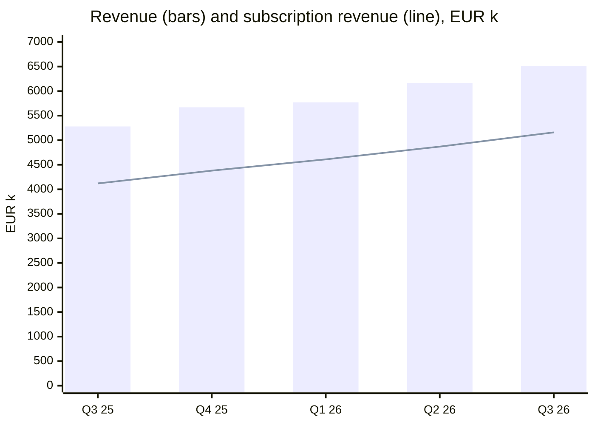
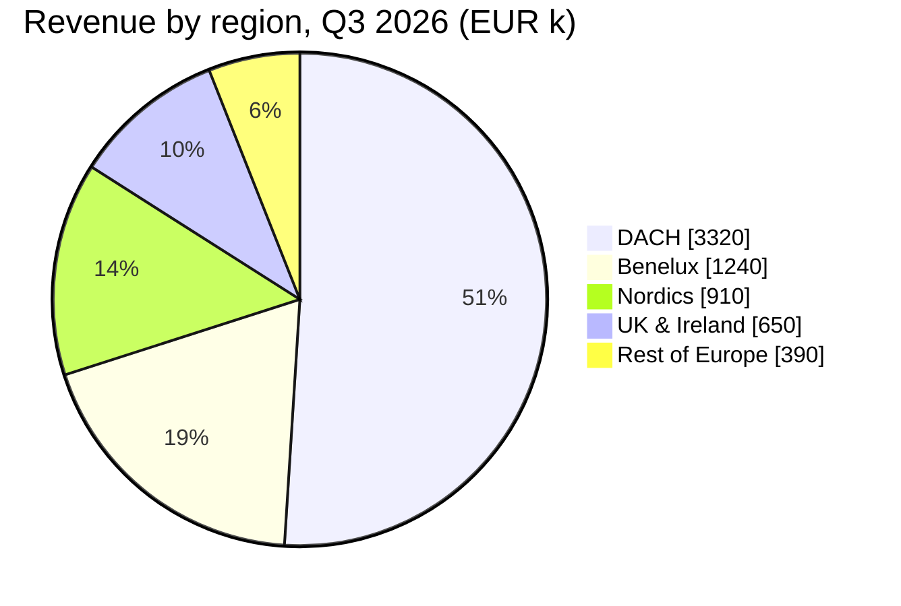
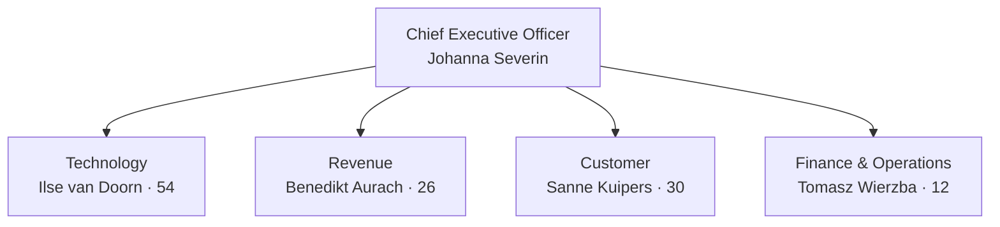

[[toc]]

<!-- pagebreak -->

# Executive summary

Q3 2026 was the quarter in which Quaybridge turned EBITDA-positive for the first time. Revenue grew 23.3% year on year to EUR 6.51 m, annual recurring revenue (ARR)[^arr] closed at EUR 21.3 m, and EBITDA[^ebitda] came in at EUR 0.13 m against a loss of EUR 0.47 m a year ago. We reached this point two quarters earlier than the plan the supervisory board approved in December, and without slowing hiring in product and engineering.

Three things drove the quarter. First, the subscription business kept compounding: net new ARR of EUR 1.2 m was the strongest we have recorded, carried by the largest new-customer quarter in the company's history (21 new customers, EUR 0.78 m of new ARR). Second, the carrier network continued to outgrow the core product. Dock appointments booked through the platform rose 31% to 2.84 million, and network revenue grew 34% year on year. Third, gross margin improved by 4.7 percentage points to 73.1% as hosting costs were renegotiated in Q2 and professional services moved closer to break-even.

The quarter was not without problems. On 14 August a database migration degraded the booking API for 42 minutes during the morning peak in Central Europe, our first severity-1 incident since March 2025. We describe the cause and the corrective actions under [Reliability](#reliability). Gross revenue retention also slipped one point to 95%, mostly because a long-standing customer was acquired by a group that runs its own scheduling system.

We are raising full-year guidance for revenue and EBITDA and narrowing the ARR range. Revenue is now expected at EUR 25.0–25.4 m (previously EUR 24.6–25.2 m), growth of 21–23% on 2025.

Johanna Severin, Chief Executive Officer
Tomasz Wierzba, Chief Financial Officer

## Highlights

- **First EBITDA-positive quarter.** EBITDA of EUR 130 k (2.0% margin), an improvement of EUR 600 k year on year and EUR 230 k on Q2.
- **Record net new ARR.** EUR 1.2 m, of which EUR 0.78 m from new customers. ARR grew 24.6% year on year to EUR 21.3 m.
- **The network effect shows in the numbers.** 9,400 carriers booked at least one appointment in the quarter, up from 7,100 a year ago; network revenue reached 13.2% of total revenue.
- **Slot Forecast generally available.** The arrival-prediction module launched on 19 August and was live at 64 sites by the end of September.
- **Positive free cash flow.** EUR 130 k, helped by annual renewals invoiced in July. Cash at quarter end was EUR 14.2 m.

## Key figures

| Metric | Q3 2026 | Q2 2026 | Q3 2025 | Change YoY |
|:-------|--------:|--------:|--------:|-----------:|
| ARR (EUR m) | 21.3 | 20.1 | 17.1 | +24.6% |
| Revenue (EUR k) | 6,510 | 6,160 | 5,280 | +23.3% |
| Recurring share of revenue | 92.5% | 91.7% | 90.2% | +2.3 pp |
| Gross margin | 73.1% | 71.6% | 68.4% | +4.7 pp |
| EBITDA (EUR k) | 130 | −100 | −470 | +600 |
| EBITDA margin | 2.0% | −1.6% | −8.9% | +10.9 pp |
| Free cash flow (EUR k) | 130 | −600 | −820 | +950 |
| Cash and equivalents (EUR m) | 14.2 | 14.1 | 16.9 | −16.0% |
| Customers | 322 | 305 | 268 | +20.1% |
| Net revenue retention, TTM[^nrr] | 112% | 111% | 108% | +4 pp |
| Gross revenue retention, TTM | 95% | 96% | 94% | +1 pp |
| Dock appointments booked (m) | 2.84 | 2.61 | 2.17 | +30.9% |
| Headcount (FTE) | 123 | 118 | 104 | +18.3% |

# Financial performance

> [!NOTE]
> All figures in this report are unaudited management accounts prepared under German GAAP (HGB) and presented in thousands of euros (EUR k) unless stated otherwise. Totals may differ from the sum of their parts because of rounding. The full income statement is in [Appendix B](#appendix-b-income-statement).

## Revenue

Revenue for the quarter was EUR 6,510 k, up 5.7% on Q2 and 23.3% on Q3 2025. Recurring revenue, meaning subscription and network fees, made up 92.5% of the total, the highest share to date.

| Segment | Q3 2026 | Q2 2026 | Q3 2025 | QoQ | YoY | Share of Q3 |
|:--------|--------:|--------:|--------:|----:|----:|------------:|
| Subscription | 5,160 | 4,870 | 4,120 | +6.0% | +25.2% | 79.3% |
| Carrier network | 860 | 780 | 640 | +10.3% | +34.4% | 13.2% |
| Professional services | 490 | 510 | 520 | −3.9% | −5.8% | 7.5% |
| **Total revenue** | **6,510** | **6,160** | **5,280** | **+5.7%** | **+23.3%** | **100.0%** |

**Subscription** revenue grew in line with ARR. Price increases applied at renewal since January contributed roughly two points of the 25.2% growth; the remainder is volume, split almost evenly between new customers and additional sites at existing customers.

**Carrier network** revenue is a per-booking fee that carriers pay when they reserve a dock appointment at a warehouse that runs Quaybridge. The average fee was stable at EUR 0.30 per appointment, so revenue tracks booking volume. Bookings rose 8.8% on Q2, more than the usual seasonal pattern, because three large grocery distribution centres went live in July.

**Professional services** declined as planned. Since Q1, standard implementations at sites with fewer than ten dock doors are delivered by certified partners, and our own team concentrates on enterprise roll-outs. Services revenue is now a by-product of subscription growth rather than a target in its own right.

## Revenue by region

DACH remains our home market and still accounts for just over half of revenue, but every other region grew faster. Revenue in the Nordics rose 42% after the 2025 partnership with a Swedish freight exchange, and Rest of Europe (mainly Poland, Czechia and France) grew 50% from a small base.

| Region[^region] | Q3 2026 | Q3 2025 | YoY | Share of Q3 |
|:----------------|--------:|--------:|----:|------------:|
| DACH | 3,320 | 2,850 | +16.5% | 51.0% |
| Benelux | 1,240 | 1,010 | +22.8% | 19.0% |
| Nordics | 910 | 640 | +42.2% | 14.0% |
| UK & Ireland | 650 | 520 | +25.0% | 10.0% |
| Rest of Europe | 390 | 260 | +50.0% | 6.0% |
| **Total** | **6,510** | **5,280** | **+23.3%** | **100.0%** |

## Gross margin

Gross profit was EUR 4,760 k, a margin of 73.1%. The improvement of 1.5 points on Q2 came from all three segments.

| Segment | Revenue | Cost of revenue | Gross profit | Margin Q3 26 | Margin Q2 26 | Margin Q3 25 |
|:--------|--------:|----------------:|-------------:|-------------:|-------------:|-------------:|
| Subscription | 5,160 | 980 | 4,180 | 81.0% | 80.3% | 78.9% |
| Carrier network | 860 | 300 | 560 | 65.1% | 62.8% | 62.5% |
| Professional services | 490 | 470 | 20 | 4.1% | 2.0% | −7.7% |
| **Total** | **6,510** | **1,750** | **4,760** | **73.1%** | **71.6%** | **68.4%** |

Subscription cost of revenue consists of hosting, second-line support and licensed traffic data. The three-year hosting agreement signed in May reduced compute cost per active site by 14%; Q3 is the first quarter with the full effect. Network cost of revenue is mostly payment processing and text messages to drivers; moving registered carriers to in-app notifications lowered messaging cost by EUR 25 k in the quarter.

## Operating expenses

Operating expenses grew 2.7% on Q2, less than half the rate of revenue. As a share of revenue they fell from 81.3% a year ago to 75.0%.

| Function | Q3 2026 | % of revenue | Q2 2026 | Q3 2025 | YoY |
|:---------|--------:|-------------:|--------:|--------:|----:|
| Research & development | 2,380 | 36.6% | 2,310 | 2,050 | +16.1% |
| Sales & marketing | 1,690 | 26.0% | 1,640 | 1,480 | +14.2% |
| General & administrative | 810 | 12.4% | 800 | 760 | +6.6% |
| **Total operating expenses** | **4,880** | **75.0%** | **4,750** | **4,290** | **+13.8%** |

Research and development remains the largest cost line and the one we are least willing to cut: it grew 16% year on year as the engineering hub in Kraków reached its planned size of 22. Sales and marketing grew more slowly than new ARR, and the sales-efficiency ratio[^magic] improved for the fourth consecutive quarter to 0.73 (Q2: 0.69). General and administrative costs were broadly flat; the Q4 2025 peak reflected one-off legal fees for the secondary share sale that accompanied the Series B.

## Profitability and cash

| EUR k | Q3 2026 | Q2 2026 | Q3 2025 |
|:------|--------:|--------:|--------:|
| Operating result (EBIT) | −120 | −340 | −680 |
| Depreciation and amortisation | 250 | 240 | 210 |
| **EBITDA** | **130** | **−100** | **−470** |
| Change in working capital | 180 | −320 | −230 |
| **Operating cash flow** | **310** | **−420** | **−700** |
| Capital expenditure | −180 | −180 | −120 |
| **Free cash flow** | **130** | **−600** | **−820** |
| Cash at end of period | 14,200 | 14,070 | 16,900 |

The working-capital inflow in Q3 is seasonal. About 40% of our enterprise contracts renew on 1 July and are invoiced annually in advance, which lifts deferred revenue and cash in the third quarter. We therefore do not read one positive free-cash-flow quarter as a trend. Free cash flow over the last twelve months was −EUR 2.7 m, and we expect 2027 as a whole to be free-cash-flow positive.

# Customers and retention

## ARR development

| EUR k | Q3 2026 | Q2 2026 |
|:------|--------:|--------:|
| Opening ARR | 20,100 | 19,000 |
| New customers | 780 | 400 |
| Expansion | 690 | 800 |
| Contraction | −90 | −40 |
| Churn | −180 | −60 |
| **Closing ARR** | **21,300** | **20,100** |
| Net new ARR | 1,200 | 1,100 |

New-customer ARR almost doubled on Q2. Q2 is traditionally our weakest selling quarter because grocery and retail customers freeze changes to their warehouses ahead of the summer peak; Q3 picks up the deals that slip out of it. Expansion was lower than in Q2, which included the roll-out of 38 sites at a pan-European building-materials distributor.

Over the last twelve months net revenue retention was 112% and gross revenue retention 95%. The quarterly bridges behind these figures are in [Appendix C](#appendix-c-arr-bridge-by-quarter).

## Customer base

At the end of September Quaybridge served 322 customers operating 1,180 warehouse sites. Average ARR per customer rose to EUR 66 k (Q3 2025: EUR 64 k).

| ARR per customer | Customers | Share | ARR (EUR k) | Share of ARR |
|:-----------------|----------:|------:|------------:|-------------:|
| Above EUR 250 k | 12 | 3.7% | 4,350 | 20.4% |
| EUR 100–250 k | 41 | 12.7% | 6,150 | 28.9% |
| EUR 25–100 k | 148 | 46.0% | 8,500 | 39.9% |
| Below EUR 25 k | 121 | 37.6% | 2,300 | 10.8% |
| **Total** | **322** | **100.0%** | **21,300** | **100.0%** |

Concentration remains moderate. The ten largest customers account for 18.0% of ARR and no single customer exceeds 2.5%.

## Notable wins

We do not name customers without their consent; the wins below are described by sector.

- **German grocery wholesaler, 14 distribution centres.** Our largest new contract to date at EUR 310 k ARR over three years. The customer replaces a spreadsheet-and-phone booking process and expects to cut average truck waiting time from 74 to under 30 minutes.
- **Dutch third-party logistics provider.** EUR 140 k ARR across nine sites, won against two international competitors. The deciding factor was the carrier network: 60% of the provider's inbound carriers were already registered on Quaybridge.
- **Nordic building-materials distributor.** EUR 95 k ARR for six sites, the first customer to buy Slot Forecast at contract signature.

## Churn

Four customers with combined ARR of EUR 180 k left in the quarter. The largest (EUR 110 k) was acquired by a logistics group that standardises on an in-house yard-management system; the customer was satisfied with the product and has agreed to act as a reference. The other three were small single-site customers, two of which closed the site in question.

# Product and engineering

## What we shipped

**Slot Forecast** became generally available on 19 August. It predicts the actual arrival time of each booked truck from carrier history, live traffic and the driver's last reported position, and shows the dock team which slots are likely to be missed. In the pilot at four sites it reduced idle dock time by 18%. By the end of September 64 sites had activated it; it is priced as an add-on at 15% of the base subscription.

**Carrier app 3.0** replaced the previous mobile web flow with native apps for drivers. Drivers can now check in by scanning a code at the gate, which removes the need for a gatehouse terminal at smaller sites. In September 41% of check-ins came through the app.

**Warehouse system connectors.** The connector framework now covers the five warehouse-management platforms most common among our customers, up from three. Two of the connectors are certified by the platform vendor, which shortens enterprise security reviews by several weeks.

## Reliability

| | July | August | September | Q3 2026 | Target |
|:--|--:|--:|--:|--:|--:|
| Availability[^uptime] | 99.99% | 99.91% | 100.00% | 99.97% | 99.90% |
| Booking API latency, p95 (ms) | 176 | 194 | 171 | 180 | < 250 |
| Severity-1 incidents | 0 | 1 | 0 | 1 | 0 |
| Severity-2 incidents | 2 | 1 | 1 | 4 | — |
| Production deployments | 402 | 351 | 387 | 1,140 | — |

> [!IMPORTANT]
> **Incident of 14 August.** A schema migration on the booking database took an exclusive lock that our migration tooling had classified as safe. Booking requests queued behind it and timed out between 07:12 and 07:54 CEST. No data was lost; 6,300 booking attempts failed and were retried by carriers or dock staff. Every migration now runs against a production-sized copy in CI with lock monitoring, and migrations are blocked between 05:00 and 11:00 on weekdays.

Availability for the quarter stayed above our contractual commitment of 99.9%, so no service credits are due.

## Roadmap for Q4

- **Yard management (beta).** Track trailers from gate to door, including drop-trailer parking. Five design-partner sites are signed.
- **Capacity pooling.** Customers with several sites in one region can offer carriers an alternative slot at a neighbouring warehouse when the preferred one is full.
- **Polish and Czech localisation** of the carrier app, which the Rest-of-Europe pipeline needs.

## Security and compliance

The ISO/IEC 27001 surveillance audit in September closed with no major and two minor findings, both about how access reviews are documented. Both were remediated by 10 October. The annual external penetration test is scheduled for November.

# People and organisation

We ended the quarter with 123 full-time equivalents after nine joiners and four leavers. Voluntary attrition over the last twelve months was 9.5% (11 departures on an average headcount of 116), slightly better than the 10.4% a year ago.

| Function | Q3 2026 | Q2 2026 | Change | Open roles |
|:---------|--------:|--------:|-------:|-----------:|
| Research & development | 54 | 52 | +2 | 3 |
| Sales & marketing | 26 | 25 | +1 | 2 |
| Customer success & support | 19 | 18 | +1 | 1 |
| Professional services | 11 | 12 | −1 | 0 |
| General & administrative | 13 | 11 | +2 | 1 |
| **Total** | **123** | **118** | **+5** | **7** |

Most of the team works from Hamburg (71). Rotterdam (24) hosts sales and customer success for Benelux and the UK, Kraków (22) is an engineering hub, and six colleagues work remotely from the Nordics and France.

*Leadership team and team sizes in FTE at 30 September 2026. Technology comprises engineering (41) and product and design (13); Revenue comprises sales (15) and marketing (11); Customer comprises success and support (19) and professional services (11). Finance & Operations covers finance, legal, people and IT; the CEO is counted under general & administrative.*

Two leadership changes took effect in the quarter. Sanne Kuipers joined on 1 July as Chief Customer Officer and now leads both customer success and professional services, which previously reported separately. The Head of People role, vacant since April, was filled internally.

The employee survey in September had a response rate of 88%. Engagement was unchanged at 7.8 out of 10. As in March, the lowest-scoring item was clarity about career paths outside management; a dual-ladder framework for engineering and customer roles will be introduced in January.

# Outlook and guidance

Based on the third-quarter results and the pipeline for the fourth quarter, we are raising guidance for revenue and EBITDA and narrowing the range for year-end ARR.

| Full year 2026 | Prior guidance (July) | Updated guidance | 9 months actual |
|:---------------|----------------------:|-----------------:|----------------:|
| Revenue (EUR m) | 24.6–25.2 | 25.0–25.4 | 18.4 |
| ARR at year end (EUR m) | 22.0–22.6 | 22.4–22.8 | 21.3 |
| EBITDA (EUR m) | −0.6 to −0.2 | −0.1 to +0.2 | −0.3 |
| Headcount at year end (FTE) | 128–132 | 126–129 | 123 |

The updated revenue range implies fourth-quarter revenue of EUR 6.56–6.96 m. Fourth-quarter revenue is usually lifted by professional services, as customers complete roll-outs before their own year-end change freeze. The headcount range is lower because two senior engineering hires were brought forward into Q3 and the remaining Q4 hiring is limited to roles with signed offers.

> [!WARNING]
> Guidance reflects management's current expectations and the contracts signed or in late-stage negotiation as of 24 October 2026. It assumes no material change in European freight volumes and an exchange rate of 11.6 Swedish kronor per euro for Nordic contracts. Actual results may differ materially.

## Priorities for 2027

1. Make the carrier network a product in its own right, with a paid tier for carriers that book at many warehouses.
2. Reach free-cash-flow break-even for the full year without new financing.
3. Enter France with a local sales team, building on the 14 customers we already serve there through partners.

# Risks and mitigations

| Risk | Likelihood | Impact | Mitigation |
|:-----|:----------:|:------:|:-----------|
| A slowdown in European freight volumes reduces booking revenue | Medium | Medium | Network revenue is 13% of the total; subscription fees are fixed per site and do not depend on volume. |
| Consolidation among customers, as in this quarter's largest churn | Medium | Medium | Multi-year contracts for all customers above EUR 100 k ARR; 71% of that ARR is contracted beyond 2027. |
| A large warehouse-software vendor bundles dock scheduling into its suite | Low | High | No single vendor can replicate the cross-warehouse carrier network; connectors to all major platforms keep us neutral. |
| Further availability incidents damage enterprise trust | Low | High | Migration safeguards introduced in August; internal availability target raised to 99.95%. |
| Wage inflation at the engineering hubs | High | Low | Kraków salaries benchmarked twice a year; equity programme extended to all permanent staff. |

<!-- pagebreak -->

# Appendix

## Appendix A: Definitions

Annual recurring revenue (ARR)
: Annualised value of all subscription contracts in force on the last day of the period, excluding one-off fees and network revenue.

Net new ARR
: Closing ARR minus opening ARR for the period.

Net revenue retention (NRR)
: ARR at the end of the period from customers who were customers twelve months earlier, divided by their ARR twelve months earlier.

Gross revenue retention (GRR)
: As NRR, but excluding expansion. GRR cannot exceed 100%.

EBITDA
: Operating result before depreciation and amortisation. No adjustments are made for share-based compensation or one-off items.

Free cash flow
: Operating cash flow minus capital expenditure, including capitalised development costs.

Dock appointment
: A time slot at a loading dock reserved by a carrier through Quaybridge, counted once when it is confirmed.

## Appendix B: Income statement

Changes are shown in EUR k where the base is negative and in percentage points (pp) for margins. Cost lines are shown as negative values; their percentage changes refer to the size of the cost.

| EUR k | Q3 25 | Q4 25 | Q1 26 | Q2 26 | Q3 26 | QoQ | YoY | 9M 25 | 9M 26 | 9M YoY |
|:------|------:|------:|------:|------:|------:|----:|----:|------:|------:|-------:|
| Subscription | 4,120 | 4,380 | 4,610 | 4,870 | 5,160 | +6.0% | +25.2% | 11,760 | 14,640 | +24.5% |
| Carrier network | 640 | 710 | 690 | 780 | 860 | +10.3% | +34.4% | 1,740 | 2,330 | +33.9% |
| Professional services | 520 | 580 | 470 | 510 | 490 | −3.9% | −5.8% | 1,470 | 1,470 | 0.0% |
| **Revenue** | **5,280** | **5,670** | **5,770** | **6,160** | **6,510** | **+5.7%** | **+23.3%** | **14,970** | **18,440** | **+23.2%** |
| Cost of revenue | −1,670 | −1,740 | −1,730 | −1,750 | −1,750 | 0.0% | +4.8% | −4,840 | −5,230 | +8.1% |
| **Gross profit** | **3,610** | **3,930** | **4,040** | **4,410** | **4,760** | **+7.9%** | **+31.9%** | **10,130** | **13,210** | **+30.4%** |
| Gross margin | 68.4% | 69.3% | 70.0% | 71.6% | 73.1% | +1.5 pp | +4.7 pp | 67.7% | 71.6% | +3.9 pp |
| Research & development | −2,050 | −2,120 | −2,260 | −2,310 | −2,380 | +3.0% | +16.1% | −5,900 | −6,950 | +17.8% |
| Sales & marketing | −1,480 | −1,620 | −1,590 | −1,640 | −1,690 | +3.0% | +14.2% | −4,250 | −4,920 | +15.8% |
| General & administrative | −760 | −840 | −790 | −800 | −810 | +1.3% | +6.6% | −2,220 | −2,400 | +8.1% |
| **Operating expenses** | **−4,290** | **−4,580** | **−4,640** | **−4,750** | **−4,880** | **+2.7%** | **+13.8%** | **−12,370** | **−14,270** | **+15.4%** |
| **Operating result (EBIT)** | **−680** | **−650** | **−600** | **−340** | **−120** | **+220** | **+560** | **−2,240** | **−1,060** | **+1,180** |
| Depreciation & amortisation | 210 | 220 | 230 | 240 | 250 | +4.2% | +19.0% | 600 | 720 | +20.0% |
| **EBITDA** | **−470** | **−430** | **−370** | **−100** | **130** | **+230** | **+600** | **−1,640** | **−340** | **+1,300** |
| EBITDA margin | −8.9% | −7.6% | −6.4% | −1.6% | 2.0% | +3.6 pp | +10.9 pp | −11.0% | −1.8% | +9.2 pp |
{.income-statement}

## Appendix C: ARR bridge by quarter

| EUR k | Q4 2025 | Q1 2026 | Q2 2026 | Q3 2026 | Last 12 months |
|:------|--------:|--------:|--------:|--------:|---------------:|
| Opening ARR | 17,100 | 18,000 | 19,000 | 20,100 | 17,100 |
| New customers | 450 | 520 | 400 | 780 | 2,150 |
| Expansion | 690 | 720 | 800 | 690 | 2,900 |
| Contraction | −60 | −80 | −40 | −90 | −270 |
| Churn | −180 | −160 | −60 | −180 | −580 |
| **Closing ARR** | **18,000** | **19,000** | **20,100** | **21,300** | **21,300** |

Net revenue retention over the last twelve months is (17,100 + 2,900 − 270 − 580) / 17,100 = 112.0%; gross revenue retention is (17,100 − 270 − 580) / 17,100 = 95.0%.

## Appendix D: Operating metrics by quarter

| | Q3 2025 | Q4 2025 | Q1 2026 | Q2 2026 | Q3 2026 |
|:--|--:|--:|--:|--:|--:|
| Customers | 268 | 281 | 296 | 305 | 322 |
| Warehouse sites | 935 | 990 | 1,060 | 1,110 | 1,180 |
| Active carriers (thousands) | 7.1 | 7.6 | 8.2 | 8.8 | 9.4 |
| Dock appointments (m) | 2.17 | 2.30 | 2.35 | 2.61 | 2.84 |
| Average network fee per appointment (EUR) | 0.29 | 0.31 | 0.29 | 0.30 | 0.30 |
| Sales-efficiency ratio | 0.56 | 0.61 | 0.62 | 0.69 | 0.73 |
| Headcount (FTE) | 104 | 109 | 114 | 118 | 123 |

[^arr]: ARR excludes carrier network revenue, which is transaction-based. See Appendix A for all definitions.
[^ebitda]: EBITDA is not adjusted for share-based compensation or one-off items.
[^nrr]: Over the trailing twelve months. The calculation is shown in Appendix C.
[^region]: Region of the customer's contracting entity. DACH is Germany, Austria and Switzerland; the Nordics are Sweden, Norway, Denmark and Finland.
[^magic]: Net new ARR in the quarter divided by sales and marketing expense in the previous quarter.
[^uptime]: Share of minutes in which the booking API and web application answered health checks from three European regions. Planned maintenance announced seven days in advance is excluded; there was none in Q3.
