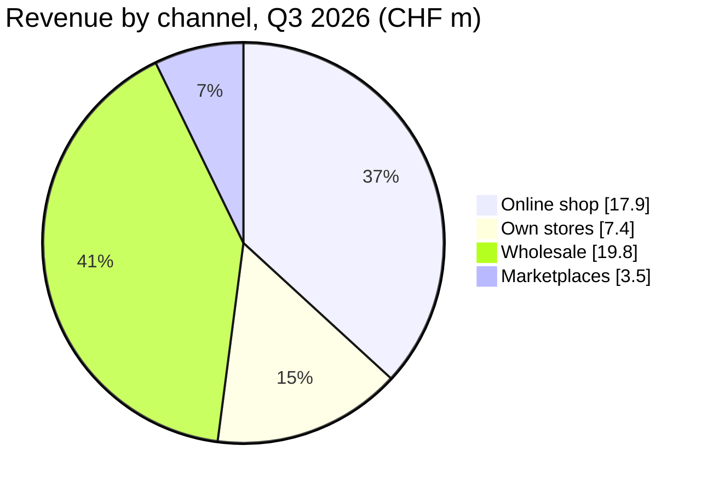
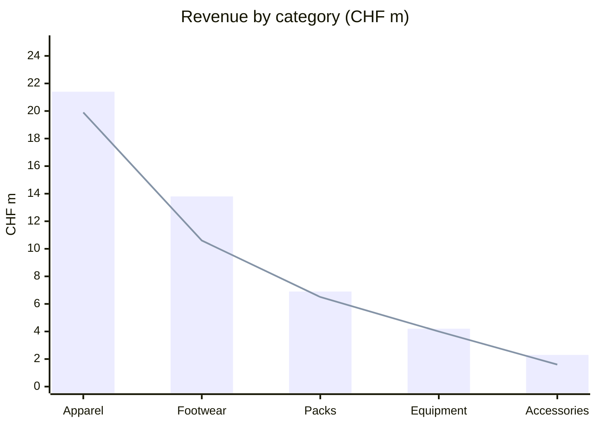

<!--
  Fixture: business-report — template "Business report" (Business).
  Stresses: [[toc]]; an executive summary with a key-figures table; KPI
  tables with right-aligned numbers, totals rows and a wide 9-column table;
  Mermaid pie + xychart (bar/line) charts; a quote from the CEO; outlook with
  nested bullets; an alert for a forward-looking-statements disclaimer;
  footnotes; a page break before the appendix; an appendix with a long table.
  Suggested title: "Halden Outdoor AG — Q3 2026 Quarterly Report".
  Patch: business-report-patch.json.
-->

[[toc]]

# Executive summary

Halden Outdoor closed the third quarter of 2026 with net revenue of **CHF 48.6 million**, up 14 % on the same quarter last year and 3 % above plan. Growth came almost entirely from the direct-to-consumer channel, which for the first time exceeded half of revenue. Gross margin improved by 2.1 percentage points to 54.8 % as fewer seasonal goods had to be discounted. Operating profit (EBIT) rose to CHF 6.9 million, a margin of 14.2 %.

The wholesale business remained weak. Two of our five largest retail partners reduced their autumn orders after a warm September, and wholesale revenue fell 9 %. We expect wholesale to stabilise in the first half of 2027 as partners return to normal inventory levels.

| Key figures | Q3 2026 | Q3 2025 | Change |
|---|---:|---:|---:|
| Net revenue (CHF m) | 48.6 | 42.6 | +14.1 % |
| Gross margin | 54.8 % | 52.7 % | +2.1 pp |
| EBIT (CHF m) | 6.9 | 5.1 | +35.3 % |
| EBIT margin | 14.2 % | 12.0 % | +2.2 pp |
| Free cash flow (CHF m) | 4.2 | −1.3 | n/m |
| Employees (FTE, end of period) | 412 | 386 | +6.7 % |

> Our customers are buying fewer, better things, and they want to buy them from us directly. This quarter shows that the shift is lasting, and that it is good for our margins.
>
> — Annika Brunner, Chief Executive Officer

# Revenue

## By channel

| Channel | Q3 2026 (CHF m) | Share | Q3 2025 (CHF m) | Change |
|---|---:|---:|---:|---:|
| Online shop | 17.9 | 36.8 % | 13.2 | +35.6 % |
| Own stores (9) | 7.4 | 15.2 % | 6.1 | +21.3 % |
| Wholesale | 19.8 | 40.7 % | 21.8 | −9.2 % |
| Marketplaces | 3.5 | 7.2 % | 1.5 | +133.3 % |
| **Total** | **48.6** | **100.0 %** | **42.6** | **+14.1 %** |

The online shop grew fastest in Germany (+52 %) and Austria (+41 %), where we launched local-language customer service in April. Marketplace revenue more than doubled from a low base after we listed the full footwear range on two additional platforms.

## By product category

Apparel remains our largest category. Footwear grew strongly after the relaunch of the *Grat* hiking boot, which sold 38,000 pairs in the quarter.

*Bars: Q3 2026. Line: Q3 2025.*

## By region

| Region | Q1 | Q2 | Q3 | YTD 2026 | YTD 2025 | Change | Share of YTD | Online share | Stores |
|---|---:|---:|---:|---:|---:|---:|---:|---:|---:|
| Switzerland | 9.8 | 12.1 | 14.2 | 36.1 | 33.4 | +8.1 % | 30.1 % | 39 % | 6 |
| Germany | 8.2 | 11.4 | 15.7 | 35.3 | 28.0 | +26.1 % | 29.4 % | 58 % | 2 |
| Austria | 3.1 | 4.4 | 5.9 | 13.4 | 10.9 | +22.9 % | 11.2 % | 49 % | 1 |
| France | 3.9 | 5.0 | 6.1 | 15.0 | 14.2 | +5.6 % | 12.5 % | 31 % | 0 |
| Nordics | 2.4 | 3.3 | 4.0 | 9.7 | 8.8 | +10.2 % | 8.1 % | 44 % | 0 |
| Rest of world | 2.6 | 3.2 | 2.7 | 8.5 | 8.1 | +4.9 % | 7.1 % | 61 % | 0 |
| **Total** | **30.0** | **39.4** | **48.6** | **118.0** | **103.4** | **+14.1 %** | **100 %** | **47 %** | **9** |

# Profitability

Gross margin benefited from a higher share of full-price sales: the share of revenue sold at a discount fell from 27 % to 19 %. Freight costs were 6 % lower per unit after we consolidated inbound shipments from Vietnam through one port.

Operating expenses rose 11 %, mainly because of marketing for the German online launch (CHF 1.4 million) and 26 additional employees in customer service and logistics.

| CHF m | Q3 2026 | Q3 2025 | YTD 2026 | YTD 2025 |
|---|---:|---:|---:|---:|
| Net revenue | 48.6 | 42.6 | 118.0 | 103.4 |
| Cost of goods sold | −22.0 | −20.2 | −54.6 | −49.5 |
| **Gross profit** | **26.6** | **22.4** | **63.4** | **53.9** |
| Marketing | −6.1 | −4.8 | −15.2 | −12.6 |
| Personnel | −8.7 | −7.9 | −25.4 | −23.1 |
| Other operating expenses | −3.9 | −3.7 | −11.3 | −10.9 |
| Depreciation and amortisation | −1.0 | −0.9 | −2.9 | −2.6 |
| **EBIT** | **6.9** | **5.1** | **8.6** | **4.7** |

YTD EBIT is lower than the sum of quarterly results would suggest because the first quarter is seasonally loss-making.[^seasonal]

# Cash flow and balance sheet

Free cash flow turned positive at CHF 4.2 million after a negative prior-year quarter, in which we had built winter inventory early to avoid shipping delays. Net working capital fell to 31 % of trailing revenue (Q3 2025: 36 %). Net cash at the end of September was CHF 12.4 million; the revolving credit facility of CHF 25 million remained undrawn.

# Sustainability

- **Materials.** 71 % of apparel by weight used recycled or certified fibres (target for 2027: 80 %).
- **Repairs.** The repair service handled 4,900 items in the quarter, 38 % more than a year ago; median turnaround was 11 days.
- **Emissions.** Scope 1 and 2 emissions fell 18 % year on year after the Frauenfeld warehouse switched to a renewable electricity contract.[^scope3]

# Outlook

We confirm our guidance for the full year 2026:

- Net revenue between **CHF 172 and 178 million** (2025: CHF 154.3 million).
- EBIT margin between **9 and 10 %**.
- Capital expenditure of about CHF 6 million, mainly for:
  - the new store in Munich (opening March 2027),
  - warehouse automation in Frauenfeld,
    - phase 1 (picking robots) completed in October,
    - phase 2 (returns sorting) planned for Q2 2027.

> [!NOTE]
> This report contains forward-looking statements based on current expectations and assumptions. Actual results may differ materially because of weather, consumer demand, supply chain disruptions, currency movements and other factors beyond our control.

<!-- pagebreak -->

# Appendix

## Store performance

| Store | Opened | Area (m²) | Revenue Q3 (CHF k) | Change | Conversion | Avg. basket (CHF) |
|---|---|---:|---:|---:|---:|---:|
| Zurich Bahnhofstrasse | 2014 | 420 | 1,640 | +12 % | 21 % | 168 |
| Bern Marktgasse | 2016 | 310 | 980 | +8 % | 24 % | 152 |
| Basel Freie Strasse | 2017 | 280 | 870 | +15 % | 22 % | 149 |
| Lucerne | 2019 | 250 | 790 | +19 % | 26 % | 171 |
| St. Gallen | 2021 | 220 | 560 | +6 % | 23 % | 139 |
| Interlaken | 2022 | 190 | 710 | +31 % | 29 % | 194 |
| Berlin Mitte | 2023 | 360 | 820 | +44 % | 18 % | 161 |
| Hamburg | 2025 | 330 | 610 | n/m | 17 % | 158 |
| Innsbruck | 2025 | 240 | 420 | n/m | 25 % | 176 |

## Definitions

Direct-to-consumer (DTC)
: Revenue from the online shop and own stores.

Free cash flow
: Cash flow from operating activities minus capital expenditure.

Conversion
: Transactions divided by visitors counted at the store entrance.

[^seasonal]: Q1 2026 EBIT was CHF −4.6 million (Q1 2025: CHF −5.2 million).

[^scope3]: Scope 3 emissions, which account for over 90 % of our footprint, are reported annually in the sustainability report.
