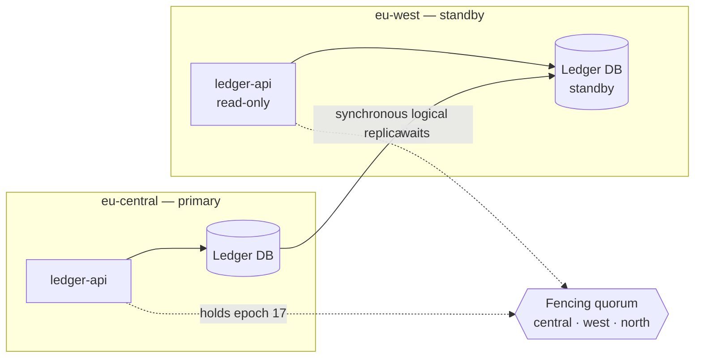
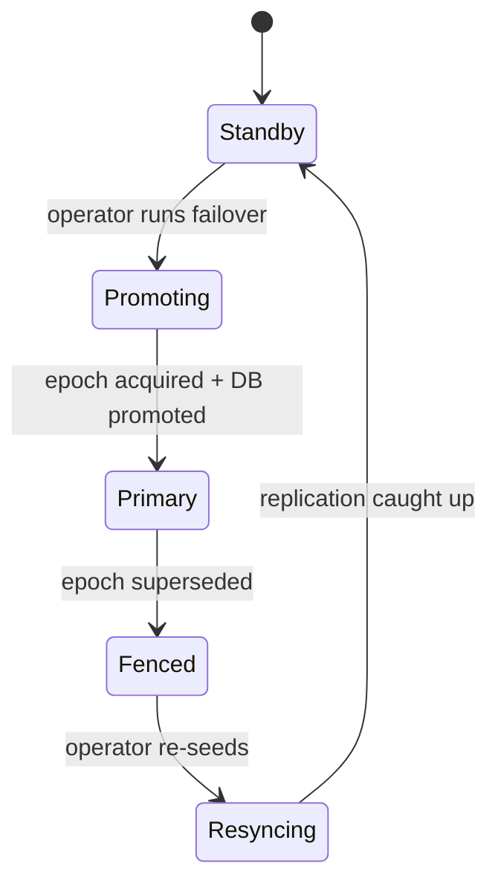

<!--
  Fixture: design-doc — template "Design doc / RFC" (Engineering).
  Stresses: a metadata block (key/value table) right after the title; goals /
  non-goals lists; a Mermaid flowchart + a state diagram; an "alternatives
  considered" comparison table with many columns; numbered decisions (D1…);
  a rollout table; risks with likelihood/impact; open questions as a task list;
  footnotes; nested numbered lists; an h2 that tends to land near a page end.
  Suggested title: "RFC 0042: Regional failover for the payments ledger".
  Patch: design-doc-patch.json.
-->

| | |
|---|---|
| **Status** | In review |
| **Authors** | Priya Raman, Tomás Ferreira |
| **Reviewers** | Lena Vogt (Storage), Daniel Osei (Payments), Mira Halvorsen (SRE) |
| **Created** | 2026-10-14 |
| **Last updated** | 2026-11-03 |
| **Tracking issue** | LEDGER-1187 |
| **Decision deadline** | 2026-11-20 |

# Summary

The payments ledger runs in a single region (`eu-central`). A full regional outage today stops card capture, payouts and refunds until the region recovers; our last two provider incidents lasted 47 and 132 minutes. This RFC proposes a warm standby in `eu-west` fed by logical replication, a fencing token held in a quorum store spanning three regions, and an operator-triggered failover that completes in under five minutes with no lost committed entries.

# Context

The ledger is an append-only PostgreSQL database (2.1 TB, ~1,800 writes/s at peak) behind the `ledger-api` service. Every money movement is a pair of balanced entries written in one transaction. Downstream systems — reconciliation, reporting, the merchant dashboard — read from replicas in the same region.

Three properties make failover harder than for a typical service:

1. **No double spending.** Two regions must never accept writes for the same account at the same time. A brief split brain could approve two refunds against one balance.
2. **No lost entries.** An entry that `ledger-api` acknowledged to a caller must survive the failover. Card networks treat an acknowledged capture as final.
3. **Idempotency keys must stay unique.** Clients retry with the same key after a timeout; the standby must know every key the primary accepted.

Our current recovery objective, written into merchant contracts in 2025, is an RPO of zero and an RTO of four hours.[^contract] The RTO is met only because no outage has lasted that long.

## What happened on 12 September

At 14:06 UTC the provider lost power in two of three availability zones in `eu-central`. The database primary was in one of them; the synchronous replica was in the other. Promotion to the asynchronous replica in the third zone was possible but would have lost up to 900 ms of acknowledged writes, so the on-call engineer correctly waited. Capture resumed at 16:18 UTC. Merchants retried 41,000 captures in that window, 6 % of which were abandoned by the cardholder.

# Goals

- Recover write availability for the ledger within **15 minutes** of a regional outage, of which at most **5 minutes** is the failover itself.
- Lose **no acknowledged entry** (RPO = 0) in any single-region failure.
- Make split brain impossible by construction, not by runbook discipline.
- Keep p99 write latency for `POST /entries` below **40 ms** (today: 18 ms).

## Non-goals

- Automatic failover. A human decides; the system makes the decision safe and fast.
- Active-active writes. Partitioning accounts across regions is a much larger project (see [Alternative C](#alternatives-considered)).
- Failover for the reporting warehouse, which can tolerate a day of delay.
- Multi-cloud. Both regions stay with the current provider.

# Proposal

## Overview

We add a standby ledger database in `eu-west` and a small **fencing service** that hands out a monotonically increasing epoch to exactly one region at a time. `ledger-api` writes the current epoch into every transaction and refuses to commit when it does not hold the latest one.



## Replication

The primary uses PostgreSQL synchronous replication with `synchronous_standby_names = 'ANY 1 (west_a, west_b)'`. A commit returns only after one of two standbys in `eu-west` has flushed it. This is what gives us RPO = 0 across regions; it costs one cross-region round trip (measured: 11–14 ms) on every commit.

The in-region synchronous replica stays, but becomes one of three candidates (`ANY 1 (central_b, west_a, west_b)`) only during a declared `eu-west` outage, so a single lost region never blocks commits.

## Fencing

Each `ledger-api` instance obtains a lease on the epoch from the quorum store (etcd with one member per region). The epoch is written into a single-row table on every transaction:

```sql
-- Runs inside every write transaction, before the entries are inserted.
UPDATE ledger.fence
SET last_seen_at = now()
WHERE epoch = $1;      -- the epoch this instance holds
-- 0 rows updated → this region has been fenced off; roll back.
```

Failover increments the epoch in the quorum store **before** promoting the standby, then writes the new epoch to the promoted database. Any straggling primary in `eu-central` that comes back will find its epoch outdated on its first write and roll back. The state machine for a region:



## Failover procedure

1. The operator runs `ledgerctl failover --to eu-west --reason "<incident id>"`.
2. The tool checks the preconditions:
   1. the standby's replay LSN equals its received LSN (nothing pending);
   2. the quorum store is reachable from `eu-west` and `eu-north`;
   3. no failover happened in the last 30 minutes (override with `--force`).
3. It bumps the epoch, promotes the standby, and flips the `ledger-api` DNS record (TTL 30 s).
4. It posts the timeline to the incident channel.

Dry runs (`--plan`) print every step without changing anything and are part of the monthly game day.

# Alternatives considered

| | A: Async replica + manual promote | B: Sync replication + fencing (**proposed**) | C: Active-active, accounts partitioned | D: Managed distributed SQL |
|---|---|---|---|---|
| RPO | ≤ 1 s | 0 | 0 per partition | 0 |
| RTO | 30–60 min | ≤ 5 min | none for unaffected partitions | ≤ 1 min |
| p99 write latency | 18 ms | ~32 ms | 18 ms | 45–70 ms (measured) |
| Split-brain safety | runbook only | by construction | by construction | by construction |
| Engineering effort | 2 weeks | 8 weeks | 9+ months | 6 months (migration) |
| Operational change | small | moderate | large | very large |
| Cost per month | +€4k | +€9k | +€14k | +€38k |

**A** fails the RPO goal: an async replica can be up to a second behind, and on 12 September that would have meant 1,700 lost entries. **C** is where we want to end up, but it requires every caller to know an account's home region and a rewrite of cross-account transfers into a two-phase protocol. **D** moved the latency budget out of reach in our load test and would lock the ledger into one vendor's SQL dialect.

# Decisions

**D1.** We use synchronous cross-region replication and accept the latency cost (~14 ms on p99).

**D2.** Failover is operator-triggered. Automatic failover is out of scope until we have six months of game-day data.

**D3.** The fencing epoch lives in etcd with one member in each of three regions, so that losing any single region keeps a quorum.

**D4.** `ledger-api` checks the epoch inside the write transaction, not in a separate call, so there is no window between check and commit.

**D5.** Reads served from `eu-central` replicas during a failover are allowed but tagged `stale=true` in responses; the merchant dashboard shows a banner.

# Rollout plan

| Phase | Weeks | Scope | Exit criterion |
|---|---|---|---|
| 0 — Preparation | 1–2 | Provision `eu-west`, etcd quorum, dashboards | Standby replicating asynchronously, lag < 200 ms |
| 1 — Shadow fencing | 3–4 | Epoch written but not enforced | 14 days without a mismatch |
| 2 — Synchronous | 5–6 | Switch to `ANY 1 (west_a, west_b)` | p99 write latency < 40 ms for 7 days |
| 3 — Enforcement | 7 | Epoch enforced | Game day: failover in staging under load |
| 4 — Production game day | 8 | Planned failover and failback in production | RTO ≤ 5 min, zero lost entries |

Each phase can be rolled back independently. Phase 2 has the largest blast radius: if latency regresses, setting `synchronous_standby_names` back to the in-region replica restores today's behaviour in one reload.

# Risks

| Risk | Likelihood | Impact | Mitigation |
|---|---|---|---|
| Cross-region latency spikes block commits | Medium | High | `ANY 1` of two standbys; alert at p99 > 25 ms; documented downgrade |
| etcd quorum lost (two regions down) | Low | High | Writes stop safely; manual override documented with four-eyes rule |
| Operator promotes during a short blip | Medium | Medium | 5-minute precondition check; `--plan` output reviewed in the incident channel |
| Idempotency table diverges | Low | High | Keys are in the same database and replicate with the entries |
| Cost overrun | Low | Low | Standby sized at 60 % of the primary; resize on promotion |

# Open questions

- [ ] Do we need a third standby in `eu-north` so that `eu-west` maintenance does not degrade us to in-region sync? (Owner: Mira)
- [ ] Should the failover tool page the payments lead automatically, or is the incident commander enough? (Owner: Daniel)
- [x] ~~Can logical replication keep up with peak write volume?~~ Yes: 2,600 writes/s sustained in the load test with 9 ms apply lag.
- [ ] How do we fail back without a second outage window?

# Appendix: latency measurements

Measured from `ledger-api` pods in `eu-central-1a` to a standby in each candidate zone, 10,000 commits of a typical two-entry transaction:

| Standby location | p50 (ms) | p95 (ms) | p99 (ms) | Max (ms) |
|---|---:|---:|---:|---:|
| `eu-central-1b` (today) | 1.9 | 3.4 | 5.1 | 22.0 |
| `eu-west-1a` | 11.2 | 12.8 | 14.1 | 61.7 |
| `eu-west-1b` | 11.6 | 13.3 | 14.9 | 58.2 |
| `eu-north-1a` | 19.4 | 21.0 | 23.6 | 79.3 |

[^contract]: Merchant agreement, schedule 4 ("Service levels"), section 2.3. Legal has confirmed that improving the RTO does not require a contract change.
