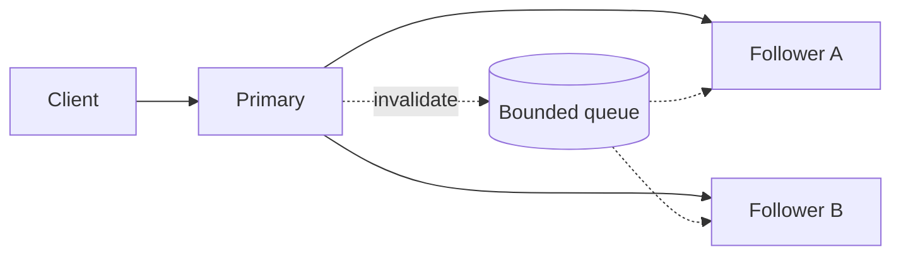

[[toc]]

# Introduction

Distributed caches fail in ways that are hard to see from a single node. This report describes how the **edge cache** behaves under partial network partitions, what we measured over six weeks of production traffic, and which configuration we recommend for the next release. The short version: the write-through path is safe, but the invalidation fan-out needs a bounded queue.[^1]

We use `cache.get(key)` and `cache.put(key, value, ttl)` throughout; both are described in the [API reference](https://example.com/api). Read latency is reported as the 99th percentile over one-minute windows.

## Background

Each region runs three cache nodes behind a consistent-hash ring. A write goes to the primary first and is then replicated to two followers. Followers acknowledge asynchronously, which keeps write latency low but opens a window in which a reader can see a stale value.

### Terminology

- **Primary**: the node that owns a key on the ring.
- **Follower**: a node holding a replica of the key.
- **Fan-out**: the set of invalidation messages a single write produces.
  - Nested items keep the list readable when a definition needs detail.

#### Assumptions

1. Clocks are synchronised to within 50 ms.
2. A partition heals within ten minutes.
3. Clients retry idempotent reads at most twice.

# Method

We replayed a recorded day of traffic against a staging ring and injected partitions with a fault proxy. The proxy configuration is shown below.

```yaml
proxy:
  listen: 0.0.0.0:7000
  upstream: cache-primary:6379
  faults:
    - kind: partition
      after: 120s
      duration: 90s
    - kind: latency
      p99: 250ms
```

The replay driver is a small TypeScript program. It reads the recorded requests and keeps the original inter-arrival times:

```ts title="replay.ts"
import { readFile } from 'node:fs/promises'

interface Recorded { at: number; op: 'get' | 'put'; key: string; value?: string }

export async function replay(path: string, client: CacheClient): Promise<Stats> {
  const lines = (await readFile(path, 'utf8')).split('\n').filter(Boolean)
  const start = performance.now()
  const stats = new Stats()
  for (const line of lines) {
    const req: Recorded = JSON.parse(line)
    const wait = req.at - (performance.now() - start)
    if (wait > 0) await sleep(wait)
    const t0 = performance.now()
    if (req.op === 'get') await client.get(req.key)
    else await client.put(req.key, req.value ?? '', 300)
    stats.record(req.op, performance.now() - t0)
  }
  return stats
}
```

To run it locally:

```bash
bun install --frozen-lockfile
bun run replay --trace traces/2026-10-12.ndjson --target localhost:7000
```

> [!NOTE]
> The trace contains no personal data: keys were hashed before recording.

# Results

Table 1 summarises read latency and stale-read rate per configuration.

| Configuration | p50 (ms) | p99 (ms) | Stale reads | Errors |
|---|---:|---:|---:|---:|
| Baseline | 1.8 | 6.2 | 0.00 % | 0 |
| Partition, unbounded queue | 2.1 | 41.7 | 0.31 % | 12 |
| Partition, bounded queue (1k) | 2.0 | 9.4 | 0.04 % | 0 |
| Partition, bounded queue (10k) | 2.0 | 18.9 | 0.02 % | 0 |

The stale-read rate grows with the queue length, as expected from queueing theory: with arrival rate $\lambda$ and service rate $\mu$, the mean time a message waits is

$$
W = \frac{\lambda}{\mu(\mu - \lambda)}
$$

so halving the slack $\mu - \lambda$ more than doubles the wait.



> Every cache is a promise about the past. The only question is how old a past you are willing to serve.
>
> — from the design review

> [!WARNING]
> An unbounded queue hides the problem until memory runs out. Always set `invalidation.maxQueue`.

## Discussion

The bounded queue trades a small number of dropped invalidations for predictable latency. Dropped invalidations are recovered by the TTL, which caps staleness at five minutes. For keys where that is too long, clients can request a **read-through** with `cache.get(key, { fresh: true })`.

---

# Recommendation

- [x] Ship the bounded queue with a limit of 1,000 messages.
- [x] Alert when the queue is more than 80 % full for five minutes.
- [ ] Revisit the limit after the next traffic peak.

[^1]: A queue with a fixed capacity that drops the oldest message when full.
