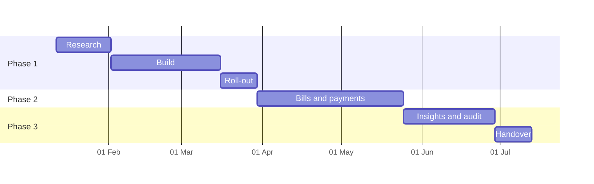

<!--
  Fixture: proposal — template "Client proposal" (Business).
  Stresses: a cover-ish opening (prepared for / by, reference, validity) as a
  two-column key/value table; problem / approach / deliverables sections;
  a timeline table and a Mermaid gantt; a pricing table with subtotal, VAT and
  total rows (bold) and right-aligned currency; optional items; terms as a
  numbered list with nested sub-clauses; a callout (TIP); a signature block
  (two parties side by side as a table: a row of empty cells is a line to
  sign on, the row under it its caption — the `proposal` template draws
  the lines); a page break before the terms.
  Suggested title: "Proposal: Customer portal relaunch for Rheintal Energie".
  Patch: proposal-patch.json.
-->

| | |
|---|---|
| **Prepared for** | Rheintal Energie AG — Sabine Kälin, Head of Customer Service |
| **Prepared by** | Northlight Studio GmbH — Marco Bianchi, Managing Partner |
| **Reference** | NL-2026-118 |
| **Date** | 4 November 2026 |
| **Valid until** | 15 December 2026 |

# Summary

Rheintal Energie supplies electricity, gas and heat to 140,000 households and businesses. Its customer portal, built in 2017, handles meter readings, bills and moving house, but two thirds of these requests still reach the call centre because customers cannot complete them online. We propose to rebuild the portal in three phases over **26 weeks**, starting with the three tasks that generate the most calls, for a fixed price of **CHF 384,000** excluding VAT.

We expect the new portal to move at least 40 % of meter-reading and moving-house calls online within six months of launch, which on your current call volumes would save roughly CHF 290,000 in call-centre cost per year.

# Your situation

In our discovery workshop on 21 October, your team described three problems:

1. **Customers give up.** 62 % of sessions that start a moving-house request end before submission. The form asks for 31 fields, including the meter number, which most customers do not know.
2. **The portal does not work on phones.** 58 % of visits come from mobile devices, but the bill view and the meter-reading form require horizontal scrolling.
3. **Every change needs the original vendor.** The portal runs on a framework that is no longer maintained, and your IT team cannot deploy changes without external help, which adds four to eight weeks to every request.

At the same time, the national smart-meter roll-out will make 70 % of your meters remotely readable by 2028, which changes what customers need from the portal: fewer manual readings, more insight into consumption.

# Our approach

We work in short cycles with your customer service team, test every change with real customers before it ships, and hand over a portal that your own developers can maintain.

## Phase 1 — Moving house and meter readings (weeks 1–10)

- Research: 12 interviews with customers who recently moved, analysis of 400 call transcripts.
- Redesign of the moving-house flow, reducing it to the information you actually need (target: under 10 fields), with the meter number looked up from the address.
- Meter-reading flow with photo upload and automatic digit recognition.
- Launch to 10 % of customers, then to everyone after two weeks without critical issues.

## Phase 2 — Bills and payments (weeks 11–18)

- Mobile-first bill view with a plain-language explanation of each line.
- Payment plans and changes to monthly instalments, with rules agreed with your billing team.
- Connection to the existing SAP IS-U backend through the API layer built in phase 1.

## Phase 3 — Consumption insights and handover (weeks 19–26)

- Consumption charts for smart-meter customers, with comparisons to the previous year.
- Accessibility audit (WCAG 2.2 AA) by an external tester and fixes.
- Training for your developers, documentation and a joint on-call period of four weeks.

> [!TIP]
> Phase 1 alone delivers most of the call reduction. If budget approval for the full project takes longer, we can start phase 1 on its own and quote phases 2 and 3 separately; the fixed price for phase 1 is unchanged.

# Timeline

| Phase | Start | End | Milestone |
|---|---|---|---|
| Kick-off and research | 12 Jan 2027 | 30 Jan 2027 | Research findings presented |
| Phase 1 build | 2 Feb 2027 | 13 Mar 2027 | Moving house + meter readings live for 10 % |
| Phase 1 roll-out | 16 Mar 2027 | 27 Mar 2027 | Live for all customers |
| Phase 2 | 30 Mar 2027 | 22 May 2027 | Bills and payments live |
| Phase 3 | 25 May 2027 | 10 Jul 2027 | Handover complete |

# Team

| Role | Name | Allocation |
|---|---|---|
| Project lead | Marco Bianchi | 40 % |
| Service designer | Leonie Graf | 100 % (phases 1–2), 50 % (phase 3) |
| Frontend developers | Jan Novak, Aiko Mori | 100 % |
| Backend developer | Felix Ammann | 80 % |
| Accessibility specialist | external, Accessio GmbH | audit in phase 3 |

# Investment

All prices in Swiss francs. The fixed price covers the scope described above; changes are handled as described in the terms.

| Item | Days | Rate | Amount |
|---|---:|---:|---:|
| Research and service design | 85 | 1,450 | 123,250 |
| Frontend development | 150 | 1,250 | 187,500 |
| Backend and integration | 52 | 1,250 | 65,000 |
| Project management | 26 | 1,450 | 37,700 |
| Accessibility audit (external) | — | — | 9,800 |
| Fixed-price discount | | | −39,250 |
| **Subtotal** | | | **384,000** |
| VAT 8.1 % | | | 31,104 |
| **Total** | | | **415,104** |

## Optional items

| Option | Amount |
|---|---:|
| Native app wrapper (iOS and Android) for the portal | 48,000 |
| Support and maintenance after handover, per year (24 days, 4-hour response) | 36,000 |
| Additional customer research round after launch | 14,500 |

<!-- pagebreak -->

# Terms

1. **Scope.** The scope is defined by sections "Our approach" and "Timeline". Changes are agreed in writing; each change request states its effect on price and dates.
2. **Payment.**
   1. 30 % on signature;
   2. 30 % when phase 1 is live for all customers;
   3. 30 % when phase 2 is live;
   4. 10 % on handover.

   Invoices are payable within 30 days.
3. **Your contributions.** Rheintal Energie provides a product owner for at least two days per week, access to test systems of the SAP backend by 2 February 2027, and recruits customers for research with our support.
4. **Delays.** If a contribution under clause 3 is late, dates move by the same amount. Delays of more than four weeks caused by either party allow the other party to renegotiate the timeline.
5. **Rights.** On full payment, Rheintal Energie receives all rights in the source code and designs created for this project. We keep the right to reuse general components and know-how that are not specific to Rheintal Energie.
6. **Warranty.** We fix defects reported within 90 days of each phase's launch at no cost.
7. **Liability.** Liability is limited to the fees paid, except for intent and gross negligence.
8. **Law.** Swiss law applies. Place of jurisdiction is St. Gallen.

# Acceptance

By signing, both parties accept this proposal and its terms.

| Rheintal Energie AG | Northlight Studio GmbH |
|---|---|
| | |
| Place, date | Place, date |
| | |
| Sabine Kälin, Head of Customer Service | Marco Bianchi, Managing Partner |
| | |
| Thomas Egli, CFO | Nina Hofer, Partner |
