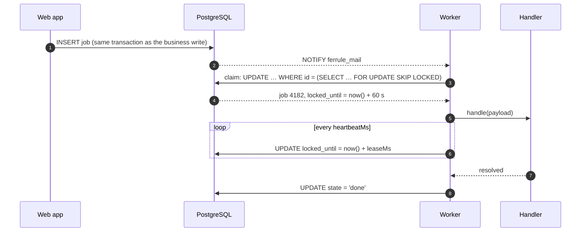

<!--
  Fixture: tech-docs — template "Technical documentation" (Engineering).
  Stresses: [[toc]]; many code blocks in ts, python, bash, yaml, json, sql, go;
  a titled block (title="…") and one with very long lines (wrapping); a long
  (> 15 lines) block that must split across pages; config + API tables incl. a
  wide one; all five alert kinds; a Mermaid sequence diagram; inline code in
  headings and tables; nested lists; a versioned changelog; footnotes.
  Suggested title: "Ferrule 3 — Developer Guide". Patch: tech-docs-patch.json.
-->

[[toc]]

# Overview

**Ferrule** is a durable job queue for applications that already run PostgreSQL. Jobs are rows, workers claim them with `SELECT … FOR UPDATE SKIP LOCKED`, and a job is only removed once its handler has returned. There is no broker to operate, no second source of truth, and a job can be enqueued in the same transaction as the business write that caused it — so you never send the welcome e-mail for a sign-up that was rolled back.

Ferrule ships client libraries for TypeScript, Python and Go. All three speak the same table layout, so a job enqueued from a Python web app can be processed by a Go worker.

> [!NOTE]
> This guide covers Ferrule **3.x**. If you are upgrading from 2.x, read [Migrating from 2.x](#migrating-from-2x) first: the `attempts` column changed type and the migration rewrites the jobs table.

## When to use Ferrule

Ferrule fits when you want at-least-once execution of background work and your throughput stays below a few thousand jobs per second per database. It is a poor fit for:

- fan-out messaging where many consumers each need every message — use a log such as Kafka;
- sub-millisecond latency between enqueue and execution — polling adds up to `pollInterval` of delay, although `LISTEN/NOTIFY` wake-ups bring the median down to a few milliseconds;
- very large payloads — keep payloads under 64 KB and store blobs elsewhere:
  - put the file in object storage,
  - enqueue its key,
    - and let the handler fetch it with a short-lived credential.

## Concepts

Queue
: A named stream of jobs. Workers subscribe to one or more queues; a queue has no configuration of its own.

Job
: A row with a `kind`, a JSON `payload`, a `run_at` time and a retry state. Handlers are looked up by `kind`.

Lease
: The time a worker may hold a claimed job before another worker is allowed to take it over. Leases are extended by a heartbeat while the handler runs.

Dead letter
: A job that exhausted its attempts. It stays in the table with `state = 'dead'` until you retry or purge it.

# Installation

Ferrule needs PostgreSQL 13 or newer. The schema migration is idempotent, so it is safe to run on every deploy.

```bash
# TypeScript / Node.js 20+ or Bun 1.2+
npm install @ferrule/client

# Python 3.10+
pip install "ferrule[asyncpg]"

# Go 1.22+
go get github.com/ferrule-dev/ferrule-go@v3.4.1

# Create or upgrade the schema (any client works; the SQL is the same)
npx ferrule migrate --database-url "$DATABASE_URL" --schema ferrule
```

> [!TIP]
> Run the migration as a role that owns the `ferrule` schema, and grant your application role only `SELECT, INSERT, UPDATE, DELETE` on its tables. Workers never need DDL rights.

The core of the generated schema looks like this:

```sql
CREATE TABLE IF NOT EXISTS ferrule.jobs (
  id            bigint GENERATED ALWAYS AS IDENTITY PRIMARY KEY,
  queue         text        NOT NULL DEFAULT 'default',
  kind          text        NOT NULL,
  payload       jsonb       NOT NULL DEFAULT '{}'::jsonb,
  state         text        NOT NULL DEFAULT 'ready'
                CHECK (state IN ('ready', 'running', 'done', 'dead')),
  run_at        timestamptz NOT NULL DEFAULT now(),
  attempts      smallint    NOT NULL DEFAULT 0,
  max_attempts  smallint    NOT NULL DEFAULT 20,
  locked_by     text,
  locked_until  timestamptz,
  last_error    text,
  unique_key    text,
  created_at    timestamptz NOT NULL DEFAULT now()
);

CREATE INDEX IF NOT EXISTS jobs_claim_idx
  ON ferrule.jobs (queue, run_at)
  WHERE state = 'ready';

CREATE UNIQUE INDEX IF NOT EXISTS jobs_unique_key_idx
  ON ferrule.jobs (queue, unique_key)
  WHERE unique_key IS NOT NULL AND state IN ('ready', 'running');
```

# Quick start

The smallest useful setup is one client that enqueues and one worker that processes. In TypeScript:

```ts title="src/jobs/sendWelcomeEmail.ts"
import { defineJob } from '@ferrule/client'
import { z } from 'zod'
import { mailer } from '../mail'

export const sendWelcomeEmail = defineJob({
  kind: 'user.welcome-email',
  queue: 'mail',
  payload: z.object({ userId: z.string().uuid(), locale: z.enum(['en', 'de', 'fr']) }),
  maxAttempts: 8,
  async handle({ payload, signal, log }) {
    const user = await db.users.find(payload.userId)
    if (!user) {
      log.warn('user disappeared before the welcome mail was sent', { userId: payload.userId })
      return // done: nothing left to do
    }
    await mailer.send({ to: user.email, template: 'welcome', locale: payload.locale }, { signal })
  }
})
```

Enqueue it inside the transaction that creates the user:

```ts
await db.transaction(async (tx) => {
  const user = await tx.users.insert({ email, name })
  await sendWelcomeEmail.enqueue({ userId: user.id, locale: 'en' }, { tx })
})
```

Then start a worker. A worker process can serve several queues; concurrency is per queue.

```ts
import { Worker } from '@ferrule/client'
import { sendWelcomeEmail } from './jobs/sendWelcomeEmail'

const worker = new Worker({
  connectionString: process.env.DATABASE_URL,
  queues: { mail: { concurrency: 4 }, default: { concurrency: 16 } },
  jobs: [sendWelcomeEmail]
})

process.on('SIGTERM', () => worker.stop({ graceMs: 25_000 }))
await worker.start()
```

> [!IMPORTANT]
> Handlers must be **idempotent**. Ferrule guarantees at-least-once execution: a worker that crashes after the e-mail left but before the job was marked done will cause the job to run again once its lease expires.

## Python

The Python client mirrors the TypeScript API with `async` functions. Payloads are validated with Pydantic when a model is given.

```python
from pydantic import BaseModel
from ferrule import Ferrule, JobContext

app = Ferrule(dsn="postgresql://app@db/app", schema="ferrule")


class ResizeImage(BaseModel):
    upload_id: str
    widths: list[int] = [320, 640, 1280]


@app.job("image.resize", queue="media", max_attempts=5, payload=ResizeImage)
async def resize_image(ctx: JobContext, payload: ResizeImage) -> None:
    original = await storage.get(payload.upload_id)
    for width in payload.widths:
        ctx.heartbeat()  # extend the lease between slow steps
        variant = await to_thread(render_variant, original, width)
        await storage.put(f"{payload.upload_id}/{width}.webp", variant)


if __name__ == "__main__":
    app.run_worker(queues={"media": 2})
```

## Go

```go
package main

import (
	"context"
	"log/slog"
	"os"

	"github.com/ferrule-dev/ferrule-go/v3"
)

type InvoicePayload struct {
	InvoiceID string `json:"invoiceId"`
	Reminder  int    `json:"reminder"`
}

func main() {
	client, err := ferrule.Open(context.Background(), os.Getenv("DATABASE_URL"))
	if err != nil {
		slog.Error("open", "err", err)
		os.Exit(1)
	}
	ferrule.Register(client, "invoice.reminder", func(ctx context.Context, job *ferrule.Job[InvoicePayload]) error {
		return sendReminder(ctx, job.Payload.InvoiceID, job.Payload.Reminder)
	}, ferrule.WithQueue("billing"), ferrule.WithMaxAttempts(3))

	if err := client.Work(context.Background(), ferrule.Queues{"billing": 2}); err != nil {
		slog.Error("worker stopped", "err", err)
	}
}
```

# Configuration

Every client reads the same options. Environment variables override file configuration, which overrides defaults.

| Option | Env variable | Default | Description |
|---|---|---|---|
| `connectionString` | `FERRULE_DATABASE_URL` | — | PostgreSQL URL. Required. |
| `schema` | `FERRULE_SCHEMA` | `ferrule` | Schema that holds the tables. |
| `pollInterval` | `FERRULE_POLL_MS` | `1000` | Milliseconds between claim queries when idle. |
| `leaseMs` | `FERRULE_LEASE_MS` | `30000` | How long a claimed job is reserved. |
| `heartbeatMs` | `FERRULE_HEARTBEAT_MS` | `10000` | How often a running job extends its lease. |
| `listen` | `FERRULE_LISTEN` | `true` | Wake idle workers with `LISTEN/NOTIFY`. |
| `retention.done` | `FERRULE_KEEP_DONE` | `7d` | How long finished jobs stay in the table. |
| `retention.dead` | `FERRULE_KEEP_DEAD` | `30d` | How long dead jobs stay in the table. |

A typical deployment keeps its worker settings in YAML next to the service:

```yaml
# ferrule.yaml
connectionString: ${DATABASE_URL}
schema: ferrule
pollInterval: 500
leaseMs: 60000
queues:
  mail:
    concurrency: 4
  media:
    concurrency: 2
    rateLimit: { perSecond: 10, burst: 20 }
  default:
    concurrency: 16
retention:
  done: 3d
  dead: 45d
metrics:
  prometheus:
    enabled: true
    port: 9464
```

## Retry policy

Failed jobs are retried with exponential backoff and full jitter. The delay before attempt $n$ is drawn uniformly from $[0, \min(c, b \cdot 2^{n})]$, with base $b = 2\,\text{s}$ and cap $c = 1\,\text{h}$ by default. You can override the policy per job:

```json
{
  "kind": "invoice.reminder",
  "retry": {
    "strategy": "exponential",
    "baseMs": 5000,
    "capMs": 21600000,
    "jitter": "full",
    "retryOn": ["ETIMEDOUT", "ECONNRESET", "HTTP_503"],
    "giveUpOn": ["HTTP_400", "HTTP_404"]
  }
}
```

> [!WARNING]
> `maxAttempts` counts the first run. A job with `maxAttempts: 1` is never retried — it goes straight to the dead letters on its first failure.

# How a job is processed

The diagram shows one job from enqueue to completion, including a lease extension while the handler runs.



The claim query is the heart of Ferrule. It is a single statement, so two workers can never claim the same row:

```sql
UPDATE ferrule.jobs
SET state = 'running', locked_by = $2, locked_until = now() + make_interval(secs => $3 / 1000.0), attempts = attempts + 1
WHERE id IN (
  SELECT id FROM ferrule.jobs
  WHERE queue = $1 AND state = 'ready' AND run_at <= now()
  ORDER BY run_at
  LIMIT $4
  FOR UPDATE SKIP LOCKED
)
RETURNING id, kind, payload, attempts, max_attempts;
```

# Client API

## `Ferrule` client

| Method | Returns | Description |
|---|---|---|
| `enqueue(kind, payload, opts?)` | `Promise<JobId>` | Insert one job. `opts.tx` joins an open transaction. |
| `enqueueMany(jobs, opts?)` | `Promise<JobId[]>` | Insert many jobs in one statement (up to 5,000). |
| `schedule(kind, payload, at)` | `Promise<JobId>` | Shorthand for `enqueue` with `runAt`. |
| `cancel(id)` | `Promise<boolean>` | Remove a job that has not started yet. |
| `retry(id)` | `Promise<void>` | Move a dead job back to `ready` with zero attempts. |
| `stats(queue?)` | `Promise<QueueStats>` | Counts per state and the age of the oldest ready job. |

## Driver compatibility

The TypeScript client accepts several database drivers. The matrix below lists what each adapter supports; columns are versions of the adapter package.

| Driver | Adapter | Min. version | Transactions | LISTEN/NOTIFY | Pooling | Prepared statements | Bun | Deno | Edge runtimes |
|---|---|---|:-:|:-:|:-:|:-:|:-:|:-:|:-:|
| `pg` | `@ferrule/pg` | 8.11 | yes | yes | `pg.Pool` | yes | yes | yes | no |
| `postgres` | `@ferrule/postgres-js` | 3.4 | yes | yes | built in | yes | yes | yes | no |
| Drizzle | `@ferrule/drizzle` | 0.36 | yes | via `pg` | driver's | yes | yes | partial | no |
| Prisma | `@ferrule/prisma` | 5.20 | interactive only | no | driver's | no | yes | no | no |
| Neon serverless | `@ferrule/neon` | 0.10 | yes | no | HTTP | no | yes | yes | yes |

# Operations

## Monitoring

Every worker exports Prometheus metrics. The ones to alert on:

- `ferrule_queue_oldest_ready_seconds` — the age of the oldest job waiting to run. Alert when it exceeds your latency budget for that queue.
- `ferrule_jobs_dead_total` — rises when jobs exhaust their attempts.
- `ferrule_lease_expired_total` — rises when workers die or handlers block the event loop past `leaseMs`.

This is what a typical worker start-up log looks like at the `debug` level — note how long lines are wrapped rather than cut off:

```text
2026-11-04T09:12:44.318Z DEBUG ferrule.worker pid=48211 host=worker-media-7c9f5d8b6-q2xtl queues=media:2,default:16 lease_ms=60000 heartbeat_ms=10000 poll_ms=500 listen=true schema=ferrule version=3.4.1 driver=pg@8.13.1 node=v22.11.0
2026-11-04T09:12:44.402Z DEBUG ferrule.claim queue=media claimed=2 ids=[48120931,48120932] query_ms=3.1 sql="UPDATE ferrule.jobs SET state = 'running', locked_by = $2, locked_until = now() + make_interval(secs => $3 / 1000.0) WHERE id IN (SELECT id FROM ferrule.jobs WHERE queue = $1 AND state = 'ready' AND run_at <= now() ORDER BY run_at LIMIT $4 FOR UPDATE SKIP LOCKED) RETURNING id"
2026-11-04T09:12:51.977Z WARN  ferrule.handler kind=image.resize id=48120931 attempt=3/5 error="UpstreamError: storage returned 503 Service Unavailable for PUT https://media-eu-central.objects.example.net/uploads/7f3c2a9e-4b1d-4a8e-9f0c-2d6b5e8a1c34/1280.webp (request id 0f9e8d7c6b5a)" next_run_in=41.6s
```

## Cleaning up

Finished jobs are deleted by the worker in small batches according to the retention settings. If you run many workers, only one of them prunes at a time (an advisory lock elects it). To purge dead letters by hand:

```sql
DELETE FROM ferrule.jobs
WHERE state = 'dead' AND kind = 'image.resize' AND created_at < now() - interval '14 days';
```

> [!CAUTION]
> Never `TRUNCATE ferrule.jobs` on a live system. It takes an `ACCESS EXCLUSIVE` lock, blocks every enqueue in your application's transactions, and throws away jobs that were committed but not yet run.

# Migrating from 2.x

Version 3 changes three things that need attention:

1. **`attempts` is now `smallint`.** The migration rewrites the table; on large tables run it during a quiet period or use the online variant:
   ```bash
   npx ferrule migrate --online --batch-size 10000
   ```
2. **Handlers receive one context object.** Replace `(payload, job)` with `({ payload, job, signal, log })`.
3. **`uniqueKey` only blocks ready and running jobs.** In 2.x a finished job with the same key also blocked new inserts until it was pruned.[^unique]

# Changelog

## Version 3.4.1 — 2026-10-28

- Fixed: the heartbeat could extend a lease after the worker had already released the job, leaving it locked for one extra lease period.
- Fixed: `enqueueMany` with more than 1,000 jobs exceeded the bind-parameter limit with the `postgres` driver.

## Version 3.4.0 — 2026-09-15

- Added: per-queue rate limits (`rateLimit.perSecond`, `rateLimit.burst`).
- Added: `ferrule status --json` for scripts.
- Changed: the default `pollInterval` is now 1,000 ms (was 5,000 ms), since `LISTEN/NOTIFY` keeps idle load low.

[^unique]: Ferrule 2.x documented this as a feature ("deduplicate for the retention period"). Almost every user who relied on it wanted the 3.x behaviour instead.
